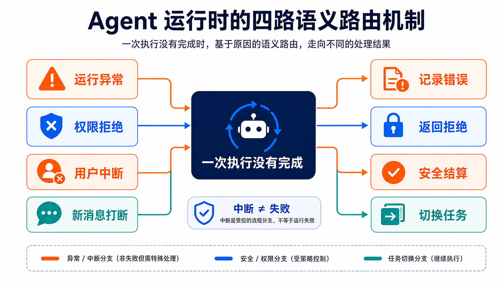
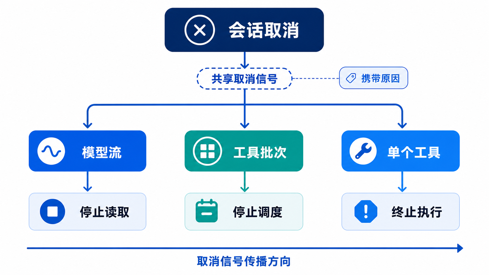
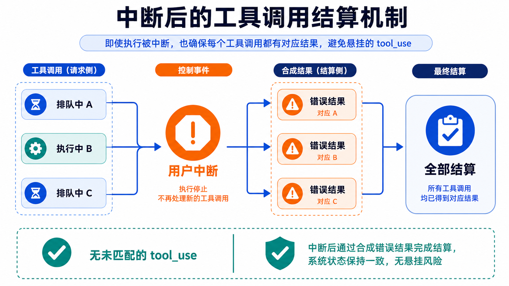
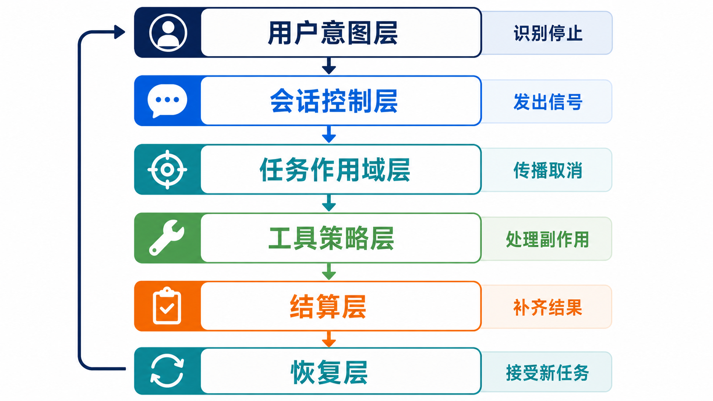

# 用户中断时，Claude Code 如何安全停止模型和工具？

用户按下 Escape 或 Ctrl+C，看起来只是一个 UI 事件。

可在 Agent 内部，此时可能同时发生很多事：模型流还在接收 token，两个读取工具并发执行，一个 Bash 子进程正在跑，另一个写入工具停在权限弹窗，消息历史里还出现了尚未配对的 `tool_use`。

如果程序只是停止渲染，后台副作用仍可能继续；如果粗暴退出进程，会留下悬空调用、半写文件和无法恢复的会话。

所以“中断”不是一个 `cancelled = true`，而是一条从用户意图传播到模型请求、工具队列、子进程、权限等待和消息结算的结构化控制流。

Claude Code 的实现里，`AbortController` 负责传播信号，工具契约决定能否取消，流式执行器负责结算未完成调用，查询循环最后修复协议状态。

## 中断为什么不能等同于抛出异常？

异常表示程序出现了意料之外的失败；中断通常是用户明确要求改变控制流。

两者对 Agent 的语义不同：

- 异常：系统应报告错误，模型可能尝试修复。
- 权限拒绝：本次动作未获批准，模型应换路径或停止。
- 用户中断：用户不想继续当前轨迹，系统应尽快停止可停止工作。
- 用户提交新消息导致打断：旧轨迹停止后，应把新意图交给下一轮。

如果全部包装成普通 Error，UI 会显示误导性的失败，模型也可能把用户取消当成工具故障进行重试。

Claude Code 会检查 abort 的 `reason`，例如区分普通取消和新消息触发的 `interrupt`。后者不必再插入一条冗余“用户中断”消息，因为紧随其后的新用户消息已经表达了变化。

自己的 Agent 也应使用结构化终止原因，而不是只传一个布尔值。



## 用户按键怎样传到正在运行的请求？

交互层的取消处理有明确优先级：如果当前有活动请求，先取消它；只有 Agent 空闲时，Escape 才用于弹出排队命令或关闭其他状态。

```typescript
// 根据恢复源码裁剪
const handleCancel = () => {
  if (
    abortSignal !== undefined &&
    !abortSignal.aborted
  ) {
    clearPermissionQueue()
    onCancel()
    return
  }

  if (hasCommandsInQueue()) {
    popCommandFromQueue()
    return
  }

  onCancel()
}
```

这避免用户以为自己停止了 Agent，实际只是删掉一条排队输入。

UI 的 `onCancel()` 最终触发当前会话的 AbortController。非交互 QueryEngine 也提供 `interrupt()`：

```typescript
// 根据恢复源码裁剪
class QueryEngine {
  interrupt(): void {
    this.abortController.abort()
  }
}
```

一个入口对应一个会话级控制器，模型请求、Hooks、权限和工具都应派生或监听它，而不是各自维护不相干的取消标志。

## 为什么需要父子 AbortController？

如果所有任务共享同一个 Controller，一个局部工具失败可能把整个 Agent 会话一起杀掉；如果每个任务完全独立，用户取消又无法传播到子任务。

Claude Code 用父子控制器构建取消树：

```typescript
// 根据恢复源码裁剪
function createChildAbortController(parent) {
  const child = createAbortController()

  if (parent.signal.aborted) {
    child.abort(parent.signal.reason)
    return child
  }

  parent.signal.addEventListener(
    'abort',
    () => child.abort(parent.signal.reason),
    { once: true },
  )

  return child
}
```

真实实现使用 `WeakRef` 并在子控制器中断后移除父监听，避免长期会话积累监听器。

父取消会向下传播，子取消默认不会反向影响父。这允许：

- 用户取消会话：模型和所有工具一起停。
- 某个并行 Bash 失败：只取消它的兄弟工具，不结束整个查询循环。
- 单个权限弹窗拒绝：按设计决定是否把取消冒泡到当前查询。

这种结构和结构化并发思想一致：任务属于清晰作用域，父作用域结束时不遗留孤儿任务。



## 所有工具都应该立即取消吗？

不一定。

Claude Code 的 Tool 契约允许声明：

```typescript
// 根据恢复源码裁剪
interruptBehavior?(): 'cancel' | 'block'
```

注释给出的语义是：用户在工具运行中提交新消息时，`cancel` 工具停止并丢弃结果；`block` 工具继续运行，新消息等待。

为什么需要 `block`？

有些操作中途停止比等待完成更危险。例如一个无法事务化的写操作、安装过程或外部提交，强行取消可能留下更不确定的状态。工具没有声明时，源码默认按 `block` 处理，这是保守选择。

流式执行器判断中断原因时会检查这个策略：

```typescript
// 根据恢复源码裁剪
if (context.abortController.signal.aborted) {
  if (
    signal.reason === 'interrupt'
  ) {
    return tool.interruptBehavior() === 'cancel'
      ? 'user_interrupted'
      : null
  }
  return 'user_interrupted'
}
```

这里还区分“新消息打断”和显式全局取消。新消息只应打断声明可取消的工具；更强的用户取消可以结束更广范围的任务。

自己设计时，可以把策略扩展成：

```typescript
type InterruptPolicy =
  | { kind: 'cancel'; cleanup?: () => Promise<void> }
  | { kind: 'finish'; maxWaitMs: number }
  | { kind: 'checkpoint'; resumeToken: true }
```

重点是由工具声明边界，而不是 UI 猜测。

## 流式执行中的工具怎样被安全停止？

`StreamingToolExecutor` 会为一组并发工具创建兄弟取消控制器，再为每个工具创建子控制器。

```typescript
// 根据恢复源码裁剪
this.siblingAbortController =
  createChildAbortController(context.abortController)

const toolAbortController =
  createChildAbortController(
    this.siblingAbortController,
  )

runToolUse(tool.block, {
  ...context,
  abortController: toolAbortController,
})
```

如果一个 Bash 工具报错，兄弟控制器以 `sibling_error` 为原因中断，让其他相关子进程尽快停止；父查询控制器仍然存在，查询循环可以接收错误结果并决定下一步。

如果单个工具控制器因权限拒绝等非兄弟原因被中断，源码在特定条件下把原因冒泡到查询控制器，确保查询循环真正结束，而不是把拒绝结果再次喂给模型继续自动行动。

这说明取消树并不只有单向传播。有些领域事件需要显式升级到父作用域，但升级条件必须写清楚，不能让任意子任务都随意终止整个会话。



## 中断后，未完成的 `tool_use` 怎么办？

停止执行只是第一半，第二半是修复消息协议。

模型已经产生的工具调用必须有对应结果。流式执行器会为排队中或执行中的工具生成合成错误：

```typescript
// 根据恢复源码裁剪
private createSyntheticErrorMessage(
  toolUseId,
  reason,
  assistantMessage,
) {
  return createUserMessage({
    content: [{
      type: 'tool_result',
      tool_use_id: toolUseId,
      content: messageFor(reason),
      is_error: true,
    }],
    sourceToolAssistantUUID: assistantMessage.uuid,
  })
}
```

理由可能是：

- `user_interrupted`；
- `sibling_error`；
- `streaming_fallback`。

生成器还会保证导致兄弟取消的那个工具不会再收到一份重复“兄弟错误”，从而避免同一个调用结算两次。

如果没有使用流式执行器，查询循环会扫描当前 assistant 消息，为出现过的调用统一补“Interrupted by user”结果。

这条补偿让会话仍然可恢复，也让模型历史清楚表达动作没有正常完成。

## 查询循环为什么要在最后再检查一次 abort？

模型流式请求、工具流式启动和 Hooks 可能交错。任何局部组件都无法单独保证“中断后的所有结果已经收干净”。

所以查询循环在模型响应阶段结束后，优先检查取消信号：

```typescript
// 根据恢复源码裁剪
if (toolUseContext.abortController.signal.aborted) {
  if (streamingToolExecutor) {
    for await (
      const update of streamingToolExecutor.getRemainingResults()
    ) {
      if (update.message) yield update.message
    }
  } else {
    yield* yieldMissingToolResultBlocks(
      assistantMessages,
      'Interrupted by user',
    )
  }

  if (signal.reason !== 'interrupt') {
    yield createUserInterruptionMessage()
  }

  return { reason: 'aborted_streaming' }
}
```

顺序非常重要：

1. 先收集工具的合成结果，结算所有已公开调用。
2. 再做会话级清理。
3. 按中断原因决定是否写用户中断消息。
4. 返回明确终止原因，不进入下一轮 Agent Loop。

如果先 `return`，工具结果会丢；如果先继续 Agent Loop，模型可能在取消之后又发起新动作。

### 权限弹窗等待时，取消如何避免竞态？

权限请求本身也是一个异步等待。用户可能几乎同时点击允许和按下取消，Hook 也可能在后台返回批准。

Claude Code 的权限上下文使用“一次性解析”机制，保证 Promise 只能被一个路径完成：

```typescript
// 根据恢复源码裁剪
function createResolveOnce(resolve) {
  let claimed = false
  let delivered = false

  return {
    claim() {
      if (claimed) return false
      claimed = true
      return true
    },
    resolve(value) {
      if (delivered) return
      delivered = true
      claimed = true
      resolve(value)
    },
  }
}
```

取消路径还会先检查 signal，再清理权限队列并生成拒绝结果。

这解决的是经典竞态：取消和批准同时到达时，不能一个路径开始执行工具，另一个路径又告诉查询循环已经取消。

自己的 Agent 中，凡是存在“用户操作 + 自动审批 + 超时”竞争同一个 Promise，都应使用原子状态或一次性完成器。

### 中断能保证副作用没有发生吗？

不能。

AbortSignal 是协作式取消。只有底层操作主动监听 signal，并且能在安全点停止，它才有效。

下面这些情况都可能已经产生部分副作用：

- 子进程在信号到达前写入文件；
- HTTP 请求已经被服务端接收；
- 数据库操作没有放在事务里；
- 工具库根本不支持 AbortSignal；
- 清理函数本身失败。

因此，中断后的状态应该被视为：

```latex
模型轨迹：已停止并结算
环境状态：可能成功、失败或部分完成，需要验证
```

Agent 可以在下一轮提示模型重新读取关键文件或查询远程状态，而不是直接假定回滚完成。

对于不可逆动作，更可靠的设计包括：

- 执行前确认；
- 幂等请求键；
- 数据库事务；
- 临时文件 + 原子替换；
- 可恢复检查点；
- 补偿操作；
- 明确的“结果不确定”状态。

中断机制负责停止继续扩散，事务机制负责环境一致性，两者不能互相替代。

### 模型请求取消和工具取消有什么不同？

模型请求通常只产生文本和 `tool_use` 提议，取消网络流主要影响的是“还能不能继续收到内容”。工具已经开始后，取消则可能影响真实环境。

因此会话控制器向下传播时，各层清理动作不同：

| 层级 | 取消时主要动作 |
| --- | --- |
| 模型流 | 关闭流、停止解析新内容 |
| 工具队列 | 不再启动排队调用 |
| 运行中工具 | 传递 signal、执行清理 |
| 权限等待 | 移除提示、一次性结算 |
| 消息协议 | 补齐错误 `tool_result` |

不能因为模型流已经关闭，就认为工具也停止了。流式工具执行恰恰允许模型输出还没结束时工具就启动，所以两条取消链必须在会话根控制器处汇合。

同样，工具已成功完成也不代表模型响应需要保留。若当前流式尝试因协议回退被整体丢弃，执行器要为已经公开却不再采用的调用生成清楚的合成结果，并避免把旧结果混入新尝试。

### 为什么监听器清理也是可靠性问题？

一个长时间运行的 Agent 会创建大量子 Controller。如果每次都在父 signal 上添加监听，却不在子任务结束后移除，内存和闭包引用会不断累积，最终出现监听器警告甚至持有整个会话对象。

Claude Code 的子控制器实现使用弱引用，并在子 controller 自己 abort 时尝试移除父监听器。父已经中断或对象已回收时，清理操作保持无害。

自己的实现即使不使用 `WeakRef`，也要让作用域拥有明确的 dispose：

```typescript
// 示例设计，不是 Claude Code 原样源码
function linkAbort(parent: AbortSignal) {
  const child = new AbortController()
  const forward = () =>
    child.abort(parent.reason)

  parent.addEventListener('abort', forward, { once: true })

  return {
    controller: child,
    dispose: () =>
      parent.removeEventListener('abort', forward),
  }
}
```

在工具完成、失败和取消三个分支的 `finally` 中调用 `dispose()`。中断系统本来是为了收尾，如果它自己制造资源泄漏，长会话会越来越不稳定。



## 自己实现时，怎样搭一条完整取消链？

可以按下面六层搭建：

```latex
用户意图层：取消 / 新消息打断 / 停止所有任务
会话控制层：Root AbortController + 结构化 reason
任务作用域层：模型、工具批次、单工具的子 Controller
工具策略层：cancel / finish / checkpoint
结算层：成功、失败、拒绝、取消都生成 tool_result
恢复层：重新验证可能发生的外部副作用
```

代码评审时检查：

1. 所有长任务是否接收同一作用域派生的 signal？
2. 子任务结束后是否移除监听器？
3. 不可安全取消的工具是否明确声明？
4. 取消和批准是否只能有一个赢家？
5. 已出现的工具调用是否全部结算？
6. 中断后是否阻止 Agent 自动进入下一轮？
7. 对可能部分完成的副作用是否重新验证？

不要只测试“模型还没返回时按取消”。还要测试工具已开始、权限弹窗中、并发工具一半失败、新消息打断和恢复会话等边界。

还可以加入时间约束：用户发出取消后，模型流多久关闭、排队工具多久被结算、子进程多久退出。超过上限时记录哪个层级没有响应 signal。这样“支持取消”不只是接口上有一个参数，而是可以观测的服务目标。

对无法及时停止的 `block` 工具，界面应明确显示“正在等待安全结束”，而不是假装已经取消。透明反馈能避免用户重复发送中断，产生更多竞争状态。

取消链还需要一个最终审计事件，记录中断来源、传播耗时、仍在收尾的工具以及补出的合成结果数量。用户若随后报告“按了停止但文件仍改变”，开发者才能还原：副作用发生在信号发出前，还是某个工具根本没有监听取消。**无法观测的取消，出了问题时就只能被当成偶发故障。**

恢复测试也不能直接沿用中断前的假设。稳妥的下一步通常是重新读取受影响文件、查询远程事务状态，再决定继续、补偿还是回滚。对于带幂等键的工具，可以安全查询同一操作是否已经提交；没有幂等能力的工具则应把“不确定执行”展示给用户，而不是自动重试。

因此，中断后的第一轮更像环境对账，而不是接着生成。只有对账结果重新建立了事实，Agent 才能继续规划。

## 最后：安全中断是一种结构化收尾

用户中断不是让界面安静下来，而是要求整个 Agent Runtime 停止当前因果链。

Claude Code 的处理可以概括为：

用户信号进入会话级控制器，沿父子取消树传播；工具根据自身策略停止或完成；执行器为未完成调用生成合成结果；查询循环收齐结算后，以明确原因终止本轮。

这套机制仍不能自动撤销所有外部副作用，但它至少保证三件事：后台任务不会无限遗留、会话协议不会出现悬空调用、Agent 不会在用户取消后继续自作主张。

如果你的 Agent 已经能够执行真实动作，那么中断链和正常执行链同样重要。正常路径决定它能做什么，中断路径决定当用户说“停”时，它是否真的停得下来，并留下一个还能理解和恢复的世界。
