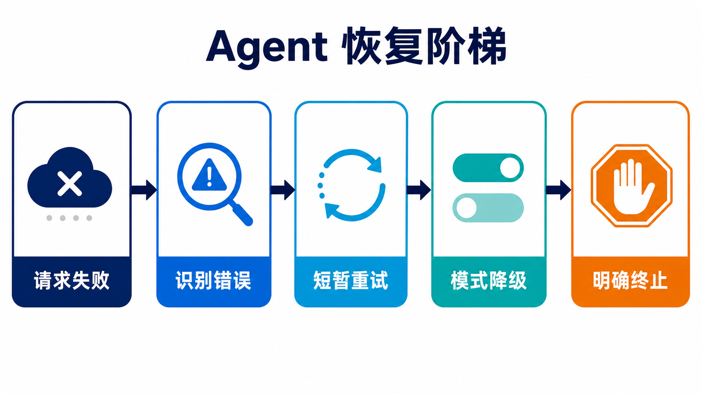
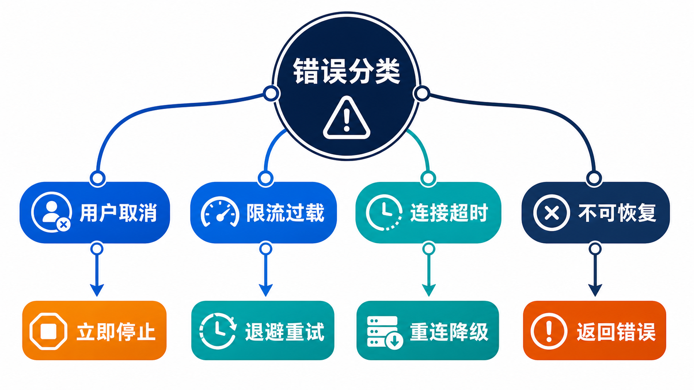
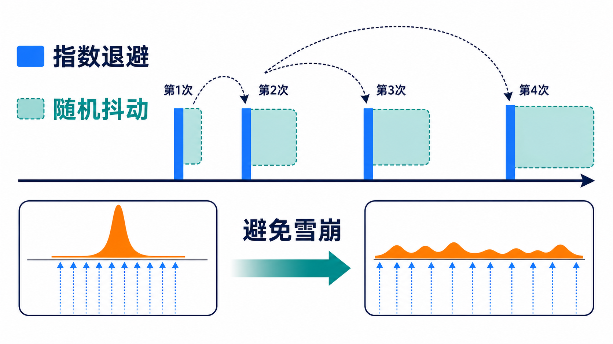
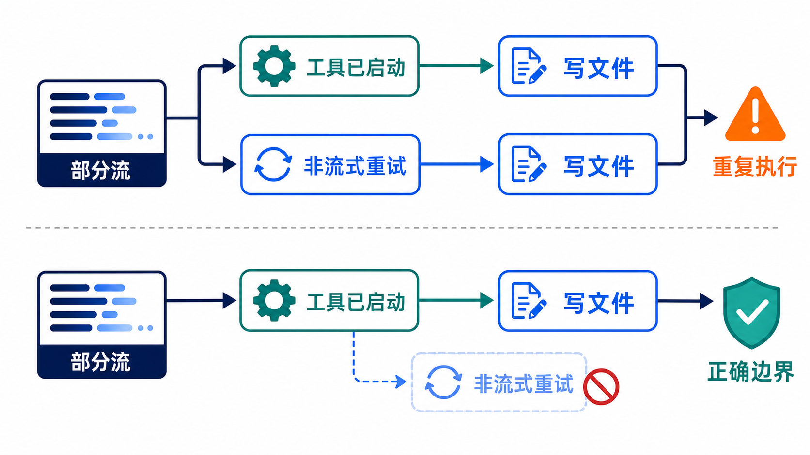

# 模型报错、超时或过载时，Agent Loop 如何恢复？

假设你写了一个 Coding Agent：模型负责判断下一步，工具负责读文件、改代码和执行命令。

Demo 跑起来并不难。真正棘手的是，它刚改完一半代码，模型请求突然超时了。你应该原样重试、切换请求模式、换模型，还是直接停下来？

如果答案只是“捕获异常后重试三次”，这个 Agent 迟早会制造事故。因为模型请求不是普通的查询接口：流式响应可能已经触发工具，工具可能已经产生副作用，上下文还可能在失败前发生了变化。

**Claude Code 展示的关键思路，是把恢复拆成一条有边界的阶梯：先识别错误，再选择重试、重连或降级；一旦无法证明操作仍然安全，就明确终止。**

## 为什么“所有错误都重试”一定会出问题？

先区分两个概念：失败和可重试失败。

网络抖动、服务过载和短暂限流，通常没有改变任务语义。请求晚几秒重新发出，仍然是在解决同一个问题。用户主动取消、权限拒绝、参数非法则不同，它们代表调用方明确要求停止，或者当前输入本身无法成功。

还有一类更危险的失败：模型的流式响应已经输出了一个完整的 `tool_use`，工具也开始执行，但流随后断开。此时从头重放请求，很可能再次得到相同工具调用。

对于“读文件”一类幂等操作，重复一次通常只是浪费成本；对于“写文件”“提交代码”“发送消息”，重复执行就是副作用事故。

所以，恢复策略不能只看 HTTP 状态码，还要同时回答三个问题：

1. 这是不是用户主动要求停止？
2. 失败发生前有没有对外产生副作用？
3. 系统能否确认重试仍然对应同一份状态？

这三个问题决定的是正确性，不只是可用性。



## 第一步不是重试，而是给错误分类

Claude Code 的 API 层会区分用户取消、连接问题、超时、限流和服务过载。分类之后，不同错误才进入不同路径。

下面的代码来自恢复源码中的 `withRetry`，为突出控制逻辑做了裁剪：

```typescript
// 裁剪后的核心代码：省略了日志、遥测和具体供应商判断
for (let attempt = 1; attempt <= maxRetries + 1; attempt++) {
  if (options.signal?.aborted) {
    throw new APIUserAbortError()
  }

  try {
    client ??= await getClient()
    return await operation(client, attempt, retryContext)
  } catch (error) {
    lastError = error

    if (!isRetryable(error)) {
      throw new CannotRetryError(error, retryContext)
    }

    await sleep(getRetryDelay(error, attempt), options.signal)
  }
}
```

注意第一条判断：`AbortSignal` 一旦被触发，流程直接抛出用户取消错误，而不是把它当成网络故障继续重试。

这是 Agent 开发里非常容易写错的一点。异常只是 JavaScript 层面的统一表现，语义却完全不同。用户按下停止键之后继续请求模型，等于系统在违背用户意图。

一个可迁移的错误分类至少应该包含四组：

| 错误类型 | 默认动作 | 原因 |
| --- | --- | --- |
| 用户取消、权限拒绝 | 立即停止 | 用户意图优先 |
| 429、529、短暂网络错误 | 有上限地重试 | 状态通常未改变 |
| 流式中断、连接陈旧 | 重连或模式降级 | 传输通道可能失效 |
| 参数错误、认证无效 | 修复条件或返回错误 | 重复相同请求不会成功 |

这里的重点不是记住具体状态码，而是**让错误类型直接决定动作**，不要把判断散落在业务循环里。

## 重试为什么要退避，还要加随机抖动？

服务过载时，最糟糕的做法是所有 Agent 同时立刻重试。

假设一千个会话在同一秒收到过载响应，它们都等待固定的一秒，然后又在同一秒打回来。服务刚恢复一点，就再次被同步流量压垮。这就是重试雪崩。

Claude Code 自己管理重试，而不是完全依赖 SDK 的自动重试。恢复源码里能看到基础延迟、最大重试数、连续 529 计数以及 `Retry-After` 的处理。

实现时可以把延迟理解为：

```typescript
// 示例代码：用于解释策略，不是仓库原样源码
function nextDelay(attempt: number, retryAfterMs?: number) {
  if (retryAfterMs !== undefined) return retryAfterMs

  const exponential = Math.min(500 * 2 ** (attempt - 1), 30_000)
  const jitter = Math.random() * exponential * 0.2
  return exponential + jitter
}
```

指数退避让失败越久，尝试越稀疏；随机抖动让不同实例错开时间；上限则防止用户无限等待。

不过，等待时间不能只由公式决定。服务端给出 `Retry-After` 时，应优先尊重它；用户正在前台等待和后台生成标题，也不该共享同一套策略。

恢复源码中有一个很有价值的取舍：前台主任务可以对 529 做有限重试，标题、摘要、建议等后台请求则倾向于尽快失败。原因是后台请求的价值较低，大规模过载时继续重试只会放大网关压力。

这给 Agent 平台一个通用设计：**按请求价值分配恢复预算，而不是让所有模型调用拥有相同重试权。**



## 流式失败时，为什么不能总是退回非流式请求？

流式模式的好处是能更早显示内容，也能更早发现完整的工具调用。可它带来一个特殊边界：当流只返回一部分时，系统很难判断服务端究竟执行到了哪里。

Claude Code 会用空闲超时监控流。如果长时间没有新数据，它会中止流，并在合适的情况下改用非流式请求。但源码里也专门留下了关闭这种降级的路径。

原因就藏在下面这段注释对应的判断里：

```typescript
// 裁剪后的核心代码
const disableFallback =
  envDisableNonStreamingFallback ||
  featureDisableStreamingFallback

if (disableFallback) {
  throw streamingError
}

const result = yield* executeNonStreamingRequest(
  requestContext,
  retryOptions,
)
```

为什么要允许禁用？因为“流式失败后再发一次非流式请求”并不总是无害。

如果系统支持边流式接收、边执行工具，第一条流里的 `tool_use` 可能已经启动了写文件。非流式重试又生成相同的 `tool_use`，写操作就执行两次。

因此，降级需要一个明确边界：

- 尚未产生可执行工具调用：可以重试或切换模式；
- 已收到工具调用，但工具尚未启动：丢弃旧调用后可以受控重放；
- 工具已经产生副作用：默认不能自动重放，除非工具支持幂等键或事务恢复。

这也是为什么成熟 Agent 需要记录“请求进度”，而不能只有“请求成功/失败”两个状态。

## 重试之后还不行，应该降级什么？

恢复并不等于永远坚持原方案。合理的降级通常有三层。

第一层是连接降级。陈旧的 keep-alive 连接出现 `ECONNRESET` 或 `EPIPE` 时，重新创建客户端、刷新认证缓存或关闭连接复用，比原样重试更有效。

第二层是传输降级。流式通道异常、但还没有触发副作用时，可以尝试非流式调用。这改变的是传输方式，不改变任务目标。

第三层是模型降级。当前模型持续过载时，可以切换到预先配置的后备模型。此时要注意，模型能力、上下文限制和工具调用行为可能变化，因此它不是“透明重试”。

恢复源码用一个专门的异常把模型切换信号向上传递：

```typescript
// 裁剪后的核心代码
export class FallbackTriggeredError extends Error {
  constructor(
    public readonly originalModel: string,
    public readonly fallbackModel: string,
  ) {
    super(`Model fallback triggered`)
  }
}

if (errorFromRetry instanceof FallbackTriggeredError) {
  throw errorFromRetry
}
```

为什么不用普通返回值？因为模型切换需要由更上层的 Agent Loop 重新构造下一次调用。如果底层 API 函数把信号吞掉，只生成一条“切换模型”的错误文本，循环实际上仍然停在原模型上。

所以，降级信号要穿透正确的抽象层：连接问题在 API 客户端层处理，模型选择在 Agent Runtime 层处理，任务目标则由会话层保持。



## 恢复过程中，哪些状态必须保持不变？

重试不是重新开始。要让恢复后的 Agent 仍然是同一个 Agent，至少要守住四类状态。

第一是消息链。已经确认写入会话的用户消息、助手内容和工具结果不能因为请求重发而重复追加。

第二是工具执行账本。每个 `tool_use_id` 是否已开始、是否完成、结果是什么，都应可查询。恢复时先查账本，再决定是否执行。

第三是预算。一次失败请求已经消耗的 token、时间和尝试次数不能被重置，否则“最多十轮”的限制会被恢复逻辑绕过。

第四是取消信号。所有等待、请求和工具都应该观察同一个或明确派生的 `AbortSignal`。源码中的 `sleep(..., options.signal)` 很关键：如果退避等待不能被取消，用户按停止键后仍要等几十秒。

可以把一次调用建模成下面这个状态机：

```typescript
// 示例代码：生产 Agent 可使用的最小状态模型
type AttemptState =
  | { phase: 'requesting'; attempt: number }
  | { phase: 'streaming'; receivedToolIds: string[] }
  | { phase: 'executing'; startedToolIds: string[] }
  | { phase: 'retry_wait'; wakeAt: number }
  | { phase: 'failed'; reason: string }
  | { phase: 'completed' }
```

只有知道失败发生在哪个阶段，恢复策略才有足够信息做安全判断。

## 自己开发 Agent，怎样落地一条安全恢复链？

不要先堆十种异常类。可以从四个模块开始。

第一，写一个集中式 `classifyError`，输出 `abort`、`retry`、`reconnect`、`fallback` 或 `fail`。业务循环只消费分类结果，不直接猜错误字符串。

第二，为每次模型调用记录 `attemptId`，为每次工具调用记录稳定的 `toolUseId`。所有副作用工具再增加幂等键，或者在执行前查询是否已经完成。

第三，把恢复预算显式化：最大尝试次数、最大累计等待、最大连续过载次数和是否允许换模型。达到任一上限就返回可理解的终止原因。

第四，给恢复路径本身加观测：记录错误类型、尝试次数、等待时间、是否重连、是否降级，以及失败时处于哪个工具阶段。没有这些信息，线上只会看到“Agent 偶尔卡死”。



## 幂等键、检查点和补偿动作，分别解决哪种副作用？

只判断“工具是否只读”还不够。有些写操作可以安全重试，有些写操作可以确认结果，还有一些只能在失败后补偿。

幂等键适合支持去重的外部系统。Agent第一次创建工单时生成 `operationId`，重试仍携带同一个 ID。服务端发现操作已经完成，就返回同一份结果，而不是再创建一张工单。

```typescript
// 示例代码：给副作用工具增加稳定操作 ID
await issueTracker.createTicket({
  operationId: `${sessionId}:${toolUseId}`,
  title,
  body,
})
```

检查点适合可以查询当前状态的动作。比如 `git commit` 请求后进程断开，恢复时先检查 HEAD 和提交信息，确认目标提交是否已经存在，再决定是否重做。这里不是要求动作本身幂等，而是让 Runtime能判断动作的完成事实。

补偿动作适合无法原子回滚的长事务。部署已经切走一半流量时发生错误，系统可能需要执行“把流量切回旧版本”，而不是简单再部署一次。补偿也可能失败，所以它应成为独立、可观测、需要权限的工具调用。

三者不能互相替代：

| 机制 | 依赖条件 | 恢复动作 |
| --- | --- | --- |
| 幂等键 | 执行端支持去重 | 原请求可安全重放 |
| 检查点 | 结果状态可查询 | 先确认，再决定是否重放 |
| 补偿动作 | 存在反向操作 | 显式撤销已发生副作用 |

对于普通文件写入，可以把“写临时文件—原子重命名”看成小型事务；对于命令执行，则应记录命令、cwd、开始时间、退出码和可验证产物。仅仅保存一条“工具执行中”不足以恢复。

**恢复设计真正要保存的是可判定性：系统必须有办法判断动作没发生、已发生，还是发生到一半。** 如果三种状态无法区分，自动恢复就应该停止，并把检查清单交给用户。

还要避免把错误结果无限送回模型。模型看到超时后可能反复生成同一个工具调用，形成语义层重试，绕过 API 层的尝试上限。Runtime应按 `toolUseId`、参数摘要或稳定操作 ID识别重复动作，把累计次数纳入同一份恢复预算。

最后，恢复预算最好是分层的：单次 API调用有尝试上限；单个 Tool Use有执行或确认上限；整段 Agent会话还有总轮数、总费用和总时长上限。任何一层达到限制，都应该产生结构化终止原因，供上层和用户判断下一步。

文章开头的问题现在可以回答了：模型超时后，不应该条件反射地重发请求。

**安全的 Agent 恢复，是一条受状态约束的决策链：先尊重取消，再判断错误能否恢复；重试必须退避并可中断；降级必须确认没有重复副作用；最终还要有明确的预算和终止点。**

如果你正在实现自己的 Agent，可以先做一个很小的练习：让同一条任务分别模拟 429、流式空闲超时和工具执行后断流，观察系统是否会在正确阶段停下。能通过这三个场景，恢复链才算真正开始具备生产意识。
