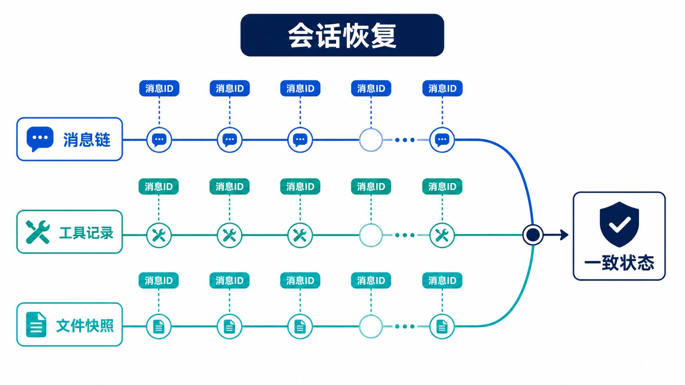
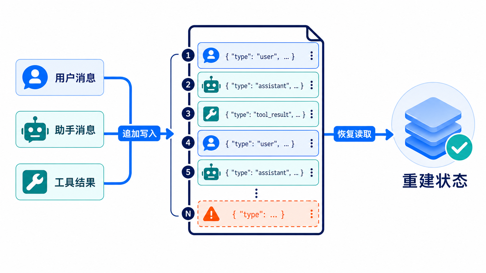
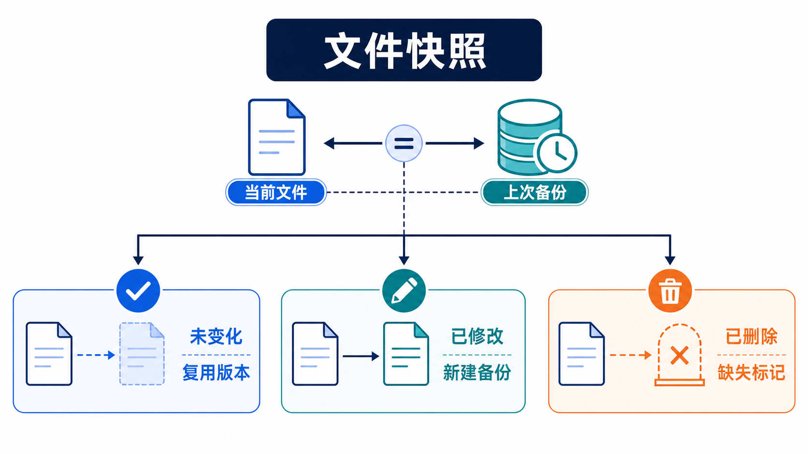
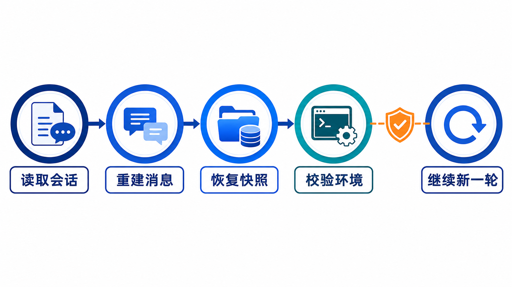

# 文件快照、会话持久化和恢复机制是怎么做的？

一个 Coding Agent 运行二十分钟后突然退出，再打开时恢复了聊天记录。看起来一切正常，于是模型接着说：“我继续修改刚才的文件。”

问题是，恢复聊天并不等于恢复任务。

磁盘上的代码可能已经改了，某个工具也可能执行成功，只是结果来不及写入会话。如果 Agent 只把历史消息重新塞给模型，它可能重复运行命令、覆盖用户后来的修改，或者在错误目录里继续工作。

**Claude Code 的恢复不是读回一段对话，而是让消息链、工具记录和文件快照重新对齐到同一个会话位置。**

## 为什么 Agent 恢复比聊天软件恢复更难？

聊天软件的核心状态通常是消息。Agent 却同时生活在两个世界里。

一个世界是模型上下文：用户说了什么、模型做了什么判断、调用了哪些工具。另一个世界是真实环境：文件内容、工作目录、进程、Git 状态和权限配置。

两边任何一侧单独恢复，都可能产生“状态分叉”。

例如，记录里最后一条是模型请求写入 `config.ts`，但程序在工具结果落盘前崩溃。磁盘上文件已经写完，消息链却不知道。恢复后的模型看到未完成的 `tool_use`，再次写入同一文件。

反过来，如果会话里记录了“写入成功”，但用户在程序退出后又手工改过文件，直接回滚到旧快照又会抹掉用户工作。

所以生产 Agent 至少要保存三类事实：

- 对话事实：消息的顺序、父子关系和压缩边界；
- 行动事实：工具是否启动、完成、失败以及返回结果；
- 环境事实：关键文件在某个消息节点对应的版本。

恢复的目标不是回到“看起来差不多”的状态，而是找到一处可以安全继续的新边界。



## 会话日志为什么更适合追加写，而不是反复覆盖？

Claude Code 会把用户消息、助手消息、工具结果以及若干系统元数据按顺序写入会话存储。恢复时再读取这些记录，重建可用的消息链。

追加写有三个现实优势。

第一，崩溃影响更小。覆盖一个大 JSON 文件时，进程中断可能让整个文件损坏；一行一个事件的日志即使尾部不完整，前面的已确认记录仍然可读。

第二，因果顺序更清晰。模型消息、工具调用和工具结果以发生顺序进入日志，恢复器可以沿着父消息关系检查链条。

第三，写入成本稳定。长会话不用每次序列化全部历史，只追加这一轮新增内容。

下面是根据恢复源码中会话记录方式提炼的结构，属于示例代码：

```typescript
// 示例代码：说明追加式日志，不是仓库原样源码
type SessionEntry =
  | { type: 'user'; uuid: string; parentUuid?: string; content: unknown }
  | { type: 'assistant'; uuid: string; parentUuid: string; content: unknown }
  | { type: 'tool-result'; uuid: string; toolUseId: string; result: unknown }
  | { type: 'file-history-snapshot'; messageId: string; snapshot: unknown }

async function append(entry: SessionEntry) {
  await writeQueue.enqueue(JSON.stringify(entry) + '\n')
}
```

这里还有一个容易忽视的细节：追加顺序必须受控。多个工具结果并行完成时，如果直接同时写文件，物理顺序可能与消息因果不一致。因此源码使用有序写队列，并在返回最终结果前刷新缓冲写入。

**持久化不是“最终写进去就行”，而是要让落盘顺序能够重放。**

## 文件快照究竟保存什么？

很多人听到“文件快照”，第一反应是每一轮把整个项目复制一份。那样当然能回滚，但大型仓库很快就会把磁盘占满。

Claude Code 的思路更像增量备份：只跟踪被工具修改过的文件；新快照创建时，比较当前文件和上一版本；没有变化就复用备份，发生变化才创建新版本，文件不存在则记录缺失标记。

恢复源码里的 `fileHistoryMakeSnapshot` 分成三个阶段。下面是裁剪后的核心逻辑：

```typescript
// 裁剪后的核心代码：省略日志、遥测和异常分支
const trackedFileBackups = {}
const previous = state.snapshots.at(-1)

await Promise.all([...state.trackedFiles].map(async path => {
  const latest = previous?.trackedFileBackups[path]
  const stats = await statOrUndefined(path)

  if (!stats) {
    trackedFileBackups[path] = {
      backupFileName: null,
      version: (latest?.version ?? 0) + 1,
    }
  } else if (latest && !(await fileChanged(path, latest))) {
    trackedFileBackups[path] = latest
  } else {
    trackedFileBackups[path] = await createBackup(path)
  }
}))
```

`backupFileName: null` 不是“没有记录”，而是一个明确的墓碑：这个文件在该快照点不存在。回滚时如果当前磁盘上有它，就知道应该删除。

快照还会与用户消息的 `messageId` 关联。这样，用户选择回到某条消息时，系统不只知道应该截断哪些对话，也知道当时被跟踪文件分别对应哪个版本。

这比“每次工具调用后做备份”更有意义。用户真正理解的恢复单位通常是一轮任务，而不是内部的第七个工具调用。



## 为什么快照创建要分成“读状态、做 IO、再提交”？

恢复源码中的快照函数没有把所有操作塞进一次状态更新，而是分成三个阶段：

1. 捕获当前跟踪集合；
2. 在状态更新之外异步读取和备份文件；
3. 再次读取最新状态并提交新快照。

这样设计是为了处理并发。

假设快照正在并行读取十个文件，期间另一个工具又修改了第十一个文件，并把它加入 `trackedFiles`。如果函数只使用最开始那份状态，新快照就会漏掉新文件。

源码在提交阶段重新读取 `state.trackedFiles`，并从上一个快照继承异步窗口内新增的备份：

```typescript
// 裁剪后的核心代码
updateFileHistoryState(state => {
  const lastSnapshot = state.snapshots.at(-1)

  for (const path of state.trackedFiles) {
    if (path in trackedFileBackups) continue
    const inherited = lastSnapshot?.trackedFileBackups[path]
    if (inherited) trackedFileBackups[path] = inherited
  }

  const snapshot = { messageId, trackedFileBackups, timestamp: new Date() }
  recordFileHistorySnapshot(messageId, snapshot)

  return {
    ...state,
    snapshots: appendWithLimit(state.snapshots, snapshot),
  }
})
```

这段代码揭示了一个通用原则：**耗时 IO 不要持有一份假装始终最新的内存状态。提交前必须重新合并并发变化。**

你自己的 Agent 即使不用 React 状态，也会遇到相同问题。后台工具、文件监听和主循环可能同时更新恢复信息。把快照当成一个有提交点的小事务，会比“随手复制 Map”可靠得多。

## 会话恢复时，为什么不能把旧状态原样塞回去？

安全恢复是一段重建过程，不是反序列化后直接运行。

第一步，读取会话日志，并容忍尾部存在不完整记录。只有通过格式和链关系校验的事件才能进入恢复集合。

第二步，重建消息链。压缩前的旧消息、进度消息和工具中间态不一定全部适合重新送给模型，需要按压缩边界和父子关系投影出有效历史。

第三步，恢复文件快照元数据。这里通常不是立刻改写磁盘，而是恢复“可以回到哪些节点”的能力。

第四步，重新验证环境。工作目录是否存在？仓库是否还是同一个？权限规则、可用工具和 MCP 连接是否变化？旧会话里的授权不能无条件变成新进程的永久授权。

第五步，创建一个新的用户轮次继续。不要假装崩溃从未发生；恢复后的运行应有新的尝试边界和取消控制器。

一个简化的恢复入口可以这样设计：

```typescript
// 示例代码：安全恢复的控制顺序
async function resumeSession(sessionId: string) {
  const entries = await readValidEntries(sessionId)
  const messages = rebuildMessageChain(entries)
  const snapshots = rebuildSnapshotIndex(entries)

  const environment = await validateEnvironment({
    cwd: readStoredCwd(entries),
    permissions: await loadCurrentPermissions(),
  })

  return createRuntime({
    messages,
    snapshots,
    environment,
    abortController: new AbortController(),
  })
}
```

关键在 `loadCurrentPermissions()`：恢复的是会话意图，不是绕过当前安全策略的通行证。



## 回滚文件时，怎样避免覆盖用户的新修改？

快照支持回滚，不代表系统应该静默回滚。

从旧快照到当前磁盘之间，可能既有 Agent 修改，也有用户手工修改。两者都只是“文件内容不同”，仅靠时间戳无法可靠区分。

比较稳妥的流程是：

1. 先计算将要修改、创建和删除的文件集合；
2. 展示差异统计或补丁；
3. 检查当前文件是否仍与 Agent 最后观察到的版本一致；
4. 对冲突文件要求用户确认，或者只生成恢复补丁；
5. 应用后再创建一个新快照，不篡改旧快照。

恢复源码里的 `fileHistoryRewind` 会先找到与 `messageId` 对应的目标快照，再通过 `applySnapshot` 执行文件系统副作用。它也提供差异统计和“是否可恢复”的检查入口。

这说明快照有两个职责：一是保存恢复材料，二是让系统在执行前解释影响范围。

对于生产 Agent，第二个职责同样重要。可解释的回滚比自动回滚更符合用户对代码资产的控制预期。

## 自己开发 Agent，最小持久化方案应该怎么搭？

你不必一开始就做分布式事件存储。一个实用的本地版本可以从五件事开始。

第一，为每条消息生成稳定 UUID，并记录 `parentUuid`。恢复时不要只依赖数组下标。

第二，使用追加式日志和单写队列。每条记录包含版本号和类型，尾部损坏时可以舍弃单条，而不是丢失整个会话。

第三，给工具调用建立账本。至少记录 `planned`、`started`、`completed`、`failed`，以及稳定的 `toolUseId`。

第四，只跟踪 Agent 实际修改的文件。备份前比较内容或可信元数据，未变化就复用版本；删除要写墓碑。

第五，把恢复拆成“重建”和“执行”两步。加载旧状态时不产生文件副作用，用户确认后再回滚。



## 会话日志怎样发现断链、重复和半条记录？

追加日志解决了“大文件整体损坏”，却不会自动保证每条事件都正确。进程可能在写到一半时退出，异步任务也可能把同一个结果提交两次。

最小校验可以从三个字段开始：记录 UUID、父记录 UUID 和记录类型。恢复器按物理顺序读取，却按父子关系重建逻辑链。不存在父节点的消息先放入隔离区，不直接喂给模型。

```typescript
// 示例代码：恢复阶段的链校验
function rebuild(entries: SessionEntry[]) {
  const accepted = new Map<string, SessionEntry>()
  const rejected: SessionEntry[] = []

  for (const entry of entries) {
    if (accepted.has(entry.uuid)) continue

    if (entry.parentUuid && !accepted.has(entry.parentUuid)) {
      rejected.push(entry)
      continue
    }

    accepted.set(entry.uuid, entry)
  }

  return { accepted: [...accepted.values()], rejected }
}
```

工具协议还需要第二层校验：每个 `tool_result` 必须能找到对应的 `tool_use_id`；一个副作用工具不能出现两个互相矛盾的成功结果；Assistant消息之后若只有半条 Tool Result，则把会话停在人工检查边界。

压缩会话更复杂。压缩摘要并不是普通消息，它代表一段旧历史被新的上下文边界替代。恢复时既不能把被压缩历史和摘要全部再次发送，也不能因为日志里仍保留旧记录就认为它们都属于当前上下文。

因此会话持久化常常同时保存两种结构：

- 事件日志保留发生过什么，便于审计和恢复；
- 当前投影保存下一轮模型应该看到什么，便于继续运行。

两者类似数据库的事务日志与物化视图。事件日志不轻易修改，投影可以由规则重新计算。

快照记录也要进行引用完整性校验。`messageId` 找不到对应用户消息时，这份快照可以保留用于排障，却不能作为 UI 中可点击的恢复点；备份文件缺失时，则只能报告部分可恢复，不能静默把它当成“文件当时不存在”。

还有写入确认问题。`append()` 返回并不一定代表数据真正落盘，操作系统缓存仍可能丢失。高可靠场景可以在关键边界执行 flush 或 fsync，但每条消息都同步刷盘会显著增加延迟。更实际的权衡是：普通流式文本批量写，用户消息、工具结果和快照边界强制刷新。

恢复能力还需要定期演练，不能只靠单元测试证明。可以在不同位置注入进程退出：Assistant消息落盘前、Tool Use落盘后、文件写完但 Tool Result写入前、快照元数据写入后。每个注入点都要有预期的恢复边界。

演练结果不必追求“全部自动继续”。更合理的验收表是：

| 崩溃位置 | 可以自动恢复什么 | 必须人工确认什么 |
| --- | --- | --- |
| 模型请求前 | 已确认消息链 | 无 |
| Tool Use 后、执行前 | 工具意图 | 是否仍要执行 |
| 写工具执行后、结果前 | 会话与旧快照 | 磁盘副作用是否完成 |
| 快照提交后 | 消息、快照索引 | 外部系统副作用 |

对外部工具，文件快照帮不上忙。创建工单、发送消息或修改云资源需要独立的工具账本、幂等键或查询接口。会话恢复只能告诉系统“模型想做过什么”，不能证明第三方系统最终发生了什么。

恢复后的第一轮也应该带一个内部边界说明：这是续接会话，哪些工具状态已确认，哪些状态未知。它不必暴露给用户，却能防止模型把一段有缺口的历史当成连续事实。

最后，为会话格式设置版本号和迁移函数。消息 Schema、快照路径和压缩边界都会演进；没有版本，旧日志只能靠字段猜测。迁移应该生成新投影，保留原事件日志，失败时允许只读打开，而不是边读边覆盖唯一副本。

**会话恢复不是“尽量多读回来”，而是宁可舍弃无法证明因果关系的尾部，也不要把矛盾状态继续交给模型。** 模型擅长补全文本，却不应该被允许猜测某次写文件到底有没有发生。

文章开头的场景现在有了答案：重新显示聊天记录，只完成了恢复工作的三分之一。

**真正可继续的 Agent 会话，必须让对话因果、工具执行和文件版本重新落到同一条时间线上；恢复之后还要重新验证当前环境，而不是盲目信任旧进程留下的一切。**

如果你正在实现自己的 Coding Agent，可以先做一次断电测试：让程序在文件写入后、工具结果落盘前强制退出，再恢复会话。系统能否识别磁盘已变化并避免重复写入，比正常退出后能否“继续聊天”更能检验持久化设计。
