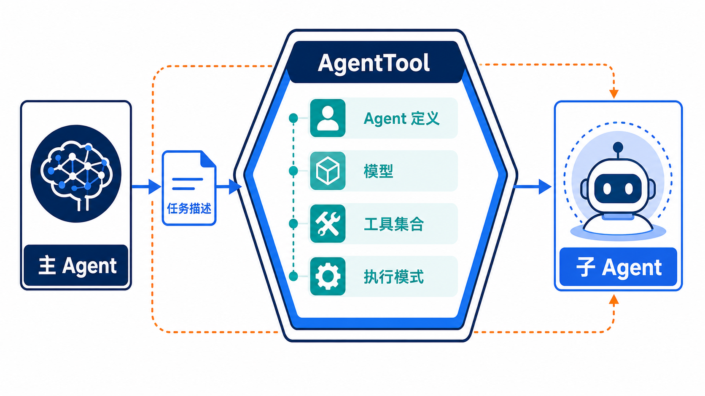
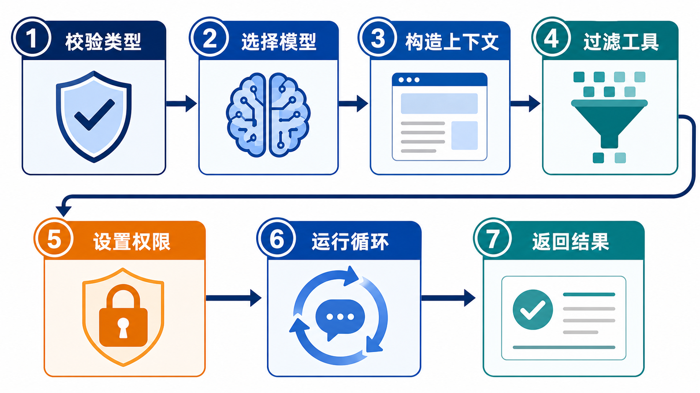
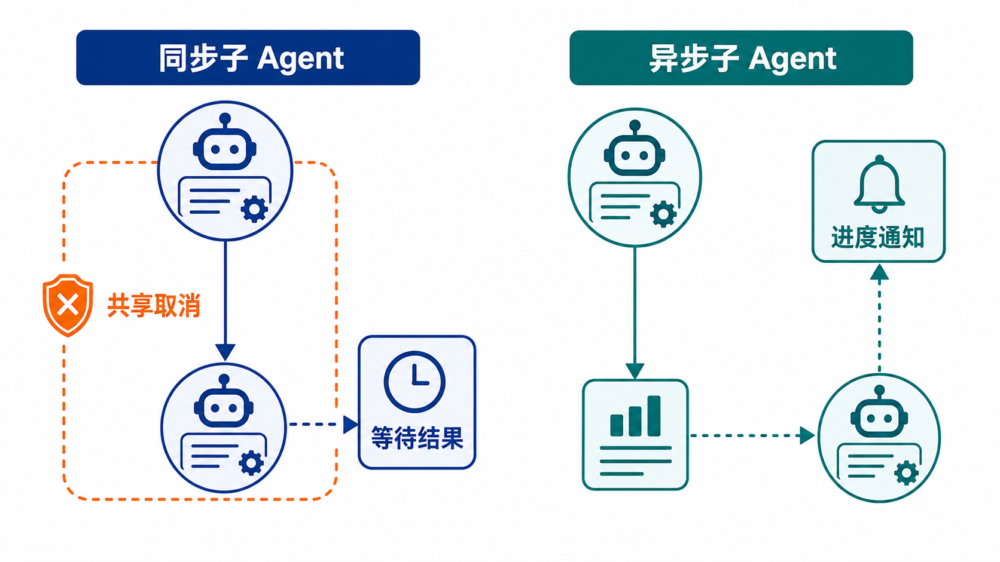
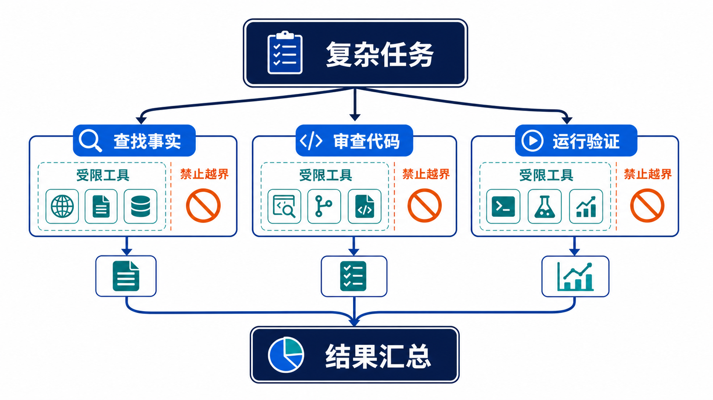

# AgentTool 如何启动一个子 Agent？

复杂任务来了：先摸清陌生仓库，再定位 Bug，最后修改代码并运行测试。

最直接的做法，是让一个 Agent 从头做到尾。可上下文很快被搜索结果塞满，模型一边记着几十个文件，一边还要规划修复，注意力和 token 都在被无关细节消耗。

于是很多框架加了“子 Agent”。但如果实现只是再调用一次模型 API，它并没有真正形成分工：工具、权限、上下文和取消仍然混在一起，最后只是多花一份模型费。

**Claude Code 的 AgentTool 更像一个委派网关：主 Agent 提交边界清晰的任务，Runtime 再为子 Agent 选择定义、模型、上下文、工具、权限和运行方式。**

## 子 Agent 为什么应该是一套运行时，而不是一条 Prompt？

先看两种常见实现。

第一种是把任务拼进同一个会话：“现在请扮演代码审查员。”模型身份变了，历史和工具却没变。它仍然看见主任务的所有噪声，也仍然可能调用不需要的写入工具。

第二种是新建一次模型请求，但把父 Agent 的完整系统提示、全部工具和全部消息复制过去。这解决了一部分注意力问题，却没有建立安全边界。

真正的子 Agent 至少要拥有自己的：

- `agentId`，用于追踪消息、成本和结果；
- Agent 定义，描述职责、模型、工具和权限；
- 消息集合，决定它知道哪些历史；
- 工具池，决定它能做哪些动作；
- 取消控制器，决定父任务停止时它是否一起停止；
- 会话记录，支持进度、恢复和结果回传。

这就是为什么 Claude Code 把 Agent 做成一个 Tool。对主循环来说，“委派任务”是一种可审计动作；对 Runtime 来说，它会启动另一套受约束的查询循环。



## AgentTool 收到调用后，先决定什么？

AgentTool 的输入不是只有一段 `prompt`。恢复源码里的输入 Schema 还包括任务简述、子 Agent 类型、模型覆盖、是否后台运行，以及工作目录或 worktree 隔离方式。

下面是裁剪后的定义：

```typescript
// 裁剪后的核心代码
const inputSchema = z.object({
  description: z.string(),
  prompt: z.string(),
  subagent_type: z.string().optional(),
  model: z.enum(['sonnet', 'opus', 'haiku']).optional(),
  run_in_background: z.boolean().optional(),
  isolation: z.enum(['worktree']).optional(),
  cwd: z.string().optional(),
})
```

这些字段分别回答五个问题：

1. 为什么要委派？
2. 委派给哪类 Agent？
3. 用什么模型和成本档位？
4. 主 Agent 是否必须等待？
5. 子 Agent 在哪个文件系统边界里工作？

调用进入后，系统不会立刻运行模型。它先收集可用 Agent 定义，检查所需 MCP 服务是否存在，再应用权限规则过滤不可使用的 Agent 类型。

```typescript
// 裁剪后的核心代码
const agentsWithMcp = filterAgentsByMcpRequirements(
  agents,
  mcpServersWithTools,
)

const availableAgents = filterDeniedAgents(
  agentsWithMcp,
  toolPermissionContext,
  AGENT_TOOL_NAME,
)
```

这一步说明，Agent 类型本身也是权限对象。允许调用 `AgentTool`，不等于允许启动任意自定义 Agent。

## 一个子 Agent 是怎样被逐层组装出来的？

从 AgentTool 到 `runAgent()`，启动过程可以整理成七步。

第一，选择 Agent 定义。定义里包含角色提示、允许工具、可选模型、最大轮数和权限模式。缺省时可以回到通用 Agent。

第二，解析模型。显式调用参数优先于 Agent 定义，Agent 定义又优先于父循环默认值。这样搜索任务可以使用便宜模型，复杂审查再使用能力更高的模型。

第三，构造上下文。常规子 Agent 通常从任务消息开始；需要继承父会话时，会过滤掉不完整工具调用，避免 API 收到无法配对的 `tool_use`。

第四，裁剪用户和系统环境。只读 Explore、Plan Agent 没必要继承全部 Git 状态或执行规则；少传无关上下文，本身就是成本优化。

第五，解析工具池。定义中的工具白名单与当前可用工具求交集，而不是凭名称生成不存在的能力。

第六，建立子 Agent 的权限与取消语义。同步 Agent 可以共享父取消信号，后台 Agent 则使用独立控制器。

第七，调用同一套 `query()` 循环，将消息、System Prompt、工具和上下文作为参数传入。

`runAgent()` 的核心可以裁剪成下面这样：

```typescript
// 裁剪后的核心代码：省略 Hook、遥测和持久化
const model = getAgentModel(
  agentDefinition.model,
  parentOptions.mainLoopModel,
  modelOverride,
  permissionMode,
)

const tools = resolveAgentTools(
  agentDefinition,
  availableTools,
  isAsync,
).resolvedTools

for await (const message of query({
  messages: initialMessages,
  systemPrompt: agentSystemPrompt,
  userContext,
  systemContext,
  canUseTool,
  toolUseContext: childContext,
  querySource,
  maxTurns: agentDefinition.maxTurns,
})) {
  yield message
}
```

这里最值得迁移的不是某个函数名，而是组装顺序：**先确定能力边界，再启动推理循环。**



## 父 Agent 的上下文应该给子 Agent 多少？

子 Agent 的价值，很大一部分来自上下文隔离。复制得太少，它需要重新搜索；复制得太多，它又退化成第二个主 Agent。

Claude Code 存在两条不同路径。

常规委派更强调任务级上下文。主 Agent 写出明确指令，子 Agent用自己的消息和工具去完成。它不必看到父会话的全部讨论。

Fork 路径则会继承父 Agent 的对话前缀。恢复源码中的 `buildForkedMessages()` 会保留父 Assistant 消息里的全部 `tool_use`，再构造一个包含对应占位 `tool_result` 的用户消息，最后追加每个子任务的指令。

```typescript
// 裁剪后的核心代码
const toolResults = toolUseBlocks.map(block => ({
  type: 'tool_result',
  tool_use_id: block.id,
  content: FORK_PLACEHOLDER_RESULT,
}))

return [
  clonedAssistantMessage,
  createUserMessage({
    content: [...toolResults, childDirective],
  }),
]
```

占位结果为什么要一致？多个 Fork 如果拥有字节一致的请求前缀，就更容易共享 Prompt Cache。真正不同的部分只放在末尾的子任务指令里。

不过，Fork 也有代价：上下文更大，父会话里的陈旧信息会被继承，子 Agent 还可能误以为自己仍是主 Agent。因此源码会注入明确的 Fork 身份和范围约束，并阻止 Fork 子 Agent 再递归 Fork。

选择规则可以很简单：

- 子任务可独立描述：只传任务和必要材料；
- 子任务强依赖刚刚的推理与文件发现：考虑 Fork；
- 父上下文噪声已经很大：宁愿重新给一份干净摘要。

## 同步与异步子 Agent，差别不只是“要不要等待”

同步子 Agent 像一次普通工具调用：父 Agent 阻塞等待结果，取消父任务时子任务也应尽快停止。它适合下一步决策强依赖结果的工作，例如“先查清认证流程，再决定改哪个函数”。

异步子 Agent 则需要独立生命周期。父 Agent 可以继续工作，子 Agent 把进度写入任务状态，完成后再发通知。

恢复源码在取消控制器上明确区分两者：

```typescript
// 裁剪后的核心代码
const agentAbortController =
  override?.abortController
  ?? (isAsync
      ? new AbortController()
      : toolUseContext.abortController)
```

同步任务共享父控制器，保证用户停止主任务时不会留下孤儿请求。异步任务使用未链接控制器，因为它被设计为独立运行；父 Agent 当前这一轮结束，不应自动杀死后台任务。

独立运行不等于不受管理。后台 Agent 仍需要：

- 注册任务 ID；
- 持续更新进度和 token；
- 支持主动终止；
- 保存输出位置；
- 结束后通知父会话；
- 在异常时记录失败状态。

如果你的框架只有 `Promise.all()`，它实现的是并发调用，不是异步 Agent 生命周期。



## 怎样限制子 Agent 的工具和权限？

子 Agent 不应该默认继承父 Agent 的全部“永久允许”规则。

恢复源码会根据 `allowedTools` 重建会话级允许规则，同时保留 SDK 调用方显式传入的 CLI 级规则。这样既尊重外部调用者授权，又避免父会话临时批准泄漏给所有子 Agent。

```typescript
// 裁剪后的核心代码
if (allowedTools !== undefined) {
  toolPermissionContext = {
    ...toolPermissionContext,
    alwaysAllowRules: {
      cliArg: parentRules.cliArg,
      session: [...allowedTools],
    },
  }
}
```

后台 Agent 还有一个额外问题：它通常无法弹出交互式确认。源码会设置 `shouldAvoidPermissionPrompts`，让无法展示 UI 的 Agent 不要卡死在权限对话框上。

生产设计里可以把工具分成三组：

- 自动允许：只读、可重复、结果有限；
- 需要父 Agent 代理确认：写文件、运行高风险命令；
- 子 Agent 永不允许：发布、删除远端资源、修改凭据。

Agent 定义里的工具列表不是功能菜单，而是最小权限声明。

## 什么任务值得委派，什么任务不值得？

委派本身有成本：新 System Prompt、新模型调用、额外上下文以及结果汇总。任务太小，子 Agent 的启动成本可能比直接做还高。

适合委派的任务通常具备三个特征：范围可以一句话说清；产出可以独立验收；执行过程中不需要频繁与主 Agent 往返。

例如：

- “找出认证模块的入口和调用链，不修改文件”；
- “审查这三个文件的并发安全问题，输出风险列表”；
- “运行测试并归纳失败原因，不自行修复”。

不适合委派的任务则往往边界模糊：“帮我看看项目有什么问题”，或者下一步每隔几秒都要主 Agent 决策。

主 Agent 还要控制扇出数量。更多子 Agent 不等于更快：它们可能重复读同一批文件、争抢写锁、同时消耗限流额度，最后主 Agent还要花大量 token 去合并彼此矛盾的结果。

一个实用规则是：先按“不同证据源或不同产物”拆任务，再按依赖关系决定并发。共享大量前置工作的子任务，往往应该先由一个探索 Agent 产出地图，再继续拆分。



## 自己实现 AgentTool，最小版本需要哪些接口？

可以从一个很克制的接口开始：

```typescript
// 示例代码：最小委派接口
type DelegateInput = {
  description: string
  prompt: string
  agentType: string
  runInBackground?: boolean
}

type AgentDefinition = {
  systemPrompt: string
  allowedTools: string[]
  model?: string
  maxTurns: number
}
```

调用链固定做六件事：验证 Agent 类型、加载定义、求出工具交集、创建子上下文、运行 Agent Loop、把最终结果和使用量返回父 Agent。

第二阶段再加入后台任务、会话持久化和 worktree。不要在没有生命周期管理之前就开放无限并发。

最后，为每次委派记录四项观测数据：父 `agentId`、子 `agentId`、任务类型、终止原因。否则一条请求变成五个 Agent 后，线上错误很难追到真正的执行者。

## 子 Agent 的结果怎样回到父 Agent，才不会再次污染上下文？

子 Agent运行时可能产生上百条搜索、读取和工具进度消息。父 Agent真正需要的通常只是结论、证据位置、修改产物和未解决问题。

如果把子 Agent完整转录直接拼回父历史，前面的上下文隔离就被抵消了。更合理的做法是区分“可审计转录”和“父 Agent消费结果”：完整转录单独持久化，父 Agent只接收有固定上限的最终结果。

```typescript
// 示例代码：子 Agent 结果契约
type DelegationResult = {
  status: 'completed' | 'failed' | 'cancelled'
  summary: string
  artifacts: Array<{
    type: 'file' | 'commit' | 'report'
    ref: string
  }>
  unresolved: string[]
  usage: { turns: number; tokens: number }
}
```

对研究任务，`artifacts` 可以是关键文件与行号；对隔离修改任务，可以是提交哈希或补丁；对验证任务，则是命令、退出码和失败摘要。产物引用比“我已经完成”更容易被主 Agent核验。

结果还要保留失败语义。子 Agent达到最大轮数，不应被包装成成功摘要；用户取消也不能写成普通工具错误。父 Agent需要知道是重试、换策略、缩小任务，还是直接向用户报告。

后台 Agent的结果回传必须处理竞态：通知到达时，父会话可能正处于另一个模型轮次。直接修改当前消息数组会破坏顺序。比较稳妥的方式是把结果写入事件队列，在下一个明确边界作为新消息注入。

如果子 Agent修改了 worktree，父 Agent还要把“合并结果”视为新的高风险动作。子 Agent提交成功，只证明隔离空间里的产物可用；把它 cherry-pick 到主分支仍需要冲突检查、权限判断和最终测试。

**委派的结束不是子 Agent输出一句话，而是父 Runtime收到一份有状态、有产物、有边界的结果合同。** 只有这样，主 Agent才能在不吞下全部中间噪声的情况下继续决策。

成本也应回传。否则主 Agent可能连续启动多个昂贵子任务，却只看到自己的 token 使用量。将子 Agent使用量归入父任务预算，才能防止委派成为绕过总成本限制的路径。

回到文章开头：子 Agent 的意义不是“多调用一次模型”，而是把复杂任务变成一组有边界、可追踪、最小权限的运行单元。

**AgentTool 负责建立这道边界：任务先被结构化，再选择 Agent 定义和模型；上下文按需继承，工具和权限重新裁剪；最后由独立的 Query Loop 执行，并以同步结果或异步通知回到主 Agent。**

如果你要为自己的 Agent 加委派能力，先只实现一个只读“探索 Agent”。限制它只能读取和搜索，要求输出固定结构的仓库地图。这个小场景最容易检验：上下文是否真的隔离，工具是否真的受限，结果是否真的能被主 Agent 使用。
