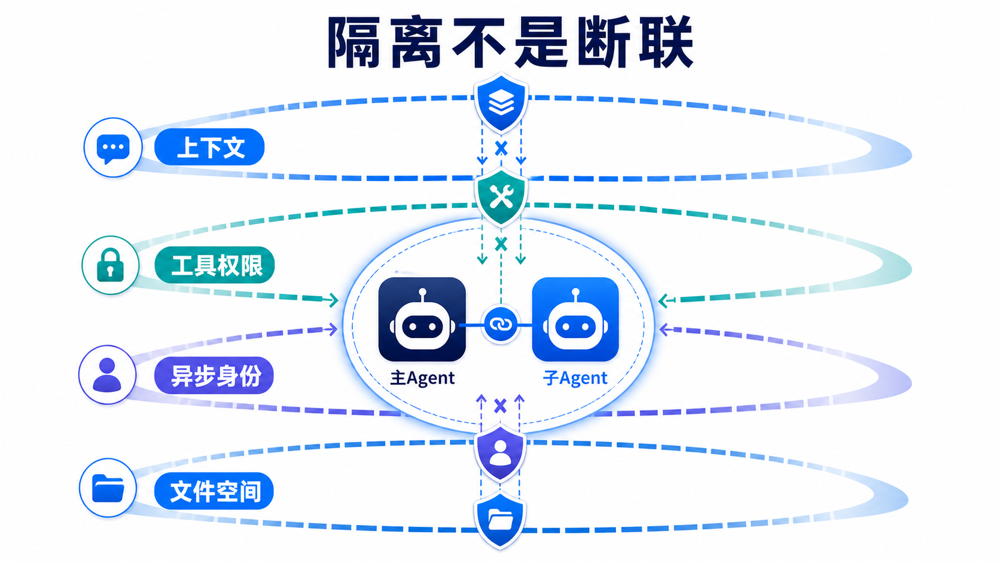
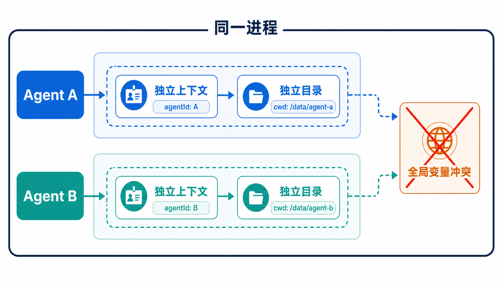
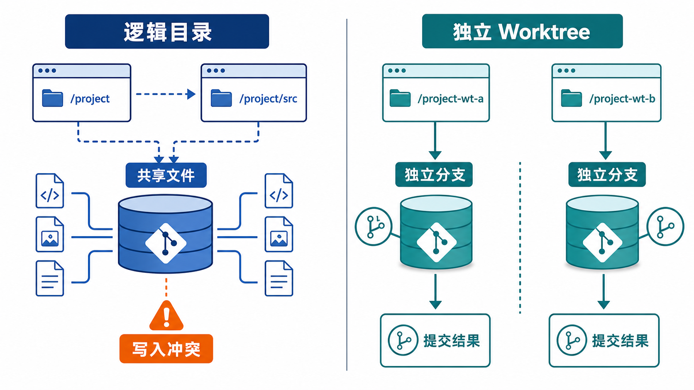
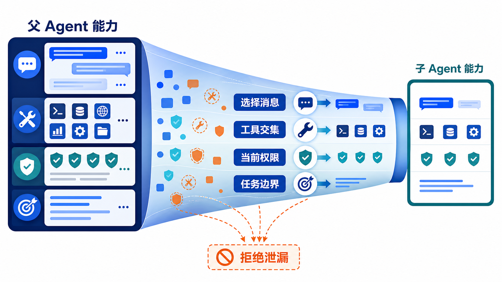

# 主 Agent 和子 Agent 如何隔离上下文与权限？

主 Agent 把“审查登录模块”交给子 Agent。你希望它只读相关文件，最后返回风险列表。

结果子 Agent 看见了父会话里刚刚批准过的写权限，顺手改了文件；两个后台 Agent 又同时修改同一个工作区，其中一个覆盖了另一个的结果。

问题不在模型不听话，而在 Runtime 没有给委派建立真正的边界。

**主 Agent 与子 Agent 的隔离不是简单地开一个新对话，而是同时隔离上下文、工具权限、异步身份和文件空间；它们仍能通过受控消息和结果回传协作。**

## 上下文隔离，究竟要防什么？

上下文隔离首先是为了减少噪声。

主 Agent 可能已经经历了几十轮搜索、讨论和修改。子 Agent 只负责审查三个文件，没有必要知道用户最初如何描述 UI，也不需要看到前一个失败工具的长输出。

其次是为了防止角色混淆。继承完整历史后，子 Agent 可能把父会话里的“你负责完成整个任务”当成自己的目标，与最新委派发生冲突。

最后才是隐私和安全。父上下文中可能包含与子任务无关的凭据路径、外部系统返回值或敏感说明。默认复制一切，会扩大信息暴露范围。

Claude Code 的常规子 Agent 会构造独立的 `initialMessages`，需要继承时才接收 `forkContextMessages`。继承前还会过滤不完整工具调用：

```typescript
// 裁剪后的核心代码
const contextMessages = forkContextMessages
  ? filterIncompleteToolCalls(forkContextMessages)
  : []

const initialMessages = [
  ...contextMessages,
  ...promptMessages,
]
```

为什么不完整工具调用必须过滤？模型 API 通常要求 `tool_use` 和 `tool_result` 成对。如果父 Agent 正好在工具执行中被 Fork，子 Agent拿到孤立的 `tool_use`，下一次请求可能直接被判为协议错误。

上下文隔离的原则不是“子 Agent 什么都不知道”，而是**只复制它完成任务所需、并且在因果上闭合的信息**。



## 工具隔离为什么要取交集，而不是重新授权？

Agent 定义可以声明允许使用哪些工具，但这不代表它能凭空获得这些能力。

有效工具集合应该是：

当前 Runtime 可用工具 ∩ Agent 定义允许工具 ∩ 当前会话权限允许工具

如果主会话没有连接某个 MCP 服务，Agent 定义写了工具名也不能使用；如果用户禁止写入，子 Agent也不能因为自己是“修复 Agent”就绕过。

Claude Code 的 `runAgent()` 会通过 `resolveAgentTools()` 从当前工具池里解析子 Agent 工具。AgentTool 本身还会先根据 MCP 要求和权限规则过滤可选 Agent 类型。

这比在子 Agent System Prompt 里写“不要调用写工具”可靠得多。提示词只是行为指导，工具不出现在 API Schema 中，才是能力层面的限制。

权限也不能简单继承父会话的所有临时批准。恢复源码在提供 `allowedTools` 时，会重建子 Agent 的 session 规则：

```typescript
// 裁剪后的核心代码
toolPermissionContext = {
  ...toolPermissionContext,
  alwaysAllowRules: {
    cliArg: parentContext.alwaysAllowRules.cliArg,
    session: [...allowedTools],
  },
}
```

它保留调用方显式传入的 CLI 级规则，但替换会话级规则，避免父 Agent 一次性批准泄漏到所有子任务。

## 为什么同进程并发还需要“身份隔离”？

很多子 Agent 并不启动新进程，而是在同一个 Node.js 进程里并发运行。这很快，却带来一个经典问题：如果当前 `agentId`、工作目录和追踪信息放在全局变量里，Agent A 和 Agent B 会互相覆盖。

假设 A 发起 API 请求前把全局 `currentAgentId` 设为 A，随后事件循环切到 B，把它改成 B。A 的请求结束后读取全局变量，遥测和会话记录就被记到了 B 名下。

Claude Code 使用 `AsyncLocalStorage` 给每条异步调用链保存 Agent 上下文。

源码结构很直接：

```typescript
// 裁剪后的核心代码
const agentContextStorage =
  new AsyncLocalStorage<AgentContext>()

export function runWithAgentContext<T>(
  context: AgentContext,
  fn: () => T,
): T {
  return agentContextStorage.run(context, fn)
}

export function getAgentContext() {
  return agentContextStorage.getStore()
}
```

`run()` 范围内创建的 Promise、定时器和异步调用会读取到自己的上下文。A 和 B 即使交错执行，也能得到不同的 `agentId`。

工作目录采用相同思路：

```typescript
// 裁剪后的核心代码
const cwdStorage = new AsyncLocalStorage<string>()

export function runWithCwdOverride<T>(cwd: string, fn: () => T) {
  return cwdStorage.run(cwd, fn)
}

export function pwd() {
  return cwdStorage.getStore() ?? getGlobalCwd()
}
```

这解决的是“每条异步链看到哪个目录”的问题，但还没有隔离真实文件。



## 独立 cwd 为什么不等于文件隔离？

Agent A 的 cwd 是 `/project/src`，Agent B 的 cwd 是 `/project/tests`。它们逻辑目录不同，但仍然位于同一个仓库和工作树中。

A 修改 `/project/package.json`，B 立刻就能看到；两者同时写同一文件，后完成的写入仍可能覆盖先完成的写入。

所以要区分两层：

- 逻辑 cwd 隔离：防止路径解析和命令执行串到别的目录；
- 物理工作区隔离：防止多个 Agent 修改同一份文件。

Claude Code 的 AgentTool 支持 `isolation: "worktree"`。系统会为子 Agent 创建临时 Git worktree，让它拥有独立路径和分支。子 Agent 在其中修改、测试和提交，主 Agent最后再决定如何合并结果。

Worktree 的代价也很现实：

- 创建和清理需要额外时间；
- 未被 Git 跟踪的文件不一定自动出现；
- 大型依赖目录可能需要链接或重新安装；
- 最终仍要解决多个分支间的语义冲突；
- 非 Git 项目无法直接使用同样方案。

因此不是所有子任务都要 worktree。只读搜索使用逻辑 cwd 足够；可能改写重叠文件的并行任务，才值得付出物理隔离成本。

## 子 Agent 的权限模式应该怎样继承？

权限继承面临两种相反风险。

完全继承，可能把父 Agent 的宽权限扩散给不可信子任务。完全重置，又会让同步子 Agent反复询问相同操作，交互体验很差。

恢复源码采取的是受控派生：先取得父 AppState，再根据 Agent 定义覆盖权限模式；但父会话处于明确的 `bypassPermissions` 或 `acceptEdits` 等模式时，不随意缩回另一种模式。

后台 Agent 还会根据能否展示 UI 设置 `shouldAvoidPermissionPrompts`。不能弹窗的任务遇到需要确认的操作时，应该拒绝或把请求冒泡给父会话，而不是永久等待。

可以把继承策略整理成四条：

1. 外部调用者显式授权是上限，子 Agent不能扩权；
2. Agent 定义可以进一步缩小权限；
3. 父会话临时批准默认不跨 Agent 泄漏；
4. 无 UI 的后台任务不得进入交互等待。

如果产品需要“子 Agent 请求父 Agent批准”，最好把它设计为一个显式协议：子 Agent暂停并返回待批准动作，父 Agent在自己的权限上下文里发起询问，批准后再续跑。不要让两个 Agent共享同一个对话框状态。



## 取消、状态和缓存哪些该共享，哪些不该？

隔离并不是所有状态都复制一份。关键是按语义选择。

同步子 Agent与当前父步骤绑定，适合共享取消控制器。用户停止主任务，它应该一起停。异步子 Agent有独立生命周期，使用自己的控制器，但仍要能被任务管理器主动终止。

文件读取缓存则要更谨慎。Fork 子 Agent继承父上下文时，可以克隆父读取状态，减少重复读取；普通子 Agent更适合创建有限大小的新缓存，避免一方更新缓存后影响另一方对文件新鲜度的判断。

根任务的 AppState 也不适合整体复制。后台 Agent需要把任务进度注册到根状态，才能在主 UI 中显示；它自己的局部消息、权限派生和工具状态又必须隔离。

这形成三种共享方式：

| 状态 | 推荐方式 | 目的 |
| --- | --- | --- |
| 任务注册、总体使用量 | 显式共享根通道 | 统一观测 |
| Agent 身份、cwd、消息 | 异步局部存储 | 防止串扰 |
| 文件缓存、权限上下文 | 克隆后派生 | 继承起点但允许独立变化 |

判断标准不是“方便”，而是一个变化是否应该立刻影响另一个 Agent。

## 如何防止能力从父 Agent 泄漏到子 Agent？

最常见的泄漏不是秘密文本，而是能力。

父 Agent拥有 Bash、文件写入、网络请求和多个 MCP 工具。子任务只负责搜索，却因为复用了同一工具数组而获得全部能力。

安全做法是逐层收窄：

第一层选择消息，只保留任务必要上下文。第二层选择工具，按定义与可用工具求交集。第三层重新应用当前权限。第四层用任务描述限制目标和输出。

还要注意“间接能力”。一个只允许 Bash 的子 Agent，理论上仍然可以通过 shell 修改文件或访问网络。工具名白名单必须结合命令级权限、沙箱和工作目录边界。

MCP 也类似。允许一个远端 MCP 工具意味着把输入发送到外部服务。子 Agent是否需要看到该服务器、能否调用写操作，都应该单独评估。

因此，最小权限不能只停在 Schema 层。完整链条是：

模型可见工具 → 参数校验 → 权限判断 → 执行沙箱 → 文件或网络边界 → 结果回传

每一层都应继续收窄，而不是期待第一层解决所有安全问题。



## 自己实现隔离，可以按什么顺序推进？

第一阶段先做逻辑隔离：每个 Agent独立 `agentId`、消息数组、工具数组和 `AbortController`。不要使用可变全局 `currentAgent`。

第二阶段加入异步上下文存储，让日志、成本、cwd 和调用链自动归属正确 Agent。为并发测试故意交错两个 Agent 的定时器，检查身份是否串线。

第三阶段实现权限派生。定义一条清晰公式：子权限只能小于等于父权限；临时批准是否继承要明确记录。

第四阶段再支持物理工作区。优先从 Git worktree 开始，并规定输出契约：子 Agent返回提交哈希或补丁、测试结果、未解决冲突，主 Agent负责合并。

第五阶段做泄漏测试：父 Agent加入一个只有它能调用的危险工具，子 Agent启动后检查该工具是否完全不出现在 Schema 中；再测试 Bash 能否绕过限制。

## 隔离失效时，系统应该怎样“失败得安全”？

隔离机制自己也会失败：worktree 创建到一半、异步上下文丢失、权限规则解析异常、子 Agent找不到指定 cwd。此时不能退回共享全局状态继续跑，因为那恰好绕过了隔离目标。

可以为每层定义失败策略：

- 上下文构造失败：不启动模型，返回缺失的消息或协议节点；
- 工具过滤失败：默认空工具集，而不是父工具全集；
- 权限加载失败：默认拒绝写操作；
- cwd 校验失败：不退回进程 cwd，明确终止；
- worktree 创建失败：不在主工作树替代执行；
- Agent 身份缺失：停止持久化与工具执行，避免错误归属。

这叫 fail closed。它会牺牲一部分可用性，却守住能力边界。

隔离还需要生命周期清理。后台 Agent结束后要注销任务、关闭专属 MCP连接、删除允许删除的临时 worktree，并停止 Hook。清理函数应放在 `finally`，同时做到幂等：调用两次不会删除主工作树或报出新的致命错误。

```typescript
// 示例代码：隔离资源的结构化清理
try {
  return await runChild(runtime)
} finally {
  await Promise.allSettled([
    runtime.mcp.cleanup(),
    runtime.hooks.unregister(),
    runtime.worktree?.remove(),
  ])
}
```

对于需要保留的失败 worktree，不要自动删除。应记录路径、分支、最后提交和清理责任，让用户可以检查未合并修改。临时资源是否回收，也是一种需要明确策略的状态。

**隔离的可靠性不只看正常运行时互不干扰，还要看初始化失败和清理失败时会不会悄悄退回更危险的共享状态。**

文章开头的事故，本质上不是“子 Agent越界”，而是系统从未告诉它边界在哪里。

**可靠的多 Agent 隔离要同时回答四件事：它能看到什么、能调用什么、异步事件算在谁头上、写入发生在哪份文件空间。只有这四个边界都明确，主 Agent 和子 Agent的协作才是可控的。**

如果你正在搭建多 Agent 系统，先做一个两任务冲突实验：让两个子 Agent同时修改同一文件。逻辑 cwd 版本应该暴露冲突风险，worktree 版本则应该产生两个独立结果并交给主 Agent合并。这个实验能最快检验你拥有的到底是“并发调用”，还是“隔离运行时”。
