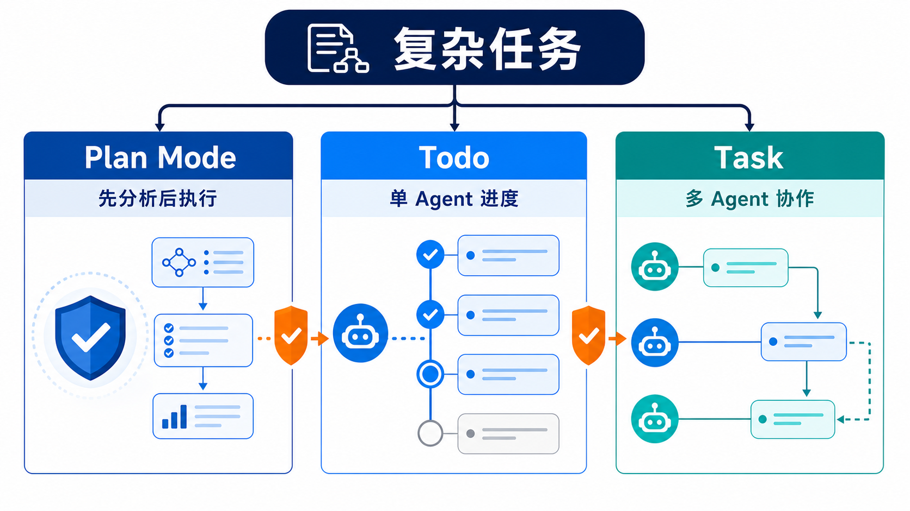
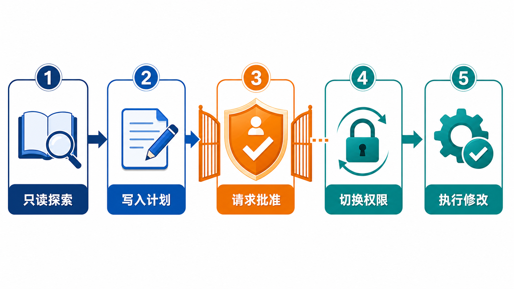
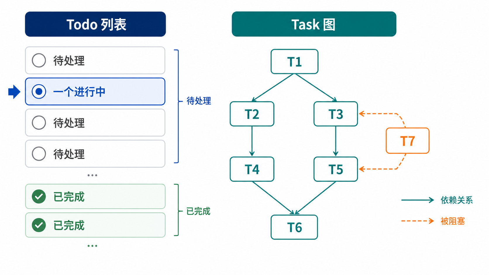
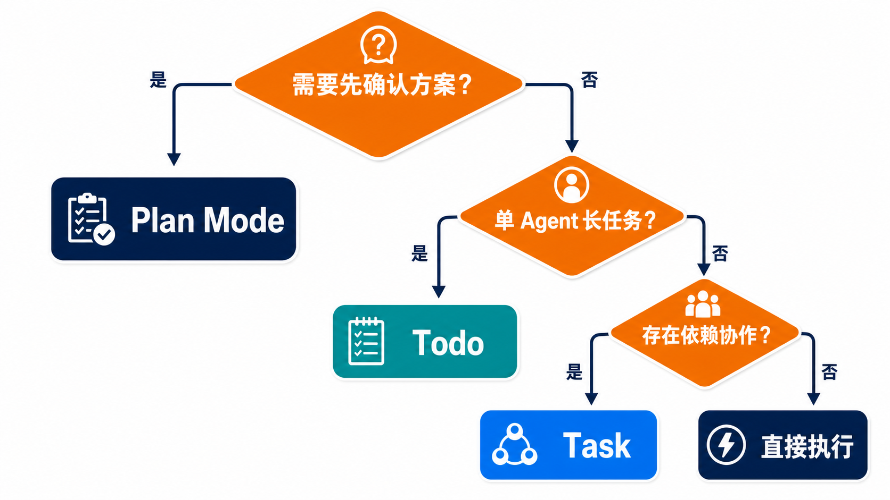

# Plan Mode、Todo 和 Task 系统分别解决什么问题？

“做计划”听起来只有一件事。

可在 Agent 系统里，至少有三种完全不同的需求：动手前先把方案讲清楚；执行中别忘了下一步；多个 Agent协作时知道谁被谁阻塞。

如果只用一张 Todo 列表解决所有问题，计划可能未经批准就开始执行，多 Agent依赖也只能写在自然语言里；如果所有小任务都建成一张复杂任务图，系统又会被管理成本拖慢。

**Claude Code 把三类问题拆开：Plan Mode 管“能不能开始改”，Todo 管“一个 Agent现在做到哪”，Task 管“多个工作单元如何依赖与协作”。**

## Plan Mode 解决的不是“有没有计划”，而是执行边界

用户说“先看看怎么改，不要动代码”，真正要求的是一种权限状态。

如果 Agent只在 Prompt 里收到“先规划”，模型仍然看得见写文件和高风险 Bash 工具。一旦推理偏离，它就可能提前实施。

Plan Mode 因此不能只是输出格式。它需要把会话切换到一个受限权限上下文：允许读取、搜索和分析；允许把方案写到计划文件；限制普通项目文件修改；方案确认后再切回实施权限。

恢复源码中的 `/plan` 命令会显式执行模式转换，并更新权限上下文：

```typescript
// 裁剪后的核心代码
if (currentMode !== 'plan') {
  handlePlanModeTransition(currentMode, 'plan')

  setAppState(prev => ({
    ...prev,
    toolPermissionContext: applyPermissionUpdate(
      prepareContextForPlanMode(prev.toolPermissionContext),
      { mode: 'plan' },
    ),
  }))
}
```

这里的关键是 `prepareContextForPlanMode`。进入计划模式不是多设一个布尔值，而是派生一套新的工具权限。



## 一次完整的 Plan Mode 应该经历哪些状态？

一个可靠流程通常包含五个状态。

第一，只读探索。Agent读取代码、搜索引用、检查配置，把不确定性降下来。

第二，写入计划。方案应该成为一个可查看的产物，而不是只存在于模型即将被压缩的上下文中。

第三，请求批准。用户检查目标、影响范围、验证方式和风险。这里的批准对象是具体方案，而不是笼统的“以后都可以改”。

第四，切换权限。批准后 Runtime离开 Plan Mode，恢复实施所需工具，同时记录这次转换。

第五，执行修改。实施阶段仍然要接受常规工具权限、Hook 和沙箱检查，计划批准不等于绕过全部安全机制。

如果用户拒绝方案，系统应该保留探索结果并允许继续修改计划，而不是把拒绝当作工具错误无限重试。

Plan Mode 的另一个边界是计划陈旧。用户批准后项目可能被别人修改，或者 Agent实施中发现核心假设不成立。此时正确动作是回到计划阶段，而不是机械完成过时步骤。

因此计划状态至少需要：

```typescript
// 示例代码：计划状态，不是仓库原样源码
type PlanState =
  | { status: 'draft'; version: number }
  | { status: 'awaiting_approval'; version: number }
  | { status: 'approved'; version: number; approvedAt: number }
  | { status: 'stale'; version: number; reason: string }
  | { status: 'rejected'; version: number }
```

批准必须绑定版本。计划内容变化后，旧批准不能继续生效。

## Todo 为什么更适合管理单 Agent 的执行节奏？

方案批准后，Agent可能要修改五个文件、补测试、运行检查并整理结果。它需要的是一个短期工作记忆。

Todo 的核心是顺序和状态，而不是权限。恢复源码里的提示对状态约束很明确：`pending`、`in_progress`、`completed`，同时只有一个任务处于 `in_progress`。

这是一个看似保守、实际很有用的设计。

模型容易在执行中开太多线程：改一半文件，又去研究另一个问题，再回来时忘记验证。限制一个进行中事项，会迫使它显式完成或更新当前步骤。

一个 Todo 项通常只需要：

```typescript
// 示例代码：最小 Todo 数据结构
type TodoItem = {
  content: string
  activeForm: string
  status: 'pending' | 'in_progress' | 'completed'
}
```

`content` 适合显示目标，例如“运行认证模块测试”；`activeForm` 适合进度展示，例如“正在运行认证模块测试”。

Todo 不应成为永久需求库。失去相关性的步骤应该删除；遇到阻塞时保持进行中或改写任务，不要为了让进度条好看而标记完成。



## Task 为什么要从列表升级成依赖图？

当工作被分给多个 Agent，线性 Todo 就不够了。

例如“更新 API”和“更新前端类型”可以并行，“端到端测试”必须等待两者完成，“发布说明”又可能依赖最终测试结果。

Claude Code 的 Task 工具有稳定 ID、状态、`blocks` 和 `blockedBy`。`TaskGet` 返回完整描述时，也会提醒执行者在开始前检查 `blockedBy` 是否为空。

恢复源码中的输出逻辑能看到这些字段：

```typescript
// 裁剪后的核心代码
return {
  task: {
    id: task.id,
    subject: task.subject,
    description: task.description,
    status: task.status,
    blocks: task.blocks,
    blockedBy: task.blockedBy,
  },
}
```

这已经不是清单，而是一个有向图。

Task 图的价值有三点：

1. 调度器可以找出当前可运行节点；
2. Agent不会抢到仍被前置任务阻塞的工作；
3. 某个节点失败时，系统能计算受影响的下游任务。

但依赖图也需要防环。创建 `A blockedBy B` 之后，再创建 `B blockedBy A`，整个系统会永久等待。更新依赖时应执行环检测，并对长时间无可运行节点的图发出死锁告警。

## 三套系统怎样在一次真实任务中配合？

假设用户要求“重构认证模块，先出方案，确认后实现并让两个 Agent并行处理代码和测试”。

第一阶段进入 Plan Mode。主 Agent只读探索，产出重构边界、迁移步骤、风险和验收条件。用户批准方案版本 3。

第二阶段主 Agent建立 Todo：拆分任务、启动子 Agent、合并实现、运行总体验证、整理结果。Todo帮助主 Agent维持自己的执行节奏。

第三阶段建立 Task 图：

- T1：修改认证核心；
- T2：更新调用方，`blockedBy: [T1]`；
- T3：补单元测试，可与 T1 部分并行；
- T4：运行端到端测试，`blockedBy: [T2, T3]`。

子 Agent领取任务时，通过 TaskGet获取完整描述和依赖。完成后用 TaskUpdate更新状态，解除下游阻塞。

主 Agent的 Todo 可能只有“等待并合并子任务”这一项，它不需要复制所有 Task 节点。Todo 是主 Agent的视角，Task 图是团队共享的协调状态。

最后，如果 T3 发现计划假设错误，主 Agent把计划标为 stale，重新进入 Plan Mode。三套系统形成闭环，而不是单向流水线。



## 为什么不能只保留其中一种？

只保留 Plan Mode，会有方案却没有执行进度。模型实施十几步时仍可能遗漏。

只保留 Todo，会把方案批准退化成一个普通清单项。“完成计划”之后模型就可能直接写文件，用户没有真正的权限门。

只保留 Task，则每个单 Agent小任务都要创建 ID、维护依赖和领取状态。系统管理成本过高，模型还可能花大量 token操作任务工具。

它们关注的时间尺度也不同：

| 机制 | 时间位置 | 核心问题 | 状态所有者 |
| --- | --- | --- | --- |
| Plan Mode | 实施前及方案失效时 | 是否允许按此方案行动 | 用户与会话 |
| Todo | 单 Agent执行过程中 | 当前一步和剩余步骤 | 当前 Agent |
| Task | 多工作单元协作期 | 依赖、分配和完成 | 共享任务系统 |

当系统把它们合并为一个“万能计划对象”时，权限、进度和调度会互相污染。

## 什么时候该用 Plan、Todo 或 Task？

可以用三个问题快速决定。

第一，实施前是否存在高不确定性或需要用户确认的重大取舍？是，就用 Plan Mode。典型场景包括跨模块重构、数据库迁移、删除资源和多种方案成本差异明显的任务。

第二，是否是一个 Agent需要连续执行较多步骤？是，就用 Todo。它不要求任务很复杂，只要容易遗忘或需要展示进度就有价值。

第三，是否存在多个执行者或非线性依赖？是，就用 Task。即使只有一个进程，只要多个后台工作单元需要独立状态，Task 图也有意义。

如果三个答案都是否，就直接执行。读一个文件、回答一个明确问题，不必为了“看起来专业”而创建管理对象。

一个任务也可以同时使用三者，但每一层只保存自己的信息。不要在 Todo 里重复整份计划，也不要把 Task 描述写成几千字方案。



## 自己开发时，如何避免计划系统变成形式主义？

第一，为每套机制定义触发条件。不要让模型逢任务必写计划，也不要让 Todo成为回复前的固定表演。

第二，让状态变化产生真实约束。Plan Mode 要改变工具权限；Task 的 `blockedBy` 要影响领取；Todo 的一个 `in_progress` 要经过 Schema 校验。

第三，把完成定义写清楚。Todo 的 completed 代表动作和验证都完成；Task 的 completed 还应包含产物引用；Plan 的 approved 只代表允许实施，不代表任务完成。

第四，控制同步成本。Todo 更新可以每完成一步进行；Task 状态需要原子写入；计划正文只在版本变化时重新确认。

第五，记录偏离。执行与计划不一致时，不要默默改 Todo 假装一切正常。记录假设变化，必要时让计划失效并重新批准。

## 多个 Agent 同时更新 Task，怎样避免状态互相覆盖？

任务图一旦由多个 Agent共享，就变成并发状态系统。

Agent A读取 T1 为 `pending`，Agent B也读取到同样状态；两者同时把它改成 `in_progress`，就会重复工作。或者 A完成 T1并解除 T2阻塞时，B正好用旧版本更新 T1描述，把完成状态覆盖回去。

最小解决方案是版本号加条件更新：

```typescript
// 示例代码：乐观并发控制
async function updateTask(
  id: string,
  expectedVersion: number,
  patch: TaskPatch,
) {
  const task = await store.get(id)
  if (task.version !== expectedVersion) {
    throw new ConflictError()
  }

  return store.put({
    ...task,
    ...patch,
    version: task.version + 1,
  })
}
```

领取任务则应是原子动作：“仅当状态仍为 pending 且 blockedBy 为空时，改成 in_progress 并写入 owner。”成功者执行，冲突者重新读取任务图。

完成任务也不能只更新一个节点。系统需要在同一个事务或等价的原子操作中，写入完成结果并重新计算下游 `blockedBy`。否则进程可能在两步之间退出，留下“前置已完成、下游仍永远阻塞”的不一致图。

Task状态最好采用有限状态机：

```latex
pending → in_progress → completed
                    ↘ failed
pending/in_progress → cancelled
```

默认禁止 `completed → in_progress` 这类倒退。确实需要重开时，创建新版本或显式 `reopened` 事件，让审计记录保留“为什么重做”。

Todo 通常属于单个 Agent，不必一开始就使用分布式锁，但仍要校验“最多一个 in_progress”。Plan批准则要比较方案版本和关键环境指纹，防止批准对象在执行前被替换。

**计划系统是否可靠，不取决于 UI 上有没有三个状态颜色，而取决于状态转换能否被并发验证、失败恢复和审计重放。**

还要处理 Agent失联。某任务被领取后长时间没有心跳，系统不能直接让另一个 Agent重做，因为原 Agent可能仍在产生副作用。应先请求取消、检查产物和工具账本，再决定回收租约或转人工处理。

文章开头的疑问现在可以回答了：三套机制都叫“计划”，是因为自然语言把不同控制问题混在了一起。

**Plan Mode 是权限门，Todo 是单 Agent 的工作记忆，Task 是协作调度图。把三者分开，才能分别保证先确认再行动、执行不遗漏，以及多 Agent不互相等待或重复劳动。**

如果你正在实现 Agent 任务管理，先不要一次做全。先给高风险写操作加入真正的 Plan Mode 权限门，再给长任务加入 Todo。等你确实需要并行 Agent时，再引入带环检测的 Task 依赖图。这个顺序能让每一层都因为真实问题而存在。
