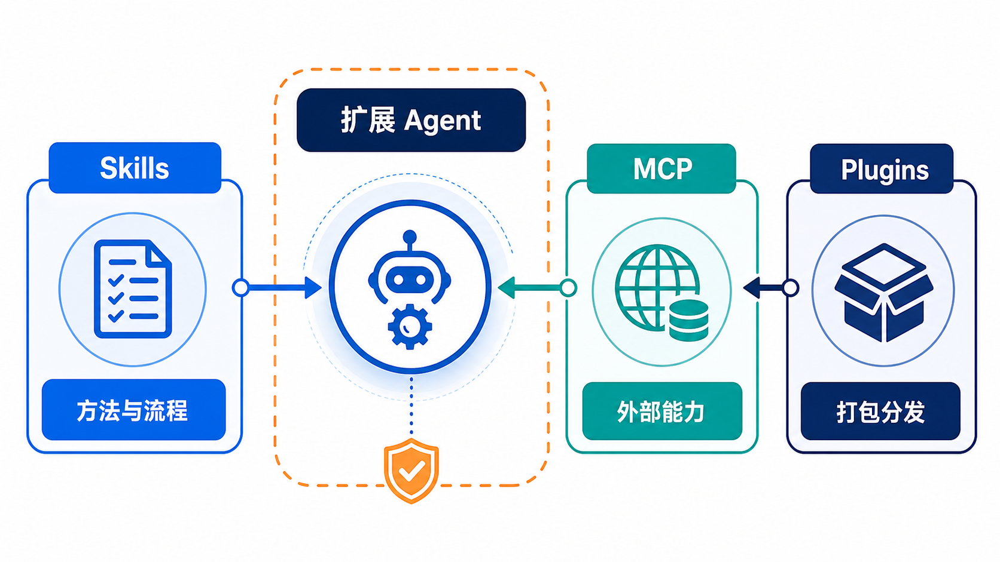
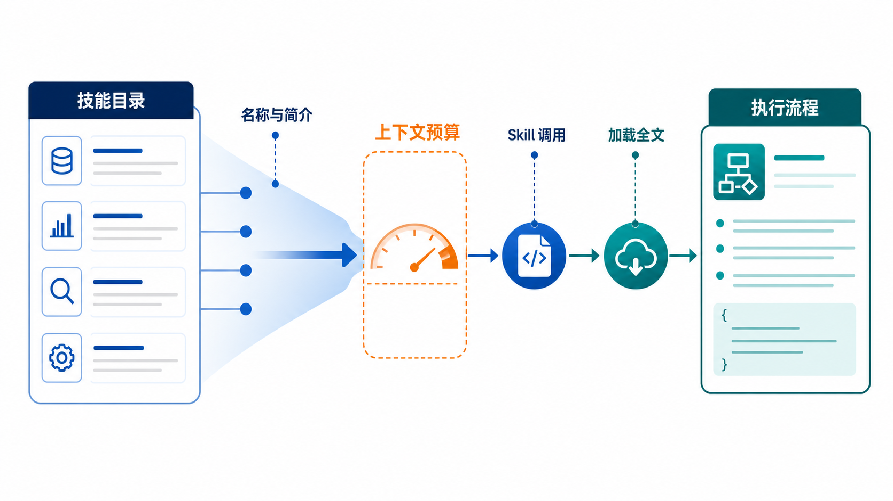
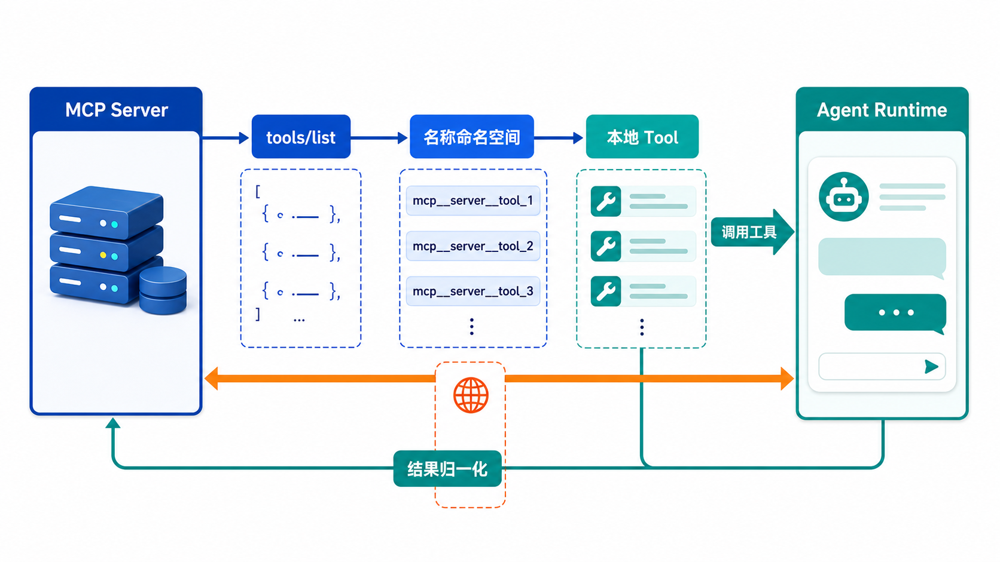
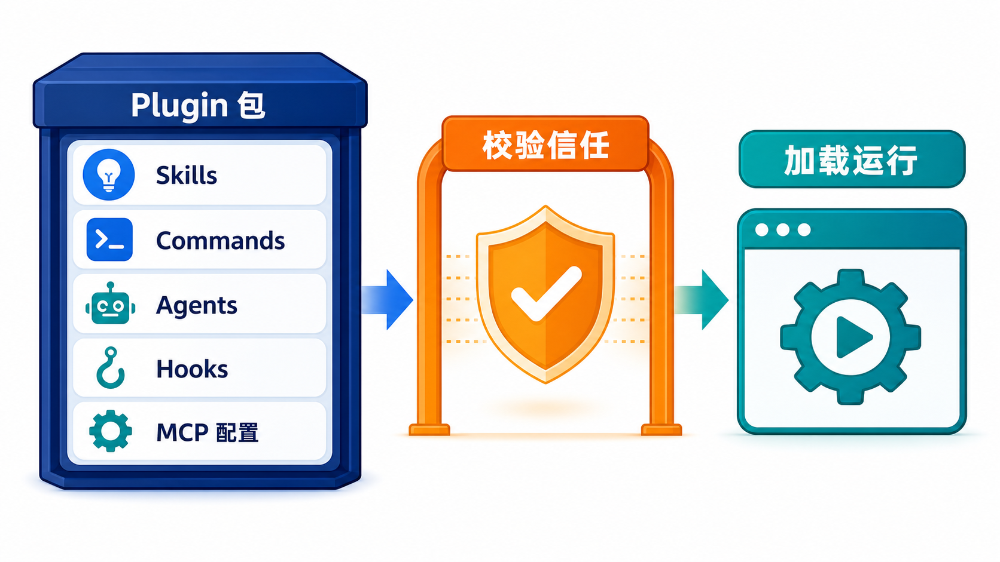

# Skills、Plugins 和 MCP 有什么区别，应该如何选择？

你想让 Agent学会一套代码审查流程，于是有人建议写 Skill；又有人说应该接 MCP；还有人让你做成 Plugin。

三个概念都能“扩展 Agent”，但它们扩展的东西并不相同。

把审查步骤接成 MCP，会凭空多一个远程服务；把数据库连接写进 Skill，模型只有说明却没有可执行通道；把所有东西都叫 Plugin，又会掩盖真正的运行机制。

**Skills 扩展的是方法和工作流，MCP 扩展的是可调用的外部能力，Plugins 扩展的是打包、安装和分发边界。它们不是替代关系，常常需要组合。**

## Skill 到底给 Agent 增加了什么？

Skill 本质上是一份可按需加载的操作知识。

它可以告诉 Agent什么时候使用某项能力、按什么步骤处理输入、要读取哪些参考资料、如何验证结果，以及输出应该满足什么格式。

它没有自动创造底层能力。如果 Skill 写着“查询生产数据库”，Runtime却没有数据库工具，模型只能描述步骤，不能真的查询。

Claude Code 会把 Skill 作为可调用命令暴露给模型。系统提示先提供技能名称和简短描述，模型选择后再由 SkillTool加载完整内容。

恢复源码中的预算逻辑说明了为什么要分两阶段：

```typescript
// 裁剪后的核心代码
export const SKILL_BUDGET_CONTEXT_PERCENT = 0.01
export const MAX_LISTING_DESC_CHARS = 250

export function getCharBudget(contextWindowTokens?: number) {
  if (contextWindowTokens) {
    return Math.floor(
      contextWindowTokens
      * CHARS_PER_TOKEN
      * SKILL_BUDGET_CONTEXT_PERCENT
    )
  }
  return DEFAULT_CHAR_BUDGET
}
```

技能目录只占上下文窗口的一小部分；单个描述还有硬上限。因为目录用于发现，不用于执行。真正调用时才加载全文。



## 为什么 Skill 要渐进加载，而不是全部塞进 System Prompt？

假设安装了五十个 Skill，每个说明两千字。全部放入 System Prompt，不仅首轮成本巨大，还会让模型在无关规则之间反复权衡。

渐进加载把问题拆成“发现”和“执行”：

发现阶段只回答：有哪些 Skill、分别适合什么场景。执行阶段才回答：选中的 Skill具体怎么做。

恢复源码的 `formatCommandsWithinBudget()` 会先尝试完整简介；总字符超过预算后，压缩非内置技能的描述；极端情况下只保留名称。内置技能的完整简介会优先保留。

调用后，Skill 既可以把内容注入当前会话，也可以在 Fork 子 Agent中执行。后者拥有独立 token 预算，适合步骤较长、会产生大量中间上下文的技能。

```typescript
// 裁剪后的核心代码
for await (const message of runAgent({
  agentDefinition,
  promptMessages,
  toolUseContext: skillContext,
  canUseTool,
  isAsync: false,
  querySource: 'agent:custom',
  model: command.model,
  availableTools: context.options.tools,
})) {
  agentMessages.push(message)
}
```

所以一个高质量 Skill 应该包含决策规则、工作流和验证标准，而不是复制一份工具说明书。

## MCP 为什么不是“更高级的 Skill”？

MCP 解决的是进程和系统之间的能力互通。

外部服务通过协议声明工具、资源或 Prompt。Claude Code 连接服务器，读取工具 Schema，把它们转换成 Runtime自己的 Tool 结构，再把模型调用通过对应传输发送到服务器。

恢复源码中的 MCP 客户端会请求 `tools/list`，然后为工具构造命名空间：

```typescript
// 裁剪后的核心代码
const result = await client.listTools()

return result.tools.map(tool => {
  const fullName =
    buildMcpToolName(client.name, tool.name)

  return {
    name: fullName,
    mcpInfo: {
      serverName: client.name,
      toolName: tool.name,
    },
    inputJSONSchema: tool.inputSchema,
    isReadOnly: () =>
      tool.annotations?.readOnlyHint ?? false,
  }
})
```

常见名字形如 `mcp__server__tool`。命名空间避免两个服务器都提供 `search` 时发生冲突，也让权限和遥测知道调用来自哪里。

工具调用发生时，客户端通过 stdio、HTTP、SSE、WebSocket 或 SDK 传输发出请求，再把服务器结果归一化成 Agent 能理解的内容块。

MCP 的关键价值不是写了一份 Schema，而是建立标准协议边界：能力可以运行在另一个进程、另一台机器或第三方服务中。



## Plugin 为什么更像“安装包”，而不是一种运行能力？

Plugin 管理的是组件如何组合和分发。

一个 Plugin 可以包含 Skills、Slash Commands、Agents、Hooks 和 MCP 配置。安装后，加载器发现这些组件，校验 Manifest，处理命名冲突和信任，再分别交给对应 Runtime模块。

因此 Plugin 本身不会替代 SkillTool 或 MCP Client。它只是把相关扩展放进一个可安装、可启用、可升级的边界里。

恢复源码的 Plugin Loader 注释列出了典型结构：

```latex
// 结构示例：用于说明目录职责
my-plugin/
├── plugin.json
├── commands/
├── agents/
└── hooks/
```

其他模块还会加载 Plugin 提供的 MCP 配置和技能。最终真正运行的，仍然是 Command、Agent、Hook 或 MCP Server。

这类似手机应用安装包与其中功能模块的关系。安装包解决交付、版本和信任；功能模块解决运行时行为。

## 三者的权限和信任边界有什么不同？

Skill 的主要风险是提示注入和行为诱导。它能告诉模型调用工具、读取文件或执行命令，因此 Skill 来源必须可信，全文要在调用时受当前权限约束。

MCP 的风险更直接：数据会跨进程或跨网络发送，远端工具还可能产生外部副作用。服务器连接状态、认证、超时、结果大小和工具注解都要验证。

Plugin 的风险范围最大，因为一个包可能同时带入 Skill、Hook、Agent 和 MCP 配置。安装和启用相当于信任一组组件，不能只检查 `plugin.json` 名称。

可以按下面四层检查：

1. 来源：谁发布，是否锁定版本和完整性；
2. 声明：包含哪些组件，要求哪些权限；
3. 加载：Schema、路径、命名空间和重复项是否合法；
4. 执行：每次工具调用仍经过当前会话权限、Hook 和沙箱。

不要因为 Plugin 已安装，就把它提供的工具自动永久放行；也不要因为 MCP 工具标注 `readOnlyHint`，就完全相信服务端不会写数据。注解是分类信号，不是安全证明。



## 一个扩展需求，应该怎样选择？

先问：缺的是“知道怎么做”，还是“真的能做”？

如果 Agent已经有文件、Bash 或浏览器工具，只是不知道你团队的发布流程，写 Skill。它应说明触发条件、步骤、验证和回滚。

如果 Agent需要访问它原本够不到的系统，例如工单平台、内部数据库或设计服务，接 MCP。服务端提供小而清晰的工具 Schema，Runtime负责连接与权限。

如果你要把一组 Skill、Agent、Hook 和 MCP 配置交给很多用户安装、升级和统一管理，做 Plugin。

典型组合是：

Plugin 负责交付，MCP 负责连接工单系统，Skill 负责规定“读取工单—修改代码—回写状态”的工作流。

三者分层后，升级也更清楚。流程变化只更新 Skill；服务 API变化更新 MCP Server；组件组合和版本发布更新 Plugin。

## 为什么不能把所有扩展都做成 Tool？

Tool 是模型能调用的动作，适合输入明确、输出结构化、执行边界清楚的能力。

“如何完成一次发布”不是单个动作，而是由检查、构建、测试、批准和回滚组成的策略。把它做成一个巨型 `release_everything` 工具，会把关键决策藏进黑盒，主 Agent无法逐步解释和干预。

相反，“查询构建状态”很适合 Tool。若只把它写在 Skill里，Skill最终仍要借助某个执行通道获取数据。

还有上下文成本问题。每个 Tool 的名称、描述和 Schema都要发送给模型。把几十个低频工作流拆成上百个 Tool，会挤占每一轮上下文。Skill 的渐进发现和 MCP 工具的延迟加载，都是为了控制这个成本。

设计时可以使用一个判断：

- 一个确定动作：Tool；
- 一套跨动作决策：Skill；
- 一组远端动作的标准连接：MCP；
- 一组扩展的安装交付：Plugin。



## 自己开发扩展系统，最小架构怎么搭？

第一步建立统一 Tool 接口。无论内置工具还是 MCP 工具，进入 Agent Loop 后都拥有名称、描述、输入 Schema、权限分类和执行函数。

第二步建立按需知识加载。System Prompt只提供 Skill目录，调用时加载全文，并记录已加载状态，避免重复注入。

第三步实现扩展来源信息。每个 Skill、Tool、Agent 和 Hook都带 `source`，例如 bundled、project、plugin 或 mcp。权限和日志才能按来源判断。

第四步再做 Plugin。Manifest只描述包元数据和组件入口，加载器分别调用已有 Skill、MCP、Agent 与 Hook模块，不重复发明运行时。

第五步建立失败隔离。一个 MCP Server连接失败，不应让全部本地 Skill消失；一个 Plugin组件无效，应报告具体错误并阻止危险的半加载状态。

## 扩展越来越多时，怎样控制上下文和工具选择成本？

扩展系统很容易遇到一个反直觉问题：安装的能力越多，Agent单轮效果反而越差。

原因是模型每轮要在更多工具和技能描述之间做选择。名称相近、描述宽泛的扩展会互相竞争；大 Schema还会持续占用输入 token。即使这轮根本不需要工单或设计工具，它们仍然可能出现在请求中。

Claude Code 的 Skill目录预算已经体现了第一层控制。MCP 工具也需要类似策略：连接服务器不等于把所有工具永远发送给模型，可以先提供服务器或工具搜索能力，命中后再把相关 Tool加入当前工具池。

一个扩展索引至少应保存：

```typescript
// 示例代码：延迟加载所需的最小索引
type CapabilityIndex = {
  name: string
  kind: 'skill' | 'tool' | 'agent'
  summary: string
  source: string
  tags: string[]
  load: () => Promise<LoadedCapability>
}
```

索引用于召回，完整内容用于执行。召回时可以结合任务关键词、显式用户指定、Agent定义要求和近期使用记录，但最终加载仍要经过权限与来源检查。

还要限制同义能力。三个 Plugin都提供“创建工单”时，系统应该利用命名空间区分来源，并允许管理员设定首选或禁用项；不要把选择责任全部扔给模型。

结果大小也是扩展成本。MCP 查询可能返回几十万字符，如果直接成为 Tool Result，会迅速压垮上下文。更稳妥的方式是分页、过滤、保存大结果到文件，再只把摘要与引用交给模型。

扩展升级还会破坏缓存和会话重放。Tool Schema变化后，旧消息中的参数未必通过新校验。会话应记录当时使用的能力版本；恢复时发现不兼容，就要求迁移或停止自动重放。

**扩展架构的目标不是让模型看见所有能力，而是让正确能力在正确一轮以可承担的上下文成本出现。** 发现层、加载层和执行层分开后，规模才能增长而不拖垮每次请求。

最后，可以为每个扩展记录三类指标：被召回多少次、真正调用多少次、调用后任务是否继续成功。长期只被展示却从不调用的能力，应从默认目录移出，而不是继续消耗上下文预算。

文章开头的问题现在可以回答了：Skill、MCP 和 Plugin 都能扩展 Agent，是因为它们位于同一条扩展链的不同位置。

**Skill 教 Agent采用什么方法，MCP 让 Agent触达外部能力，Plugin 则把这些能力和方法组织成可安装、可升级的产品单元。选型时先找缺失层，再决定是否组合，而不是比较谁“更高级”。**

如果你有一个真实扩展需求，可以把它拆成三列：决策知识、执行能力、交付组件。分别填入 Skill、MCP 和 Plugin。填不进某一列，就说明你可能根本不需要那一层。
