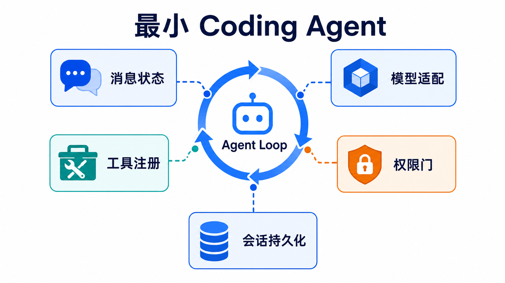
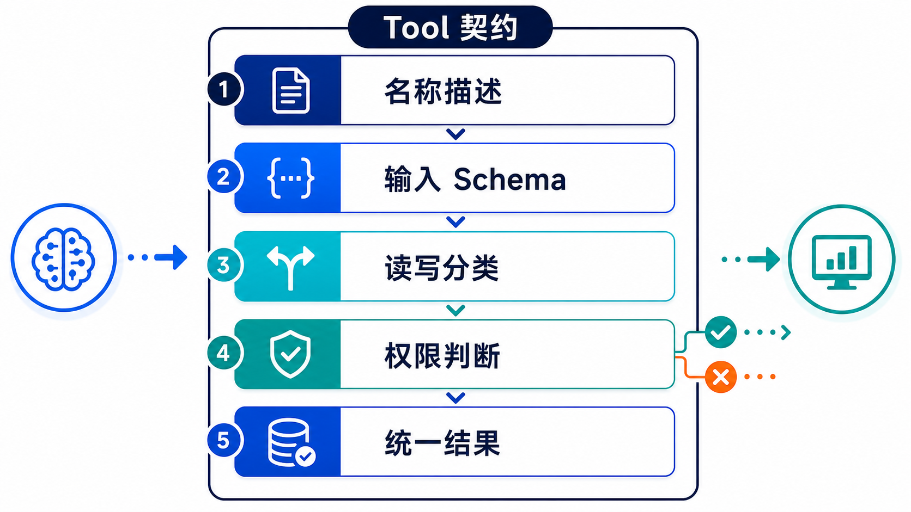
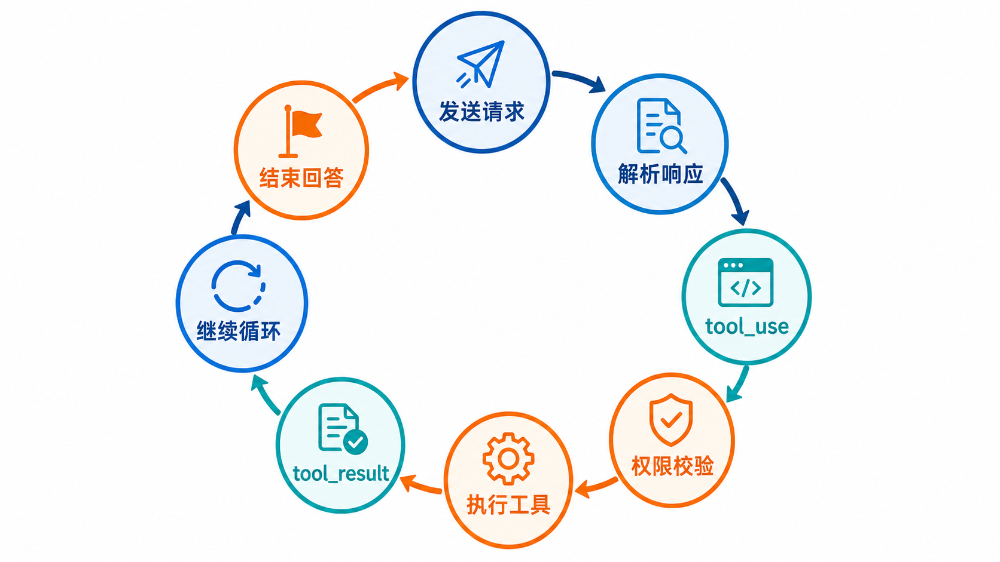
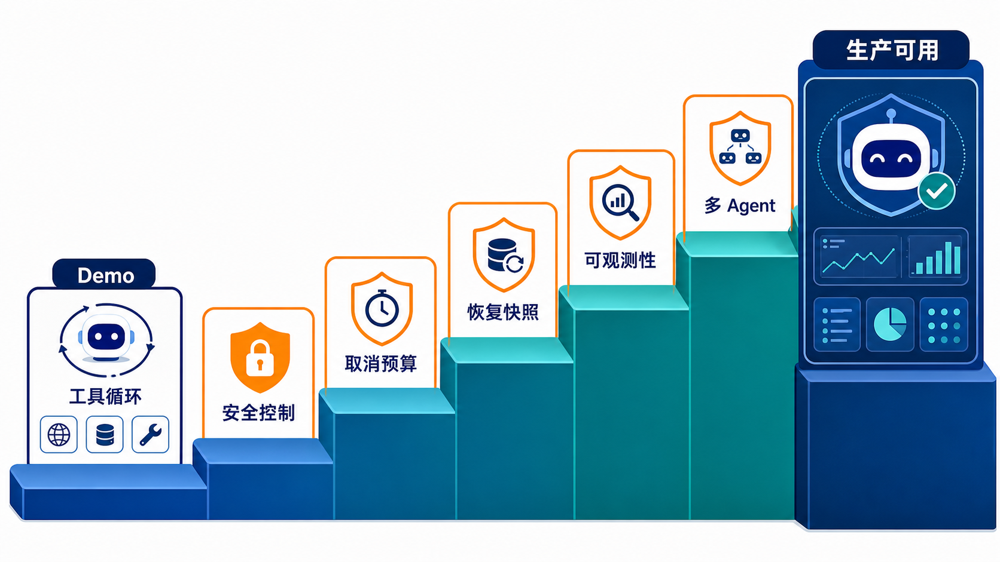

# 如何根据 Claude Code 原理实现一个最小 Coding Agent？

一个模型加三个函数，算不算 Coding Agent？

如果模型能调用 `readFile`、`writeFile` 和 `runCommand`，它确实可以完成一次演示。但只要工具结果没有正确回填、写操作没有权限门、循环没有轮数上限，它就可能卡住、重复写入，甚至在错误目录执行命令。

学习 Claude Code 源码的价值，不是复制它庞大的工程模块，而是看清哪些东西构成了 Agent 的最小闭环。

**一个最小但结构正确的 Coding Agent，需要消息状态、模型适配器、工具注册表、权限门、Agent Loop 和会话持久化六个部分。**

## 先定义目标：这次“最小”要小到什么程度？

我们实现的版本只承诺四件事：

1. 接收用户编码任务；
2. 模型可以读取文件、写文件和运行受限命令；
3. 工具结果回到下一轮模型请求；
4. 用户可以取消，循环有轮数上限，会话可以追加保存。

它暂时不做 TUI、MCP、Plugin、子 Agent、上下文压缩和自动模型降级。这些都是生产能力，但不是理解核心闭环的前提。

技术选择也尽量朴素：TypeScript、一个支持 Tool Use 的模型客户端、Zod 或 JSON Schema 做参数验证。代码以架构示例为主，不绑定某家 SDK 的具体类型。

目录可以只有六个模块：

```latex
src/
├── model.ts
├── tools.ts
├── permissions.ts
├── session.ts
├── agent-loop.ts
└── main.ts
```

注意，这不是按 Claude Code 源码目录复刻，而是把前面文章提炼出的职责压缩到最小项目里。



## 第一步：让消息成为唯一可信的循环状态

Agent Loop 的输入不只是用户最后一句话，而是一条完整消息链。

最小类型可以这样定义：

```typescript
type TextBlock = {
  type: 'text'
  text: string
}

type ToolUseBlock = {
  type: 'tool_use'
  id: string
  name: string
  input: unknown
}

type ToolResultBlock = {
  type: 'tool_result'
  toolUseId: string
  content: string
  isError?: boolean
}

type Message =
  | { role: 'user'; content: Array<TextBlock | ToolResultBlock> }
  | { role: 'assistant'; content: Array<TextBlock | ToolUseBlock> }
```

为什么不把工具结果存在另一个数组？因为下一轮模型必须看到工具结果与对应 `tool_use` 的因果关系。分离存储后，很容易漏传或顺序错位。

每个 Tool Use 都有稳定 ID，结果通过 `toolUseId` 配对。这个约束应该在进入模型适配器前校验。

还要区分“会话历史”和“当前工作状态”。历史消息用于模型上下文；轮数、成本、取消控制器和已执行工具 ID属于 Runtime状态，不应该伪装成普通文本塞给模型。

## 第二步：把模型差异关进适配器

Agent Loop 不应该直接依赖某个 SDK 的流事件名称。

可以让适配器只暴露一个稳定接口：

```typescript
type ModelResponse = {
  content: Array<TextBlock | ToolUseBlock>
  stopReason: 'end_turn' | 'tool_use' | 'max_tokens'
  usage: { inputTokens: number; outputTokens: number }
}

interface ModelAdapter {
  complete(input: {
    system: string
    messages: Message[]
    tools: ToolSchema[]
    signal: AbortSignal
  }): Promise<ModelResponse>
}
```

适配器负责把本地消息转成供应商格式，把返回内容归一化，并把 SDK 超时、用户取消和 API错误映射到本地错误类型。

这样做的好处不只是方便换模型。重试策略、流式解析和使用量统计也被限制在清晰边界中，Agent Loop只处理“文本、工具调用或结束”。

如果后续加入流式响应，可以让适配器额外提供 `AsyncGenerator<ModelEvent>`，但最终仍汇总成同一个 `ModelResponse`。不要让半截流事件直接污染会话消息。



## 第三步：Tool 不是函数表，而是一份执行契约

每个工具至少需要名称、描述、输入 Schema、读写分类和执行函数。

```typescript
type ToolContext = {
  cwd: string
  signal: AbortSignal
}

type Tool<I> = {
  name: string
  description: string
  inputSchema: z.ZodType<I>
  readOnly: boolean
  execute(input: I, ctx: ToolContext): Promise<string>
}
```

工具注册表负责按名称查找：

```typescript
class ToolRegistry {
  private tools = new Map<string, Tool<unknown>>()

  register(tool: Tool<unknown>) {
    if (this.tools.has(tool.name)) {
      throw new Error(`duplicate tool: ${tool.name}`)
    }
    this.tools.set(tool.name, tool)
  }

  get(name: string) {
    return this.tools.get(name)
  }

  schemas(): ToolSchema[] {
    return [...this.tools.values()].map(toModelSchema)
  }
}
```

输入必须在执行前校验。模型生成的参数不是可信程序输入，路径穿越、空命令和超长内容都应由 Schema 与工具实现共同拒绝。

工具结果统一返回字符串只是最小方案。生产版可以返回结构化内容、附件和进度，但必须有统一归一化层，让 Agent Loop不用知道每个工具的内部形态。

## 第四步：权限判断必须位于模型和执行器之间

模型请求调用工具，不代表工具应该执行。

最小权限门可以按只读与写入分类：

```typescript
type PermissionDecision =
  | { behavior: 'allow' }
  | { behavior: 'deny'; message: string }
  | { behavior: 'ask'; reason: string }

async function canUseTool(
  tool: Tool<unknown>,
  input: unknown,
): Promise<PermissionDecision> {
  if (tool.readOnly) return { behavior: 'allow' }

  return {
    behavior: 'ask',
    reason: `${tool.name} 会修改外部状态`,
  }
}
```

CLI Demo 可以在 `ask` 时读取用户确认；无交互模式则默认拒绝，或者要求调用方预先提供允许规则。

真实权限不能只依赖 `readOnly` 布尔值。`runCommand("cat file")` 看似只读，换成 `rm` 就有副作用。第二阶段要加入工具专属分类：解析命令、限制路径、匹配允许与拒绝规则。

还有一个重要顺序：先校验输入，再展示确认。否则界面显示的是未经解析的模糊参数，用户不知道真正会执行什么。



## 第五步：写出真正闭环的 Agent Loop

核心循环只做八件事：发送请求、解析响应、记录 Assistant 消息、寻找 Tool Use、校验权限、执行工具、追加 Tool Result、决定继续或结束。

```typescript
// 示例代码：最小 Agent Loop
async function runAgent(
  messages: Message[],
  runtime: Runtime,
) {
  for (let turn = 1; turn <= runtime.maxTurns; turn++) {
    throwIfAborted(runtime.signal)

    const response = await runtime.model.complete({
      system: runtime.systemPrompt,
      messages,
      tools: runtime.tools.schemas(),
      signal: runtime.signal,
    })

    const assistant: Message = {
      role: 'assistant',
      content: response.content,
    }
    messages.push(assistant)
    await runtime.session.append(assistant)

    const calls = response.content.filter(
      (block): block is ToolUseBlock =>
        block.type === 'tool_use',
    )

    if (calls.length === 0) {
      return collectText(response.content)
    }

    const results = await executeCalls(calls, runtime)
    const userResult: Message = {
      role: 'user',
      content: results,
    }
    messages.push(userResult)
    await runtime.session.append(userResult)
  }

  throw new Error('maximum turns reached')
}
```

这段循环最重要的不是 `for`，而是消息追加位置。Assistant 的 `tool_use` 先进入历史，执行结果再作为 User 消息紧随其后。下一轮模型才能看见严格配对的调用与结果。

如果工具被拒绝，也要生成 `tool_result`，内容说明拒绝原因。不能悄悄丢弃 Tool Use，否则消息协议不闭合，模型也不知道为什么动作没有发生。

### 第六步：工具调用怎样执行才不会互相踩踏？

最安全的最小版是串行执行所有工具。实现简单，副作用顺序确定。

第二阶段可以像 Claude Code 那样区分只读和写入：连续只读工具并行，写操作形成屏障。

```typescript
// 示例代码：保守的串行执行器
async function executeCalls(
  calls: ToolUseBlock[],
  runtime: Runtime,
): Promise<ToolResultBlock[]> {
  const results: ToolResultBlock[] = []

  for (const call of calls) {
    const tool = runtime.tools.get(call.name)
    if (!tool) {
      results.push(errorResult(call.id, 'tool not found'))
      continue
    }

    const parsed = tool.inputSchema.safeParse(call.input)
    if (!parsed.success) {
      results.push(errorResult(call.id, parsed.error.message))
      continue
    }

    const decision = await runtime.permissions.check(
      tool,
      parsed.data,
    )
    if (decision.behavior !== 'allow') {
      results.push(errorResult(call.id, decisionToText(decision)))
      continue
    }

    try {
      const content = await tool.execute(parsed.data, {
        cwd: runtime.cwd,
        signal: runtime.signal,
      })
      results.push(successResult(call.id, content))
    } catch (error) {
      results.push(errorResult(call.id, toMessage(error)))
    }
  }

  return results
}
```

注意工具异常被转换成 Tool Result，而不是直接炸毁整个 Agent Loop。这样模型可以看到错误，选择修正参数或换一种方案。

用户取消是例外。取消信号应向上抛出并结束整个循环，不能被包装成普通工具失败后继续。

### 第七步：最小持久化和恢复怎样做？

会话存储可以从 JSONL 开始。每次追加 Message 时写一行，写入通过单队列保持顺序。

```typescript
class JsonlSession {
  constructor(private path: string) {}

  async append(message: Message) {
    await enqueueWrite(
      this.path,
      JSON.stringify({
        version: 1,
        timestamp: new Date().toISOString(),
        message,
      }) + '\n',
    )
  }
}
```

启动时逐行读取合法记录，尾部损坏就停止在最后一条完整记录。恢复后创建新的 `AbortController`，重新加载当前权限和 cwd，再接受新的用户消息。

此时还不能安全恢复“执行到一半的写工具”。因此最小版要规定：只有完整 Tool Result 落盘后，该工具才算确认完成；发现孤立 Tool Use 时，向用户报告并要求检查磁盘，不自动重放写操作。

下一阶段再增加工具执行账本和文件快照。先诚实地停止，比伪装成无缝恢复更安全。

## 从 Demo 走向生产，应该按什么顺序加能力？

最小循环跑通后，不要第一时间加十种 Tool。系统的下一个瓶颈通常是控制能力。

第一层加入安全控制：路径边界、命令分类、交互确认、拒绝规则和无交互默认拒绝。

第二层加入取消和预算：模型请求、退避等待、工具执行共享可传播信号；限制轮数、token、累计时间和费用。

第三层加入恢复：追加式工具账本、文件增量快照、幂等键和会话重建。

第四层加入可观测性：每轮延迟、模型使用量、工具成功率、权限拒绝、终止原因和父子调用链。

第五层才是多 Agent、MCP、Skills 和 Plugins。没有前四层，多 Agent只会把不可控问题放大。

生产化不是让核心循环越来越复杂。相反，应保持 Agent Loop只负责状态推进，把重试、权限、工具、持久化和委派放在明确边界里。



## 把六个模块接起来时，依赖关系应该朝哪个方向？

模块都有了，不代表拼起来就是好架构。最容易出现的问题是循环依赖：Tool直接修改 Session，Session又调用权限 UI，模型适配器还偷偷读取全局 cwd。最后任何一处都无法单测。

可以固定一条依赖方向：

```latex
main
  └─ AgentRuntime
       ├─ ModelAdapter
       ├─ ToolRegistry
       ├─ PermissionService
       └─ SessionStore
```

AgentRuntime 是编排者，其他模块只暴露能力。Tool执行函数接收显式 `ToolContext`，不能从全局变量读取会话；SessionStore只保存事件，不负责决定是否执行；ModelAdapter只做协议转换，不直接运行工具。

入口负责组装依赖：

```typescript
// 示例代码：应用入口
const controller = new AbortController()
const registry = new ToolRegistry()
registry.register(readFileTool)
registry.register(writeFileTool)
registry.register(runCommandTool)

const runtime = new AgentRuntime({
  model: new ProviderModelAdapter(config),
  tools: registry,
  permissions: new CliPermissionService(),
  session: new JsonlSession(sessionPath),
  systemPrompt: buildCodingPrompt(),
  cwd: projectRoot,
  signal: controller.signal,
  maxTurns: 20,
})

process.once('SIGINT', () => controller.abort())
await runtime.submit(userPrompt)
```

`main` 可以替换 CLI 为 HTTP服务，核心循环不变；测试时替换 `ModelAdapter` 为脚本化假模型，精确返回 Tool Use；权限服务也可以换成固定 allow/deny，从而复现每条分支。

测试假模型非常重要。依赖真实模型输出会让回归测试不稳定，也难以覆盖“两个 Tool Use、第二个参数非法”“写工具成功后取消”等边界。脚本化事件能验证的是 Runtime协议，不是模型聪明程度。

```typescript
// 示例代码：可重复的假模型
const fakeModel = new ScriptedModel([
  responseWithToolUse('read_file', { path: 'src/a.ts' }),
  responseWithText('入口位于 src/a.ts'),
])
```

系统提示也应作为依赖传入，而不是散落在 Tool描述里。最小提示只说明身份、工作目录、工具使用原则和完成标准；参数约束放在 Schema，安全边界放在权限层，避免一条超长 Prompt承担所有职责。

还要统一错误出口。入口接收到 `Cancelled`、`BudgetExceeded`、`PermissionDenied` 或 `RuntimeError` 后，分别设置退出码和用户提示；不要让底层 SDK堆栈直接成为最终回答。

**依赖方向清晰之后，每一层都能被替换和验证，Agent Loop也才能保持“小”。** 生产能力增加时，通常是新增一个实现或包装器，而不是不断往循环里插条件分支。

这个结构还方便加入中间件。重试可以包装 `ModelAdapter`，遥测可以包装模型和工具执行，内容截断可以包装 Session投影，核心接口不需要知道这些能力的存在。

```typescript
// 示例代码：用装饰器增加观测与重试
const model = new RetryingModelAdapter(
  new TracedModelAdapter(
    new ProviderModelAdapter(config),
    tracer,
  ),
  retryPolicy,
)
```

中间件顺序必须明确。先观测再重试，会得到每次尝试的独立 Span；先重试再观测，只会得到整个恢复过程的总耗时。两种都合理，但回答的问题不同。生产系统通常同时保留“逻辑调用”和“物理尝试”两个层级。

工具执行也可以使用同样结构：`ValidatedTool` 先校验参数，`PermissionedTool` 再判断权限，`TracedTool` 记录耗时，最内层才产生副作用。顺序错了，未经许可的参数就可能提前进入外部日志或执行器。

配置则应该在 Runtime创建时冻结一份快照。模型、最大轮数、cwd 和允许工具如果在循环中被全局配置热更新，前后两轮可能使用不同规则，却没有任何会话记录。需要动态切换时，显式产生一个配置变更事件。

最后，系统提示、Tool Schema 和消息投影可以计算内容摘要并写入调试记录。遇到“模型为什么没调用工具”时，你才能确认当轮到底发送了什么，而不是只看源代码推测。

## 怎样验证这个最小 Agent 真的“结构正确”？

至少跑六个场景。

第一，模型直接回答，不调用工具。循环应在一轮结束。

第二，读取文件后回答。历史中应出现 Assistant Tool Use、User Tool Result、下一轮 Assistant文本。

第三，模型传入非法参数。工具不能执行，模型收到结构化错误后有机会修正。

第四，写文件被用户拒绝。拒绝作为 Tool Result回填，会话协议仍然闭合。

第五，工具执行时取消。模型不再继续下一轮，会话记录保持到最后确认节点。

第六，达到最大轮数。系统返回明确终止原因，而不是无限调用。

测试时不要只断言最终文本。还要断言消息序列、工具执行次数、取消传播和持久化行数。Agent 的正确性主要存在于过程。

再加两类故障注入会更接近生产。让模型适配器第一次返回 429、第二次成功，验证重试没有重复追加用户消息；让写工具完成后模拟会话写入失败，验证系统停止自动重放，并把磁盘检查提示作为恢复结果。

性能测试也不需要真实大模型。假模型连续产生二十轮 Tool Use，可以检查消息数组、持久化文件和工具结果是否线性增长；若一次追加导致整个历史重复序列化，很快就能在这个测试里暴露。

最后做一次权限回归：把同一写工具分别放在交互、无交互和预授权模式下运行。三种模式应该产生允许、拒绝或询问的确定结果，而不是依赖模型是否“自觉”。

回到文章开头：模型加三个函数可以完成 Demo，却还不是一个结构完整的 Coding Agent。

**真正的最小闭环是：模型只负责产生文本或工具意图；Tool 契约负责验证能力；权限门决定动作能否发生；执行结果严格回填消息链；循环在回答、取消或预算边界停止；关键消息按顺序持久化。**

把这个版本写出来之后，再回头看 Claude Code 的上下文压缩、子 Agent、MCP 和恢复机制，你会发现它们不是互不相干的功能，而是在同一个小闭环外逐层补上规模、安全和可靠性。
