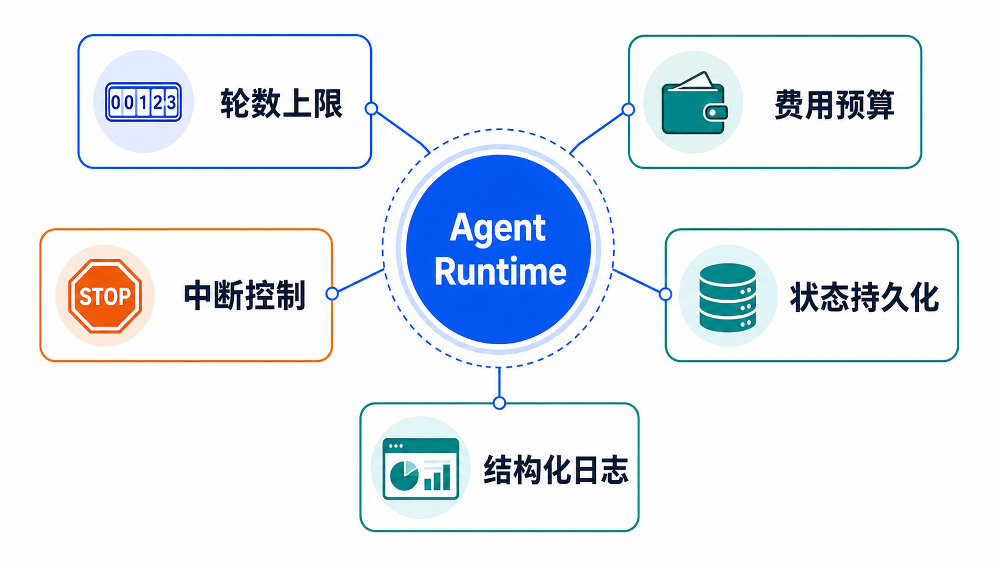
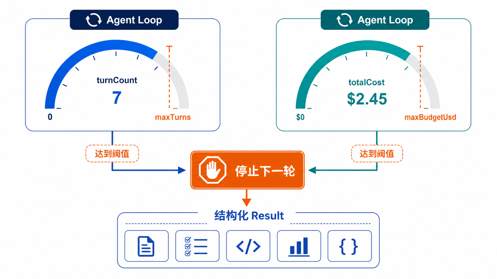
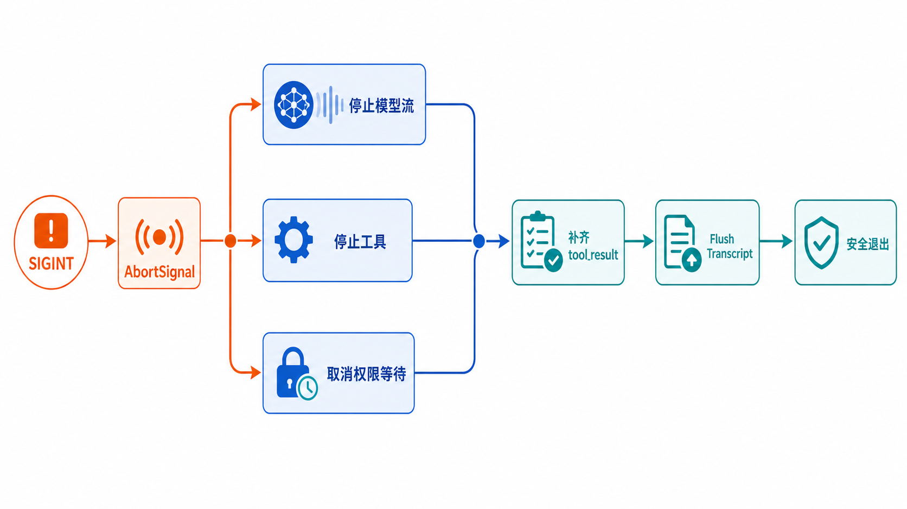
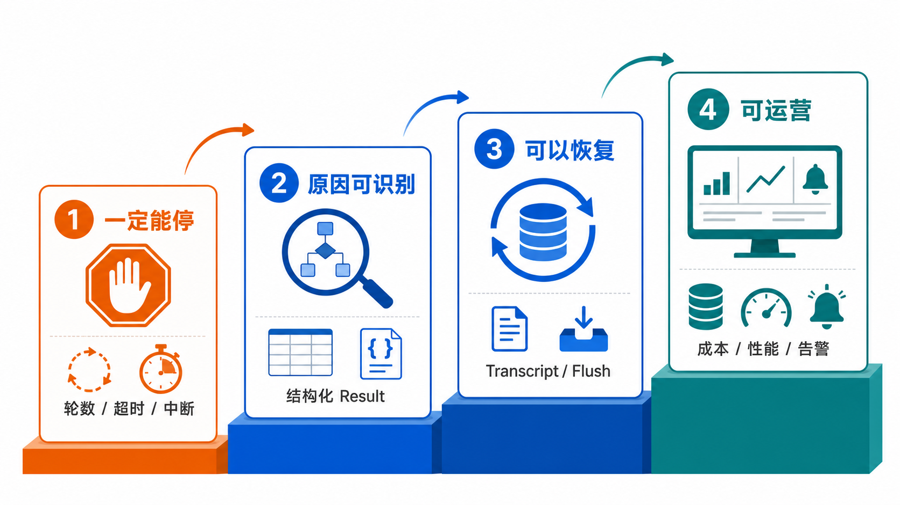

# 从 Demo 到生产：Agent 的轮数、预算、日志、中断和状态应该如何设计？

写一个能跑起来的 Agent，往往只需要几十行代码。

准备一组工具，把用户消息发给模型；如果模型返回 `tool_use`，就执行工具并把结果送回去。这个循环一旦打通，Demo 看起来已经很像一个完整产品。

可只要把它放到真实任务里，问题就来了。

模型连续调用几十次工具怎么办？测试命令卡住以后怎么停？已经花掉的 Token 和费用在哪里统计？用户按下 Ctrl+C 时，正在写入的会话会不会损坏？进程退出以后，又该怎么判断这次任务究竟是成功、超预算，还是执行到一半崩了？

**Demo 证明 Agent 能做事，生产系统则要证明它能被约束、被观察、被中断，而且失败后还能解释发生了什么。**

Claude Code 的恢复源码里，QueryEngine、`query()` 和 Headless 运行路径正好给出了一套比较完整的答案。这篇文章不讨论某个模型有多聪明，而是集中看五个生产问题：轮数、预算、中断、状态和日志。

## 一、生产级 Agent，首先要有“护栏”

可以把一个长期运行的 Agent 想成一辆自动驾驶车辆。

模型能力决定它会不会判断路线，工具决定它能不能转向和加速。但一辆真正上路的车，还需要速度上限、刹车、仪表盘、行车记录和故障码。

Agent 也是一样。

| 生产问题 | 对应护栏 | 没有它会怎样 |
| --- | --- | --- |
| 循环过长 | `maxTurns` | 一直调用模型和工具 |
| 成本失控 | `maxBudgetUsd` | 单次任务费用不可预测 |
| 用户想停止 | `AbortController` | 模型停了，工具还在运行 |
| 进程异常退出 | Transcript 持久化 | 无法恢复，也无法复盘 |
| 结果不明确 | 结构化 Result | 上层只看到“进程结束了” |
| 故障难定位 | Usage、Duration、Errors | 无法判断慢在模型还是工具 |

这些机制有一个共同特点：它们不能只写在 Prompt 里。

你当然可以告诉模型“最多执行十轮”或者“请节省 Token”，但模型的回答不是可靠的系统边界。真正的上限必须由运行时计数，真正的停止必须由程序发出中断信号。

**生产护栏的本质，是把概率性的模型行为包在确定性的程序约束里。**



## 二、边界应该放在哪一层？

一种常见写法，是在最外层给整个 Agent 加一个超时：

```typescript
await Promise.race([
  runAgent(prompt),
  timeout(10 * 60 * 1000),
])
```

它能防止进程永久挂住，却不知道 Agent 内部发生了什么。

也许 Agent 已经执行了二十轮，只差最后一次测试；也许第一次 Bash 就卡住了；也许模型已经超出预算，但工具仍在继续执行。外层超时只能粗暴切断，无法给上层返回准确原因。

Claude Code 的做法更像分层限流：

- `query()` 在 Agent Loop 内部检查轮数和中断；
- QueryEngine 在消费消息时累计费用和用量；
- Tool 执行链把同一个 AbortSignal 传给具体工具；
- Headless 宿主接收 SIGINT，并触发优雅关闭；
- Result 消息把结束原因交给 SDK 或调用方。

也就是说，边界不是一个总开关，而是沿运行链逐层传递。

这张图最值得注意的是，中断信号和状态记录会穿过多层。它们不是某个 UI 的附加功能，而是 Agent Runtime 的基础协议。

## 三、`maxTurns` 限制的到底是什么？

“最多十轮”听起来很简单，但首先要定义一轮是什么。

在 Claude Code 的查询循环里，只要模型产生工具调用，运行时就会执行工具、收集结果，然后准备下一次模型请求。源码在把工具结果并入消息历史前计算下一轮：

```typescript
const nextTurnCount = turnCount + 1

if (maxTurns && nextTurnCount > maxTurns) {
  yield createAttachmentMessage({
    type: 'max_turns_reached',
    maxTurns,
    turnCount: nextTurnCount,
  })

  return {
    reason: 'max_turns',
    turnCount: nextTurnCount,
  }
}
```

这里限制的不是模型输出了多少个文本块，也不是执行了多少个工具，而是 Agent 即将带着工具结果再次进入模型决策的次数。

这个位置很重要。

如果只在模型调用前做一个全局计数，可能在工具已经执行后直接退出，却没有把结果转换成清晰的终止事件。现在的流程会先产生 `max_turns_reached` Attachment，再由 QueryEngine 转换成结构化结果：

```typescript
{
  type: 'result',
  subtype: 'error_max_turns',
  is_error: true,
  num_turns: turnCount,
  errors: [
    `Reached maximum number of turns (${maxTurns})`,
  ],
}
```

于是 SDK 调用方不需要从一段自然语言里猜测“是不是超过轮数了”，而是能直接按 `subtype` 处理。

自己设计 Agent 时，也应该先定义清楚：

1. 一轮从哪里开始，到哪里结束；
2. 达到上限时是否允许当前工具收尾；
3. 上限是正常停止还是错误；
4. 调用方通过什么字段识别结束原因。

没有这些定义，`maxTurns = 10` 只是一个看似明确、实际含糊的配置。



## 四、预算为什么不能只在最后统计？

轮数上限控制执行长度，却不能直接控制费用。

一轮可能只是很短的模型判断，也可能带着庞大上下文和长输出。不同模型的单次成本也不同，因此生产系统还需要独立的费用边界。

QueryEngine 在消费流式消息时累计 Usage，并在每次处理消息后检查总费用：

```typescript
if (
  maxBudgetUsd !== undefined &&
  getTotalCost() >= maxBudgetUsd
) {
  yield {
    type: 'result',
    subtype: 'error_max_budget_usd',
    is_error: true,
    num_turns: turnCount,
    total_cost_usd: getTotalCost(),
    usage: totalUsage,
    modelUsage: getModelUsage(),
    errors: [
      `Reached maximum budget ($${maxBudgetUsd})`,
    ],
  }

  return
}
```

这段逻辑有两个值得迁移的设计。

第一，预算检查发生在运行过程中，而不是任务结束以后。只有这样，预算才是控制器，而不只是账单。

第二，超预算结果同时返回总费用、总 Usage、分模型用量和已经执行的轮数。调用方不仅知道“为什么停”，也知道“停之前消耗了多少”。

不过，费用边界也有天然误差。

当一次模型请求已经发出时，客户端无法在任意 Token 位置精确刹停；工具产生的外部费用也未必包含在模型 Usage 中。因此 `maxBudgetUsd` 更像“达到阈值后不再继续下一步”，而不是信用卡级别的硬实时额度。

更严格的系统还需要：

- 在请求前估算最坏成本；
- 给模型、工具和第三方 API 分别记账；
- 为单次任务、用户和团队设置不同额度；
- 对昂贵工具增加单独审批。

## 五、用户按下 Ctrl+C，为什么不能直接 `process.exit()`？

最直接的退出方式是杀掉进程。

它确实能停下来，却可能让系统停在最糟糕的时刻：模型流只收到一半、工具正在写文件、Transcript 还在缓冲区，或者遥测和费用数据尚未刷新。

Claude Code 的 Headless 路径会把 SIGINT 转成中断信号，再进入优雅关闭：

```typescript
const sigintHandler = () => {
  if (
    abortController &&
    !abortController.signal.aborted
  ) {
    abortController.abort()
  }

  void gracefulShutdown(0)
}

process.on('SIGINT', sigintHandler)
```

AbortController 的价值在于，它可以沿调用链向下传播。

模型流监听 Signal 后可以停止读取；ToolUseContext 把同一类信号交给工具；权限等待也能和中断 Promise 竞速。这样，中断不只是“UI 不再显示”，而是让仍在工作的组件收到同一个停止意图。

`query()` 还会区分中断发生的位置：

- 模型流期间中断：`aborted_streaming`；
- 工具执行期间中断：`aborted_tools`；
- Hook 阻止继续：`hook_stopped`。

这比统一返回 `cancelled` 更有诊断价值。

更关键的是，即使工具中途停止，运行时也要尽量补齐对应的 `tool_result`。模型已经产生的 `tool_use` 不能孤零零留在消息历史里，否则恢复会话时可能出现协议不完整。

因此，生产 Agent 的中断流程应该是：

接收外部信号 → 触发共享 AbortSignal → 等待关键组件清理 → 补齐消息状态 → 刷新持久化 → 最后退出进程。



## 六、为什么 Transcript 要边运行边写？

很多 Demo 只在任务结束后保存一次完整对话。

正常完成时没有问题，可一旦进程崩溃、机器重启或宿主提前结束进程，本轮所有状态都会丢失。

QueryEngine 会在处理 Assistant、User、Attachment 和 Progress 等消息时更新内存状态，并按消息类型记录 Transcript。完成前还会显式刷新需要落盘的数据。

可以把这种设计理解成一个事件日志：

```latex
User Message
Assistant tool_use
Tool progress
User tool_result
Compact boundary
Assistant final text
Result
```

恢复会话时，系统不是寻找某个巨大对象的最后快照，而是根据已经记录的消息重建状态。

事件式持久化还有一个好处：它保留了因果关系。

你能知道某个文件修改来自哪个 `tool_use`，权限拒绝发生在什么位置，压缩边界之前保存了哪些消息。对调试 Agent 来说，这比只保存最终答案有价值得多。

当然，边运行边写也会带来写入频率和一致性成本。

Claude Code 的代码中既有异步排队写入，也有在关键退出点主动 Flush 的逻辑。这个取舍很常见：

- 每条消息同步落盘最安全，但会拖慢流式输出；
- 全部放在内存里最快，但崩溃时丢失最多；
- 队列写入加关键节点 Flush，通常是两者之间的平衡。

如果你自己的 Agent 会修改真实项目，至少应在这些节点保证持久化：

1. 用户消息进入会话以后；
2. 工具产生不可逆副作用以后；
3. 上下文压缩边界生成以后；
4. 向 SDK 返回最终 Result 以前；
5. 收到退出信号以后。

## 七、日志为什么不能只打印报错堆栈？

Agent 的失败经常不是一个 Exception。

模型可能正常返回，却没有产生可用结果；权限连续被拒绝；工具执行完成，但最终消息只有未配对结果；任务耗时很长，却没有任何单步报错。

因此，QueryEngine 输出的最终 Result 会包含多类诊断字段：

```typescript
{
  subtype: 'success' | 'error_during_execution',
  duration_ms,
  duration_api_ms,
  num_turns,
  stop_reason,
  total_cost_usd,
  usage,
  modelUsage,
  permission_denials,
  errors,
}
```

这些字段可以回答不同问题：

- `duration_ms`：用户一共等了多久；
- `duration_api_ms`：时间主要花在模型还是本地执行；
- `num_turns`：Agent 是否陷入反复尝试；
- `stop_reason`：最后一次模型响应为什么停止；
- `total_cost_usd`：一次任务的经济成本；
- `permission_denials`：任务是否被安全策略阻断；
- `errors`：运行时记录了哪些具体异常。

一个可观测的 Agent，应该同时记录三条时间线：

1. **模型时间线**：请求、首 Token、结束、Usage 和重试；
2. **工具时间线**：排队、权限等待、执行、进度和结果；
3. **会话时间线**：用户输入、状态变化、压缩、中断和最终结果。

只记录模型 API 日志，会看不到本地工具卡顿；只记录 Bash 输出，又无法解释模型为什么反复执行同一操作。



## 八、从 Demo 升级到生产，可以先补哪几层？

生产化不意味着第一天就搭建复杂平台。

更实际的做法，是按故障影响逐层补齐。

### 第一层：先让任务一定能停

- 设置最大轮数；
- 给模型和工具传递 AbortSignal；
- 捕获 SIGINT 和宿主取消事件；
- 给长时间工具设置超时。

### 第二层：让停止原因可以被程序识别

- 使用结构化 Result；
- 区分完成、超轮数、超预算、中断和执行错误；
- 保留 `tool_use_id` 与 `tool_result` 配对；
- 不用自然语言代替状态码。

### 第三层：让任务可以恢复和复盘

- 边运行边保存消息；
- 在关键副作用后 Flush；
- 保存会话 ID、模型、权限和工具版本；
- 给压缩、恢复和分支建立明确边界。

### 第四层：让成本和性能可运营

- 累计输入、输出和缓存 Token；
- 分开统计模型时间、工具时间和权限等待；
- 设置任务级、用户级和团队级预算；
- 对异常循环和重复工具调用报警。

回到开头，生产级 Agent 和 Demo 的区别，并不只是多了几条异常处理。

真正的变化是：运行时开始拥有明确的控制权。

模型可以建议继续，但 `maxTurns` 决定还能不能继续；模型可以请求昂贵工具，但预算和权限决定是否执行；用户可以随时中断，而 Transcript 和 Result 保证这次停止仍然可恢复、可解释。

最后可以把整篇文章压缩成三条设计原则：

**第一，所有软约束都要在运行时找到对应的硬边界。**

**第二，中断不是杀进程，而是一条需要向下传播、向上报告的状态变化。**

**第三，日志的目标不是证明程序报错了，而是还原 Agent 为什么走到这个结果。**

如果你的 Agent 已经能调用工具，下一步不要急着继续加工具。

先关掉网络、让某个工具卡住、把预算调得很低，再在执行中途按一次 Ctrl+C。系统能不能干净停止、返回明确原因，并在重启后解释刚才发生了什么，才是它有没有走出 Demo 的真正测试。
