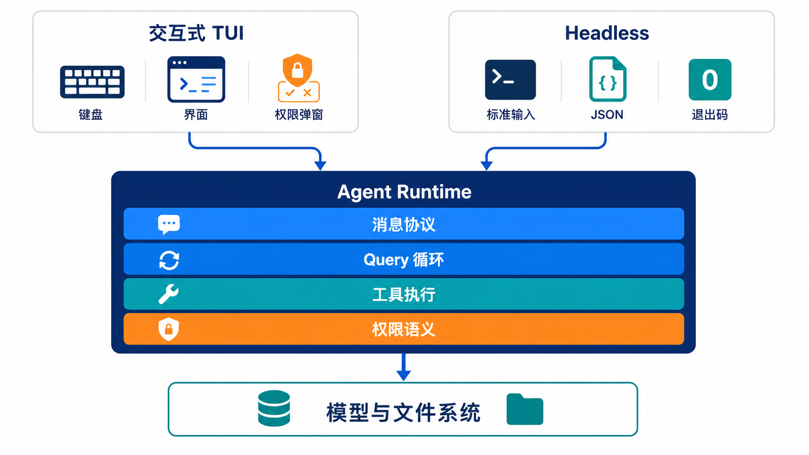
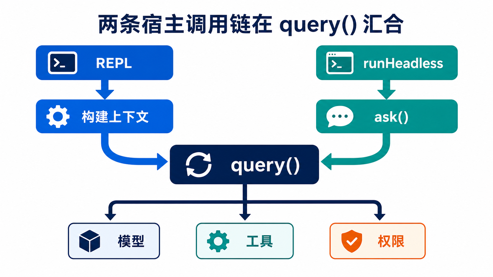
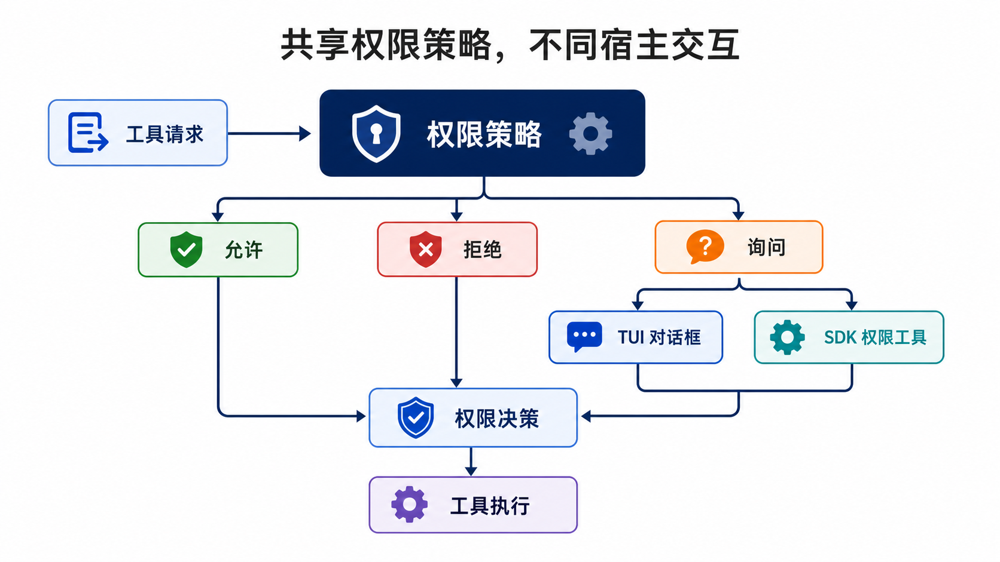
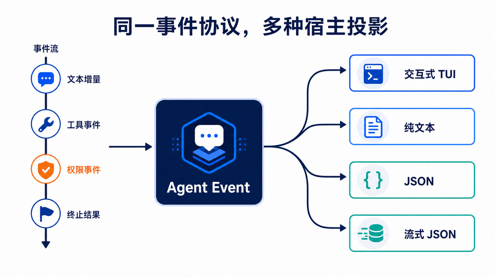

# 交互式 TUI 和 Headless 模式如何复用同一套 Agent Runtime？

同一个 Coding Agent，通常会长出两张完全不同的脸。

一张是交互式 TUI：用户能看到流式文字、工具进度、权限弹窗，随时继续输入或按下中断键。另一张是 Headless：它从参数或标准输入接收任务，把结果写成文本、JSON 或事件流，然后按约定的退出码结束。

这时很容易出现两套实现。TUI 写一套循环，脚本模式再写一套；前者处理权限弹窗，后者加一个自动批准；前者支持上下文压缩，后者忘了；最后，同一句 Prompt 在两个入口里得到不同工具、不同终止条件和不同会话行为。

Claude Code 源码提供的短答案是：**复用的重点不是让 TUI 和 Headless 共用一个入口函数，而是让它们在 UI 边界之下，复用同一套消息协议、Query 循环、工具执行、权限语义和会话状态。**

更准确地说，两个宿主拥有不同的“驾驶舱”，但它们不应该各造一台发动机。

## 先分清：宿主循环和 Agent Loop 不是一回事

TUI 有自己的宿主循环：监听键盘、更新 React 状态、渲染消息、显示工具进度、打开权限对话框。Headless 也有宿主循环：读取输入队列、处理控制请求、把内部事件序列化到标准输出、管理进程退出。

这些循环看起来都在“不断运行”，但它们与 Agent Loop 的职责不同。

Agent Loop 回答的是：

1. 当前消息和系统上下文是什么？
2. 应该调用模型还是执行工具？
3. 工具结果如何回到消息历史？
4. 什么情况下继续下一轮？
5. 什么情况下成功、失败、压缩或中断？

宿主循环回答的则是：

1. 用户输入从哪里来？
2. 事件展示成什么样？
3. 权限问题由谁回答？
4. 结果写到屏幕、JSON 还是 socket？
5. 宿主什么时候退出？

如果把这两层混在一起，TUI 组件里就会出现模型重试，Headless 输出器里又会复制工具编排。真正的复用，要先把“任务如何推进”和“宿主如何交互”切开。



## 入口可以分叉，但分叉要发生在正确的位置

Claude Code 的主入口先完成参数解析、配置、权限上下文和工具装配，然后根据 `isNonInteractiveSession` 选择 Headless 或交互路径。

Headless 分支直到使用时才动态加载输出模块：

```typescript
// 以下为裁剪后的核心代码
if (isNonInteractiveSession) {
  const { runHeadless } =
    await import('src/cli/print.js')

  void runHeadless(
    inputPrompt,
    () => headlessStore.getState(),
    headlessStore.setState,
    commandsHeadless,
    tools,
    sdkMcpConfigs,
    activeAgents,
    options,
  )
  return
}
```

交互路径则构造 `AppState`，再调用 `launchRepl()`。后者动态加载 React 应用和 REPL：

```tsx
// 以下为源码核心代码
export async function launchRepl(
  root,
  appProps,
  replProps,
  renderAndRun,
) {
  const { App } = await import('./components/App.js')
  const { REPL } = await import('./screens/REPL.js')

  await renderAndRun(
    root,
    <App {...appProps}>
      <REPL {...replProps} />
    </App>,
  )
}
```

为什么不从进程入口就完全拆成两个应用？

因为两种模式仍然需要共享一部分可信启动状态：工作目录、配置优先级、权限模式、工具集合、模型选择和会话标识。如果这些状态在两个独立入口中各自解析，差异会慢慢扩大。

为什么又不能等到 Agent Loop 内部再区分 TUI 和 Headless？

因为输入和输出的生命周期完全不同。TUI 必须响应渲染与按键，Headless 必须遵守机器可解析的流协议。把这些细节塞进 Runtime，会让核心循环到处判断 `if (interactive)`。

因此，合理的分叉点是：**共享可信配置与能力装配，分开宿主适配器，再汇入共同的 Query Runtime。**

## 真正共享的核心，是 `query()` 生成器

恢复源码中，交互式 REPL 直接调用 `query()`。它先并行准备 System Prompt、User Context 和 System Context，然后把 UI 已持有的消息、权限回调和工具上下文交给 Query：

```typescript
// 以下为裁剪后的核心代码
const [
  defaultSystemPrompt,
  baseUserContext,
  systemContext,
] = await Promise.all([
  getSystemPrompt(freshTools, model, dirs, freshMcpClients),
  getUserContext(),
  getSystemContext(),
])

const systemPrompt = buildEffectiveSystemPrompt({
  mainThreadAgentDefinition,
  toolUseContext,
  customSystemPrompt,
  defaultSystemPrompt,
  appendSystemPrompt,
})

for await (const event of query({
  messages: messagesIncludingNewMessages,
  systemPrompt,
  userContext: baseUserContext,
  systemContext,
  canUseTool,
  toolUseContext,
  querySource: getQuerySourceForREPL(),
})) {
  onQueryEvent(event)
}
```

Headless 路径外面多了一层 `runHeadless()` 和 `ask()`。它要维护输入队列、结构化输出、持久消息、读取文件状态和 SDK 控制请求，但进入 Agent 执行时，最终也遍历相同的 `query()`：

```typescript
// 以下为裁剪后的核心代码
for await (const message of query({
  messages,
  systemPrompt,
  userContext,
  systemContext,
  canUseTool: wrappedCanUseTool,
  toolUseContext: processUserInputContext,
  fallbackModel,
  querySource: 'sdk',
  maxTurns,
  taskBudget,
})) {
  // 记录消息、持久化 transcript、转换结果
}
```

这揭示了一个重要细节：所谓“复用同一套 Runtime”，不等于两个模式必须调用完全相同的最外层类。恢复源码里的 `QueryEngine` 更偏 Headless/SDK 会话包装，交互 REPL 直接驱动底层 `query()`。真正稳定的复用点，是再往下一层的 Query 协议和执行机制。



## 为什么 AsyncGenerator 特别适合做宿主边界

Agent 的一次响应不是一个字符串。它可能先产生流式文本，再产生 `tool_use`，随后出现权限判断、工具进度、`tool_result`、压缩边界，最后才形成终止结果。

如果 Runtime 直接调用 `renderText()`，它就绑定了终端。如果它直接拼装 JSON，又绑定了 SDK。异步生成器提供了更中性的接口：

```typescript
// 教学伪代码
async function* runAgent(input): AsyncGenerator<AgentEvent, Terminal> {
  yield { type: 'request_started' }
  yield { type: 'text_delta', text: '正在检查' }
  yield { type: 'tool_started', id: 't1', name: 'Read' }
  yield { type: 'tool_finished', id: 't1', result }
  return { status: 'success', usage, cost }
}
```

TUI 消费事件后更新本地状态；Headless 消费同一事件后序列化。两边可以选择不同的可见性，但不能篡改事件语义。

这个边界还有三个好处。

第一，背压自然存在。消费者没有取下一项时，生产者不会无限把事件推入内存。

第二，中断容易传递。宿主持有 `AbortController`，Runtime 和工具共享 `signal`。

第三，终止结果可以与过程事件分开。事件负责“发生了什么”，生成器返回值负责“最终为什么结束”。

当然，生成器也有边界。如果多个后台 Agent 同时产生事件，仅靠单一迭代器未必足够，需要事件队列、父子 ID 和顺序规则。但无论底层用生成器、Channel 还是 Observable，关键都是把 Runtime 暴露为事件协议，而不是暴露为 UI 回调集合。

## 权限回调必须由宿主提供，权限语义必须由 Runtime 保证

交互模式遇到危险工具时，可以弹出对话框；Headless 不能停在那里等一个永远不会出现的按键。是不是意味着两边需要两套权限系统？

不是。应当拆成两部分。

权限策略负责计算 `allow`、`deny` 或 `ask`，检查显式规则、Hook、沙箱和路径边界。这部分必须共享。权限交互负责在结果为 `ask` 时怎样取得答案，这部分由宿主注入。

```typescript
// 教学伪代码
type CanUseTool = (
  tool: Tool,
  input: unknown,
  signal: AbortSignal,
) => Promise<
  | { behavior: 'allow'; updatedInput?: unknown }
  | { behavior: 'deny'; message: string }
>

const tuiCanUseTool = createDialogPermissionAdapter(store)
const sdkCanUseTool = createPermissionToolAdapter(io)
```

TUI 适配器把请求写进状态，显示确认界面，再等待用户选择。SDK 适配器可以调用外部的 permission prompt tool，或在没有交互通道时根据模式拒绝。二者返回同一种决策，工具执行链不需要知道答案来自键盘、远端服务还是固定策略。

这里最不能做的是：Headless 一律自动允许。非交互不代表无风险。没有权限通道时，更安全的默认值通常是拒绝并输出结构化原因；确实需要自动化时，应通过明确的 allow 规则、沙箱或显式的绕过选项授权。



## 状态应该共享结构，不应该共享一个全局对象

两个模式都会用到消息、工具、MCP 客户端、权限上下文、文件读取缓存、费用和任务状态。最直接的复用方式似乎是做一个巨大的全局 Store，让 TUI 和 Headless 都读写它。

这会带来两个问题。

第一，生命周期不一致。TUI Store 会被 React 组件长期订阅；Headless 可能一轮结束就退出，也可能从标准输入接收多轮命令。全局状态很难正确清理。

第二，写入来源不清楚。界面为了展开一条消息而更新 Store，不应该影响 Runtime；Headless 为了序列化进度而增加字段，也不该污染交互模式。

源码采取的方向是共享 `AppState` 形状与 `getAppState`、`setAppState` 能力，再由宿主持有实例。Headless 的消息数组和文件读取缓存还会跨 `ask()` 调用持续存在：

```typescript
// 以下为裁剪后的核心代码
const mutableMessages: Message[] = initialMessages

let readFileState = extractReadFilesFromMessages(
  initialMessages,
  cwd(),
  READ_FILE_STATE_CACHE_SIZE,
)

for await (const message of ask({
  mutableMessages,
  getReadFileCache: () => readFileState,
  setReadFileCache: cache => {
    readFileState = cache
  },
  getAppState,
  setAppState,
  // ...
})) {
  output.enqueue(message)
}
```

可迁移的做法是把状态分三层：

- Runtime 状态：消息历史、轮数、预算、工具调用配对；
- 宿主状态：输入框、展开项、输出格式、socket 连接；
- 共享能力状态：权限上下文、工具池、模型配置，由显式接口访问。

共享类型与状态转换，比共享一个可随处修改的单例更可靠。

状态边界还决定了能否恢复会话。宿主重启后，真正需要恢复的是消息、文件读取版本、任务和权限拒绝等 Runtime 事实，而不是 TUI 上一次展开了哪张卡片。相反，Headless 的输出队列已经写出去多少、某个 socket 是否仍连接，也不该被塞进可跨版本恢复的会话记录。

判断一个字段放在哪里，可以问：换成另一个宿主，这个字段仍会改变模型下一步决策吗？如果会，它更接近 Runtime 状态；如果只改变用户怎样看见结果，它属于宿主状态；如果决定模型和工具能做什么，它属于共享能力状态。这个问题比按文件名分层可靠得多。

## 输出格式可以不同，协议事实不能不同

TUI 为了可读性，可以把多条流事件合并成一段文字，把每秒产生的工具进度替换为最新一条，把压缩边界渲染成提示卡。Headless 的 `stream-json` 则需要保留机器能识别的事件顺序和 ID。

展示可以不同，但以下事实必须稳定：

- 每个 `tool_use` 都有唯一 ID；
- 对应的 `tool_result` 使用相同 ID；
- 中断、拒绝和执行错误可以被区分；
- 压缩边界不会伪装成普通助手文字；
- 最终结果包含终止原因、轮数、用量和费用；
- 同一条事件不会因重试被宿主重复提交。

为什么这一点重要？

因为自动化调用者不会“看懂大概意思”。如果 Headless 只是把 TUI 文本去掉颜色后打印出来，调用者无法可靠判断是模型回答完了、预算耗尽了，还是工具被拒绝了。

因此应该先定义领域事件，再分别实现渲染器：

```typescript
// 教学伪代码
interface HostAdapter {
  readInput(): AsyncIterable<HostCommand>
  requestPermission(req: PermissionRequest): Promise<Decision>
  emit(event: AgentEvent): void
  finish(result: TerminalResult): Promise<void>
}
```

TUI Adapter 把 `emit()` 映射为界面状态；JSON Adapter 把它映射为一行一条的事件；文本 Adapter 只挑选面向人的结果。Runtime 不应该为了某个输出格式改变内部事实。



## 设计自己的多宿主 Agent，先守住这六条边界

第一，入口共享配置、权限和能力装配，但在 UI/IO 层及时分叉。

第二，把 Agent Loop 做成不依赖终端的事件生产者。它可以使用异步生成器，也可以使用有类型的事件通道。

第三，权限策略放在 Runtime 侧，权限交互通过回调或 Adapter 交给宿主；无交互通道时不要默许危险操作。

第四，区分 Runtime 状态、宿主状态和共享能力状态，避免巨型全局 Store。

第五，为过程事件与最终结果分别建模。文本、JSON 和 TUI 可以有不同投影，但必须保留相同的工具 ID、错误类型与终止原因。

第六，用契约测试同时跑两个宿主。给定相同消息、固定模型响应和伪工具，断言它们产生相同的工具调用顺序、权限结果和 Terminal Result；至于界面画成什么颜色，不属于 Runtime 测试。

回到开头的问题：交互式 TUI 和 Headless 模式怎样复用同一套 Agent Runtime？

不是把两种模式硬塞进一个巨型 `run()`，也不是强迫它们共享全部状态。正确的复用，是让宿主负责输入、展示和交互，让 Query Runtime 负责上下文、模型、工具、权限语义与终止。

**可以有两套驾驶舱，但消息协议、执行规则和安全边界只能有一套。**这条边界守住之后，你再增加 IDE、桌面端、Web 服务或定时任务，也只是多写一个宿主适配器，而不是重新实现一个 Agent。
