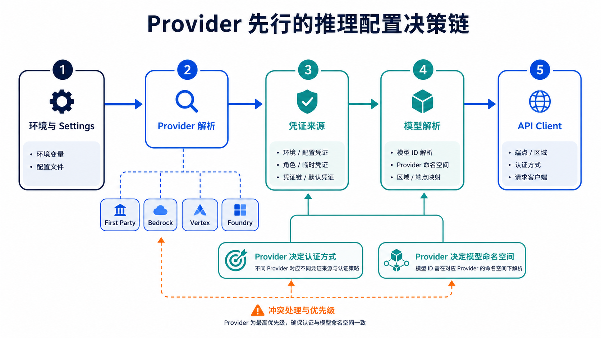
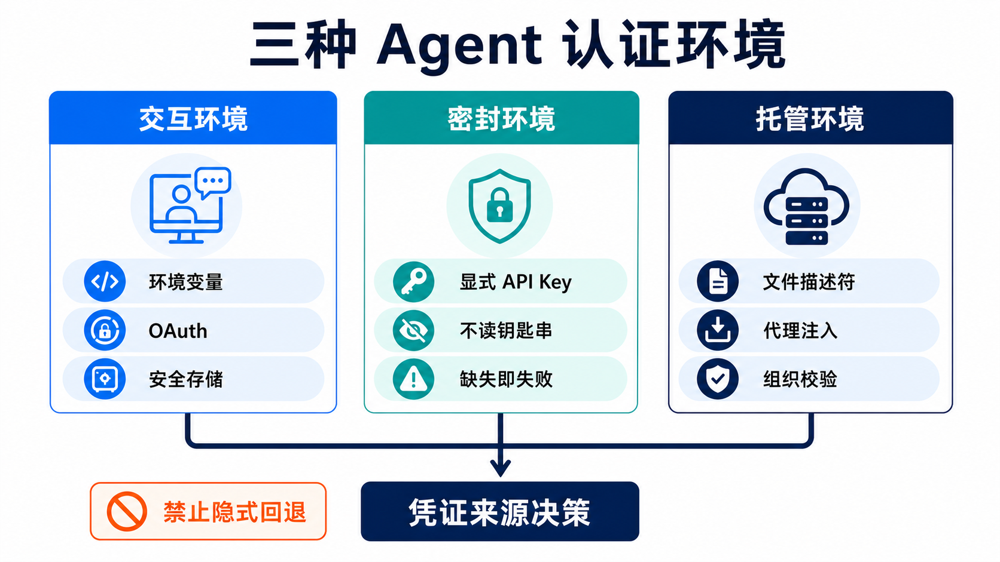
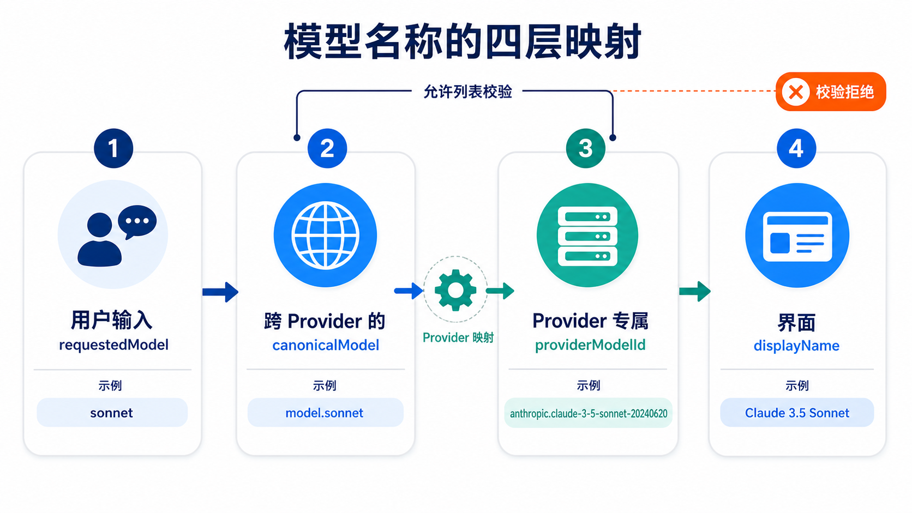
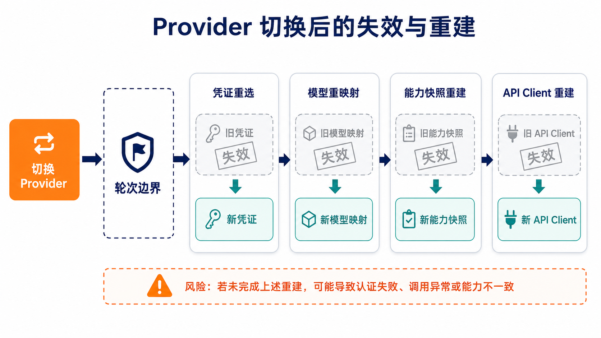

# Claude Code 如何处理认证、模型选择和 Provider 配置？

Agent 接入模型时，Demo 往往只有三行配置：一个 API Key、一个模型名、一个请求地址。

可一旦产品要同时支持账号登录、环境变量、CI 密钥、企业网关、Bedrock、Vertex、Foundry 和自定义 Provider，三行代码会迅速变成一团优先级判断。更危险的是，认证来源和模型选择彼此有关：OAuth 能用的能力不一定适用于第三方云；同一个 `sonnet` 别名，在不同 Provider 下可能要映射为不同模型 ID。

如果解析顺序不稳定，同一台机器可能因为钥匙串里还留着旧登录，就覆盖了 CI 明确传入的 Key；用户切到 Bedrock，程序却继续附加第一方 OAuth Header；配置里允许的模型被命令行绕过，安全边界也会失效。

Claude Code 源码给出的短答案是：**先解析 Provider，再按显式优先级选择认证来源和模型设置，最后把用户友好的别名归一化成 Provider 真正接受的模型 ID。**

这不是三个互不相干的工具函数，而是一条配置决策链。

## Provider 必须先于认证与模型被确定

Provider 决定请求发往哪套后端，也决定凭证来自哪套基础设施。源码把内置 Provider 归纳为 `firstParty`、`bedrock`、`vertex` 和 `foundry`，环境变量优先于结构化 Provider 配置，最后才回退到第一方：

```typescript
// 以下为源码核心代码
export function getAPIProvider(): APIProvider {
  const configured = getConfiguredBuiltInProvider()

  return isEnvTruthy(process.env.CLAUDE_CODE_USE_BEDROCK)
    ? 'bedrock'
    : isEnvTruthy(process.env.CLAUDE_CODE_USE_VERTEX)
      ? 'vertex'
      : isEnvTruthy(process.env.CLAUDE_CODE_USE_FOUNDRY)
        ? 'foundry'
        : configured ?? 'firstParty'
}
```

为什么 Provider 要先解析？

因为后面的每一个默认值都依赖它。第一方可以使用 OAuth 或 API Key；Bedrock 依赖 AWS 凭证链；Vertex 使用 Google 身份；Foundry 又有自己的部署和认证语义。模型 ID 同样不同，第三方云的模型上线时间还可能落后于第一方。

一个可靠的请求配置流程应该是：

```typescript
// 教学伪代码
const provider = resolveProvider(env, settings)
const credential = resolveCredential(provider, env, settings)
const modelSetting = resolveModelSetting(cli, env, settings)
const modelId = resolveModelForProvider(modelSetting, provider)
const client = createClient({ provider, credential })
```

不要先读取所有可能的凭证，再看哪个“恰好存在”。那会让机器的历史状态参与决策。Provider 是认证策略和模型命名空间的总开关。



## 认证来源需要优先级，也需要互斥规则

Claude Code 不只是查找“有没有 Token”，还会返回 Token 的来源。恢复源码中可以看到 `ANTHROPIC_AUTH_TOKEN`、OAuth 环境变量、文件描述符、`apiKeyHelper`、安全存储等不同路径。

```typescript
// 以下为裁剪后的核心代码
export function getAuthTokenSource() {
  if (isBareMode()) {
    if (getConfiguredApiKeyHelper()) {
      return { source: 'apiKeyHelper', hasToken: true }
    }
    return { source: 'none', hasToken: false }
  }

  if (process.env.ANTHROPIC_AUTH_TOKEN) {
    return { source: 'ANTHROPIC_AUTH_TOKEN', hasToken: true }
  }

  if (process.env.CLAUDE_CODE_OAUTH_TOKEN) {
    return {
      source: 'CLAUDE_CODE_OAUTH_TOKEN',
      hasToken: true,
    }
  }

  const oauth = getClaudeAIOAuthTokens()
  if (shouldUseClaudeAIAuth(oauth?.scopes) && oauth?.accessToken) {
    return { source: 'claude.ai', hasToken: true }
  }

  return { source: 'none', hasToken: false }
}
```

记录来源有什么用？

第一，错误提示才准确。环境变量失效时应该提示检查变量，账号登录过期时应该刷新 OAuth，而不是统一显示“未登录”。

第二，可以阻止不该发生的回退。源码在发现 `apiKeyHelper` 已配置但缓存暂时为空时，会保留 `source='apiKeyHelper'`，而不是继续跌落到钥匙串。否则短暂的加载时序会偷偷切换账号。

第三，日志可以记录“来源类型”，而不记录秘密本身。可观测性需要知道失败集中在哪条认证路径，但永远不需要把 Token 写入日志。

互斥同样重要。第三方 Provider、生效中的外部 API Key 或外部 Auth Token，会关闭第一方 OAuth 路径。不是哪个凭证先读到就用哪个，而是先决定哪些认证体系在当前模式下合法。

## `--bare` 展示了什么叫密封的认证环境

普通交互环境为了方便，可以读取安全存储、账号登录和用户配置。但脚本或容器经常需要可重复性：这次运行只能使用调用者明确提供的秘密，不能碰宿主机钥匙串。

源码对 Bare 模式的认证边界很明确：第一方只允许环境中的 API Key，或者由显式 `--settings` 提供的 `apiKeyHelper`；不读 OAuth、钥匙串和普通配置文件。第三方 Provider 继续走各自的云凭证链。

```typescript
// 以下为裁剪后的核心代码
if (isBareMode()) {
  if (process.env.ANTHROPIC_API_KEY) {
    return {
      key: process.env.ANTHROPIC_API_KEY,
      source: 'ANTHROPIC_API_KEY',
    }
  }

  if (getConfiguredApiKeyHelper()) {
    return {
      key: getApiKeyFromApiKeyHelperCached(),
      source: 'apiKeyHelper',
    }
  }

  return { key: null, source: 'none' }
}
```

这类模式的价值不只是快，而是“密封”。如果 CI 没传 Key，它应当稳定失败，而不是因为某位开发者本地登录过就偶然成功。

开发自己的 Agent 时，可以把认证上下文显式建模：

```typescript
// 教学伪代码
type AuthEnvironment =
  | { mode: 'interactive'; allowKeychain: true }
  | { mode: 'hermetic'; allowKeychain: false }
  | { mode: 'managed'; tokenChannel: 'fd' | 'proxy' }
```

一个布尔值 `headless` 无法表达这些差异。真正影响认证的是信任边界，而不是有没有界面。



## 模型选择也必须有唯一、可解释的优先级

源码对主模型设置写出了清楚的顺序：

1. 会话中通过模型命令产生的覆盖；
2. 启动时 `--model` 的覆盖；
3. `ANTHROPIC_MODEL` 环境变量；
4. 保存的 Settings；
5. 内置默认值。

核心逻辑并不复杂：

```typescript
// 以下为裁剪后的核心代码
export function getMainLoopModel(): ModelName {
  const model = getUserSpecifiedModelSetting()

  if (model !== undefined && model !== null) {
    return parseUserSpecifiedModel(model)
  }

  return getDefaultMainLoopModel()
}
```

复杂的是“覆盖”不能绕过政策。`getUserSpecifiedModelSetting()` 在返回之前还会检查 `availableModels` 允许列表；不被允许的显式模型不会因为来自命令行就获得特权。

这给 Agent 配置一个通用原则：**优先级解决谁说了算，校验规则解决允许说什么。**二者必须分开。命令行可以覆盖用户默认值，但不能覆盖组织政策；会话内选择可以覆盖启动默认值，但不能制造 Provider 根本不存在的模型。

为了可调试，最终结果最好携带解析轨迹：

```typescript
// 教学伪代码
{
  value: 'provider-specific-model-id',
  requestedAs: 'sonnet',
  source: 'cli',
  provider: 'bedrock',
  policy: 'allowed',
}
```

这样遇到“为什么没用我配置的模型”时，系统能回答，而不是让用户逐层删除环境变量试错。

## 别名、展示名和 API 模型 ID 是三种不同概念

用户希望输入 `sonnet`、`opus` 或 `haiku`，界面希望显示易读名称，API 却需要精确的 Provider 模型 ID。把三者混成一个字符串，会让 UI、缓存、计费和请求层相互污染。

源码中的 `parseUserSpecifiedModel()` 会把别名解析成相应的默认模型，同时保留自定义模型名的大小写：

```typescript
// 以下为裁剪后的核心代码
export function parseUserSpecifiedModel(input) {
  const normalized = input.trim().toLowerCase()

  if (isModelAlias(normalized)) {
    switch (normalized) {
      case 'sonnet':
        return getDefaultSonnetModel()
      case 'haiku':
        return getDefaultHaikuModel()
      case 'opus':
        return getDefaultOpusModel()
      case 'best':
        return getBestModel()
    }
  }

  return input.trim()
}
```

而类似 `[1m]` 的产品标签，在真正发送 API 前还会被移除：

```typescript
export function normalizeModelStringForAPI(model: string): string {
  return model.replace(/\[(1|2)m\]/gi, '')
}
```

这里至少应该有四层字段：

- `requestedModel`：用户输入；
- `canonicalModel`：跨 Provider 统计使用的族名；
- `providerModelId`：请求真正发送的 ID；
- `displayName`：界面文案。

它们可能相等，但不能假设永远相等。尤其在企业网关和云 Provider 中，部署 ID 甚至不包含任何可识别的模型族信息。



## OAuth 刷新是一个并发问题，不只是一个 HTTP 请求

桌面上可能同时运行多个 Claude Code 会话。Token 过期时，如果每个进程都同时刷新，会造成重复请求、覆盖安全存储，甚至互相把刚写入的新 Token 当成旧数据。

源码的刷新流程先在单进程内复用 in-flight Promise，再使用文件锁协调多个进程。获得锁后，它还会重新读取 Token：如果另一个进程已经刷新，就直接使用新值。

```typescript
// 以下为裁剪后的核心代码
let pendingRefreshCheck: Promise<boolean> | null = null

export function checkAndRefreshOAuthTokenIfNeeded() {
  if (pendingRefreshCheck) return pendingRefreshCheck

  const promise = refreshImpl()
  pendingRefreshCheck = promise.finally(() => {
    pendingRefreshCheck = null
  })
  return pendingRefreshCheck
}

async function refreshImpl() {
  const release = await lockfile.lock(configDir)
  try {
    const lockedTokens = await readTokensAgain()
    if (!isExpired(lockedTokens)) return false

    const refreshed = await refreshOAuthToken(
      lockedTokens.refreshToken,
    )
    saveOAuthTokensIfNeeded(refreshed)
    return true
  } finally {
    await release()
  }
}
```

为什么加锁后还要再读一次？

因为等待锁期间，世界已经变了。最初读到的“过期”只是旧快照。锁保护的是刷新与写入的临界区，进入临界区后必须重新验证前提。

这是本地 Agent 常见的并发模式：单进程 Promise 去重、跨进程锁、锁内二次检查。配置刷新、插件更新和会话迁移同样适用。

还有一种容易被忽略的情况：服务端返回了 401，但本地过期时间认为 Token 仍有效。此时不能继续信任本地时钟，应该把服务端拒绝当作强信号，清空缓存并强制刷新。不过强制刷新之前仍要比较“失败的 Token”和安全存储里的 Token：如果两者不同，说明另一个进程已经完成刷新，本进程只需采用新值。

错误也要分类。`missing_credentials` 表示根本没有合法来源；`expired_credentials` 表示可以尝试刷新；`provider_auth_failed` 表示云凭证链失败；`organization_mismatch` 表示 Token 有效但不属于要求的组织；`model_not_allowed` 则不是认证错误。若把它们都折叠成 401，自动重试会浪费时间，用户也不知道该重新登录、修改 Provider，还是更换模型。

同时，任何刷新失败都不应在日志里输出 Refresh Token、完整 Header 或 Helper 的标准输出。日志只保留来源、错误类别、重试次数和 Provider。调试信息越详细，秘密边界越要更严格。

## Provider 切换时，能力也要重新计算

换了 Provider，不只是换 Base URL。上下文窗口、模型可用性、Beta Header、快速模式、计费信息和认证刷新能力都可能变化。

因此 Client 不应该只在进程启动时全局创建一次，然后让用户修改 Provider 字段。更稳妥的做法是把 Provider、凭证来源、模型 ID 和能力快照组成 Client Key：

```typescript
// 教学伪代码
const clientKey = hash({
  provider,
  endpoint,
  credentialSource,
  modelCapabilitiesVersion,
})
```

Provider 变化后，旧 Client、旧能力缓存和旧模型列表必须失效。否则界面可能仍展示第一方支持的模型，实际请求却发往第三方；或者旧 OAuth Header 被带到企业网关。

同时，切换应发生在轮次边界。一轮工具执行到一半时更换模型和后端，会让用量、重试和消息兼容性难以解释。把新配置存为“下一轮生效”，比即时修改所有全局变量可靠。

模型能力最好来自一个与 Provider 绑定的快照，而不是散落的字符串判断。比如是否支持长上下文、结构化输出、特定 Beta、思考模式和图片输入，都应由 `ModelCapabilities` 回答。Runtime 在一轮开始时冻结这份快照，Prompt 组装、工具 Schema 和 Token 预算都读取同一版本。

如果能力获取需要网络，启动时可以先使用内置保守值并后台刷新，但不能默认打开未经确认的能力。保守值意味着宁可暂时不展示某功能，也不要构造 Provider 不接受的请求。刷新完成后，在下一轮更新快照，并记录“能力版本发生变化”，这样问题才能复现。

费用统计也要绑定最终解析后的模型，而不是用户输入的别名。同一个 `sonnet` 在不同 Provider 下可能对应不同 ID 与定价；若只按别名记账，预算停止条件就会失真。请求发出前形成的解析结果，应同时交给 Client、Usage Tracker 和日志系统。



## 你自己的 Agent 配置层，至少要回答七个问题

第一，Provider 的最高优先级来源是什么？环境变量、命令行和 Settings 冲突时谁赢？

第二，当前 Provider 允许哪些认证体系？哪些凭证即使存在也必须忽略？

第三，认证来源能否被记录而不泄露秘密？失败提示能否针对来源给出？

第四，模型设置的优先级是否唯一？组织允许列表是否独立于优先级执行？

第五，别名、展示名、Canonical Name 和 API ID 是否分开？

第六，OAuth 刷新如何处理同进程和跨进程竞争？

第七，Provider 或模型变化后，哪些 Client 与能力缓存必须失效，何时生效？

落地时可以把所有解析收束为一个不可变对象，而不是让调用方分别调用十几个 Getter：

```typescript
// 教学伪代码
type ResolvedInferenceConfig = {
  provider: Provider
  endpoint: string
  auth: {
    source: CredentialSource
    secret: SecretHandle
  }
  model: {
    requested: string
    canonical: string
    apiId: string
  }
  capabilities: ModelCapabilities
  decisionTrace: ConfigDecision[]
}
```

其中 `SecretHandle` 只提供签名请求的能力，不允许被普通字符串化；`decisionTrace` 记录“命令行覆盖 Settings”“模型通过组织允许列表”之类的事实，不包含秘密。Runtime 每轮接收这个快照，就能避免一半代码读环境变量、另一半代码读缓存导致的不一致。

回到开头的问题：Claude Code 如何处理认证、模型选择和 Provider 配置？

它没有把所有凭证和模型字符串丢进一个“自动猜测”函数，而是先确定 Provider，再按信任环境和显式优先级选择认证来源；模型设置经过覆盖顺序、政策校验、别名解析与 Provider 映射，最后才进入 API。

**配置系统真正的目标不是方便地找到一个能用的值，而是稳定地证明：为什么这次请求使用了这个 Provider、这份凭证和这个模型。**
