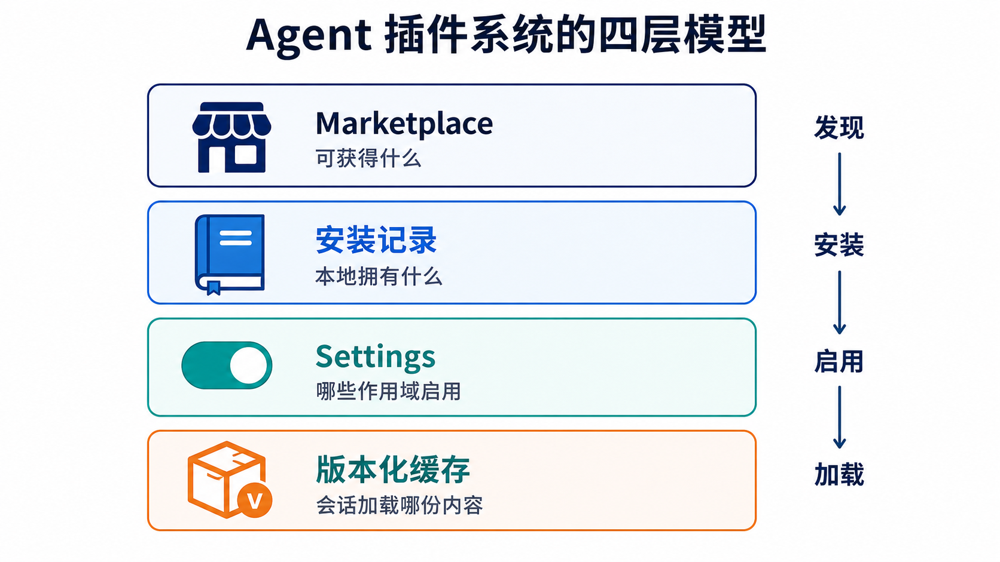
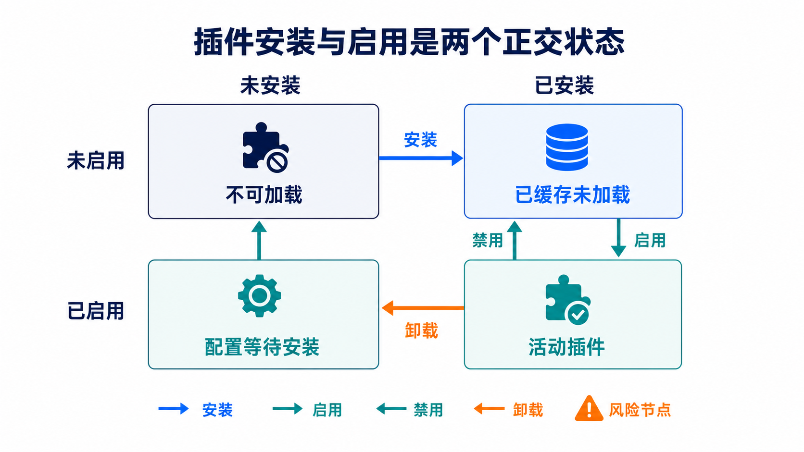
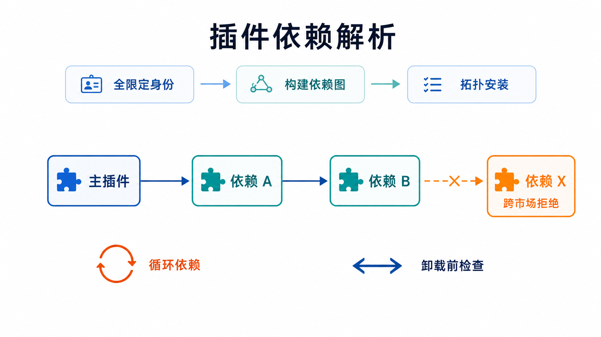
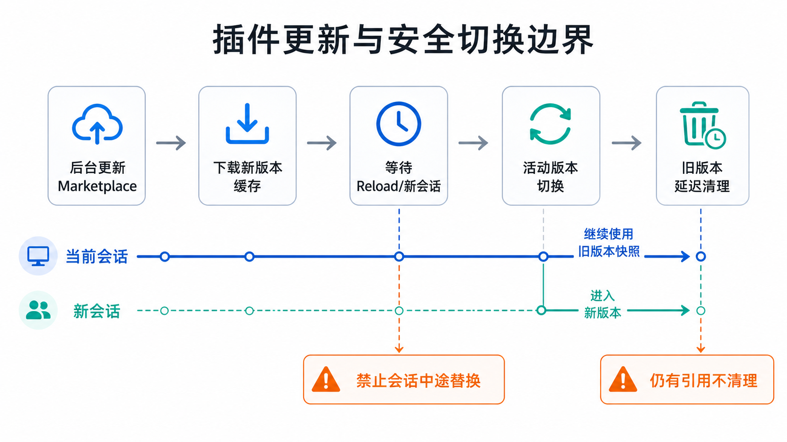

# Plugin Marketplace 如何安装、启用和管理插件？

Agent 的插件系统看起来很像一个“下载目录”：找到插件，把文件复制到本地，然后加载其中的 Skill、Command、Hook 或 MCP 配置。

真正做起来，问题马上出现。用户输入一个短名称，究竟来自哪个市场？插件安装在用户级、项目级还是仅本机级？“已经安装”和“当前启用”是不是一回事？市场更新了插件目录，正在运行的会话要不要立刻换版本？插件被下架后，又该怎样卸载本地副本？

如果这些概念没有分开，插件系统会变得既不稳定又不安全：一次市场刷新可能让会话中途换代码；禁用插件却没有停止它的 Hook；同名插件从错误来源安装；卸载时因为市场已不存在而找不到本地记录。

Claude Code 恢复源码给出的短答案是：**Marketplace 管“可获得什么”，安装记录管“本地拥有什么”，Settings 管“在什么作用域启用什么”，版本化缓存管“会话实际加载哪份不可变内容”。**

这四层合在一起，才是一套可维护的 Agent 扩展系统。

## Marketplace 不是插件目录，而是来源与索引

Marketplace 的职责是声明插件条目、来源、版本和元数据。它可以来自 Git 仓库、本地路径或其他受支持来源，但加载后都要转成统一的市场索引。

插件身份也不是只有名字。源码使用 `name@marketplace` 形式建立全限定 ID：

```typescript
// 以下为源码核心代码
export function parsePluginIdentifier(plugin: string) {
  const parts = plugin.split('@')
  return {
    name: parts[0] || '',
    marketplace: parts[1],
  }
}

export function buildPluginId(
  name: string,
  marketplace?: string,
): string {
  return marketplace ? `${name}@${marketplace}` : name
}
```

为什么一定要带市场？

因为名字不具备全局唯一性。两个市场都可以有 `reviewer`，但来源、维护者和权限完全不同。用户只输入短名时，系统可以搜索所有已配置市场；一旦出现多个匹配，就必须要求全限定名称，不能凭遍历顺序选一个。

Marketplace 自身也应有稳定标识和作用域。用户级市场跟随个人，项目级市场进入团队配置，本地级市场只属于当前机器。市场来源和启用范围是两件事：来源回答“从哪里获取索引”，作用域回答“谁声明要使用它”。



## 安装是一条解析、校验、物化和登记流水线

源码里的核心安装操作先解析标识，再到已物化的 Marketplace 中查找插件。如果用户给了市场名，就在指定来源里定位；如果只给短名，就遍历已知市场。

```typescript
// 以下为裁剪后的核心代码
export async function installPluginOp(plugin, scope) {
  const {
    name: pluginName,
    marketplace: marketplaceName,
  } = parsePluginIdentifier(plugin)

  let pluginEntry
  let foundMarketplace

  if (marketplaceName) {
    pluginEntry = await getPluginFromMarketplace(
      pluginName,
      marketplaceName,
    )
    foundMarketplace = marketplaceName
  } else {
    const marketplaces = await loadKnownMarketplacesConfig()
    for (const name of Object.keys(marketplaces)) {
      const marketplace = await getMarketplace(name)
      const entry = marketplace.plugins.find(
        item => item.name === pluginName,
      )
      if (entry) {
        pluginEntry = entry
        foundMarketplace = name
        break
      }
    }
  }

  // 后续：解析来源、复制到版本缓存、写安装记录
}
```

教学上可以把完整流程拆成六步：

1. 解析 `name@marketplace`；
2. 从允许的 Marketplace 找到唯一条目；
3. 校验 Manifest、来源路径和依赖；
4. 计算稳定版本；
5. 复制到版本化缓存；
6. 原子更新安装记录。

为什么不能直接从 Marketplace 路径加载？

因为市场会更新。一次 `git pull` 可能改变同一目录下的 Hook 或 Skill，正在运行的会话下一次读取就得到另一份代码。安装应当把内容物化成不可变版本，再让安装记录指向它。

此外，路径必须经过边界校验。Manifest 声明的相对目录不能通过 `../` 逃出市场根目录，下载包也不能通过压缩路径覆盖任意文件。Marketplace 是外部输入，不是可信本地模块。

Manifest 校验不能只看 JSON 能否解析。插件声明了哪些 Hook、要启动什么 MCP 命令、引用哪些 Skill 目录、是否包含可执行文件，都应该形成一份安装预览。高风险能力可以要求用户确认，企业策略还可以拒绝不允许的组件类型。

复制过程也需要事务边界。可以先把插件放入临时目录，完成 Manifest、依赖、哈希和路径检查后，再原子移动到版本缓存。若在校验前就写安装记录，Loader 可能看到一个只复制了一半的目录。正确顺序是“准备—验证—提交”，清理临时目录只是失败后的收尾，不是回滚权威状态。

来源信任与运行权限也不应混为一谈。来自官方市场，只能说明来源受控，不能自动代表其中每一个工具都可以绕过工作区权限。安装信任、启用信任和每次工具调用的权限，属于三个不同阶段。

## 安装与启用为什么必须分开

“安装”表示本机拥有某个插件版本；“启用”表示某个 Settings 作用域把它加入可加载集合。

这一区分解决了很多真实需求。团队可以在项目配置中启用统一插件，而插件内容由每个开发者安装到本地缓存；用户可以暂时禁用插件而不删除下载内容；一个插件还可以同时拥有用户级安装和项目级启用关系。

源码把安装、卸载、启用、禁用拆成独立操作：

```typescript
// 以下为裁剪后的核心接口
export async function installPlugin(plugin, scope) {
  return installPluginOp(plugin, scope)
}

export async function uninstallPlugin(plugin, scope) {
  return uninstallPluginOp(plugin, scope, true)
}

export async function enablePlugin(plugin, scope) {
  return enablePluginOp(plugin, scope)
}

export async function disablePlugin(plugin, scope) {
  return disablePluginOp(plugin, scope)
}
```

如果把禁用实现为删除，用户稍后重新启用就必须联网，离线环境也无法恢复。如果把卸载只实现为从 Settings 移除，版本缓存和插件私有数据会永久堆积。

更重要的是，作用域必须进入每次操作的身份。用户级安装不能被“项目级卸载”模糊地删除；源码会在实际安装作用域不匹配时返回明确错误，避免一个命令影响超出授权的范围。

多作用域还需要确定合并优先级。假如组织层强制启用某个安全插件，项目层就不应通过同名 `disabled` 把它关闭；用户层启用一个插件，也不该自动写进项目仓库。可以把最终状态计算为：

```typescript
// 教学伪代码
const effective = mergePluginPolicy({
  managed, // 可强制、不可由低层覆盖
  project, // 团队共享
  local,   // 本机针对该项目
  user,    // 个人默认
  session, // 仅本次运行
})
```

合并结果要保留来源。当用户问“为什么这个插件无法禁用”，界面应该指出它由 Managed Scope 强制，而不是只显示一个灰掉的开关。



## 版本化缓存让更新和回滚有了抓手

插件版本从哪里来？源码的版本策略会优先使用 `plugin.json` 的显式版本，其次使用 Marketplace 提供的版本；对于本地来源，还可以根据内容或版本控制信息形成可区分版本。

更新操作不会直接覆盖旧目录，而是计算新版本路径，再复制到新的版本化缓存：

```typescript
// 以下为裁剪后的核心代码
const manifestPath = join(
  sourcePath,
  '.claude-plugin',
  'plugin.json',
)

const newVersion = await getPluginVersion(
  sourcePath,
  pluginId,
  entry.version,
)

let versionedPath = getVersionedCachePath(
  pluginId,
  newVersion,
)

versionedPath = await copyPluginToVersionedCache(
  sourcePath,
  pluginId,
  newVersion,
)

await updateInstalledPluginRecord(
  pluginId,
  scope,
  versionedPath,
  newVersion,
)
```

这相当于插件层面的发布指针。旧会话可以继续引用旧版本，新会话读取更新后的安装记录。更新失败时，旧版本仍在，安装记录也不应提前切换。

回滚因此不需要“把新文件反向改回去”，只需要把活动记录重新指向仍然存在的旧版本。真正删除旧版本，应当由后台清理在确认没有安装记录、没有运行会话引用之后完成。

版本号也不能只用于展示。它应该进入加载缓存 Key、依赖解析、诊断输出和遥测。否则文件已经更新，Loader 却因为只按插件名缓存而继续返回旧 Manifest。

更新记录本身也要原子写入。假设进程在写 JSON 中途崩溃，下一次启动不应得到半个文件。常见做法是写入同目录临时文件、刷新内容，再用 rename 替换；读取端遇到损坏记录时，应保留版本目录并进入修复流程，而不是把“看不懂的记录”解释为“没有安装”，继而重复安装。

会话加载后最好持有 `{pluginId, version, installPath}` 快照。即使后台把全局记录切向新版本，当前会话仍然使用旧快照，直到显式 Reload。这样一次会话中的 System Prompt、Hook 和工具定义来自同一版本，不会各读到不同时间点的插件内容。

## 插件依赖不能退化成递归安装

一个插件可能依赖另一个插件。最简单的实现是看到依赖就递归安装，但很快会遇到循环依赖、跨市场替换和作用域冲突。

恢复源码中的依赖解析强调全限定身份：裸依赖名默认继承声明插件所在的 Marketplace，跨 Marketplace 依赖受到限制。这能阻止恶意市场通过同名依赖劫持另一个来源。

可以把依赖图的规则定义为：

```typescript
// 教学伪代码
type DependencyDecision =
  | { ok: true; order: PluginId[] }
  | { ok: false; reason: 'cycle'; cycle: PluginId[] }
  | { ok: false; reason: 'cross-marketplace' }
  | { ok: false; reason: 'missing' }
```

安装前先构建完整有向图，做循环检测和拓扑排序，再统一物化。不要安装到一半才发现深层依赖缺失；那会留下半套记录。

禁用或卸载同样要检查反向依赖。如果还有插件依赖目标插件，系统至少要给出警告；在团队强制插件场景下，还可能需要直接拒绝。依赖关系属于安装事务的一部分，不是加载失败后再打印一句日志。



## Marketplace 更新为什么适合后台做，插件切换却要有边界

源码有独立的后台安装管理器：启动时协调尚未物化的 Marketplace，更新状态写入 AppState；新 Marketplace 安装完成后，可以自动刷新插件列表。

这改善了启动时间，但也提出一个问题：后台拉取完成后，是否立刻让当前会话加载新插件？

对“此前完全不存在的新市场”，刷新可让用户尽快看到插件。对“现有市场内容发生更新”，源码倾向于提示用户重新加载，而不是把正在运行的插件静默替换。

原因在于插件不是静态文案。它可能带有 Hook、命令、Agent、MCP 服务和权限声明。会话中途切换，会发生这些不一致：

- System Prompt 已包含旧 Skill 描述；
- Hook 列表已经注册；
- 工具集合已经发给模型；
- MCP 连接可能仍指向旧进程；
- 新版本的配置迁移尚未执行。

因此后台可以更新“可用版本”，活动版本的切换应发生在明确的 Reload 或新会话边界。可以提前下载，但不要提前改变语义。

## 卸载必须以本地记录为准，而不能依赖市场仍然存在

插件可能被下架，Marketplace 也可能被用户删除。此时卸载仍必须可用。

源码的卸载逻辑会优先解析实际安装记录；即使 Marketplace 查不到插件，也可以依据本地记录确定安装路径、作用域和版本。这个原则非常关键：**安装依赖远端发现，卸载必须依赖本地事实。**

卸载通常包含三类状态：

1. 从指定作用域的安装记录中移除；
2. 更新 Settings 中的启用关系；
3. 在最后一个安装引用消失后，标记版本缓存和插件私有数据可清理。

为什么不是立即递归删除整个插件目录？

因为另一个作用域可能仍引用相同版本，运行中的会话也可能正在使用它。更稳妥的做法是引用计数或可达性清理：先更新权威记录，再把不可达版本标为 orphan，最后由后台任务清理。

插件的持久数据也要有单独策略。普通卸载可以保留数据以便重装，显式“删除数据”才清除；无论哪种，都要在结果中告诉用户发生了什么。



## 设计 Agent 插件平台时，先建立这张账本

每个插件至少需要记录：

| 字段 | 解决的问题 |
| --- | --- |
| `pluginId` | 名称与 Marketplace 的唯一身份 |
| `scope` | 谁声明安装或启用 |
| `version` | 当前物化内容的版本 |
| `installPath` | 实际不可变缓存位置 |
| `source` | 来源与诊断 |
| `enabled` | 当前作用域是否加载 |
| `dependencies` | 安装顺序与卸载约束 |
| `installedAt/updatedAt` | 审计与清理 |

所有变更都围绕这张账本进行，而不是靠扫描目录猜状态。安装是先准备内容再提交记录；启用只改变作用域配置；更新生成新版本并切指针；卸载先解除引用，再延迟清理。

最后还要做两类测试。一类是状态机测试：安装、禁用、启用、更新、卸载在每个作用域下都得到正确记录。另一类是故障注入：下载失败、Manifest 无效、复制中断、记录写入失败、市场消失、两个进程同时更新时，旧版本仍可使用且没有半提交状态。

还应增加来源替换测试：市场地址被改成另一个仓库时，现有 `pluginId` 是否需要重新确认；同名市场在用户层和项目层冲突时，哪一个生效；插件版本号没变但内容哈希变了，系统是拒绝、告警还是生成新内部版本。插件供应链的问题往往发生在这些“名字看起来没变”的地方。

回到开头的问题：Plugin Marketplace 如何安装、启用和管理插件？

它不是把远端目录直接暴露给 Loader，而是用 Marketplace 做发现与来源约束，用版本化缓存物化不可变内容，用安装记录保存本地事实，用 Settings 决定各作用域是否启用，并把 Reload、更新和卸载放在清晰的生命周期边界上。

**插件系统的核心不是“能加载多少扩展”，而是每一份扩展从哪里来、当前谁在用、什么时候切换，以及失败后怎样回到上一份可用状态。**
