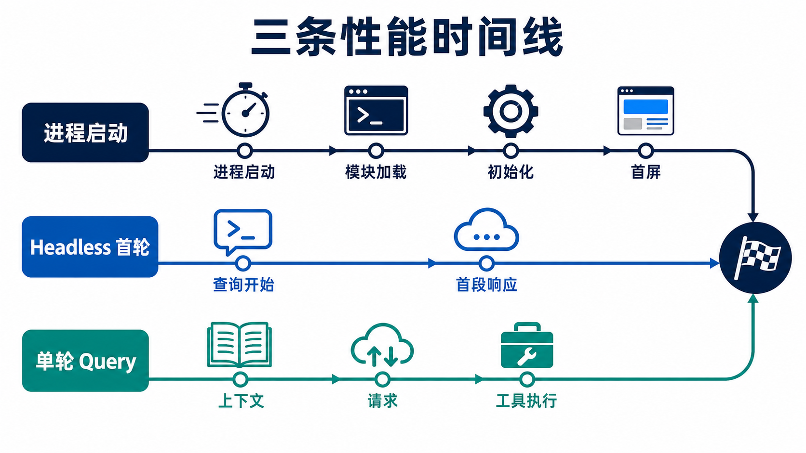
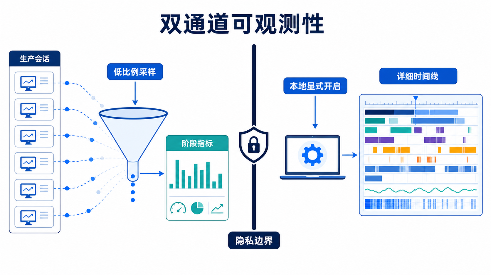
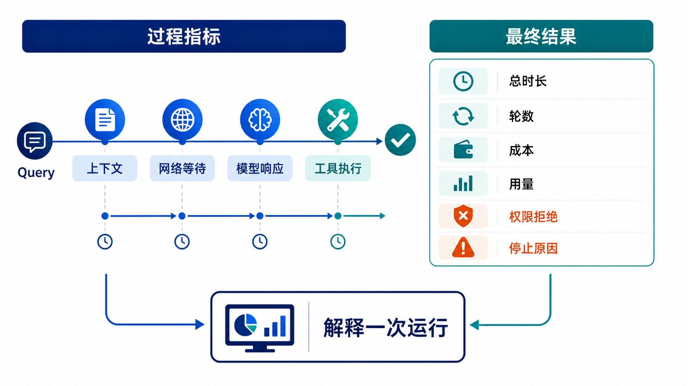
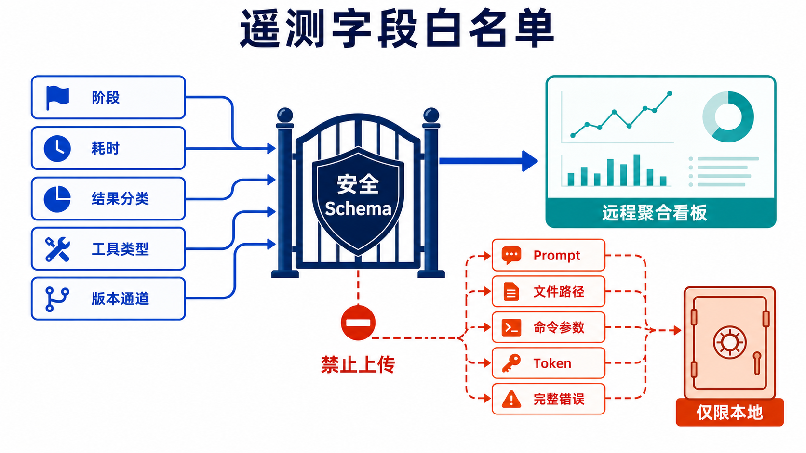

# Claude Code 如何做遥测、性能分析和启动优化？

Agent 性能问题很会伪装。

用户说“回复慢”，可能是项目上下文加载慢，也可能是工具 Schema 太大、客户端创建慢、网络首包慢，甚至是权限分类器和 Hook 在模型响应之后耗时。用户说“启动慢”，又可能只发生在 Headless、某种 Provider、装了几十个 MCP 的项目，或者只出现在 P99。

如果只有一条从命令开始到结束的总耗时，团队只能猜。可如果什么都记录，又很容易把 Prompt、路径、命令或插件名带进遥测，造成隐私风险；性能埋点本身还可能增加内存和启动成本。

Claude Code 源码给出的短答案是：**用低成本、可采样的阶段指标观察整体分布，用显式开启的本地 Profiler 获取细粒度时间线，再把会话最终结果中的用量、成本和拒绝记录用于解释 Agent 行为。**

也就是说，遥测、性能分析和调试日志是三种工具，不能混成一个万能 Logger。

## 先把“慢”拆成三条时间线

一套 Coding Agent 至少有三条性能时间线。

第一条是进程启动：CLI 入口、模块加载、初始化、Settings、参数路由、TUI 首屏。

第二条是 Headless 首轮：进程启动、初始化事件、Query 开始、API 请求发出、第一段响应。

第三条是每轮 Query：用户输入、上下文组装、压缩、工具 Schema、消息归一化、Client 创建、网络首包、流式完成、工具执行。

它们有重叠，却不能用同一个起止点代替。源码为三条链分别提供 `startupProfiler`、`headlessProfiler` 和 `queryProfiler`。这让问题可以被定位成：

```latex
启动慢：import / init / settings / route
首轮慢：system message / query start / API first response
单轮慢：context / compact / schema / client / network / tools
```

为什么要单独看 Headless？

因为 TUI 启动后，用户输入本身提供了一段天然预取时间；Headless 收到 Prompt 就要立刻执行，没有这段空档。只看交互模式的首屏指标，会掩盖脚本调用真正感受到的延迟。



## Checkpoint 比到处打印 Date.now 更可靠

源码的启动 Profiler 使用运行时性能 API 记录命名检查点，再从检查点计算阶段差值：

```typescript
// 以下为裁剪后的核心代码
const PHASE_DEFINITIONS = {
  import_time: [
    'cli_entry',
    'main_tsx_imports_loaded',
  ],
  init_time: [
    'init_function_start',
    'init_function_end',
  ],
  settings_time: [
    'eagerLoadSettings_start',
    'eagerLoadSettings_end',
  ],
  total_time: [
    'cli_entry',
    'main_after_run',
  ],
} as const

export function profileCheckpoint(name: string) {
  if (!SHOULD_PROFILE) return
  getPerformance().mark(name)
}
```

相比每个函数自己打印耗时，Checkpoint 有三个优势。

第一，时间基准统一。跨模块的两个点可以直接计算，不受不同 Logger 刷新时机影响。

第二，业务代码只负责声明“阶段发生”，Profiler 负责采样、计算和报告。

第三，同一批 Mark 可以生成阶段摘要，也可以在本地输出完整时间线。

命名要体现业务阶段，不要体现源码行号。`query_tool_schema_build_start` 比 `functionA_start` 更稳定，因为重构函数后，产品阶段仍然存在。

同时，要定义配对规则。Start 没有 End 时，报告不能把下一个 Mark 当作结束；重复 Checkpoint 要保留顺序，不能简单用 Map 覆盖。源码的详细启动分析甚至把内存快照与 Mark 数组按索引对应，正是为了处理同名检查点多次出现。

Checkpoint 应该放多少个？

太少无法定位，太多又会让时间线变成源码执行日志。比较实用的判断是：一个点能否区分两种不同的优化动作？“上下文加载结束”和“请求发出”之间值得继续拆 Schema、消息归一化与 Client 创建，因为它们的修复方法不同；同一个纯函数内部的十个小步骤若都只能通过重写该函数改善，就没有必要全进生产指标。

**Checkpoint 描述的是可决策阶段，不是对每一行代码做考勤。**

## 采样让生产遥测保持低成本

性能工具本身也会影响性能。每次启动都保存几十个内存快照、格式化完整报告、写磁盘，测到的就不再是原来的启动路径。

源码把模式分成两类：生产遥测按概率采样；详细分析只在显式环境开关打开时启用。未采样的会话在 `profileCheckpoint()` 入口直接返回。

```typescript
// 以下为裁剪后的核心代码
const DETAILED_PROFILING =
  isEnvTruthy(process.env.CLAUDE_CODE_PROFILE_STARTUP)

const STATSIG_SAMPLE_RATE = 0.005
const STATSIG_LOGGING_SAMPLED =
  process.env.USER_TYPE === 'ant' ||
  Math.random() < STATSIG_SAMPLE_RATE

const SHOULD_PROFILE =
  DETAILED_PROFILING || STATSIG_LOGGING_SAMPLED
```

采样决策在进程启动时做一次，而不是每个 Checkpoint 都重新随机。这样一条会话要么拥有完整阶段，要么完全不进入样本，避免“只采到起点没采到终点”。

采样率也不应一刀切。高频启动指标可以低采样，罕见故障和明确失败结果可以更高采样；内部开发构建可以全量，外部用户更保守。关键是所有比例都要进入分析口径，不能把样本数直接当作真实发生数。

还要控制维度基数。把完整版本 SHA、任意插件名、项目路径或错误文本当作标签，会让指标系统产生几乎无限的时间序列。更合理的是预先定义有限维度：操作系统类别、运行模式、Provider 类别、成功状态和粗粒度版本通道。需要调查单个会话时，使用本地 Profile 或明确授权的诊断包，不要把全局面板变成会话搜索器。

采样也要对一次会话保持一致。如果启动被采样、Query 没被采样，两组指标就不能通过 Session 直接拼接。可以分别分析各自分布；若确实需要端到端链路，则在进程开始时做一次会话级采样，并让各 Profiler 继承同一个决定。



## TTFT 必须拆成请求前开销和网络等待

“第一段输出用了两秒”仍然不够。两秒可能有一秒半花在本地上下文处理，也可能请求几乎立即发出，主要在等待服务端。

Query Profiler 跟踪从用户输入到首段响应的多个节点，包括上下文加载、微压缩、自动压缩、Query Setup、工具 Schema、消息归一化、Client 创建、请求发出、响应 Header 和 First Chunk。

报告会把首段时间拆为两部分：

```typescript
// 以下为裁剪后的核心计算
const preRequestOverhead = apiRequestSentTime
const networkLatency =
  firstChunkTime - apiRequestSentTime

const preRequestPercent =
  preRequestOverhead / firstChunkTime

const networkPercent =
  networkLatency / firstChunkTime
```

这会直接改变优化决策。如果本地开销高，应检查 CLAUDE.md、Git 状态、插件、工具 Schema 和压缩；如果网络高，继续微调本地函数不会改善用户感受，应该看区域、Provider、重试和模型负载。

还要区分 TTFB 与 TTFT。响应 Header 到达说明服务器已响应，第一段内容到达才是用户真正看到输出。流式协议、代理缓冲和 SDK 解析都可能让二者之间出现差距。

一个成熟的性能面板至少应展示：

- `time_to_query_start`；
- `query_overhead`；
- `request_to_headers`；
- `headers_to_first_chunk`；
- `tool_execution`；
- `turn_total`。

只有这样，“模型慢”和“Agent Runtime 慢”才不会被混为一谈。

怎样知道优化有没有把问题从一个阶段搬到另一个阶段？

要同时看绝对时间和占比。工具 Schema 从四百毫秒降到一百毫秒，但 Client 创建从一百毫秒升到五百毫秒，TTFT 仍然变差；只展示“Schema 提升百分之七十五”会得出错误结论。阶段指标必须与端到端指标同屏，并且每个阶段的起止点在版本之间保持兼容。

长尾还要按场景分群：空项目与大型仓库、无 MCP 与大量 MCP、交互与 Headless、第一轮与后续轮次。分群字段必须是有限枚举或数量桶，例如 `mcp_count_bucket`，而不是服务名称列表。

## Agent 的最终结果本身就是可观测性接口

性能时间线解释过程，Terminal Result 解释结果。`QueryEngine` 返回的结构中包含总时长、API 时长、轮数、总成本、Usage、按模型用量和权限拒绝。

```typescript
// 以下为裁剪后的核心字段
return {
  subtype: 'success',
  duration_ms: Date.now() - startTime,
  duration_api_ms: getTotalAPIDuration(),
  num_turns: messages.length - 1,
  total_cost_usd: getTotalCost(),
  usage: this.totalUsage,
  modelUsage: getModelUsage(),
  permission_denials: this.permissionDenials,
  stop_reason: lastStopReason,
}
```

为什么这些字段要作为结果，而不是只写日志？

因为调用 Agent 的上层系统需要作决策。CI 可以根据 Subtype 判断任务失败还是预算耗尽；调度器可以比较总时长和 API 时长；产品可以把权限拒绝展示给用户；成本控制器可以聚合按模型用量。

结构化结果还让离线测试更容易。固定模型响应和工具后，可以断言轮数、停止原因与拒绝记录，不必解析自然语言日志。

需要注意，性能指标不应改变业务结果。Profiler 即使关闭、写报告失败或遥测发送失败，Agent 仍要返回完整 Terminal Result。可观测性是旁路，不是主流程依赖。



## 工具、Hook 和分类器要单独计时

一轮 Query 可能包含多次模型调用和多次工具执行。只看轮次总时长，不知道时间究竟花在哪里。

交互 REPL 在一轮结束时汇总 Hook、工具和权限分类器的持续时间与调用次数，再把它们附加到 API 指标消息：

```typescript
// 以下为裁剪后的核心字段
createApiMetricsMessage({
  ttftMs,
  otps,
  hookDurationMs: getTurnHookDurationMs(),
  hookCount: getTurnHookCount(),
  toolDurationMs: getTurnToolDurationMs(),
  toolCount: getTurnToolCount(),
  classifierDurationMs:
    getTurnClassifierDurationMs(),
  classifierCount:
    getTurnClassifierCount(),
})
```

计时要同时记录次数。工具总共用了三秒，一次三秒和三十次各一百毫秒，优化方向完全不同。Hook 也是如此：一个慢 Hook 和几十个重复执行的 Hook，需要不同修复。

并行工具还要区分 Wall Time 与 Sum Time。三个工具并行各耗时两秒，用户等待约两秒，但工具耗时求和是六秒。前者反映体验，后者反映资源消耗。指标命名必须说明是哪一种，不能把 Sum Time 当作轮次瓶颈。

如果要分析具体工具，可以记录工具类型、成功/失败和耗时桶，但不要默认记录命令参数、文件路径和 Tool Result。性能诊断需要“Read 工具 P95 变慢”，不需要知道用户读了哪个私有文件。

## 隐私边界要在类型与字段层建立

性能埋点最常见的泄露不是有人主动上传 Prompt，而是开发者顺手把整个 Error、Config 或 Tool Input 塞进 Metadata。

更稳妥的做法是建立安全字段类型和显式白名单：

```typescript
// 教学伪代码
type SafeMetric = {
  phase: MetricPhase
  durationMs: number
  outcome: 'ok' | 'error' | 'cancelled'
  provider: ProviderCategory
  toolKind?: ToolKind
}

emitMetric('agent_phase', {
  phase: 'tool_execution',
  durationMs,
  outcome,
  provider,
})
```

路径、Prompt、命令、Token、完整错误文本、插件自定义字段默认都不进入远端遥测。本地详细 Profiler 也要谨慎：它可以输出更多 Checkpoint 和内存信息，但仍没有理由写入会话内容。

错误分类要使用有限枚举，而不是原样发送 `error.message`。确实需要分析未知错误时，可以在用户明确开启 Debug 后写入本地文件，并告诉用户文件在哪里、可能包含什么，再由用户决定是否分享。

采样不等于匿名。即使只有千分之几，只要字段里包含秘密，风险仍然存在。隐私控制必须发生在事件构造之前，而不是上传端再尝试清洗。

还要防止关联后重新识别。单个字段可能无害，但精确时间、完整版本、罕见 Provider、插件组合和长错误枚举放在一起，就可能唯一定位某个用户。生产指标应使用时间桶、版本通道和有限分类，并设置合理保留期。

**先定义允许上传的最小 Schema，再让代码填字段；不要先收集对象，最后靠黑名单删除。**



## 从数据到优化，要形成可验证的闭环

有了指标，不代表自动得到优化。比较可靠的闭环是：

第一，找到明确的用户指标，例如启动 P95 或首段输出 P99。

第二，用阶段拆分定位贡献最大的区间，而不是直接挑源码里看起来复杂的函数。

第三，提出一个能改变依赖图的改动：并行独立 I/O、延迟非关键模块、缓存纯计算、给远端依赖加有界等待。

第四，在本地详细 Profiler 中验证阶段确实缩短，并检查有没有把耗时移到第一轮。

第五，通过生产采样观察不同平台、Provider 与项目规模下的分位数，同时监控错误率和语义退化。

第六，保留回滚开关。性能优化经常改变并发时序，可能只在少量环境触发竞态。指标变好但权限、工具或插件行为不一致，仍然是失败。

每次优化还要保存基线窗口和实验版本。没有基线，周末流量、Provider 波动或模型服务变化都可能被误判为代码收益。最好在同一版本通道做对照，至少同时比较样本量、P50、P95、P99、错误率和取消率。

对于一次明显的长尾回归，先用生产阶段指标缩小范围，再在可复现环境打开本地详细 Profile。不要为了调查一个 P99，就临时把所有外部会话改成全量详细采集。

回到开头的问题：Claude Code 如何做遥测、性能分析和启动优化？

它先把启动、Headless 首轮和 Query 拆成独立时间线，用 Checkpoint 定义可比较阶段；生产环境低成本采样，本地显式模式输出细粒度报告；同时用结构化 Terminal Result、工具与 Hook 指标解释一次 Agent 运行的成本和终止原因。

**可观测性的目标不是收集最多数据，而是在不收集会话秘密的前提下，把“感觉慢”变成一条能定位、能验证、也能回滚的因果链。**
