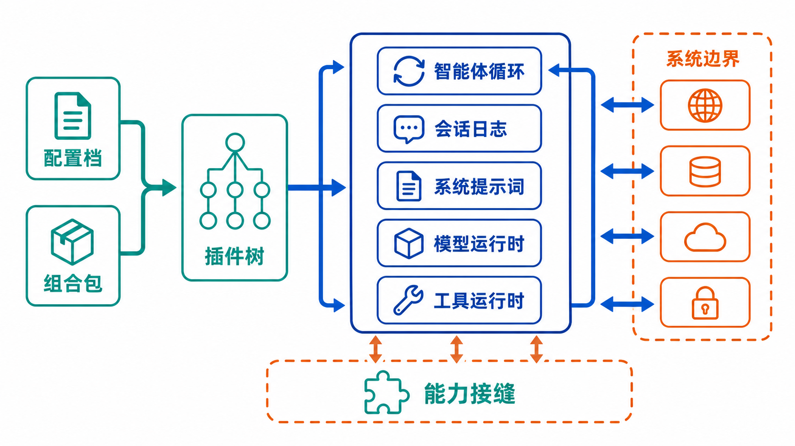
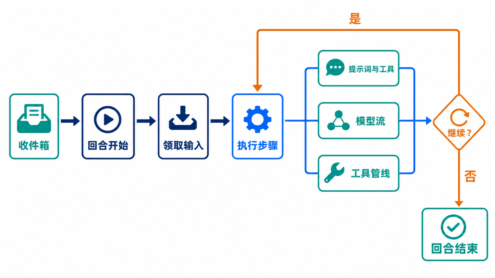
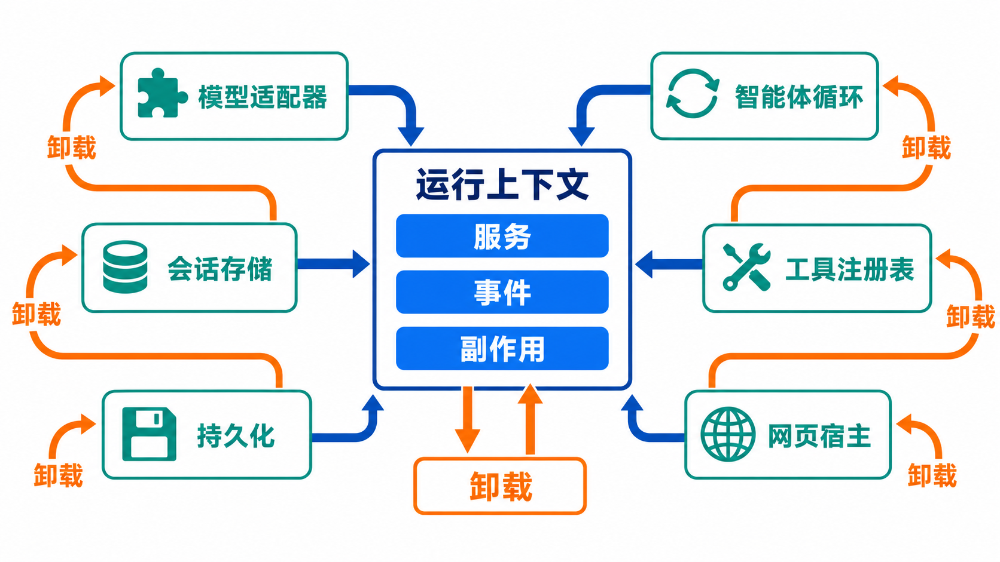
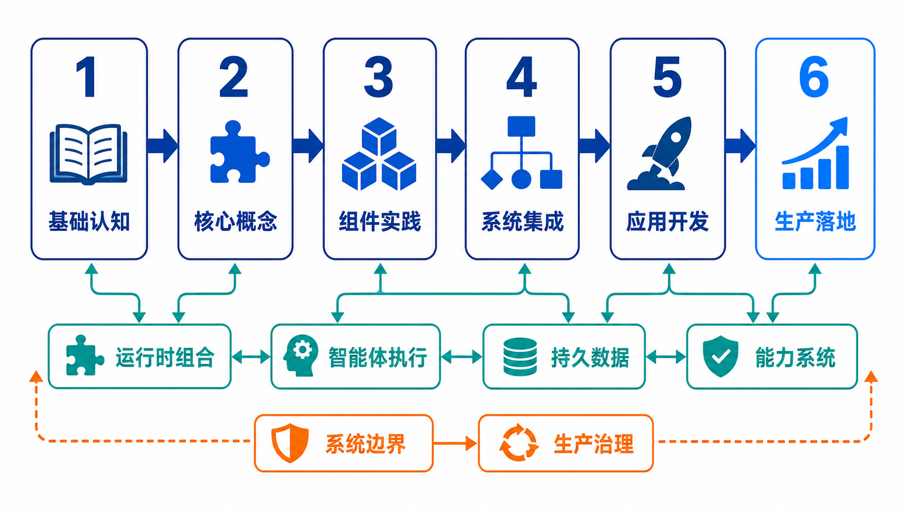

DeepSeek Harness 刚开源时，最容易产生的误解是：它是不是 DeepSeek 为自家模型写的又一个命令行聊天工具？或者，它只是把 OpenAI 兼容接口、文件读写、Shell 和 MCP 包进了一个 Coding Agent？如果只看 `npx @deepseek-ai/dsh web` 的启动方式，这两个判断都很自然；但沿着源码继续往下看，会发现它真正想解决的并不是“怎样向模型发请求”，而是“怎样把一个长期运行、能使用真实能力、可被人类干预、可恢复又可替换的 Agent 组装出来”。

这套框架用 **Everything is a Plugin** 概括自己的运行时模型。这里的 Plugin 不只是放在扩展目录里的附加功能，而是组成运行时的基本单位：模型适配器、Agent Loop、Session Store、工具注册表、持久化、审批策略和 Web Host 都由插件贡献。负责装配这些插件的 Cordis，是一个同时管理依赖注入、事件派发和生命周期的 TypeScript 运行时；它没有用一个不可替换的“万能核心类”承载全部行为。

本文以官方最新不可变标签 `dsh-v0.1.0-rc.7` 为基线，先给出全景架构、一次 Turn 的真实主链、最关键的设计约束，以及后续 14 篇专题应该怎样阅读。需要特别提醒：官方仍将其标记为 Developer Preview，并明确警告会出现兼容性破坏。理解它的设计很有价值，但现在就把内部类型当成稳定公共 API，是完全不同的事情。



## 1. Harness 不是模型 SDK，而是 Agent 的运行时底座

模型 SDK 主要负责把请求序列化成 HTTP，处理鉴权、流式分片和响应类型；Agent Harness 需要处理的范围要大得多。模型可能要求并行执行多个工具，用户可能在工具运行一半时转向，Agent 可能被取消、恢复或从历史节点分叉，Shell 与文件系统必须落在同一个沙箱世界，会话中的每个模型可见事实还必须能够从持久化日志重新构造。

可以先用一个极简对比理解两者职责：

```latex
模型 SDK：
Prompt -> HTTP Request -> Model -> Stream Chunks -> Response

Agent Harness：
Input Queue -> Turn/Step Driver -> Prompt + Tools -> Model Stream
            -> Tool Execution -> Permission/Sandbox -> Session Log
            -> Continue/Stop/Fork/Resume -> UI/SDK/ACP
```

DeepSeek Harness 的根 `package.json` 把项目版本固定为 `0.1.0-rc.7`，Node.js 引擎要求是 `^22.19.0 || >=24.0.0`，包管理器固定到 `pnpm@11.7.0`。从 npm 启动 Web 形态只需要：

```bash
npx @deepseek-ai/dsh web
```

从源码运行则要完成完整的 Host/Client 构建：

```bash
git clone --branch dsh-v0.1.0-rc.7 \
  https://github.com/deepseek-ai/deepseek-harness.git
cd deepseek-harness
pnpm install
pnpm run build
pnpm dsh web
```

这两个入口启动同一套可组合运行时。Web Profile 叠加 Web Host 与浏览器 Client；Headless Profile 则在没有服务器的情况下运行一次任务。二者只改变插件组合，核心执行语义仍然共用。

这个边界可以从创建 Agent 的所有权继续确认。调用方通过 Agent Factory 创建或恢复 Agent，Factory 仍使用自己的依赖 Context 解析 `sessions`、`llm`、`tools` 与 `systemPrompt`；调用方 Fiber 和 Agent Loop Provider 共同拥有最终 Handle。销毁时先取消并等待 Driver 完全停稳，再撤销 Agent Scope、刷新 Session，最后从 Store 脱离。关闭浏览器页面不会销毁运行时事实；模型流结束时，会话持久化也可能仍在收尾。

```latex
交互表面负责：提交消息、显示事件、发出取消意图
Agent Handle 负责：收件箱、运行状态、生命周期与作用域
Agent Loop 负责：轮次、步骤、请求、工具与停止判断
Session 负责：持久事实、消息投影、恢复与分支
```

判断某段代码属于 SDK、UI 还是 Harness，关键在于它是否拥有跨请求的不变量，而不在于有没有“调用模型”。模型适配器负责归一化请求与流；Web 和 SDK 负责驱动 Agent、消费事件；Turn/Step 闭合、工具结果配对、取消收敛与 Session 重建则需要一套权威实现。

## 2. 从五个主干服务建立仓库地图

官方仓库包含 `apps/`、`packages/`、`native/`、`python/`、`vendor/`、`website/` 等目录，仅 `packages/` 下就有一百多个工作区。如果按包逐个看，很快会陷入 UI 卡片、Provider 和测试支撑代码之中。官方架构文档实际给出了更可靠的阅读入口：

| 主干 | 责任 | Cordis Context 键 |
| --- | --- | --- |
| `core/session` | 追加式会话事件日志与内存 Session Store | `ctx.sessions` |
| `core/system-prompt` | Prompt Section、动态上下文和工具 Schema 组装 | `ctx.systemPrompt` |
| `core/tools` | 有作用域的工具注册与受保护执行管线 | `ctx.tools` |
| `core/agent` | Agent 接口、注册表、Inbox 与 `agent/*` 事件 | `ctx.agents` |
| `core/agent-loop` | 默认 Turn/Step 驱动器 | `ctx.agentLoop` |

模型侧再增加一个 `llm/llm`：它定义 Message、Content Block、StreamChunk 和 Adapter 接缝，通过 `ctx.llm` 暴露。其余文件、Shell、终端、LSP、Subagent、Workflow、Web、Approval 等能力，都是围绕这条主干挂载的插件。

下面的教学图按源码职责简化了依赖方向，并非官方类图：

```latex
                Profile / Bundle / Patch
                          |
                    Cordis Loader
                          |
       +------------------+------------------+
       |                  |                  |
  Agent Registry     Session Store     System Prompt
       |                  ^                  |
       v                  |                  v
  Agent Loop ----------> Event Log -----> LLM Request
       |                                     |
       +---------- Tool Runtime <------------+
                          |
             Capability Providers / Policy
```



## 3. Everything is a Plugin 还要求贡献能够撤销

许多框架也有 Plugin API，但插件注册之后通常只往全局 Map 里塞一个对象。Cordis 更强调生命周期：插件对 Context（当前作用域中的服务视图）做出的贡献，要通过 Effect（受生命周期管理的副作用）或事件注册表达，并在插件卸载时反向撤销。因此动态重载配置、替换 Provider、为单个 Agent 创建隔离作用域时，运行时知道资源归谁所有，也知道应该按什么顺序清理。

DeepSeek Harness 的根开发约束直接写明：**Registrations are effects**。每个 contribution 都要经过 `ctx.effect()`、`ctx.on()`，注册表的 `register()` 则返回 disposer。用教学伪代码表示，大致是：

```typescript
// 教学伪代码：表达 Cordis 的生命周期语义，不是原文件逐字摘录
export default function plugin(ctx: Context) {
  ctx.effect(() => {
    const disposeTool = ctx.tools.register(myTool)
    const disposeListener = ctx.on('agent/request', onRequest)

    return () => {
      disposeListener()
      disposeTool()
    }
  })
}
```

这会带来三个直接结果。第一，Agent Loop 没有特权，可以换成另一种驱动器；第二，工具和 Prompt Section 可以只对某个 Agent 的 `agent.ctx` 生效，不污染其他会话；第三，配置热重载无需重启整个进程，而是卸载受影响的 Fiber，再挂载新的插件子树。这里的 Fiber 指一次插件挂载对应的生命周期实例，它记录依赖、状态和需要撤销的资源。

Cordis 的 Event 还区分多种派发语义：普通 `emit`、等待全部监听器的 `parallel`、串行监听，以及允许拦截和改写的 `waterfall`。Waterfall 监听器必须调用 `next()` 才会把控制权交给下一层；直接返回意味着短路。这种语义会在 `agent/pre-step`、`agent/request`、`llm/stream`、`tools/pre-execute` 等关键位置反复出现。

```typescript
// 教学伪代码：waterfall 的核心语义
ctx.on('agent/request', async (request, next) => {
  const rewritten = addPolicyContext(request)
  return next(rewritten) // 不调用 next() 就会终止下游链
})
```

可撤销性背后还有 Fiber 状态机。插件先处于 `PENDING`，声明的服务依赖满足后进入 `LOADING`，成功才是 `ACTIVE`；配置变化、Provider 替换或父 Fiber 销毁会使其进入 `UNLOADING`，逆序等待 disposer，随后重新等待或彻底 `DISPOSED`。配置行顺序无法保证启动顺序，插件应通过 `inject` 声明依赖，不能假定某个 Provider 已经先执行。

```typescript
// 源码裁剪：vendor/cordis/src/fiber.ts
export const enum FiberState {
  PENDING,
  LOADING,
  ACTIVE,
  FAILED,
  DISPOSED,
  UNLOADING,
}
```

事件模式本身也是公共契约。纯观察用 `emit`；持久化 Flush 需要 `parallel`，保证所有后端都启动并等待结算；单一决策可以使用 `serial`；请求、步骤准入和工具执行用 `waterfall`，让策略能够包围内建行为。一个只想记录日志的 Waterfall Listener 如果忘记 `next()`，会直接拦截模型或工具，后果远不止少记一条日志。

Context 隔离和 DSH Scope 也不能混为一谈。Cordis `isolate(name)` 决定同名 Service 在哪个 Realm（隔离域）中解析；`dsh-scope` 给 Tool、Prompt Section 等注册项附加 Agent 身份，并使 Preset Listener 能接收后代 Agent 的事件。前者防止服务实例碰撞，后者防止能力目录和事件在 Session 之间串话。

## 4. Profile、Bundle 和 Patch 决定“这个 Agent 到底是什么”

DeepSeek Harness 并不把 Web、Headless、工具集、持久化和权限策略硬编码到一个启动函数里。运行中的 `dsh` 是一棵由配置层叠加出来的插件树。

- **Profile**：用户选择的命名组合，记录要叠加哪些 Bundle，并保存该 Profile 自己的 `cordis.patch.yml`。
- **Bundle**：一组可分发的 Cordis 配置行及其插件代码，例如 `dsh-base`、`dsh-web-app`、`dsh-headless`。
- **Patch**：按稳定行 ID 替换完整配置或插入新行的覆盖层。
- **Preset**：为某个 Session 选择的 Agent 组合，使不同会话拥有不同模型、工具和能力。
- **Scope**：运行时的隔离注册边界，让 contribution 只对指定 Agent 可见。

官方规定的合并顺序是：Profile 声明的 Bundle 按顺序应用，然后是 Profile Patch、Harness Home Patch，最后是命令行 `--patch`。后面的层可以替换前面的完整配置：

```latex
empty tree
  -> base bundle
  -> web-app or headless bundle
  -> profile cordis.patch.yml
  -> home cordis.patch.yml
  -> --patch overlay
  -> effective plugin tree
```

实际运行时可以直接查看最终结果：

```bash
dsh --profile web --dump-config
```

这个命令非常重要，因为源码里的 Bundle 只代表默认组合，用户机器真正启动的树还受到安装插件与多层 Patch 影响。调试时若只盯着 `packages/bundle/base/cordis.patch.yml`，却不看 effective config，很容易解释错运行行为。

还要把 Host Plane 与 Agent Plane 分开。Session Store、模型路由、Sandbox、Approval、持久化与 API Gateway 通常在 Profile 中挂载一次；Persona、模型可见工具、局部 Compaction 和 Plan Mode 则由 Agent Preset 选择。Preset 先作为 standing composition 挂载，每个 Session 的 Agent Scope 再继承它。这样 `standard` 与 `minimal` 可以在同一进程并存，共用 Host 基础设施。

Patch 的覆盖粒度是稳定行 ID，目标行的配置整体替换，并非悄悄深合并。升级上游 Bundle 后，用户层应重新对照新增字段；尤其是 Sandbox、遥测和持久化配置，旧 Patch 能继续解析不代表仍保留新版安全默认。可复现部署至少要保存 Harness Tag、依赖锁、Profile Manifest、全部 Patch、Preset 文件和 `--dump-config` 输出。



## 5. 一次 Turn 不是一次模型请求，而是零到多个 Step

Harness 对执行单位的划分很精确：一个 **Step** 是一次模型请求以及该响应要求执行的工具；一个 **Turn** 则包含零到多个 Step。Turn 在第一批输入被领取前开启，当没有待处理工作时关闭。

`ReactLoopAgent` 内部维护 `idle`、`maintenance`、`running` 三类 Phase。`followup()`、`steer()`、`inject()` 最终都进入同一个 Inbox，但目标位置和是否立即唤醒驱动器不同：

```typescript
followup(input) // 放入 next-turn，并唤醒
steer(input)    // 放入 next-step，并唤醒
inject(input)   // 放入 next-step，但等待其他消息唤醒
```

源码中的主循环可以概括成：

```typescript
// packages/core/agent-loop/src/agent.ts 的结构化缩写
private async kick(): Promise<void> {
  try {
    while (await this.turn()) {}
  } finally {
    // 回到 idle，并在必要时重放已锁存的 wake
  }
}
```

Turn 开始后，驱动器先从 Inbox claim 输入，再组装 Prompt Section 和工具 Schema，通过 `agent/pre-step` Waterfall 决定拒绝还是进入 Step。进入 Step 后，会话依次记录 `step/start`、用户消息、请求头、模型流式 Chunk、完整 Assistant Message、Tool Call/Result，最后记录 `step/end`。如果工具结果要求再请求模型，或者有 `next-step` 输入，Turn 就继续下一个 Step；否则经过 `agent/turn-stopping` 后写入 `turn/end`。

一个容易忽略的边界是：被拒绝的输入或被改写为空的第一次 claim，依然会形成有 `turn/start` 和 `turn/end`、但没有 Step 的持久 Turn。这样日志不会假装这次尝试从未发生，也不会为没有调用的模型伪造 Step。

Inbox 带有持久语义，不是临时数组。`next-turn` 保存会开启普通后续轮次的输入，`next-step` 保存最近请求边界要领取的中途引导与注入上下文；每次插入、替换、取消和 Claim 都先追加 `agent/inbox/spliced`，恢复时再重放出 Pending 消息。`followup()` 选择下一轮并唤醒，`steer()` 选择下一步并唤醒，`inject()` 选择下一步但安静等待。

Step 内部也有严格顺序：准入消息先写 `user/message`，请求头变化写 `request/header`，每个流分片写 `assistant/chunk`，成功后完整消息引用这些 Chunk 的 seq；工具调用与结果随后成对记录。模型失败的 Retry 仍属于当前 Step，因为它没有产生成功 Assistant Message；工具或 Steering 形成欠账时才进入下一 Step。rc.7 没有内建 Turn 步数上限，终止 Hook、Goal 和评价器必须自己限制轮次、Token 或墙钟预算。

## 6. Session Event Log 才是上下文事实来源

DeepSeek Harness 有一条关键架构约束：**Model-visible means logged**。凡是进入模型请求的内容，都要能从 Session Log 重新构造。系统把 Turn、Step、用户消息、Assistant Chunk、工具调用和结果记录为追加事件，再由 `deriveMessages()` 投影模型历史，避免让一个原地修改的 `messages[]` 同时承担全部事实。

官方类型 `SessionEventMap` 是可通过 TypeScript declaration merging 扩展的事件词汇表，核心事件包括：

```typescript
interface SessionEventMap {
  'turn/start': { turn: number }
  'turn/end': { turn: number; reason: TurnEndReason }
  'step/start': { turn: number; step: number }
  'step/end': { turn: number; step: number }
  'user/message': UserMessage
  'assistant/chunk': StreamChunk
  'assistant/message': AssistantMessage
  'tool/call': ToolCall
  'tool/result': { message: ToolResultMessage }
}
```

上面是为了突出主干而做的源码裁剪，完整定义位于 `packages/core/session/src/types.ts`。原始 Chunk 也写入日志，不只是为了调试：Web UI 回放、流式保真、遥测、崩溃恢复和 Transcript 都能从同一事件流派生。Fork 则复制指定边界之前的事件作为 Seed，并在 Session Header 中记录 `parentSession` 与 `seedLength`。

这套机制也有严格代价。`SESSION_FORMAT_VERSION` 在当前预发布阶段固定为 `0`，官方不承诺迁移；持久化后端遇到不同版本会直接拒绝，而不是尽量猜测。扩展模型可见输入时，开发者必须增加 Session Event，并确保投影、TypeScript SDK、Python SDK 和快照输出一起更新。

模型历史只从部分 Event 派生：`user/message`、`assistant/message` 与 `tool/result` 可以进入 Ordered Surface；Turn/Step、Chunk、Tool Call 和 Request Header 留作日志事实，不重复发送给模型。普通 Surface 节点采用 Append，压缩则追加 Replacement 节点遮蔽一个连续范围，原始事件仍保留给 Transcript 与审计。

这一区分同时保护三种视图：模型读取当前 Surface，人工 Transcript 读取原始追加消息，Web 可用 Chunk 重放流式过程。若只维护一个可变 `messages[]`，压缩会删除用户看过的历史，保留 Chunk 又会让下一次模型请求重复内容。追加日志加受校验投影，才使三个消费方共享事实却不共享同一种展示。

## 7. 能力不是工具函数，而是 Definition、Provider、Consumer 三角色

文件系统、Shell、Subprocess、Terminal、LSP、Web Search、Subagent 和 Workflow 在仓库里没有被写成一堆互相调用的具体类。官方把一个可替换能力定义为 **Capability Seam**，完整接缝包含三种角色：

1. **Service Definition**：声明能力接口、请求类型和事件。
2. **Service Provider**：提供本地、沙箱、远程或第三方实现。
3. **Consumer**：把能力暴露给 Agent，通常是模型可调用 Tool。

以 Shell 为例，模型调用 `bash` Tool 并不意味着 Tool 直接 `spawn()`。Consumer 依赖 `ctx.shell` 的 Definition；本地 Provider 再通过 `ctx.subprocess` 执行；Sandbox 插件可以包装 argv；文件策略和审批事件能在固定位置拦截。若把 Subprocess 与 FS Provider 同时切换到远程 E2B 世界，Shell、Terminal 与 LSP 会一起移动，而不需要为每个 Tool 各写一份 E2B 分支。E2B 是一种云端隔离执行环境；LSP（Language Server Protocol，语言服务器协议）用于提供跳转、诊断等代码语义能力。

```latex
Tool Consumer -> Service Definition -> Provider
                      |                  |
                 typed events      local / sandbox / remote
```

阅读这些小包时，与其追问“为什么 Bash 被拆成这么多包”，不如检查 Definition、Provider、Consumer 能否独立演进，以及安全策略是否拥有稳定的拦截点。

完整能力还必须保证 Provider 处于同一个执行世界。只把 Shell 切到远程机器、却让 FS Tool 继续读取本地目录，模型会看到互相矛盾的文件；Terminal、LSP 和 Subprocess 也会产生相同问题。Capability Seam 的收益不是少写一个适配器，而是能成组替换 Definition 背后的 Provider，并让权限、取消和审计仍在固定事件边界生效。

Tool Schema 只描述模型如何提出调用，并不构成安全策略。路径限制、命令包装、审批和外部副作用控制要落在 Tool Pipeline、Capability Event 或 Provider。Web 按钮也不能成为唯一审批实现，因为 Headless、SDK 与 Subagent 会绕过页面，却仍进入相同能力世界。

## 8. Host/Client、SDK 与 ACP 都只是在投影同一运行时

Web 形态由 Host 与 Client 两个 TypeScript 编译聚合组成。两边都通过 declaration merging 扩展 Cordis `Context`，但同名键可能指向不同服务，因此源码刻意维持 `tsconfig.host.json` 与 `tsconfig.client.json` 两个 Program。`api/remotes` 是少数同时具有 Host/Client 配置的包。

跨边界方法不依赖手写 REST DTO。DTO（Data Transfer Object，数据传输对象）是专门用于跨进程传递数据的结构；若 Host 和前端各维护一份，很容易漂移。这里由 Host 服务用 `@Remote` 或 `@RemoteScope` 标记可调用方法，Typert 在 Host 构建阶段分析类型图，生成给 Client 使用的类型声明与运行时描述，Client 再把它们装配到 `ctx.remote` 或 Agent 作用域的 `agentCtx.remote`。

```latex
Host Service + @Remote
        -> Typert type graph
        -> generated declarations + runtime metadata
        -> API Gateway
        -> Client ctx.remote / agentCtx.remote
```

TypeScript SDK、Python SDK、JSON-RPC Server 和 ACP Server 也不另建 Agent Loop。ACP 是 Agent Client Protocol，用于把 Agent 运行时接入外部客户端。它们驱动 `ctx.agents`、订阅 `session/event`，把同一会话和生命周期投影成外部协议。根开发规范因此要求：Agent Loop、Session Lifecycle 或 `SessionEventMap` 变化时，两个 SDK 的预期输出必须在同一变更中更新。

Host/Client 分离还解释了仓库为什么维护两个 TypeScript Program：声明合并会让同一个 Context Key 在两侧指向不同服务，若放进一个编译图，类型看似齐全却可能把 Host-only 实现打进浏览器。Typert 生成的是受控类型投影和运行时贡献，不意味着所有 Cordis Service 都自动跨网络暴露；只有明确标注的 Remote 方法才进入 Gateway。

跨越 Worker 或网络后，进程内 Scope 身份也会消失。外部调用必须携带显式 Session/Agent 标识并重新做授权，不能把 `ctx.agent` 或异步发起方上下文当作 Wire Credential。Scope 负责可信进程内的路由，不替代多租户鉴权。

## 9. 应该怎样阅读这套源码，而不是迷失在一百多个包里

建议按因果链而不是目录顺序阅读：

```latex
1. docs/architecture.md
2. docs/cordis-primer.md
3. packages/core/agent + agent-loop
4. packages/core/session
5. packages/core/system-prompt + tools
6. packages/llm/llm + llm-deepseek
7. 一个完整 Capability Seam（推荐 fs 或 shell）
8. session persistence / projection / query
9. api gateway / typert / client runtime
10. extensions / sdk / acp / hooks
```

不要先从 Web UI 找“发送按钮最终调用哪个 API”，因为那只会看到运行时的一个投影；也不要先逐个阅读工具实现，因为所有工具真正共享的执行语义在 `core/tools` 与 `tool-execution-pipeline.md`；更不要把 `cordis.patch.yml` 当作普通配置，它实际上描述了运行时对象图与生命周期所有权。

每读完一层，都可以用一个具体不变量检验是否真正理解：卸载插件后注册是否消失；两个 Preset 的工具是否串话；被拒绝输入是否留下零 Step Turn；任意请求能否从 Header 与 Surface 重建；工具崩溃后是否能区分未开始与结果未知；Host 重连是否只重建投影而不重跑 Agent。沿这些问题追测试，比只记住包名更有效。



## 10. 这套设计最值得学习什么，又应该警惕什么

DeepSeek Harness 最值得研究的并不是它预装了多少 Coding 工具，而是四个架构判断。

第一，**把扩展性下沉成运行时本体**。Agent Loop、模型、会话、工具和 UI 都接受同一种插件生命周期，而不是核心固定、外围可插拔。第二，**用追加日志统一模型上下文、UI 回放、持久化和恢复**，避免每个表面维护一份稍有差异的消息状态。第三，**用 Capability Seam 分离能力接口、实现和模型暴露方式**，让沙箱、远程执行与权限策略能够整体替换。第四，**把人类干预与外部协议建立在相同事件和 Agent Handle 上**，从而减少 Web、CLI、SDK、ACP 各自重写执行语义。

风险同样清楚。当前是 `0.1.0-rc.7` Developer Preview，`SESSION_FORMAT_VERSION = 0`，SQLite Schema 只接受当前版本，官方明确偏向“修正基础设计”而不是提供兼容垫片。插件能力很强，也意味着配置可以决定安全边界；如果错误地组合 FS、Shell、Sandbox 与 Approval Provider，框架不会因为名字叫 Harness 就自动变安全。自修改插件进一步放大了这一点：能检查和挂载插件是强大的研究能力，却绝不等于应该在无审批、无隔离环境中默认开启。

后续 14 篇会沿着这张全景图向内收缩：先讲 Cordis 与配置组合，再完整还原 Turn/Step、Session Log、Prompt、LLM Stream 与 Tool Pipeline；然后解释执行世界、持久化、人类控制面和 Subagent 编排；最后拆开 Host/Client、Typert、外部协议、自修改扩展以及预发布阶段的安全与测试策略。每一篇都只在有独立机制和足够源码支撑时成篇。

阅读过程中应始终回到固定标签核对实现；后续预览版即使保留同名类型，也可能已经改变事件载荷、配置层和持久化语义，不能用名称相同推断行为兼容。

## 官方资料与固定源码定位

- [DeepSeek Harness 官方仓库](https://github.com/deepseek-ai/deepseek-harness)
- [固定标签 ](https://github.com/deepseek-ai/deepseek-harness/tree/dsh-v0.1.0-rc.7)`dsh-v0.1.0-rc.7`
- [README](https://github.com/deepseek-ai/deepseek-harness/blob/dsh-v0.1.0-rc.7/README.md)
- [根 package.json](https://github.com/deepseek-ai/deepseek-harness/blob/dsh-v0.1.0-rc.7/package.json)
- [官方架构说明](https://github.com/deepseek-ai/deepseek-harness/blob/dsh-v0.1.0-rc.7/docs/architecture.md)
- [Cordis Primer](https://github.com/deepseek-ai/deepseek-harness/blob/dsh-v0.1.0-rc.7/docs/cordis-primer.md)
- [Agent Loop 实现](https://github.com/deepseek-ai/deepseek-harness/blob/dsh-v0.1.0-rc.7/packages/core/agent-loop/src/agent.ts)
- [Session EventMap](https://github.com/deepseek-ai/deepseek-harness/blob/dsh-v0.1.0-rc.7/packages/core/session/src/types.ts)
- [Package 分组与能力清单](https://github.com/deepseek-ai/deepseek-harness/blob/dsh-v0.1.0-rc.7/packages/README.md)
