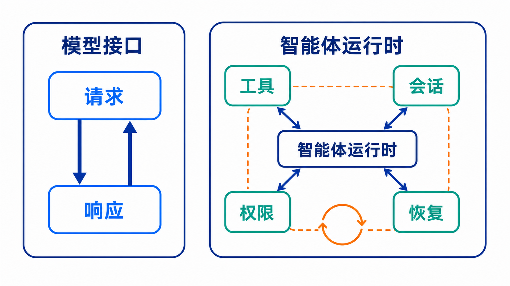
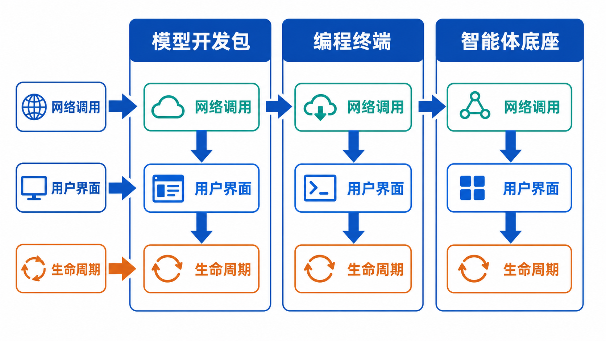
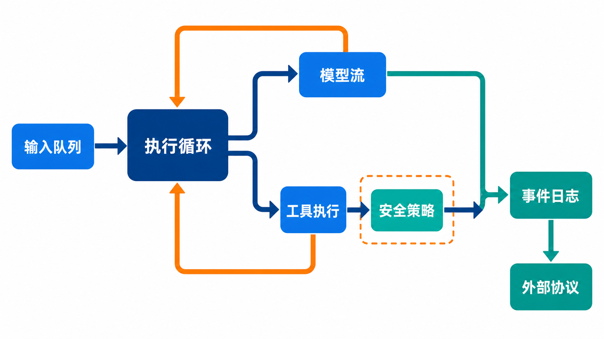
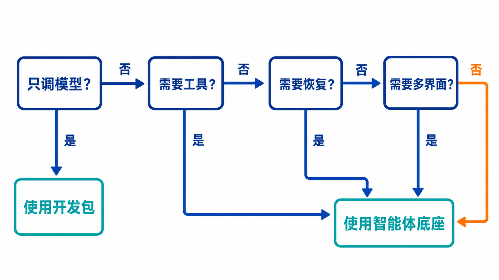

第一次运行 DeepSeek Harness，用户看到的是一个可以聊天、读取代码、调用 Shell 的 Web 界面。再加上项目由 DeepSeek 发布，很容易把它归类为“DeepSeek 模型 SDK 的图形外壳”，或者“又一个 Coding Agent TUI”。但这个判断只描述了某个产品表面，没有解释仓库为什么要包含一百多个包、为什么模型适配器和 Agent Loop 都只是插件，也无法解释同一套内核怎样同时支撑 Web、Headless、SDK、ACP、Subagent 和远程沙箱。ACP（Agent Client Protocol）是一种把外部 Agent 运行时接入客户端的协议。

SDK 解决“怎样调用模型”，TUI（Terminal User Interface，终端用户界面）解决“怎样与用户交互”，Harness 处理的是第三类问题：**怎样让一个能长期运行、调用真实能力、接受人类干预、持久化并恢复的 Agent，在可替换、可隔离、可观测的运行时里成立**。它的中心由 Cordis 插件树、事件溯源 Session、Turn/Step 驱动器、工具执行管线和能力接缝组成，而非某个 DeepSeek API 客户端或终端渲染循环。

本文固定在官方标签 `dsh-v0.1.0-rc.7`。当前版本仍是 Developer Preview；文中出现的内部接口可以帮助我们理解架构，却不应被误认为已经承诺稳定的公共 API。

## 1. 先把三种产品的责任边界分开

模型 SDK 的核心输入通常是模型名、消息、工具 Schema 和采样参数，核心输出是响应或流式分片。它必须处理 HTTP、鉴权、错误映射和供应商字段，但通常不负责判断一次工具执行后是否应再次请求模型，也不拥有会话恢复和权限审批。

```typescript
// 教学伪代码：典型模型 SDK 的责任，不是 Harness 源码
const stream = client.chat.completions.create({
  model: 'deepseek-chat',
  messages,
  tools,
  stream: true,
})

for await (const chunk of stream) render(chunk)
```

Coding TUI 或 Web Chat 的主要职责是接收输入、显示流、呈现工具卡片、允许取消和选择会话。它可以自己包含一个简单 Agent Loop，但“界面”并不天然等于“运行时”。当用户关闭浏览器，Host 仍可能在执行工具；当 Python SDK 发起任务时，根本不需要浏览器节点。

```latex
交互表面：输入框、会话列表、流式文本、工具卡片、取消按钮
模型接缝：请求序列化、供应商鉴权、流解析、错误归一化
Harness：队列、轮次、步骤、工具、权限、会话日志、恢复、作用域
```

DeepSeek Harness 把这些层明确拆开。官方 `docs/architecture.md` 列出的主干服务不是“页面”和“API Client”，而是 `ctx.sessions`、`ctx.systemPrompt`、`ctx.tools`、`ctx.agents`、`ctx.agentLoop` 与 `ctx.llm`。其中只有最后一个接近模型 SDK，其余都是 Agent 运行时责任。



## 2. 仓库入口已经说明：Web 只是一个 Profile

从命令行看，最显眼的入口是：

```bash
npx @deepseek-ai/dsh web
```

但 `packages/boot/app-boot/src/profile.ts` 里的模板清楚表明，`web` 和 `headless` 只是两种有序 Bundle 组合：

```typescript
// 源码裁剪：packages/boot/app-boot/src/profile.ts
export const PROFILE_TEMPLATES: Record<string, readonly string[]> = {
  web: ['@deepseek-ai/dsh-base', '@deepseek-ai/dsh-web-app'],
  headless: ['@deepseek-ai/dsh-base', '@deepseek-ai/dsh-headless'],
}
```

两者都先加载 `dsh-base`。Web Bundle 添加浏览器应用和 Host 边界，Headless Bundle 添加一次性执行器；模型、工具、Session、Sandbox、Approval 等基础能力没有分别复制。换句话说，浏览器 UI 是被组合进 Harness 的一个表面，不是 Harness 的定义。

实际排查时，源码目录里的默认配置还不是最终真相。Profile Bundle、Profile Patch、Harness Home Patch 和命令行 Patch 会逐层覆盖，应该查看有效插件树：

```bash
dsh --profile web --dump-config
dsh --profile headless --dump-config
```

如果这是“固定核心加两个前端”，两个命令应启动两套不同主程序；源码实际表达的是“空树加不同插件层”。这个差别决定了第三方可以创建自己的 Profile，而无须 Fork Web 或 Headless 入口。

更具体地说，Web Profile 增加的是“如何让浏览器连接并投影运行时”，而不是“如何让模型调用工具”。一个 Session 从 Web 创建后，真正执行仍由 Host 中的 Agent Factory、Session Store 与 Agent Loop 完成；浏览器刷新只会失去当前页面状态，不应改变已经写入 Session 的事实。Headless 则省去服务器和前端节点，把首条输入送入同一个 Agent Handle，等待其空闲后退出。两者对 Turn、Step、Tool Result 和持久日志的定义完全一致。

这种结构还改变了部署思路。团队可以定义 `batch-review` Profile：仍加载 Base，但不加载 Web Server，额外叠加企业凭据、只读 Sandbox 与审计插件；也可以定义 `internal-web`，保留 Web Bundle，却替换模型 Provider 和 Approval Policy。它们不是通过环境变量在一个巨大启动函数里打开几十个分支，而是形成可检查的有效插件树。

Profile 层还负责模块解析边界。官方 `profile.ts` 先从当前 dsh 安装解析 Bundle，再从 Profile 目录解析树外依赖，并维护 Harness Home 下的依赖回退。这个细节说明 Bundle 不只是配置片段：它是可分发代码与配置的绑定单元，必须避免 Profile 私自安装另一份 Cordis 造成 Context 品牌和 Service Definition 分裂。

```latex
表面变化：Web / Headless / 将来的 TUI
保持稳定：Session 格式、Agent Handle、工具执行管线、模型接缝
部署覆盖：模型提供方、权限、持久化、遥测、第三方插件
```

## 3. 运行主干由可替换服务组成

DeepSeek Harness 没有让一个 `CodingAgent` 同时持有模型 Client、消息数组、文件系统、终端和 UI 回调。Cordis Context 更像带生命周期和作用域的服务仓库：插件按稳定键取得能力，不直接依赖某个具体实现。

```typescript
// 源码裁剪：vendor/cordis/src/context.ts
export interface Context {
  root: this
  events: EventsService
  logger: LoggerService
  reflect: ReflectService
  registry: RegistryService
}
```

Harness 各包再通过 TypeScript declaration merging（声明合并：多个模块共同扩展同一接口）把 `sessions`、`tools`、`llm`、`agents` 等服务补进这个接口。一个 Service 在构造时通过反射层注册到当前 Context，其所有权属于当前插件 Fiber。Fiber 是一次插件挂载的生命周期实例，负责记录依赖和清理动作：

```typescript
// 源码裁剪：vendor/cordis/src/service.ts
constructor(protected ctx: Context, name: string) {
  name ??= this.constructor['provide'] as string
  this.ctx.reflect.provide(name, self, this[symbols.check])
}
```

于是“替换模型”是替换 `ctx.llm` 的 Adapter 注册，“替换会话持久化”是换掉订阅 Session 生命周期的插件，“替换 Agent Loop”是提供另一个 Agent 驱动器。不存在必须侵入修改的特权核心。一个教学性的最小插件形态如下：

```typescript
// 可运行示例骨架：需在真实工程中安装 @deepseek-ai/cordis
import type { Context } from '@deepseek-ai/cordis'

export default function auditPlugin(ctx: Context) {
  ctx.on('internal/dispatch', (mode, name) => {
    ctx.logger('audit').debug('%s %s', mode, name)
  })
}
```

这也解释了“一切皆插件”并不是营销式的“支持扩展”。模型适配器、Session Store、工具注册表、Agent Loop 乃至 Web Host 都遵守同一套挂载和卸载语义，才使“运行时组件可替换”成为事实。



## 4. Agent Loop 管的是 Turn、Step 和未完成工作

一次模型 API 调用不是一次完整 Agent 行为。模型可能返回多个工具调用；工具结果要写回上下文，再发起下一次请求；用户可能在执行期间 `steer()`；插件也可能注入下一步上下文。Harness 因此用 Turn 和 Step 划分执行单位。

`packages/core/agent-loop/src/agent.ts` 中的驱动边界非常小，但语义很强：

```typescript
// 源码裁剪：默认驱动器持续领取仍有欠账的 Turn
private async kick(): Promise<void> {
  try {
    while (await this.turn()) {}
  } catch (_error) {
    // 错误与取消被收容在 driver 边界
  } finally {
    // 收敛回 idle，必要时重放已锁存的 wake
  }
}
```

一个 Step 是一次模型请求加它要求的工具执行；一个 Turn 可以有零到多个 Step。`followup()` 进入下一 Turn，`steer()` 和 `inject()` 进入下一 Step，但 `inject()` 不主动唤醒驱动器：

```typescript
// 源码裁剪：packages/core/agent-loop/src/agent.ts
followup(input) { this.send(input, 'next-turn', true) }
steer(input)    { this.send(input, 'next-step', true) }
inject(input)   { this.send(input, 'next-step', false) }
```

这不是模型 SDK 能自然承载的状态。SDK 的 Stream 结束就完成了职责；Harness 必须继续回答：工具是否形成新的请求债务、是否已达到自然停止点、插入的消息属于当前 Step 还是下个 Turn、取消后醒来的消息是否要重分类。

## 5. 会话不是可变 messages 数组，而是可重放事实流

简单聊天程序经常把 `messages[]` 原地追加后存入数据库。问题在于，一旦还要支持原始流回放、工具卡片、压缩、Fork、请求头变更、Crash Repair 和 UI 同步，这个数组无法同时表达所有事实。DeepSeek Harness 将 `Session` 定义为仅追加事件日志，模型消息只是日志上的派生投影。

```typescript
// 源码裁剪：packages/core/session/src/types.ts
export interface SessionEventMap {
  'turn/start': { turn: number }
  'step/start': { turn: number; step: number }
  'user/message': UserMessage
  'assistant/chunk': { turn: number; step: number; chunk: StreamChunk }
  'assistant/message': { turn: number; step: number; message: AssistantMessage; usage?: TokenUsage }
  'tool/call': { turn: number; step: number; callId: CallId; name: string; arguments: string }
  'tool/result': { turn: number; step: number; message: ToolResultMessage }
  'step/end': { turn: number; step: number }
  'turn/end': { turn: number; reason: TurnEndReason }
}
```

“模型可见即已记录”是关键不变量。用户消息、Assistant 完整消息和工具结果组成 ordered surface；`assistant/chunk` 保留流式保真，Turn/Step 边界保留控制语义，请求头则让恢复后的下一次请求可以重建模型、系统提示词和工具 Schema。

```latex
Session Event Log（事实）
  ├─ deriveMessages() -> 下一次模型请求
  ├─ session/event    -> Web、SDK、ACP 实时投影
  ├─ persistence      -> JSONL 等存储
  ├─ fork()           -> 稳定边界上的子会话
  └─ telemetry        -> 请求与工具链路
```

模型 SDK 会返回 Chunk，却不负责定义 Chunk、完整消息、工具事实和 Turn 边界怎样组成可恢复历史；TUI 会渲染历史，却不应该成为历史的唯一所有者。Session 数据面正是 Harness 独立存在的理由。

请求本身还要记录“当时究竟调用了什么”。Agent Loop 在首次请求、恢复和有效配置变化时写 `request/header`，其中包含模型提供方、模型、系统提示词与工具描述；适配器解析出的默认推理强度或最大 Token 也被标明来源。下一次恢复不能简单拿当前设置覆盖，否则相同消息前缀会进入不同模型能力世界，甚至让历史里的工具调用对不上现有描述。

```latex
一次可靠的智能体请求 =
  可重建消息历史
  + 当时的模型路由与调用配置
  + 当时的系统提示词
  + 当时的工具描述
  + 当前步骤的取消边界
```

Harness 还必须处理“完成”不是单一状态。Turn 可能正常完成、被用户或父 Agent 取消、被策略阻塞、因模型失败结束，或者至少一个 Step 达到最大输出 Token。模型 SDK 最多返回请求错误与结束原因；Harness 要把它们折叠为 Session 级结果，让上层知道是否可以继续、是否需要人类判断、是否应该在崩溃恢复后修补工具结果。

取消也不是对网络请求调用一次中止就结束。取消信号要穿过系统提示词组装、模型流、工具执行和生命周期钩子；Driver 还要决定是否清空 Inbox，中止后到达的唤醒输入是否应该归入新 Turn。只有 Agent Runtime 拥有这些状态，UI 的取消按钮和 SDK 的取消方法才会得到同一种语义。

## 6. 工具并非函数表，而是策略与能力世界的交界

把 `read_file`、`bash` 注册成 JSON Schema 并不难，难的是在真实运行时里回答：哪个 Agent 看得到这个工具、参数何时验证、执行前谁能拦截、Shell 与文件系统是否指向同一沙箱、是否需要审批、取消信号怎样传播、结果如何进入 Session。

Harness 的工具路径可以概括为：

```latex
模型工具调用
  -> 作用域内 Tool Registry 查找
  -> tools/pre-execute 瀑布
  -> Tool.execute（可并发、可串行屏障）
  -> tools/post-execute 瀑布
  -> tool/result 追加进 Session
  -> 是否继续下一个 Step
```

文件、Shell、Subprocess、Terminal、LSP 又采用 Capability Seam：Definition 声明接口和事件，Provider 决定本地、沙箱或远程实现，Consumer 再把它暴露为模型工具。教学伪代码如下：

```typescript
// 教学伪代码：表达 Definition / Provider / Consumer 分离
interface FileCapability {
  read(path: string, signal: AbortSignal): Promise<string>
}

ctx.tools.register({
  name: 'read_file',
  schema: readSchema,
  execute: ({ path }, signal) => ctx.fs.read(path, signal),
})
```

因此切换 `ctx.fs` 与 `ctx.subprocess` Provider，可以让 Bash、PTY 和 LSP 一起进入远程沙箱，而不必为每个工具各写一套 `if (e2b)`。PTY（伪终端）为交互式命令提供终端语义，LSP（语言服务器协议）提供代码诊断和跳转；E2B 则是一种云端隔离执行环境。SDK 只提供调用模型所需的“工具声明”字段，Harness 还要管理工具实际运行的执行世界。

## 7. 同一运行时可以投影成 Web、SDK、ACP 和子 Agent

如果 Agent Loop 被写在 React Hook 或 TUI 事件循环里，外部 SDK 想复用时只能重新实现。DeepSeek Harness 的 UI、TypeScript/Python SDK、ACP Server 和 Subagent Driver 都围绕同一个 Agent Handle 与 `session/event` 工作。

```latex
                    Web Client
                        |
Python SDK ---- Agent Registry ---- TypeScript SDK
                        |
                    ACP Server
                        |
                 Subagent Provider
```

实时协调和持久事实也被有意拆开。`agent/status`、`agent/pre-step`、`agent/request` 适合干预进行中的工作；`session/event` 适合回放和 Transcript。一个外部表面如果要可靠恢复，不应把临时 `agent/*` 通知当历史数据库。

下面是消费边界的教学示例，不是某个 SDK 文件的逐字摘录：

```typescript
// 教学伪代码：外部表面驱动同一 Agent，而不接管 Loop
const agent = runtime.agents.get(sessionId)
agent.followup(userMessage)

ctx.on('session/event', (session, event) => {
  if (session.id === sessionId) pushToClient(event)
})
```

由此可见，“Web 版”和“SDK 版”不是两个 Agent 产品，只是同一个运行时的不同投影。TUI 若加入，也应成为另一种表面，而不是重新拥有一套消息和工具状态机。



## 8. 插件生命周期比功能数量更能说明 Harness 的性质

Agent 长期运行时，注册能力只是问题的一半，撤销能力同样重要。配置热重载、Session 结束、Agent Preset 卸载和沙箱销毁都要求清理监听器、服务、进程和缓存。Cordis 的 Fiber 把插件贡献作为 Effect 收集，并在卸载时逆序释放。

```typescript
// 可运行示例骨架：插件卸载时自动撤销定时器和监听器
export default function heartbeat(ctx: Context) {
  ctx.effect(() => {
    const timer = setInterval(() => ctx.emit('heartbeat'), 1000)
    const off = ctx.on('shutdown-requested', () => clearInterval(timer))
    return () => {
      off()
      clearInterval(timer)
    }
  })
}
```

`vendor/cordis/src/fiber.ts` 还定义了 `PENDING`、`LOADING`、`ACTIVE`、`FAILED`、`UNLOADING`、`DISPOSED` 等状态；声明 `inject` 的插件会等待服务满足，而不是依赖脆弱的手工启动顺序。

这对 Agent 尤其关键：工具 Provider 卸载后必须从 Schema 中消失；某个 Agent 的作用域销毁后不能把监听器泄漏给其他会话；持久化插件要在最终脱离前排空；活动模型流要收到取消。一个只有“插件注册 Map”的 SDK，很难提供这种所有权语义。

以本地开发和远程执行为例，工具消费者只知道文件或 Shell 服务的接口；提供方决定路径解析、进程启动、输出采集和错误类型；沙箱策略在能力事件或提供方边界施加限制。若三者被写进一个 `bashTool()` 函数，更换远程工作区时不仅要改 Bash，还要分别改文件读取、搜索、终端与语言服务，最终形成多个不一致的“当前目录”。

能力接缝还给安全审计一个固定位置。审批不应只存在于网页按钮，因为无界面模式和 SDK 同样会执行有副作用操作；路径策略也不应只写在工具描述里，因为模型描述不是强制机制。提供方与策略才是真正执行边界，工具描述只是告诉模型如何提出请求。Harness 的价值正在于把“模型建议执行什么”与“系统实际上允许执行什么”分开。

```latex
模型层：选择工具并生成参数，不拥有最终权限
工具层：校验与标准化调用，产生持久调用与结果
能力层：访问文件、进程、终端或远程环境
策略层：审批、沙箱、租户限制、取消与审计
```

同样，模型并不是运行时的唯一行动者。用户可以中途引导，钩子可以拒绝步骤准入，目标驱动器可以要求继续，后台任务可以投递结果，子智能体可以报告完成。它们都需要在安全边界上把输入变成 Session 可见事实。若框架以“模型输出驱动一切”为中心，这些控制面只会成为旁路；Harness 则把模型看作参与者之一。

所有权模型还决定了关闭顺序。Agent Handle 的调用方、Agent Loop Provider 与 Session Store 不是可以任意销毁的三个对象：模型流必须先取消并停稳，Agent Scope 中的注册随后撤销，Session 最终刷新后才能从 Store 脱离。若 UI 直接拥有 Agent 对象，关闭一个浏览器标签就可能误杀共享 Host 资源；若 Provider 卸载不等待异步延续，又可能在依赖消失后继续向日志发布。

从工程指标看，Harness 比 SDK 多出来的代码并非“功能包装”，而是在支付一致性成本：身份在 Host、Worker 和 Wire 边界必须显式传递；持久日志要验证连续序号与 JSON；工具管线要维持模型顺序和执行并发；Scope 要防止一个 Preset 的注册泄漏给另一个 Agent；所有异步资源都要有完全停稳边界。演示程序可以省略这些成本，长期 Agent 产品不能。

这也提供一个实用的技术选型标准。如果应用只需要单轮文本生成或简单结构化输出，模型 SDK 足够；如果 Agent 只在本机短暂运行，且不要求恢复、多个表面或动态能力，轻量 Loop 也可能更合适。只有当系统需要可替换能力、持久会话、并发外部输入、权限与多个消费表面时，完整 Harness 的复杂度才产生净收益。DeepSeek Harness 展示的是这类系统的一种明确答案，不意味着每个聊天功能都应照搬整套架构。

还可以从测试边界反向判断。模型 SDK 的契约测试关注请求字段、流分片和错误码；界面测试关注节点渲染、交互与重连；Harness 的契约测试则必须覆盖消息在收件箱中的持久身份、轮次与步骤闭合、工具调用和结果配对、作用域隔离、取消后的停稳、恢复请求是否与原日志一致。DeepSeek Harness 仓库里大量属性测试、生命周期测试和组合测试并非附属负担，而是在验证运行时不变量。如果一个项目没有这些不变量，只测试“模型最终回答了文本”，它更可能仍是应用层 Agent，而不是可复用 Harness。

最后，名称中的 DeepSeek 也不意味着只能调用 DeepSeek 模型。基础组合加载的是 LLM 接缝与多个可注册适配器，Agent Loop 只要求某条模型路由能够准备并流式执行请求。模型选择属于 Session 的调用配置，工具、会话与能力层不应进口某个供应商客户端。正因为供应商被压缩在 Adapter Seam 后面，框架真正有辨识度的部分才是模型之外的运行世界。把它读成“DeepSeek API 的参考客户端”，会恰好跳过最值得研究的部分。

在生产评审中，可以要求团队画出四张图：谁拥有 Agent 生命周期，谁拥有持久事实，谁执行真实副作用，谁能从外部继续或取消工作。如果答案分别落在 UI 状态、模型 SDK 回调、工具函数和临时 WebSocket 上，系统会在恢复与多表面场景中分裂；如果这些答案都能映射到稳定运行时边界，才真正接近 Harness。rc.7 给出的价值正是一套可以沿源码验证的边界，而不仅是一组预装功能。



## 9. 它的价值、边界与 Developer Preview 风险

DeepSeek Harness 最值得借鉴的是职责切分：模型通过 `ctx.llm` 接入，Agent Loop 处理欠账，Session Event Log 负责事实，工具管线管理执行，Capability Seam 管理现实能力，Profile 与 Scope 决定哪些组件组合在何处可见。这使界面、模型和 Provider 可以替换，而不改写运行时主链。

但不能从“架构完整”推导出“已经生产稳定”。`SESSION_FORMAT_VERSION` 在 `packages/core/session/src/types.ts` 中仍固定为 `0`，官方明确不提供预发布阶段的广泛迁移保证；插件配置能决定 FS、Shell、Sandbox 与 Approval 的组合，也意味着错误组合会直接破坏安全边界。固定标签文章能解释 rc.7 的行为，不能替代升级时重新核对源代码和数据格式。

判断它是不是“另一个 SDK 或 TUI”，可以用四个问题收尾：关闭 UI 后 Agent 是否仍有完整生命周期？更换模型 Provider 是否不影响 Session 与工具？恢复时模型上下文是否能从持久事实重建？为单个 Agent 换能力是否不会污染全局？DeepSeek Harness 对这四个问题都给出了运行时层面的答案，所以它更准确的名称不是客户端或界面，而是 **Agent Harness**。
