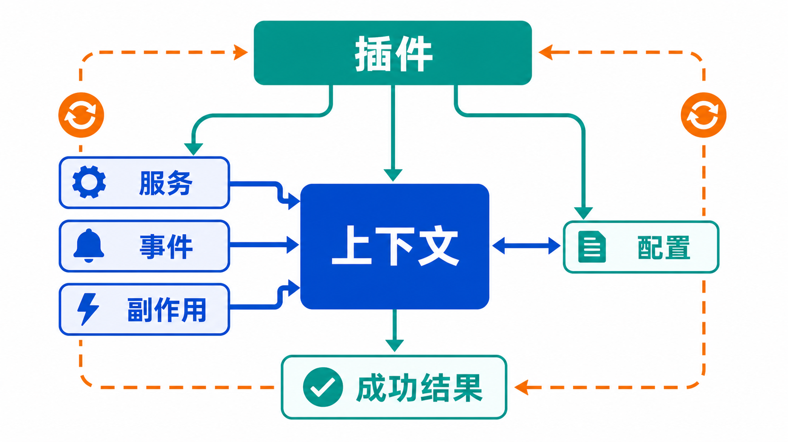
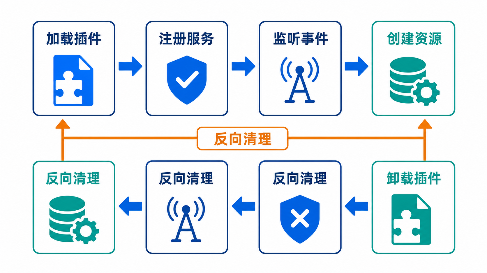
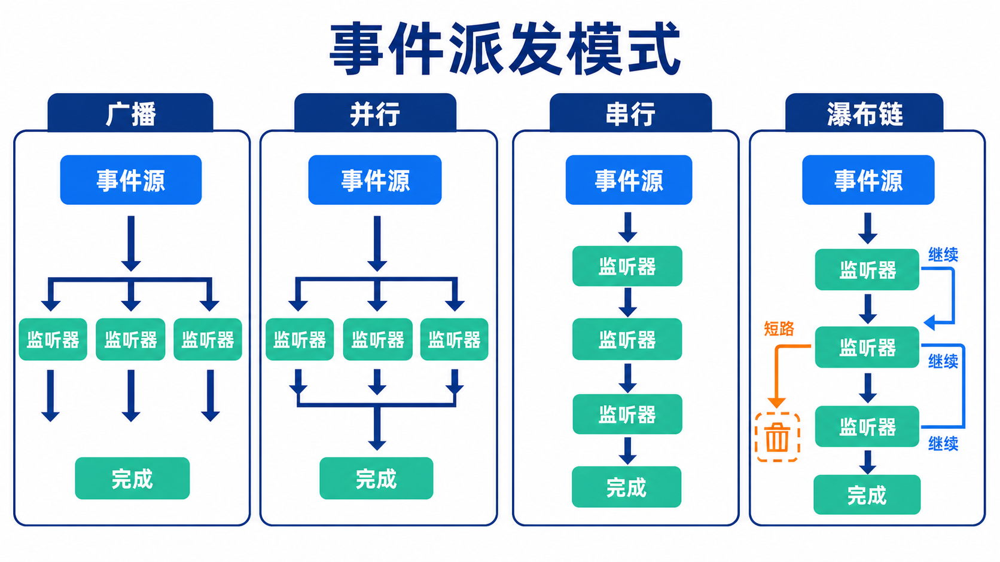
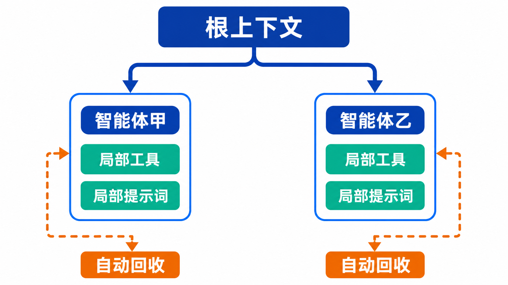

阅读 DeepSeek Harness 时，Cordis 往往比 Agent Loop 更陌生。它是一个同时管理服务解析、事件派发和插件生命周期的 TypeScript 运行时：源码里的功能大多写成插件，服务通过 `ctx.xxx` 获取，监听器支持 `emit`、`parallel`、`serial`、`waterfall` 等派发方式，注册项还能随插件卸载而撤销。只把 Cordis 当作依赖注入容器，会看不懂工具注册、Prompt Section、模型 Adapter 和 Session 持久化为什么强调 Effect；只把它当作事件总线，又会漏掉 Context 隔离和 Fiber 所有权。

Cordis 把四个概念组合成一个运行时：**Context 是带作用域的服务视图，Service 是稳定能力键背后的实现，Event 是插件之间的控制协议，Effect 是贡献与生命周期之间的所有权关系**。Fiber（纤程）不是操作系统线程，而是一次插件挂载的生命周期实例；它把这四者绑定起来，负责等待依赖、记录失败、热重载和逆序卸载。

本文以官方标签 `dsh-v0.1.0-rc.7` 内 vendored Cordis 为准，重点核对 `vendor/cordis/src` 与 Harness 的实际用法。

## 1. Context 不是普通对象，而是服务解析代理

`new Context()` 创建根上下文时，会安装 Reflect、Registry、Events 和 Logger 四个内置服务，并返回一个 Proxy。普通属性读取会经过服务解析器，所以 `ctx.tools` 看起来像对象字段，背后却是当前隔离域中名为 `tools` 的实现。

```typescript
// 源码裁剪：vendor/cordis/src/context.ts
constructor() {
  this[Context.isolate] = Object.create(null)
  this[Context.intercept] = Object.create(null)
  const self = new Proxy<this>(this, ReflectService.handler)
  this.root = self
  this.fiber = new Fiber(self, {}, Object.create(null), null, () => [])
  this.reflect = new ReflectService(self)
  this.registry = new RegistryService(self)
  this.events = new EventsService(self)
  this.logger = new LoggerService(self)
  return self
}
```

Context 支持 `extend()`，子对象通过原型继承父 Context，额外元数据只遮蔽当前分支，不修改父对象。这是 Agent 把自身挂到 `ctx.agent`、Scope 给 Context 打标签，以及 Loader 为插件加入 Fiber 所有权的基础。

```typescript
// 源码裁剪：vendor/cordis/src/context.ts
extend(meta = {}): this {
  const self = Object.create(getTraceable(this, this))
  for (const prop of Reflect.ownKeys(meta)) {
    Object.defineProperty(self, prop, Reflect.getOwnPropertyDescriptor(meta, prop)!)
  }
  return self
}
```

因此 Context 不能用“全局单例容器”来理解。根 Context 是共同底座，子 Context 可以带不同 Fiber、不同服务隔离标签、不同拦截配置和不同 Agent 身份；同一个插件从不同 Context 读取同名服务，结果可能不同。



## 2. Service 用稳定键把接口与实现解耦

Service 子类在构造函数里调用 `super(ctx, name)`，反射层会把当前实例注册到服务名。贡献属于构造它的 Fiber，Fiber 卸载时会自动移除。

```typescript
// 源码裁剪：vendor/cordis/src/service.ts
export abstract class Service<T = never> {
  public name!: string

  constructor(protected ctx: Context, name: string) {
    name ??= this.constructor['provide'] as string
    this.ctx.reflect.provide(name, self, this[Service.check])
  }
}
```

Harness 常通过声明合并为 `Context` 增加类型。下面是一个可运行的最小模式；真实工程需要安装 Cordis 并按包的导出配置编译：

```typescript
// 可运行示例：定义 ctx.clock 服务
import { Context, Service } from '@deepseek-ai/cordis'

declare module '@deepseek-ai/cordis' {
  interface Context { clock: ClockService }
}

export class ClockService extends Service {
  static provide = 'clock'
  constructor(ctx: Context) { super(ctx, 'clock') }
  now() { return Date.now() }
}

export default function apply(ctx: Context) {
  new ClockService(ctx)
}
```

消费方依赖 `ctx.clock.now()`，不需要导入某个本地或远程时钟实现。对 Harness 而言，`ctx.llm`、`ctx.sessions`、`ctx.tools` 和能力 Provider 都使用相同逻辑：稳定的是服务键与接口，具体插件可以替换。

Service 解析还有一个容易误判的点：类型系统里的 `ctx.clock` 只说明“这个 Program 知道存在名为 clock 的服务”，不说明当前 Fiber 已经注入或运行时一定可用。强依赖应通过 `inject` 声明，弱依赖可以显式使用查询方法并处理缺席。直接用非空断言把可选能力当作必然存在，只是把组合错误推迟到了更深的调用栈。

一个 Service 也不必等同于某个巨大单例。Harness 的 Tool Registry 本身可以是 Host Service，但其中的注册条目按 DSH Scope 分层；某些 Agent Preset 又会在 Cordis Isolation Realm 内提供独立的状态服务。稳定键解决接口寻址，Realm 解决实例碰撞，Scope 解决注册可见性，它们分别处在不同抽象层。

```latex
服务键：调用者要找哪一种能力
隔离域：同名能力解析到哪一个实现槽位
智能体作用域：注册项对哪些智能体可见
纤程所有权：实现和注册由谁创建、何时撤销
```

Service 构造时还可以提供可用性检查，并能通过 Symbol 支持 Callable Service。Logger 因而可以表现成 `ctx.logger('name')`，同时仍然是受 Context 跟踪的服务实例。这样的机制不是 Harness 插件作者每天都要使用，但它解释了为什么 Context 属性读取不能被当成普通字段访问来重构。

## 3. inject 把加载顺序变成依赖条件

如果插件启动时直接读取 `ctx.tools`，它必须保证 Tool Service 已存在。传统应用常依赖配置文件顺序或手写启动阶段；Cordis 让插件声明 `inject`，Fiber 在所需服务可用前保持 `PENDING`，服务变更后再刷新。

```typescript
// 可运行示例骨架：只有 tools 与 sessions 都可用时才激活
export const inject = ['tools', 'sessions']

export default function apply(ctx: Context) {
  const dispose = ctx.tools.register(myTool)
  return dispose
}
```

函数插件也可以带属性，类插件则可通过 Service 机制和初始化 Hook 表达。关键不是具体语法，而是“依赖缺失”成为可观察的生命周期状态，而不是在任意时刻抛出 `Cannot read properties of undefined`。

Fiber 的状态定义位于 `vendor/cordis/src/fiber.ts`：

```typescript
// 源码裁剪
export const enum FiberState {
  PENDING,
  LOADING,
  ACTIVE,
  FAILED,
  DISPOSED,
  UNLOADING,
}
```

这对动态配置尤其重要：Provider 暂时卸载后，依赖它的插件可以退出活动状态；新实现加载完成后，再按依赖重新激活。插件树因而不是“一次启动后永不变化的对象图”，而是具有依赖响应能力的运行图。

## 4. Event 是类型化协议，派发模式也是契约

Cordis Event 不只有发布订阅。`vendor/cordis/src/events.ts` 定义五种模式：`emit`、`parallel`、`serial`、`bail` 和 `waterfall`。它们的等待、顺序和返回值不同，不能互换。

```latex
emit      同步通知全部监听器，不等待异步结果，不取返回值
parallel  并行等待全部监听器，多个失败聚合
serial    按顺序等待，遇到第一个有效返回值停止
bail      同步按顺序，遇到第一个有效返回值停止
waterfall 中间件嵌套；调用 next() 才委托后续
```

事件类型通过 declaration merging 扩展：

```typescript
// 可运行示例：声明并发送类型化事件
declare module '@deepseek-ai/cordis' {
  interface Events {
    'audit/record'(entry: { action: string; at: number }): void
  }
}

ctx.on('audit/record', entry => console.log(entry.action))
ctx.emit('audit/record', { action: 'tool-called', at: Date.now() })
```

Harness 的 `session/event` 是 durable fact 的实时广播，`agent/status` 是运行状态通知，`agent/turn-stopping` 是串行终止检查，而 `agent/request`、`agent/pre-step`、`llm/stream`、`tools/pre-execute` 是 Waterfall。选择模式就是选择控制权：观察者不应短路，策略决策需要能够短路，资源 Flush 则需要等待全部后端。



## 5. Waterfall 为什么是 Agent 可拦截主链的关键

Waterfall 不是简单地“把上一步返回值传给下一步”。它采用 around-middleware：监听器收到业务参数和 `next()`，调用 `next()` 才会进入后面的监听器及最终实现；不调用就短路。外层还能等待并包装下游返回值。

```typescript
// 源码裁剪：vendor/cordis/src/events.ts
waterfall(...args: any[]) {
  const cbs = this.dispatch('waterfall', args)
  const inner = args.pop()
  const next = () => {
    const cb = cbs.shift() ?? inner
    return cb(...args)
  }
  args.push(next)
  return next()
}
```

例如一个请求策略既可以修改模型配置，也可以包围下游调用：

```typescript
// 教学伪代码：展示 around-middleware，不是原文件逐字摘录
ctx.on('agent/request', async (request, next) => {
  request.reasoningEffort ??= 'medium'
  const started = performance.now()
  try {
    return await next()
  } finally {
    metrics.observe(performance.now() - started)
  }
})
```

权限策略也可以拒绝后续执行：

```typescript
// 教学伪代码：不调用 next() 即短路
ctx.on('tools/pre-execute', async (call, next) => {
  if (isForbidden(call)) return deniedResult(call)
  return next()
})
```

常见错误是“我只是观察一下”却忘记调用 `next()`，结果内建行为完全没有执行。官方 Primer 因而强调：Waterfall 的派发模式属于公共契约，插件作者必须明确自己是包围、改写还是拥有最终决策。

事件分发还会带一个可选的 `thisArg`，Cordis 用它应用 Context Filter。Harness 的 Agent Event Dispatcher 会构造带 Scope Key 的载体，让未打 Scope 标签的全局监听器仍能观察，而某个 Preset Scope 的监听器只接收自己的子 Agent 事件。也就是说，同一个事件名既提供类型契约，又通过 Subject Carrier 路由到正确运行域。

```typescript
// 教学伪代码：显式主体参与事件过滤
ctx.emit(agentCarrier, 'agent/status', {
  agent,
  status: 'running',
})
```

这比在每个监听器开头手写 `if (payload.agent.id !== myId) return` 更可靠。手工判断容易漏掉祖先 Preset、Fork 或 Agent 重建；Scope Carrier 则把事件准入与注册 Context 绑定。需要强调的是，这种进程内 Scope 身份不能越过 Worker 或网络成为授权凭据，跨边界仍必须传显式 Session/Agent 身份并重新验证。

监听器自身也是 Effect。`ctx.on()` 先断言当前 Fiber 仍 Active，再把 Callback 绑定到反射上下文，最终通过 `fiber.effect()` 存入 Hook 列表。卸载 Fiber 后监听器会自动移除，调用 disposer 第二次不会重复工作。这里的 disposer 是“撤销函数”：调用它会移除注册或关闭资源。普通插件不应直接操作 `_hooks`，否则既绕过过滤，也失去 Effect 元数据和生命周期保证。

`parallel` 的失败语义也值得注意：所有监听器都会启动，使用 `Promise.allSettled()` 等待，然后把拒绝聚合成 `AggregateError`。这适合 Session Flush 一类“每个持久化后端都必须有机会排空”的检查点；如果用遇错即停的串行循环，第一个后端失败会让其他后端根本没有执行清理。

```latex
通知事件关注：所有观察者都能看到，但不影响主流程
检查点事件关注：所有参与者都要结算，失败统一报告
决策事件关注：按顺序找到权威决定
瀑布事件关注：多个插件共同包围一个内建动作
```

## 6. Effect 把每一项贡献绑定到所有者

注册工具、添加 Prompt Section、监听事件、启动定时器、打开文件句柄，都是插件对运行时施加的副作用。如果只执行“添加”，卸载时就会留下幽灵工具、重复监听器或仍运行的后台任务。Cordis 的原则是 **Registrations are effects**：注册本身也属于副作用，贡献要返回用于撤销注册的 disposer，Effect 再由当前 Fiber 收集。

```typescript
// 可运行示例：一个 Effect 同时拥有资源与监听器
ctx.effect(() => {
  const controller = new AbortController()
  const off = ctx.on('task/cancel', () => controller.abort())
  const task = startWorker(controller.signal)

  return async () => {
    off()
    controller.abort()
    await task.catch(() => {})
  }
})
```

Fiber 接受同步 disposer、异步 disposer、Promise，甚至产生多个 disposer 的同步或异步 Iterable。源码类型概括如下：

```typescript
// 源码裁剪：vendor/cordis/src/fiber.ts
export type Effect<T = any> =
  | Disposable<T>
  | Iterable<Disposable<T>, void, void>
  | Promise<Disposable<T>>
  | AsyncIterable<Disposable<T>, void, void>
```

卸载时按逆注册顺序执行，这与资源栈语义一致：先创建底层连接，再注册上层消费者；清理时先撤掉消费者，再关连接。若清理顺序需要整体保证，把相关工作放在同一个 Effect 中比散落多个 Hook 更安全。

## 7. Context 的 isolate 与 intercept 解决两种不同问题

`isolate(name)` 为某个服务名建立新的隔离标签。它不是复制整个 Context，而是改变这个名字的查找域。同一棵插件树可以在两个 Agent 作用域中各提供一个 `tools` 或其他服务实现，而互不冲突。

```typescript
// 源码裁剪：vendor/cordis/src/context.ts
isolate(name: string, label?: symbol) {
  const shadow = Object.create(this[Context.isolate])
  shadow[name] = label ?? Symbol(name)
  return this.extend({ [Context.isolate]: shadow })
}
```

`intercept(name, config)` 则不是换实现，而是为此分支下启动的插件加入服务专属配置。Service 的 `resolveConfig()` 会从祖先到当前合并这些拦截值，再叠加 base 与 head。

```typescript
// 源码裁剪：概念化展示两个分支
const tenantA = root.isolate('tools').intercept('llm', { timeout: 30_000 })
const tenantB = root.isolate('tools').intercept('llm', { timeout: 10_000 })
```

在 Harness 中还存在更高层的 `dsh-scope`，它为 Agent 注册贡献提供身份和事件路由。Cordis Isolation 解决“同名 Service 实现放在哪个 Realm”，DSH Scope 解决“某项注册属于哪个 Agent，以及事件向哪个祖先作用域传播”。两者相邻但不等价。



## 8. Fiber 让热重载变成卸载旧贡献再挂载新贡献

Fiber 是一次插件应用的运行时实例，持有父 Context、子 Context、配置、依赖快照、状态和 disposer 列表。Config 先经过 Standard Schema 校验；依赖满足后进入 Loading，插件回调创建 Effect，最终 Active。失败或更新时，旧 Epoch 被卸载。

```latex
PENDING --依赖满足--> LOADING --成功--> ACTIVE
                         |                |
                         v                v
                       FAILED        UNLOADING --> PENDING 或 DISPOSED
```

这使 HMR 的语义不是“重新执行函数，期望旧注册自己消失”，而是沿所有权树撤销旧 Fiber 的贡献，再用新配置挂载。一个工具插件如果正确通过 `ctx.effect()` 或 Registry 返回值注册，热更新后不会存在两个同名旧执行器；反之，绕开 Effect 直接写全局 Map，就破坏了运行时的可逆性。

下面是符合生命周期的工具注册骨架：

```typescript
// 教学伪代码：真实 ToolDefinition 字段以 core/tools 为准
export const inject = ['tools']

export default function apply(ctx: Context) {
  ctx.effect(() => ctx.tools.register({
    name: 'hello',
    schema: { type: 'object', properties: { name: { type: 'string' } } },
    execute: async ({ name }) => ({ text: `你好，${name}` }),
  }))
}
```

Fiber 也提供诊断用 Effect 元数据树，让运行时能回答“这个监听器或服务是谁注册的”。对于一百多个包的 Harness，这比手工追踪全局集合更重要。

Fiber 的依赖响应也意味着插件回调可能运行不止一次。依赖实现变化、配置更新或热重载会结束旧 Epoch，再产生新 Epoch。插件回调内的模块级可变变量如果没有按 Fiber 隔离，第二次加载会复用脏状态；把连接和缓存放在返回 disposer 管理的实例里，才与运行时语义一致。

异步 Effect 还存在停稳问题。调用 disposer 不等于资源瞬间消失：后台 Promise、子进程或网络 Stream 可能正在收尾。Cordis 保存 `inertia`，卸载边界等待清理结算；DSH Scope 的 `dispose()` 进一步循环等待 Fiber 惰性过渡结束。对 Agent 来说，只有达到完全停稳，才能保证旧插件不会在新配置已生效后又发布一条迟到事件。

```typescript
// 可运行示例骨架：把异步循环的终止纳入 disposer
ctx.effect(() => {
  const abort = new AbortController()
  const running = consumeQueue(abort.signal)
  return async () => {
    abort.abort()
    await running
  }
})
```

配置本身也属于 Fiber Epoch。Cordis 会在启动前使用插件声明的 Standard Schema 校验和规范化配置，当前实现明确拒绝异步配置验证。插件不应在启动一半后才发现字段错误并留下部分注册；相关贡献应在完成校验后，通过一个或几个有序 Effect 建立。

对外部资源还要考虑清理失败。Cordis 会尽力收容并记录插件观察者错误，但资源所有者不能假设任何异常都会被框架“自动恢复”。例如子进程终止超时、数据库 Flush 失败或网络迭代器不响应取消，都需要 Provider 自己定义 Deadline 和降级方式。Effect 提供所有权容器，不替代领域级恢复设计。

插件调试时可以沿四条线检查：Fiber 当前状态是否 Active；所需服务在这个 Isolation Realm 是否存在；事件 Listener 是否被目标 Scope Filter 接纳；Effect Tree 中是否能找到预期注册。只看“配置 YAML 里有这一行”远远不够，因为它可能仍在 Pending、在另一个 Realm，或者已经因依赖变化进入 Unloading。

还需要区分“插件卸载”与“进程退出”。正确的插件即使在进程不退出的情况下也能被完整撤销，因为配置热重载、Agent Preset 销毁和测试隔离都依赖这一点。只注册 `process.on('exit')` 的清理逻辑无法处理局部插件树更新，也会让单元测试在同一进程加载第二套 Context 时受到上一套状态污染。Effect 的价值正是把清理边界从全局进程缩小到贡献的真实所有者。

Context 的继承结构也要求插件避免捕获错误层级。插件启动时收到的 `ctx` 已经带有当前 Fiber、Isolation 与 Intercept；若为了“方便”保存 `ctx.root` 并从根注册工具或监听器，这些贡献就会绕过 Agent Scope 和局部 Realm。除非功能明确属于 Host 全局层，否则应使用注入给插件的当前 Context。反过来，Host 服务也不能偷偷保存某个 Agent Context 作为默认调用目标，因为并发会话会让这个默认值发生身份串扰。

```latex
正确问题：这项贡献应由哪个 Fiber 所有、在哪个 Context 可见？
危险捷径：总是从根 Context 注册，或把最后一个 Agent 记成全局当前值
```

Waterfall 插件还有返回顺序问题。外层监听器先运行，但它在 `await next()` 之后的修改晚于内层，因此最终结果沿调用栈向外返回。多个插件都改写消息列表时，作者必须明确是“调用下游前加入前缀”“调用下游后附加内容”，还是“完全替换下游结果”。无意识地在共享对象上原地修改，会让监听顺序成为隐藏 API。Harness 关键 Waterfall 通常使用冻结值或结构化 Decision，就是为了让替换意图更明显。

事件观察者不应承担必须完成的核心写入。`emit` 不等待异步结果，而且 Session 的实时观察者失败会被逐个收容；若业务要求“所有后端持久成功后才能继续”，应使用受等待的 Flush/Checkpoint 服务，而不是在 `session/event` 回调里假装同步提交。事件是否 Awaited 是可靠性设计的一部分，不只是性能选项。

测试 Cordis 插件时，至少应覆盖四种生命周期：依赖一开始就存在时正常激活；依赖稍后出现时从 Pending 激活；依赖或配置变化时旧 Effect 完整撤销；父 Fiber 卸载时异步 disposer 真正结算。带 Scope 的插件还要创建两个并发 Agent，证明贡献互不可见，同时全局观察器仍能收到两边事件。

对于服务替换，应测试消费者不会保存旧实现的裸引用越过 Epoch。通常在插件激活期间通过当前 Context 使用服务是安全的；把实现交给长期分离任务，则必须让任务也归当前 Effect 所有，并在依赖切换前停止。否则新 Provider 已注册，后台任务仍调用旧连接，运行时表面上热重载成功，实际却同时活着两个能力世界。

Cordis 并不会替插件决定这些领域策略，它提供的是足够精确的结构：依赖何时满足、注册归谁、事件如何路由、清理何时结算。DeepSeek Harness 能把模型、工具、Session 与 UI 都做成插件，是因为这些结构比普通扩展点更接近一个微型应用运行时。

还有一条容易被忽略的安全规则：进程内 Context 身份只能帮助路由，不能替代授权。`Context.is()` 的品牌跨 Realm 和 Cordis 副本可识别，Scope Carrier 也能过滤 Listener，但攻击者通过网络提交一个 Session ID 时，Host 仍要校验访问权；Worker 收到任务时也必须携带显式主体。把 Context 当作能力对象适用于受信进程内部，一旦跨越序列化边界，所有对象身份都会消失。

配置插值同样要保持克制。Loader 可以在 Entry 激活后针对插件 Context 解析表达式，这使配置能够引用环境和服务，却也意味着表达式拥有部署代码级信任。用户 Preset 或第三方 Profile 不是无害数据；能安装插件、执行表达式和决定 Shell Provider 的配置，应接受与本地代码相同的审计。可组合性提高了变化速度，同时也扩大了配置错误和供应链代码的影响面。

因此，成熟的插件交付物不只包含 `apply(ctx)`：还应包含配置 Schema、明确的 inject、所有 Effect 的 disposer、事件模式说明、作用域归属、最小权限与生命周期测试。做到这些，插件才能在 Profile 覆盖、Preset 隔离和热重载下保持一致，而不仅是在默认启动顺序中“碰巧可用”。



## 9. 用 Cordis 写 Harness 插件时的边界与检查表

第一，选择 Service 还是 Event。直接能力调用适合 Service，例如 `ctx.fs.read()`；观察、拦截和多方策略适合 Event，例如 `tools/pre-execute`。不要为了“解耦”把所有方法调用都绕成广播，也不要让跨插件策略偷偷进口具体实现。

第二，先确定派发模式。纯观察用 `emit`，必须全部完成的检查点用 `parallel`，按顺序选出一个决定用 `serial` 或 `bail`，需要包围并可短路主链时用 `waterfall`。Waterfall 观察器必须 `next()`。

第三，所有注册都要有 disposer。优先使用已经自动绑定 Fiber 的 `ctx.on()`、`ctx.provide()` 和注册表 API；自己创建外部资源时放进 `ctx.effect()`，并让取消与异步关闭真正收敛。

第四，声明 `inject`，不要赌配置行顺序。第五，明确使用的是 Cordis `isolate` 还是 DSH Agent Scope。第六，Developer Preview 阶段不要依赖未记录的内部 Fiber 字段；本文引用的是 `dsh-v0.1.0-rc.7` 的实现，后续版本应重新核对。

把这套模型压缩成一句话：Context 决定“在这里能看见什么”，Service 决定“能力以什么稳定名字被调用”，Event 决定“插件怎样观察和接管过程”，Effect 决定“贡献归谁、何时撤销”，Fiber 则让它们一起经历等待、激活、失败和卸载。DeepSeek Harness 的可组合性就是建立在这组运行时语义之上。
