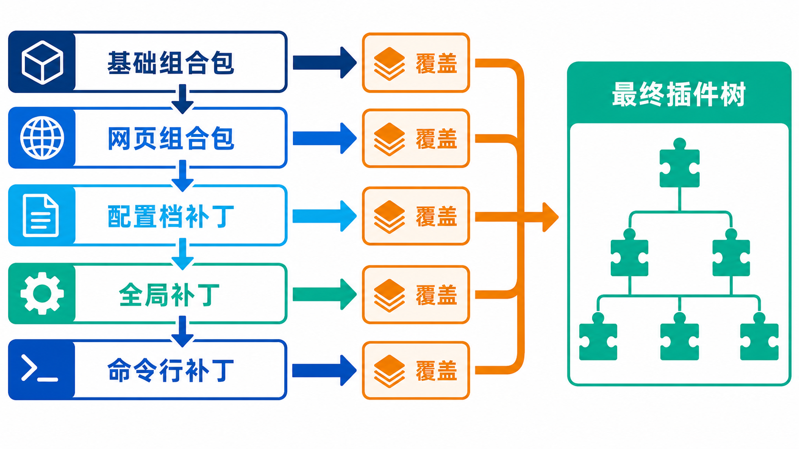
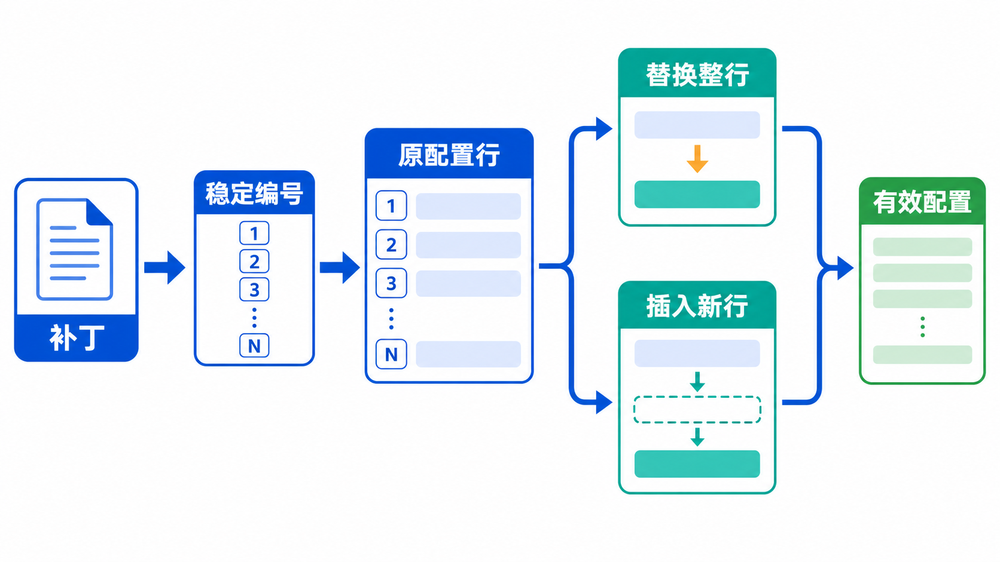
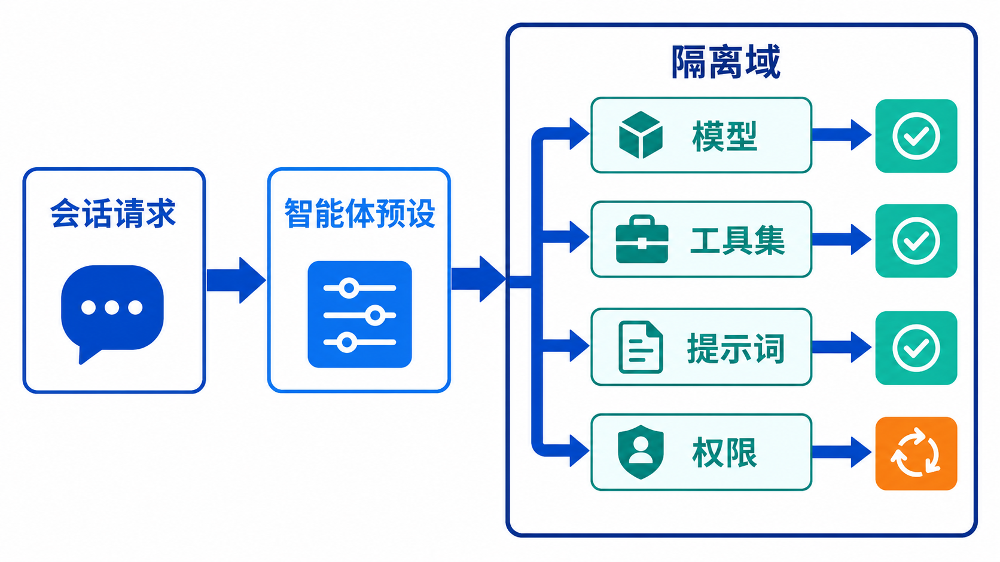
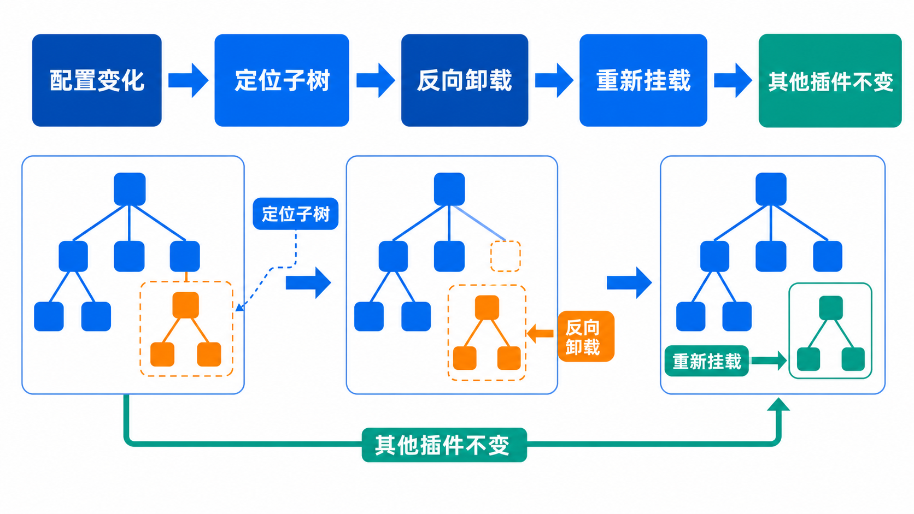

DeepSeek Harness 说“一切皆插件”，但插件数量不会自动带来可组合性。要看懂它的装配方式，需要回答五个层次的问题：进程启动时加载哪些基础组件？不同运行形态怎样复用基础层？用户怎样覆盖默认配置？同一进程中的不同 Agent 怎样只看到各自的贡献？某个 Session 恢复时又怎样保证使用原来的工具和提示词？

这五个问题分别落在 **Profile、Bundle、Patch、Scope 与 Preset** 上。Profile 选择进程级组合，Bundle 分发可叠加的配置层，Patch 对稳定行做覆盖，Preset 定义 Agent 平面的一组能力，而 Scope 把这些注册定向给相应 Agent。把它们混成“几种 YAML 配置”会看不清所有权；按 Host Plane 和 Agent Plane 分层，组合逻辑就会清楚。

本文固定使用官方标签 `dsh-v0.1.0-rc.7`，重点参考 `packages/boot/app-boot/src/profile.ts`、`packages/bundle`、`packages/preset/agent-presets` 和 `packages/core/scope`。

## 1. 先区分宿主平面与 Agent 平面

Host Plane（宿主平面）是进程级基础设施：Session Store、持久化、模型路由、Sandbox、Approval、API Gateway、全局注册表和 Web Server。它们通常在 Profile 启动时挂载一次，并为多个 Session 服务。Agent Plane（Agent 平面）指某类 Agent 能看到和使用的组合：Persona、Prompt Section、Tool、Plan Mode、Compaction 和 Workflow 等。这里的“平面”表示责任层次，不是独立进程。

```latex
Host Plane（进程一次）
  Session / LLM / Tools Registry / Sandbox / Approval / Persistence / Gateway
                              |
                    Agent Preset Roster
                  /           |           \
          standard Scope  minimal Scope  自定义 Scope
              |                |              |
          Agent A、B         Agent C        Agent D
```

分层的判断标准不是“这个包是否与 Agent 有关”，而是谁需要在什么时候解析它。例如 API Gateway 在 Session 创建前就要存在，不能藏进某个会话的 Preset；一个模型可调用的 `todo_write` Tool 则可以由 Preset 决定是否暴露。注册表可以是 Host 单例，注册表中的条目却按 Scope 分层。

这也是为什么 `apps/cli/config/agent-presets/standard/agent.cordis.yml` 的注释比配置字段更重要：它逐项说明哪些服务应留在 Host，哪些消费者可以由 Preset 贡献，以及服务行为什么要处于 `isolate` Realm。Realm 在这里指同名 Service 的隔离域，用来避免不同 Preset 解析到同一个有状态实例。



## 2. Profile 是运行入口的命名组合

Profile 存放在 Harness Home 的 `profiles/<name>` 下，核心是一个 `package.json` 和用户自己的 `cordis.patch.yml`。Manifest（描述该 Profile 元数据和依赖的清单）中的 `dsh.profile.bundles` 规定 Bundle 顺序，Profile 目录的 dependencies 则容纳树外插件。

```json
{
  "name": "dsh-profile-web",
  "private": true,
  "dependencies": {},
  "dsh": {
    "profile": {
      "bundles": [
        "@deepseek-ai/dsh-base",
        "@deepseek-ai/dsh-web-app"
      ]
    }
  }
}
```

上面是根据 `initProfile()` 生成结构整理的可运行配置示例。rc.7 自带两个模板：

```typescript
// 源码裁剪：packages/boot/app-boot/src/profile.ts
export const PROFILE_TEMPLATES = {
  web: ['@deepseek-ai/dsh-base', '@deepseek-ai/dsh-web-app'],
  headless: ['@deepseek-ai/dsh-base', '@deepseek-ai/dsh-headless'],
}
```

Profile 不是“Agent 人格”。`web` Profile 可以创建使用 `standard` 或 `minimal` Preset 的 Session；同一个 Preset 也可以出现在 Headless。Profile 决定进程有哪些基础设施和表面，Preset 决定某类 Agent 拥有什么模型可见组合。

## 3. Bundle 是可分发、仍可覆盖的配置层

Bundle 是 npm 包，其 `package.json` 的 `dsh.bundle.patch` 指向一个 Patch 文件。`dsh-base` 为每个 Profile 提供共同底座；`dsh-web-app` 与 `dsh-headless` 只叠加模式相关行。Bundle 插入的配置仍保留稳定行 ID，所以后面的层可以覆盖。

```json
{
  "name": "@deepseek-ai/dsh-base",
  "dsh": {
    "bundle": { "patch": "./cordis.patch.yml" }
  }
}
```

`packages/bundle/base/cordis.patch.yml` 不是最终树，而是对空树的一次大插入。开头就挂载 LLM、Session、Typert、Agent 等服务：

```yaml
# 源码裁剪：packages/bundle/base/cordis.patch.yml
- insert:
    - id: llm
      name: '@deepseek-ai/dsh-llm'
    - id: session
      name: '@deepseek-ai/dsh-session'
    - id: agent
      name: '@deepseek-ai/dsh-agent'
    - id: agent-default-model
      name: '@deepseek-ai/dsh-agent-default-model'
      config:
        provider: deepseek-official
        model: deepseek-v4-flash
```

Bundle 的价值不是复用一份 YAML 文本，而是提供有顺序、可寻址、可由后层修订的发行单元。模式 Bundle 不需要复制 Base 的全部内容，第三方 Bundle 也可以在基础层之后插入遥测、远程 Provider 或企业策略。

Bundle 还承担“安装拥有默认值”的契约。Base Bundle 里的遥测插件虽然已经挂载，但默认模式关闭；多模型适配器可以处于无路由的休眠状态，等待 Settings 文档提供配置；Session Query Service 可以存在，却把全文检索设为永不打开。也就是说，组件是否在树上和功能是否当前启用是两件事，覆盖层要辨别是 Disable Entry、改变 Config，还是向注册表增加路由。

每个 Bundle 应尽量只负责自己的模式差异。Base Patch 的注释明确要求：某个行值如果因 Web 与 Headless 不同，就由模式 Bundle 各自写完整配置，而不是在 Base 放一个似是而非的中间状态。这样一行通常只有基础层或模式层，加用户层，来源更容易追踪。

```latex
基础包：所有形态共同需要的服务与中性默认值
模式包：网页、无界面等运行形态的完整差异
用户层：部署路径、凭据引用、策略与第三方扩展
临时层：一次启动的诊断或实验覆盖
```

Profile 的模块查找顺序也保护“Bundle 来自当前 Harness 安装”这一事实。官方 Bundle 先从启动器安装位置解析，避免 Profile 局部依赖阴影替换内置 Base；树外插件才通过 Profile 的 `node_modules` 进入。对第三方扩展来说，这意味着 Peer Dependency 应指向 Harness 提供的 Service Definition，而不是偷偷打包一套 Cordis 和 Definition 副本。

## 4. Patch 按行标识替换，后层拥有更高优先级

Profile 加载时从空 Entry List 开始，依次应用 Bundle Patch、Profile Patch、Harness Home Patch 和命令行 Overlay。官方架构给出的顺序可写成：

```latex
[]
 -> profile.bundles[0]
 -> profile.bundles[1]
 -> ...
 -> profile/cordis.patch.yml
 -> $DSH_HOME/cordis.patch.yml
 -> --patch 文件与命令行生成层
 -> Effective Entry Tree
```

Patch 的重要语义是：目标行的 `config` 被整体替换，不做不可见的深层合并。因此覆盖某行时要写出期望的完整配置。下面是一个用户层示例：

```yaml
# 可运行配置示例：放进当前 Profile 的 cordis.patch.yml
- id: session-query-sqlite
  config:
    path: /var/lib/dsh/session-index.sqlite
    openAt: startup

- insert:
    - id: company-audit
      name: '@example/dsh-company-audit'
```

稳定 ID 是 Patch 可维护性的关键。如果只按数组位置覆盖，Base Bundle 增加一行就会让用户补丁错位；按 ID 定位则允许层独立演进。当然，目标行被上游改名或删除仍会造成警告或失效，所以升级时必须检查 effective tree。

```bash
# 实际生效配置比阅读任意单层更可信
dsh --profile web --dump-config
```

源码中的 `composeEntries()` 最终调用 `applyEntryPatches([], structuredClone(layers.flat()), ...)`，说明所有层在一个规则下合成，并非每个 Bundle 启动一个嵌套应用。



## 5. Preset 定义的是“这种 Agent 能做什么”

Agent Preset 是目录中的 `agent.cordis.yml`，配套元数据可以给出名称、说明和排序。`standard` 是完整 Coding Agent，`minimal` 则故意只保留固定 Persona、持久 Bash 与字符串替换编辑器。两者差异是插件组合，不是 Agent 类的两个子类。

```yaml
# 源码裁剪：minimal/agent.cordis.yml
- id: persona
  name: '@deepseek-ai/dsh-persona'
  config:
    text: You are a helpful software engineer assistant.
    complete: true
    includeRuntimeContext: false
```

Minimal 还为 `terminals` 和 `fs` 建立独立 Realm：

```yaml
# 源码裁剪：minimal/agent.cordis.yml
- id: filesystem
  name: cordis:group
  group: true
  isolate:
    fs: true
  config:
    - id: fs-local
      name: '@deepseek-ai/dsh-fs-local'
    - id: str-replace-editor
      name: '@deepseek-ai/dsh-tool-str-replace-editor'
```

`standard` 则加入文件搜索、Jobs、Skills、Goal、Plan Mode、Compaction、Subagent、Workflow、提问和 Todo 等能力。把这些做成 Preset 的收益是：新增 Agent 形态只需声明组合；工具目录和 Prompt Section 会从该 Agent 的 Scope 装配，无需在 Loop 中增加 `if (preset === ...)`。

## 6. Scope 让同一个注册表呈现不同的 Agent 视图

只挂载多个 Preset 仍不够。如果所有 Tool 都进入全局 Map，Standard 的 Agent 会看到 Minimal 的工具，不同 Preset 中同名服务还会冲突。`dsh-scope` 为注册贡献附加不透明身份，并维护 Scope 父子链。

```typescript
// 源码裁剪：packages/core/scope/src/index.ts
export type ScopeKey = object

export function createScope(ctx: Context, key: ScopeKey, options?: { parent?: ScopeKey }) {
  if (options?.parent !== undefined) bindScopeParent(key, options.parent)
  const fiber = ctx.plugin(scope)
  const scoped = fiber.ctx.extend({ [kScope]: key })
  return { ctx: scoped, rawDispose: fiber.dispose, dispose: () => quiesceFiber(fiber) }
}
```

Preset 先作为 standing composition 挂在一个 Scope 上，每个采用该 Preset 的 Agent Scope 再把它设为父 Scope。注册视图向下继承：Agent 看得到自己以及祖先 Preset 的层；事件准入则向上扩展：Preset 监听器可以收到其子 Agent 的事件。

```latex
standard-standing-scope
  ├─ agent-A-scope
  └─ agent-B-scope

minimal-standing-scope
  └─ agent-C-scope
```

三个 Agent 可以共享 Host 的 Tool Registry 服务实例，却从 Registry 得到不同分层条目。Scope 解决的是“注册与事件的路由身份”，Cordis `isolate` 则解决“同名 Service 的实现 Realm”，二者缺一不可。

Scope 的父子关系采用对象身份，而不是字符串 ID。字符串适合持久化 Session 和 Preset 名，进程内 Scope Key 则必须防止碰撞和伪造。`bindScopeParent()` 会拒绝重复绑定与环；`scopeChainOf()` 返回从当前 Key 到根祖先的链。一个 Agent 可以继承 Standing Preset，Preset 却不会反向看到另一个兄弟 Agent 的私有层。

```typescript
// 源码裁剪：packages/core/scope/src/index.ts
function linkScopeParent(key: ScopeKey, parent: ScopeKey): void {
  for (let cursor: ScopeKey | undefined = parent;
       cursor !== undefined;
       cursor = scopeParents.get(cursor)) {
    if (cursor === key) throw new Error('scope parent link would form a cycle')
  }
  scopeParents.set(key, parent)
}
```

事件与注册视图沿链传播的方向不同。子 Agent 读取注册表时继承父 Preset 的 Layer；Preset Scope 监听器则能接收派发给后代 Agent 的事件。兄弟之间没有继承，子 Scope 的 Listener 也不会反向接收父级或别的子级事件。这种方向性让一份 Preset 组合可以服务多个 Session，又不把 Session 状态做成 Preset 单例。

Scope 生命周期由独立 Fiber 支撑。销毁 Agent 时，Scope Dispose 会撤销该 Agent 创建的注册，并等待 Fiber 完全停稳。Standing Preset Mount 可以比单个 Agent 活得更久，因为它挂载一次、供所有使用同一 Preset 的 Session 继承。Mount 记录会在 Fiber uid 清空后被清理，避免历史 Session 数量变成内存泄漏。

需要跨 Host 查询某个 Agent 的 Preset 私有 Service 时，不能简单从 Root `ctx.get(name)`。`serviceForAgent()` 先找到 Agent Scope 的 Standing Parent，再在反射 Store 中按 Fiber 子树定位实现。这个 API 只解决“已持有 Agent 的读寻址”，不允许启动期 Host Plugin 把一个 Per-Agent Service 声明成强 Inject，因为那时还没有目标 Agent。

## 7. 为什么 Preset 中的 Service 必须放进 isolate Realm

Tool Consumer 往往只是向 Host Registry 注册一项，不提供新 Service，因此可以直接位于 Preset Scope。可某些插件会 `provide()` 一个服务，例如 Plan Mode、Compaction 或 Terminal Registry。如果它在 Preset 中没有 `isolate`，实现就会发布到根 Realm：另一个 Preset 提供同名服务时冲突，Host 读取时还可能错误地拿到某个 Preset 的实例。

Standard Preset 用 Group 表达共同 Realm：

```yaml
# 源码裁剪：standard/agent.cordis.yml
- id: compaction
  name: cordis:group
  group: true
  isolate:
    compaction: true
    toolResultPruner: true
  config:
    - id: compaction-basic
      name: '@deepseek-ai/dsh-compaction-basic'
    - id: tool-result-pruner
      name: '@deepseek-ai/dsh-compaction-tool-result-pruner'
```

`true` 表示此 Entry 的本地 Realm，而不是跨 Preset 共享单例。相关 Provider 和 Consumer 必须进入同一个 Realm，否则 Consumer 会解析根服务，看不到 Group 内实现。

`agent-presets` 的 Mount 逻辑还会检查泄漏服务。其判断不是只看 Fiber uid，因为不同根 Registry 的 uid 会碰撞，而是沿 Fiber 对象父链确认实现是否属于这棵 Preset 子树，再比对该服务是否被发布到了根 Isolation Symbol。这个防线把配置错误从“运行时串话”提前成 Mount 失败。

## 8. Preset 选择为什么必须写入 Session 事实

Preset 决定系统提示词、工具 Schema 和能力，它直接改变模型可见请求。因此 Session 创建时把 `agentPreset` 写进 `SessionHeader`。如果空白 Session 在第一次 Turn 前换了 Preset，还要追加 `agent-preset/selected`：

```typescript
// 源码裁剪：packages/preset/agent-presets/src/session.ts
declare module '@deepseek-ai/dsh-session/types' {
  interface SessionEventMap {
    'agent-preset/selected': { agentPreset: string }
  }
}

export function resolveSessionPreset(session) {
  for (let i = session.events.length - 1; i >= 0; i--) {
    const event = session.events[i]
    if (event?.type === 'agent-preset/selected') return event.data.agentPreset
  }
  return session.header.agentPreset
}
```

只读取 Header 会把切换后的会话恢复到创建时 Preset，产生“历史曾使用某工具，恢复后却没有该工具”或“同一消息历史配上不同 Persona”的问题。最新选择必须是持久事实，符合 Harness 的 `model-visible means logged` 原则。

这也带来限制：有内容后的 Session 不能随意换 Preset，因为旧日志已经在旧能力世界中产生。空白窗口内的 Recompose 尚未让模型看见任何请求，所以允许重新绑定 Scope Parent；一旦开始执行，组合应视为会话身份的一部分。



## 9. 如何设计一个自定义 Agent 组合并验证它

建议先判断能力位于哪个平面，再写配置。进程级 Provider、持久化、网关与策略放 Profile/Bundle；模型可见 Tool、Persona、Prompt 与每 Agent 状态放 Preset；跨多个 Agent 的共享 Registry 保持 Host 单例，但其条目必须 Scope-aware。

下面是一份教学性的简化 Preset：

```yaml
# 可运行配置骨架：具体插件是否安装由 Profile dependencies 决定
- id: persona
  name: '@deepseek-ai/dsh-persona'
  config:
    text: 你是一名只读代码审查智能体。

- id: read-tools
  name: '@deepseek-ai/dsh-tool-fs'

- id: review-state
  name: cordis:group
  group: true
  isolate:
    reviewState: true
  config:
    - id: review-store
      name: '@example/dsh-review-state'
```

Profile 的用户 Patch 再安装或配置 `@example` 包。完成后至少做四项验证：用 `--dump-config` 核对 Host 有效树；查看 Preset Roster 是否显示 Broken；同时创建两个不同 Preset Session，确认工具列表不串；重启恢复 Session，确认 `resolveSessionPreset()` 得到原选择。

Preset Discovery 还区分 `system` 与 `user` Trust。用户目录中的 Preset 由人或 Agent 本地创建，拥有与 Shell 代码相当的信任，不应被当成远程无害数据。Preset ID 必须匹配小写字母、数字和连字符的约束，防止 `..`、分隔符或绝对路径把发现和复制操作带出授权根目录。

```typescript
// 源码裁剪：packages/preset/agent-presets/src/types.ts
export type PresetTrust = 'system' | 'user'
export const PRESET_ID = /^[a-z0-9][a-z0-9-]*$/
```

发现损坏的 Preset 时，Roster 不会把它悄悄隐藏。条目保留 `broken` 原因，Mount 路径提前拒绝；否则损坏目录仍占据 ID，用户却既看不到也无法修复。未知 Preset 与已知但 Mount 失败也使用不同 Error，调用方可以分别提示“选择不存在”和“部署组合有问题”。

Mount 期间不只等待 import 完成，还要检查 Enabled Row 是否一直 Pending。一个行可能没有抛错，却等待 Preset 永远不会提供的 Service；`inactiveRows()` 会列出行 ID、插件名和缺失依赖，让这种半激活组合显式失败。Agent 不应在只有一半 Tool 和 Prompt Section 的状态下开始首个请求。

Preset 文件被视为输入模板，不是运行时持久目标。用于 Mount 的 `PresetTree.write()` 被重写为空操作，因为 Agent 销毁会 Dispose 整棵子树；若沿用 Loader 默认写回，第一次 Session 结束就可能把共享 Preset 写成空数组。真正的“在线编辑 Preset”需要独立、审计过的持久流程，不能复用运行树的自动写回。

Blank Session 的 Recompose 也要满足原子性：新 Mount 必须先完整可用，再把 Agent Scope 的父链重新绑定；若新组合失败，旧组合或空白状态应保持可解释。已有模型可见内容后则拒绝切换，因为 Tool Schema、Persona 和 Context 已进入历史。配置 UI 看似只是下拉框，背后其实改变了 Session 的能力身份。

```latex
创建时选择：写入 SessionHeader.agentPreset
空白期改选：追加 agent-preset/selected，再重绑 Scope
首个模型步骤之后：不得无痕切换能力世界
恢复或分支：从最新持久选择重新挂载同一 Preset
```

验证自定义组合时还要检查安全闭环。只从 Preset 移除 Bash Tool，不代表其他 Tool 无法经 Workflow 或 Subagent 间接执行命令；只换成本地 FS Provider，也不代表 Shell 与 LSP 位于同一个文件世界。应沿 Capability Seam 列出 Definition、Provider、Consumer 与 Policy，确保 Agent 可见能力和真实执行边界一致。

最后，配置评审最好保存 `--dump-config` 输出作为发布产物，并把 Profile Manifest、所有 Patch、Preset 文件和外部插件 Lockfile 一起版本化。单看源码 Tag 无法复现某台机器的 Agent，因为用户层与命令行层会改变最终树。有效配置加固定依赖图，才是这套可组合系统的真实部署声明。

补丁评审还应关注“整行替换”带来的升级差异。假设上游给某插件新增一个安全相关默认字段，用户 Patch 仍完整替换旧 Config，那么升级后该字段可能回到插件默认或根本未出现。自动化测试应把上游有效行与用户覆盖行做结构比较，提示新增、删除和类型变化，而不是只验证 YAML 能解析。对权限、沙箱、遥测与持久化路径，这种漂移尤其危险。

禁用一行也需要追踪依赖后果。Cordis 会让注入该 Service 的下游 Fiber 进入 Pending，但弱依赖消费者可能仍然 Active，只是在运行时降级。有效树看起来“没有报错”不代表产品能力完整。应从 Service Definition 的消费者图出发，验证每个被禁用 Provider 会让哪些工具消失、哪些页面降级、哪些后台流程停止。

Agent Plane 中还常见“注册表在 Host，条目在 Preset”的混合所有权。例如 Skills、Tools、Prompt Section 由 Host Registry 聚合，但某个 Preset 只在自己的 Scope Layer 注册几项。这种模式避免每个 Preset 都创建一个无法被 Host API 查询的私有 Registry，同时保持模型目录隔离。若第三方插件不知道 Registry 已经 Scope-aware，自己在 Root 注册，就会让所有 Preset 都看见它。

```latex
进程单例服务不等于全局可见条目
每智能体服务不等于必须复制所有基础设施
是否隔离实例与是否隔离注册，是两个独立设计决定
```

相反，一个真正带可变 Agent 状态的 Service 不应只依赖 Scoped Registry 隔离。若两个 Session 调用的是同一 Service 实例，Service 内部的“当前计划”或“当前终端”必须按 Agent/Session Key 分区，或者直接放进 Preset 的 Isolation Realm。只隐藏注册入口无法隔离实现内部的可变字段。

对 Subagent 还要考虑 Preset 继承。新建子 Agent 可以显式选择 Preset，Fork 子会话则从父 Session 的稳定日志前缀和持久身份出发。Delegation Depth、Origin 和 Agent Preset 都进入 Header，避免进程重启后把子 Agent 当顶层 Agent，或在不同工具世界继续旧任务。组合系统的持久性不只是保存“选了 standard”这一个字符串，而是让创建、恢复、分支和远程驱动都尊重它。

用户自建 Preset 具备代码信任还意味着不能直接从陌生仓库自动安装并挂载。YAML 中的 `!!js` 表达式、插件模块、相对文件以及 Shell Provider 都可能执行本地代码或改变策略。一个安全的分享流程应把 Preset 与其依赖 Lockfile 一起审查，在隔离 Profile 中试运行，确认没有根 Service 泄漏，再进入正式 Roster。

升级测试可以建立三类快照。第一类是 Effective Entry Tree，检测 Bundle/Patch 合成变化；第二类是每个 Preset 的 Tool Schema 和 Prompt Section，检测模型可见能力变化；第三类是两个并发 Agent 的 Scope 可见性矩阵，检测串话。相比只跑一次端到端对话，这三类快照更接近组合层的真实契约。

当某个 Agent 行为异常时，排查顺序也应从外向内：先确认启动的是哪个 Profile，再看 Bundle 与 Patch 合成出的行；确认 Session 最终解析到哪个 Preset；检查 Preset Mount 是否存在 Pending 或 Leak；最后检查 Agent Scope 是否正确继承 Standing Scope。跳过前面几层直接调试 Tool 实现，经常会发现代码没问题，只是它从未进入目标 Agent 的能力目录。

这套分层最终让“Agent 是什么”成为可声明、可重建的答案：它既不是某个 TypeScript 类，也不是一份孤立 Prompt，而是进程基础设施、部署覆盖、Agent 能力组合和运行身份共同作用的结果。只有同时保存配置与会话身份，才可能在另一台机器或下一次启动中重现相同 Agent。

组织职责也应与这些层对应。框架维护者发布 Bundle 和 Service Definition；平台团队维护 Profile、凭据引用、持久化和策略 Patch；Agent 设计者维护 Preset 中的 Persona、Tools 与局部状态；运行时则把最终 Preset 选择写入 Session。若所有文件都由一个生成脚本覆盖，任何角色的小改动都可能重置别人的安全设置。分层配置不仅是技术复用，也是变更权限的边界。

线上回滚时也不能只回滚应用包。若新版已经创建使用新 Preset 或新 Session Event 的会话，旧版进程未必能正确恢复；若 Profile Patch 已改变存储路径，回滚二进制可能读到另一套数据。发布单元应包含 Harness Tag、Bundle 版本、Profile/Patch 哈希、Preset 哈希和 Session 格式兼容判断。Developer Preview 阶段尤其要把回滚演练放在真实副本数据上，而不是假设配置文本向后兼容。

从这个角度看，Profile、Bundle、Patch、Scope 和 Preset 不是五个可以任意合并的名字。前三者回答进程怎样启动，后两者回答同一进程中某个 Agent 怎样获得能力；Session 事件再把选择固定成可恢复事实。沿着这条边界写扩展，组合复杂度才不会重新落回条件分支和全局状态。



## 10. 组合设计的收益、失败方式与升级边界

五层机制各自解决一个明确问题：Bundle 让默认能力可分发，Profile 决定进程形态，Patch 提供部署覆盖，Preset 描述 Agent 身份，Scope 把贡献限制到相应会话。它们共同避免“复制一份 Agent 类再改几个开关”的组合爆炸。

最常见失败有四类。第一，把 Host Service 放进 Agent Preset，导致 Gateway 或启动期消费者无法解析；第二，Preset 中提供 Service 却没建 Isolation Realm，导致根泄漏或同名冲突；第三，Patch 误以为 Config 深合并，漏写字段；第四，只在内存中切换 Preset，不记录 Session 事实，恢复后能力漂移。

rc.7 仍处于 Developer Preview，Profile Manifest、Preset Mount 和 Session 格式都可能破坏兼容。生产尝试应固定 `dsh-v0.1.0-rc.7` 或自己的审计提交，保存 effective config，版本化自定义 Patch 与 Preset，并为作用域隔离编写跨 Session 测试。组合能力越强，越需要把最终树、所有权和持久身份当成可验证产物。
