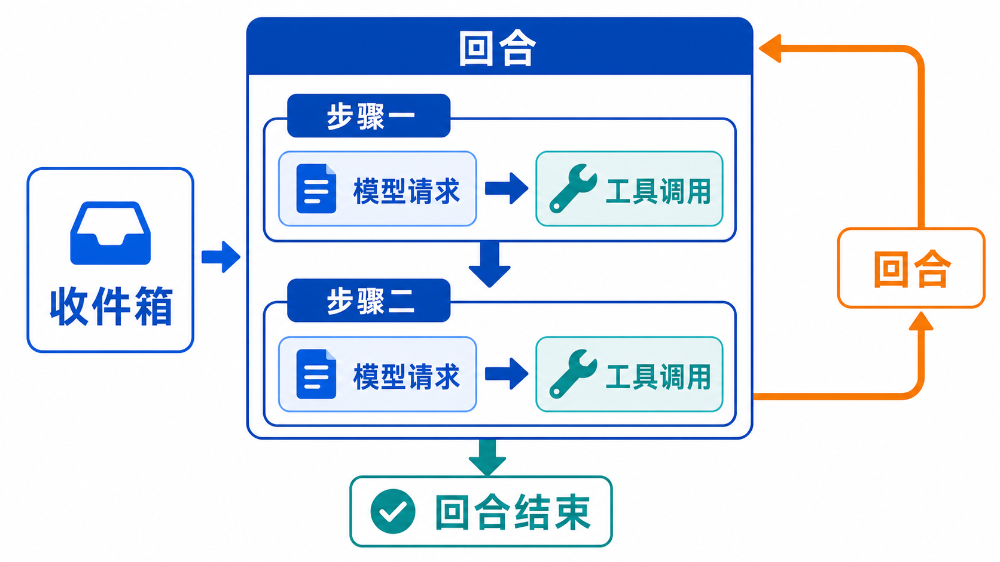
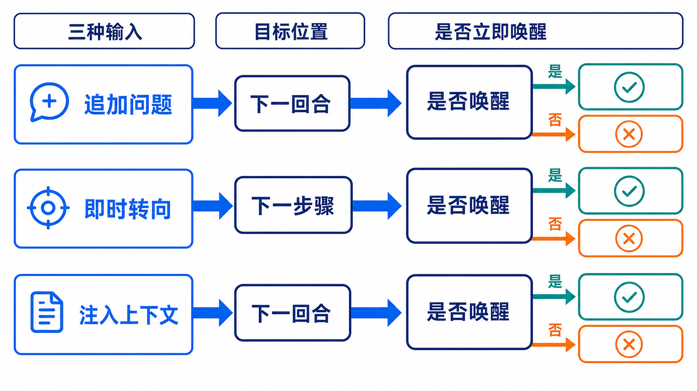
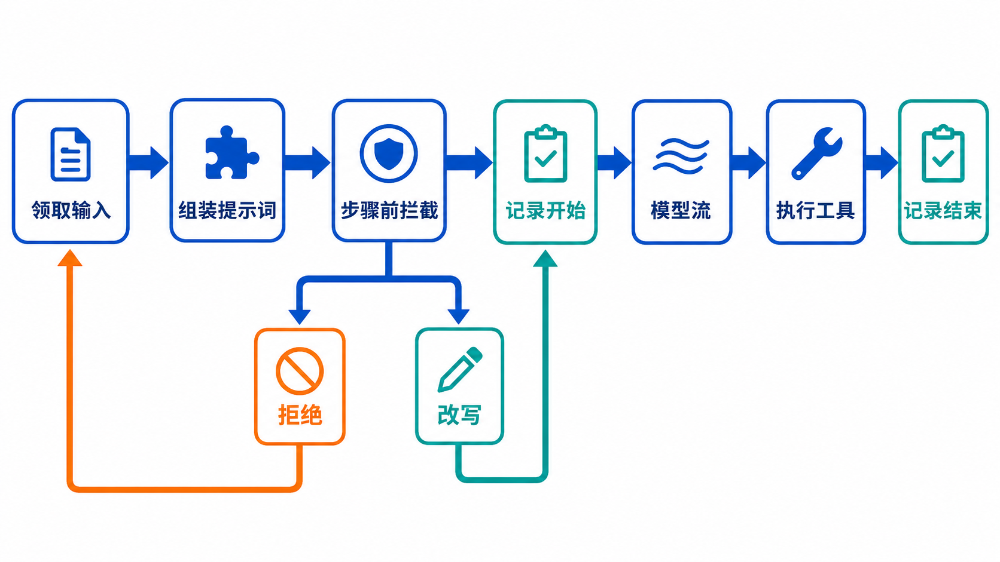
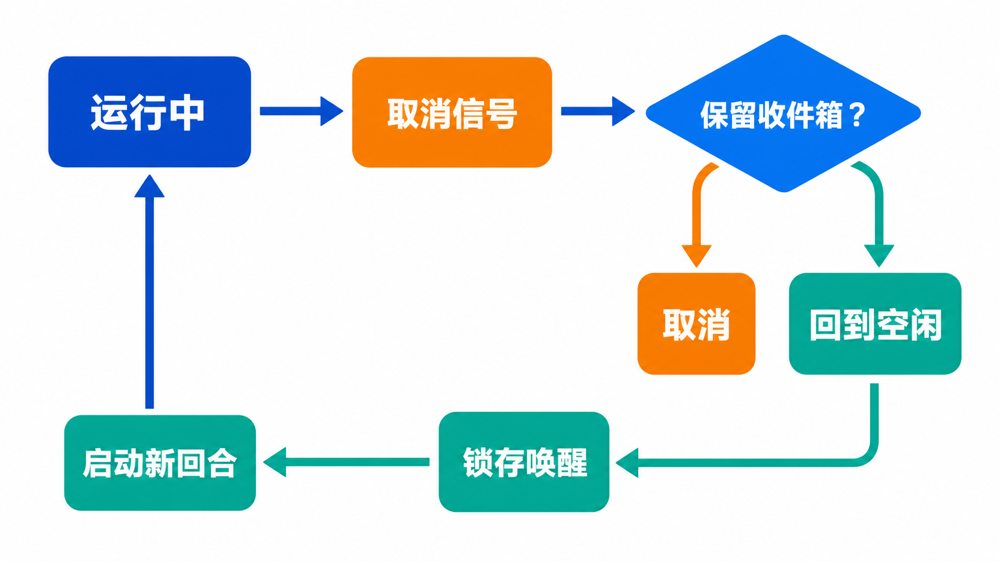

Agent Loop 常被简化成一句话：“请求模型，若返回工具调用就执行工具，再把结果交回模型，直到没有工具。”这句话能画出演示程序，却不足以处理用户中途引导、插件注入、取消与恢复、工具并发、请求重试、自然停止检查和崩溃后的持久边界。DeepSeek Harness 的默认 `ReactLoopAgent` 因此没有围绕一个 `while (toolCalls)` 数组打转，而是围绕 **Inbox、Turn、Step 与 Continuation** 建立执行语义。

Inbox（收件箱）保存尚未进入模型历史的工作；Turn（轮次）表示一次从唤醒到待办清空的活动；Step（步骤）包含一次模型请求以及这次响应触发的工具执行；Continuation（继续条件）概括所有让 Driver 进入下一 Step 或下一 Turn 的原因，例如工具结果、Steering（对当前轮次的中途引导）、注入上下文、停止钩子、后台结果和 Goal。

本文固定在 `dsh-v0.1.0-rc.7`，源码主线是 `packages/core/agent/src/inbox.ts` 与 `packages/core/agent-loop/src/agent.ts`。

## 1. Inbox 为什么分成 next-turn 与 next-step

用户在 Agent 空闲时发送一个新问题，直觉上应该开启新的 Turn；用户在模型或工具正在运行时补充“先别改配置文件”，则应该在当前 Turn 的下一 Step 生效。二者都属于输入，但调度位置不同。`InboxState` 因而维护两条有序列表：

```typescript
// 源码裁剪：packages/core/agent/src/inbox.ts
type InboxState = Record<InboxTarget, UserMessage[]>

private readonly state: InboxState = {
  'next-turn': [],
  'next-step': [],
}
```

`next-turn` 是普通排队提示词，一次 Turn 边界最多领取一条；`next-step` 是最靠近下一请求边界的上下文，领取时整批取出。Turn 第一次 Claim 的顺序是先取全部 `next-step`，再取一条 `next-turn`，所以先注入的策略上下文会排在直接用户提示之前。

```typescript
// 源码裁剪：packages/core/agent/src/inbox.ts
claim(target: InboxTarget, turn: number): UserMessage[] {
  const claimed = this.mutate('next-step', 0, this.nextStep.length, [], false)
  if (target === 'next-turn') {
    claimed.push(...this.mutate('next-turn', 0, 1, [], false))
  }
  for (const message of claimed) this.notifications.claimed(message, turn)
  return claimed
}
```

两个列表不是临时内存队列。每次插入、删除、替换和 Claim 都会先追加 `agent/inbox/spliced` Session Event，再修改投影。进程恢复时，Inbox 从 Seed 之后的 splice 事件重放出仍待处理的消息。这避免“消息已经接受但还没进入 Step，进程一重启就消失”。



## 2. followup、steer 与 inject 是同一发送原语的三个策略

`ReactLoopAgent.send()` 接收目标列表和是否唤醒两个参数，三个公共方法只是固定组合：

```typescript
// 源码裁剪：packages/core/agent-loop/src/agent.ts
followup(input) { this.send(input, 'next-turn', true) }
steer(input)    { this.send(input, 'next-step', true) }
inject(input)   { this.send(input, 'next-step', false) }
```

`followup()` 创建普通后续工作并唤醒空闲 Driver；它不返回“这个回答”的 Promise，消息 ID 只用于追踪 Inbox 插入、领取与丢弃。`steer()` 把输入放在下一 Step 并唤醒：Agent 空闲时也会立即打开一个 Turn；运行中则等最近的 Step 边界。`inject()` 放进同一个 `next-step`，却不唤醒，适合文件变化、子目录指令、Skill 内容或后台通知等上下文。

```typescript
// 可运行示例骨架：真实 UserMessage 用 createUserMessage 创建
agent.inject(runtimeContext)   // 安静加入上下文
agent.followup(userQuestion)   // 唤醒并开启普通 Turn

// 运行中用户改变方向
agent.steer(correction)
```

这个区分防止两类错误。若所有注入都唤醒，环境噪声会制造无意义模型调用；若所有输入都等下个 Turn，中途 Steering 就无法及时改变下一次请求。`target × wakeup` 使“放在哪里”与“现在要不要运行”成为两个正交维度。

消息身份也是 Inbox 设计的一部分。两个 Pending List 共享一套唯一 Message ID 检查；Replace 可以改变身份，但不能与另一条 Pending 消息重复。`splice()` 会把负索引、无穷位置和删除数量规范化为确定坐标，再把规范结果写进事件。恢复时重放的是已经规范化的操作，不需要重新猜当时数组长度和 JavaScript Splice 边界。

```latex
先验证候选队列中的消息标识无重复
再追加 agent/inbox/spliced 持久事实
随后修改内存投影并发布 inserted/discarded 通知
```

Live Observer 在 Session Event 提交时仍能读到 Splice 之前的 Inbox，因此可以用标准化坐标还原被移除消息；投影随后才 Mutate。这个细小顺序保证持久事实先于派生状态。若先改内存再写 Log，Append 失败会让 Runtime 与磁盘分叉。

Clear 也不是直接将两个数组设为空，而是先清 `next-step`，再清 `next-turn`，每次都生成取消结果的 Splice。取消后的 UI 可以知道哪些输入被丢弃，而不是只看到队列突然缩短。Claim 则使用纯删除 Splice，不标记 Canceled，因为消息不是丢弃，而是已经归属某个 Turn。

在外部 API 中，消息入队成功与 Turn 最终完成要分开建模。`followup()` 返回 `void`，防止调用者把插入动作误当成某个回答 Future；要观察结果，应读 Session Event 或等待 Agent 达到 Idle。一个 Turn 可能包含其他 Steering 和 Tool Continuation，不存在可靠的“一条输入对应一条输出”。

## 3. Driver 的 Phase 如何避免重复执行器

默认 Agent 只有三种 Phase：`idle`、`maintenance` 与 `running`。Running 保存当前 Turn、Step、AbortController 和一个 `wakeRequested` 锁存位；Maintenance 允许压缩等排他任务暂时占用 Agent，但外部唤醒可以被记录，待维护完成后重放。

```typescript
// 源码裁剪：packages/core/agent-loop/src/agent.ts
type Phase =
  | { kind: 'idle'; lastTurn: number }
  | { kind: 'maintenance'; abort: AbortController; lastTurn: number; wakeRequested: boolean }
  | { kind: 'running'; abort: AbortController; turn: number; step: number; wakeRequested: boolean }
```

`wakeDriver()` 在 Idle 时同步预留 Running Phase，再启动 `kick()`；已有 Driver 时不会再创建第二个循环。Maintenance 或已 Abort 的活动收到唤醒，会把 `wakeRequested` 设为 `true`，等当前活动收敛后重放。

```typescript
// 源码裁剪：核心分支的结构化缩写
private wakeDriver(wakeAfterAbort = false): void {
  if (this.phase.kind !== 'idle') {
    if (this.phase.kind === 'maintenance' || wakeAfterAbort) {
      this.phase.wakeRequested = true
    }
    return
  }
  this.setPhase({ kind: 'running', abort: new AbortController(), turn: lastTurn, step: 0, wakeRequested: false })
  this.loopCtx.agents.withInitiator(this, () => this.kick())
}
```

这比“每次 send 都异步调用 runLoop”可靠：并发输入只修改 Inbox，一个 Driver 在明确边界 Claim；状态发布也只有 Idle/Running 的可控转换。

## 4. Turn 在 Claim 之前开启，所以可以零 Step 结束

`turn()` 先追加 `turn/start`，然后才 Claim 输入并执行 `agent/pre-step`。若监听器拒绝、Claim 后消息被改写为空，或者唤醒消息被并发取消，这个 Turn 仍以 `turn/end` 关闭，但没有 `step/start`。

```typescript
// 源码裁剪：packages/core/agent-loop/src/agent.ts
const turn = phase.turn + 1
this.session.append('turn/start', { turn })
phase.turn = turn

const decision = await this.preStep(target, { turn, step })
if (decision.kind === 'reject') {
  turnEnds = { kind: 'blocked' }
  return false
}
if (phase.step === 0 && decision.messages.length === 0) {
  turnEnds = { kind: 'completed' }
  return false
}
```

零 Step Turn 不是多余日志。它忠实表达“运行时接受过一次唤醒并尝试准入，但没有花费模型请求”。如果把 `turn/start` 放到准入之后，审批拒绝和竞态清空会从历史中消失，UI、遥测和恢复无法区分“从未收到”与“收到但阻塞”。

`PreStepDecision` 只有两个分支：

```typescript
// 源码裁剪：packages/core/agent/src/runtime-types.ts
export type PreStepDecision =
  | { kind: 'reject' }
  | { kind: 'enter'; messages: UserMessage[] }
```

Claim 已经把候选消息从 Inbox 删除，所以 Reject 不会自动放回；在 Claim 之后新插入的消息仍留在队列，属于后续边界。策略插件若想“暂缓而非消费”，必须明确设计新的重新入队行为，不能把 Reject 当作 Peek。



## 5. 一个 Step 包含模型流与该响应要求的工具

准入消息先作为 `user/message` 追加到 Session，再由 `step()` 从 `deriveMessages()` 构造历史、组装系统 Prompt 和 Tool Schema、建立冻结请求，然后读取模型 Stream。每个 Chunk 都先写入日志，最后才组装 Assistant Message。

```typescript
// 源码裁剪：packages/core/agent-loop/src/agent.ts
for await (const chunk of stream) {
  signal.throwIfAborted()
  chunkSeqs.push(this.session.append(
    'assistant/chunk', { turn, step, chunk },
  ).seq)
  assembler.push(chunk)
}

this.session.append('assistant/message', {
  turn, step, message, usage: assembler.usage,
}, { surfaceOp: 'append', sourceEventSeqs: chunkSeqs })
```

若 Assistant 没有 Tool Call，Step 返回 `completed`；若达到最大输出 Token，返回 `max-tokens`；若有工具调用，`executeToolCalls()` 执行并追加 Call/Result。工具是否宣告本 Turn 已结束由 `concluded` 决定，否则返回 `null`，意味着还欠下一次模型请求。

```typescript
// 源码裁剪：Step 停止判断
const toolCalls = message.content.filter(block => block.type === 'tool-call')
if (toolCalls.length === 0) return { kind: 'completed' }

const { concluded } = await executeToolCalls(...)
return concluded ? { kind: 'completed' } : null
```

所以 Step 的边界不是“只含一次 HTTP”。它还拥有响应所触发工具的 Durable Fact，确保下一 Step 的模型历史已包含工具结果。

Pre-Step 不只是权限门。Driver 会先组装当前系统上下文 Section，把动态 Runtime Context 变成一个候选 User Message，再把已 Claim 消息与候选上下文交给 Waterfall。压缩插件可以在上下文压力下先替换 Surface，指令插件可以增加来源明确的提醒，Hook 可以拒绝或改写整批输入。Waterfall 返回的 Enter Batch 才是这个 Step 的权威输入。

```typescript
// 教学伪代码：外层监听器保留下游消息并附加来源明确的上下文
ctx.on('agent/pre-step', async (payload, next) => {
  const decision = await next()
  if (decision.kind === 'reject') return decision
  return {
    kind: 'enter',
    messages: [...decision.messages, policyReminder],
  }
})
```

动态 Runtime Context 不会每次无条件重复。`RuntimeContextProjection` 查找当前 Surface 中最后保留的系统提示词快照；渲染文本没有变化就不产生新消息，清空时则追加明确的 Cleared Marker。这样模型可见上下文变化仍被日志记录，又避免每个 Step 重复相同内容破坏前缀缓存。

Request Build 也在 Step 内形成一个 Epoch。Agent 首次根据 Options 选择 Route，后续 Request Waterfall 可以改配置；LLM Service `prepareCall()` 把精确模型默认值固化，Header 变化时追加 `request/header`，Route 或 Context Window 变化时追加 `request/context`。最后请求被深冻结并标记为 Agent Loop Request，防止 Adapter 或插件在派发后偷偷修改。

```latex
步骤输入事实 -> 派生消息 -> 请求配置瀑布 -> 适配器准备
           -> 记录请求头与上下文 -> 冻结请求 -> 模型流
```

工具调用在同一个 Step 内还要遵守模型顺序。执行器可以并发启动允许并行的调用，却要按照模型给出的顺序完成 Pre/Post 与 `tool/result` 提交；串行屏障会阻止后面的调用越过。否则下一次模型请求里的工具结果顺序会随网络时序漂移，回放也无法稳定再现。

## 6. Continuation 如何让当前 Turn 再走一个 Step

Turn 内层循环在每个 Step 后检查两种欠账。第一种是工具：`step()` 返回 `null`，说明模型调用工具后需要看结果。第二种是 `inbox.nextStep`：运行期间的 Steering、Inject 或停止 Hook 可能已经加入输入。只要任一存在，就把 `target` 改为 `next-step`，再次经过 Claim 与 `agent/pre-step`。

```typescript
// 源码裁剪：packages/core/agent-loop/src/agent.ts
if (turnEnds && this.inbox.nextStep.length === 0) {
  await this.dispatch.serial('agent/turn-stopping', { turn, signal })
}
if (turnEnds && this.inbox.nextStep.length === 0) break
target = 'next-step'
```

`agent/turn-stopping` 是一个终止检查点。监听器可以调用 `agent.steer()` 添加一条反馈，使本来完成的 Turn 继续下一 Step。Claude Code Hook 桥接中的 Stop Hook 就采用这种方法：阻塞原因被转成 Steering，让模型再处理一次，而不是在 Loop 里硬编码 Hook。

```typescript
// 教学伪代码：终止检查生成 Continuation
ctx.on('agent/turn-stopping', async ({ agent }) => {
  const verdict = await evaluateLastAnswer(agent.session)
  if (!verdict.ok) {
    agent.steer(createUserMessage({
      content: [{ type: 'text', text: verdict.feedback }],
      source: { kind: 'plugin', plugin: 'quality-gate' },
    }))
  }
})
```

rc.7 没有内建 Turn Step 上限。无条件在 `turn-stopping` 里 Steering 会形成无限 Continuation，因此拥有继续权的插件必须自限次数、预算或 Deadline。

## 7. 当前 Turn 结束后，为什么还可能立即开始下一个 Turn

Turn 的 `finally` 无论成功、错误或取消都会追加 `turn/end`。若正常收敛后 Inbox 仍有 Pending，Driver 不退出，而是换一个新的 AbortController、重置 Step 编号并返回 `true`，让 `kick()` 进入下一 Turn。

```typescript
// 源码裁剪：packages/core/agent-loop/src/agent.ts
if (!this.inbox.hasPending) return false
phase.abort = new AbortController()
phase.wakeRequested = false
phase.step = 0
return true
```

为什么不能把多条 Follow-up 合并进同一 Turn？因为每条普通用户消息代表独立工作边界，Turn End Reason、取消和持久检查点都需要归属。下一 Step 输入用于修正正在进行的工作，下一 Turn 输入用于开始后续工作。这种区分还让后台任务可以选择调度策略：重要结果用 `followup()` 唤醒一个普通后续 Turn，安静上下文用 `inject()` 等待将来其他输入。

```latex
Turn 7：用户“分析失败原因”
  Step 1：模型调用日志工具
  Step 2：模型读取结果，用户 steer“只看支付模块”
  Step 3：模型完成分析

Turn 8：队列里下一条 followup“生成修复方案”
```

Continuation 因而有两种粒度：继续当前 Turn 的下一 Step，或在当前 Turn 完整关闭后开启下一 Turn。Inbox Target 决定它属于哪一种。



## 8. 取消、错误重试和 max-tokens 如何保持边界完整

每个 Running Turn 持有 AbortController，模型流、Prompt 组装、工具和扩展点共享该 Signal。`cancel()` 默认清空 Inbox 并 Abort；`keepInbox` 可以保留尚未领取的消息。Signal 只对当前活动有效，插件不能保存后拿来控制后续 Turn。

```typescript
// 源码裁剪：packages/core/agent-loop/src/agent.ts
cancel(cause, options = {}): void {
  if (!options.keepInbox) {
    this.inbox.clear()
    if (this.phase.kind !== 'idle') this.phase.wakeRequested = false
  }
  if (this.phase.kind !== 'idle') this.phase.abort.abort(cause)
}
```

模型 Stream 以内带失败会先进入 `agent/request-error` Waterfall。恢复插件可以返回 `{ kind: 'retry' }`，在同一个 Step 内重建请求；若不接管，则抛出 `LlmError`，Turn 以结构化 Error 结束。注意这种 Retry 不是新的 Step，因为它没有产生一条成功 Assistant Message。

```typescript
// 教学伪代码：只对明确可重试失败接管
ctx.on('agent/request-error', async ({ failure }, next) => {
  if (failure.code === 'RATE_LIMITED') {
    await backoff()
    return { kind: 'retry' }
  }
  return next()
})
```

`max-tokens` 在一个 Turn 中具有粘性：后续插件即使让 Turn 再走一个完成 Step，也不能把最终结果降级成普通 `completed`。取消、错误和最大 Token 都在 `turn/end.reason` 中成为持久事实。

Continuation 还需要区分“内容已被接受”和“外部任务已结算”。例如后台 Subagent 的 Continuable Route 在子 Agent Inbox 接受初始消息后即可返回，父 Agent 不等待子任务完成；子 Activation 结束时，Continuation Service 再投递一条 Settlement Notice。详细输出仍以子 Session Transcript 为真，不应复制成父任务返回值。

后台结果送达父 Agent 时可以选择 Wakeup 或 Quiet。Wakeup 使用 `followup()`，确保已经停驻的父 Agent 会开启后续 Turn 读取结果；Quiet 使用 `inject()`，只在下次已有请求时作为上下文进入。这个选择属于部署调度策略，而不应让模型在单次 Tool Arguments 里决定，否则模型可以无限唤醒自己。

Goal Continuation 也遵守类似边界：持久 Goal Phase 与 Process-local Activation 分离，自动继续只在运行时持有有效权威时发生。进程重启后先从 Session 事实恢复目标，再由明确服务决定是否重新武装；不能因为日志里存在“active”字符串，就在未知环境下自行发起模型请求。

```latex
延续内容：必须经过带身份的消息与收件箱
调度决定：唤醒后续轮次，或安静等待未来请求
持久状态：说明上次发生了什么，不自动等于当前执行授权
运行授权：只在活跃服务与作用域边界中有效
```

并发竞态是 Loop 最值得测试的部分。应覆盖在 Pre-Step Claim 之后插入 Steering、Stream 结束瞬间 Cancel、Maintenance 期间 Follow-up、Abort 后 Wakeup、Turn Stopping Hook 再次 Steering，以及 Disposal 与后台报告同时发生。只测试“模型连续调用两次工具”无法证明 Driver 真的只有一个，也无法证明消息不会丢失或归错 Turn。

Turn 和 Step 编号也有不同重置规则。Agent 从历史最后一个 `turn/start` 取得 Last Turn；每个新 Turn 递增 Turn 并把 Step 归零；Turn 内每个 Enter 才递增 Step。被拒绝的 Turn 不消费 Step 编号，Request Retry 也不递增 Step，因为没有新的成功请求事实。这些编号使 Invariant Checker 能验证边界闭合和工具配对。

Turn End 的写入位于 `finally`，即使 Model、Tool 或 Hook 抛错也要尝试闭合。非 LLM Error 会被展平成结构化 `UNKNOWN` Failure；LLM Error 则保留 Provider Code 和事实。若连 `turn/end` Append 都失败，Driver 不能伪装成正常 Idle，而要报告第二个边界错误。Session 日志完整性优先于友好的“继续运行”。

没有内置 Turn Budget 是一个刻意开放点，也是生产风险。除了 Max Rounds，还应限制每 Turn 工具数量、总 Token、墙钟时间、后台唤醒频率和相同错误重复次数；触发时使用类型化 Cancel Cause 或策略结果结束，并让 UI 能说明原因。把预算只写在 System Prompt 里不构成执行保证。

最后，`whenIdle()` 代表当前以及被它触发的新 Activity 已完全收敛。实现会反复比较 `activityDone`，防止等待期间旧 Driver 结束又立即被锁存 Wake 启动新 Driver。它适合 Headless Runner 的退出边界，却仍不等于持久化已经 Flush；调用方若要读取磁盘，还需显式请求 Session Checkpoint。

恢复一个已有 Session 时，Loop 也不能只查最后一条 Assistant Message。它要重建 Pending Inbox、取得最后 Turn 编号、恢复最新请求头，并修复崩溃时开放的工具边界。若上次进程在 `tool/call` 后、`tool/result` 前退出，新进程不能盲目重新执行有副作用工具；修复结果必须告诉模型外部状态未知。Loop 的继续能力因此依赖 Session Repair，而不是“从最后一条消息再发一次”。

请求缓存同样受边界影响。只要 System Prompt、Tool Schema 和消息前缀保持一致，Provider 可以复用前缀缓存；运行时上下文重复追加、工具结果乱序或恢复时换用当前默认 Header 都会让缓存失效。Agent Loop 记录 Header 并避免无变化上下文快照，不只是为了审计，也是在保护稳定请求前缀。

插件若要在 `agent/pre-step` 添加内容，必须给消息稳定 Source 和 ID。来源用于区分直接用户、插件快照、Goal Round 与 Session Reference；ID 贯穿 Inbox Splice、Claim 和 Session Surface。直接构造一个只有 role/content 的普通对象，可能绕过身份校验，在恢复或 UI 关联时失败。应使用 LLM 包提供的消息工厂。

```latex
消息进入循环前：拥有唯一标识、合法来源、冻结内容
消息被领取时：持久删除收件箱项并关联轮次
消息准入步骤时：作为 user/message 进入表面
消息被拒绝时：不进入模型历史，但领取事实仍成立
```

工具自身宣告 `concluded` 也必须谨慎。某些终止型工具代表用户已经获得最终结果，不需要模型总结；普通读写工具则通常要求把结果交回模型。若错误地标为 Concluded，Turn 会在 Tool Result 后结束，模型永远看不到结果；若所有工具都强制继续，用户确认或最终输出型 Tool 又会多花一次请求。执行模式是 Tool Contract 的一部分。

外部 Steering 也不是实时修改正在生成的 Token。它只保证在下一个安全 Step Boundary 被 Claim；已经发出的模型请求仍然继续，除非调用方同时 Cancel。产品 UI 应明确区分“补充下一步指令”和“停止当前生成后重来”，不能把同一个按钮模糊映射到两种语义。

Maintenance Phase 则为无法与模型 Turn 并发的工作提供排他边界，例如某些压缩或修复任务。Maintenance 收到 Wake 只锁存，不同时开 Driver；完成后若 Inbox 仍有 Pending 才重放。若维护任务失败，其 `finally` 仍恢复 Idle，并处理锁存唤醒，避免 Agent 永久卡在“看起来空闲却不再运行”的中间态。

在多 Agent 场景中，`withInitiator()` 使用异步上下文标识当前驱动者，让由父 Agent 发起的子任务可以区分父子来源。这个环境身份只在进程内帮助事件和所有权追踪，跨 Worker、Persistence 与 Wire 仍要显式传 Agent/Session ID。Continuation 不能依靠某个全局 `currentAgent`，否则并行子 Driver 会互相覆盖。

因此生产监控不应只记录模型延迟。至少要有 Inbox 长度与等待时间、每 Turn Step 数、每 Step Tool 数、Continuation 来源、取消原因、Turn End Reason、请求重试次数和 Idle 收敛时间。只有观测“欠账从哪里产生、在哪个边界消失”，才能判断循环是在正常推进，还是被某个 Hook、Tool 或后台通知反复续命。

告警也应区分“队列暂时有消息”和“队列长期无法被领取”。空闲 Agent 只有安静注入属于正常状态，不应自动唤醒；但存在下一轮输入却长期 Idle，则可能是 Wake 锁存、Provider 卸载或所有权边界异常。把两个 Inbox Target 分开监控，才能避免为了清掉一个正常 Context 注入而制造昂贵模型请求。



## 9. 设计自定义 Continuation 时要守住哪些不变量

第一，任何将进入模型的 Continuation 内容都应形成带 Source 的 `UserMessage`，经过 Inbox、Pre-Step 与 `user/message` 提交，而不是直接拼进临时 `messages[]`。第二，选择正确调度：要唤醒停驻 Agent 用 `followup()`，要修正当前工作用 `steer()`，只想给未来请求附加上下文用 `inject()`。

第三，不要把 `agent/status === idle` 当作持久完成证明。状态是进程内协调，事实应从 Session 的 Turn/Step Event 判断；若外部调用需要等待当前活动收敛，可以用 `whenIdle()`，但它不是某条消息与某个回答的一一 Future。第四，Continuation 必须有预算。工具循环可由工具策略限制，停止钩子、Goal 或评价器应保存 Round 并设 Max Rounds，避免永不停机。

第五，遵守 Claim 语义：Pre-Step 收到的是已经从 Inbox 独占移除的批次，Reject 会消费它；新增消息发生在 Claim 之后就属于下个边界。第六，不要在 Step 之外伪造 `step/start/end`，也不要让 Request Retry 生成虚假 Assistant Message。

DeepSeek Harness 的 Agent Loop 之所以显得比十行 Demo 复杂，是因为它把“继续”从隐式 `while` 条件展开成可排队、可拦截、可持久、可取消的边界。Inbox 说明还欠什么，Turn 说明一次活动何时开始和结束，Step 说明哪次模型调用及工具属于一起，Continuation 则让插件和外部输入在安全边界上表达“还不能停”。
