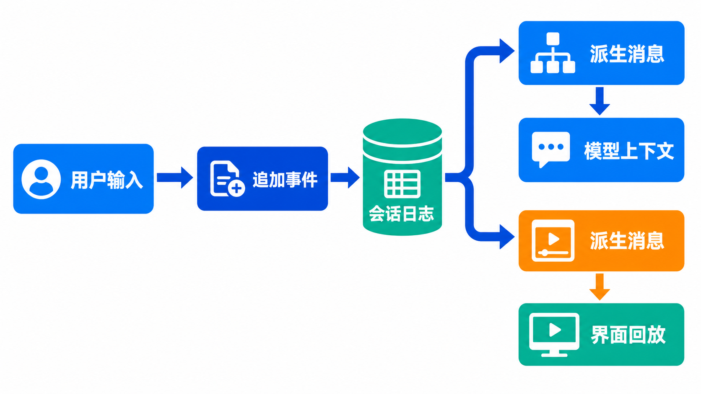
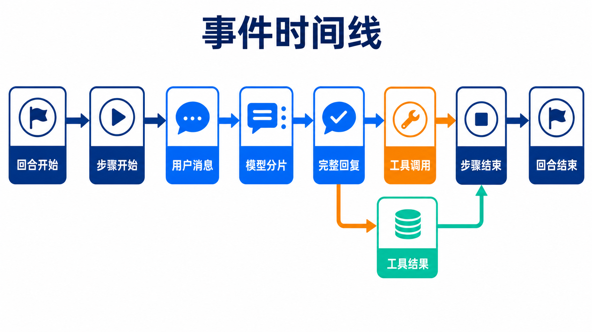
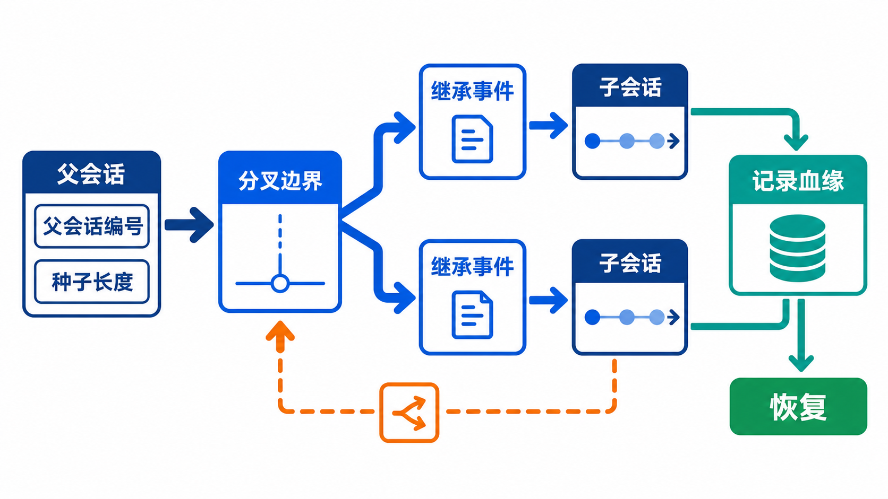
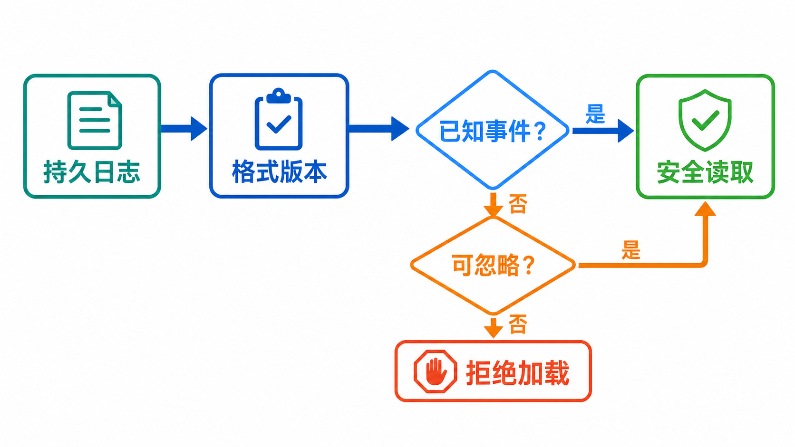

多数聊天应用把上下文理解为一个 `messages[]`：用户消息追加一项，模型回复追加一项，工具结果再追加一项，请求前把整个数组发出去。这个设计在短对话里足够，但一旦 Agent 需要流式回放、并行工具、取消、压缩、Fork、崩溃修复、UI 同步和精确恢复，单一可变数组会同时承担“模型当前看什么”“用户过去看过什么”“系统发生过什么”三种互相冲突的职责。

DeepSeek Harness 选择把 **Session Event Log 作为会话交互的仅追加事实来源**。模型上下文由 Log 上的 Surface（当前模型可见消息节点的有序投影）派生；原始 Chunk、Turn/Step 边界、请求头、工具调用和错误仍保留在 Log 中，但不一定成为模型消息。在正常的上下文压缩路径里，系统不会改写旧事件，而是追加一个 Surface Replacement（表面替换节点），让后续模型看到摘要视图，同时保存用户已经经历过的记录。显式删除、保留期限或隐私治理仍可在存储层处理，不能把“仅追加”理解成数据永不删除。

这不是单纯为了“可审计”。它建立了一个更强的不变量：**凡是模型可见的内容，都必须能够从持久日志重建；不能从日志重建的临时拼接，不应进入模型请求。** 本文以 `dsh-v0.1.0-rc.7` 中 `packages/core/session` 为固定基线。

## 1. 为什么可变 messages 数组会同时产生三种真相

假设模型流式输出十个 Chunk，最后形成一条 Assistant Message，并调用两个工具。模型下一次请求只需要完整 Assistant Message 和两个 Tool Result；Web UI 想逐块播放 Chunk；遥测想知道 Token Usage；崩溃恢复还要判断工具是否已经开始、结果是否未知。若全部塞进 `messages[]`，要么丢失 Chunk 和边界，要么把不该发给模型的内部记录也发出去。

```typescript
// 教学反例：一个数组被迫承担太多角色
const messages = []
messages.push(userMessage)
messages.push(...streamChunks)       // 模型下次不该看到 Chunk
messages.push(assistantMessage)      // 与 Chunk 重复
messages.push(toolCallInternalState) // 不一定是合法模型消息
messages.push(toolResult)
```

压缩进一步暴露矛盾。为了减少 Token，系统要把旧消息换成摘要；但若原地删除，用户 Transcript 和审计也被改写。若另存一份 `compactedMessages`，原始历史与模型历史开始分叉，每个新功能都要猜应该读哪份。

Event Log 把问题拆开：Log 保存按时间发生的不可变事实；Surface 保存哪些事实当前产生模型消息；`deriveMessages()` 把 Surface 节点转换成实际请求历史。三层各有一个清晰职责。

```latex
Append-only Log：发生过什么
Ordered Surface：未来模型当前看哪些消息节点
Derived Messages：本次请求实际发送的 Message[]
```



## 2. Session Event 的信封如何保证可重放

`packages/core/session/src/types.ts` 将事件定义成以 `type` 为判别字段的联合。每条事件有连续 `seq`、毫秒时间、JSON 数据，以及可选的 Surface 和来源元数据。

```typescript
// 源码裁剪：packages/core/session/src/types.ts
export type SessionEvent<T extends SessionEventType = SessionEventType> = {
  [K in SessionEventType]: {
    type: K
    seq: number
    time: number
    data: SessionEventMap[K]
    ignorable?: true
  } & (K extends SurfaceEventType ? {
    sourceEventSeqs?: number[]
    surfaceOp?: SurfaceOp
  } : object)
}[T]
```

`seq` 必须从零连续递增，任何 Seed 或恢复输入都经过同一规则校验。`data` 必须是无损 JSON：拒绝循环引用、不支持的标量、稀疏数组和特殊原型；接受后做快照并深冻结。这样，Producer 在 Append 后继续修改原对象，也不能篡改已提交事实。

```typescript
// 源码裁剪：Session.append 的关键顺序
const dataSnapshot = snapshotJsonValue(data)
if (dataSnapshot === undefined) {
  throw new Error('session event data is not losslessly JSON-serializable')
}
// 校验 envelope、surface 与来源后同步提交
```

`ignorable: true` 只用于旧 Reader 可以安全跳过的纯信息事件。未知且未标 Ignorable 的事件必须拒绝恢复，因为它可能改变其后日志的解释。默认“拒绝多一点”比“静默恢复出错误上下文”安全。

## 3. 哪些事件会进入模型，哪些只留在事实层

核心事件词汇同时包含执行边界、消息、原始流、工具事实和请求状态：

```typescript
// 源码裁剪：packages/core/session/src/types.ts
interface SessionEventMap {
  'turn/start': { turn: number }
  'turn/end': { turn: number; reason: TurnEndReason }
  'step/start': { turn: number; step: number }
  'step/end': { turn: number; step: number }
  'user/message': UserMessage
  'assistant/chunk': { turn: number; step: number; chunk: StreamChunk }
  'assistant/message': { turn: number; step: number; message: AssistantMessage; usage?: TokenUsage }
  'tool/call': { turn: number; step: number; callId: CallId; name: string; arguments: string }
  'tool/result': { turn: number; step: number; message: ToolResultMessage }
  'request/header': { header: EpochHeader; reason: RequestHeaderReason }
}
```

只有 `user/message`、`assistant/message` 和 `tool/result` 可以进入 Surface。Turn/Step、Chunk、单独 Tool Call、Todo 和 Request Header 都是 Log-only。Assistant Message 自己的 Content Block 已包含模型 Tool Call，`tool/call` 事件则记录执行开始与原始 Arguments，二者用途不同。

`deriveEventMessage()` 是唯一逐节点投影规则：

```typescript
// 源码裁剪：packages/core/session/src/surface.ts
switch (event.type) {
  case 'user/message': return event.data
  case 'assistant/message':
    return event.data.message.content.length === 0 ? null : event.data.message
  case 'tool/result': return event.data.message
  default: return null
}
```

空内容 Assistant Message 仍可能承载 Usage 或 max-tokens 事实，所以保留在 Log，却不向模型插入一个空 Assistant Turn。这正是事实与上下文分离的具体收益。

消息事件本身存储完整、带身份且已冻结的 Message，而不是只存 `content`。User Message 的 `source.kind` 可以区分真人输入、插件上下文、Session Reference 或 Goal；Assistant Source 必须包含真实 Provider/Model；Tool Result Source 必须携带与 Content Block 一致的 Call ID。恢复边界会重新校验这些关系。

```latex
用户消息：角色必须为 user，来源种类非空
助手消息：角色必须为 assistant，来源必须是 model + provider/model
工具结果：角色必须为 user，来源必须是 tool + callId
工具块：唯一 tool-result 块的 toolCallId 必须与来源一致
```

这让消息身份不依赖数组位置。压缩替换、UI 虚拟节点、Inbox 操作和跨协议传输都可以引用同一个 Message ID；Producer 也不能在 Append 后更改来源。若只在展示层临时生成 ID，重连后卡片、反馈和工具配对就会指向另一对象。

Session Event Map 可以由插件合并扩展，但 Core 对未知事件采取保守策略。普通事件类型增加通常不需要提升整个 Session Format Version，因为 `ignorable` 能表达旧 Reader 是否可以跳过；真正改变 Header、Envelope、核心事件语义或 Surface 机制的结构变化才要求版本升级。这个区分减少无意义迁移，同时防止语义破坏被当作词汇扩展。



## 4. Surface 如何在仅追加日志上表达当前模型视图

Surface Event 必须携带 `surfaceOp`。普通消息使用 `'append'` 加到尾部；压缩或剪枝使用 `{ op: 'replace', start, end }`，用新节点遮蔽当前 Surface 的一个连续范围。旧节点仍留在 Log，只是不再进入未来 `deriveMessages()`。

```typescript
// 源码裁剪：packages/core/session/src/types.ts
export type SurfaceOp =
  | 'append'
  | { op: 'replace'; start: number; end: number }
```

假设 Surface 节点为 `[3, 8, 10, 15, 19]`，摘要事件 25 替换 3 到 15：

```latex
日志：    0 1 2 3 ... 8 ... 10 ... 15 ... 19 ... 25
旧表面：        [3,    8,    10,    15,    19]
替换操作：       ^-------------------^
新表面：        [25,                       19]
```

Replacement 必须引用当前 Surface 上真实存在的 start/end，顺序不能颠倒，`sourceEventSeqs` 必须包含所有被遮蔽节点。工具结果 Replacement 更严格：只能替换一个当前 `tool/result`，且除 Content 外其他字段必须一致，防止剪枝伪造 callId、错误身份或工具来源。

```typescript
// 教学伪代码：压缩摘要作为新 user/message 追加事实
session.append('user/message', summaryMessage, {
  surfaceOp: { op: 'replace', start: firstSeq, end: lastSeq },
  sourceEventSeqs: shadowedSeqs,
})
```

这让“模型现在看什么”可以变化，却不会重写“当时发生过什么”。

## 5. deriveMessages 为什么只增量读取 Surface

`Session` 内部拥有一个 `SurfaceManager`。Append Surface Node 时，`deriveMessages()` 只投影新增节点并缓存结果；发生 Replacement 时，Surface 的 `replaceGeneration` 变化，派生缓存才从有效边界重建。每次返回新的数组，内部 Message 仍是事件里已经冻结的同一对象。

```typescript
// 源码裁剪：packages/core/session/src/index.ts 的概念结构
deriveMessages(): Message[] {
  // surface 未替换时，仅消费新增 seq
  // 对每个 seq 调用 this.deriveEventMessage(this.log[seq])
  // 返回新的数组，消息对象保持冻结与身份
}
```

增量投影避免每个 Step 扫描完整日志；更重要的是，不存在“若 Surface 缓存坏了就回退猜原始 Log”的旁路。Surface Transition 在 Append 和 Seed Replay 时已受校验，派生只消费经过验证的节点。

模型请求还不止 Message History。系统 Prompt、工具 Schema、Provider、Model 与推理参数保存在 `request/header` 快照中，Route Capacity 保存在 `request/context`。Agent Loop 在 Header 首次、恢复或变化时追加完整规范值：

```typescript
// 源码裁剪：packages/core/agent-loop/src/agent.ts
if (!this.requestHeaderLogged) {
  session.append('request/header', {
    header,
    reason: baseline === undefined ? 'initial' : 'resume',
  })
} else if (!headerEquals(baseline, header)) {
  session.append('request/header', { header, reason: 'change' })
}
```

因此精确请求重建由“最新 Request Header + 边界处 Surface Messages”共同完成，而不是只恢复聊天正文后用当前默认模型和当前工具列表碰碰运气。

## 6. 原始 Chunk 与完整消息为什么必须同时记录

模型 Stream 中的 Text Delta、Reasoning、Tool Call Arguments、Usage 和 Finish 信号，需要 `BlockAssembler` 才能形成最终 Assistant Message。Harness 为每个 Chunk 追加 `assistant/chunk`，成功完成后再追加 `assistant/message`，并让 `sourceEventSeqs` 指向组成它的 Chunk。

```typescript
// 源码裁剪：packages/core/agent-loop/src/agent.ts
const chunkSeqs: number[] = []
for await (const chunk of stream) {
  chunkSeqs.push(session.append('assistant/chunk', { turn, step, chunk }).seq)
  assembler.push(chunk)
}

session.append('assistant/message', { turn, step, message, usage }, {
  surfaceOp: 'append',
  sourceEventSeqs: chunkSeqs,
})
```

完整消息是模型上下文的规范单位，原始 Chunk 则提供 UI 流式保真、适配器排错、Telemetry 和来源证明。若只存 Chunk，每次恢复都要重跑可能变化的 Assembler；若只存完整消息，界面无法精确重放，工具参数是如何流式形成的也丢失。

存在 `sourceEventSeqs: []` 也有语义：它说明 Provider Stream 已知为空，而不是旧记录没有来源信息。其他 Surface Event 若提供 Source Seq，数组不得为空、不得重复、必须全部早于当前 Seq。

Surface Replacement 会使模型前缀从首个被遮蔽节点起变化，因此通常损失一部分 KV Cache；但仅追加的新消息保留旧前缀，可以继续复用缓存。压缩策略不应只看“摘要省了多少 Token”，还要考虑摘要时机造成的缓存失效、摘要模型成本，以及 Tool Result 剪枝是否足以延后整段压缩。

Tool Result Pruner 使用单节点 Replacement 且只允许改 Content，就是为了保留 Call ID、Turn、Step、Error Identity 和 Presentation Metadata。模型未来看到更短结果，人类 UI 仍能展示原始 Append Event；系统也能证明剪枝副本源自哪一条结果，而不是生成一个无法追踪的新工具消息。

```latex
仅追加：未来请求增加尾部 Token，旧前缀可复用
表面替换：未来请求变短，但替换起点后的缓存失效
日志本体：两种压缩操作都只追加，不在原位改写旧事件
```

`replaceGeneration` 是派生缓存的失效信号，不是日志版本。每次位置替换才递增；普通追加无需重建旧投影。消费方若缓存 Token 计数或上下文窗口估计，也应把 Replacement Generation 纳入 Key，否则压缩后仍会使用旧消息长度。

## 7. Event Log 如何支撑恢复、Fork 与崩溃修复

Session 构造器接收 Seed 时会验证每条事件的无损 JSON、连续 Seq、消息身份、Provider/Model、Surface Transition 和版本。Resume 的 Seed 是完整存储日志；Fork 则选择一个稳定前缀，要求边界处没有开放 Turn，再创建带 `parentSession` 与 `seedLength` 的子 Session。

```typescript
// 可运行 API 骨架：真实 id 使用 SessionId 类型
const child = ctx.sessions.fork(
  parentSession,
  completedTurnEndSeq,
  childSessionId,
)
```

子 Session 不需要复制一个恰好同步的 `messages[]`，只要复制经过验证的 Event Prefix，Surface 和派生消息就会得到相同结果。Session Header 记录创建时间、cwd、父会话、Seed 边界、Subagent Origin、Delegation Depth 与 Agent Preset，保证恢复知道这段日志来自哪个能力世界。

崩溃修复也依赖事实粒度。若 Assistant Message 中有 Tool Call，但尚未记录 `tool/call`，修复可以生成 `TOOL_NOT_STARTED` 结果；若已有 `tool/call` 却无结果，则生成 `TOOL_OUTCOME_UNKNOWN`，提醒模型不要盲目重试可能有副作用的操作。只有独立记录“模型请求了什么”和“执行是否开始”，才能区分两种风险。

```latex
assistant/message 有调用，tool/call 无记录
  -> 工具未被 Harness 记录为开始，可以按语义重试

tool/call 已记录，tool/result 缺失
  -> 外部副作用未知，只读/幂等才可直接重试
```



## 8. UI Transcript 与模型 Surface 为什么不能读同一个视图

模型需要读取当前 Surface，包括压缩后的摘要和剪枝结果；面向人的 Transcript 却不能使用它。用户已经看过的二十条消息被摘要遮蔽后，界面不应突然声称这些话从未发生。官方源码因此提供 `isAppendSurfaceEvent()`：人类 Transcript 读取以 `'append'` 进入 Surface 的原始消息，Replacement Copy 保持模型专用。

```typescript
// 可运行示例骨架：按事实来源投影 Transcript
const transcript = session.events
  .filter(isAppendSurfaceEvent)
  .map(event => session.deriveEventMessage(event))
  .filter((message): message is Message => message !== null)
```

UI 若要流式动画，可以同时消费 `assistant/chunk`；重连后再以 Log 补齐。SDK 需要可回放历史，应订阅 `session/event`，而不是依赖 `agent/status` 或临时 `agent/*` Hooks。后者是进行中协调协议，进程重启不会自动重放。

Telemetry、持久化和查询也可以分别投影同一日志，而不争抢 Session 的写权限。持久化插件订阅 `session/event`，在 `session/flush` 并行检查点排空；查询后端可以建立 SQLite Projection；Session Core 本身保持内存 Store 与事实语义，不把任何一个后端硬编码成真相。

Session Store 将“构造、发布、通知”拆成 `prepare()`、`enter()` 和 `announce()`，是为了建立严格所有权顺序。允许两个调用方并发 Prepare 同一 ID，但只有一个能 Enter；Announce 只产生一对 Created/Disposed 生命周期边。Agent Loop 可以先准备 Session 和 Scope，确保全部资源就绪后再发布，销毁时先最终刷新再脱离。

持久化插件不拥有 Session 语义。它订阅 Append，将事件写入 JSONL 或其他后端，并在 `session/flush` 时排空；Core 负责 Snapshot、Freeze、Seq、Surface 与消息验证。这样换后端不会改变模型历史规则，后端也不能因为数据库 Schema 方便就丢掉未知 Required Event。

```latex
会话核心：什么是合法事实、怎样派生消息
持久后端：事实怎样耐久写入和恢复
查询投影：怎样按标题、正文或谱系建立索引
界面投影：怎样显示流、工具卡片和人工记录
```

Observer 失败不会回滚已经提交的 Session Event。Append 先同步提交，再对每个 `session/event` Listener 单独收容同步异常和异步拒绝。事件日志是真相，某个 UI 推送或遥测导出失败不能让核心撤销事实；要求耐久保证的调用方随后使用受等待的 Flush，并处理 Aggregate Failure。

Fork 的稳定边界检查同样重要。只复制到某个任意 Seq，可能留下打开的 Turn、半条 Assistant Stream 或已开始未结束的 Tool Call；子 Session 会继承无法解释的运行状态。`ctx.sessions.fork()` 要求所选前缀没有开放 Turn，默认取当前最后事件，并记录父 ID 与 Seed Length。分支是事实前缀复制，不是浅拷贝当前消息数组。

Transcript、模型历史和审计导出还应处理时间含义。Event `time` 是 Append 时刻，不一定等于外部动作实际完成时刻；Tool Result 的领域 Metadata 可以补充更细时间，但不能回写旧 Event。跨机器时钟偏差也不能替代 Seq 顺序，Session 内的权威次序始终是连续 Seq。

大工具结果不能因为日志永久保留就无限内嵌原始字节。Harness 可把图片等二进制放到内容寻址 Attachment Backend，消息保存引用；文本结果可先完整记录，再由 Pruner 为模型 Surface 追加缩略版本。外部 Blob 生命周期必须与 Session 引用、删除和备份协调，不能让日志保留一个已失效地址。

安全上，Event Log 可能包含原始 Prompt、模型推理片段、工具参数、文件内容、凭据误输出与工作目录。默认关闭遥测不等于本地日志无敏感数据；持久化目录权限、备份加密、保留策略、导出脱敏和多租户访问控制都必须落在部署层。`ignorable` 只描述兼容性，不代表事件可以安全公开。

从测试角度，应对任意合法 Event 序列验证三类性质：Snapshot 后 Producer 修改不影响 Log；完整 Replay 得到同一 Surface 和 Derived Messages；非法 Seq、来源引用、替换范围或消息形态在 Append 与 Restore 两个边界都被拒绝。属性测试比几个固定对话样例更适合发现 Replacement 与 Fork 的组合漏洞。

请求重建测试还要选择任意 Step 边界，折叠该边界之前的 Surface 与最新 Request Header，确认得到的 Provider、Model、System、Tools 和 Messages 与当时发送值深度相等。只验证会话最后状态会漏掉中途切换模型、工具目录变化或压缩代际对早期请求的影响。

崩溃测试则应在每个持久点强制终止：`turn/start` 后、`step/start` 后、若干 Chunk 后、Assistant Message 后、Tool Call 前后和 Tool Result 后。恢复器应闭合孤儿 Turn，保留已落地事实，并只在工具结果缺口处追加风险明确的修复消息。任何测试都不应通过删除尾部坏记录来伪装成功，因为真实后端可能已经向观察者发布它。

多写入者也不是 Event Log 自动解决的问题。一个 Session 对象通过 Store 所有权和重入保护保证进程内 Append 串行；若两个进程同时写同一 Session 文件，连续 Seq 与 Flush 无法单独防止分叉。持久后端需要排他锁、租约或单写者路由。Session Header 和 `session/end-seed` 只能区分 Seed 与当前生命周期，不是跨进程存活证明。

查询数据库同样属于派生索引。SQLite 全文搜索损坏或落后时，可以从 JSONL 事实重建；不能反过来从搜索行猜完整 Session，因为索引可能省略 Chunk、Header 和 Required Plugin Event。备份策略应优先保护规范 Log 与 Attachment，再把查询索引视为可再生产物。

```latex
可重建：模型消息、当前表面、标题索引、用量统计、界面记录
不可凭空重建：未写日志的临时提示、丢失的外部副作用、已删除附件字节
```

“模型可见即已记录”还约束 System Prompt 的动态部分。rc.7 的 Runtime Context 会先渲染为来源明确的 User Message Snapshot，只有变化时才追加；静态 System 与 Tools 则进入 Request Header。插件若在最终 Adapter 内部偷偷拼一段系统指令，Session 无法解释模型为什么采取某行动，也无法精确恢复同一请求。这种便利扩展破坏了整个不变量。

对于隐私删除，Append-only 也不意味着法律或安全上永不允许删除。正确做法是在存储治理层定义整 Session 删除、Attachment 擦除和备份保留，而不是悄悄修改一条 Event 的 Content 仍声称 Log 未变。若需要可验证脱敏副本，应生成新的导出或明确的迁移格式，保留操作审计和版本边界。

Event Log 还给跨语言 SDK 一个稳定协议。TypeScript 与 Python 不必共享某个内存 `messages[]` 实例，只需对同一 Event Envelope、Message Identity 与 Surface 规则达成一致。核心事件词汇变化时，两个 SDK 的预期输出应在同一提交更新，否则某一端会显示或恢复出不同历史。

最后，事实源并不等于所有消费方都要读取完整日志。高频 UI 可以订阅增量事件并维护本地 Projection，模型 Loop 可以使用 Session 的增量 Surface Cache，查询服务可以消费数据库索引。关键是它们都承认缓存可以丢弃和重建，只有规范 Event Log 及其 Header 决定会话是什么。这个所有权关系比“大家都访问数据库同一张消息表”更重要。



## 9. 扩展 Session Event 时必须守住哪些边界

新增持久事实时，通过 TypeScript declaration merging 扩展 `SessionEventMap`，并明确它是否影响模型重建。普通领域事件默认是 Log-only；如果希望内容进入模型，不能只新增任意事件然后在 Request 时临时扫描拼接，而应走现有 `user/message` 或扩展完整 Surface 机制，并同步更新类型、校验、投影、SDK 与持久目录。

```typescript
// 可运行类型扩展示例：Log-only 的领域事实
declare module '@deepseek-ai/dsh-session/types' {
  interface SessionEventMap {
    'review/verdict': {
      rule: string
      passed: boolean
      explanation: string
    }
  }
}

session.append('review/verdict', {
  rule: 'tests-pass', passed: true, explanation: '全部通过',
})
```

不要把 Secret、不可序列化 Handle、AbortSignal 或活对象写进事件；Event Data 是持久 JSON，不是进程内对象仓库。不要绕过 `Session.append()` 直接修改 Log；它负责快照、冻结、连续 Seq、Surface 和 Observer Containment。不要用当前 Surface 生成 Transcript，也不要从 Log 中物理删除被压缩历史。

最后要正视版本边界。rc.7 的 `SESSION_FORMAT_VERSION = 0`，官方明确表示预发布阶段不承诺迁移，持久后端遇到其他版本会拒绝加载。即使某条旧 JSON 能被新版解析，也不等于语义正确。生产实验应固定标签、备份原始日志，并把升级视为数据格式变更，而不是只升级 npm 包。

Session Event Log 成为事实来源的根本原因，不在于 Event Sourcing（事件溯源：以事件序列保存状态变化）听起来更“高级”，而在于 Agent 同时存在多种真实视图。只有先保存不可变事实，再以受校验的 Surface 派生模型上下文，系统才能在压缩 Token 时不原位改写旧事件，在重放 UI 时不重复消息，并在恢复执行时判断工具副作用是否发生。这条数据约束是 DeepSeek Harness 其他能力可以可靠组合的基础。
