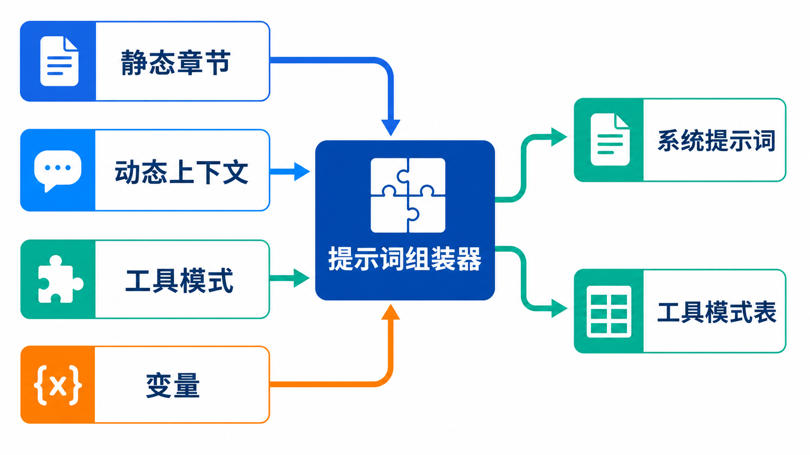
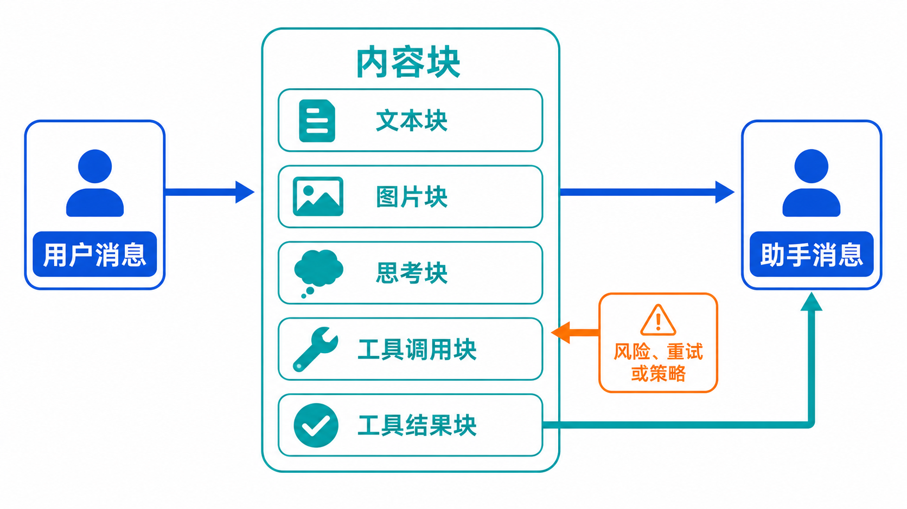
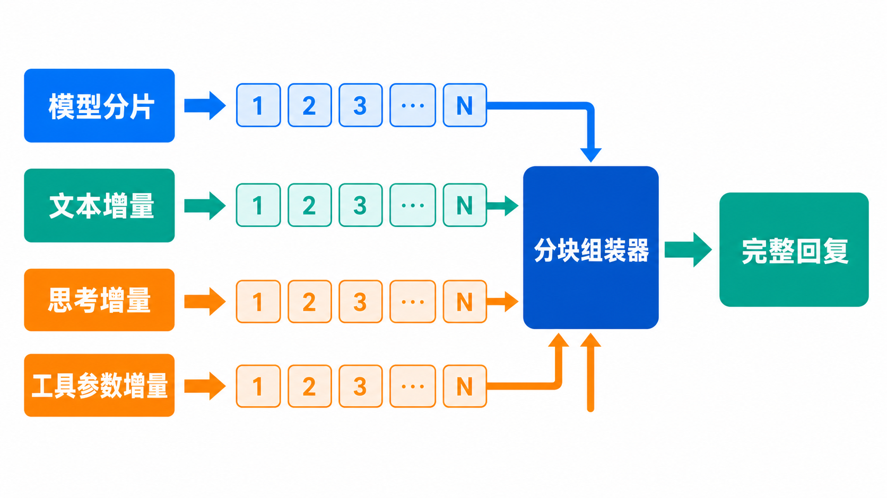
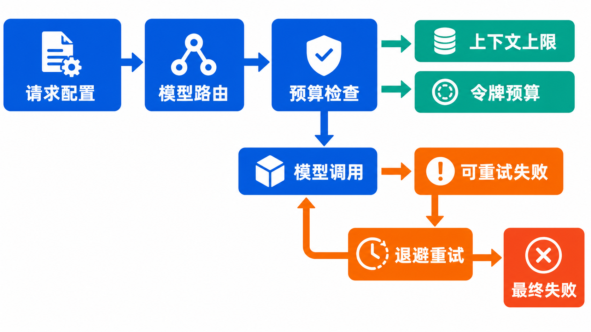

很多 Agent 框架把“调用模型”写成一个巨大的适配器：拼提示词、转换消息、附加工具、发 HTTP、解析流、统计用量，全挤在同一个函数里。DeepSeek Harness 走了另一条路。它先建立供应商无关的消息和流式事件词汇，再让系统提示词注册表、会话投影、Agent Loop 与模型适配器各自承担一段责任。理解这条链，关键不是找到一个万能的 `chat()`，而是回答四个问题：模型实际看到了什么、这些内容来自哪里、什么时候进入持久日志、供应商协议在哪里被隔离。

本文固定核对官方标签 `dsh-v0.1.0-rc.7`。代码片段来自该标签，较长实现会注明“源码裁剪”；为了串起调用链而补写的代码会明确标为教学伪代码。

## 1. 请求不是字符串，而是一次分层装配

一次模型请求至少经过六层：插件向 `SystemPrompt` 注册静态 section、动态 context、变量和工具；每个 step 按 agent scope 装配；会话事件派生出不可变 `Message[]`；LLM Runtime 解析 provider/model 与调用配置；具体 Adapter（适配器，即隔离某家模型协议的翻译层）序列化为厂商协议；DeepSeek 返回的 SSE（Server-Sent Events，服务器沿 HTTP 连接持续推送事件的协议）再被翻译成统一的 `StreamChunk`（流式事件块，例如文本增量、用量或结束信号）。因此“提示词”只是请求的一部分，并不等于历史，更不等于线上 JSON。

```latex
插件贡献
  ├─ section / context / variable / tool schema
  ↓
PromptAssembly → system + runtime-context snapshot
  ↓
Session Event Log → Message[]
  ↓
GenerateOptions → DeepSeek wire request
  ↓
SSE bytes → StreamChunk → session events / UI
```



这层次划分解决了一个常见混乱：稳定规则可以进入 system prompt，频繁变化的工作目录、权限状态等作为 user-role context snapshot 进入历史，用户消息和工具结果保持独立身份。更重要的是，所有模型可见输入都必须能从日志重建；运行时不能偷偷把一段关键状态仅塞进 HTTP 请求，否则恢复、回放和审计就会得到另一场对话。

## 2. SystemPrompt 是有序、可作用域化的注册表

核心实现位于 `packages/core/system-prompt/src/index.ts`。`PromptSection` 不只是文本，还携带唯一名称、顺序以及 `complete` 语义。静态字符串和按次计算函数使用同一接口：

```typescript
// 源码裁剪：packages/core/system-prompt/src/index.ts
export interface PromptSection {
  readonly name: string
  readonly order: number
  readonly text: string | ((context: AssembleContext) => string)
  readonly complete?: boolean
}

export interface PromptAssembly {
  sections: AssembledSection[]
  contexts: AssembledContext[]
  tools: ToolSchema[]
  variables: Record<string, string | undefined>
}
```

名称是覆盖与冲突检测的依据，`order` 决定模型阅读顺序。约定中 `-100` 放 Harness 身份，`0` 放部署 persona，工具指引常在 `100–199`。这不是随意拼数组：同名全局贡献可以被 scope 内贡献遮蔽，而重复的同层注册会尽早报错。`complete` 则让某个插件声明“这就是完整系统提示词”；装配仍经过 waterfall 以解析工具和变量，最后却只恢复该 section，多个有效 complete 会失败。

一个典型注册可以这样写：

```typescript
// 可运行示例：在已组合 systemPrompt 的 Cordis 插件中
export default function install(ctx: Context) {
  ctx.systemPrompt.section({
    name: 'deployment:persona',
    order: 0,
    text: '你是一名严谨的 TypeScript 工程助手。',
  })
  ctx.systemPrompt.variable('workspace_name', () => 'demo')
}
```

变量插值是严格的：名字必须匹配小写字母开头的规则，未知变量、未定义变量、坏括号都会抛错，替换后的值不会二次扫描。这避免用户内容碰巧含有 `{{...}}` 时触发递归模板注入。真正渲染在 `renderPrompt()`：逐 section 插值、删除空文本、用两个换行连接。

```typescript
// 源码裁剪：packages/core/system-prompt/src/index.ts
export function renderPrompt(assembly: PromptAssembly): string {
  return assembly.sections
    .map(section => interpolate(section, assembly.variables, 'section'))
    .filter(text => text.length > 0)
    .join('\n\n')
}
```

## 3. 动态 Context 为什么不用反复改 system

运行时上下文由 `PromptContext` 提供，也有名称、顺序和按次求值函数。但 `renderContextSnapshot()` 会把它包装成明确的快照声明：新快照取代旧快照。源码还保留每个 section 的来源名称，让 UI 无需重新解析大段文本就能展示“工作区”“权限策略”“技能目录”等贡献。

```typescript
// 源码裁剪：packages/core/system-prompt/src/index.ts
export function joinContextSections(
  sections: readonly ContextSnapshotSection[],
): string {
  const body = sections.map(section => section.text).join('\n\n')
  if (body.length === 0) return ''
  return 'Current runtime context. This snapshot supersedes earlier '
    + `runtime-context snapshots.\n\n${body}`
}
```

这么做有两个收益。第一，稳定 system 前缀有利于供应商侧提示缓存；权限、cwd、活动目标变化时，不必改写整个 system。第二，快照以带 provenance（来源信息，用来回答“谁生成了这段内容、它属于哪种语义”）的 user message 进入会话，可以被持久化和恢复。`ContextForm` 进一步把语义分为 `instructions`、`catalog`、`snapshot`、`notice`、`relay`、`recall`；它描述“内容是什么”，不描述 UI 用什么颜色显示。

注意 `AssembleContext.signal` 只控制本次装配，提供者不能保存它去影响后续 turn。作用域也很关键：带 agent scope 的 provider 只参与该 agent 的装配；裸调用只见全局项。这样父 Agent 与子 Agent 可以共享基础人格，却拥有不同的工具和运行时状态。

## 4. Content Block 是供应商无关的最小内容词汇

Content Block（内容块）是消息内部最小的带类型单元：文本、推理、图片、工具调用和工具结果各自保留结构，不会先被压成一个字符串。消息类型位于 `message.ts` 与 `types.ts`。统一 `Message` 有稳定 `id`、三种 Harness 角色、内容块数组和强制来源：

```typescript
// 源码裁剪：packages/llm/llm/src/message.ts
export interface Message {
  readonly id: MessageId
  readonly role: 'system' | 'user' | 'assistant'
  readonly content: ContentBlock[]
  readonly source: MessageSource
}
```

核心内容块包含文本、推理、图片、工具调用和工具结果。工具结果在 Harness 中仍是 user-role message，但块里保存 `toolCallId`；适配器可以再翻译成某家 API 的 `role: 'tool'`。这是很实用的两阶段设计：领域模型不被 OpenAI 兼容协议绑架，同时保留严格的调用关联。

```typescript
// 教学化摘录：以实际联合类型为准
type ContentBlock =
  | { type: 'text'; text: string }
  | { type: 'reasoning'; text: string }
  | { type: 'image'; attachment: ImageAttachmentRef }
  | { type: 'tool-call'; id: CallId; name: string; arguments: string }
  | { type: 'tool-result'; toolCallId: CallId; content: ContentBlock[] }
```

`ImageAttachmentRef` 是由附件服务管理的持久图片引用，包含不可变字节及显示所需的元数据；图片块自身不直接塞入一份临时 Base64 数据。这一层间接引用让消息冻结、持久化与附件生命周期可以分别管理。

`createMessage()` 会生成 UUID，并通过 `structuredClone` 与 `deepFreeze` 断开调用者引用。不可变不是装饰：同一条消息会穿过实时投递、持久日志、重放和模型请求，如果某个 UI 或 adapter 能原地改数组，事件溯源的“同一事实”就失效。



```typescript
// 源码裁剪：packages/llm/llm/src/message.ts
export function createMessage<T extends NewMessage>(input: T): T & Pick<Message, 'id'> {
  return freezeMessage({ ...input, id: MessageId(crypto.randomUUID()) })
}
```

图片能力还有统一递归检查 `contentHasImage()`。它会进入嵌套工具结果，因此不能靠只扫顶层来绕过文本模型的限制：

```typescript
// 源码：packages/llm/llm/src/content.ts
export function contentHasImage(content: readonly ContentBlock[]): boolean {
  return content.some(block => block.type === 'image'
    || (block.type === 'tool-result' && contentHasImage(block.content)))
}
```

## 5. GenerateOptions 在 Adapter 前冻结请求语义

Agent Loop 不应该知道 `/chat/completions`。它向 LLM seam 提交 `GenerateOptions`：模型、历史、system、工具 schema、采样参数、推理强度、会话 ID、用途和取消信号。provider/model 的选择与默认值合并在 Runtime 层完成，Adapter 收到的是一次操作的确定快照。

```typescript
// 教学伪代码：字段名对应 rc.7 的 GenerateOptions
const options: GenerateOptions = {
  provider: 'deepseek',
  model: 'deepseek-chat',
  system: renderPrompt(assembly),
  messages: deriveMessages(session.events),
  tools: assembly.tools,
  maxTokens: 8192,
  reasoningEffort: 'high',
  sessionId: session.id,
  purpose: 'conversation',
  signal,
}
```

DeepSeek Adapter 的 `stream()` 每次调用只读取一次连接配置和凭据；请求飞行中即使热更新配置，endpoint 与 key 也不会来自不同代际。它把调用者 signal 与内部 consumer controller 合并，并加上 idle watchdog（空闲监视器：连续一段时间没有传输活动就取消请求）。`finally` 会终止上游迭代器，避免 UI 不再消费时连接继续泄漏。

```typescript
// 源码裁剪：packages/llm/llm-deepseek/src/adapter.ts
const connection = this.config.options()
const apiKey = await this.config.resolveApiKey(connection)
const consumer = new AbortController()
const upstream = options.signal === undefined
  ? consumer.signal
  : AbortSignal.any([options.signal, consumer.signal])
using watchdog = idleWatchdog(upstream, connection.streamIdleTimeoutMs, code)
```

## 6. 从统一消息到 DeepSeek Wire Request

序列化集中在 `packages/llm/llm-deepseek/src/serialize.ts`。system 单独放在首条 wire message；用户文本被拼接；assistant 的文本、reasoning 和 tool call 分路；Harness 的 tool-result 被展开为独立 `role: 'tool'`。

```typescript
// 源码裁剪
for (const result of toolResults) {
  wire.push({
    role: 'tool',
    tool_call_id: result.toolCallId,
    content: flattenText(result.content) || '(no output)',
  })
}
```

纯工具调用 assistant turn 的 `content` 必须发送空字符串而不是 `null`；reasoning 只在带工具调用的 turn 回传，符合 thinking mode 的 passback 需要，也避免普通轮次浪费 token。图片则被明确拒绝，而不是在 `flattenText()` 时静默丢失。模型目录同样声明 text-only，从入口能力检查到最后序列化形成双保险。

```typescript
// 源码裁剪：serializeRequest()
return {
  model: options.model,
  messages,
  stream: true,
  stream_options: { include_usage: true },
  ...(tools?.length ? { tools } : {}),
  ...(options.maxTokens === undefined ? {} : { max_tokens: options.maxTokens }),
}
```



这里的“可选字段省略而不是发 null”也很重要：省略让 provider 默认值生效，null 可能被网关拒绝或表达另一种语义。`session-title` 用途会强制关闭 thinking，短标题预算不能被推理消耗；conversation 与 compaction 则继承正常默认值。

## 7. SSE 如何变成统一 StreamChunk

SSE 的传输解析位于 `packages/llm/llm-deepseek/src/sse.ts`。它使用 `TextDecoderStream` 和 `EventSourceParserStream` 处理任意字节切分、跨块 UTF-8、CRLF 换行、BOM（字节顺序标记）、多行 data 与注释。注释只刷新活动 watchdog，不进入模型内容。

```typescript
// 源码：packages/llm/llm-deepseek/src/sse.ts
const events = stream
  .pipeThrough(new TextDecoderStream())
  .pipeThrough(new EventSourceParserStream({ onComment }))
for await (const { data } of events) {
  yield data
  if (data === DONE) return
}
throw new LlmError('SSE stream ended without [DONE]', 'STREAM_CLOSED')
```

EOF 前没有 `[DONE]` 会被视为截断，不能把“已经收到了大部分文本”伪装成成功。适配器的 translate 层再把供应商增量转换成 `StreamChunk`：它是一组供应商无关的流式事件，包括块开始、文本或推理增量、工具参数增量、块结束、用量和最终结束原因。上层 Agent Loop 只认识这些事件，不认识 SSE JSON 字段。

```typescript
// 教学伪代码：统一消费流
const { turn, step } = currentPhase
for await (const chunk of llm.stream(options)) {
  session.append('assistant/chunk', { turn, step, chunk })
  if (chunk.type === 'block-end' && chunk.block.type === 'tool-call') {
    pendingCalls.push(chunk.block)
  }
  if (chunk.type === 'usage') usage = chunk.usage
}
```

供应商 HTTP 状态也被归一为稳定错误码：401/403 为 `AUTH`，429 为 `RATE_LIMIT`，上下文超限从 400 文本中识别，5xx 为 `SERVER`。调用者取消、空闲超时、网络失败和服务端错误由不同路径表达，使 retry policy 不必解析人类错误消息。

## 8. 流式输出为什么仍然必须落入事件日志

流式只是交付方式，不应形成第二份真相。每个 chunk 可先驱动实时 UI，同时追加 session event；完整 assistant message 在 step 边界装配并记录。这样中途断线、工具调用参数逐段到达、推理与正文并行等情况都能回放。UI 可以用 chunk 显示“正在生成”，恢复后则根据完成事件重建稳定消息。

一个可靠消费端还要处理背压（下游处理慢时，上游应等待而非无限堆积数据）和取消：避免启动一个无人 await 的后台 `for await`；消费者退出时要触发 adapter `finally`；超时衡量的是“单次读取无活动”，并非整场固定总时长；SSE comment 算传输活动但不算内容。若调用者把同一 AsyncIterable 消费两次，通常意味着发出两次真实请求，因此共享应在拥有者层显式完成。

```typescript
// 可运行示例：只消费一次，并在取消时结束
const controller = new AbortController()
try {
  for await (const chunk of adapter.stream({ ...options, signal: controller.signal })) {
    await persistAndPublish(chunk)
  }
} finally {
  controller.abort('consumer closed')
}
```

## 9. 沿源码验证请求链与生产边界

### 沿源码继续追踪一次真实 Step

如果准备自己阅读仓库，可以从 `packages/core/agent-loop/src/agent.ts` 的 step 主流程向两侧追。向前看，request header 先冻结本轮 provider、model、reasoning effort、最大输出等选择；随后 system prompt assembly 使用当前 Agent 作为 scope target。向后看，LLM Runtime 返回的 chunk 被逐项追加，并由 tool-call assembler 组合参数。只搜索 `stream(` 还不够：同名方法只是供应商 seam，决定“哪些历史进入请求”的是 Session surface 与 message derivation。

一个 step 在概念上可以拆成如下伪代码。它不是仓库函数的逐行复制，但每个动作都对应 rc.7 的真实职责：

```typescript
// 教学伪代码：一次 step 的模型侧路径
const assembly = await ctx.systemPrompt.assemble({
  scope: agent.scope,
  signal,
})
const system = renderPrompt(assembly)
const contextSections = renderContextSections(assembly)
await publishChangedContextSnapshot(agent, contextSections)

const messages = deriveMessages(agent.session.surface)
const selected = await agent.resolveModel(request, signal)
for await (const chunk of ctx.llm.stream({
  ...selected,
  system,
  messages,
  tools: assembly.tools,
  signal,
})) {
  appendAndPresentChunk(agent.session, chunk)
}
```

`publishChangedContextSnapshot` 值得特别留意。动态 context 不能每次无脑复制一遍，否则 cwd、权限与工具目录即使不变，也会不断吃掉上下文。框架要比较当前完整快照与先前模型可见状态，在真正变化时才形成新消息。与此同时，完整快照必须能取代旧快照，而不是让模型同时相信两个 cwd 或两个权限策略。`source.form='snapshot'` 与命名 sections 正是为这种消费方式准备的。

系统 section 的函数也应保持廉价、确定和可取消。它可能在每个 step 被调用；若 provider 内做网络抓取，应观察 assembly signal，并把真正需要持久化的外部事实写成 session event。仅返回一段瞬时网络结果会违反可重建原则。一个更安全的 provider 是“从已经记录的领域状态渲染文本”，而不是“装配时临时发现新世界”。

```typescript
// 推荐写法：从已记录状态渲染，不在装配期制造新事实
ctx.systemPrompt.context({
  name: 'deployment:review-state',
  order: 120,
  text: ({ agent }) => {
    if (agent === undefined) return ''
    const review = foldReviewState(agent.session.events)
    return review.active ? '当前代码审查模式已开启。' : ''
  },
})
```

### Tool Call 为什么也是流内容而不是最终附属字段

供应商通常把工具参数分多个 delta 发送。第一个片段可能只有 call index 与 name，后续不断补 arguments，最后才给 finish reason。如果上层只在流末读取一个完整响应，就无法实时显示工具卡片，也无法在截断时解释“工具参数尚未闭合”。统一 `StreamChunk` 因此需要表达调用开始、参数增量和结束等阶段，并保留 provider call id。

拼接 arguments 时不能边收边 `JSON.parse` 并把失败当成模型错误，因为半段 JSON 本来就不合法。正确时机是在工具调用块完成后解析；若 SSE 在完成前断开，整次模型响应失败，不能执行已经猜到的半个工具。多个工具调用还可能交错到达，assembler 必须按块序号分桶，不能用一个全局字符串缓存。

```typescript
// 教学伪代码：按调用身份组装，不提前执行
const calls = new Map<number, { id?: CallId; name?: string; json: string }>()
for await (const chunk of stream) {
  if (chunk.type === 'block-start' && chunk.blockType === 'tool-call') {
    calls.set(chunk.index, { json: '' })
  } else if (chunk.type === 'tool-call-delta') {
    const call = calls.get(chunk.index)
    if (call === undefined) throw new Error('orphan tool-call delta')
    call.id = chunk.id
    if (chunk.name !== undefined) call.name = chunk.name
    call.json += chunk.argumentsDelta
  } else if (chunk.type === 'block-end' && chunk.block.type === 'tool-call') {
    completed.push(chunk.block)
  }
}
```

reasoning 与 text 同样是两个通道。UI 可以分别呈现，持久消息保留块类型，DeepSeek 下一次 wire replay 又按官方规则只在工具调用轮次带回 reasoning。若一开始就把两者拼成一个字符串，后续无法做到既完整重放工具轮 reasoning、又不在普通轮浪费 token。

### 缓存前缀、重放状态与跨 Provider 历史

稳定 system section 排在前面、动态 context 作为后续快照，并不只是代码整洁。许多模型服务按请求前缀计算缓存命中；把时间戳、cwd 或实时状态塞进 system 最前部，会让后面完全相同的长指令也失去缓存。Harness 的 section order 和 context 分离给部署保留了优化空间，但框架并不保证某家 provider 一定命中缓存，成本监控仍需依据实际 usage。

Assistant message 的 `source` 强制记录 provider 与 model，并允许携带 `replayState`。它是适配器为了后续重放而保存的供应商私有状态，要求属于 lossless JSON，也就是经过快照后仍能无损写入和读回的 JSON 值。有些供应商要求把响应中的私有状态带回下一轮；但 Runtime 只应在当前 adapter 实例同时拥有历史 provider 和目标 provider 时暴露它。跨 provider 路由不能把 A 的不透明 token 发给 B，也不能让一个插件读到另一个 adapter 的私有状态。

```typescript
// 源码类型：packages/llm/llm/src/message.ts
export interface AssistantProvenance {
  provider: string
  model: string
  replayState?: unknown
}
```

这还影响故障切换。文本、工具调用和结果可以通过 provider-neutral blocks 转给备用模型，但供应商专有 reasoning replay 或缓存句柄不一定可移植。可靠的 fallback policy 应先查询目标模型的输入 modality 与能力，再决定是否能复用历史；遇到图片而目标 text-only 时必须在切换前拒绝，不能等 serializer 静默删除。

### 错误、重试与幂等边界

LLM retry 只适用于尚未对上层产生不可撤销语义的失败。DNS、连接拒绝、部分 429/5xx 可以按 provider policy 重试；但如果已经向 UI/日志发布一部分 chunk，重新请求可能生成完全不同后缀。实现必须要么把一次 attempt 作为可识别的事件范围并丢弃失败 attempt 的 surface，要么在第一块交付后停止透明重试。不能简单在 `for await` 外套三次循环，把三段答案拼起来。

HTTP `Retry-After` 可为秒数或日期，adapter 会转换为正毫秒；错误 taxonomy 再决定 policy 是否使用它。401/403 不应盲重试，context window exceeded 应触发 compaction 或缩小输入，而不是原样请求；caller abort 永不重试；idle timeout 是否重试取决于是否已发布内容和调用用途。

```typescript
// 教学伪代码：按错误类别而不是消息文本决策
switch (error.code) {
  case 'RATE_LIMIT':
  case 'SERVER':
  case 'TRANSPORT':
    return retryIfAttemptStillInvisible(error.retryAfterMs)
  case 'CONTEXT_WINDOW_EXCEEDED':
    return requestCompaction()
  case 'AUTH':
  case 'ABORTED':
  case 'UNSUPPORTED_CONTENT':
    throw error
}
```

标题生成和压缩也走 LLM seam，但用 `purpose` 明示。Adapter 可据此关闭标题 thinking、添加 compaction header，监控也能分摊成本。插件若把所有请求都伪装 conversation，就失去这些策略分流能力。



### 建议的分层测试矩阵

Prompt 层要验证全局与 scope section 的顺序、同名遮蔽、complete 冲突、未知变量、动态函数取消和 toolOrder。Message 层要验证 ID 稳定、深冻结、嵌套图片发现、tool result callId 和 source form。Serializer 层应快照纯文本、纯工具调用、带 reasoning 的工具轮、空工具结果、可选字段省略和 text-only 拒绝。

SSE 层要故意把中文 UTF-8 从每个可能字节位置切开，覆盖 CRLF、多 data 行、comment heartbeat、BOM、空事件、合法 `[DONE]` 与无终止符 EOF。Adapter 层要覆盖配置在请求中途热更新、credential 失败、consumer 提前 return、caller abort 和 idle watchdog。最终再用 Agent Loop snapshot 证明 chunk、assistant、tool call 和 usage 形成正确的 session transcript。

这套矩阵看似重复，实际每层证明不同承诺。只做真实 API 测试很难稳定制造半个 UTF-8 或 truncated SSE；只做 serializer 单测又无法证明模型可见输入已经被记录。层级越清楚，线上出现“模型回答断了”时越能快速判断是装配、历史、协议、传输还是消费端的问题。

### 按一次故障进行端到端诊断

假设用户反馈“第二轮模型忘了第一轮工具输出”。首先检查 Session surface 是否仍包含对应 tool-result，而不是直接抓 HTTP；若事件存在但 surface 被 compaction/prune替换，要检查替换来源与预览。其次检查 `deriveMessages()` 是否生成 user-role 的 tool-result block，callId 是否与 assistant tool-call 相同。然后查看 adapter `serializeMessages()` 是否展开为 `role:'tool'`，最后才比较线上请求体。

如果 wire 请求正确而模型仍报找不到 tool call，常见原因是历史 assistant 的 tool call 在跨 provider 路由时丢失、arguments 未完成便被持久化、或者网关不接受 null/空内容差异。rc.7 明确把纯工具调用 assistant content 发为空字符串，并在有 toolCalls 时回放 reasoning。抓包时应对照这三个字段，而不是只看文本。

若问题是流式回答末尾缺失，先确认 SSE 是否到达 `[DONE]`。没有 sentinel 即使已有 finish delta 也按 `STREAM_CLOSED`；若有 sentinel但 UI缺字，检查 consumer 是否提前 return 或并发消费同一 iterable；若 adapter报 idle timeout，区分服务无字节、只有 comment heartbeat以及下游处理太慢。watchdog 的 pulse 与 `next(iterator)` 位置能说明究竟是谁空闲。

若 system 内容不符合预期，打印 assembly 的命名 sections、contexts、variables 和 tools，而不是仅打印最终大字符串。命名贡献能立刻暴露同名 shadow、order 错误、complete section 或 scope 缺失。诊断输出要脱敏，尤其不能记录 credential、用户私密上下文和完整工具结果。

### 扩展新 Provider 时应守住的最小契约

新 adapter 首先声明 provider/model discovery 与输入 modalities；其次把 `GenerateOptions` 的 system、messages、tools 和调用配置完整映射；再把供应商流翻译成统一 chunks；最后把认证、限流、超时、上下文超限和取消映射为稳定 `LlmError`。只实现“文本能出来”还不是可用 provider。

图片支持必须递归处理 tool-result 内嵌图片；不支持就前置拒绝。工具调用必须保留 provider call id 和原始参数增量，结束时给出确定完整事件。Usage 可能只在最后一块出现，adapter 要允许零值/缺失但不能凭文本长度冒充供应商计费。结束原因要翻成上层能理解的 stop、length、tool 等语义。

供应商专有选项应留在 adapter-owned config 或受控 extension，不应污染所有 provider 的核心请求类型。共同语义如 maxTokens、temperature、stop、reasoning effort 才进入 seam；不共同的缓存句柄、地区路由和实验开关由具体实现解析，并在不支持时 fail loud。

真实 API e2e 之外还需要 keyless replay/mock。固定 wire stream 可以验证 chunk translation 和消息重放；真实 e2e 验证当前服务协议但可能受模型非确定性影响。两者共同覆盖，才能在 provider API 变化时区分“模型今天答得不同”和“adapter 丢了协议字段”。

### 请求成本与隐私的最后一道检查

System、动态 context、历史消息和工具 schema都会占输入窗口。工具越多，schema 成本越大；context 快照重复越多，稳定前缀越短；tool result 未 retention，下一轮可能直接超限。Token meter 应按当前 surface 和本次 assembly测量，而不是仅统计用户文本。触发压缩后重新装配，因为 summary、工具 restriction 或权限状态可能同时变化。

日志和 tracing 记录 provider、model、耗时、首 token、usage、错误码通常足够，不应默认写完整 prompt、arguments、reasoning和 tool output。需要调试全文时使用显式受控开关、短保留期和租户隔离。匿名用户 ID、session ID等 attribution header 也属于可关联标识，应纳入隐私说明。

最终上线门槛可以概括为四个等式：模型可见动态事实等于日志可重建事实；UI实时块最终等于持久 assistant/tool message；provider wire 语义等于统一 `GenerateOptions`；取消返回等于上游工作已经静止。四者中任何一个不成立，系统即使能聊天，也还不是可恢复、可审计的 Agent Runtime。

还应保存一组脱敏的固定请求夹具，覆盖普通回答、推理、并行工具和工具失败。每次升级先比较装配产物与协议快照，再运行真实模型冒烟。这样既能发现确定性的字段回归，也不会把模型随机措辞变化误判为框架故障。对于长会话，再增加压缩前后两份请求，确认动态上下文只有最新快照生效，工具调用与结果仍完整配对。

这也是发布前不可省略的兼容性证据与故障基线。

## 10. 结语：四层语义一致，模型请求才可重建

这套设计的核心收益是可替换与可重放：系统提示贡献可以随插件增删；动态状态能够持久恢复；内容块不绑定 provider；Adapter 只负责能力声明、协议翻译和传输；Agent Loop 无需理解 SSE 的供应商字段。测试也可以逐层进行：提示装配验证顺序和 scope，消息层验证不可变与来源，序列化层验证 wire JSON，SSE 层验证截断与 UTF-8，最后由 loop snapshot 检查完整会话。

失败归属也因此更清楚。未知提示变量在装配期失败；文本模型遇到嵌套图片返回 `UNSUPPORTED_CONTENT`；空闲流返回 `TIMEOUT`；用户取消是 `ABORTED`；缺少 `[DONE]` 是 `STREAM_CLOSED`。如果历史中的纯 reasoning assistant 消息无法形成合法 wire message，问题会在后续请求中显式暴露，而不会靠静默删历史掩盖。

`0.1.0-rc.7` 仍是 Developer Preview。`ContentBlock`、`StreamChunk`、供应商重放状态和提示装配事件都是重要扩展面，却还不构成长期兼容承诺。业务插件应依赖公共包导出，避免导入适配器私有 wire 类型；持久化消费者应按照 session format 机制拒绝无法理解的必需事件。升级时要同时回归装配后的 system、派生消息、wire 请求和整场流式 transcript。四层结果保持一致，才能确认升级没有悄悄改变一次模型请求的语义。
