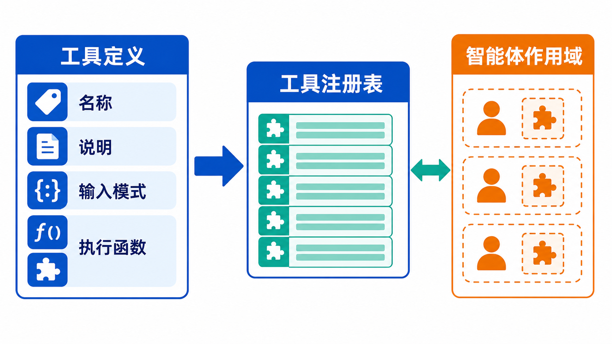
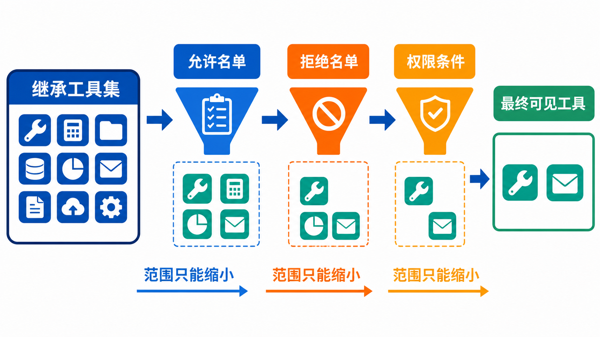
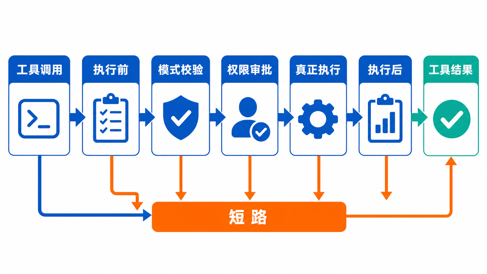
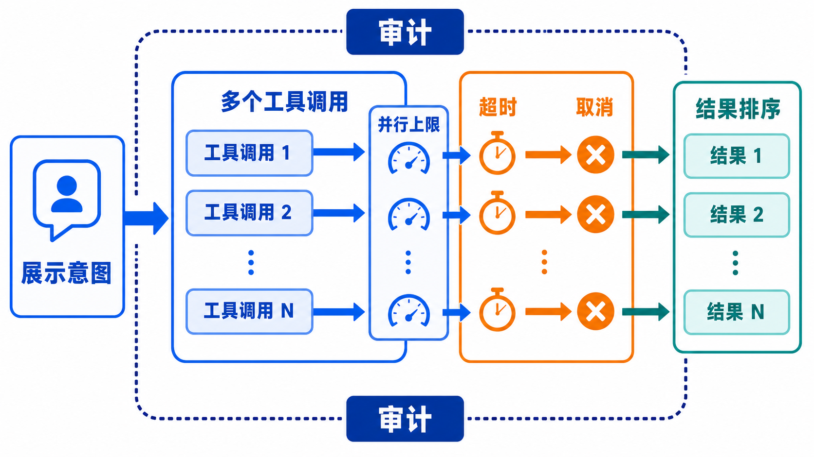

Agent 的工具系统不是“名字映射到函数”这么简单。模型先看到某组 schema，随后返回不可信 JSON 参数；框架要验证工具是否仍可见、决定要不要审批、传播取消与超时、执行函数、校验返回值、渲染模型内容，最后把结果和审计事件写入会话。任何一步和其他步骤采用不同的工具集合或不同身份，都可能造成“模型看得到却调不到”“被限制的工具绕过限制”“取消后副作用仍在后台继续”等问题。

DeepSeek Harness 把这些责任集中在 `@deepseek-ai/dsh-tools` 的注册表和执行管线中，又允许策略插件通过 Cordis Waterfall 包裹它。Waterfall（瀑布式调用链）会让监听器按顺序进入；监听器调用 `next()` 才把控制权交给下一层，并可在返回时继续处理结果。本文基于固定标签 `dsh-v0.1.0-rc.7`，源码重点为 `packages/core/tools/src/` 与 `packages/core/agent-loop/src/tool-calls.ts`。长片段均为源码裁剪，组合演示会标记为可运行示例或教学伪代码。

## 1. 一次工具调用其实经过三条链

第一条是“发布链”：工具定义注册后，经作用域遮蔽、restriction（限制规则，即按 allow/deny 收缩继承工具集合）和呈现模式处理，生成本次 prompt 的 `ToolSchema[]`。第二条是“执行链”：根据同一作用域重新解析定义，快照参数和执行身份，依次经过 pre、around execute、post、finalize 和 result。第三条是“持久链”：Agent Loop 记录 tool call、执行结果；Code Mode（让模型通过一段程序批量调用原生工具的折叠传输模式）的子调用还记录 start/settled 配对事件。

```latex
定义 → 注册表 → 作用域视图 → 限制交集 → Schema 给模型
                                  ↓
模型调用 → 名称解析 → pre → execute waterfall → Schema 校验 → body → post → finalize
                                  ↓
           tool/result 观察事件 → Session tool result message
```



工具定义包含模型可见字段和运行时私有字段。模型只看 `name`、`description`、`parameters`；`execute`、输出 schema、超时、并发分类、UI presentation 都不能泄漏进 prompt。

```typescript
// 源码裁剪：packages/core/tools/src/index.ts
export interface ToolDefinition extends ToolSchema {
  readonly output: ToolOutputDefinition
  execute(args: unknown, exec: ToolRunContext): Promise<unknown>
  finalizeContent?(
    exec: Readonly<ToolExecution>,
    result: Readonly<ToolExecutionResult>,
  ): ContentBlock[] | undefined
  timeoutMs?: number
  isConcurrencySafe?(args: unknown): boolean
  presentCall?(args: unknown): ToolCallView | undefined
  presentResult?(args: unknown, result: ToolResult): ToolResultView | undefined
}
```

`output` 要求工具先返回规范、可无损还原的 JSON 值，也就是能够稳定生成快照、序列化并原样读回的普通 JSON 数据，再由纯 `render()` 投影为模型内容。结构化值便于 Code Mode 直接交给程序；文本、差异内容或终端卡片属于另一层呈现。这样可以避免把一段面向人的字符串同时充当程序 API、模型结果和 UI 数据。

## 2. defineTool 把参数类型与 JSON Schema 绑在一起

工具作者通常用 `packages/core/tools/src/schema.ts` 的 `defineTool()`，参数 spec 既生成 TypeScript 推断，又编译为 JSON Schema。以下是贴近真实接口的可运行示例：

```typescript
// 可运行示例：放入已经组合 tools 服务的插件
const readText = defineTool({
  name: 'read_text',
  description: '读取一个 UTF-8 文本文件',
  parameters: {
    path: { type: 'string', description: '相对当前工作目录的路径' },
    startLine: { type: 'integer', optional: true },
  },
  output: {
    schema: { type: 'object', properties: {
      text: { type: 'string' },
    }, required: ['text'], additionalProperties: false },
    render: (_args, value) => [{ type: 'text', text: value.text }],
  },
  async execute(args, exec) {
    exec.signal.throwIfAborted()
    return { text: await read(args.path, exec.signal) }
  },
})
ctx.tools.register(readText)
```

原始 `register()` 也能接受 `ToolDefinition`，因此边界仍会检查 schema，不能只相信 TypeScript。插件可能来自另一 realm（独立的 JavaScript 执行域）、配置文件或动态加载，验证器会识别跨 realm 的普通对象和数组，并拒绝稀疏数组、不可枚举装饰、循环引用、非有限数字和 `-0`。

支持的是有意收窄的 JSON Schema 子集：`type`、`oneOf`、`properties`、`required`、`additionalProperties`、`items`、`enum`、`const`，以及 description/title/default/examples 注释。不支持的关键字会一次收集全部 violation，而不是改完一个再发现下一个。

```typescript
// 源码裁剪：packages/core/tools/src/json-schema.ts
const CONSTRAINT_KEYWORDS = new Set([
  'type', 'oneOf', 'properties', 'required',
  'additionalProperties', 'items', 'enum', 'const',
])
const ANNOTATION_KEYWORDS = new Set([
  'description', 'title', 'default', 'examples',
])
```

收窄子集并非能力不足，而是让四个消费者一致：模型 function schema、运行时输入/输出验证、TypeScript SDK 生成和 Python SDK 生成。如果 schema 接受一个生成器表达不了的结构，Code Mode 就会向模型宣告错误 API。

## 3. 注册是 Effect，注销也是语义的一部分

`ToolRuntime.register()` 先校验名称、输入 schema、输出 schema 与定义，再通过 `ctx.effect()` 发布。返回的 disposer（注销函数）只撤销这次贡献；热重载、scope 销毁和测试清理共享同一生命周期。重复全局名字失败，scope 内同名可以遮蔽继承定义，但不会修改父层。

```typescript
// 教学化裁剪：真实实现包含完整冻结与验证
register(definition: ToolDefinition): () => void {
  validateDefinition(definition)
  const scope = scopeOf(this.ctx)
  return this.layers.mutate(scope,
    layer => layer.tools.add(definition.name, snapshot(definition)),
    { label: 'tools.register()' },
  )
}
```

注册表公开给 system prompt 的 provider 会返回 `schemas` 与 `knownNames`。`knownNames` 是 restriction 之前的名字全集，用来验证 `toolOrder`：某个工具在当前 agent 被隐藏，不意味着配置里写它就是拼写错误。反过来，彻底未注册的名字必须在装配期失败，不能静默忽略。

UI presentation 也跟随定义快照。`presentCall(args)` 只依赖参数，`presentResult(args, result)` 只依赖持久结果；二者必须纯函数，因为实时流和历史回放会重复调用。工具返回 `terminal`、`diff`、`search` 等 render intent，而不是直接构造某个 React 组件。

## 4. Restriction 是继承面上的交集过滤器

Restriction 只允许在 scoped context（通常 `agent.ctx`）注册，裸 context 调用会报错，以防一个局部策略意外屏蔽所有 Agent。结构是 allow 与 deny 的组合：

```typescript
// 源码裁剪：packages/core/tools/src/index.ts
export interface ToolRestriction {
  readonly allow?: readonly string[]
  readonly deny?: readonly string[]
}
```

限制沿 scope chain 求交：任一层不允许，工具就不可见。它过滤继承来的全局/父层能力；scope 自己注册的局部工具属于该 scope 的新增表面，不被当作要过滤的继承项。多个 restriction 不是后者覆盖前者，而是共同收紧。

```typescript
// 可运行示例：只在 agent 作用域生效
const release = agent.ctx.tools.restrict({
  allow: ['read_file', 'grep', 'lsp_query'],
  deny: ['write_file'],
})
// agent 销毁时 effect 自动撤销，也可提前 release()
```

空 restriction 被判为大概率配置物化错误；未知全局工具名失败；保留的 `run_code` transport 名不能直接被限制，应该限制它能代理的端能力。restriction 改变后发送 `tools/change`，下一次 prompt 装配会获得新 schema。



这条规则也缩小了 TOCTOU（Time of Check to Time of Use，检查时状态与实际使用时状态发生变化）风险：执行时不会拿模型请求时保存的任意函数引用，而是在调用作用域下重新解析当前视图。工具在等待模型期间被卸载或限制后，旧模型响应不能继续调用它，会得到 `UNKNOWN_TOOL`。可见性和可执行性来自同一个 registry view 算法。

## 5. 身份和参数先冻结，Schema 校验在 pre 之后

模型返回的是工具名与 JSON 字符串。Agent Loop 解析 JSON 后创建 `ToolExecutionInput`，携带 `callId`、根调用 ID、参数、精确 Agent 与必需的 `AbortSignal`。registry 随后铸造不可伪造的 symbol token，并对参数做可无损 JSON 快照和冻结，策略监听器不能在途中篡改调用身份或参数。

```typescript
// 源码裁剪：packages/core/tools/src/index.ts
export interface ToolExecutionInput {
  readonly callId: CallId
  readonly rootCallId?: CallId
  readonly name: string
  readonly arguments: unknown
  readonly agent?: Agent
  readonly parent?: ToolExecutionToken
  readonly signal: AbortSignal
}
```

这里要区分“参数可安全快照”和“参数符合工具 Schema”。rc.7 先完成前者，再运行 `tools/pre-execute`；进入 `tools/execute` 并最终分发到 `defineTool()` 包装后的 `execute()` 时，才进行 Schema 校验。因此 pre 策略看到的是不可篡改、可写入日志的 JSON 参数，却不能假定它已经满足工具的 `required`、`oneOf` 或字段类型约束。校验仍然发生在用户工具 body 之前，失败会转成稳定错误结果，不会让业务函数接触非法参数。

```typescript
// 教学伪代码：展示 rc.7 的阶段顺序
const exec = createFrozenExecution(JSON.parse(call.arguments))
const decision = await runPreExecuteWaterfall(exec)
if (decision.kind !== 'allow') return resolveDecision(decision)

return runExecuteWaterfall(exec, async () => {
  // defineTool 生成的包装 execute 在调用用户 body 前执行这一步
  const violations = validateJsonSchemaValue(definition.parameters, exec.arguments)
  if (violations.length > 0) throw new ToolArgsError(violations)
  return userExecute(exec.arguments, exec)
})
```

裸 `register()` 仍允许工具定义的 `execute` 接收 `unknown`，因为该接口保留了开放扩展能力；`defineTool()` 才把运行时校验与 TypeScript 参数推断绑定起来。权限插件若需要根据路径、命令或 URL 做 pre 判断，应自行采用拒绝优先的解析规则，不能借用尚未发生的 Schema 校验作为安全前提。

在 Code Mode 下还有 parent token 的语义：模型只能直接调用 `run_code`，原生工具名必须作为其程序中的子 dispatch 且携带 parent。只检查名称会允许模型绕过 collapse；token 同时证明调用来自注册表拥有的外层执行。

## 6. pre-execute：允许、拒绝或询问

第一个公开 waterfall 是 `tools/pre-execute`。默认 `next()` 表示 allow；监听器可以 deny 或 ask。ask 会通过可选 `ApprovalService` 请求人类决定，没有 approval seam 时转为拒绝。异步 gate 必须观察 `exec.signal`，registry 会等待它真正 settle，避免取消后 gate 仍持有资源。

```typescript
// 可运行示例：敏感工具进入审批
ctx.on('tools/pre-execute', async (exec, next) => {
  if (exec.name !== 'deploy_prod') return next()
  return {
    kind: 'ask',
    reason: '该调用会修改生产环境，请确认一次性授权',
  }
})
```

Waterfall 的关键规则是：要委托后续监听器必须调用 `next()`。直接 return 会短路整条链。不要把它误解为 EventEmitter 广播。策略顺序可以用 prepend/append 组织，但安全不应依赖“我大概注册得更早”；像 approval policy `never` 这种必须无条件生效的规则，由服务入口本身在 dispatch 前执行。

pre 阶段之后会再次检查调用者取消。若还未进入 body，结果应表达“未调用”；如果 body 已经开始，取消错误码可能不同。这种区分对审计很有价值：一个被取消的部署到底完全没发生，还是发生到一半，需要由结构化状态回答。

## 7. execute Waterfall：超时、度量和工具主体

`tools/execute` 是 around-dispatch waterfall。监听器调用 `next()` 获得已经归一化的结果，所以可以包超时、重试、追踪和资源计量。它允许临时替换 `exec.signal`，但 registry 会把原始 caller signal 再融合，wrapper 不能切断用户取消。rc.7 的实现可在 `timeout-policy/src/index.ts` 中核对。

```typescript
// 教学伪代码：合作式超时 wrapper
ctx.on('tools/execute', async (exec, next) => {
  const timeoutMs = ctx.tools.get(exec.name, exec.agent)?.timeoutMs
  if (timeoutMs === undefined) return next()
  const timeout = AbortSignal.timeout(timeoutMs)
  const previous = exec.signal
  exec.signal = AbortSignal.any([previous, timeout])
  try {
    return await next()
  } finally {
    exec.signal = previous
  }
})
```

实际实现强调 quiescence（静止状态）：超时后，已经启动的工具及其子任务都要停止，框架才结束本次调用。不能只用 `Promise.race()` 把错误返回给模型，同时任由工具在后台写文件。registry 不会丢弃工具 Promise，同进程代码也无法直接硬杀，因此工具要把 `exec.signal` 转发到 fetch、fs、subprocess，并在返回或抛错前收束自身工作。`timeoutMs` 只是工具声明的合作式预算，具体由 timeout policy 插件执行。

工具主体成功后，返回值先生成一份可无损还原的 JSON 快照，再按 `output.schema` 验证，之后调用 `output.render(args, value)`。非 JSON、`NaN`、循环对象、Schema 不符都会转成框架拥有的失败；不能等到持久化之后才发现日志无法读取。

```typescript
// 教学伪代码：body 后的规范化
const value = snapshotJsonValue(await definition.execute(args, runContext))
validateJsonSchemaValue(definition.output.schema, value)
const content = definition.output.render(args, value)
return { value, content, isError: false }
```



## 8. post、finalize 与 result 为什么分三层

`tools/post-execute` 接收已经归一化的成功或错误结果，监听器可以接受、替换、丰富或阻断。工具 body 抛错也会进入这里，因此策略可以统一脱敏或映射错误。监听器抛错本身则形成策略失败，不能被当作工具成功。

`finalizeContent` 是工具自己的同步最后一公里：它对每个结果恰好运行一次，包括绕过 post 的管线失败，只能替换 model-facing content，不能修改 `isError`、identity 或 canonical value。典型用途是给 sandbox denial 添加结构化提示；这个函数要覆盖所有输入情况，且不可抛错。

最后 `tools/result` 是只观察、不修改的通知事件。registry 发布的是深冻结、lossless JSON 的最终快照；监听器错误会被隔离，不得改变已经决定的结果。三层分别回答：部署策略是否接受结果、工具如何最终解释内容、旁观者如何记录事实。

```typescript
// 可运行示例：只观察，不改结果
ctx.on('tools/result', (exec, result) => {
  metrics.record({
    tool: exec.name,
    ok: !result.isError,
  })
})
```

Code Mode 的子 dispatch 多一条 `tools/code-dispatch-log` waterfall。它只改“写入日志的副本”：程序已经拿到完整结构值，模型也不直接看到子结果；spill policy（超量转存策略）可以把超大文本替换成预览加定位符，避免会话无限膨胀。started 和 settled 事件用 `subCallId` 配对，且在外层 `run_code` 返回前排空，从结构上保证执行包含关系。

## 9. 生产场景中的并发、安全与契约验证

并发不是全局开关。只有 `isConcurrencySafe(args)` 精确返回 true 的调用才能和兄弟调用重叠；省略、抛错、返回非 true 或参数无效都按 exclusive。exclusive 会形成排序屏障。安全分类必须考虑参数，例如两个只读文件调用可并行，而写同一目标或操作父 Agent 状态不能并行。

```typescript
// 可运行示例：只读查询明确可并行
isConcurrencySafe(args) {
  return args.operation === 'read' || args.operation === 'stat'
}
```

并发只是上线检查的一部分。后续各小节会继续核对注册表视图、输入输出 Schema、Waterfall 组合、错误呈现、Code Mode 和契约测试；这些机制共同决定模型可见能力能否稳定地映射为一次受控执行。

### 从注册表视图理解“已知、可见、可执行”

阅读源码时容易把三个集合混成一个。已知集合用于配置诊断：全局注册过但被某个 scope restriction 隐藏的名字仍是已知，`toolOrder` 写它不算拼错。可见集合是本次 assembly 真正提供给模型的 schema。可执行集合还受调用时 mode、parent token、pre policy 与取消状态约束。模型收到请求后到返回调用之间，插件可能热卸载，所以执行阶段必须重新解析。

scope shadow 也不是修改原定义。父层 `search` 与子层同名 `search` 可以是不同实现，子层离开时父定义重新显现。注册表的 disposer 只撤销自己贡献的对象；即使另一个热重载版本后来占据同名位置，旧 disposer 也不能删除新对象。Effect 的身份检查正是为了防止这种“旧清理器删新服务”。

`tools/change` 故意是 unfiltered notification，因为全局工具变化影响所有 agent 的下一次装配。监听者收到它之后不应立刻修改正在飞行的请求，而应让下一 step 重新 assemble。某个 scoped restriction 改变也可能只影响一条分支，但通知保持简单，由消费者按需失效缓存。

### 输入与输出 Schema 的安全细节

JSON Schema 验证不等于业务授权。`path` 是字符串，只证明类型正确，不证明位于 workspace；`command` 非空，也不证明允许执行；URL 通过格式检查，也不证明没有 SSRF（服务端请求伪造，即诱使服务访问本不应暴露的内部或受限地址）。schema 负责结构，permission、sandbox 和 provider 负责语义安全，工具 body 负责领域前置条件。把这些都挤进 description 只是给模型建议，不能替代强制检查。

`additionalProperties: false` 对工具参数很重要。模型偶尔会生成看似合理但不存在的字段；开放对象若静默接受，模型可能误以为其控制项生效。例如传入 `force:true` 而工具忽略，会造成错误安全预期。可扩展对象才应保持开放，并在版本策略中说明未知字段处理。

`oneOf` 的分支要能给出清楚诊断。若多个分支同时匹配或都不匹配，不能随便挑第一个。enum 与 const 使用 lossless JSON scalar；数字排除非有限值和负零，保证验证、日志 JSON 与跨语言 SDK 对同一值有一致看法。annotations 虽不参与验证，也必须是 lossless JSON，因为它们会进入模型 schema 或生成 SDK。

输出 schema 是同等重要的反腐层。第三方工具实现即使 TypeScript 声明返回对象，运行时也可能返回 `undefined`、Date、Buffer、带 getter 的对象或循环图。Registry 在 render 和持久化之前截住它，错误归因到工具而不是让 Session append 在更远处爆炸。render 本身应是纯函数；若它读取当前文件再生成内容，历史重放会与首次执行不同。

### Waterfall 的组合顺序如何推理

可以把 waterfall 想成洋葱：最外监听器先进入，调用 `next()` 后等待内层结果，再做后处理。pre 的返回是 decision，execute 的返回是 normalized result，post 的返回是 accept/replace/block decision。三个事件签名不同，不能复制同一个通用 middleware 而忽略语义。

一个度量 wrapper 应在 `try/finally` 中记录时长；一个 timeout wrapper 要恢复 signal；一个 retry wrapper 必须确认工具语义可重试。尤其文件写、支付、部署等副作用工具不应在得到未知结果时自动重跑。框架提供 around seam 不代表所有策略都适合所有工具，插件可根据 definition metadata 或显式名单决定。

监听器返回而不调用 `next()` 是有意 short-circuit，不一定是 bug：deny gate 就该如此；缓存命中也可直接给结果。但普通观察器若忘了 `next()`，会吞掉执行。代码审查时应逐个标注监听器属于 gate、wrapper 还是 observer，并为短路写测试。

异步监听器的取消还涉及“等待静止”。registry 在 gate settle 后重新检查 signal，但不会丢弃 gate promise。若 gate 调远端策略服务，它必须转发 signal；否则用户取消只改变最终结果，资源仍占用到网络超时。execute body、post policy 和 approval answerer 都应遵循同一原则。

### 错误结果如何保持模型、程序与 UI 一致

顶层 Native Tool 调用最终给模型的是 `ContentBlock[]`，UI 用 presentation intent 渲染，Session 保存 tool-result message。Code Mode 子调用则给程序 canonical value；失败时程序获得可捕获错误，同时日志保存渲染后的 content。两条路径必须共享同一 `isError` 判断和 call identity，否则 UI 会显示成功而程序已抛错。

`finalizeContent` 适合加入模型恢复提示，例如 sandbox denial 后说明可请求怎样的 escalation。它不适合把失败翻成成功，因为只能替换 content，其他结果字段归 registry 所有。内容函数必须 total，最坏也返回原内容；若最后一公里还能抛异常，框架将无法保证每次调用都有可持久化结果。

工具错误文本也不应泄漏任意异常堆栈。provider/工具可记录内部 cause 到受控日志，model-facing 内容使用稳定码和必要上下文。对模型有行动价值的信息包括：哪个字段错误、哪个资源不存在、是否可以缩小范围或请求授权；宿主绝对路径、凭据和完整内部堆栈通常没有必要。



### 并发工具调用的屏障语义

假设模型一次返回 A、B、C、D，A/B 标记 parallel，C exclusive，D parallel。调度器可以同时运行 A/B，必须等二者静止后运行 C，再在 C 完成后运行 D。exclusive 不只是“自己不并行”，还是前后组之间的排序屏障。这样一个写操作可以位于两批只读查询之间而不发生越序。

并发安全分类读取的是已经解析并快照、但未必已经通过工具 Schema 的 args，因此分类函数应同步、纯且采用保守默认值，遇到陌生结构就返回非 true。按路径判断两个写操作是否冲突往往需要跨调用比较，单调用 `isConcurrencySafe` 无法表达，因此此类写默认 exclusive。只有不修改父状态、后端支持并发且记录事件可交换的操作，才适合显式开启并行。

取消一组并行调用时，每个 body 都收到 signal，调度器仍等待已启动工作 settle；排队但未启动的调用不进入 body，也不记录 Code Mode start。对已经 start 的子调用则必须恰有一个 settled event，包括 aborted error，UI 才不会永久显示运行中。

### Code Mode 并不是绕过权限的捷径

Code Mode 把很多 schema 折叠成一个 `run_code`，系统提示中附带 TypeScript/Python SDK。程序调用 SDK 时仍回到同一个 ToolRuntime：restriction、pre approval、execute wrapper、输出验证全部生效。差别只在传输和呈现，不在 authority。若 `run_code` 内能够直接拿 Context 或工具函数引用，安全模型就会被破坏。

SDK schema 生成和运行时验证共用受支持 JSON Schema 子集。新增后端语言需要同时更新语言联合、renderer 表和 run_code flavor；`satisfies` 让缺一个键成为类型错误。生成文本仍需 snapshot，因为类型系统无法验证面向模型的说明有没有同步更新。

程序发起多个子调用时，scheduler 可以并行，但每个 subCallId 由 parent call 和提交序号确定，日志 start 按实际开始而非入队时间追加。工具结果 spill 只改变日志副本，程序保留完整值，这是代码处理大数据而不淹没会话的关键。

### 建议补充的契约测试

工具作者至少应测试：定义注册与 dispose 后 schema 消失；scope shadow/解除后恢复；allow 与 deny 多层交集；非法参数不进入 body；取消在 pre、body、post 三阶段的结果；输出含非 JSON 值被拒绝；render/presentation 重放一致；result observer 抛错不改变返回。

平台作者还要测试 waterfall 顺序：每个 listener 的进入/退出序列、短路、同步抛错和异步抛错；signal 被 wrapper 替换后 caller abort 仍到达 body；timeout 后 body 达到静止；审批 allowed-once 不复用到第二调用；restriction 在模型请求后改变时旧响应被拒绝。

最后用真实 Agent snapshot 覆盖并行调用、exclusive 屏障、Code Mode 子 dispatch、spill 日志副本与恢复回放。只有 registry 单测无法证明 Agent Loop 正确把 assistant tool-call 与每个 tool-result 配对；只有端到端测试又很难定位 schema 或 policy 层。两类证据应同时存在。

### 一个实用的故障定位顺序

遇到 `UNKNOWN_TOOL`，先保存模型请求时的 schema 名单，再读取执行时 agent scope view；比较期间是否发生 restriction、mode 或插件卸载，不要立即认定模型幻觉。遇到参数错误，打印 JSON path 与 schema violation，不打印全部敏感参数。遇到工具“超时但仍在改文件”，检查 body 是否真实转发 signal、子进程是否等待退出，而不是只调大 timeout。

结果能在程序中使用却不出现在历史，检查 Code Mode start/settled bridge 和 `tools/code-dispatch-log`；历史有结果但 UI一直 pending，检查 subCallId/callId 配对和 presentation 是否抛错；UI正确但模型下一轮忘记，检查顶层 tool-result message 是否在 surface，子 dispatch 本来就不直接回模型。

审批异常则沿 pre decision→Approval policy→answerer waterfall→asked/decided事件→最终工具结果追踪。任何一步用人类消息文本代替结构化 code，都会让定位依赖字符串。稳定身份、封闭 decision union 和每层单一职责，正是复杂工具系统仍可调试的原因。

## 10. 结语：让每条工具路径回到同一 Runtime

Tool Registry 的价值不在于保存函数，而在于把能力发布、范围收缩、调用身份、审批、执行、结果规范化和生命周期回收放进同一控制面。未知工具、参数不合法、审批拒绝、调用前取消、body 错误、输出 Schema 错误、post policy 错误和超时各有明确归属，排障时不必从一段模糊异常文本反推整条链。

上线前可以沿调用顺序检查：Schema 只使用受支持子集并写清字段含义；参数和输出能够无损写入 JSON；模型可见 Schema 与执行视图来自同一注册表；restriction 挂在正确的 Agent scope；pre 监听器在委托时调用 `next()`；工具转发取消信号并在结束前达到静止；post、finalize 与 result 各守职责；presentation 能被纯重放；并发分类默认保守。模型看到的工具列表和实际可执行列表也要在同一次组合测试中核对。

`0.1.0-rc.7` 仍处于 Developer Preview。插件应依赖公共事件名、`ToolDefinition` 和稳定错误码，避免依赖私有 token、内部结果字段或未导出的 Waterfall 实现顺序。新增入口只要继续复用同一视图、同一身份、同一调用链和同一结果物化，工具数量增长就不会另造一套安全模型；绕过其中任意环节，则应把它当成新的高风险执行面重新设计和测试。
