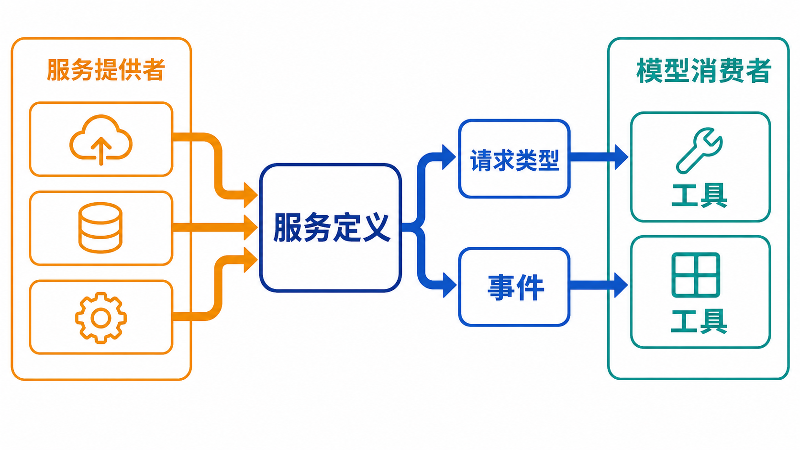
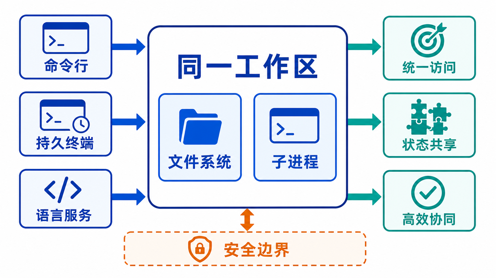
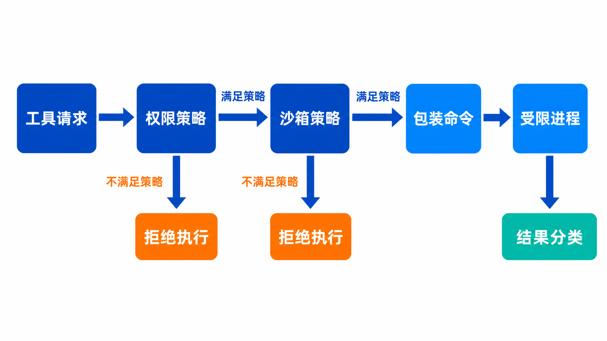
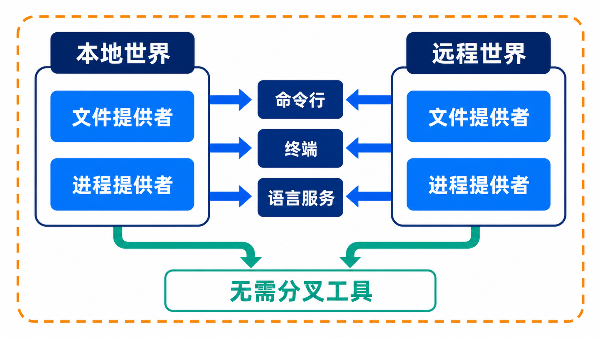

Coding Agent 最危险的一类架构错误，是每项能力都“各自工作”：文件工具读宿主机，Shell 跑容器，LSP（Language Server Protocol，语言服务器协议）又在第三个目录；路径在其中一层是 `/workspace/a.ts`，另一层却不存在；沙箱（sandbox，用来限制程序可访问资源的运行边界）只围住命令，却没有围住写文件 API。单个工具测试都可能通过，模型组合使用时才暴露世界不一致。

DeepSeek Harness 用 Capability Seam（能力接缝）解决这个问题。“接缝”是一条可替换的能力边界。完整结构包含 Service Definition、Service Provider 和 Consumer 三种角色：定义给出稳定语义，provider 决定本地或远程实现，consumer 把能力变成模型工具或其他插件 API。本文基于 `dsh-v0.1.0-rc.7`，重点核对 `packages/fs/`、`shell/`、`terminal/`、`lsp/`、`sandbox/` 与 `e2b/`。代码中的省略属于源码裁剪，跨能力示例会明确标注。

## 1. Capability Seam 不是简单接口

以文件为例：`@deepseek-ai/dsh-fs` 只定义 `ctx.fs`；`dsh-fs-local` 与 `dsh-fs-e2b` 是可替换 provider；`dsh-tool-fs`、搜索工具、LSP 同步是 consumers。部署必须组合恰好一个 provider，加载第二个同名 Service 会失败，而不是悄悄以后者覆盖前者。

```latex
Service Definition：FileSystem / ShellExecutor / LspService
           ↑
Provider：Local / Sandboxed Local / E2B / stdio LSP
           ↓
Consumer：read_file / write_file / bash / terminal / lsp_query
```



这比“依赖注入一个 interface”更完整，因为 seam 还拥有错误码、品牌 ID、取消语义、生命周期和配置解析。Consumer 不猜 provider 的平台，也不直接 import 某个本地实现。替换 provider 时模型工具保持原样，因此远程执行不是重写一套 Agent Loop。

```yaml
# 教学化配置：展示 provider 替换，不是仓库现成完整 profile
plugins:
  - name: '@deepseek-ai/dsh-fs'
  - name: '@deepseek-ai/dsh-fs-sandbox'
  - name: '@deepseek-ai/dsh-tool-fs'
```

完整 seam 的判断标准是：定义是否足以让 provider 互换，provider 是否真正兑现定义的失败和取消，consumer 是否只依赖定义。如果 consumer 仍用 Node `fs` 偷读，或者 provider 返回只有自己理解的字符串错误，接缝就被绕开了。

这里的 E2B 是一种托管的远程代码沙箱；`stdio LSP` 表示 Harness 通过子进程的标准输入和标准输出（standard input/output）与语言服务器交换 LSP 消息。它们是 provider 的不同实现方式，不是模型工具本身。

## 2. FileSystem 用 FsTarget 统一路径身份

`packages/fs/fs/src/index.ts` 没有把路径当普通字符串贯穿所有操作。`resolve()` 将用户路径与 cwd 解析为 `FsTarget`；target 带稳定、不透明的 `targetKey` 和用于显示的路径。Provider 还拥有 `processPath()` 与 `fileUrl()`，因为远端 Linux、Windows 和宿主 macOS 的路径及 URI 编码都可能不同。

```typescript
// 源码裁剪：packages/fs/fs/src/index.ts
export abstract class FileSystem extends Service {
  abstract resolve(
    path: string,
    opts?: { cwd?: string; signal?: AbortSignal },
  ): Promise<FsTarget>
  abstract processPath(target: FsTarget): string
  abstract fileUrl(target: FsTarget): string
  abstract contains(parent: FsTarget, child: FsTarget): boolean
  abstract stat(target: FsTarget, signal?: AbortSignal): Promise<FsInfo | undefined>
  abstract readText(target: FsTarget, signal?: AbortSignal): Promise<string>
  abstract listDir(target: FsTarget, signal?: AbortSignal): Promise<FsDirEntry[]>
}
```

稳定身份让别名和 symlink（symbolic link，符号链接）不会被当成不同文件。`lstat(path)` 则刻意保留“按输入路径检查”的语义，不跟随末级符号链接，供 consumer 在 resolve 前检查路径本身。`streamText()` 负责跨数据块的 UTF-8 解码和二进制拒绝；`readBytes()` 必须提供 `maxBytes`，provider 不能无界缓冲大文件。

写入和编辑也是 seam 的一部分，因为版本检查、字面匹配与原子替换必须在同一临界区完成。若 consumer 先读后写，就会在两步之间产生 stale overwrite。

```typescript
// 源码裁剪
abstract writeText(
  target: FsTarget,
  content: string,
  expected?: FsWriteIntent,
  signal?: AbortSignal,
  sandboxPolicy?: SandboxExecutionPolicy,
): Promise<FsWriteOutcome>

abstract editText(
  target: FsTarget,
  edit: FsEditRequest,
  expected?: { version: FsVersion },
  signal?: AbortSignal,
  sandboxPolicy?: SandboxExecutionPolicy,
): Promise<FsEditOutcome>
```

`fs/observed`、`fs/write-intent` 和 `fs/edit-intent` 又把观察状态策略从 storage mechanics 中分离。前者记录模型确实看过哪个版本，后两者决定写入是否要求不存在、版本一致等。Waterfall 是 single-slot decision：第一个不调用 `next()` 的返回值拥有决定，而非多个 guard 随意合并。

## 3. Shell 抽象的是请求、解析后规格与进程句柄

`packages/shell/shell/src/index.ts` 的 `ShellExecutor` 把用户请求和 provider 已解析规格分开。默认 cwd、环境、超时与 sandbox policy 应在 `resolve(request)` 中显式形成 `ShellExecSpec`，`run(spec)` 不再偷偷 `?? default`。这是仓库明确推广的 capability pattern。

```typescript
// 教学化摘录：字段按 rc.7 类型简化
interface ShellExecRequest {
  command: string
  cwd?: string
  timeoutMs?: number
}

interface ShellExecSpec {
  command: string
  cwd: string
  timeoutMs: number
  sandbox: SandboxExecutionPolicy
}
```

前台 `run()` 对普通非零退出、超时 kill 等返回结构化 `ShellRunResult`；只有基础设施失败才 reject。后台 `start()` 返回 `ShellProcess`，调用者轮询输出、状态并负责关闭。这样工具可以稳定地区分“命令执行失败”和“执行器坏了”，无需用异常消息猜测。

```typescript
// 可运行示例：只通过 seam 执行
const request = { command: 'pnpm test', cwd: agent.session.cwd }
const spec = await ctx.shell.resolve(request, { agent, signal })
const result = await ctx.shell.run(spec, signal)
if (result.exitCode !== 0) {
  return { ok: false, stdout: result.stdout, stderr: result.stderr }
}
```

本地 bash/pwsh provider 与 sandbox provider 都实现同一服务。工具可以根据 `ctx.shell.sandboxMode` 如实在 schema 中暴露是否支持 escalation，而不是永远显示一个无效字段。环境变量也经过专门的 shell-env seam 组合，provider 不应把宿主敏感环境全部无条件转发。



## 4. Sandbox 有两种不同威胁模型

文件 sandbox 和 Shell sandbox 看起来都叫 sandbox，安全边界却不同。`dsh-fs-sandbox` 在可信进程内对“模型控制的路径”做策略围栏：读允许，`read-only` 拒绝任何写，`workspace-write` 只允许 workspace root 与平台临时目录，`danger-full-access` 不围栏。它不是隔离不可信代码的内核边界。

```typescript
// 源码裁剪：packages/fs/fs-sandbox/src/index.ts
private async checkedTarget(
  target: FsTarget,
  sandboxPolicy?: SandboxExecutionPolicy,
): Promise<FsTarget> {
  const policy = sandboxPolicy ?? this.ctx.sandboxPolicy.resolve()
  if (policy.mode === 'danger-full-access') return target
  if (policy.mode === 'read-only') throw new FsError(message, 'FS_SANDBOX_DENIED')
  const fresh = await this.resolve(target.displayPath)
  for (const root of writableRoots(policy)) {
    if (await isPathUnder(fresh.targetKey, root)) return fresh
  }
  throw new FsError(message, 'FS_SANDBOX_DENIED')
}
```

它在写入前重新规范化路径（canonicalize），再把这个重新检查后的目标交给实际写入，避免“在 A 处检查、却在 B 处写入”。不过，若攻击者恰好在检查与系统调用之间替换上级符号链接，仍可能发生 TOCTOU（Time of Check to Time of Use，检查时与使用时之间的竞态）。源码对这个信任边界有明确取舍。执行不可信 Shell 代码时，应使用 Seatbelt（macOS 沙箱机制）、Landlock（Linux 内核的非特权访问控制机制）或远端 E2B 这类更强隔离。

Sandbox policy 不是 provider 的固定全局值，而是按 session/call 解析的 `{mode, workspaceRoot}`。升级授权只对一次调用盖章为严格更宽模式，不应永久修改 agent。filesystem 和 shell 共同使用 `writableRoots(policy)`，避免一边允许 `/tmp`、另一边拒绝造成语义漂移。

```typescript
// 教学伪代码：一次性升级，而非切换全局默认
const policy = ctx.sandboxPolicy.resolve(agent.session)
const approved = await ctx.approval.request({ agent, toolName, callId, reason, signal })
const effective = approved === 'allowed-once'
  ? widenForThisCall(policy, requestedMode)
  : policy
return ctx.fs.writeText(target, content, intent, signal, effective)
```

## 5. Terminal 是有所有权的持久交互会话

Shell 的一次命令不足以覆盖 REPL（Read-Eval-Print Loop，读入、求值、输出循环式交互环境）、数据库控制台和持续开发服务器。`@deepseek-ai/dsh-terminal` 提供后端注册表与 `TerminalSessionService`，PTY（Pseudo Terminal，伪终端）会话由“精确的存活 Agent 对象”拥有，而不是仅凭可伪造或可恢复的 session ID。

```typescript
// 源码裁剪：packages/terminal/terminal/src/index.ts
interface SessionRecord {
  readonly id: TerminalSessionId
  readonly owner: Agent
  readonly name: string | undefined
  readonly type: string
  readonly session: TerminalBackendSession
  active: TerminalSendOperation | undefined
  closing: Promise<void> | undefined
}
```

注册 backend 是 effect；spawn 在发布会话前完成 setup，取消或 owner 死亡会 rollback。owner 可以按名字保留一个会话；同一会话同一时刻只有一个 active send，否则抛 `SEND_ACTIVE`。scrollback 读取有页界，不能把无限终端输出塞进内存。

```typescript
// 可运行示例：创建、发送、读回、关闭
const term = await ctx.terminals.spawn(agent, {
  type: 'bash', name: 'dev', cwd: agent.session.cwd,
}, signal)
const op = ctx.terminals.startSend(agent, term.id, {
  text: 'pnpm dev', submit: true, signal,
})
await op.done
const page = await ctx.terminals.read(agent, term.id, { lines: 200 })
await ctx.terminals.close(agent, term.id, 'task complete')
```

Agent dispose 会关闭其所有已发布会话和未发布 spawn。这里不能仅依赖垃圾回收，因为 PTY、进程树和文件描述符是外部资源。命名 reservation、pending spawn、published session 与 closing Promise 形成完整生命周期，避免 spawn/teardown 竞态留下孤儿进程。

## 6. LSP 暴露语义查询，不暴露 JSON-RPC 后门

`packages/lsp/lsp/src/index.ts` 只提供 go-to-definition、find-references、go-to-implementation 和 hover 四类规范化查询。没有“任意 JSON-RPC method”逃生口，所以 provider 可以替换，consumer 也不能绕过响应校验。

```typescript
// 源码裁剪
export class Lsp extends Service implements LspService {
  private readonly providerIds = new Set<LspProviderId>()
  private readonly routes = new Map<string, Route>()

  async query(request: LspQueryRequest, signal?: AbortSignal) {
    const route = this.routes.get(finalExtension(request.filePath))
    if (route === undefined) throw new LspError(message, 'LSP_UNAVAILABLE')
    return route.provider.query({ ...request, languageId: route.languageId }, signal)
  }
}
```

provider 原子预留 ID 与扩展名集合，`.TS` 归一为 `.ts`；冲突前完成全部校验，失败不发布半套路由。按最终扩展名选择与注册顺序无关，`foo.d.ts` 路由为 `.ts`，`.bashrc` 没有扩展名。stdio provider 内部才负责 LSP framing、initialize、文档同步、请求 ID 和退出。

LSP 的 `filePath` 必须属于同一执行世界。Consumer 应先让 `ctx.fs` 解析/读取，再用 provider 能看见的 process path 或 URI；若 fs 是 E2B 而 LSP 在宿主运行，结果必然错误。因此“每项 seam 可替换”不代表任意 provider 混搭都语义有效，profile/bundle 必须选择同世界的一组。



## 7. E2B 如何让多个 Adapter 共享一个远端世界

E2B 运行时的所有者实现位于 `packages/e2b/e2b/src/index.ts`。它创建一份 `E2BRuntime`，文件与子进程适配器共享同一个 `Sandbox` 句柄，因此 cwd、文件状态和进程真正共享。若每个适配器各自创建沙箱，文件写入后 Shell 就看不到它。

```typescript
// 源码裁剪
export class E2BRuntime extends Service {
  readonly cwd: string
  readonly runtimeRoot: string
  private readonly ready: Promise<Sandbox>

  async getSandbox(): Promise<Sandbox> {
    if (this.disposed) throw new Error('E2B sandbox service is disposing')
    const sandbox = await this.ready
    if (this.disposed) throw new Error('E2B sandbox service is disposing')
    return sandbox
  }
}
```

构造时验证 API key、绝对 Linux cwd 与正数 timeout；创建后建立 workspace 与权限为 700 的 runtime root。插件 dispose 或 E2B timeout 会 kill sandbox。控制命令使用随机 HOME，避免远端用户 profile 污染协议命令；参数通过 `quoteE2BShellArg()` 保持单个 opaque shell word。

```typescript
// 源码：安全引用不可避免的 bash -l -c 参数
export function quoteE2BShellArg(value: string): string {
  return `'${value.replaceAll('\'', "'\"'\"'")}'`
}
```

这个 POC 展示的核心不是某家云产品，而是 ownership：远端世界由一个服务创建、准备、共享和销毁，能力 adapters 不各自拥有生命周期。相同模式可用于自建容器、SSH 工作区或微虚拟机。

## 8. Consumer 如何把能力变成工具而不泄漏实现

`dsh-tool-fs` 依赖 `ctx.fs`，解析 session cwd、可选 sandbox escalation、版本观察和 diff presentation；`dsh-tool-bash` 依赖 `ctx.shell`，处理前后台、输出保留和任务注册；`dsh-tool-terminal` 依赖 terminals；`dsh-tool-lsp` 依赖 lsp 和 fs。它们不 import `LocalFileSystem` 或 E2B SDK。

一个 consumer 的理想流程如下：

```typescript
// 教学伪代码：写文件工具的分层职责
async function execute(args, exec) {
  const cwd = sessionCwd(exec.agent)
  const target = await ctx.fs.resolve(args.path, { cwd, signal: exec.signal })
  const policy = ctx.sandboxPolicy.resolve(exec.agent?.session)
  const intent = await ctx.waterfall('fs/write-intent', target, exec, () => undefined)
  return ctx.fs.writeText(target, args.content, intent, exec.signal, policy)
}
```

工具层拥有模型交互：字段说明、错误渲染、是否提示 escalation、输出窗口和 UI card。Provider 拥有 I/O 原子性、平台转换、真正取消和底层错误映射。Policy 插件拥有授权判断。三者相互越界会让本地 provider 看似正常，换成远程后立即崩溃。

## 9. 组合边界与失败方式

上线前先画出“执行世界表”：每个 profile 的 fs、shell、terminal、LSP、sandbox、cwd、temp roots 和进程路径属于哪里。至少做一条端到端测试：文件工具写入→Shell 读取并修改→LSP 查询修改后文件→终端运行程序→再次由文件工具读取结果。单测五个 seam 不能替代这条组合证明。

失败应结构化区分：`FS_STALE_VERSION` 表示观察后已变化，`FS_SANDBOX_DENIED` 表示策略拒绝，LSP 的 `LSP_UNAVAILABLE` 与 `LSP_CONFLICT` 表示路由问题，terminal 的 `FOREIGN_SESSION`、`OWNER_NOT_LIVE`、`SEND_ACTIVE` 表示生命周期/所有权问题。不要解析 stderr 来判断文件 sandbox；但 Shell 内核 sandbox 只能从执行结果映射时，要保留原始 stderr 供诊断。

安全上还要承认边界：路径 containment 不是不可信代码隔离；`danger-full-access` 不是“多一个可写目录”，而是移除围栏；远端 sandbox 的 API key 不能进入 sandbox 环境；owner 销毁必须清理进程；批准升级应一次性；LSP 服务器本身是代码执行面，应和目标仓库在匹配的信任域内运行。

rc.7 仍是 Developer Preview，provider package、配置行和接口字段可能变化。业务扩展应依赖 Service Definition 公共导出与稳定错误码，不向下转型具体 provider；profile 要把成套能力纳入同一套版本化组合测试；升级时尤其复核 `sandboxMode` 能力声明、cwd 解析和可写根目录。后文继续展开这些边界在路径、并发、远程故障和运维中的具体表现。

### 一条路径在五种能力之间怎样流动

用户输入的相对路径首先基于 session cwd 交给 `ctx.fs.resolve()`。得到的 `FsTarget` 是文件 seam 的稳定身份；若要启动编译器，则用同一 provider 的 `processPath(target)` 交给 Shell；若要发 LSP 请求，则由 provider 生成 file URI 或让 LSP provider在相同世界打开对应路径；终端 spawn 的 cwd 也必须来自同一 session 解析结果。任何 consumer 自己调用 `path.resolve(process.cwd(), input)` 都会破坏链条。

路径显示与身份也应分开。`displayPath` 可以给模型和 UI，`targetKey` 只用于同 provider 的相等/containment 判断，不能持久化后让另一个 provider 解释。远端 provider 可能用对象 ID 或 Linux canonical path，Windows provider 则有盘符、大小写和 junction 语义。把 targetKey 品牌化，正是阻止普通字符串跨边界滥用。

当前工作目录同样不是全局 `process.cwd()`。每个 session 有自己的 cwd，子 Agent、恢复会话和远端 sandbox 都可能不同。工具 consumer 应从 exact agent/session 解析；无 agent 的后台插件必须显式传 cwd，不能偷偷借最近一次请求。Shell、文件搜索、LSP 和终端使用同一 cwd 后，模型才可在读到 `src/a.ts` 后运行 `tsc` 并相信它编译的是那份文件。

### 文件观察策略为什么放在独立插件

安全编辑常要求“先读后写”。文件 provider 能提供版本，但它不知道某次读取是否代表模型观察；工具层能看见调用，却不应持有跨调用全局状态。因此 `fs/observed` 记录 target、present/absent 与 version，并以 tool execution actor 关联；observation policy 再在 `fs/write-intent`/`fs/edit-intent` 决定 expected guard。

如果模型读取版本 v3，外部编辑器改到 v4，随后工具按 v3 edit，provider 应在同一临界区返回 `FS_STALE_VERSION`。不能先 stat 比对 v3，再单独写，因为 stat 与 write 之间仍可变化。新建文件也要区分“确认不存在后创建”和“未观察便覆盖”，所以 write intent 不只是一个 optional version。

负观察也有价值：模型列目录确认文件不存在，随后创建时可以要求 absent。符号链接路径更复杂，`lstat` 检查路径本身，`resolve` 给出跟随后的目标；sandbox 写前再解析 fresh target。三个动作分别解决路径形态、稳定身份和临写 containment，不是重复 I/O。

### Shell 生命周期不能只返回 stdout

命令执行包含 stdout、stderr、exit code/signal、超时、截断信息和可能的后台 handle。非零退出是正常运行结果，不应当作 transport exception；spawn 失败、IPC 断裂、sandbox provider 不可用才是基础设施异常。这样的 taxonomy 让工具给模型展示命令失败输出，同时让 guard/retry 只处理真正的执行器问题。

输出必须有界。前台命令可用 `TextRetainer` 保留首尾并报告省略字节；后台命令把完整进程所有权交给 jobs/terminal，而不是一直等到内存塞满。取消需要终止进程树并等待退出；仅停止读取 stdout 会留下编译器、服务器和子进程继续修改 workspace。

Windows 与 POSIX provider 共享 request/spec seam，但命令语言不同。`pwsh-local` 解析 PowerShell，`bash-local` 解析 bash；consumer 不应在 shell service 外拼一层 `bash -lc`，否则 Windows 失效，还可能让引用与 sandbox 逃逸。E2B SDK 无可避免的内部 login shell 则被 owner 封装，并对每个 opaque 参数做专用引用。

### Sandbox Policy 的解析与一次性升级

三种 mode 是有序能力：read-only 最窄，workspace-write 加入有限写根，danger-full-access 最宽。部署提供默认，session 可有 override，一次工具调用又可提出严格更宽请求。解析结果应在调用开始时冻结，类似 LLM connection snapshot；执行中途修改 session policy 不应让半场命令换边界。

审批 grant 只覆盖请求描述的本次调用，且 requested mode 必须确实比 effective mode 更宽。模型在已经 danger-full-access 时再请求 escalation 是配置/参数错误；从 read-only 请求 workspace-write 与请求 danger-full-access 风险不同，UI 应展示具体差异。拒绝后仍按原 policy 执行通常不安全，涉及必要权限的调用应直接返回 denial。

filesystem fence 与 kernel sandbox 必须使用相同 workspace root 和 temp roots，但执行机制不同。文件 fence 在可信 Node 进程检查 canonical path；Shell sandbox 把不可信程序放入 Seatbelt/Landlock 等系统边界。若仅给 Shell 套 sandbox，模型仍可能通过 `write_file` 写任意宿主路径；若仅围文件工具，命令 `rm` 仍能逃逸。完整 profile 要同时选择匹配 provider。

### Terminal 的并发和清理竞态

Terminal spawn 分为 reservation、backend setup、publication 三阶段。name 在 setup 前预留，防止两个并发 spawn 都认为名字可用；backend 创建成功但 agent 已销毁时必须 rollback；service disposal 与 await ready 竞态时，再检查 `disposing`，不能发布到正在关闭的 registry。

每个 terminal session 只允许一个 active send，因为 PTY 输入/完成判断如果交错，无法把输出归属于两个调用。只读 scrollback 可以有界查询，但 close 要和 active operation 协调，保证 backend 最终只清理一次。owner cleanup 的范围包括已发布 sessions 和 pending spawns，消除“尚未放入 map 所以销毁看不见”的窗口。

持久 session log 可以记录终端工具调用和有界输出，却不能恢复一个进程级 PTY。恢复后旧 terminal ID 应视为不存在；模型若需要服务持续，应重新启动。把运行时资源 ID 当作 durable capability，会让新进程错误访问已经关闭或属于别人会话的资源。

### LSP 同步的一致性问题

LSP 查询前，provider 需要确保 server 已 initialize，目标文档以正确 languageId 打开或更新到当前文本版本。多个查询可并发，但响应必须按 request id 关联；取消要发送协议 cancel 或至少忽略迟到结果。server 返回的 URI/range 还要正规化和验证，恶意或坏实现不能把任意 JSON 直接交给模型。

扩展名 routing 是能力发现，不等于服务器健康。`.ts` 已注册但进程崩溃时应返回结构化 unavailable/provider error，而不是改路由到任意第二服务器。注册时不允许两 provider 抢同扩展名，消除了顺序依赖，也迫使 profile 明确选择 TypeScript 实现。

LSP 与文件内容的竞态可通过版本与同步解决：工具读取 v3 后外部变到 v4，hover 可能对应新文本。需要精确解释时，consumer 应把查询所用文件版本/位置随结果呈现，或在同一执行链重新读取。不要把 LSP 位置当作永久事实；它是某个 workspace 状态的观察。

### 本地和远端 Provider 的契约测试

每个 FileSystem provider 应跑同一测试：相对/绝对路径、symlink、缺失文件、UTF-8 跨块、二进制拒绝、有界 bytes、稳定 list order、原子写、stale edit、取消和 containment。每个 Shell provider 应覆盖非零退出、stdout/stderr、超时进程树、后台 poll、环境过滤和 dispose。契约测试的意义是让 consumer 不需要 provider 分支。

远端测试还要加入网络断开、沙箱到期、重复终止、就绪失败后的回滚，以及宿主与远端路径不同等场景。E2B 所有者的 `ready` 状态由多个适配器共享，因此失败也应共享；某个适配器不能悄悄新建第二个执行世界来恢复，否则文件系统与子进程会再次分裂。

最后做组合证明：创建含中文名的文件，Shell 修改，LSP 定位，Terminal 运行，文件工具读回；随后把策略切到 read-only，确认文件写与 shell 写都拒绝；批准一次 workspace-write 后只允许指定调用，下一调用重新拒绝。它同时验证路径、编码、状态、所有权和权限，比五组“hello world”更接近真实 Agent 风险。



### Capability Seam 的配置与加载失败应尽早暴露

Profile 组合阶段就能确定的错误应在加载时报告：两个 Provider 同时注册 `ctx.fs`、LSP 扩展名冲突、E2B 缺少密钥、当前目录不是绝对远端路径、沙箱模式非法。不能静默跳过有问题的 Provider，再让工具在运行中表现成“文件不存在”。尽早失败可以把配置错误与任务错误分开。

有些依赖只能在 scope 激活时解析，例如工具 consumer 需要可选 approval 或某 agent 的 session policy。Cordis `inject()` 可让子插件只在完整依赖存在时激活；但必需 seam 缺失应由 manifest/invariant 明确报错。可选意味着产品确实有无该能力都合法，不是用来掩盖错误 profile。

热重载时，provider disposer 要等待拥有的进程、流、PTY 与远端 sandbox 静止。新 provider 不能在旧 provider还清理时接管同一外部目录并产生竞态。Service duplicate 检查、effect teardown 与 consumer取消要形成明确切换窗口；生产部署更适合在无活跃 turn 时替换整套 bundle。

### 跨平台路径与环境变量陷阱

Windows 的大小写规则、UNC 路径、盘符和 Junction（目录连接点），与 POSIX 的符号链接不同，Consumer 不应以字符串前缀实现路径包含判断。`/workspace/a` 的前缀判断还会误接纳 `/workspace-abuse`；`..`、编码后的分隔符和符号链接也能绕过简单比较。只有 Provider 理解本平台的规范身份，因此 `contains()` 与沙箱的 `isPathUnder` 应留在对应层。

文件 URI 不是简单拼 `file://`。空格、中文、`#` 需要编码，Windows drive 与 UNC 有特定格式；LSP server 所在平台可能与 UI不同。`fileUrl(target)` 由执行世界 provider生成，客户端只展示规范化位置，不反向猜路径。

环境变量要分为 Harness 控制字段、用户显式覆盖和安全继承白名单。远端 E2B 不接收宿主 API 密钥，内部控制命令使用随机 HOME，避免加载用户 Profile；Shell Provider 不能允许模型覆盖以 DSH 为前缀的内部变量。日志与错误也要过滤环境变量，尤其是 PATH 诊断常伴随凭据。

### 远端世界的网络故障与幂等

远端 fs 写、process spawn 与 sandbox kill 都可能出现“请求超时但服务端已完成”的未知结果。自动重试必须依据操作幂等性：stat/read可重试，带 expected version 的原子 write有条件可重试，spawn通常不能盲重试，否则出现重复进程。Provider应尽可能使用请求 ID或查询远端状态收敛。

沙箱生命周期到期意味着整个执行世界消失，不应分别报告每个文件不存在。E2BRuntime 的所有者把同一个就绪句柄与终止状态共享给各适配器，使后续失败能够归因到同一运行时。重新创建会形成新的执行世界，旧 FsTarget、进程句柄和终端 ID 全部失效，不能跨代复用。

网络取消也不等于远端已停止。adapter在 signal后应调用 SDK取消/kill并等待确认；若无法确认，返回带稳定 code的未知终态，记录诊断，禁止假装安全回滚。对于会修改外部系统的命令，这一点比快速返回更重要。

### 扩展新的能力接缝时如何判断拆包

先写 Service Definition：稳定类型、错误码、取消、所有权和生命周期；再写至少一个 provider；最后写 model-facing consumer。只有三者齐全才叫 capability seam。若定义与 provider总会一起变化，可在同 group不同 package；若 consumer有多个呈现/策略变体，应独立拆分。

不要把 provider SDK类型泄漏进 Definition，否则第二实现只能模拟第一家的世界。也不要把模型 schema 放进 Definition：同一能力可能有 native tool、Code Mode SDK、后台 workflow三个 consumers。Definition表达程序语义，Consumer表达模型交互。

新的 remote provider要证明与现有 consumer契约一致，而不是复制工具。比如 SSH文件系统实现 `FileSystem` 后，`dsh-tool-fs` 应无需修改；若总要加 `if ssh`，说明 seam缺少真正共同语义或 provider试图提供不兼容行为。此时应扩充明确可选 capability fact，而非向下转型。

### 运维可观测性也必须尊重边界

Span 可按 tool→capability operation→provider request分层，标签使用 provider type、operation、sandbox mode、结果 code和耗时，不记录完整命令/路径内容。Terminal生命周期需记录 spawn、send、close与owner；LSP记录route/provider、operation与server重启；E2B记录sandbox generation和到期。

指标应区分用户任务失败与基础设施失败：命令 exit 1不等于 Shell service error，LSP无 provider不等于查询返回空引用，sandbox denial不等于文件不存在。错误码稳定后告警才能针对真正平台故障，模型也能选择正确恢复动作。

同一执行世界还应有可关联但不暴露秘密的 world identity。它帮助发现“fs 与 shell来自不同代”，但不能成为授权 token。所有权仍由 Context/Agent和provider内部句柄判断。可观测标识只用于诊断，不能替代运行时检查。

## 10. 上线检查与结论

上线前应用一条真实链路检验整个执行世界：文件工具写入带中文名的源文件，Shell 读取并修改，LSP 定位修改后的符号，Terminal 运行程序，再由文件工具读回结果。随后把策略切到 `read-only`，确认文件写入和 Shell 写入都被拒绝；单次批准 `workspace-write` 后，只允许该次调用，下一次调用应重新回到原策略。

验收时还要确认四件事：各 capability 使用同一 session cwd 和 workspace root；文件与 Shell 的沙箱策略同源；PTY、子进程和远程沙箱在 owner 销毁后确实清理；provider 故障与用户命令失败有不同的结构化错误。其中任一项只在单工具测试里成功，都不足以证明组合安全。

Capability Seam 的价值不止于“容易换实现”。它更关键的作用，是让文件、命令、终端、语义查询与沙箱围绕同一组路径、进程和授权事实工作，并且能用端到端测试证明这份一致性。
