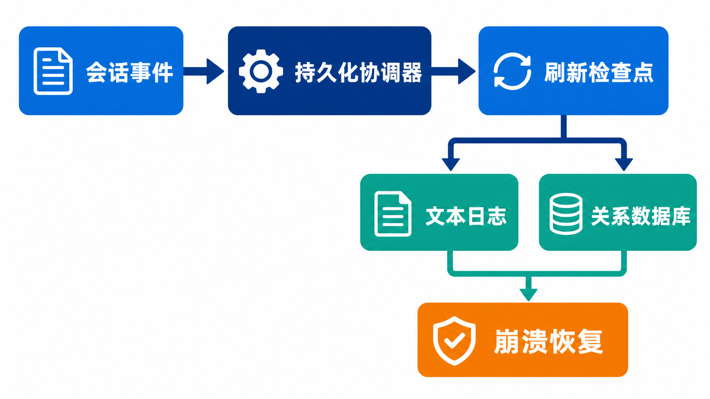
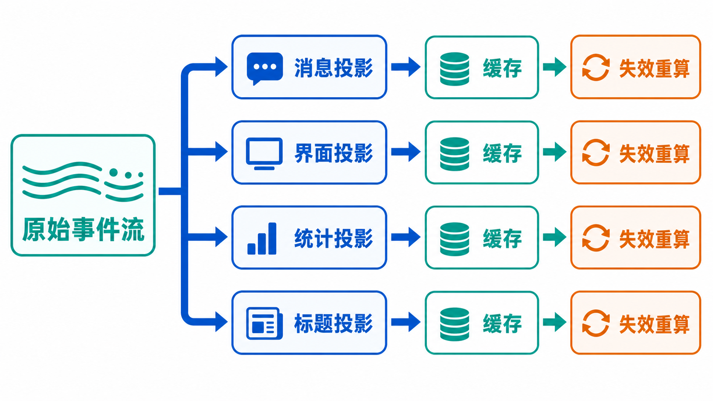
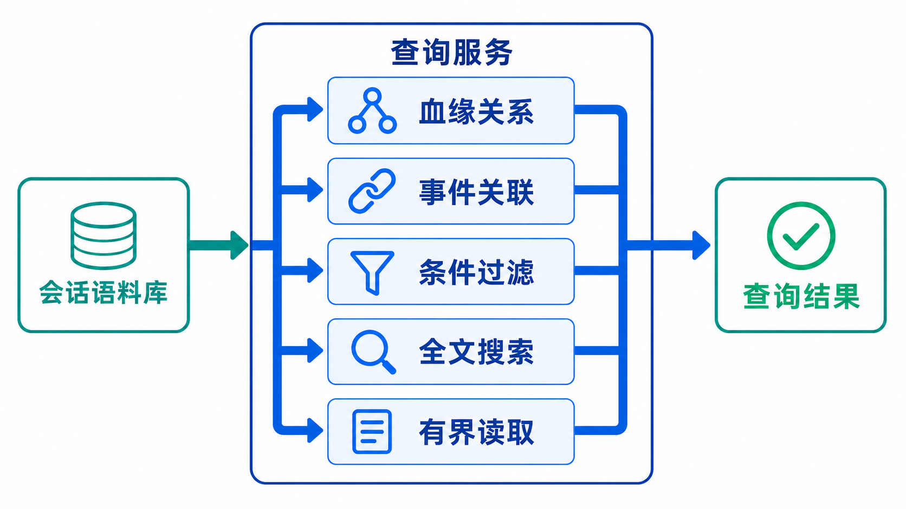
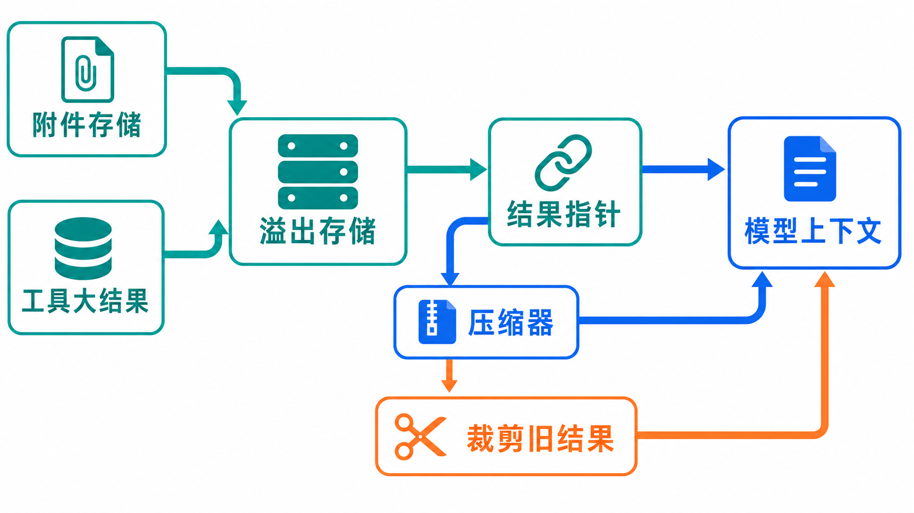

Agent 会话不是聊天消息数组。一次真实运行还包含 turn/step 边界、流式 chunk、工具调用与结果、审批审计、计划和目标状态、压缩替换、子任务关系、用量与故障恢复事实。如果只把最终文本存进数据库，恢复后的 Agent 不知道哪些工具已经执行、哪个审批曾被拒绝、当前表面又被哪次压缩替换。

DeepSeek Harness 以 append-only Session Event Log（只追加的会话事件日志）为事实来源，在它上面构建持久化、Surface、Projection、查询、压缩和 Spill。本文基于固定标签 `dsh-v0.1.0-rc.7`，重点查看 `packages/core/session/`、`packages/session/`、`packages/compaction/`、`packages/spill/`。源码片段会因篇幅裁剪；架构串联代码标为教学伪代码。

## 1. 先分清 Log、Surface 与 Projection

Log 是所有已提交事件的顺序事实，`seq`（sequence number，事件序号）连续且不可原地改写。Surface 是当前供模型派生上下文的可见节点序列：普通 append 会增加节点，压缩或裁剪事件可用 `surfaceOp: replace` 让新节点遮蔽旧范围，但旧事件仍在 Log。它不等同于用户看到的 Transcript（对话回放）：UI 可以从原始日志或另一种投影中展示被压缩的原始消息。Projection（投影）则用确定性的折叠函数，把完整日志计算成标题、统计、计划、目标等当前读模型。

```latex
Event Log：0 1 2 3 4 5 6 7 8 9 10 11 （10 是摘要事实，11 是替换消息）
Surface：  0 1 [11: checkpoint message] 8 9 （2..7 被替换）
Projection：title / plan / goal / stats （纯 fold 当前值）
```



这三层不能混用。审计、恢复和完整 UI 回放读 Log 或专用投影；下一次模型请求从 Surface 派生消息；列表页读 Projection。压缩不删除历史，也不会让总 turn 数或总 token 统计变小。如果列表页每次都完整扫描 Log 才计算标题和状态，长会话的冷启动会越来越慢。

核心事件接口以 declaration merging 开放，新插件向 `SessionEventMap` 增加类型。模型可见内容必须有事件来源；未知必需事件让旧 runtime 拒绝日志，只有显式 `ignorable: true` 的非关键事件才可跳过。

```typescript
// 教学化摘录：packages/core/session/src/types.ts
interface SessionEvent<T extends keyof SessionEventMap = keyof SessionEventMap> {
  readonly seq: number
  readonly time: number
  readonly type: T
  readonly data: SessionEventMap[T]
  readonly surfaceOp?: SurfaceOperation
  readonly sourceEventSeqs?: readonly number[]
}
```

## 2. Session append 是唯一提交入口

Live `Session` 负责验证 seq、lossless JSON、事件类型与 surface 操作，并在 commit 后同步发布 `session/event`。观察者失败被 containment，不能撤销已经提交的事件。事件发布前会快照和冻结，插件不能保留引用后悄悄修改历史。

```typescript
// 可运行风格示例：插件声明并追加事件
declare module '@deepseek-ai/dsh-session/types' {
  interface SessionEventMap {
    'review/state': { status: 'pending' | 'passed' | 'failed' }
  }
}

session.append('review/state', { status: 'pending' })
```

状态事件建议携带完整的变更后状态，而非仅写 `{op:'toggle'}`。投影可用“最后一次写入为准”或轻量的纯函数折叠；单条事件自身能说明变更后的结果，即使从检查点后开始重放，也不需要反向推测差量。对于 `goal/change` 这类复杂领域，事件携带完整 goal snapshot（快照）或 clear tombstone（表示对象已被清除的墓碑记录）。

Turn 是持久化和 crash repair 的闭合边界。完整但中断的末轮可以补写缺失工具错误及 step/turn closers；物理写了一半的 torn record 才丢弃。会话外裸事件可能在 reload 时被视为崩溃尾部，因此 approval asked/decided 等审计对必须发生在 open turn 内。

```typescript
// 教学伪代码：闭合的一轮
session.append('turn/start', { turn: 4 })
session.append('request/header', requestHeader)
session.append('step/start', { step: 1 })
// llm chunks, assistant message, tool call/result ...
session.append('step/end', { step: 1 })
session.append('turn/end', { turn: 4, outcome: 'completed' })
```

## 3. Persistence Seam 把语义与介质分开

Service Definition 在 `packages/session/session-persistence/src/index.ts`。JSONL（JSON Lines，每行一条 JSON 记录）与 SQLite provider 都实现 create、append、load、inspect、prepare、readFrom、list 和 listSnapshots，而上层不解析文件或 SQL。

```typescript
// 源码裁剪
export abstract class SessionPersistence extends Service {
  abstract create(meta: SessionHeader): Promise<void>
  abstract append(id: SessionId, events: readonly SessionEvent[]): Promise<void>
  abstract load(id: SessionId): Promise<SessionInspection>
  abstract inspect(id: SessionId, signal?: AbortSignal): Promise<SessionInspection>
  abstract readFrom(id: SessionId, fromSeq: number, signal?: AbortSignal):
    Promise<{ meta: SessionHeader; events: SessionEvent[] }>
  abstract list(signal?: AbortSignal): Promise<SessionHeader[]>
  abstract listSnapshots(signal?: AbortSignal): Promise<SessionPersistenceSnapshot[]>
}
```

`append()` 只有在 durable 后才 resolve，首 event seq 必须等于介质的 next seq。`create()` 可延迟物化，创建后从未追加的废弃会话不留下空文件。`locate()` 只给独立 artifact 的位置提示，不是授权 token；SQLite 没有每会话文件，可以返回 undefined。`readRaw()` 只由真实保存原始 artifact 的 backend 实现，不能从 events 反序列化伪装“原文”。

JSONL 适合可查看、每会话独立 artifact，并支持压缩物理编码；SQLite 适合按 seq seek 和集中索引。两者逻辑格式相同，但物理成本不同：`readFrom()` 在 SQLite 可只读 suffix，JSONL 通常仍解析全文件再跳过，只减少“返回和重折叠”而非磁盘扫描。

## 4. Coordinator 负责写后缓冲、修复和并发收敛

一线 provider 不各自重写复杂状态机。`PersistenceCoordinator` 组合底层 `PersistenceBackend` 原语，统一处理批量合并、串行化、准备缓存、版本收敛、会话接管、崩溃修复与销毁时静止。这种 write-behind（写后缓冲）会先把短时间内的追加合成批次，再落到持久介质。默认批次最多等待 200ms，既合并流式小事件，又不改变 `append` 返回时数据已耐久化的承诺。

```typescript
// 源码常量：packages/session/session-persistence/src/coordinator.ts
export const DEFAULT_PREPARED_SESSION_CACHE_SIZE = 5
export const DEFAULT_WRITE_BATCH_MAX_DELAY_MS = 200
```

`inspect()` 是非破坏读取：冷日志有完整中断轮时可在内存合成 closers，但不提交修复；`load()` 则会提交必要修复，返回以 `turn/end` 结束的平衡视图；`prepare()` 创建尚未发布的 Session reservation，供 resume 原子采用。live Session 若有开放轮，后端不能擅自 crash-repair 同一 identity。



revision（修订标识）是由具体存储来源生成的不透明变更令牌，调用者只比较它是否相同，不解析其内部含义。同一份未变日志会得到同 revision；修复或外部写入会改变它。准备缓存复用前先验证 revision，连续外部写可能增加读取延迟，但不能把旧对象图误当最新历史。

```typescript
// 教学伪代码：冷恢复流程
const snapshot = await persistence.listSnapshots()
const prepared = await persistence.prepare(id, signal)
try {
  const agent = agents.resume(prepared)
  prepared.commit()
  return agent
} finally {
  prepared[Symbol.dispose]?.()
}
```

格式不兼容与损坏被严格区分。未来 `SESSION_FORMAT_VERSION` 是“需要升级 runtime”，过去版本且没有迁移路径是“不支持旧格式”；seq 断裂或坏 JSON 才是 corruption。JSONL 可在错误中给 raw location，保护用户恢复材料。rc.7 的预发布说明明确：session format version 仍为 0，当前不承诺兼容。

## 5. Projection 是由框架驱动的纯 fold

`packages/session/session-projection/src/index.ts` 定义 projection unit：`init`、`apply`、`view` 必须同步且纯，state 必须是 plain JSON。框架订阅一次 `session/event`，驱动所有注册 unit；领域插件只提供数学，不自己管理订阅。

```typescript
// 源码裁剪
export interface ProjectionDefinition<K extends keyof SessionProjectionMap, S> {
  key: K
  schema: ZodType<SessionProjectionMap[K]>
  init(): S
  apply(state: S, event: SessionEvent): S
  view(state: S): SessionProjectionMap[K]
  stateVersion: number
}
```

对不关心的事件必须返回“同一个 state 引用”，`Object.is` 未变便不会触发下游工作。`snapshot(session)` 同步返回所有 unit 在同一 `asOfSeq` 的值，避免标题来自 seq 100、计划却来自 seq 98 的撕裂读。`view` 出站前经过 Zod schema，host 与 client 的 wire 数据有明确校验。

```typescript
// 可运行示例：最后状态投影
ctx.sessionProjections.register<'review', { status: string }>({
  key: 'review',
  schema: z.object({ status: z.string() }),
  init: () => ({ status: 'none' }),
  apply: (state, event) => event.type === 'review/state'
    ? event.data
    : state,
  view: state => state,
  stateVersion: 1,
})
```

持久 projection cache 保存 `(sessionId, key, ver, seq, val)`，永远只是 fold shortcut，不是真相。unit `stateVersion` 变化、cache seq 超过日志末尾或数据校验失败时丢弃检查点，从 log 重算。SQLite 的 `readFrom(seq+1)` 可只拉尾部；JSONL 会顺序读取，但仍减少重折叠 CPU。

## 6. Query 应读投影或有界事件，不应复制状态

会话列表只需 header、revision 和 projection 快照；详情页可以请求 history tail page；诊断才需要完整 inspect/raw artifact。每个 consumer 应选择最窄读取面，而不是把所有 events 传到浏览器后自己重建领域状态。

```typescript
// 教学伪代码：分页与投影组合
const snapshots = await persistence.listSnapshots(signal)
for (const { header, revision } of snapshots) {
  const projections = await projectionCache.read(header.id, revision, signal)
  yield { header, revision, projections }
}
```

查询还要携带一致性位置。历史页的最后 seq、Projection 的 `asOfSeq`、后续订阅的起点应能拼成无缝序列；客户端收到重复帧可按 seq 去重，发现缺口则重新拉取。watermark（水位）是消费者已处理到的位置标记；若只传“当前标题”却不带水位，网络重排会让旧标题覆盖新标题。

Projection declaration merging 让 client 类型与 host 同源：领域包向 `SessionProjectionMap` 增加 key，wire block、客户端 cell 和 React hook 自动得到值类型。UI 如何渲染不进入 projection seam，避免服务端领域层出现颜色和折叠状态。

## 7. Compaction 是日志记录的 Surface 事务

压缩的目标是减少下一次模型请求上下文，不是清除审计。`compaction-basic` 先由 token meter 对当前 surface 定价，从尾部累计 `retainTokens`，选取头部可压缩范围，并调整边界，绝不切断 assistant tool-call/result 配对。

```typescript
// 源码裁剪：packages/compaction/compaction-basic/src/region.ts
let accumulated = 0
let keepFromIdx = pricedNodes.length
for (let i = pricedNodes.length - 1; i >= 0; i--) {
  accumulated += pricedNodes[i]!.tokens
  keepFromIdx = i
  if (accumulated >= retainTokens) break
}
while (keepFromIdx > 0
  && !toolPairingBalancedBefore(session, surfaceNodes[keepFromIdx]!)) {
  keepFromIdx--
}
```

真正执行是有 durable bracket 的事务：验证范围与当前表面，追加 `compaction/start` 作为锁，异步生成 summary，再检查表面关系仍稳定，最后以 replacement event 替换范围并追加 `compaction/end`。失败也要尝试写恰好一个 end；若 close 本身失败，会留下可检测 unmatched start，而非假装成功。

```typescript
// 教学伪代码：压缩事务结构
const startEvent = session.append('compaction/start', { id, range, owner })
try {
  const summary = await summarizer.summarize(input, signal)
  assertSurfaceStillMatches(range)
  const summaryEvent = session.append('compaction/summary', {
    compactionId: id,
    summary,
    shadowedRange: range,
    shadowedSeqs: range.shadowedSeqs,
  })
  session.append('user/message', checkpointMessage(summary), {
    surfaceOp: { op: 'replace', start: range.start, end: range.end },
    sourceEventSeqs: [startEvent.seq, summaryEvent.seq, ...range.shadowedSeqs],
  })
  session.append('compaction/end', { id, outcome: 'committed' })
} catch (error) {
  session.append('compaction/end', { id, outcome: 'failed' })
  throw error
}
```

`compaction/summary` 是独立的压缩事实，记录摘要、来源范围和模型调用信息；它本身不是替换后的对话消息。真正承载 Surface 替换的是后续 `user/message`，其 `sourceEventSeqs` 同时关联摘要事件和被遮蔽的原事件。这样既能从日志审计压缩过程，又不会把摘要元数据误当成用户原话。

手动 idle compaction 要求没有 open turn；自动 compaction 可归属于 current turn。异步摘要期间若范围变化，返回 `changed`，不会用基于旧上下文的 summary 覆盖新表面。摘要还必须真的更小，否则不能用“压缩”名义增加 token。



## 8. 超大工具结果有三道不同防线

第一道是工具生成时 retention。`@deepseek-ai/dsh-output-retention` 的 `ItemRetainer` 按逻辑项保留 head；`TextRetainer` 按字节保留 head、tail 或 headTail，并精确报告 omitted 数。UTF-8 切口会去掉不完整码点，不因预算截断制造 replacement char。

```typescript
// 可运行示例：命令输出保留首尾
const retained = new TextRetainer({
  kind: 'headTail', headBytes: 32_000, tailBytes: 32_000,
})
for await (const chunk of processOutput) retained.push(chunk)
const result = retained.finish()
// result.text + result.omittedBytes
```

第二道是 spill（溢出存储）：超大的完整结果写到 `ctx.spill` provider，模型和日志只保存有界预览与 locator（用于找回完整内容的定位标识）。spill-policy 可以挂到顶层工具结果或 `tools/code-dispatch-log`；Code Mode 程序已收到完整值，Waterfall 只改变持久化副本。locator 是恢复线索，不是任意文件读取授权，provider 负责所有权与保留期。

第三道是可安全重放的工具结果裁剪。`ToolResultPruner` 扫描当前 Surface，只替换超过字符阈值的文本中段，保留头尾和富内容块顺序。切分按 Unicode code point（码点）进行，不拆 surrogate pair（UTF-16 代理对）；但 grapheme cluster（字素簇，用户视觉上的一个完整字符）仍可能被拆开，这是该算法的明确边界。

```typescript
// 源码裁剪：packages/compaction/compaction-tool-result-pruner/src/index.ts
session.append('compaction/prune', {
  shadowedRange: { start: seq, end: seq },
  shadowedSeqs: [seq],
  shadowedTokenCount: tokenMeter.estimateMessage(original),
})
session.append('tool/result', replacement, {
  surfaceOp: { op: 'replace', start: seq, end: seq },
  sourceEventSeqs: [seq],
})
```

三者不应混为一个“truncate”。Retention 说明本次工具主动省略了多少可用输出；spill 保留完整外部副本并给恢复路径；prune 在后续上下文压力下重写当前 surface，但原始 log 仍在；summary compaction 则用模型生成语义摘要替换一段历史。每层的可恢复性、成本和失败风险不同。

## 9. 数据兼容与故障恢复细节

本节继续拆解介质损坏、并发写入、投影缓存、Surface 来源关系与 Spill 生命周期。这些问题有一个共同准则：优化可以删除后重建，但不能反向改写事件日志的事实。

测试至少包含四类。第一，纯 fold：相同 events 得到相同 surface/projection。第二，介质契约：JSONL 与 SQLite 跑同一套 create/append/load/readFrom。第三，故障注入：批次中断、坏尾行、重复 seq、dispose 时写失败。第四，真实组合 snapshot：长工具结果→spill/prune→compaction→重启恢复→下一轮模型请求，确认模型看到的内容和 UI 回放一致。

不要把 projection cache 当备份，不要原地删除旧事件“节省空间”，不要在读取路径悄悄迁移未知格式，也不要让 telemetry 回写 canonical log。遥测是投影、复制、脱敏后的外发副本；其失败不应阻塞会话 append。真正需要数据保留治理时，应在明确的归档/删除产品功能中处理整个 artifact 及 spill，而不是破坏事件链。

rc.7 的根级说明表示预发布后端会拒绝旧磁盘格式，`SESSION_FORMAT_VERSION` 暂为 0 且无兼容承诺。部署升级前需要保留原始 artifact（会话存储产物），并先用副本演练新版本的 load/inspect、Projection `stateVersion` 与 Spill 布局。

### JSONL 介质怎样识别完整记录与撕裂尾部

JSONL 的优点是每行可检查，但流式写入崩溃可能留下半行。backend 读取时先解析 header，再扫描 event/chunk records，保留最后一个完整、连续的逻辑前缀；只有物理末尾的 torn fragment 可截断。中间坏行、seq 跳跃或类型不合法不是可自动丢弃的尾部，而是 corruption，因为跳过它会把后续事件接到错误历史上。

压缩物理编码不会改变逻辑规则。zstd（Zstandard，一种通用无损压缩算法）的 public/private decoder 仍要产出相同 raw artifact 文本与事件前缀；`readRaw()` 返回解压后的后端原文，保留实际字段顺序、数据块打包和换行，而非重新序列化。诊断工具由此可以检查真正写入内容。

SQLite 则可在事务内原子写 header 与首批 events，按 `(session_id, seq)` 建立顺序约束。它能 seek suffix，但同样必须验证 fromSeq 之后连续。数据库行存在不代表逻辑 turn 已闭合，load 仍交给 coordinator 补合完整中断轮。

### Write-behind 的耐久语义与背压

write-behind 可以把短时间内多个 session append 合成一批，但每个调用者返回的 Promise 必须与包含自己的 durable batch 绑定。不能在放入内存队列时就 resolve，否则进程退出会丢掉上层以为已提交的审批、工具结果或 turn end。

同一 session 的批次必须串行，多个 session 可以并行。若一次 backend append 失败，相关等待者都收到错误，后续事件不能越过失败批次继续写出造成 seq 缺口。dispose 停止接受新工作，清空计时器，刷新已有队列并等待所有 backend promise 静止；清理失败要可见，不能空 catch。

200ms 是默认部署 tunable，不是协议常量。过大增加交互耐久延迟，过小让流式 chunk 产生大量小写；provider 可以按介质调优，但不能改变“append resolve 即 durable”的外部承诺。

### Crash Repair 为什么只处理最后一个逻辑尾部

如果日志以 `turn/start` 开始了一轮，assistant 已发工具调用，部分工具已有结果，进程崩溃，repair 会为每个缺失工具形成错误结果，再闭合 step 与 turn。这样恢复后的下一次模型请求不会看到孤立 tool call。已经存在的完整工具结果必须保留，不能整轮回滚，因为工具副作用可能真实发生。

若在线 Session 仍绑定同一 ID，冷端存储后端不得修复它。内存日志可能仍开放，而且写后缓冲尚未排空；另一个检查器可以借用只读快照，但加载修复会与活跃写入者产生竞争。Coordinator 的预留与接管状态机把在线状态、已准备状态和提交恢复状态分开。

constructor seed 还有 `session/end-seed` 边界。fork/resume 带来的前缀不是当前进程重新产生的事件；telemetry、compaction lock 判断和 firstLiveSeq 都用此边界避免重复外发或把旧 lifecycle 的 unmatched marker 当成当前锁。

### Projection Cache 的冷读取阶梯

冷列表查询理想路径是：读取 session header/revision；加载 projection checkpoint；验证每行 key、stateVersion、seq 和 JSON state；从 `seq+1` 读取日志尾部；用 unit.apply 前推；输出 schema-validated view；异步写回新 checkpoint。任一步不可信就退化为从 init 折完整日志，而不是返回猜测值。

多个投影单元的检查点序号可以不同，但对外快照要形成共同的一致切面。在线注册表会在每个已提交事件到达时同步推进，天然共享 `session.seq - 1`；冷端读取器则要把所有单元推进到目标日志末尾后再一起发布。客户端不应把来自不同 Revision 的缓存值拼成一行。

projection stateVersion 只表示该 unit 的内部 state/折叠语义，不是整个 session format。修改 title fold 只需使 title checkpoint 失效，无需令所有日志不可读；新增必需 session event 则涉及日志 reader 知识，属于更广兼容问题。

### Surface Operation 如何保留来源关系

replacement event 携带 `surfaceOp` 指定旧范围，并用 `sourceEventSeqs` 列出输入事实。Surface 计算器验证范围当前可见、顺序合法，随后把旧节点从当前表面替为新 seq。旧事件仍可按 seq 审计，summary/pruned result 的来源也能追溯。

不能让任意插件直接覆盖 `session.surface.nodes`。所有变化通过 append 提交，日志便能重放出相同 surface；事件失败则表面不变。替换范围必须按当前位置解释并防止交叉覆盖，compaction 在异步 summary 后重新确认关系就是为避免基于旧切面的提交。

模型消息 derivation 读取 surface，而 session stats 等全局 projection 读取 log。UI 可同时显示当前压缩对话与“总共执行了多少 turn/tool”；如果两者都扫 surface，压缩后统计会倒退。

### Spill 的存储所有权与生命周期

Spill Service Definition 应让 provider 返回品牌化 locator/metadata，local provider 决定目录、原子写和清理。Policy 负责何时 spill、保留多少预览、如何在模型文本中说明恢复动作。工具本身不应硬编码 `~/.dsh/spill/...`，远端或多租户部署没有相同路径。

locator 必须绑定会话/调用或由读取 API重新验证所有权，不能把可猜路径当 bearer token。文件名要防路径穿越，内容写入前有大小上限/磁盘配额，清理要考虑仍被 session artifact 引用的 spill。删除会话时是否级联删除 spill 是产品策略，但必须一致且可审计。

敏感输出即使不进模型全文，完整 spill 仍含秘密。访问控制、静态加密、留存时间和遥测排除都应按完整数据处理。预览也需脱敏；把前后各几千字保留下来并不天然安全。

### 压缩摘要的语义风险

模型摘要会遗漏细节，所以 compact input 要明确包含任务决策、未完成工作、关键路径、错误与工具事实，summary 外再用 frame 标明它是压缩检查点。新模型不应把摘要当用户原话或新指令。对安全审批、权限 grant 和 durable goal state，系统应从专用事件/上下文恢复，不依赖自由文本摘要记忆。

摘要器失败、返回空文本、变得更大或引用范围已变，都不应提交 replacement。自动 compaction 还要避免无限循环：若无法缩小，返回明确错误/停止当前尝试，而不是每 step 重试消耗更多 token。

ToolResultPruner 是确定性算法，适合先运行；summary compaction 成本更高但保留跨消息语义。生产策略可以先 retention/spill 控制单次结果，再 prune 旧的大结果，最后对历史段做摘要，形成从低风险到高语义损失的层级。



### 恢复演练比备份文件存在更重要

一次完整演练应在真实长会话复制品上完成：停止 writer并 flush；复制 JSONL/SQLite 与 spill；用新版本 `inspect` 做非破坏检查；验证 event type、format version 与投影；`prepare` 后发布测试 Agent；派生下一次模型请求但不发送；比较旧版和新版 surface/messages；最后执行一个无副作用 turn并再次 reload。

还要测试降级：删除 projection cache 后结果应相同只是更慢；spill 缺失时历史仍可打开但恢复提示明确失败；torn 最后一行可修复，中间坏行必须拒绝；未知 ignorable event 可跳过，未知必需 event 必须要求升级。备份只有经过这条路径，才证明不仅“文件在”，而且语义可恢复。

### 多进程与外部写者的现实边界

SessionPersistence revision 可以发现介质变化，但不自动把单 Agent变成多主系统。一个 session identity正常应只有一个 live writer；另一个进程可 list/inspect，准备 resume前必须获得稳定 revision并确保旧 owner已经退出。连续外部写会让 prepare重试或延迟，这是保护一致性，不应通过忽略 revision强行打开。

SQLite事务和文件锁能保护物理写，却不能决定业务所有权。部署层仍要做 session租约、单写路由或进程协调。JSONL在网络文件系统上的 rename/fsync语义也可能不同，本地后端契约不能未经验证直接推广到共享盘。

客户端多 tab不是多 writer：它们通过 Host命令修改同一个 live Session，服务端 append排序，projection frames按 seq广播。客户端不能离线生成 event再合并，否则 tool call、plan intent和goal CAS会产生不可定义冲突。

### 查询与遥测不要反向污染日志

查询是 read model，不能为了“方便分页”向 canonical log写 UI游标；projection cache是派生数据，删除可重建；telemetry是出站副本，脱敏规则只改副本。三者一旦回写，就会产生观察行为改变 Agent历史的反馈环。

Telemetry live模式在 append后复制并投影 event，失败被 containment；on-demand模式按 inclusive seq读取。水位表示已经 handed off，不保证外部送达，所以整体偏 at-most-once。需要可靠送达必须设计 durable outbox，不能反复重放整段历史并期待接收端永不重复。

脱敏 waterfall应 fail closed：规则抛错时扣留该记录，不把未脱敏内容作为降级。canonical log保持原值以支持 Agent恢复；若法规要求源数据也不保存，必须在工具/输入进入日志前执行明确数据最小化，而不是依赖遥测 scrubber。

### 容量规划应分别计算四种数据

模型上下文容量由当前 surface token决定；日志容量由所有事件和流式 chunk累计决定；projection cache由 session×unit state决定；spill由大结果原文决定。压缩只减第一项，不会自动减后三项。若运营只观察 prompt token，会忽略磁盘持续增长。

流式 chunk粒度影响日志记录数与写放大，可在不丢语义的边界合批，但回放需要保持相同装配结果。工具结果应在生成时 retention/spill，避免完整巨量内容先进入 canonical event再想办法挽救。Projection state应保持小且纯 JSON，不应缓存整份历史。

保留策略需要覆盖 session artifact、projection cache、spill和遥测外部副本。删除一个 session时，要么级联清理并记录结果，要么明确spill仍按独立期限保留；模糊状态既泄露数据又使locator失效。备份也要知道是否包含spill，否则恢复后的预览指向空目标。

### 面向用户的失败信息怎样写

格式不支持要告诉用户“由更新版本写入，请升级”或“旧格式无迁移路径”，而不是笼统称损坏；corruption要指出 session id、可用raw位置和安全副本建议，不自动覆盖原件；compaction busy、summary失败、surface changed与commit失败也要区分。

大输出被 retention时说明保留策略、精确省略量和恢复动作；spill失败时不能只给预览并谎称完整结果可取；prune marker要表明历史中间已被确定性裁剪；summary frame要表明是模型生成摘要。透明表达数据变换，模型才不会把“未看到”误认为“原本不存在”。

## 10. 生产检查与结论

生产验收要同时检查：每批 append 的 seq 连续且返回时已持久化；write-behind 队列在 dispose 时等到静止；JSONL 的撕裂尾部与逻辑上中断的 turn 采用不同修复规则；活跃 Session 不被冷端修复；Projection 检查点版本变化后失效；Surface 替换引用真实 source seq；工具调用与结果经压缩后仍配对；Spill locator 经过会话或租户所有权验证。保留策略还要明确单位是逻辑项、字节、字符还是 token。

Session 数据面可用三个问题做最后验收：任一当前模型输入能否追溯到事件；任一缓存或投影删除后能否从日志重建出相同值；任一返回成功的 append 在崩溃后是否仍存在。三问都有可验证的答案，压缩、查询和存储优化才没有越过事实来源。
