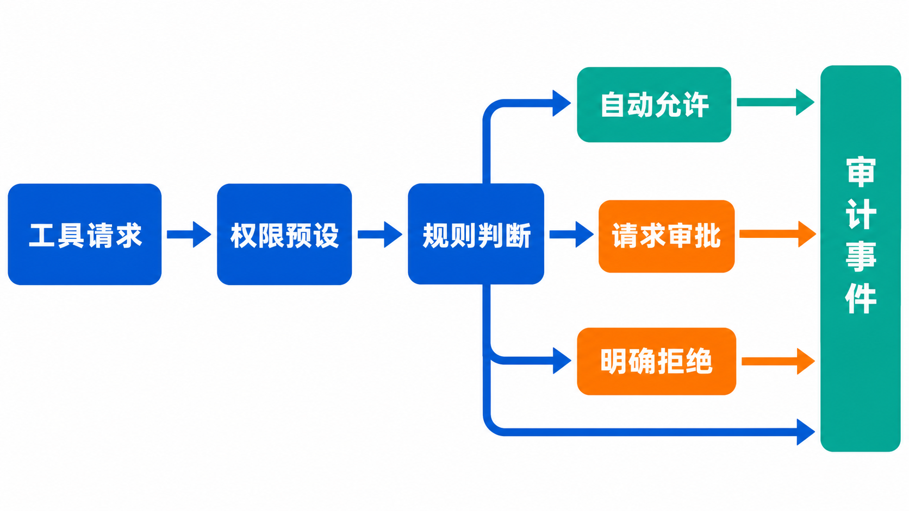
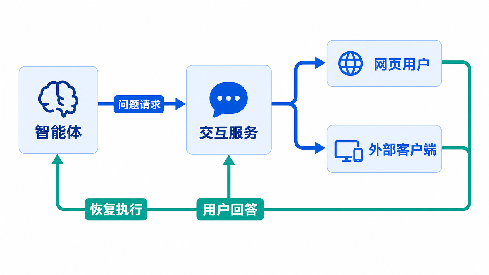
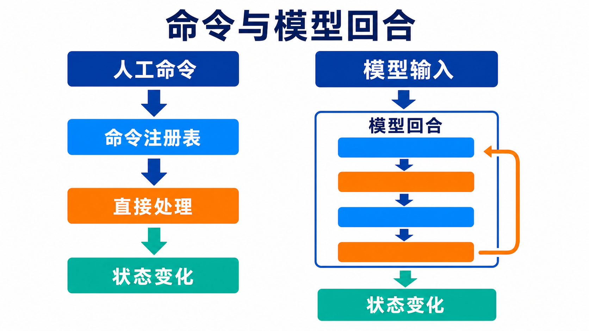
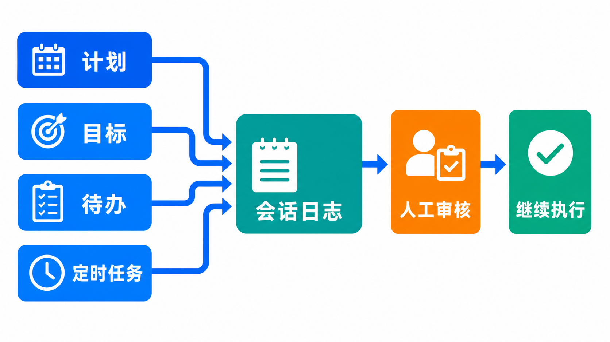

“Human in the loop”经常被简化成弹一个确认框，但 Coding Agent 的人类控制面至少包含六类不同问题：这项能力按策略能不能用；一次敏感调用是否临时批准；模型缺少业务信息时如何询问；用户如何发送结构化命令；Agent 当前是否只允许制定计划；一个长目标如何跨多轮持续、阻塞和完成。若全部塞进一个 yes/no 回调，就无法审计、恢复或在 headless 环境安全退化。

DeepSeek Harness 把 Permission、Approval、Ask User、Command、Plan 和 Goal 分成独立插件，再通过 session log、scope、system prompt context 与 Agent Loop 拼成人类控制面。本文固定基于 `dsh-v0.1.0-rc.7`，核对 `packages/interaction/`、`packages/plan/`、`packages/goal/` 及工具 pre-execute 管线。源码片段会裁剪，组合例子会明确标注为教学伪代码或可运行示例。

## 1. 六类控制问题必须分层

Permission 回答“按当前规则，这类动作允许、拒绝还是需要询问”；Approval 回答“针对这一项具体动作，人是否给一次性授权”；Ask User 回答“模型为继续任务需要什么信息”；Command 是用户主动改变运行状态的显式入口；Plan 是下一 step 起生效的行为模式；Goal 是跨 turn 的持久任务状态。

```latex
静态/会话策略：Permission ── allow / deny / ask
一次动作决策：Approval ──── allowed-once / rejected / cancelled / unavailable
业务信息补全：Ask User ──── 结构化问题与答案
用户主动控制：Command ───── /plan、/compact 等
短期行为约束：Plan ──────── active / pending
长期任务状态：Goal ──────── objective / phase / rounds / budget
```



这六类问题的核心区别是 authority（授权权威，即哪个组件有资格作出某种决定）。Ask User 的某个“同意”选项不自动成为工具权限；Approval 的 `allowed-once` 也不回答模型的开放问题；Plan 不等于 Goal；Command 不是普通用户 prompt。边界清晰后，headless（无交互界面）运行可以把 Approval 配成 fail-closed（无法获得明确授权时默认拒绝）、禁用 Ask User，却仍允许确定性的 Command 和 Goal。

## 2. Permission 应产生决策，不直接执行动作

工具权限通常挂在 `tools/pre-execute` Waterfall（按顺序传递、可中途截停的决策链）上。策略插件查看工具名、参数快照、Agent scope 和 sandbox mode 等信息，返回 allow、deny 或 ask。它不直接调用工具；真正执行还要经过调度、取消、超时、工具定义包装器中的 Schema 验证、执行后策略和日志记录。

```typescript
// 可运行示例：一个最小 permission gate
ctx.on('tools/pre-execute', async (exec, next) => {
  if (exec.name === 'read_file') return next()
  if (exec.name === 'delete_file') {
    return { kind: 'ask', reason: '该操作会删除文件' }
  }
  return { kind: 'deny', reason: '当前权限集未允许此工具' }
})
```

多个 gate 是 waterfall，不是多数投票。调用 `next()` 才委托后面的监听器；直接返回会短路。scope-filtered dispatch 确保子 Agent 的限制只判断该 Agent 的调用。Restriction 负责“工具是否出现在模型视野”，permission 负责“可见调用此刻是否获准”，两者互补：仅隐藏 schema 不能阻止旧响应或程序子调用，仅执行时拒绝又会让模型不断尝试不可能的工具。

rc.7 的真实顺序需要分清两种验证。调度器首先确认调用未被 Code Mode 折叠，并对原始参数做 lossless JSON snapshot（无损 JSON 快照）与冻结；然后把这份快照交给 `tools/pre-execute`。策略返回 ask 时才调用 Approval，通过后再分发到工具。参数是否满足该工具的 JSON Schema，则在 `defineTool` 包装的 `execute()` 内、工具主体启动前验证。因此，权限策略可能看到“属于无损 JSON，但不符合工具 Schema”的参数，不应假定 Schema 已通过。拒绝会形成工具错误结果并进入会话，而不是抛到进程顶层。

## 3. Approval 是一次动作的可审计授权

`packages/interaction/user-approval/src/index.ts` 定义 `ApprovalService`。请求携带精确 Agent、工具名、可选 callId、原因和 signal；结果只有四种封闭值：

```typescript
// 源码语义
type ApprovalOutcome =
  | 'allowed-once'
  | 'rejected'
  | 'cancelled'
  | 'unavailable'

interface ApprovalRequest {
  readonly agent: Agent
  readonly toolName: string
  readonly callId?: CallId
  readonly reason?: string
  readonly signal?: AbortSignal
}
```

只有 `allowed-once` 是 grant，而且只授权请求中的动作。没有 answerer、answerer 抛错、返回词表外值都归一为 `unavailable`，即 fail closed。signal 已取消或等待时取消返回 `cancelled`；晚到答案被丢弃，不能复活已撤回调用。

每次 request 先追加 `approval/asked`，决定后追加同 ID 的 `approval/decided`。调用必须在 open turn 内，因为 turn 是 durable repair 边界；在两轮之间写裸审计事件，崩溃恢复可能把它视为尾部垃圾。

```typescript
// 源码裁剪
const id = ApprovalRequestId(randomUUID())
session.append('approval/asked', {
  id, toolName: req.toolName,
  ...(req.callId !== undefined ? { callId: req.callId } : {}),
  ...(req.reason !== undefined ? { reason: req.reason } : {}),
})
const outcome = await this.decide(req, session)
session.append('approval/decided', { id, outcome })
return outcome
```

Approval policy 有 `ask` 与 `never`。`never` 在 service 自己的 request 入口、waterfall dispatch 前确定性返回 rejected，避免后来 prepend 的 listener 绕过；`ask` 才进入 answerer chain，无 provider 时 unavailable。最后一次 `approval/policy` event 是 session override，重启后纯 fold 恢复。

```typescript
// 源码裁剪
export function effectiveApprovalPolicy(events: readonly SessionEvent[]) {
  for (let index = events.length - 1; index >= 0; index--) {
    const event = events[index]!
    if (event.type === 'approval/policy') return event.data.policy
  }
  return undefined
}
```

策略当前值作为 runtime-context snapshot 告诉模型。切换时还 inject 一条 notice，避免模型继续按旧策略请求 escalation。日志中的 `approval/policy` 不直接进入模型 transcript，模型可见状态来自可重建 context/notice，这是“模型可见必须可从日志重建”的具体实现。



## 4. Ask User 是信息通道，不是权限通道

User Questions seam 位于 `packages/interaction/user-questions/src/index.ts`。Service 只允许一个 active UI provider，模型侧 `dsh-tool-ask-user` 则把结构化 schema 变成工具。它用于“目标目录选哪一个”“更偏向速度还是质量”等任务信息。

```typescript
// 教学化示例：模型工具参数
const questions = [{
  id: 'deploy_env',
  header: '部署环境',
  question: '这次发布到哪个环境？',
  options: [
    { label: '预发布', description: '仅供验收' },
    { label: '生产', description: '对真实用户生效' },
  ],
}]
const answer = await ctx.userQuestions.ask({ questions, agent, signal })
```

有 agent 时，ask 只允许 registry 中“精确 live instance”的 runtime root。由另一 Agent 拥有的 child/subagent 不能弹窗，否则多个后台工作者会争夺同一 UI，甚至永久阻塞。子 Agent 应在最终结果中把未决问题交还父 Agent。带 lineage 的旧 session 被恢复为新的 root 后可以正常询问；判断依据是实时 ownership，不是持久父 ID。

```typescript
// 源码裁剪
if (agents.get(agent.id) !== agent) {
  throw new UserQuestionError(message, 'CALLER_NOT_LIVE')
}
if (!agents.roots().includes(agent)) {
  throw new UserQuestionError(message, 'DELEGATED_CALLER')
}
```

UI provider 缺失返回 `NO_PROVIDER`，空问题为 `EMPTY_QUESTIONS`，提前取消为 `ASK_ABORTED`。问题的 presentation intent 还会校验 approve label 确实存在于 options；plan review 必须携带 detail，防止 UI 显示“批准”却不展示被批准内容。

Ask User 不可用于 sandbox escalation。即使模型设计了“允许/拒绝”两个选项，答案也只是业务输入；真正 grant 必须走 Approval，留下 asked/decided 审计对并受 session policy 控制。

## 5. Command 把用户意图从聊天文本中分离

Command registry 位于 `packages/interaction/commands/`。命令有品牌 ID、名称、说明、输入 hint 与 handler。客户端识别 `/plan`、`/compact` 等明确语法后提交 command run；handler 返回结构化 success/error，而不是让模型猜用户是不是在下命令。

```typescript
// 可运行风格示例
ctx.commands.register({
  name: 'review',
  description: '切换代码审查模式',
  input: { hint: '[on|off]' },
  handler: ({ agent, rawInput }) => {
    const active = rawInput.trim() !== 'off'
    agent.session.append('review/state', { active })
    return { kind: 'success', text: active ? '审查模式已开启' : '审查模式已关闭' }
  },
})
```

注册仍是 effect，卸载插件自动撤销命令；重复名字失败。执行会记录 `command/run`，使状态变化和用户触发可回放。命令参数是显式 raw input，handler 负责域内解析和错误文案，不能把任意 shell command 当作 command registry 的自然扩展。

Command 与 prompt 可以联动。例如 `/plan 请先检查迁移风险` 既排队 plan mode，又 `steer()` 一条用户消息。两件事都显式发生：命令事件记录选择，用户消息提供内容；不会把命令字符串本身误送给模型。

```typescript
// 源码思路裁剪：plan command
const outcome = this.set(agent, true)
if (message !== '') {
  agent.steer(createUserMessage({
    content: [{ type: 'text', text: message }],
    source: { kind: 'user' },
  }))
}
```

## 6. Plan Mode 在 Step 边界提交，而不是立即翻转

Plan controller 在 `packages/plan/plan-mode/src/index.ts`。它维护的 durable event 是 `plan/mode`；system prompt 的 `plan:policy` section 只有 active 时出现；`/plan` command 选择进入/离开；稳定 exit tool 允许模型在方案准备好后请求退出。

关键设计是 pending intent。用户可能在当前 step 正生成时切换模式，若立刻修改 system，却没有新的 request header，日志和模型请求会不一致。因此选择排队到下一个 accepted `agent/pre-step`，在 open turn 内追加 `plan/mode`，然后为用户选择注入 transition notice。

```typescript
// 源码裁剪
ctx.on('agent/pre-step', async ({ agent, signal }, next) => {
  const decision = await next()
  const pending = this.pendingIntents.get(agent.session)
  if (decision.kind === 'reject' || signal.aborted || pending === undefined) {
    return decision
  }
  this.onBoundary(agent.session) // append plan/mode
  return pending.narrate
    ? { ...decision, messages: [...decision.messages, narration] }
    : decision
})
```

Plan projection 同时给出 `{active, pending}`。它从 `command/run(name='plan')` 得到用户想要的 `wanted`，从 `plan/mode` 得到已提交状态并清空 wanted。重启、其他浏览器 tab 和冷读取都能恢复 pending，而不依赖 controller 的 WeakMap。

```typescript
// 源码裁剪：投影的核心 fold
if (event.type === 'command/run' && event.data.name === 'plan') {
  const wanted = event.data.args.trim() !== 'off'
  return { active: state.active, wanted }
}
if (event.type === 'plan/mode') {
  return { active: event.data.active, wanted: null }
}
```



这也解释了 UI 为什么要显示“正在进入计划模式”而非立即显示 active。控制面必须表达 intent、commit 和 model-visible 三个时点，不能用一个 boolean 掩盖。

## 7. Goal 是跨 Turn 的持久任务域

Goal 包位于 `packages/goal/goal/`，它不是一段 TODO 文本，而是由事件重建状态的领域。`goal/change` 携带完整的变更后快照，或 clear tombstone（表示目标已清除的墓碑记录）；`GoalService` 提供 create/edit/phase/clear 等 CAS（Compare-and-Set，比较并设置）变更；Projection 输出当前 Goal；tool-goal 决定模型拥有哪些操作权；round driver 驱动同一 Session 多轮继续。

```typescript
// 教学化摘录：实际字段以 packages/goal/goal/src/types.ts 为准
interface GoalSnapshot {
  readonly id: GoalId
  readonly revision: number
  readonly objective: string
  readonly phase: 'active' | 'complete' | 'blocked'
  readonly round: number
  readonly tokenBudget?: number
}
```

CAS 防止 UI 与模型同时修改时旧写覆盖新写。调用者携带预期 GoalRef/revision；不匹配则明确冲突，重新读取后再决定。clear 也保留 tombstone 与 lastRef，避免 ABA 问题：状态从 A 变成 B 又回到表面相同的 A，旧调用者若只比较表面值，会误以为期间从未变化。代次和 revision 能识别这种“看起来又一样”的新对象。

```typescript
// 教学伪代码：带版本的状态变更
const current = ctx.goals.get(agent)
await ctx.goals.edit(agent, {
  expected: { id: current.id, revision: current.revision },
  phase: 'complete',
})
```

Goal 与 Plan 的时间尺度不同。Plan 限制下一 step 主要进行分析/规划，可能几分钟内开关；Goal 描述跨多个 turn 的目标、轮数、预算和终态，可能经历工具、子任务与自动 continuation。Goal 完成不意味着 Plan 必须关闭，Plan 关闭也不意味着 Goal 完成。

rc.7 的示例 spine 将 goals 作为 opt-in 组合：加载 GoalService、tool-goal 与 goal-round-driver。headless/ACP 可以启用，也可以设 false 完全不挂载。能力不存在时模型不应看到 goal tools，客户端 projection 也应把 key 缺失解释为 capability absence，而不是“空 goal”。

## 8. 一条完整的人类控制链如何运行

假设模型要修改工作区外的配置，然后继续一个长期目标。工具 Schema 声明 `sandbox_permissions`；`pre-execute` 判断当前 `workspace-write` 无法覆盖目标，返回 `ask`；ApprovalService 根据 Session Policy 决定是否询问 UI，并记录审计；`allowed-once` 为本次调用生成更宽的策略；工具执行完把结果写入日志；Goal 仍为 Active 时，轮次驱动器可以继续下一 Turn；若缺少环境选择，模型再调用 Ask User。

```typescript
// 教学伪代码：不要复制为框架内部实现
const permission = await decidePermission(exec)
if (permission.kind === 'ask') {
  const outcome = await ctx.approval.request({
    agent, toolName: exec.name, callId: exec.callId,
    reason: permission.reason, signal: exec.signal,
  })
  if (outcome !== 'allowed-once') return deniedResult(outcome)
  exec = withOneCallEscalation(exec)
}
const result = await ctx.tools.dispatch(exec)
if (ctx.goals.current(agent)?.phase === 'active') scheduleContinuation(agent)
```

如果 policy 是 never，不显示 UI，确定性拒绝；如果 Ask User 没 provider，返回明确工具错误，模型应把问题写进最终回答；如果 child agent 请求人类，拒绝为 `DELEGATED_CALLER`，由父 Agent 汇总；如果用户在当前 step 输入 `/plan`，状态等下一个 pre-step 才 commit。这些不是边角错误，而是控制面在不同部署中的正常退化路径。

模型还需要看到当前状态，但不能让 UI 内存成为隐形输入。Approval policy、Plan policy、Goal snapshot 都应从 log fold/assembly 形成 system section 或 context message；每次模型请求都可从会话事实重建。UI 只负责呈现和回答，不拥有真实状态。

## 9. 控制面的工程细节与风险

安全检查首先确认 grant 粒度：`allowed-once` 不缓存为永久权限；批准内容绑定 tool/callId；Ask User answer 不转成授权；Plan review 必须显示完整 detail；child 不直接占用 root UI；无 answerer 一律 fail closed；取消后晚答案失效；`never` 在服务入口生效，不被 listener 顺序绕过。

一致性检查要确认所有状态可重放：policy switch、command run、plan commit、goal change 和 approval pair 都有 session events；projection 只做纯 fold；当前模型上下文来自同一日志；切换状态时有 notice，避免稳定 system 前缀频繁变化。Command handler 即使失败，也不应留下无法解释的半状态；Plan 的 command selection 与 mode commit 要在 projection 中区分 pending。

测试可以分四层。纯单测覆盖 policy fold、plan fold、goal CAS 与问题校验；服务测试覆盖 missing provider、abort race、open-turn 前置条件和审计配对；组合测试覆盖 tool pre-execute→approval→一次性 escalation→result；snapshot 测试覆盖用户实际看到的问题、命令反馈、计划提示和多轮目标 continuation。特别要注入 answerer 同步抛错、异步抛错、返回非法字符串和取消后迟到四种情况。

`0.1.0-rc.7` 仍属于 Developer Preview。Permission preset、Plan/Goal 事件字段和客户端 Projection 可能发生兼容性变化。扩展应使用公共 Service、公开工具事件和品牌 ID，不读 controller 私有 WeakMap，也不假设 UI 一定存在；持久化升级必须服从 Session format 的拒绝机制。下面的细节分别说明并发、轮次边界、威胁建模、部署与升级如何落地。

### Approval Answerer 的 UI 与并发语义

Answerer 是 `approval/request` waterfall listener。Web、ACP 或 CLI 可以分别提供实现，但同一请求只能被其中一个 claim；不适用的 listener 调用 `next()`。UI 展示应复用工具的 presentation：工具名、callId、路径/diff/command 与 reason，避免 permission 插件再拼一份可能不同的参数摘要。

多个 Agent 同时等待审批时，provider 要按精确 Agent scope 路由，不能把 A 的回答交给 B。每个 request id 只接受第一次有效决策；关闭页面、agent取消、turn 终止都应撤回 pending card。服务端与 UI 的网络断开不是“拒绝”的同义词，而是 unavailable；日志保留区别，便于判断是人拒绝还是控制面缺席。

`allowed-once` 不等于“记住此选择”。若产品需要允许某个命令前缀或目录，应作为独立、可见、可撤销的 permission policy 配置，并记录策略变更；不能在 answerer 内偷偷缓存上次结果。否则 session resume、另一个客户端和审计日志都不知道永久 grant 从何而来。

### Ask User 的问题设计与回答验证

问题数组应保持一至少量相关问题，header 短、question 完整、option label 唯一，并允许必要的自由文本。模型不可把秘密字段预填在选项中，也不应询问可以从 workspace/read-only API安全发现的信息。过度询问会把 Agent 退化成交互式表单，降低自动化价值。

回答从 UI wire 回来仍是不可信输入。Provider 要保证 question id 对应当前 request，选择项属于原 options，自由文本满足长度限制；tool consumer 再把答案渲染为明确模型内容。取消或超时不能生成看似正常的空答案，否则模型可能把空字符串理解为默认授权。

plan-review 这类 presentation intent 只是帮助 UI突出“批准方案”按钮，authority 仍属于问答域：它批准的是用户看见的方案文本，不授予文件或 shell 权限。方案执行中遇到危险动作，仍逐次进入 Permission/Approval。

### Command 执行的日志顺序与幂等

Command 是用户动作，所以 `command/run` 应先有确定 identity，再由 handler产生领域事件与反馈。若 handler 需要修改 durable 状态，顺序要让 projection 能解释失败：Plan controller 先从 command event 推导 pending，再在 step boundary 提交 `plan/mode`；失败不会伪装成已 active。

重复提交可能来自客户端重连。Command ID 可以用于去重/关联，handler 的领域操作也应尽量幂等：重复 `/plan off` 返回“已经关闭”，重复 compact 则识别 active compaction lock。不能仅按文本去重，因为用户可能有意重复同名命令。

命令发现列表是另一种 capability surface。未加载 compaction 插件时 `/compact` 不应出现在 UI；卸载 effect 后旧客户端调用应得到 unknown command，不得执行残留 handler。权限敏感命令仍需在服务端验证 agent ownership，隐藏按钮不是授权。

### Plan Mode 的真正限制来自工具与提示组合

只向 system prompt 写“请不要执行”是软约束。严格计划模式还应通过工具 restriction/permission 缩小修改能力，仅保留阅读、搜索、LSP 和必要提问；退出工具是明确状态转换。具体 preset 可以选择软或硬程度，但 UI必须如实展示，不能把纯提示宣传成安全沙箱。

Plan section 的 order 使模型在工具指导前读到策略；进入/退出 notice 则解释状态变化。若用户在 pending 期间又反向选择，controller 应合并/取消意图，以最后有效选择为准，并让 projection 的 pending 正确归零。被 `agent/pre-step` policy reject 的 step 不提交模式，避免没有模型请求却改变“本次请求状态”。

恢复时 active 从最后 `plan/mode` fold，pending 从最后相关 command 与 commit 关系 fold。WeakMap 只是 live 快速意图，不是恢复事实。任何仅更新 WeakMap 不写 command/event 的 UI捷径，都会在刷新或多 tab 时产生分裂状态。

### Goal 的轮次、预算与终态

Goal driver 让完成条件显式。每轮结束后检查当前 goal：active 且预算/轮数允许，才安排 continuation；complete 停止；blocked 表示确有外部条件且按策略审计后停止。不能因为回答看起来像结论就自动完成，也不能预算快用完便伪造 complete。

token budget 若启用，是从 goal 创建起累计的控制量，不是单次 LLM maxTokens。修改 objective、phase 或预算使用 CAS revision，冲突返回给调用者。UI 展示当前 objective、phase、round 和消耗；模型工具的 authority 可限制只能报告状态，或允许 create/edit/complete，取决于 deployment。

Goal Change 使用完整快照，使恢复过程无需重放命令语义就能知道当前值；Clear Tombstone 还保留最后引用，防止迟到的旧 Revision 更新命中新 Goal。轮次驱动器追加的 Continuation 消息也要有明确来源，让模型能够区分用户的新要求与系统对既有目标的继续执行。

### 控制面威胁建模

第一类威胁是提示注入：网页/文件要求“点击允许”没有 authority，Permission 只根据服务端策略与结构化调用决定。Approval UI 应标记 reason 来自插件还是模型，并展示真实工具参数。第二类是 confused deputy：child 借 root UI申请不属于自己的权限，因此 exact Agent scope 和 child 禁止 Ask User 很关键。

第三类是重放：旧 allowed-once、旧 question answer 或旧 command frame 被网络重新发送。request/call/command 品牌 ID、live ownership 和 session seq共同防止。第四类是取消竞态：用户按拒绝同时 answerer返回允许，服务以 signal/首次终态决定，并记录唯一 decided。

第五类是状态欺骗：UI 显示 Plan 为 Active，但请求实际未携带 Policy；或者 Goal 显示 Complete，日志仍是 Active。客户端应消费带 Watermark（已处理事件上界）的投影，模型上下文由同一套事件折叠生成，再用端到端快照比较两侧状态。

### 推荐的场景测试

场景一：无 UI 的 headless profile，policy ask，敏感工具应 unavailable 并失败；policy never 应直接 rejected且不 dispatch answerer。场景二：审批等待中取消 turn，日志出现 asked/decided(cancelled)，晚 allowed 被忽略，工具 body 从未启动。

场景三：root 可 Ask User，live child 得到 `DELEGATED_CALLER`，child最终结果携带问题，root再询问。场景四：生成中输入 `/plan`，UI先显示 pending；下一个 accepted pre-step写 mode、模型收到 section/notice，projection变 active；退出工具反向完成。

场景五：创建 goal，运行两轮后重启，从 event log恢复同 revision/round/budget；并发 UI edit与模型 complete 只有一个 CAS成功；blocked 后 driver停止。场景六：一次 workspace escalation获批并执行，第二次相同调用再次询问，证明 grant没有泄漏。

这些场景必须同时断言日志、模型请求、工具是否执行和 UI projection，单看最终文案无法证明控制面正确。真正可靠的人机协作，是所有参与者围绕同一组持久事实工作，而不是依赖某个前端组件当前恰好显示什么。



### Permission Preset 与部署策略

Permission preset 适合把一组明确规则装配到 agent scope，例如只读分析、工作区开发、无人值守 CI。Preset 应版本化并可在 UI说明，规则变化随 profile发布；不要根据模型自称“这是安全操作”动态放宽。工具自身仍声明 timeout、sandbox与参数语义，preset只决定 authority。

默认策略应从最窄可用能力开始。桌面交互可使用 approval policy ask，headless CI通常使用 never并预授权确定工具集合；远端多租户还要叠加 tenant路径、凭据和网络限制。相同工具名在不同 preset下可见性不同，system assembly要让模型看到真实集合。

策略切换属于高风险 command/API，本身要验证用户身份和 live agent ownership。切到更宽模式不能依靠普通聊天文本；切回更窄模式可立即影响下一调用，但正在执行的调用仍按开始时冻结的授权完成或被显式取消。

### 用户 Steering 与控制事件的先后关系

Steering（运行中转向）指用户在模型生成期间追加要求，它不一定终止当前 step。Agent inbox 决定在安全边界把新消息注入下一 step；如果同时发 Command，Command 领域事件和用户消息要保留确定顺序。Plan controller 在 pre-step 读取 pending intent，确保新请求 header 与实际模式一致。

取消则不同：它传播 AbortSignal，撤回 approval/ask-user，停止模型流和合作式工具，再以明确 turn outcome闭合。不能把“请停止”仅作为下一条 prompt，因为当前危险工具可能继续执行。UI应把 steer、cancel、command三个动作做成不同协议操作。

恢复后的 inbox不应重放已经消费的瞬时 UI点击；真正需要恢复的策略、plan与goal都在 session log。把临时交互和持久控制分开，避免重启后再次执行同一命令或重复弹审批。

### 审计记录应回答哪些问题

一次敏感调用的审计至少能回答：哪个 session/agent、哪个 tool/callId、何时询问、为何询问、当时策略、谁/哪个 answerer决定、结果、是否实际进入 body、最终成功或失败。`approval/asked`与`decided`负责决策对，tool call/result负责执行，turn边界负责上下文。

不应在 approval事件重复完整参数，因为 callId已关联已展示调用，重复会扩大秘密和漂移风险。需要不可抵赖的外部身份时，由 answerer/backend的受控审计系统记录主体，核心会话保留最小 outcome。日志导出前还要脱敏，审批 reason可能包含路径或用户数据。

Ask User审计重点是问题与答案是否进入模型历史，以及用户是否取消；Command审计重点是 name、args、handler outcome与领域事件；Goal审计重点是每次revision与终态。六类控制不能用同一张“human actions”平表抹平语义。

### 可访问性和无界面退化也是安全属性

审批与问题 UI要支持键盘、屏幕阅读器、明确焦点和不靠颜色区分危险级别。默认焦点不应落在批准按钮，快捷键要避免误触；长 command/diff应可展开并显示被截断提示。用户看不清被批准内容，技术上有弹窗也不构成有效控制。

CLI可通过终端 answerer交互，ACP由客户端协议承载，纯 JSON-RPC/headless则通常无 answerer。服务端永远以缺 provider fail closed，不能因为某 UI包未加载就自动 allow。Ask User缺界面时工具返回可理解错误，模型把问题交给最终输出，而不是永久等待。

超时策略要明确：Approval可由调用取消或客户端断开转 unavailable/cancelled，Ask User由工具/step signal终止；不能无限占用一个 turn。超时也不自动等于 rejected，因为审计需要区分人类决定和基础设施不可达。

### 控制面演进时的兼容原则

新增 Outcome、Policy 或 Goal Phase，会影响封闭联合类型、Session Event Reader、Projection Schema、两端 SDK 与 UI 的穷尽分支，因此要一起升级。若旧 Runtime 无法理解某个会影响模型或授权的事件，应把它作为未知必需事件拒绝，不能落入默认分支后按允许处理。

新增纯展示字段可以通过可选、ignorable路径演进，但 authority字段不能静默默认到更宽。配置迁移也遵循 fail loud：旧 permission preset名称未知时停止加载，不选择一个“最接近”的新 preset。安全兼容的方向永远是明确拒绝或保持更窄。

升级验收应重放旧会话，确认 policy、plan、goal projection一致；用新客户端连旧 Host和旧客户端连新 Host做协议兼容测试；再跑审批取消竞态和一次性授权。控制面比普通 UI更不能接受“多数路径能工作”，因为少数降级路径往往正是无人值守和故障现场。

## 10. 上线检查与结论

上线验收应至少覆盖四条链路。第一，从参数无损快照、`tools/pre-execute`、Approval 到 `defineTool` Schema 验证和工具主体，断言每一阶段的先后顺序。第二，分别测试 `ask`、`never`、无 UI、等待中取消和迟到回答，确认只有 `allowed-once` 可让该次动作继续。第三，同时核对 Plan 的 intent、step 边界提交和模型可见状态。第四，重启后从 Session Log 恢复 Goal，并用并发 CAS 测试证明旧 revision 不能覆盖新状态。

安全边界上，Ask User 的回答不能转成工具授权，`allowed-once` 不能变成隐形的永久策略，child Agent 不能借用 root 的 UI 获得不属于自己的权限，缺少 answerer 时必须保持 fail-closed。这些都要同时断言 Session 事件、模型请求、UI 投影和工具是否执行，只看最终提示文案无法证明控制面正确。

人类控制面的质量与弹窗数量无关。它取决于每个决定是否由正确的 authority 作出，是否绑定具体动作并支持取消，是否持久记录，以及恢复后 Agent、UI 与审计者是否仍围绕同一组事实工作。
