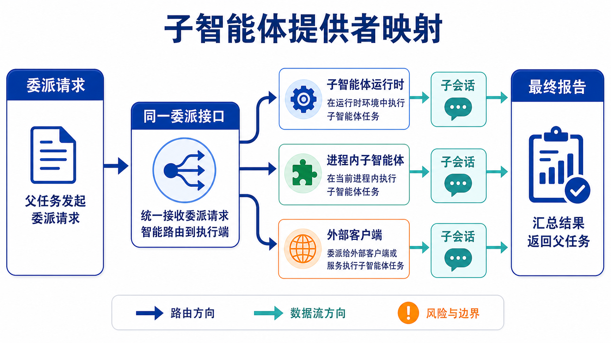
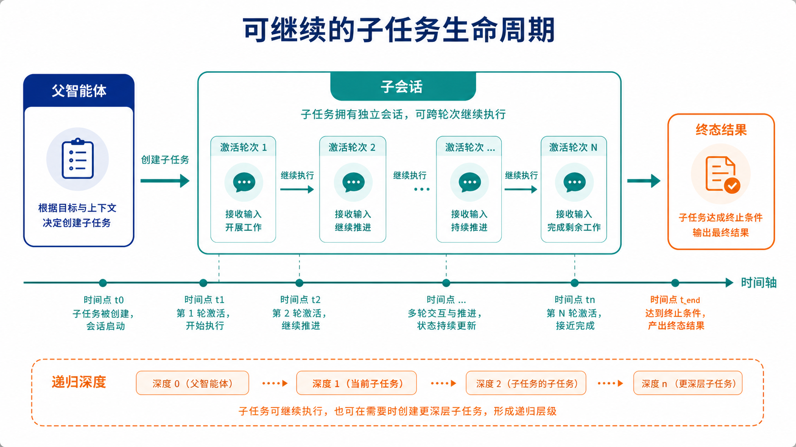
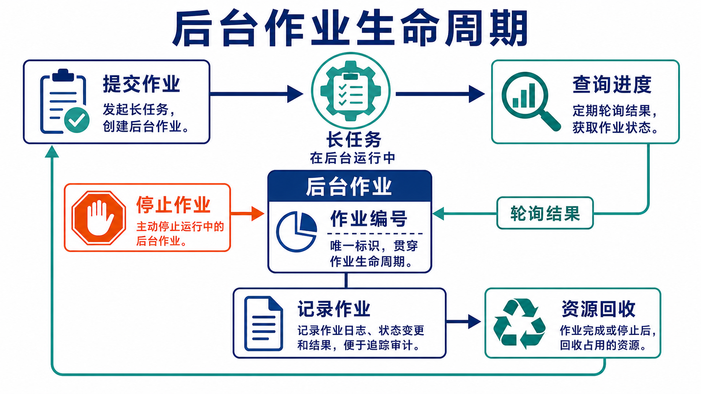
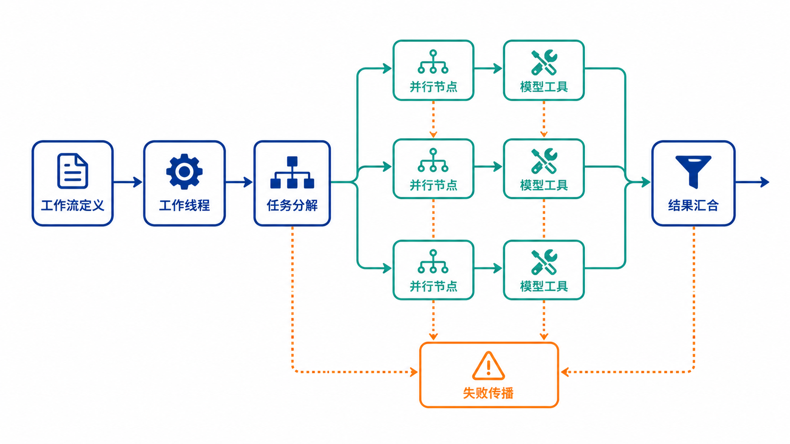

“让多个 Agent 并行干活”看起来像一个 `Promise.all()` 就能解决的问题，落到 Harness 却至少包含三种责任：谁能创建子 Agent、后台任务怎样被拥有和回收、模型写出的编排脚本在哪里执行。DeepSeek Harness 分别用 Subagent、Job 与 Workflow 三条可选的能力接缝（capability seam，即接口与具体实现之间的替换边界）承担这些责任。Subagent 负责委派和谱系，Job 负责后台工作的控制面，Workflow 负责受约束的动态编排；三者可以组合，但生命周期和事实来源并不相同。

本文以官方标签 `dsh-v0.1.0-rc.7` 为唯一基线。核心源码集中在 `packages/subagent`、`packages/jobs` 与 `packages/workflow`。文中的“源码裁剪”保持真实接口语义但省略辅助字段；“可运行示例”需要放进已装配对应插件的 rc.7 工程；“教学伪代码”只说明控制流，不能直接复制运行。

## 1. 先分清三种并发对象，而不是先选语法

Subagent、Job、Workflow 的共同点只是“主轮次不必亲自顺序完成全部工作”。它们的事实来源和生命周期完全不同。Subagent 的核心实体是子会话以及可选的在线 Activation（某个持久子会话当前在内存中的活跃执行实例）；Job 的核心实体是注册表中的后台执行记录；Workflow 的核心实体是 Worker（隔离的脚本执行线程）中的一次运行以及它启动的子 Agent。一个子 Agent 可以产生 Job，一个 Workflow 可以启动多个 Subagent，但这不意味着三者共享状态机。

```latex
父 Agent
  ├─ SubagentRuntime ── provider ── 子会话 / 外部 Agent 运行时
  ├─ Jobs registry ─── starter ─── 后台进程、下载、长计算
  └─ WorkflowEngine ── worker ─── 动态脚本
                                └─ agent() ── SubagentRuntime
```



判断该用哪条能力接缝，可以从结果形态反推：需要一个有身份、有上下文、能继续对话的执行者，用 Subagent；需要把一个已经明确的长操作放到后台、稍后读取或停止，用 Job；需要模型现场决定分支、并发组、流水线和汇总方式，用 Workflow。直接拿 Job 表示子会话会丢失谱系与授权，拿 Workflow 代替固定业务编排则会扩大脚本攻击面。

还可以从“谁拥有进度”判断。Subagent 的进度属于子会话，可由 Session 投影和 child catalog 观察；Job 的进度是 producer 写入的输出增量与状态快照；Workflow 的进度是 phase 和成员事件。三者都可能在界面显示一条“运行中”，但这个标签背后的恢复能力完全不同。产品若把它们折叠成一个布尔值，用户无法知道刷新页面后任务是否仍在、进程重启后能否继续、停止按钮究竟取消当前轮次还是销毁后台资源。因此，UI 可以统一视觉语言，协议却必须保留对象类别、owner、稳定 id 和结算原因。

## 2. Subagent 是具名 Provider 注册表，缺失能力会明确报错

服务定义在 `packages/subagent/subagent/src/index.ts`，公共请求在 `types.ts`。它与只能有一个实现的 Bash 能力接缝不同：`ctx.subagents` 同时容纳多个具名 Provider（能力实现），例如进程内创建、从父历史分叉、ACP、Codex、Claude Code 与 DSH SDK。ACP 是 Agent Client Protocol，一种把外部 Agent 运行时接入统一客户端的协议。调用者按名称选择 Provider，不把“本地或远程”硬编码进工具。

```typescript
// 源码裁剪：packages/subagent/subagent/src/types.ts
interface SubagentCapabilities {
  readonly outputSchema: boolean
  readonly depthLimit: boolean
  readonly toolFilter: boolean
  readonly persona: boolean
}

interface SubagentStartRequest {
  readonly prompt: ContentBlock[]
  readonly parent: Agent
  readonly signal: AbortSignal
  readonly outputSchema?: ObjectJsonSchema
  readonly maxDepth?: number
  readonly toolFilter?: ToolRestriction
  readonly persona?: string
}
```

能力标志不是文档提示，而是 `start` 前的机械门禁。调用请求带了 `outputSchema`，Provider 却没有声明结构化输出，服务会抛出 `UNSUPPORTED_CAPABILITY`，不会接单后悄悄退化成自然语言。`maxDepth` 是绝对委派深度上限，不是“还能再递归几层”；`toolFilter` 同时影响子 Agent 的提示可见性与实际执行入口；Persona 只遮蔽当前子 Agent 的部署人格。这种“缺失能力就明确失败”的规则，使跨运行时切换仍有可推理的语义。

```typescript
// 教学伪代码：展示能力预检，不是仓库原函数
const provider = ctx.subagents.resolve(requestedProvider)
if (request.outputSchema && !provider.capabilities.outputSchema)
  throw new SubagentError('UNSUPPORTED_CAPABILITY')
if (request.maxDepth !== undefined && !provider.capabilities.depthLimit)
  throw new SubagentError('UNSUPPORTED_CAPABILITY')
return provider.start(resolvedRequest)
```

一次性调用只等待一个终态结果，适合独立研究或明确输入输出；provider 获得的 `ResolvedSubagentStartRequest` 已包含稳定 descriptor，但不需要理解目录格式。取消信号在发布前要求清理半成品，在发布后取消剩余轮次工作。结果成功、失败、取消仍由统一 settlement 归一，调用工具无需认识 Codex 或 ACP 的私有协议。

请求中的 `parent` 也不是一个方便取 cwd 的参数。它把本次委派钉到真实 Agent：进程内 provider 从父 Session 推导工作区、谱系和深度；外部 provider 至少可以读取约定允许的 cwd。若调用者脱离 Agent 上下文伪造一个 parent id，便无法获得同等的 scope、工具限制和生命周期所有权。正确的 consumer 应从当前 tool execution context 取得活 Agent，并让 SubagentRuntime 建 descriptor；不要在业务插件中自己拼 child Session header，否则下一版 descriptor、seed 或 lineage 变化时会形成无法恢复的孤儿。

能力矩阵还应进入部署测试。对每个启用 provider，至少用同一组 contract cases 验证：不支持的 schema 是否在启动前失败；未知工具过滤项是否响亮拒绝；maxDepth 边界是等于可接受还是大于才拒绝；persona 模板缺变量时是否回滚；signal 在 provider publish 前触发是否没有 child 泄漏。这样“可替换 provider”才是行为替换，而不只是都实现了一个 TypeScript 接口。

## 3. 可继续 Subagent 把持久 Session 与在线 Activation 分开

一次性运行不是全部。可继续 child 的持久身份是 Session，在线执行形态才是 Activation。相关实现位于 `continuation.ts`、`child-agent.ts` 和 `activation-setup-registry.ts`。同一个子会话同时最多只有一个 Activation；进程重启或驻留释放不会改变 child id。

```latex
持久化 Session
  └─ 可选在线 Activation
       ├─ 一个 AgentHandle
       ├─ Agent inbox：唯一 FIFO
       └─ ownedChildren：所拥有的子 Activation
```

`startContinuable()` 先预留 child id、持久化版本化 descriptor，再由 provider 准备首次创建所需的 `ContinuableCreateSpec`。真正创建 Agent、提交初始 prompt、维护所有权图由 continuation manager 负责。返回 `{ childId, messageId }` 的时点是 inbox 已接受消息，不是模型已开跑，更不是 child 已完成。准入前失败必须不泄露“半个成功 id”，并回滚 handle 和所有权。

```typescript
// 源码裁剪：公开结果与 follow-up 选项
interface ContinuableStart {
  readonly childId: SessionId
  readonly messageId: MessageId
}

interface SubagentFollowupOptions {
  readonly source: MessageSource
  readonly signal: AbortSignal
}
```



`followup()` 只看 Activation 是否驻留：运行中便入同一 inbox，waiting 便唤醒，完全离线便从持久 Session 冷恢复。消息一旦被 inbox 接受，调用方 signal 不再拥有这轮任务，否则父工具超时会偷偷撤销已经承诺的子工作。公开停止使用 `interrupt()`：它保留未领取 inbox，通过 `Agent.cancel(..., { keepInbox: true })` 中止当前被领取的轮次，之后仍可用 follow-up 唤醒。直接父级或在线祖先链授权比“猜中可预测的 session id”重要得多。

```typescript
// 可运行示例：模型侧控制工具的典型输入形态
await send_message({
  target: childId,
  message: '请补充失败路径，并报告对应测试文件。',
})
await interrupt_agent({ target: childId })
const catalog = await list_agents({})
```

这里的函数名来自 `dsh-tool-subagent-control` 暴露的模型工具概念，具体 JS 调用签名由工具注册层决定。它们不是任意用户都能直连的公共网络 API。子级主动 `reportFrom()` 时，接收方从持久 `parentSession` 推导，child 不能指定任意目标；quiet 模式注入而不唤醒 parent，wakeup 模式形成普通 follow-up 轮次。最终 settlement 通知与 child 自己写的 report 使用不同消息来源，审计时不会把运行时的话误算成子 Agent 的陈述。

Activation 的 `running`、`waiting`、`settled` 也不是第二套业务状态机。管理器根据 Agent 是否有活跃准入/轮次、是否正在唤醒 inbox，以及 `ownedChildren` 是否为空推导它们。父 child 自身已经 idle，但孙 child 尚未 dispose 时，父 Activation 进入 waiting 并继续驻留；若此时把父 handle 释放，孙级 settlement 就失去可投递的在线 owner。child-first drain 正是为避免这种倒置释放。进程卸载时，全局 drain 关闭新准入、向下传播取消、等待已获准物化，再从叶到根释放；持久 Session 不因在线森林拆除而删除。

## 4. 跨运行时 provider 只换运输，不重写上层委派语义

进程内 provider 复用 Harness 的 Agent 组合；ACP provider 通过 Agent Client Protocol 驱动另一个程序；Codex 与 Claude Code provider 把 prompt、取消和最终结果映射到各自进程协议；`subagent-dsh-sdk` 则通过 DSH JSON-RPC SDK 驱动另一套 Harness。代表实现可查看 `subagent-acp/src/run.ts`、`subagent-codex/src/run.ts` 和 `subagent-dsh-sdk/src/run.ts`。

```yaml
# 可运行配置示意：具体包名与选项以各 provider README 为准
- name: '@deepseek-ai/dsh-subagent-acp'
  config:
    name: review-acp
    command: node
    args: ['./review-agent.js']
- name: '@deepseek-ai/dsh-subagent-codex'
  config:
    name: codex-worker
```

跨运行时不是透明分布式事务。父 Harness 能保证的是能力检查、归属、取消请求、结果归一和本地资源释放；外部进程是否真的停止、外部工具拥有什么权限、远端是否落盘，要看 provider 与目标产品的契约。因此生产配置要把 provider 名称视作信任域，而不是性能标签。一个拥有宿主文件权限的外部 CLI，即使从同一个 `subagent` 工具启动，也不会自动继承本地 sandbox 的隔离。

```typescript
// 教学伪代码：上层工具只依赖 seam
const run = await ctx.subagents.start('review-acp', {
  parent: exec.agent,
  prompt: [{ type: 'text', text: input.prompt }],
  signal: exec.signal,
})
try {
  return await run.result
} finally {
  await run.dispose()
}
```

`dispose()` 必须在成功、失败与取消路径全部执行。只等待 result 不代表传输、子进程和监听器已经释放；只发 cancel 不等待 dispose 又容易在测试或热重载中留下资源。跨边界实现最值得测试的是“就绪前取消”“发布后取消”“业务失败后清理”和“多会话互不串线”，仓库对应 provider 的 `tests/` 正在覆盖这些边界。

跨运行时还有一个容易忽略的输出边界：结构化结果只能在 provider 明确支持、schema 属于 Harness 允许子集且返回值是宿主 realm 的普通 JSON 时成立。外部 CLI 打印的一段 JSON 文本不自动等于结构化结果，桥接必须区分协议帧、stderr 诊断、增量内容和最终已提交值。图片、推理块、工具活动能否回传同样由具体 provider 定义。协调 Agent 不应因为某个后端偶然输出了相似文本，就把未声明能力当作可靠协议依赖。

## 5. Job 是后台工作控制面，不是另一种 Agent

Job seam 的服务定义位于 `packages/jobs/jobs/src/index.ts`，类型在 `types.ts`，本地实现位于 `jobs-local/src/index.ts`。Job 保存 id、kind、label、owner、状态、输出游标与终态，不保存一整套对话历史。它适合后台 shell、下载、索引、远程请求或任何有确定 producer 的长操作。

```typescript
// 源码裁剪：核心控制面
abstract class Jobs {
  abstract start(spec: JobStart): JobId
  abstract list(caller?: Agent): JobSnapshot[]
  abstract get(id: JobId, caller?: Agent): JobSnapshot
  abstract read(id: JobId, caller?: Agent): JobRead
  abstract kill(id: JobId, caller?: Agent, reason?: string):
    'requested' | 'already-finished'
  abstract wait(id: JobId, timeoutMs: number, caller?: Agent,
    signal?: AbortSignal): Promise<JobSnapshot>
}
```

Job id 可预测，因此安全边界从来不是“别人猜不到 id”，而是每次 list/get/read/kill/wait 都检查 owner session。Agent 调用只看自己拥有和无主的 Job；没有 Agent 的调用方只能看无主 Job。`start()` 还要求 owner 作用域存在已附着 controller，避免 producer 已经开跑，却没有任何所有者能读取或停止。预检失败不能留下 id 或执行资源，starter 抛错也不能留下注册记录。

```typescript
// 教学伪代码：一个 producer 的形状
const id = ctx.jobs.start({
  kind: 'index',
  label: '扫描工作区',
  owner: agent.session.id,
  start: ({ signal, write, settle }) => {
    void indexWorkspace({ signal, onProgress: write })
      .then(value => settle({ status: 'completed', output: value }))
      .catch(error => settle({ status: 'failed', error }))
    return reason => controller.abort(reason)
  },
})
```

这是教学伪代码，真实 `JobStart` 字段以 rc.7 类型为准。关键顺序是“同步取得取消能力，再原子注册”；终态采用 first-wins，晚到的 producer 结果不能覆盖已经提交的取消或失败。`read()` 对运行中 Job 返回自上次游标后的增量，对终态 Job 返回幂等最终输出并标记已报告；`wait()` 只等待，不会暗中取消 producer。

## 6. Job 的停止、完成通知与所有者释放要抵抗竞态

后台工作最危险的不是启动，而是所有者消失。Cordis fiber dispose 时，本地控制器会把仍活跃的 owned Job 转入 stopping，发出取消，等待 producer 结算，再移除对该 owner 可见的记录。慢取消不能阻塞“状态已经变了”的观察：visible-set observer 会在注册、stopping、settlement、owner 移除等每次提交后触发，UI 重新 list，而不是累积可能丢失的 delta。

```typescript
// 可运行示例：模型工具层的典型操作概念
const running = await job({ action: 'list' })
const delta = await job({ action: 'read', id: 'bash-3' })
const terminal = await job({ action: 'wait', id: 'bash-3', timeoutMs: 10_000 })
await job({ action: 'kill', id: 'bash-3', reason: '用户改变计划' })
```

上述是工具输入示例，不是直接 import 的 TypeScript API。工具消费者实现在 `packages/jobs/tool-jobs/src/index.ts`。完成 listener 采用 effect scope，每个 listener 异常被隔离；Promise 会被观察却不阻塞 settlement。特别值得注意的是完成记录先提交、其他 observer 看见终态后，才做可能同步开启模型轮次的报告，防止报告者回读到“尚未完成”的旧状态。



从调度角度看，Job 可以承载 Subagent/Workflow 之外的慢基础设施操作，但不应把二者的 live handle 随意包进 producer。若确实要让某个模型工具“后台启动工作流”，外层 Job 必须定义取消如何向 `WorkflowRun.cancel()` 传播、何时等待 `dispose()`、结果如何截断，以及 owner 消失时是否连带清理 child。否则 UI 虽然拿到一个 Job id，实际却存在两套互不知情的结算，可能出现 Job 已 cancelled 而 Workflow 仍启动新 Agent。组合抽象时必须指定唯一的最终清理负责人。

Job 和可继续 Subagent 的差别至此很清楚：Job 的 `read` 是输出游标，Subagent 的 follow-up 是新一轮用户消息；Job 的 kill 面向 producer，Subagent interrupt 面向在线 Agent 当前轮次；Job 终态后不会冷恢复为原 producer，子会话却能依据 descriptor 冷恢复。用错抽象会让恢复和授权都变得含糊。

生产 Job 还需要输出预算。不断 append 的日志若不限制，会让内存注册表和模型 `read` 结果同时膨胀；producer 应提供适合增量消费的短片段，把大型产物写到受控存储，只在 Job 输出中返回引用与摘要。终态读取虽然幂等，却不意味着可以无限重复把完整结果送进模型上下文。工具层可以报告未读 delta、截断提示和产物路径，但不能在模型没看见尾部时假装任务已经完整汇报。

所有者清理与服务全局 dispose 也不同。Agent scope 消失只清理该 owner 的工作，未归属 Job 和其他 Session 的 Job 继续存在；Jobs Service 自身卸载则关闭整个注册表。测试应同时制造慢 cancel、cancel 抛错、producer 晚 settle、listener 异步拒绝和 owner dispose 并发 read，验证 terminal record 仍然 first-wins，外部调用者不会读到另一 owner 的 label 或输出。

## 7. Workflow 把模型生成的编排脚本放入独立 Worker

Workflow seam 的浏览器安全词汇位于 `packages/workflow/workflow/src/types.ts`，Host 句柄在 `runtime-types.ts`，worker-thread 引擎在 `packages/workflow/workflow-worker-thread`。每次 run 一个 Node Worker，脚本在该 Worker 的 VM context 中执行，只有受控全局：`args`、`agent()`、`parallel()`、`pipeline()`、`phase()`、`log()` 等。

```typescript
// 源码裁剪：启动请求
interface WorkflowStartRequest {
  script: string
  meta: WorkflowMeta
  args?: unknown
  subagentProvider?: string
  maxTotalAgents?: number
  parent: Agent
  signal?: AbortSignal
}
```

`meta` 和 `args` 是先验证、再结构化克隆的普通 JSON，不能通过执行脚本文本“顺便解析”。provider override 和总 Agent 上限属于引擎策略，脚本看不到也不能更换。`phase()` 只用于展示分组，并不创建事务或屏障；真正并发来自组合器和 JavaScript await 结构。

```javascript
// 可运行工作流脚本：由 workflow 工具提交，非宿主插件代码
phase('并行调查')
const [api, tests] = await parallel([
  () => agent({ label: 'api', prompt: '检查 API 兼容变化' }),
  () => agent({ label: 'tests', prompt: '检查测试缺口' }),
])
phase('汇总')
return await agent({
  label: 'review',
  prompt: `合并两份报告：\n${JSON.stringify({ api, tests })}`,
})
```

每个 `agent()` 仍通过 Subagent seam 启动，因此父级、cwd、谱系和取消都没有第二套实现。Workflow 只决定什么时候调用、怎样组合结果。逐项 child 失败在 `parallel`/`pipeline` 中可以映射为 `null`，但参数错误、未知选项、schema 越界、超过上限、seam 启动失败等 `fatal` 错误必须穿透并终止脚本，不能被包装成一个貌似普通的空结果。

并发限制应区分“同时运行数”和“整个 run 接受过的总数”。只限制并发槽位，脚本仍可循环启动数万个很短的 child；只限制总数，又可能在上限以内瞬间压垮 provider。因此 Worker runtime 一边排队等待并发槽，一边在 `agent()` 准入时累计 total，host 还要掌握实际已发布 child，以便 Worker 被终止时合成成员终态。`agentsStarted` 在正常结算可包含脚本侧已经接受、仍等槽位的调用；强杀后只能降级为 host 可观察计数，运维指标必须理解这一区别。

## 8. 有界取消与持久事件让动态脚本可运维

活跃句柄 `WorkflowRun` 的 `result` 永不 reject，失败通过封闭 `stopReason` 表达；持有者必须调用幂等 `dispose()`。即使脚本写了永不结束的 Promise，取消后也会在引擎规定的宽限期内强制结算并终止 Worker，随后等待已启动 child 停稳。这样工具层不会因为一段恶意或错误脚本永远卡死。

```typescript
// 源码裁剪：packages/workflow/workflow/src/runtime-types.ts
interface WorkflowRun {
  readonly id: WorkflowRunId
  readonly meta: WorkflowMeta
  readonly result: Promise<WorkflowResult>
  cancel(reason?: string): void
  dispose(): Promise<void>
}

interface WorkflowResult {
  value: unknown
  stopReason: 'completed' | 'cancelled' | 'error'
  error?: string
  agentsStarted: number
}
```

运行时发出 `workflow/start`、`phase`、`log`、`agent-start`、`agent-end`、`end` 观察事件；payload 是快照，不泄露 live cancel/dispose 句柄，监听器相互隔离。顶层工具还向父 Session 写 `tool-workflow/run-start`、成员 start/end 和 run-end。第一次 append 失败后停止本 run 的后续记录，因此日志要么为空，要么是合法连续前缀；尾部缺 end 表示中断证据，不被误判成损坏。

```typescript
// 可运行宿主消费示例：已装配 workflowEngine 的插件
const run = ctx.workflowEngine.start(request)
try {
  const result = await run.result
  if (result.stopReason !== 'completed') throw new Error(result.error)
  return result.value
} finally {
  await run.dispose()
}
```



当产品 UI 需要显示“第几个成员在运行”，应消费这些事件和持久节点，而不是解析脚本文本或猜测 Promise 状态。Worker 被强杀时，引擎会为已经发布却未结束的成员合成 cancelled end，维持 start/end 配对。这类不变量可在 `workflow-worker-thread/tests` 中找到针对性测试。

脚本返回值同样要过 realm 边界物化为普通 Host JSON：函数、symbol、循环引用、带原型实例都不应逃出 Worker。`undefined` 统一成为 `null`，让工具结果有稳定表示。观察事件刻意省略 result value，是为了避免 listener 获得调用者结果的可变别名，也减少把敏感汇总广播给所有观察者的风险。真正需要返回值的只有持有 `WorkflowRun` 的 consumer；UI 依据持久投影展示阶段和成员，而不成为业务结果的第二事实来源。

## 9. 生产落地：并行不是越多越好，边界也不会自动继承

三条 seam 的价值在于把并发的不同风险放到正确位置。Subagent provider 限制单次能力，continuation manager 限制谱系与直接父级授权；Jobs 用 owner session 防止横向读取和停止；Workflow 用 Worker、总 child 上限、有界取消及 JSON 边界控制模型脚本。部署时仍要显式决定允许哪些 provider、每个 provider 的 OS 权限、Workflow 的最大并发与总 Agent 数，以及 owner 释放时可接受的清理时限。

```yaml
# 教学伪代码：生产策略清单，不是 rc.7 完整配置 schema
delegation:
  allowedProviders: [spawn-in-process, review-acp]
  maxDepth: 2
workflow:
  maxTotalAgents: 8
  maxParallelAgents: 3
jobs:
  requireOwnerController: true
security:
  externalProvidersRunInSandbox: true
```

还要接受三类失败边界。第一，进程崩溃后 Job producer 通常无法恢复，而 Session-backed child 可能冷恢复；不要承诺两者同等持久。第二，取消是协作与强制终止的组合，外部 provider 是否完成远端清理要单独观测。第三，Workflow 是执行模型生成代码，不应把宿主 `process`、文件系统、网络凭据或任意模块加载直接塞进 VM。

最后要牢记版本状态：`dsh-v0.1.0-rc.7` 仍是 Developer Preview。descriptor payload、工具参数、Workflow 内建函数、provider 配置和事件投影都可能破坏兼容。生产系统应固定 tag 与 lockfile，对代表性并发、取消、冷恢复、owner dispose 和 Worker 强杀做快照/集成测试；升级时先重放这些失败路径，再谈吞吐优化。并行架构真正可靠的标志，不是同时开了多少 Agent，而是在父级取消、子级失败、运行时跨界和进程退出时，谁拥有谁、什么已经被接受、什么还能恢复都说得清楚。

容量规划也应以总 token、工具副作用、进程与文件句柄、持久事件写入计量，而不仅是 Agent 数。三个轻量研究 child 与三个启动编译器、浏览器和 MCP 的 child 对宿主压力完全不同。Provider 可提供部署级并发限制，Workflow 再提供单 run 限制，Job producer 还要有自己的队列；多层限制应选择明确的拒绝或排队语义，并在超时与取消时释放槽位。只有资源账和所有权图一致，并行才不会把局部提速变成系统级雪崩。

运维指标应至少按 provider、parent session、结算原因和等待阶段聚合：启动前排队过长说明容量不足，published 后运行过长可能是模型或工具阻塞，dispose 过长则是清理契约问题。Job 的 stopping 时长、Activation waiting 的后代数、Workflow 强制终止次数应分别告警；把它们都算成“Agent 延迟”会掩盖真正瓶颈。
