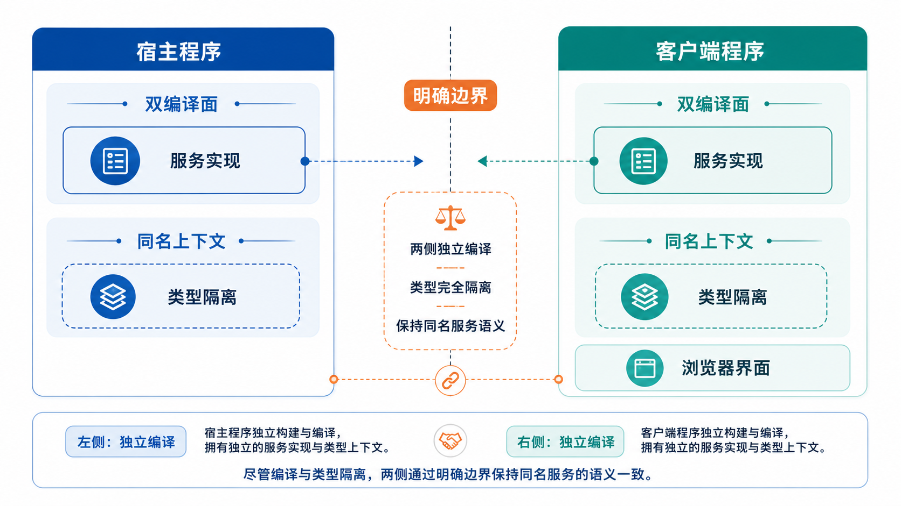
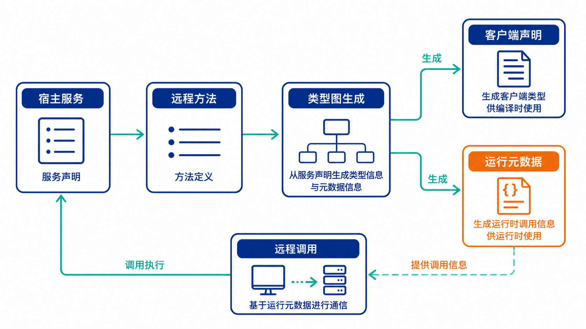
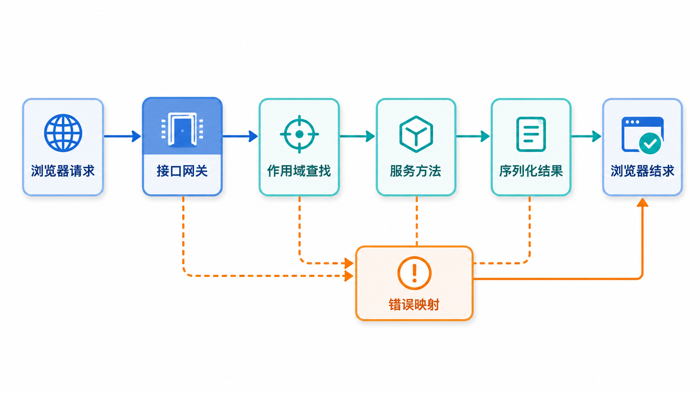
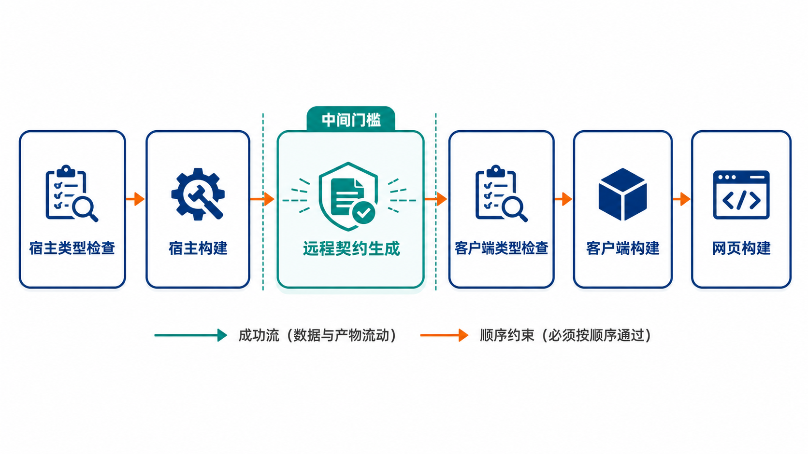

Web Client 想调用 Host 上的 `GoalService.create()`，常见做法是手写一份 HTTP DTO（Data Transfer Object，数据传输对象），再在前端复制一份 TypeScript 类型。项目一大，两份声明就可能漂移：Host 改了参数，Client 仍能编译；复杂的 `Agent` 对象被错误序列化；取消信号混进 JSON；开发模式和发布构建也可能表现不同。DeepSeek Harness 的 Typert 与 API Gateway 针对的正是这类“同一种业务能力被边界复制两次”的问题。

它采用构建期生成方案：业务服务在 Host 源码上标出 Remote 方法，生成器严格分析同一个 TypeScript 类型图，分别产生 Host 描述符和 Client 具体方法；Gateway 再根据描述符恢复 Host 对象、选择作用域 Context、校验输入输出。运行时 JavaScript Proxy 和让 Client 直接导入 Host 服务类都不在这条路径里，Connection 只承担传输与取消。本文固定基线为 `dsh-v0.1.0-rc.7`，主要对照 `docs/api-gateway.zh.md` 与 `docs/subsystems/typert.zh.md`。文中会明确区分源码裁剪、可运行示例和教学伪代码。

在继续读源码前，可以先固定几个术语。`ts.Program` 是 TypeScript 编译器看到的一整张源码与类型图；Schema 是可供运行时校验的数据结构规则；Endpoint 是远程方法的路由名称；Descriptor（描述符）记录一个远程方法的参数、结果和作用域；Lookup（对象查找）把线上传来的稳定 ID 恢复成 Host 内的 Agent 或 Context；Codec（编解码器）按照 Schema 校验并转换跨边界数据。Wire 指 Host 与 Client 之间传输的数据形态，Carrier 指承载这次调用的 HTTP、WebSocket 或进程内通道；Realm 是不同 JavaScript 执行环境形成的对象边界。SRC 是源码启动时的弱化回退模式，HMR 则是开发阶段的热模块替换。后文保留这些英文代码名，但都采用上述含义。

## 1. “不复制类型”指一份业务签名、两侧生成产物

Host 与 Client 不在同一个 `ts.Program`，也不应该互相加载对方运行时代码。这里的“不复制”是让业务方法签名成为唯一规范来源，再生成面向两侧的不同产物；它不要求把服务类塞进浏览器 Bundle。Host 需要 Schema、Endpoint、Lookup 与实现方法映射；Client 需要声明合并、具体函数与相同的 Schema Codec。二者共享 Descriptor 身份，却分别在 Host 构建侧和 Client 构建侧运行。

```latex
Host 业务源码 + @Remote / @RemoteScope
                 │
          Typert Generator
          ┌──────┴──────┐
  Host contribution   Client /remote contribution
  schema + descriptor  类型 + descriptor + mount
          │                    │
     Typert Registry      ctx.remote.namespace
          └──── Gateway ← Connection ────┘
```



这套设计只覆盖“一次请求、一次结果”的一元调用。会话事件流、增量 projection、分页实体流即使复用 Connection，也不伪装成 Remote。边界越明确，代码生成越能保证语义；若把所有协议都抽象成 Promise 方法，背压、重连、事件顺序和订阅生命周期反而会消失。

“类型只有一份”也不意味着 wire 可以随意改变。源码类型名、属性可选性、联合分支和 lookup identity 一旦进入生成 schema，就成为跨版本协议的一部分。重命名内部局部变量通常无影响，重命名 Remote 参数却可能改变具名 wire 字段；把同步实现改为 Promise 可以兼容调用模型，但改变结果类型或把 `AbortSignal` 移离末尾会使生成失败。团队应把生成 diff 当 API diff 审查，而不是把 `lib/typert.*` 视作可忽略噪音。

## 2. Remote decorator 选择公开面，而服务 binding 确定接收者

协议声明位于 `packages/typert/protocol/src/index.ts` 和 `types.ts`。业务服务用 `@Remote` 公开根 Host Context 中的服务方法，用 `@RemoteScope` 先恢复一个作用域 Context，再在该 Context 中取服务。没有 decorator 的 public 方法不会被意外暴露。

```typescript
// 可运行示例：置于已启用 decorator 与 Typert 构建的业务包
export class GoalService extends TypertRemoteService {
  constructor(ctx: Context) {
    super(ctx, 'goals')
  }

  @Remote('create')
  async createForClient(
    agent: Agent,
    request: CreateGoalRequest,
    signal: AbortSignal,
  ): Promise<CreateGoalResult> {
    signal.throwIfAborted()
    return this.create(agent, request)
  }

  @RemoteScope('agent', 'current')
  currentForClient(): CreateGoalResult {
    return { accepted: true }
  }
}
```

`TypertRemoteService` 把 Cordis service key 与默认 namespace 显式绑定；已有其他基类的类可通过 `bindTypertRemote(this, serviceKey)` 留下同样可检查的 binding。它不依赖编译器偷偷往构造器注入 symbol，因此源码回退和严格构建都能验证“descriptor 声称的服务”与“实际 receiver 的 binding”一致。

```typescript
// 源码语义裁剪：显式 binding，而不是魔法反射
class ExistingBaseService extends SomeBase {
  readonly typertRemote = bindTypertRemote(this, 'workspace')

  @Remote('open')
  openForClient(request: OpenRequest): OpenResult {
    return this.open(request)
  }
}
```

导出名可以和实现名不同。descriptor 的 `method` 是 wire 上的公开名，`implementation` 指向 receiver 上真正调用的成员。这样重构内部方法不必暴露私有命名，但任何 endpoint 变化仍是需要重新生成契约的显式兼容变化。

Decorator 只负责选择，不负责授权。一个方法被 `@Remote` 标记，表示它可以进入允许该 contribution 的 Client assembly；具体调用者是否能操作某个 Agent、Session 或 workspace，仍由 lookup policy 与业务服务检查。不能把“只有前端代码知道 endpoint”当安全控制，也不能假设 Typert schema 会判断业务所有权。好的 Remote 方法先解析身份，再通过已有领域服务执行授权，不在 Gateway 外另造一套弱化规则。

服务 binding 还能抵御热重载中的错接收者。假设旧 `goals/create` descriptor 尚在，但 Cordis service key 被另一个不相关对象占用；仅用 `Reflect.get(receiver, method)` 可能恰好找到同名函数并执行。`validateBinding` 同时核对 service 与 namespace，使这种结构巧合变成 `binding-invalid/provider-mismatch`，而非把请求发给错误插件。

## 3. InvocationDescriptor 把反射结果变成可审计的本地契约

描述符不是网络消息。网络只发送 namespace、method 与具名 `args`；Host 和 Client 各自持有相应的 `InvocationDescriptor`。真实定义在 `packages/typert/protocol/src/types.ts`，它记录服务、namespace、实现名、direct/context 调用方式、有序业务参数、取消位置与结果 codec。

```typescript
// 源码裁剪：InvocationDescriptor 的关键字段
interface InvocationDescriptor {
  readonly id: string
  readonly service: string
  readonly namespace: string
  readonly method: string
  readonly implementation?: string
  readonly invocation:
    | { readonly kind: 'direct' }
    | { readonly kind: 'context'; context: string; wire: string; codec: TypertCodec }
  readonly parameters: readonly InvocationParameterDescriptor[]
  readonly cancellation?: { readonly parameter: 'signal' }
  readonly result: TypertCodec
}
```

参数采用具名 wire 字段，而不是依赖数组位置。严格 codec 携带生成 schema；源码回退使用 `src-json`，只能保证 JSON-safe，不能恢复 TypeScript 结构。只有显式声明 `T | undefined` 的参数，缺少 wire 字段才可解码为 undefined；普通可选错觉不会被容忍。Gateway 还要求 `args` 的 key 与 descriptor 精确匹配，多字段和少字段都在业务方法执行前失败。

```typescript
// 源码裁剪：参数描述符
interface InvocationParameterDescriptor {
  readonly name: string
  readonly wire: string
  readonly source: 'json' | 'lookup'
  readonly lookup?: string
  readonly codec: TypertCodec
  readonly acceptsUndefined?: true
}

type TypertCodec =
  | { readonly mode: 'strict'; typeSymbol: string; schema: TypertSchema }
  | { readonly mode: 'src-json' }
```



取消信号有意不进 `args`。Host 方法最后一个参数若严格声明为全局 `signal: AbortSignal`，生成器把它登记到 `cancellation`，Client 方法接受可选 signal，Connection 通过 carrier 带外传递。`AbortSignal` 既不是 JSON 值，也不应被伪造为业务字段；将控制面与数据面分开，才能让 HTTP、WebSocket 或进程内 carrier 使用同一调用描述符。

严格 codec 的意义还包括返回值。业务方法在 Host 内部可能构造带 getter、Date、Map 或类实例的对象，但 Remote 结果只能是 schema 允许的跨 realm 数据。Gateway 在调用后 decode，`result-invalid` 说明服务实现违反自己发布的契约；它不应把非法对象交给 JSON.stringify 碰运气。客户端收到响应后再次按对应 codec 解码，使代理、旧 Host 或传输损坏不能绕过类型边界。

descriptor 的全局 id 与 endpoint 承担不同角色：endpoint 供传输路由，人可以读；id 用于识别生成声明本身。注册表同时拒绝重复 invocation id 和 endpoint，避免两个包以不同反射记录争抢同一调用面。源码位置只用于诊断，不进 wire，因此移动文件不会平白改变请求格式，但重新生成仍能让错误指向新位置。

## 4. Lookup 与 Context 解决“Host 对象不能过线”的问题

`Agent`、`Session`、Cordis `Context` 都不是 DTO。Typert 允许业务包通过声明合并扩展 `TypertLookupMap` 与 `TypertContextMap`：前者把 Host 对象类型与稳定 wire identity 关联，后者把作用域 Context 类别与 identity 关联。生成器看到 `agent: Agent` 时，描述符记录 wire 字段 `agentId` 与 lookup key；Gateway 收到 id 后调用当前 provider 的 resolver，业务方法最终仍得到真实 Agent。

```typescript
// 源码语义裁剪：声明合并示意
declare module '@deepseek-ai/dsh-typert-protocol' {
  interface TypertLookupMap {
    agent: {
      parameter: 'agent'
      wire: 'agentId'
      host: Agent
      value: SessionId
    }
  }
  interface TypertContextMap {
    agent: {
      wire: 'agentId'
      value: SessionId
    }
  }
}
```

这是说明字段关系的教学化裁剪，实际声明类型以 rc.7 protocol 为准。lookup 的 wire 声明在 provider 卸载后仍保留：SRC 参数发现仍会把 `agent` 识别成 lookup，但因 resolver unavailable 明确失败，不会突然把字符串 id 当作业务 Agent 传入。这条“不可用也不降级”规则对 HMR 与可选组合尤其重要。

`@RemoteScope('agent')` 则先用 `agentId` 找到 Agent Context，再从这个 Context 读 service。若 direct Remote 恰好有一个 lookup 参数，且同名 Context 使用相同 identity，生成器还可提供作用域投影：根 `ctx.remote.goals.create(agentId, request)` 保留显式身份；`agentCtx.remote.goals.create(request)` 从 consuming Context 绑定 identity，省略重复参数。

```typescript
// 可运行 Client 示例：需要挂载生成的 api-remotes/client contribution
declare const ctx: Context
declare const agentCtx: AgentContext
declare const agentId: SessionId

await ctx.remote.goals.create(agentId, { objective: 'ship it' })
await agentCtx.remote.goals.create({ objective: 'ship it' })
await agentCtx.remote.goals.current()
```

lookup 策略按 key 配置，而非按单个 endpoint 配置。若部署把 `agent` lookup 配成“允许冷恢复”，所有 Agent 参数共享该策略；若某方法只接受 live Agent，当前设计没有逐参数策略，必须在业务边界显式检查，不能假设 resolver 的来源。

lookup provider 的 disposer 也是兼容行为的一部分。卸载后 registry 保留 stable definition，却撤回 resolver；随后调用得到 `lookup-unavailable`，而不是 `input-invalid` 或把 wire id 原样交给服务。这允许 HMR 窗口被监控，也让恢复策略缺失时失败在统一位置。若 definition 本身也随 provider 消失，SRC parser 可能把相同参数改判为普通 JSON，反而造成危险的静默降级。

Context resolution 可能是异步的，例如根据 session id 冷恢复作用域组合。carrier signal 应覆盖这段查找；取消后不能继续物化一个调用者已经放弃的 Agent Context。恢复成功后，Context 与其中 Service 的生命周期仍由 provider 管理，Gateway 只是借用 receiver 执行一次方法，不获得永久 handle。业务实现若启动后台工作，应转交 Job/Subagent 等明确 owner，而不是把 borrowed Context 存进全局变量。

## 5. 严格生成流水线为何必须 Host 在前、Client 在后

生成器实现位于 `packages/typert/generator/src/analyzer.ts`、`emitter.ts` 与 `tsdown-plugin.ts`。根构建先 `build:lib:host`：Host Project Reference 建立完整 `ts.Program`，Typert 分析 decorator、规范 type symbol、lookup 和 Context，生成 host 与 remote-client 文件。之后 `build:lib:client` 才编译 Client，让它消费刚生成的声明和贡献。

```shell
# 可运行命令：仓库根目录，rc.7 推荐构建顺序
pnpm run build:lib:host
pnpm run build:lib:client

# 等价的有序入口
pnpm run build:lib
```

严格分析拒绝无法稳定表示的签名，不会退化成 `any`。复杂类型图被发射为 Schema，Host 参数和结果都经过同一套边界 Codec；生成物记录源码位置，错误能回到 Remote 声明。Typert Loader 将贡献注册进 `packages/typert/registry/src/service.ts`，批量注册具有原子性：包的构建侧标识、Schema Key、调用 ID 或 Endpoint 冲突时整批拒绝。

```typescript
// 源码裁剪：注册表契约的关键操作
interface TypertRegistryContract {
  readonly local: TypertLocalRegistry
  readonly remotes: TypertRemoteRegistry
  readonly lookups: TypertLookupRegistry
  readonly contexts: TypertContextRegistry
}

const dispose = ctx.typert.register(generatedContribution)
// fiber 卸载时 disposer 撤回这一批 schema 与 invocation
```

Host/Client 构建侧的隔离同样是安全边界。Host 入口不导入 Client 的 `Context` 声明合并，Client 入口不导入 Host Gateway Service；只负责装配的包也不替实际消费者声明 `remote.<namespace>` 依赖。谁读取 `ctx.remote.goals`，谁就在自己的 `inject` 中声明 `remote` 与 `remote.goals`，从而让 Cordis 生命周期追踪真实依赖。

这一顺序也是为什么干净工作树比“我的 watcher 能跑”更可信。开发者机器可能残留昨天生成的 Client 声明，Host 源码又已改成今天的 decorator，IDE 在两个时代的产物上同时给出绿色。CI 应先清理可生成目录，在没有历史 `lib` 的情况下执行 host build，再执行 client typecheck 和 bundle，并验证生成文件新鲜度。发布包还应做 packed-install 测试，确认 exports 中的 `/remote` 与 `/typert` 真能被消费者解析。

## 6. Host Gateway 的分发顺序是先边界验证、再业务执行

Host 入口在 `packages/api/gateway/src/index.ts`。Connection 解码 envelope 后向 `ctx.typertGateway.invoke()` 提交 namespace、method、plain-object args 和 carrier signal。Gateway 解析 descriptor，检查参数集合，解析 Context receiver，再取 live Cordis Service、验证 binding、并行解析 lookup 参数，最后注入 signal 并调用实现。

```typescript
// 源码裁剪：TypertGatewayService.invoke 的关键顺序
const endpoint = endpointOf(request.namespace, request.method)
const descriptor = this.resolveDescriptor(request.namespace, request.method, endpoint)
assertExactArguments(request.args, descriptor, endpoint)
const receiverContext = await this.resolveReceiverContext(descriptor, request.args, endpoint)
const receiver = receiverContext.get(descriptor.service)
validateBinding(receiver, descriptor.service, descriptor.namespace, endpoint)
const args = await Promise.all(descriptor.parameters.map(parameter =>
  this.resolveParameter(parameter, request.args, endpoint)))
if (descriptor.cancellation) args.push(request.signal ?? NEVER_ABORTED_SIGNAL)
const result = await Reflect.apply(method, receiver, args)
return decode(descriptor.result, result, 'result-invalid', endpoint, 'result')
```

这条顺序防止业务方法看到半验证输入。错误采用稳定分类，例如 `arguments-invalid`、`lookup-unavailable`、`context-not-found`、`provider-mismatch`、`service-unavailable`、`result-invalid`。诊断包含 endpoint 与字段名，却避免把边界值拼进消息导致凭据泄露。lookup policy 可以携带已有 RPC error 原样返回；普通业务异常在 RPC 适配层归并为 transport internal，不让任意 Error 结构成为 wire 契约。

```json
// 教学示例：Connection 上的逻辑 envelope，不承诺具体外层字段
{
  "endpoint": "goals/create",
  "payload": {
    "args": {
      "agentId": "session-123",
      "request": { "objective": "ship it" }
    }
  }
}
```



可以把 Gateway 看成五道门：endpoint 必须由 live definition claim；args 必须是精确 plain object；lookup/context 必须由当前 provider 恢复；receiver 必须是当前 Cordis service 且 binding 相符；result 必须重新通过 codec。任何一道门失败都发生在明确阶段，且不会把边界值拼入诊断。这种分层也便于模糊测试：生成器可以从 schema 产生合法/非法样本，测试每个错误只落入预期 code，并断言业务方法在输入失败时一次也没执行。

传输重试必须理解方法是否幂等。Typert 描述符只表达一元调用和类型，不声明 retry safety；Connection 断开后客户端不能自动重复 `create`、`delete`、`approve` 一类副作用。若业务需要安全重试，应在请求类型中加入幂等键并由领域服务去重，或暴露只读查询确认结果。AbortSignal 也只协作取消，客户端未收到 response 不证明 Host 没有提交副作用。

Host 与 Client 时钟和 realm 也不能进入业务契约。Date 应编码为明确字符串或数值并由 schema 描述，Error 应映射为稳定业务结果/RPC code，BigInt、Map、Set 与 class instance 不应依赖 JSON 的偶然行为。边界类型越朴素，滚动版本、测试 fixture 和其他语言客户端越容易实现相同语义。

Gateway 在 `/api` RPC carrier 上只 claim 合法的两段 endpoint，并以 `trusted-host` authority 注册拦截器。传输可信不等于业务可跳过校验：plain object、精确 key、lookup、schema、binding 和结果仍逐层验证。若 signal 已取消且业务方法同时抛错，Gateway 用专门的取消错误封装，避免把取消竞态误报成普通业务故障。

错误分类应该驱动运维而不是直接展示原始异常。`definition-unavailable` 常见于生成贡献或 HMR 生命周期问题，`service-unavailable` 指向组合缺依赖，`lookup-not-found` 可能是客户端携带陈旧 id，`result-invalid` 则是 Host 实现回归。监控按 code 与 endpoint 聚合即可定位层次，同时避免记录 args。对最终用户可给修复导向提示，对开发日志保留 contained cause，但不得序列化任意 error 对象到远端。

## 7. Client Remote 使用具体函数和生命周期 Token

Client 实现在 `packages/api/gateway/src/client/index.ts`。`ctx.remote.$mount()` 显式挂载被应用选择的 `/remote` contribution，按 namespace 安装普通对象上的具体方法，并注册为可追踪的 `remote.<namespace>` 子服务。没有 JavaScript Proxy 参与属性查找，所以类型暴露、运行方法和生命周期都来自同一生成清单。

```typescript
// 源码裁剪：Client Remote 的公共契约
interface TypertClientRemote extends TypertRemoteNamespaceMap {
  $mount(contribution: TypertRemoteContribution): Promise<TypertDisposer>
  $on<Event extends TypertRemoteEvent>(
    event: Event,
    listener: Events[Event],
  ): () => void
  $dispatch(event: string, args: readonly unknown[]): void
}
```

mount 使用串行 mutation 队列，先注册 remote contribution，再逐一安装 descriptor；中途失败会反向卸载已安装方法并撤回贡献。最后一个方法卸载后 namespace service 一并撤回。每个 mount token 带 AbortController：贡献卸载时，中止正在飞行的调用；外部曾保存的陈旧函数引用也会拒绝再次执行，不会悄悄改投同名新 provider。

为什么 mutation 必须串行？两个 fiber 若同时 mount/unmount 同一 namespace，异步 disposer 可能在新方法安装后才回来，把新记录一并删掉。队列把贡献变更线性化，失败分支也沿相反顺序撤销。Namespace service 的存在因此等价于至少一个 live method，而不是应用启动后永久存在的空壳。组件的 `inject` 可以可靠等待 `remote.goals`，并在最后贡献撤回时被 Cordis 生命周期处理。

```typescript
// 教学伪代码：调用端的核心形状
async function invokeRemote(descriptor, values, signal) {
  requireActive(mountToken)
  const args = encodeNamedArguments(descriptor, values)
  const linked = AbortSignal.any([mountToken.abort.signal, signal])
  const response = await connection.rpc.request(
    `/${descriptor.namespace}/${descriptor.method}`,
    { args },
    linked,
  )
  return decode(descriptor.result, response)
}
```

`$on/$dispatch` 处理的是 Host assembly 明确允许转发的事件，不把事件流塞进 Remote descriptor。派发对 listener 列表取快照，按注册顺序调用；同步抛错和返回 Promise 的异步拒绝都被隔离，某个组件坏掉不会阻止其他订阅者。它仍是单向、尽力的事件转发，不提供 RPC 结果语义。

作用域投影同样不是 Proxy。`agentCtx.remote.goals` 是由生成 descriptor 安装的具体 scoped method，它把 Context identity 编码进指定 wire 字段，再调用与 direct 版本相同的 carrier。若 descriptor 没有合法 scope projection，该方法根本不存在。这样调用点的 TypeScript 类型直接反映生成事实，运行时不会根据“当前对象好像有 agentId”临时猜测。

事件 forwarding 的 allowlist 属于 Host assembly。`$dispatch` 接受 string 是因为它位于 wire 边界，但没有订阅的事件被静默丢弃，Client 不能用它反向订阅 Host 上任意 Cordis Event。若需要可靠状态，组件应在收到通知后调用 Remote/query 重新读取，而不是把每条事件 delta 当唯一存储；页面断连期间事件天然可能缺失。

## 8. SRC 回退服务于 Host 源码启动，不能代替发布契约

使用 `node --import tsx/esm` 从源码启动时，Typert 编译插件没有运行。标准 decorator 初始化器仍把方法和调用模式记录到模块私有 WeakMap，显式 service binding 也存在，因此 Gateway 可以从运行函数解析简单参数名，构造较弱的临时 descriptor。参数名匹配已注册 lookup 的就解析对象，其余值只要求无循环、无特殊 prototype 的 JSON-safe 数据。

```typescript
// 不受 SRC 支持的示例：解构、默认值、rest 均应重新严格构建
@Remote('bad-src')
method({ value }: Request, limit = 10, ...rest: unknown[]) {
  return { value, limit, rest }
}
```

SRC 不读取 TypeScript 类型、不生成 schema、不推断可选，也不支持解构、默认值、rest 或重复参数名。更关键的是，Client 不会运行时发现 Host decorator，并拒绝挂载缺少 strict codec 的 SRC descriptor。它的类型和函数仍来自最近一次生成的 `lib/typert.remote-client.*`。因此 Host 源码“能调用”并不证明浏览器契约已经刷新。

SRC parser 依赖函数源码中的简单参数名，因此压缩、转译或 decorator wrapper 都可能改变可发现形状；它只服务仓库的源码 Host 开发路径，不是第三方运行时反射标准。发布部署应只接受 strict descriptors。测试若刻意覆盖 SRC，必须同时验证同一方法的严格生成版本，防止弱路径绿色而生产贡献已经无法生成。

远程签名改变时应执行：

```shell
# 可运行命令
pnpm run build:lib
pnpm run typecheck
pnpm run test
```

只改实现体而不改契约，可以继续使用 watcher；新增/删除 decorator、改 namespace、参数、返回值、lookup、Context 或 signal 时必须重新走 Host→Client。有严格 endpoint 曾经注册又撤回时，Gateway 也不会降级到 SRC，避免热卸载把严格校验静默变弱。



运维上应输出“当前挂载了哪些 Contribution、每个 Namespace 有哪些 Direct/Scoped 方法、Host 在线定义与 Client 生成物版本是否一致”的只读诊断，但不能提供任意调用控制台。诊断可对比 Descriptor ID、包的构建侧标识和 Endpoint 集合；发现差异时在用户操作前提示刷新或重启。这样陈旧静态资源问题会成为明确的部署告警，而不是零散按钮故障。

诊断输出还应避免泄露 schema 中的业务样例、lookup 实体或调用参数，只展示类型符号、摘要与状态。若要排查单次请求，使用关联 id 和稳定错误码在 Host/Connection 日志中对齐，而不要临时开启完整 args 日志；严格边界的价值不应被排障开关抵消。

## 9. 设计收益、失败方式与 Developer Preview 升级纪律

Typert 的主要收益不是少写几个 interface，而是让类型、wire schema、Host 对象恢复、作用域绑定、取消和生命周期属于同一条生成链。业务服务仍用真实 Agent 与 Context 编程；Client 只获得被显式选择的具体方法；Gateway 在业务执行前后都校验边界。它避免共享 Host 类到浏览器，也避免 DTO 双写带来的“编译通过、线上拒绝”。

```yaml
# 教学伪代码：升级检查单，不是 Harness 配置
remoteChangeChecklist:
  - decorator-and-export-name
  - namespace-and-implementation
  - parameter-name-and-wire-lookup
  - input-and-result-schema
  - context-projection
  - abort-signal-position
  - generated-host-client-artifacts
  - gateway-and-client-tests
```

失败模式也应被正视：把流协议硬塞进 Remote 会失去背压语义；错误配置 lookup 会让所有同 key endpoint 共享错误策略；只跑前端 watcher 会消费陈旧 Client 产物；手工绕过 api-remotes assembly 会让运行贡献与声明合并不一致；把 SRC 当成严格生产模式会漏掉结构校验；忘记 disposer 会留下 namespace 或飞行调用。

最后，rc.7 仍是 Developer Preview。生成文件名、descriptor 结构、decorator 约束、错误码或 assembly 选择方式都可能破坏兼容。插件仓库应固定 `dsh-v0.1.0-rc.7` 与 lockfile，CI 从干净工作树执行完整 Host→Client 构建，对每个 Remote 做成功、坏输入、坏结果、lookup unavailable、Context 不存在、取消与卸载中调用测试。所谓“跨边界不复制类型”只有在生成物可重建、调用边界可验证、生命周期可撤回时才成立；它不是少一份文件，而是少一份会悄悄漂移的事实来源。

升级时可把旧 Client 对新 Host、新 Client 对旧 Host 组成四格矩阵。若团队承诺滚动升级，就必须让兼容窗口内的 descriptor、endpoint 与 codec 同时可用；若不承诺，则在握手或静态资源版本处尽早拒绝混用，不能等到某个按钮触发 `arguments-invalid` 才发现。Developer Preview 更适合原子升级 Host 与 Web 资产，并保留旧整套 artifact 回滚，而不是默认假设跨 rc 双向兼容。

文档也应从生成事实反向产出。给前端工程师手写一张 endpoint 表，很快会与 contribution 漂移；更可靠的做法是从 descriptor/catalog 渲染方法、参数、lookup 和失败类别，并在 doc-sync 中校验新鲜度。人工文档负责解释业务语义、授权与幂等性，机器目录负责精确签名。两者分工后，“类型不复制”才能延伸到测试和文档，而不是只停在编译器内部。
