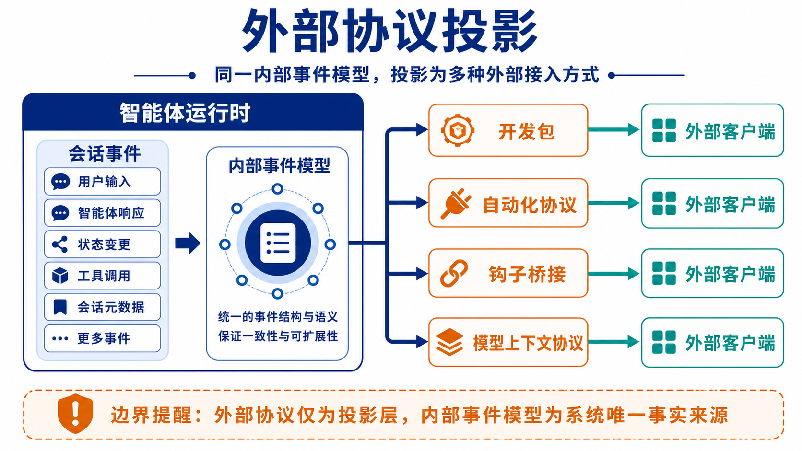
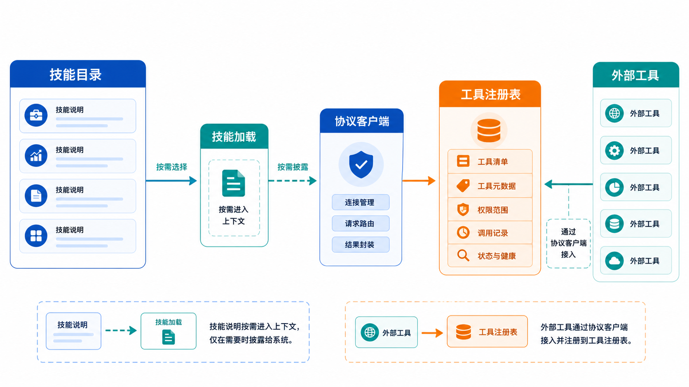
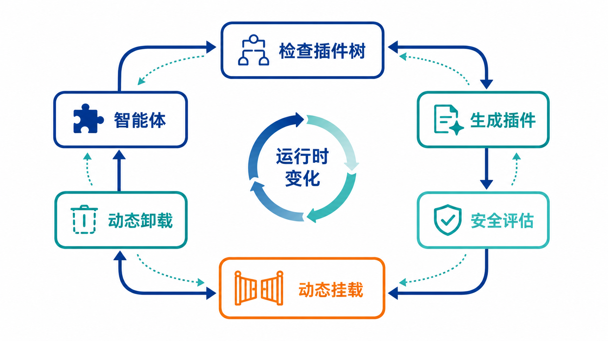
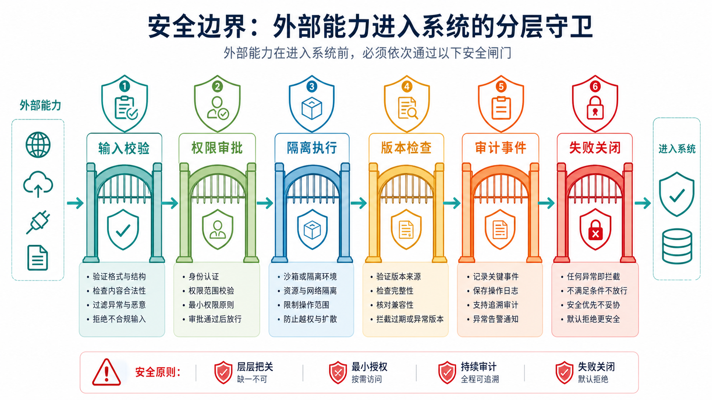

Agent Harness 不可能把所有能力都编进核心。问题是“开放”有很多方向：外部程序要驱动 Harness，编辑器客户端要通过标准 Agent 协议连接，既有自动化要在工具前后执行，外部工具服务器要进入模型工具表，本地操作手册要按需进入上下文，甚至模型要检查并临时修改正在运行的插件树。DeepSeek Harness 为这些方向分别提供 SDK、ACP、Hooks、MCP、Skills 与自引用 Cordis 工具，而不是发明一个含义模糊的 extension API。

本文固定核对官方标签 `dsh-v0.1.0-rc.7`。重点不是逐包列 README，而是建立一张“边界地图”：数据从哪边发起、谁拥有生命周期、内容是否进入模型、配置是否持久、失败应该在哪一层显现。所有链接固定到该 tag；代码较长处会用“源码裁剪”，完整组装示例会注明前置条件，教学伪代码不会冒充 rc.7 公共 API。

## 1. 六种扩展面打开的是六个不同方向

SDK 是“外部程序驱动一套 Harness runtime”；ACP 是“Harness 作为标准 Agent server 被自动化客户端驱动”；Hooks 是“Harness 在关键生命周期点调用既有命令并接收决策”；MCP 是“Harness 连接外部工具服务器，把远端工具注册进 `ctx.tools`”；Skills 是“从多个来源发现、排序、按需加载 Markdown 指令”；动态 Cordis 则是“模型在当前进程中定义和运行临时插件”。

```latex
外部应用 ── SDK JSON-RPC ──> Harness runtime
ACP client ── ACP stdio ───> Harness Agent
Harness lifecycle ── stdin/env ──> Hook command
Harness tools <── MCP transport ── MCP server
Agent prompt <── on-demand Markdown ── Skill providers
Model ── cordis_* tools ──> live Cordis plugin tree
```

边界目录还应记录协议版本、对端身份、数据分类、超时、最大消息、重试、取消与 dispose 终点。例如 stdio 并不需要网络认证，却依赖谁能启动/替换可执行文件；HTTP MCP 需要 TLS 与 header；Skill 文件依赖仓库写权限；动态 Cordis 依赖谁能让模型使用该工具。把这些属性集中维护，新增插件时才能发现它实际扩大了哪一块攻击面。



选型时先问“谁是主动方”。SDK/ACP 是外部控制面；MCP 与 Hook 是 Harness 主动调用外部实现；Skill 通常只提供可信内容，不执行任意代码；动态 Cordis 直接改变 live runtime，信任级别接近 bash。协议名称相近并不代表权限相近，例如 ACP 的 `mcpServers` 在 rc.7 中会拒绝非空输入，而 Harness 自己的 MCP Client 是一条独立插件能力。

第二个问题是“边界是否拥有 Agent”。SDK 与 ACP 创建并持有 Agent handle，它们的断开必须处理正在进行的 prompt 和后代；MCP 只注册工具，工具被哪一个 Agent 调用由 `ctx.tools` 与 scope 决定；Hook 借用当前执行上下文和 signal；Skill provider 只回答目录/正文查询；动态包则拥有一个 Cordis fiber。所有权决定 dispose 要等待什么，不能用统一的“关闭连接”代替。

第三个问题是“事实保存在哪里”。Session 日志会记录正常消息、工具调用、Hook 结果和 Skill invocation source，却不自动保存 MCP 服务器内部状态、SDK 客户端数据库或动态包 registry。恢复会话只恢复 Harness 已持久化的事实，不会复活已经退出的外部进程。设计灾备时要逐边界列出权威存储和重建步骤。

## 2. SDK 用最小 JSON-RPC 协议让另一进程驱动 Harness

SDK 栈分成 `packages/sdk/protocol`、`client` 与 `server`。protocol 定义换行分隔 JSON-RPC、请求/结果与通知；server 插件把当前 `ctx.agents` 暴露在 stdio；TypeScript Client 和 Python SDK 驱动它。SDK 不创建开发者项目、不生成配置，也不替调用者安装 runtime；调用者必须提供可执行程序与 `cordis.yml`。

```typescript
// 源码裁剪：packages/sdk/protocol/src/index.ts
export { JsonRpcLineTransport, JsonRpcResponseError } from './transport.ts'
export type {
  HarnessSdkNotificationMap,
  HarnessSdkRequestMap,
  InitializeParams,
  InitializeResult,
  SessionPromptParams,
  SessionPromptResult,
  SessionEventNotification,
  SessionStatusNotification,
} from './types.ts'
```

JSON Lines 适合 subprocess：一行一个完整 JSON-RPC frame，stdout 必须专用于协议，日志应走 stderr。initialize 先协商协议，再创建 session、提交 prompt、接收 session event/status 与 subagent 通知。真正的生命周期难点是进程退出、请求取消与 client dispose；相关实现分别在 `client/src/client.ts`、`client/src/dispose.ts` 和 `server/src/server.ts`。

Transport 要把三类失败分开：JSON-RPC error 是远端明确拒绝某个请求；进程退出或 EOF 是整个 runtime 不再可用；本地 AbortSignal 只表示调用者放弃等待。若把三者都变成同一个 `Error('failed')`，上层既无法决定是否重试，也无法知道 Session 是否可能仍在运行。请求 id 关联表在 dispose 时要统一拒绝，迟到 response 不得兑现给已经复用同一业务对象的新请求。

通知也不是持久队列。Client 订阅 session event/status 时可能因进程抖动错过帧；需要可靠恢复的应用应保存必要事件或通过协议支持的状态读取重建，而不是用“最后一条 notification”代表最终状态。SDK 适合自动化和集成，不自动提供多租户认证、网络 TLS 或任务队列；若把 stdio server 暴露成网络服务，这些责任属于外层网关。

```typescript
// 可运行示例：API 名称以 rc.7 dsh-sdk-client 导出为准
import { HarnessClient } from '@deepseek-ai/dsh-sdk-client'

await using client = await HarnessClient.spawn({
  command: 'dsh',
  args: ['--profile', 'headless'],
})
const session = await client.createSession({ cwd: process.cwd() })
const result = await session.prompt({ text: '检查项目并给出测试建议' })
console.log(result)
```

这段是组装示意，具体构造器和可执行参数应以包 README/类型为准。SDK 的稳定边界是 wire protocol，而非示例中的便捷方法名。生产调用者要监听子进程退出，给 prompt 配置 AbortSignal，并始终 dispose；仅收到最终文本不等于 server、transport 和 Agent 子树都已经停稳。

DSH SDK 还可作为 Subagent provider，这并不把两层生命周期合并：外层 Subagent run 拥有 SDK client 与远端 prompt，内层 server 拥有远端 Agent。外层取消必须传入 SDK 请求，再等待远端停稳并关闭 transport；外层 provider 只能把协议确认过的最终状态映射成 SubagentResult。测试应故意在 initialize、session 创建、prompt 准入和结果传输四个阶段分别杀掉子进程，检查没有悬挂 promise 与本地 child 记录。

## 3. ACP 是自动化 Agent 适配器，不是完整 Web UI 的远程镜像

ACP 实现在 `packages/acp/acp/src/index.ts`、`codec.ts` 与 `content.ts`。它在 stdin/stdout 打开 AgentSideConnection，支持 initialize、新 session、文本/图片 prompt、取消、已提交 assistant 输出与一次性权限应答。它不暴露编辑器导航、会话恢复、命令、模式、计划、推理、标题、工具展示或任意 MCP 配置。

```json
// 教学化 ACP 交互，字段细节以 ACP codec 为准
{"jsonrpc":"2.0","id":1,"method":"initialize","params":{"protocolVersion":1}}
{"jsonrpc":"2.0","id":2,"method":"session/new","params":{"cwd":"/workspace"}}
{"jsonrpc":"2.0","id":3,"method":"session/prompt","params":{"sessionId":"…","prompt":[{"type":"text","text":"修复测试"}]}}
```

每个连接可拥有多个会话，每个会话独立维护 workspace、一个进行中的 prompt 槽、取消区间与 disposer。图片能力只有在持久附件存储存在，且精确 provider/model 路由明确支持图片时才宣告；一批图片会先全部校验，再保存任何成员，避免半批进入历史。非空 additionalDirectories、mcpServers、音频和嵌入资源都明确拒绝。



ACP 有意只输出“已经提交”的 assistant 文本/图片，牺牲逐 token 低延迟，避免重试尝试和未提交分片泄漏。`session/cancel` 只拥有该 prompt 的准入和区间：进入 inbox 前取消不会误伤 Agent 上既有无关工作；进入后才取消指定 Agent 并等待自己的区间停稳。断开连接会拒绝新工作、drain 该连接确切拥有的可继续后代并释放 handles，不应影响同 Context 的其他前端森林。

ACP 的 stopReason 是“该 prompt 操作区间如何结束”，并不宣称是某个完全隔离轮次的纯结果。prompt 进入 inbox 后，Agent 可能同时接受 steering 或注入内容；bridge 等待整个 Agent idle 与有序输出交付，再结算响应。因此客户端若要严格一次请求一次纯函数结果，不应假设 ACP 自动提供这种隔离，而应使用独占会话、禁止并发控制，或在应用层建立更强约束。

权限请求是一次性 bridge-owned 关联。客户端可以自动 allow/deny，但决定不会作为自然语言直接塞给模型；所属工具仍通过普通 tool result 记录允许、拒绝、取消或不可用。这样权限控制保持在执行面，模型历史只看到工具事实。自动化策略若无条件 allow，相当于移除人工边界，必须由外部 sandbox 和最小工具表补偿。

```typescript
// 源码语义裁剪：ACP 插件是传输适配器
export const inject = ['agents', 'sessionPersistence', 'attachments']

export function apply(ctx: Context, config: Config) {
  const connection = createAgentSideConnection(process.stdin, process.stdout)
  const bridge = createAcpBridge(ctx, connection, config)
  ctx.effect(() => () => bridge.dispose())
}
```

这段省略了 rc.7 的真实依赖与辅助函数，只展示所有权结构，不可直接运行。准确源码请看 index.ts。ACP 在此也是 `dsh-subagent-acp` 的主要远端：父 Harness 可以把另一套 ACP Agent 当 Subagent provider，而上层委派工具不需要理解 ACP wire。

## 4. Hooks 把既有 Claude Code/Codex 自动化接到生命周期点

共享库 `packages/hooks/hook-protocol` 不注册 Cordis 插件，只提供 matcher、命令运行、输出解码、合并、持久记录与 detached drain。两个桥接 `hooks-claude-code` 和 `hooks-codex` 负责各自 payload/env 和类型化 Decision。

```typescript
// 源码裁剪：hook-protocol 的共享原语
const diagnostic = matcherDiagnostic(pattern, mode)
const matched = matchesMatcher(pattern, query, mode)
const output = await runHook(bash, hook, {
  payload,
  env,
  signal,
  defaultTimeoutMs,
}, now)
const merged = mergeHookOutputs(outputs)
```

Claude mode 对简单 `[A-Za-z0-9_|]+` 做字面/交替匹配，其他值当正则；Codex mode 始终使用未锚定正则。配置阶段先诊断坏 matcher，运行谓词仍把无效 pattern 隔离为不匹配。`runHook` 把 JSON payload 写 stdin，在 shell 凭据清理后合并 env，遵循 timeout，把 signal 传到进程组终止与 join；执行器故障被转成非阻塞 HookOutput，而不是让 agent loop 直接崩掉。

```json
// 可运行 hooks.json 形状示意，事件名以对应桥接 README 为准
{
  "hooks": {
    "PreToolUse": [
      {
        "matcher": "bash|write_file",
        "hooks": [{ "type": "command", "command": "./policy-check.sh" }]
      }
    ]
  }
}
```

输出合并的权限优先级是 deny > ask > allow；首个 `continue:false` 后保持 halt，原因拼接，上下文按顺序累积。退出码 2 以 stderr 阻止，其余失败默认不阻塞。`updatedInput` 在 rc.7 会解析但不会应用，并记录警告——这是不能忽略的兼容边界。`hook/invoked` 与 `hook/result` 进入 Session 日志且按 handlerId 配对；脱离运行的 Hook 在 fiber dispose 时先 abort 再 drain，不能继续作用于已卸载 Context。

Hook 配置本身是可执行供应链。command 不经过任意 shell 插值并不自动安全：它仍可以调用脚本，脚本会继承桥接选择的环境和 cwd。配置解析应拒绝未知事件与坏 matcher，部署仓库应审查脚本内容、固定解释器，并限制可写目录。stderrSummary 会截断后写持久事件，但前几百字符仍可能含 secret，命令必须避免输出凭据，日志出口也要脱敏。

Detached hook 的存在说明“事件 emit 已返回”不等于副作用结束。`createDetachedRuns()` 跟踪整条 Promise continuation，fiber dispose 先 abort tracker signal，再等待所有链 settle。若桥接只杀进程却不等待 exit/join，旧 Hook 可能在新插件 generation 已激活后继续写文件，形成 HMR 跨代竞态。

## 5. MCP Client 把外部工具注册为稳定、可撤回的本地工具

MCP 插件入口是 `packages/mcp/mcp-client/src/index.ts`，连接监督在 `connection.ts`，工具映射在 `tools.ts`。一个插件实例连接一个 server，支持 stdio 或 Streamable HTTP；多个实例通过不同 `serverName` 共存。

```yaml
# 可运行配置示例：stdio MCP server
- name: '@deepseek-ai/dsh-mcp-client'
  config:
    transport: stdio
    serverName: memory
    command: node
    args: ['./mcp-memory-server.js']
    env: {}
    cwd: /workspace
    toolCallTimeoutMs: 60000
    failOnStartupError: true
```

远端工具名映射为 `mcp__<serverName>__<rawName>`，serverName 必须匹配 `[A-Za-z0-9_-]{1,32}`，同一 app 中重复名称在插件加载时高声失败，不做静默覆盖。插件激活会等待初始连接与 tool discovery；`failOnStartupError` 决定首连失败是回滚 fiber，还是记录后进入 reconnect。当前 generation 的工具注册、飞行调用、transport 和重连循环全由 supervisor 拥有。

```typescript
// 源码裁剪：两种配置联合
type Config =
  | {
    transport: 'stdio'; serverName: string; command: string
    args: string[]; env: Record<string, string>; cwd: string
    toolCallTimeoutMs: number; failOnStartupError: boolean
  }
  | {
    transport: 'streamable-http'; serverName: string; url: string
    headers: Record<string, string>; toolCallTimeoutMs: number
    failOnStartupError: boolean
  }
```

MCP 工具还必须经过 Harness 原有的 Tool Registry、restriction 和执行记录。服务器声明了工具，不代表每个 Agent scope 都应看见；部署可以在 child 创建窗口收窄可见工具，审批策略也可以在真实执行前介入。对返回的大文本或二进制引用，应使用 spill/attachment 等受控路径，不让第三方 server 用一次结果挤爆 Session 和下一轮模型上下文。

对端能力同步不是授权协商。`listTools` 告诉 Harness 有哪些名字、描述和 schema，却不证明 server 实现可信，也不证明调用者有权访问其背后的数据库。应用应为不同租户使用不同 server 实例或认证上下文，禁止在一个全局 MCP 连接上仅靠 prompt 约束租户 id；工具执行端仍要做领域授权。

MCP schema 与结果跨不受信任边界，必须规范化并限制体量；远端 server 拥有的文件、网络和数据权限不会因进入 `ctx.tools` 自动变安全。部署应把 HTTP headers 当凭据管理，把 stdio command/args 当可执行配置审查，并为每次调用设置 timeout。HMR 会 dispose 旧 generation、撤回工具，再用同名实例重建；模型看到的工具表随之变化，可能影响 prompt cache。

重连不是在旧 client 上原地继续。Supervisor 应把一次连接、发现出的工具注册与飞行调用视作 generation；连接丢失后撤回旧 generation，再退避建立新的 client，重新同步工具。远端同名工具的 schema 可能变化，因此不能保留旧函数句柄投给新连接。模型正在执行旧 call 时断线，应得到明确工具错误，而不是在重连后重复执行可能有副作用的调用。

`failOnStartupError: false` 只表示插件可在首连失败时激活并后台重试，不表示工具已经可用。依赖某 MCP 工具的上层 prompt 或测试要观察注册表，而不是看到 fiber active 就继续。生产关键能力可设 true，让 Cordis 对启动失败做事务性回滚；这样“服务已启动”更接近“必需工具已发现”。



## 6. Skills 是分层内容注册表，不等于执行插件

Skill seam 的定义在 `packages/skill/skill/src/index.ts`，文件系统 provider 在 `skill-filesystem/src/index.ts`，模型工具在 `tool-skill/src/index.ts`。Registry 合并多个 provider 目录，只保留每个名字的胜者；lower rank 优先，再按 provider 注册顺序解决同 rank。

```typescript
// 源码裁剪：Skill 摘要与完整定义
interface SkillSummary {
  readonly name: string
  readonly description: string
  readonly whenToUse?: string
  readonly invocation: {
    modelInvocable: boolean
    userInvocable: boolean
  }
  readonly source: SkillSource
  readonly provider: string
  readonly resourceBase?: SkillResourceBase
}

interface SkillDefinition extends SkillSummary {
  readonly content: string
  readonly path?: string
  readonly metadata?: Readonly<Record<string, unknown>>
}
```

`list()` 只需要摘要，`get()` 才加载完整 Markdown，避免每轮把全部说明塞给模型。作用域层和 cwd 参与候选收集；project-dsh、project-agents、user、bundled 等来源可设 rank。调用策略分离 modelInvocable 与 userInvocable：可由用户显式选择但不自动广告给模型，或相反。Skill 名必须是 kebab-case，内容被视作可信本地指令，不能把不可信下载文本当无害数据。

```markdown
---
name: release-review
description: 检查发布前兼容性与测试证据
---

# Release Review

1. 读取变更文件。
2. 对照固定版本 API。
3. 运行最小测试并报告证据。
```

加载后 `renderSkillContent()` 统一产生 `<skill_content>`、resource hint 与 instructions。用户显式调用时，用户原话仍是一条普通 user message，Skill body 作为带 `skill-invocation` source 的 instructions context 注入，transcript 不必从文本猜来源。相对路径按 `resourceBase.directory`，相对 URL 按 URL base 解析；Registry 不会预加载所有资源。

Skill 的 duplicate resolution 应保持可解释。低 rank 胜出不等于更可信，它只是部署定义的优先级；summary 仍保留 source/provider，UI 与审计可以显示当前赢家来自 project、user 还是 bundled。Provider 卸载后 Registry 应重新选择下一候选，缓存也要按 scope、cwd 与 provider generation 失效，否则模型可能加载到已删除文件的旧正文。

Markdown body 是指令，不是数据。项目仓库可通过 Skill 影响模型行为，因此打开陌生仓库时应把项目 Skill 纳入信任评估。一个 Skill 可以要求读取额外文件或调用 MCP/bash；invocation policy 只控制谁能触发它，不限制它要求的动作。真正的执行限制仍由工具 scope、approval 与 sandbox 承担。

## 7. 自修改 Cordis 让模型检查、定义、运行和撤回临时插件

开放程度最高、也最需要警惕的一组能力位于 `packages/extensions/tool-cordis` 与 `cordis-host-runner`。rc.7 实际注册了七个模型工具：`cordis_inspect_list` 列出可用的只读检查器，`cordis_inspect_query` 调用某个检查器的方法，`cordis_inspect_self` 查看当前会话拥有的动态插件及其版本；`cordis_define`、`cordis_run`、`cordis_stop`、`cordis_undefine` 则依次负责登记、运行、停止和永久删除。前三个 Inspect 工具只读，不等同于插件代码可以调用的业务 Service。

`cordis_define` 只校验参数和 JavaScript 语法，并保存一份不可变的 Package（插件版本）；到 `cordis_run` 才会在 VM（隔开全局变量的 JavaScript 执行环境，并非安全沙箱）中求值 Host 半，必要时再请求浏览器加载 Client 半。下面的 Host 源码可直接作为 `cordis_define.code.host` 提交。动态环境不允许把普通对象直接注册为工具：必须先调用 `harness.defineTool`，再用 `harness.registerTool` 注册。`execute` 返回可无损序列化的 JSON 值，`output.render` 才负责把该值变成人类和模型可读的内容块。

```javascript
// rc.7 可运行的动态 Host 半；整段字符串作为 code.host 提交
return {
  name: 'project-status',
  inject: ['tools'],
  apply(ctx) {
    harness.registerTool(ctx, harness.defineTool({
      name: 'project_status',
      description: '读取当前项目状态。',
      parameters: {},
      output: {
        schema: {
          type: 'object',
          additionalProperties: false,
          properties: {
            status: { type: 'string', required: true },
          },
        },
        render(_args, value) {
          return [{ type: 'text', text: '项目状态：' + value.status }]
        },
      },
      async execute() {
        return { status: 'ready' }
      },
    }))
  },
}
```

这里的 `parameters` 使用 rc.7 统一 Schema DSL；`output.schema` 验证工具主体返回的 JSON，`render` 必须返回内容块数组。Host runner 会给 `harness.defineTool` 生成的定义打上内部标记，因而直接调用受保护的 `ctx.tools.register({ ... })` 会被拒绝。实际可用的 Service、Event、内建函数和 Client Slot（浏览器界面的插槽）应先通过 Inspect 查询，不应凭名称猜测。

新定义归属于发起会话；其他会话查询时表现为不存在，而不是返回“禁止访问”，以免泄漏元数据。运行中的 Package 可以在后续轮次继续改变工具和提示词，但只存在于当前 DSH 进程内存：它不会写入插件文件、修改 `cordis.yml`、跨进程重启，也不会自动变成正式插件。

```
// 1. 先调用 cordis_inspect_list；再从返回值选择真实 provider/method
{}

// 2. cordis_inspect_query 的参数形状，三个名称必须来自上一步
{
  "platform": "host",
  "provider": "<inspect-list 返回的 provider>",
  "method": "<该 provider 声明的 method>",
  "input": {}
}

// 3. cordis_define：hostCode 是上方整段 Host 源码字符串
{
  "plugin": { "kind": "new", "idPrefix": "proj" },
  "name": "project-status",
  "purpose": "添加项目状态工具",
  "code": { "host": "<hostCode>" }
}

// 4. cordis_inspect_self：使用 define 返回的两个准确 ID 检查源码与诊断
{ "pluginId": "<pluginId>", "packageId": "<packageId>" }

// 5. cordis_run 首次激活
{ "pluginId": "<pluginId>", "packageId": "<packageId>", "mode": "run" }

// 6. cordis_stop 与 cordis_undefine 都只接收稳定的 pluginId
{ "pluginId": "<pluginId>" }
```

上面按调用顺序分别对应 `cordis_inspect_list`、`cordis_inspect_query`、`cordis_define`、`cordis_inspect_self`、`cordis_run`，最后一个参数形状可用于 `cordis_stop` 或 `cordis_undefine`。修改已有插件时，`cordis_define.plugin` 应改成 `{ "kind": "existing", "pluginId": "…" }`；切换到新 Package 时，`cordis_run.mode` 使用 `update`。`pluginId` 是稳定身份，`packageId` 表示某个不可变版本，两者不能混用。

Host runner 执行 `stop` 时会撤销处理器，释放 Cordis fiber（由框架管理生命周期的异步执行单元）并等待它完全停稳，然后广播撤回事件；保留下来的定义以后仍可重新运行。包含浏览器 Client 半的 Package 必须由某个页面授权并执行：事件只广播元数据，获准页面再调用 `getClientCode` 取得代码。没有页面的 headless/ACP 环境会等待到发起轮次取消；`run` 成功只证明 Client 半已经装载，不能证明 React 随后一定渲染成功。

define/run 分离是重要事务边界。define 先对 Host/Client 两半做语法预检，拿到 id 时没有副作用；run 才创建 group fiber 并求值。Host 半失败时浏览器不会取得 Client code；某页面 Client 半加载失败，只有当本次请求刚启动 Host 半时才允许回滚，不能停掉其他页面已经使用的同一 live package。并发 run 对同一定义只求值一次，`startedHere` 记录责任归属。

动态 registry 全局可 inventory，但有动作的动词按 owning Session 校验。列表中“看得见别的 owner”仅供运行控制面，模型工具的会话视图不会因此获得 stop/undefine 权限。浏览器 invoke 则按 package/version 路由到自己 Host 半注册的 handler，不提供 Host 主动调用任意页面的反向通道。这些细节防止临时插件成为跨会话 RPC 总线。

## 8. 信任边界：VM 不是安全沙箱，Skill 与 Hook 也能注入行为

动态 Cordis 的 README 明确指出 VM 只隔离全局变量，不是安全边界。Node 全局可能被移除或映射到 `ctx.fs`、`ctx.web`、`ctx.bash` 等服务，但 Host realm helper 仍可能形成逃逸；同步 `vmTimeoutMs` 也限制不了已经逃出的 async 函数体。加载这组工具，应像授予 bash 一样慎重，而不是把“临时插件”理解成浏览器小组件。

```yaml
# 教学伪代码：按信任域选择扩展，不是 rc.7 schema
profiles:
  untrusted-chat:
    enable: [skills-readonly]
    disable: [tool-cordis, hooks, mcp-local-process]
  developer-workstation:
    enable: [sdk-server, mcp-approved, hooks-reviewed]
  isolated-lab:
    enable: [tool-cordis]
    sandbox: disposable-vm
```

Hook 命令能读 stdin/env 并影响 allow/deny；MCP server 能执行它声明的工具；Skill 虽然不直接运行 JS，却能指示模型调用危险能力；SDK/ACP 客户端能连续驱动 Agent；动态 Cordis 能注册新工具与监听器。因此权限不是看协议名字，而是看它能触达哪些 Cordis service、OS 资源、凭据和用户批准面。



审计也要放到不同位置：SDK/ACP 记录请求关联和 session 所有权；Hook 写 `hook/invoked`/`result`；MCP 工具调用仍进入普通 tool-call/result 日志；Skill invocation 带专用 MessageSource；动态包的 define 元数据进入呈现，但代码只留在 assistant 工具调用历史与内存注册表。不要误以为所有扩展都有同样持久证据。

网络边界也不能被包名遮蔽。Streamable HTTP MCP 需要 TLS、服务身份与 header 轮换；SDK/ACP 的 stdio 默认依赖同机进程权限；Hook 和 stdio MCP 需要 scrub ambient env；动态 Client 半经过已登录页面执行；Skill 资源若来自 URL 则需要来源完整性。安全评审应画真实进程、用户和网络拓扑，而不是只列 npm 包。

## 9. 组合、测试与 Developer Preview 兼容策略

可靠的开放系统不是“所有接口都启用”，而是按部署面组合最小集合。无人值守服务可启用 SDK server 与经过审查的远程 MCP，却不应启用等待浏览器确认的 Client 半动态包；IDE 自动化可选择 ACP 的已提交输出与权限应答；团队规范适合 Skills；已有 Claude/Codex policy 脚本适合 Hooks；动态 Cordis 更适合隔离实验，验证后转写成常规插件。

```typescript
// 教学伪代码：跨边界测试矩阵
const cases = [
  'initialize/version mismatch',
  'prompt cancelled before inbox acceptance',
  'hook timeout and deny precedence',
  'MCP reconnect replaces tool generation',
  'skill duplicate rank and provider disposal',
  'dynamic package stop reaches quiescence',
]
for (const name of cases) await verifyBoundary(name)
```

每条边界至少测试首连失败、取消、对端退出、坏 payload、重复注册和 dispose；不要只测试 happy path 的文本结果。真实入口也很重要：SDK/ACP 用构建后的 bin 与真实 stdio，MCP 用 fixture server 验证重连和工具撤回，Hook 用真实 shell executor 测进程组取消，Skill 用文件 watcher 测 HMR，动态 Cordis 测并发 run 与 stop 后完全停稳。

组合测试还要验证边界之间的干扰：Hook 阻止 MCP tool 时是否仍写成配对结果；Skill 指令触发动态 Cordis 后 stop 是否撤回新工具；ACP 断开是否只 drain 自己的 Subagent 森林；SDK Client dispose 时远端 telemetry/session flush 是否达到约定终点；MCP 重连改变工具 schema 后下一次 system prompt 是否更新。单包全绿不能证明插件图正确。

`dsh-v0.1.0-rc.7` 仍处 Developer Preview，这些 wire、工具 schema、扩展事件、配置字段和持久记录可能发生破坏变化。固定 tag 与 lockfile；升级时重新生成 snapshot，逐项对照“谁主动、谁拥有、什么进模型、什么持久、怎样取消”。Harness 的边界越多，越不能靠一个笼统的“插件权限”解释一切。真正可维护的开放性，是每条扩展路径都有自己的最小契约、失败隔离和清理终点。
