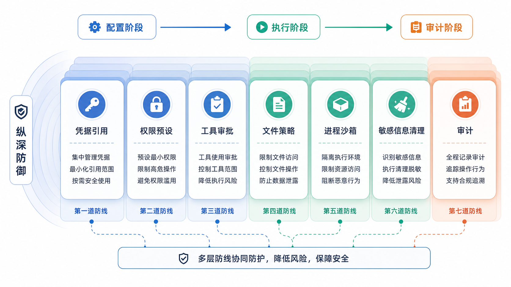
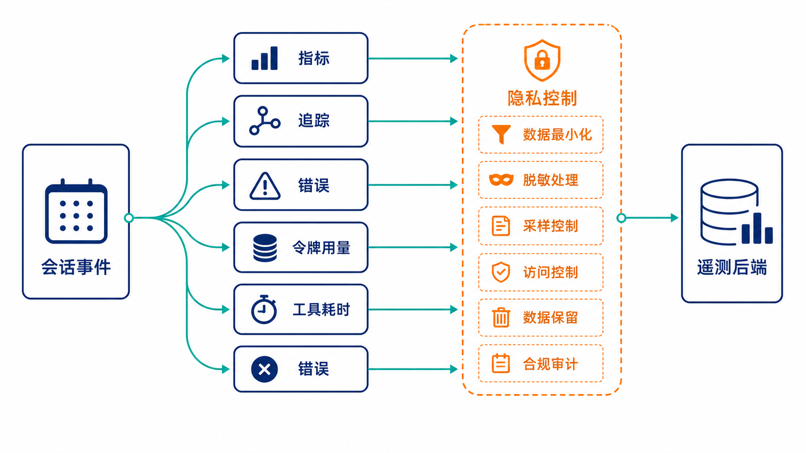
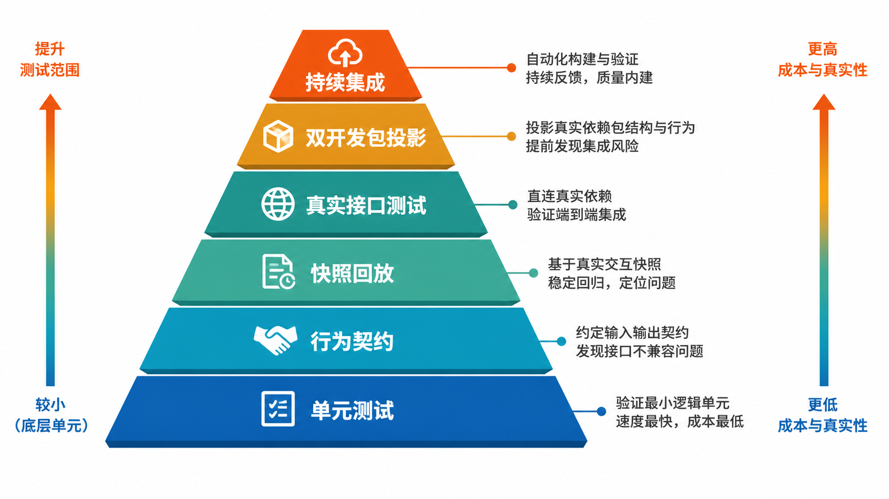
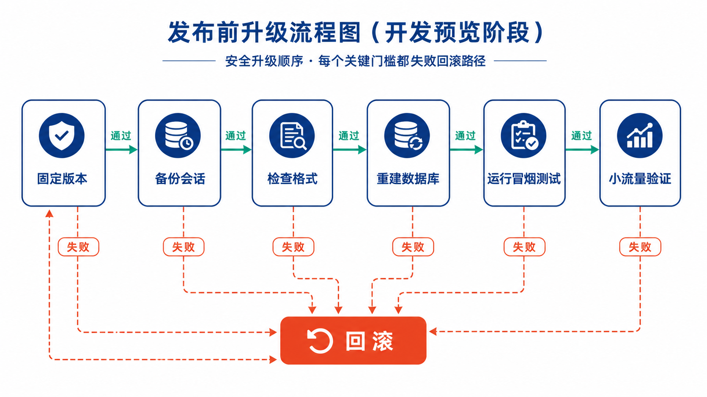

Developer Preview 最容易出现两种误判：一种把“功能能跑”当作“可以放心上线”，另一种因官方提示会破坏兼容，就干脆不做任何工程约束。DeepSeek Harness `0.1.0-rc.7` 的正确使用方式位于两者之间：承认 API、配置、事件与持久格式仍会变，同时通过固定版本、最小权限、外部可验证测试、遥测脱敏、可回滚升级和显式数据迁移，把变化限制在可观察、可恢复的边界内。

本文固定源码为官方 `dsh-v0.1.0-rc.7`，标签提交 `99f6f02`。官方 `README.zh.md` 明确标记 Developer Preview 并说明未来会有破坏兼容性变更。本文不是一份抽象安全清单，而是沿 rc.7 的 Sandbox、Credentials、Approval、Telemetry、Session、测试门禁和构建脚本说明上线纪律。源码摘录会注明，示例配置需按部署组合调整，教学伪代码不代表仓库已有迁移 API。

## 1. 先建立威胁模型与版本账本，不要把 Preview 当免责声明

需要保护的对象至少包括工作区文件、宿主系统、网络凭据、会话日志、工具返回、遥测出口和其他租户会话。潜在输入不仅是用户文本，还包括模型输出、项目内 Skill、MCP server、Hook 命令、动态 Cordis 代码、外部 Subagent provider 与恢复的历史 Session。Plugin architecture 使能力可替换，也意味着每个新插件都可能改变信任边界。

```yaml
# 教学模板：部署版本账本，不是 Harness 配置
runtime:
  repository: deepseek-ai/deepseek-harness
  tag: dsh-v0.1.0-rc.7
  commit: 99f6f02
  node: 22.19.x
  packageManager: pnpm@11.7.0
artifacts: # 构建产物及其摘要
  lockfileDigest: '<sha256>'
  imageDigest: '<sha256>'
data:
  sessionFormat: 'rc7-observed'
  backupAt: '2026-08-18T00:00:00Z'
```



根 `package.json` 给出的运行约束是 Node `^22.19.0 || >=24.0.0`、pnpm `11.7.0`。生产镜像不要用浮动 `latest`，插件依赖也不要用无上限范围。tag、commit、lockfile、Node、原生 sandbox runner 与组合配置必须一起成为发布物；只记录 npm 包版本不足以复现 Host/Client 生成契约和本地 runner 行为。

风险接受也要逐能力书写。例如只读问答部署可以不加载 shell、动态 Cordis 与 stdio MCP；代码工作站可启用 workspace-write，但要求用户审批越界重试；无人值守流水线则应在一次性容器或 microVM（以轻量虚拟机方式提供内核级隔离的运行环境）中运行，应用内 Sandbox 不能替代完整的主机隔离。Preview 仍然可以用于严肃工程，前提是暴露面足够小，并且每项变更都有撤退路径。

插件清单本身应进入软件物料表。相同 Harness tag 加载不同的 Cordis bundle，安全性质可能完全不同：一个额外的 Hook、MCP 或动态工具就能增加出站网络、进程执行或模型可见 schema。发布时保存展开后的 Profile、Bundle 与 Patch 结果，记录每个插件版本、配置来源和提供/等待的 service；故障现场才能回答“当时究竟组合了什么”，而不是只知道主程序版本。

多租户部署还要在 Harness 之外隔离 OS 用户、工作目录、临时目录与凭据来源。Session scope 能防止许多逻辑横向访问，却不是内核级租户边界；进程内插件可能拿到 root Context，全局 service 也可能看见多个 Session。高价值租户不应只靠 session id 和工具 filter 共处一个高权限进程。

## 2. Sandbox 只约束文件效果，且 partial 必须被当作事实

Sandbox seam 定义在 `packages/sandbox/sandbox/src/index.ts`，策略在 `sandbox-policy/src/index.ts`，本地后端在 `sandbox-local`。模式只有 `read-only`、`workspace-write` 与 `danger-full-access`；它们约束文件系统效果，不承诺网络隔离，也不承诺隐藏其他进程。

```typescript
// 源码裁剪：sandbox 公共词汇
type SandboxMode = 'read-only' | 'workspace-write' | 'danger-full-access'
type SandboxEnforcement = 'full' | 'partial'

interface SandboxExecutionPolicy {
  mode: SandboxMode
  workspaceRoot: string
  sessionId?: SessionId
}

abstract class SandboxProvider {
  abstract confine(argv: readonly string[], policy: SandboxPolicy): ConfinedArgv
}
```

受限模式必须返回实际执行隔离的 argv，或抛 `SANDBOX_UNAVAILABLE`，禁止静默透传。`danger-full-access` 则由消费方直接执行原 argv，根本不经过 provider。每次能力调用解析 policy：显式且已批准的模式高于 Session 日志中的 override，后者高于部署默认值；Session 不可变 cwd 变成 workspaceRoot。这样两个会话可并发使用不同边界。

```typescript
// 可运行消费模式：字段以 rc.7 服务契约为准
const policy = ctx.sandboxPolicy.resolve({ session: agent.session })
if (policy.mode === 'danger-full-access') {
  return subprocess.spawn(argv, { signal })
}
const confined = ctx.sandbox.confine(argv, policy)
if (confined.enforcement !== 'full' && requireFullIsolation) {
  throw new Error('当前平台只能部分强制执行文件策略')
}
return subprocess.spawn(confined.argv, { signal })
```

`partial` 不是普通警告，而是后端报告的强制程度。Linux 的 Landlock ABI（用户态程序调用 Landlock 内核隔离能力的接口版本）过旧，或者 Windows ACL（访问控制列表）在 Everyone 权限、硬链接等边界上无法完整收紧时，策略都可能只得到部分执行。要求严格文件隔离的环境应拒绝 `partial`，或再增加容器、microVM。还要区分 runner 自身失败与策略正常拒绝：前者表示命令没有真正开始，后者表示隔离已经生效并阻止了操作；`ConfinedArgv` 分别用 `runnerFailureRules` 和当前后端的 `denialSignatures` 提供判断依据。

工作区 root 的解析也不能用字符串前缀判断。策略服务按文件系统语义和词法语义规范化 cwd，处理符号链接与 `..`，让 runner 约束命令真正工作的目录。工具若在 sandbox 外自行打开路径，必须使用自己的 capability seam 和同等策略，不能因为“随后调用的 bash 会隔离”就认为前置读写也受保护。Sandbox 是逐执行包装器，不会自动拦截同进程 Node 插件的 `fs`。

网络不在 SandboxMode 词汇中，这一点必须写进 UI 和运维文档。`read-only` 的进程仍可能上传读取到的数据，`workspace-write` 也不限制访问云 metadata endpoint。需要网络边界时使用容器网络策略、代理 allowlist、无网络执行器或远程 sandbox provider，并用外部探针验证，而不是从模式名称推断。

## 3. Approval、权限预设与凭据引用解决不同问题

审批不是 Sandbox，Sandbox 也不是凭据管理。权限预设服务把 `sandbox/mode` 与 `approval/policy` 两个独立 knob 组合成 UI 上的具名选项，但最终仍分别写入 Session 事件。源码位于 `packages/interaction/permission-presets/src/index.ts`。选中与当前状态相同的 preset 不重复 append；手动形成非预设组合时显示 `custom`。

```yaml
# rc.7 的 dsh-permission-presets 插件配置
- id: permission
  name: '@deepseek-ai/dsh-permission-presets'
  config:
    presets:
      safe:
        sandbox: read-only
        approval: ask
        name: 只读并询问
        description: 只允许读取；需要扩大权限时向用户询问。
      coding:
        sandbox: workspace-write
        approval: ask
        name: 工作区写入
        description: 可写工作区和允许的临时目录；越界操作需要询问。
      unrestricted:
        sandbox: danger-full-access
        approval: never
        name: 完全访问且不询问
        description: 不做文件隔离；所有审批请求直接拒绝。
    defaultPreset: coding
```

这里的 `approval` 只有 `ask` 和 `never` 两个合法值。`ask` 表示把请求交给已组合的交互应答器；如果没有应答器，请求会按失败时默认拒绝的原则返回 unavailable。`never` 并不是“永远允许”，而是完全不弹出审批，任何需要审批的动作都会直接被拒绝。`custom` 只用于表示当前两个旋钮没有匹配任何预设，不能作为预设名称。

审批的意义是让人接受一次风险或策略变化，不是把未经隔离的命令变安全。一次 approved escalation 应作为新的能力调用携带显式 mode；不能在原调用中途改共享 provider 状态。多租户系统还应确保批准请求归属于准确的 Agent/tool call，客户端响应有一次性关联，不允许仅凭可预测 id 替别人批准。



凭据 seam 位于 `packages/credentials/credentials/src/index.ts`，本地 provider 位于 `credentials-local`。配置保存 POSIX 环境变量形态的 `CredentialRef`，值由 provider 管理；consumer 每次模型或外部操作重新 resolve，不跨操作缓存，因此轮换对下一请求生效。

```typescript
// 源码裁剪：凭据只在操作边界解析
type CredentialRef = Branded<'CredentialRef'>

interface ResolvedCredential {
  value: string
  source: string
}

const resolved = await ctx.credentials.resolve(config.apiKeyRef)
if (!resolved) throw new Error('credential is not configured')
await callProvider({ apiKey: resolved.value, signal })
```

UI 只能使用 `describe()` 得知 configured、source、writable，绝不能取得值。空值在 seam 全局被视作不存在；只读环境来源遮蔽可写文件时，`set/unset` 会拒绝，避免“保存成功但实际仍用旧值”。日志、错误、Hook env、MCP headers 与遥测脱敏规则都要防止值泄漏，引用名也应避免包含敏感业务含义。

凭据轮换测试要覆盖飞行请求：每个操作开始时读取一次，因此已经发出的模型请求继续使用该次快照，下一请求才看到新值。不要在单个流中途重新 resolve，否则 endpoint 与 key 可能来自不同配置代际。撤销旧值后要观察 provider 错误分类与重试，确保通用 retry 不会无限使用已经失效的快照。

## 4. 遥测是可选导出副本，不是可靠审计账本

捕获协调器在 `packages/session/session-telemetry/src/index.ts`，OpenTelemetry provider 在 `session-telemetry-otel`。OpenTelemetry 通常缩写为 OTel，是统一采集和导出日志、指标、链路数据的一套可观测性标准。这里的 provider 会镜像 Session 账本事件，并补充 `agent-error`、`shutdown` 两类运行记录；这些副本不会进入模型请求。后端 `emit()` 必须以非阻塞方式入队，批处理、重试、排队、丢失和导出器配置由 OTel SDK 负责，不属于 Agent Loop 的职责。

```typescript
// 源码裁剪：逻辑记录与最小 sink
interface SessionTelemetryRecord {
  channel: 'ledger' | 'ops'
  time: number
  severity: 'info' | 'warn' | 'error'
  attributes: Record<string, string | number>
  body: unknown
}

interface SessionTelemetrySink {
  emit(record: SessionTelemetryRecord): void
  flush?(): void
  shutdown(): Promise<void>
}
```

只有每个 `(turn, step)` 的第一条 `assistant/chunk` 被捕获，因此 seq 缺口是正常采样，不代表网络丢包。交接游标表示“已交给 backend”，不表示 collector 已收到；崩溃可能丢，SDK 重试可能重复。接收端对 ledger 用 `(session.id, event.seq)` 去重，ops 没有这类 identity，只适合告警而非累计审计。权威事实仍是 Session 日志与应用自己的安全审计系统。

```typescript
// 可运行插件示例：导出前脱敏，不改权威 Session
ctx.on('session-telemetry/record', (record, next) => {
  const candidate = next()
  return {
    ...candidate,
    body: redactSecrets(candidate.body, ['apiKey', 'authorization', 'cookie']),
  }
})
```

该事件采用 Waterfall（按注册顺序串行组合处理器）机制：监听器调用 `next()` 取得下层结果并继续叠加；不调用 `next()` 就会替换下层；处理器抛错时，这条记录按失败即停止的原则被扣住，错误由协调器隔离。这里没有内置脱敏规则——如果没有部署监听器，捕获副本会原样交给后端。因此测试必须使用真实的 SessionEvent 正文样本，覆盖用户提示词、工具结果、路径、MCP 数据、Hook 标准错误和自定义插件事件，不能只搜索几个常见字段名。

共享披露 `full | feedback-only | disabled` 只说明部署策略，不承诺投递或留存。用户界面不要把“启用了 OTel”描述为“所有记录都可靠上传”，也不要把 disabled 误写成“本地没有日志”。关闭外发和删除本地会话是两件事。

Telemetry backend 的 shutdown 是应用退出的一部分：协调器在 dispose 前产生 shutdown ops marker，再等待 SDK pipeline quiescence；失败只记录警告，不应让整个应用无法退出。部署仍需设置外层 shutdown deadline，因为 collector 不可达时第三方 SDK 可能拖延。强制超时后必须承认尾部记录可能丢失，不能伪造“全部已送达”的成功指标。

脱敏规则也应版本化。字段路径会随插件事件变化，旧规则可能无法覆盖新的数据结构。稳妥做法是默认删除高风险正文分支，再明确列出允许导出的字段。若业务必须使用 `full` 模式，至少要扫描字符串中是否出现已知凭据值，并对路径和用户文本分类；还可以在 CI 中注入专门用于探测泄漏的合成密钥，确认导出器始终收不到它。这类无真实权限、只用于触发告警的测试值常被称为 canary secret（探针密钥）。

## 5. Session 兼容首先是事件关系和未知插件事件，而非 JSON 能解析

Session 是权威事件日志。核心关系不变量在 `packages/core/session/src/invariant.ts`：seq 严格递增；turn 不嵌套；step 必须属于当前 turn；tool/result 要匹配本 step 先前 tool/call；request header/context 位于开放 turn。插件通过 declaration merging 添加的事件关系由插件自己的 invariant 拥有，核心 default 分支不会擅自解释。

```typescript
// 源码裁剪：核心关系状态
interface SessionTrace {
  lastSeq: number
  openTurn: number | null
  openStep: number | null
  nextTurn: number
  nextStep: number
  pendingCalls: Set<CallId>
}

if (event.seq <= trace.lastSeq)
  fail(`seq must strictly increase`)
```

“文件还能 JSON.parse”远远不等于数据兼容。升级可能改变 header、事件 payload、surface replacement、packed line layout、projection 或 compaction 规则；旧插件事件也可能失去拥有者。安全做法是保留原始只读副本，在复制品上运行离线迁移，再用新版本 Session loader、关系 invariant、projection 与代表性回放同时验证。

```shell
# 可运行仓库命令：只针对签入的旧 packed fixture 迁移器
pnpm run migrate:packed-session-fixtures

# 不要把它假设为任意生产会话的通用迁移器
pnpm run test:snapshot
```

`scripts/migrate-packed-session-fixtures.ts` 明确用于仓库 fixture。生产迁移必须确认自己的 persistence provider 与格式，不能直接对数据目录批量运行一个测试脚本。若新版本没有官方迁移路径，优先保留旧 runtime 做只读导出，或把旧对话归档为不可继续的数据，而不是现场猜 schema。

插件事件的所有权尤其重要。核心 loader 对未知 merge-extensible event 可以保留数据，却不一定知道如何投影、压缩或修复；删掉插件后继续恢复旧 Session，可能出现“日志能读、模型上下文少了一段”的语义损失。升级清单应列出每种 event.type 的 owning package、新版是否仍加载、是否有 invariant/projection，以及缺失时采用拒绝恢复、只读显示还是显式转换。

大型工具结果的 spill（把过大正文移到外部文件、日志中只保留引用）也属于会话数据，不能只备份 JSONL。若遗漏 spill 目录、附件、SQLite 索引或插件外部存储，备份文件看似完整，实际无法重放。迁移 manifest（描述迁移内容、版本、校验和与依赖关系的清单文件）应记录所有持久化 provider 的根目录、校验和与相对引用；恢复演练需要在隔离主机从备份重新组装，不能只检查原机器上的文件还在不在。

## 6. 测试要覆盖层次、竞态和真实入口，不只追求行覆盖率

官方测试策略见 `docs/testing.zh.md`。`pnpm run test` 跑包级单元测试；`test:coverage` 对 `packages/*/*/src` 做按文件 100% 门禁；`test:e2e` 调真实 provider；`test:snapshot` 固定无密钥对外行为；`test:web` 用 Chromium 验证浏览器呈现。行覆盖率证明代码被执行，不能证明权限、清理和外部效果正确。

```shell
# 可运行的分层门禁
pnpm run typecheck
pnpm run lint
pnpm run test
pnpm run test:coverage
pnpm run test:snapshot
pnpm run test:web
```

Preview 上线最值得增加的是部署组合测试：通过 Loader 和真实 `cordis.yml` 启动，而不是手动 new 几个 Service；只 mock LLM、网络和时钟等高成本/不确定边界，下游文件工具、shell executor、Session persistence 尽量使用真实实现。每个测试在 `afterEach` dispose，并验证完全停稳，尤其是 prompt 取消、Hook detached run、MCP reconnect、Subagent descendants 和 Job owner teardown。



测试失败注入应覆盖“清理本身也失败”。例如 persistence flush 拒绝、Hook 进程不响应 TERM、MCP transport 在 dispose 时抛错、Subagent provider 已退出、Telemetry shutdown 超时。理想结果不是所有错误消失，而是每个分支都被观察、其余资源仍继续释放、最终状态不伪装成成功。`Promise.all` 的首个 rejection 若让其他 disposer 无人观察，就是典型的测试漏区。

性能与压力也属于兼容测试：超长会话 projection、成千工具事件、并发 Workflow child、频繁 HMR 与浏览器 reconnect 可能触发平时看不到的竞态。门禁不必每次跑完整压力套件，但候选发布至少要用生产分位数据验证内存、事件延迟、flush 时间和取消上界，并为超限设置明确拒绝，而不是等待 Node OOM。

```typescript
// 可运行 Vitest 模式示意：验证外部世界，而非模型自报
it('只修改允许的工作区文件', async () => {
  const before = await readFile(outsidePath)
  await harness.prompt('更新项目版本，并不要改工作区外文件')
  expect(await readFile(packageJson)).toContain('0.2.0')
  expect(await readFile(outsidePath)).toEqual(before)
  await harness.dispose()
})
```

真实 API 测试不能只断言 assistant 文本包含“完成”，还应重新读取文件、执行命令、查询数据库或检查传输帧。Smoke test（冒烟测试）是用少量真实请求确认主链路能否工作的快速测试；带密钥冒烟测试能发现模拟对象无法暴露的 provider/tool 组合断裂。缺少密钥时自动跳过只是为了让无密钥 CI 能继续运行，发布门禁仍需在受控环境执行这组测试。构建产物测试还要运行真正的 `lib/bin.js` 及其同目录 worker，避免 tsx 的路径映射和模块单例掩盖发布故障。

## 7. Snapshot、Replay 与兼容夹具是升级的行为合同

每项模型可见、协议可见或人类可见变化，都应更新组装后的 snapshot。ACP 套件固定归一化 JSON-RPC 与重新持久化日志；headless 套件固定规范事件 JSONL；Web 套件回放 Session 并比较用户可见结构；TypeScript SDK 与 Python SDK 各自投影 Agent Loop 和 `SessionEventMap`，相关变化应同时更新。

```latex
旧版录制输入
  ├─ 在旧 runtime 重放 → 旧输出（基线）
  └─ 在候选 runtime 重放
       ├─ Session invariant
       ├─ 新 projection
       ├─ 协议/界面 snapshot diff
       └─ 外部效果 diff
```

record、refresh 与 replay 不能混用。CI 应强制只读 replay，禁止失败时自动改 expected；本地 refresh 只在输入仍有效、预期呈现有意变化时使用；record 表示重新调用真实路径产生新 transcript，更需要逐行审查。token 化大型稳定内容能降低噪音，但至少保留一个场景固定完整 system prompt 与 tool schema，防止所有 fixture 同时错而没人察觉。

```shell
# 可运行命令；修改 expected 前先审查差异
pnpm run test:snapshot
pnpm run test:snapshot:refresh

# 只有确需重新录制真实 transcript 时
pnpm run test:snapshot:record
```

兼容夹具应包含正在进行的 turn、未完成 tool call、已取消 prompt、超大 spill 结果、父子 Session、插件自定义事件和遥测游标等困难状态。只用“一个完整短对话”无法证明升级安全。对无法迁移的状态要有明确降级：拒绝恢复并给出导出路径，远比忽略未知字段后继续运行更可靠。

## 8. 升级采用影子验证、复制迁移和可回滚切换

Preview 升级不应在原数据上直接启动新二进制。先读取 release/tag diff，特别关注公共 types、Cordis service key、配置 schema、生成 catalog、SessionEventMap、provider descriptors 与默认 preset；在干净 checkout 用新 lockfile完整构建 Host→Client；然后对生产数据快照做只读扫描和复制迁移。

```yaml
# 教学伪代码：升级状态机
upgrade:
  from: dsh-v0.1.0-rc.7
  to: '<candidate-tag>'
  stages:
    - build-clean-artifacts
    - snapshot-production-data
    - migrate-copy
    - replay-shadow
    - canary-new-sessions
    - freeze-old-writes
    - switch-routing
    - retain-rollback-runtime
```

Canary（小流量试运行）阶段先用候选版本创建少量新 Session，不立即允许它写入旧 Session。影子进程不得共享同一套可写持久化目录、Job 注册表或 Hook 副作用。若要比较模型请求，可以从日志副本构造请求快照，不要同时运行两套会产生真实副作用的 Agent。切换前短暂冻结旧版本写入，等待 Session 和遥测刷新落盘，并让 Job、Subagent 完整退出，再复制最后增量或原子切换目录、数据库指针。

```typescript
// 教学伪代码：迁移函数必须幂等并记录来源
function migrateRc7ToCandidate(input: Rc7Session): CandidateSession {
  assertValidRc7(input)
  if (input.header.migrations?.includes('rc7-to-candidate')) return input
  const output = structuredClone(input)
  output.events = input.events.map(migrateEvent)
  output.header.migrations = [...(input.header.migrations ?? []), 'rc7-to-candidate']
  assertValidCandidate(output)
  return output
}
```

这不是仓库已有 API，而是迁移程序应具备的性质：输入校验、纯转换、幂等标记、输出校验、原件不改。回滚也有方向性：新版本写出的数据可能旧版本无法读，因此应保留切换前快照，并在回滚时丢弃或单独归档切换后的新写入，不能让旧 binary 打开已被原地升级的数据。

## 9. 发布检查单：安全、可观测和可恢复必须同时通过

上线前至少回答以下问题：所有外部执行是否有明确的 Sandbox 或容器边界；只得到部分强制时是否会阻断高风险能力；危险工具的审批是否准确关联到本次调用；凭据是否只以引用出现并在每次操作开始时解析；遥测是否在脱敏失败时默认停止外发，并完成用户披露；Session 是否已有备份且通过关系不变量验证；每个可选插件卸载后是否完全停稳；真实入口、快照、Web、SDK/ACP 与带密钥冒烟测试是否通过；回滚版本和旧数据副本是否可用。

```typescript
// 教学伪代码：发布门禁应机器可判定
const gates = {
  pinnedArtifacts: true,
  sandboxProbe: 'full',
  redactionFixtures: 'pass',
  sessionReplay: 'pass',
  unitCoverage: 'pass',
  snapshotsReadOnly: 'pass',
  realProviderSmoke: 'pass',
  rollbackDryRun: 'pass',
}
if (Object.values(gates).some(value => value === false || value === 'fail')) {
  throw new Error('release blocked')
}
```



检查单还应标明责任人和证据链接：安全负责人确认威胁模型与隔离探针，平台负责人确认构建产物和锁文件，数据负责人确认备份与迁移校验，产品负责人确认用户披露和不兼容提示。机器门禁输出 commit、配置摘要、测试报告和数据清单；人工只批准无法自动判断的风险。没有证据的“已确认”在 Preview 快速变化中几乎无法复现。

发现候选版本回归时，应先停止扩大写入，再按对象分类处理：新建 Session 可直接路由回旧 runtime；已被候选写入的 Session 冻结并单独导出；正在运行的 Job/Workflow/Subagent 先取消和 drain；动态插件、Hook 和 MCP generation 随旧 fiber dispose；Telemetry 做有界 shutdown。回滚顺序若只替换二进制而不处理在线资源与新格式数据，会把一次可控发布失败变成长期数据污染。

还要持续监控“没有报错但语义退化”的信号：sandbox enforcement 从 full 变 partial、MCP 工具代际频繁重连、遥测 exporter 队列丢弃、Session loader 修复事件、未知 plugin event、Hook 超时、Subagent provider 能力下降、snapshot 中工具 schema 改变。这些通常比单个 500 错误更早揭示版本或组合漂移。

`dsh-v0.1.0-rc.7` 已经提供了几项关键工程边界：受限执行在隔离不可用时默认拒绝，凭据只保存引用，遥测可以逐层脱敏，Session 有关系不变量，测试也覆盖不同层级和真实入口。这些机制不等于开箱即用的安全配置，更不是长期兼容承诺。使用 Developer Preview 时，每次运行都应对应一个固定版本、可审计的插件组合；每次升级都应当作数据和行为迁移；每种失败都要能停止、清理、诊断和回滚。安全、遥测、测试、数据恢复缺一项，快速迭代都会留下不可控的缺口。

发布后还要定期演练，不能让检查单成为一次性文档。应从生产备份恢复隔离副本，用固定回放运行代表性 Session；轮换测试凭据并确认下一次操作生效；故意断开采集器以观察队列和关闭过程；让 Sandbox runner 探针失败，确认受限工具会默认拒绝；撤回一个 MCP 或 Hook 插件，确认 Cordis fiber（由框架管理生命周期的异步执行单元）完全停稳；再使用旧构建产物进行回滚演练。演练结果记录耗时、可能丢失的数据窗口和人工步骤，超过恢复目标就阻断下一次功能发布。

对外 SLA 也应反映 Preview 事实。可以承诺业务侧备份频率、故障响应和新 Session 可用性，但不要在没有迁移证明时承诺任意 rc 之间无缝续聊。把“会话可导出”“历史只读可查”“旧 runtime 可临时恢复”“新会话可立即创建”拆成不同等级，比一个含糊的“数据兼容”更诚实，也更容易测试。

安全事件与兼容事故应共用一条证据链：发布账本指出当时运行的构建产物，Session 与 Hook/tool 事件还原 Agent 行为，权限事件说明谁批准了扩大能力，隔离探针记录当时的强制程度，遥测提供尽力而为的跨系统线索，备份清单证明可恢复范围。单一来源都不完整；把它们组合起来，才能判断问题来自模型、插件回归、配置漂移、外部 provider，还是数据迁移。
