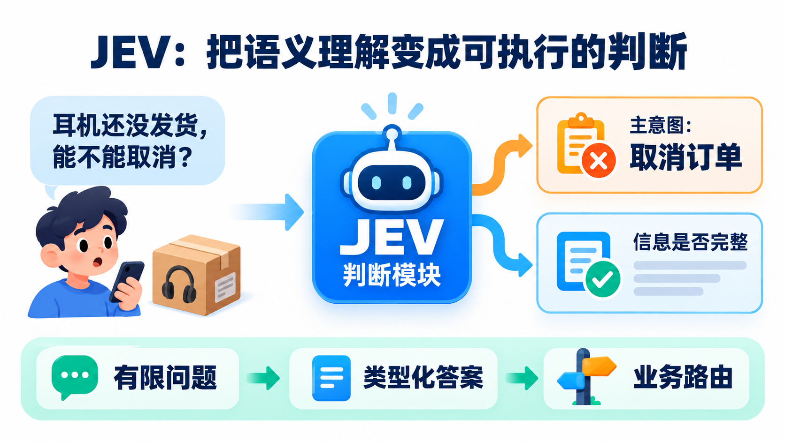
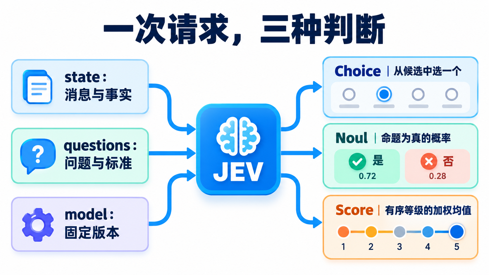
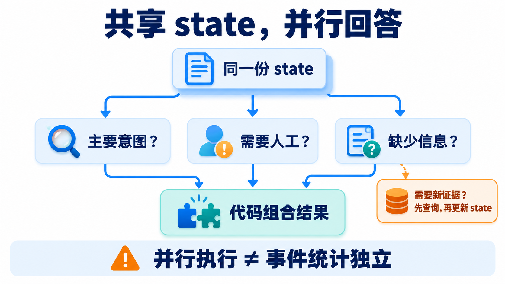
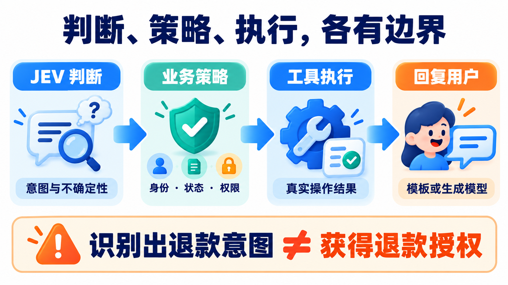

用户问客服：“耳机还没发货，能不能帮我取消？”

如果交给通用大模型，它可以理解这句话、写解释，也可以通过结构化输出给出 `cancel_order`。但在高频客服系统里，这一步真正需要的往往只是一个判断：用户想查物流，还是申请取消？信息够不够？下一步该交给哪个处理器？

JEV，就是 TypeSafe 官方写作 **Jev** 的决策模型，适合放在这样的环节。这个系列用电商客服贯穿五篇，依次讲原理、意图识别、不确定性、应用场景和上线评测。

资料核对日期：2026-10-21。本文解析公开的模型定位、训练目标和接口机制；已查阅的官方资料未给出完整网络结构、参数规模及 RLCD 的完整训练配方。下文的流程图是教学示意，不是内部网络结构图。

## 一、它把“理解输入”和“生成文章”拆开了

Jev 属于 TypeSafe 所称的 System One Models。调用方提供一份待判断材料 `state`，再提供一组带类型的问题，模型返回程序可直接处理的结果。

例如，把用户消息、前一轮对话和订单状态放进 `state`，再询问主要意图。代码读到意图标识后，决定调用物流查询、进入取消确认流程，还是继续追问。

这里的价值是：**把语义判断变成一个有明确输入、答案范围和返回类型的组件。** 问题怎么定义、结果怎样组合、动作何时执行，仍由应用程序决定。

*图 1｜JEV：把语义理解变成可执行的判断。把有限问题交给模型判断，再由程序组织后续流程。*

## 二、一次调用由三部分构成

| 部分 | 放什么 | 电商客服例子 |
| --- | --- | --- |
| `state` | 待判断的内容与相关事实 | 最新消息、相关历史、已核验的订单状态 |
| `questions` | 具体问题、输出类型和判定标准 | 当前主要诉求是什么？是否明确要求转人工？ |
| `model` | 模型 ID 或别名 | 示例固定使用 `jev-1.14.0` |

常用的文本判断类型有三种。

| 类型 | 适合的问题 | 结果怎么读 |
| --- | --- | --- |
| Choice | 从给定候选中选一个 | `choice`、各候选的 `probabilities`、`confidence` |
| Noul | 一个命题是否成立 | `noul` 表示“是”的概率，接近 0 表示倾向“否” |
| Score | 按有序标准判断程度 | `score` 是等级编号的概率加权均值，并返回分布与置信度 |

“属于查物流还是申请退款”适合 Choice；“是否明确要求人工客服”适合 Noul；“问题对业务的影响程度”适合 Score。不要把三个接口都理解成“让模型随便打个分”。

例如，Score 的三个等级可以定义成“仅显示异常”“功能受限但有替代路径”“核心流程不可用”。返回 1.4 表示在这套等级上的位置，不表示有 40% 的用户受影响。

*图 2｜一次请求，三种判断。state 提供材料，questions 定义问题，model 固定版本；三种输出类型承担不同任务。图中数值仅作示意。*

## 三、公开原理的关键：并行判断与校准目标

通用生成模型通常逐个 token 产生答案。TypeSafe 的公开说明则强调，Jev 直接返回概率与结构化判断，同一请求中的多个问题针对同一个 state 并行、独立评估。

这带来一个很实用的设计：一次请求同时问“主要诉求是什么”“是否要人工”“是否缺少关键信息”，然后用代码组合结果。它们不需要先后等待。

但“独立评估”有边界。如果第二问必须读取第一问得到的新证据，就不能假设同一请求里第二问自动知道第一问的答案。例如，要先查数据库才能知道退款状态，就得先执行查询、更新 state，再做后续判断。并行执行也不意味着这些业务事件在概率上相互独立，不能随意把它们的概率相乘。

RLCD，全称 Reinforcement Learning for Calibrated Decisions，是官方给出的训练方向：让输出概率与实际结果更加匹配。 直观地说，一批被赋予约 0.8 概率的事件，长期统计应接近八成发生。

这是训练目标和群体统计性质，**不是任意一条结果正确的保证**。中文口语、隐含诉求和行业缩写都需要用自己的数据验证。也不能把一种通用校准方法或分类损失，直接写成 Jev 未公开的内部实现。

*图 3｜共享 state，并行回答。多个问题共享同一份 state；需要新证据的后续问题，应先查询并更新 state。*

## 四、它和传统分类器、结构化输出有什么区别？

| 方案 | 适合的情况 | 需要承担的工作 |
| --- | --- | --- |
| 规则或传统分类器 | 标签稳定、规则明确，或已有充足标注 | 维护规则、训练数据和类别边界 |
| 通用 LLM 加结构化输出 | 既要复杂理解，又要生成解释、内容或参数 | 校验语义、评估耗时与成本，设计异常路径 |
| Jev | 能写成有限选择、命题判断或等级评分的高频环节 | 定义问题，评估概率，编写路由与业务策略 |

结构化输出本身已经能提高通用模型的格式稳定性，不能把比较简化成“LLM 一定输出坏 JSON”。Jev 的区别还包括决策导向的训练和输出机制。究竟是否更划算，必须比较同一任务、同等质量要求下的整条链路。

## 五、它在 Agent 中负责哪一层？

在一个客服 Agent 中，可以让 Jev 选择处理路径，让规则引擎检查可退款金额，让业务工具查询或执行，让生成模型组织对用户的解释。

这几层不要混在一起。识别出“申请退款”，不等于已经核实“有权退款”；返回合法的候选项，也不等于选对了候选项。类型正确、判断正确、动作合法，是三件不同的事。

*图 4｜判断、策略、执行，各有边界。模型判断、业务策略、工具执行与回复层分别承担明确责任。*

## 面试怎么答

Jev 是面向软件决策的模型。它接收 state 和带类型的问题，通过 Choice、Noul、Score 等接口提供结构化判断。公开机制强调多个问题的并行评估，以及 RLCD 所追求的概率校准。接入 Agent 时，我会把它放在意图、路由或证据判断环节，由业务代码管理权限、阈值和执行，生成式模型负责需要自由文本的部分。

## 高频追问

**它能直接写客服回复吗？** 本系列讨论的决策接口不负责自由生成客服话术。可以使用模板或另一个生成模型。

**它是不是不用训练就能判断所有业务？** 可以通过请求定义类别和规则，不代表无须标注与评测。官方说明当前不提供按客户数据进行微调或 LoRA 适配。

**它有图像能力吗？** 2026-10-14 的官方发布说明已加入实验性图像输入和 Box 类型，但标注为 Danger Zone。本系列以常规文本决策为主，不把实验特性当成成熟生产能力。
