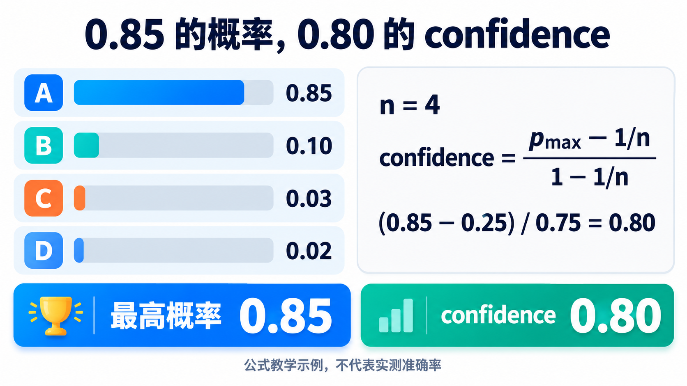
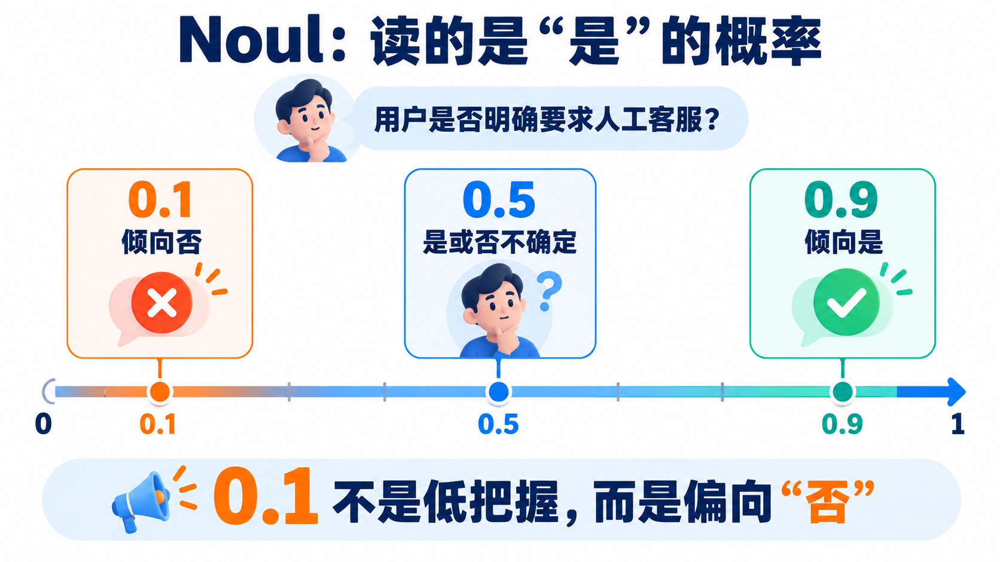
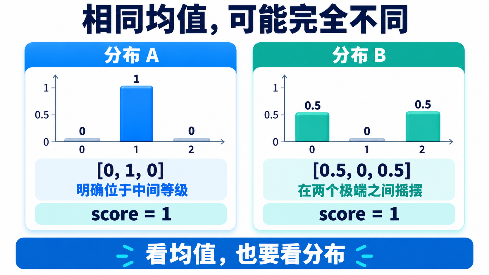
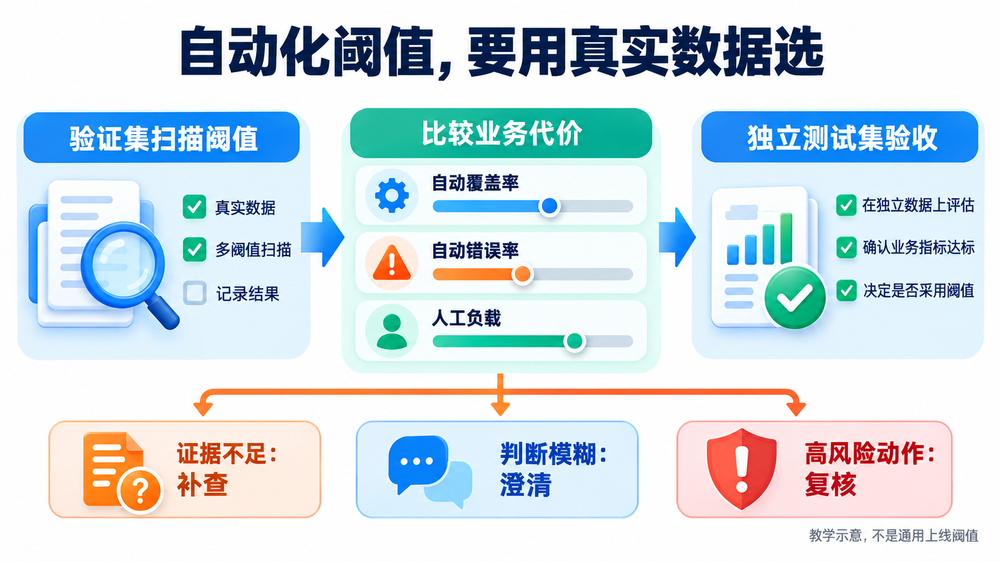

意图识别已经能返回 `refund_request`，系统是否可以自动进入退款流程？

如果只看标签，就丢掉了模型表达的不确定性。但即使返回一个 0.9，也要先弄清楚：它是某个选项的概率、一个命题成立的概率，还是由概率分布计算出来的置信度？这三个字段不能混着用。

## 一、Choice：概率和 confidence 是两个量

Choice 返回每个候选的概率，选取最大概率的候选作为 `choice`。官方当前文档定义的 Choice 置信度为：

```latex
confidence = (p_max - 1/n) / (1 - 1/n)

n：候选数量
p_max：最高候选概率
```

假设有四个候选，概率是 0.85、0.10、0.03、0.02，则最高概率是 0.85，而 confidence 等于 0.80。

这两个数不同，因为 confidence 描述的是最高概率相对均匀分布高出多少。它不是模型另外审查一次答案后给出的“正确率”。

这也意味着，改动候选数量后，原来的 confidence 阈值不能不经评测就照搬。新增一个“售后其他”类别，既可能改变分布，也会改变公式中的基线。



*图 1｜0.85 的概率，0.80 的 confidence。四个候选的最高概率为 0.85，按 Choice 公式计算的 confidence 为 0.80。*

## 二、Noul：0.1 不代表模型没有把握

Noul 返回“是”的概率，没有单独的 `confidence` 字段。

假设问题是“用户是否明确要求人工客服”：

| `noul` | 含义 | 一种可考虑的处理 |
| --- | --- | --- |
| 接近 1 | 倾向明确要求人工 | 转人工 |
| 接近 0.5 | 是与否都不确定 | 结合场景澄清 |
| 接近 0 | 倾向没有要求人工 | 继续普通流程 |

所以 `noul = 0.1` 通常是较明确的“否”，不是低置信度。还要注意，问“是否紧急”时返回 0.8，是“紧急这个命题成立”的概率，不是“紧急程度为八分”。如果要测程度，应使用定义清楚等级的 Score。



*图 2｜Noul：读的是“是”的概率。Noul 是命题为真的概率；接近 0 表示倾向否，接近 0.5 才是不确定。*

## 三、Score：均值会隐藏分歧

假设影响程度有 0、1、2 三个等级。

分布 A 是 `[0, 1, 0]`，分布 B 是 `[0.5, 0, 0.5]`。两者的 `score` 都等于 1：前者明确落在中间等级，后者在两个极端之间摇摆。

如果代码只看 `score > 0.9`，这两种情况会走同一个分支，却忽略了完全不同的不确定性。因此要结合概率分布或 Score 的置信度判断。Score 使用面向有序等级的置信度计算，不能套用上面的 Choice 公式。



*图 3｜相同均值，可能完全不同。两份分布的 score 都为 1，但概率质量分布在不同等级，不能只看均值。*

## 四、校准是群体统计，不是单次承诺

可以把验证集上预测概率落在 0.8 附近的样本分成一组，统计真实发生比例。如果长期只有一半正确，说明这一业务分布下存在过度自信。

准确率和校准度回答的是两个问题：前者问“选对了多少”，后者问“声称的概率与实际频率是否一致”。一个系统总猜概率较大的常见类别，可能整体准确率不错，却把稀有意图全部处理错。

因此评估时至少要查看各类别的精确率、召回率、分桶校准情况，以及自动处理部分的错误率。中文客服还应单列否定、反问、口语、省略和多轮纠正样本，避免大多数简单句掩盖难例。

## 五、阈值怎么定？先问错一次损失多少

给一个订单查询错误地转到商品咨询，代价主要是多一轮对话；给一笔不该退款的订单自动退款，代价显然不同。它们不应使用同一个放行标准。

一个简化的二元决策例子：假设“误执行”的损失是 100，“错过一次应执行动作”的损失是 1，且概率已适当校准、没有第三条处理路径。那么比较期望损失：

```latex
执行的期望损失 = (1 - p) × 100
不执行的期望损失 = p × 1

执行更划算的条件：p > 100 / 101 ≈ 0.9901
```

这是通用决策论示例，不是 Jev 的官方阈值。现实系统还有人工复核、追问和补查数据，通常应该把这些第三条路径也纳入策略，而不是只在执行和拒绝之间二选一。

## 六、用“覆盖率—错误率”选择工作点

阈值越严格，自动处理的比例往往越低；阈值越宽松，误路由风险往往越高。上线时需要把这两个指标一起观察。

可以在验证集上扫描多个阈值，记录每个阈值下的自动覆盖率、自动部分错误率和人工量，再挑选符合业务容量与风险预算的工作点。确定后使用独立测试集验收，避免反复针对同一批样本调参。

模型升级、候选列表变化和输入来源变化都会影响这个工作点。需要固定模型版本，并保存问题定义和阈值版本，才能解释“昨天放行，今天却转人工”的原因。



*图 4｜自动化阈值，要用真实数据选。在验证集上比较覆盖率、错误率和人工负载，再用独立测试集验收。*

## 面试怎么答

我会分别解释 Choice 概率、由分布计算的 confidence，以及 Noul 的肯定概率。阈值从真实标注数据与错误成本出发，结合覆盖率和自动错误率确定；不会把 0.9 当成普遍安全线。即使概率很高，也要保留身份、业务条件和幂等校验，因为置信度不能替代授权。

## 高频追问

**最高概率很高，是否一定不需要澄清？** 不一定，正确选项可能根本不在候选集中，或者输入缺少关键背景。应配合范围判断、必填字段和业务校验。

**Noul 多标签结果能直接相乘吗？** 除非有合理的独立性假设并验证过，否则不能。问题独立执行不代表事件统计独立。
