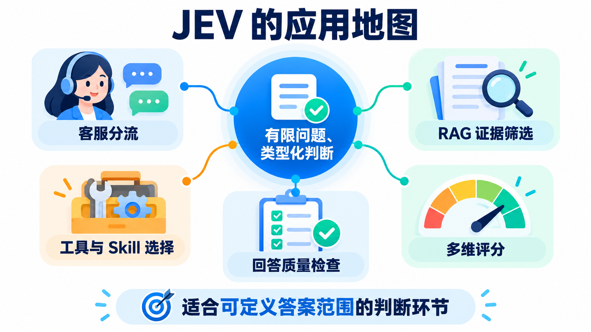
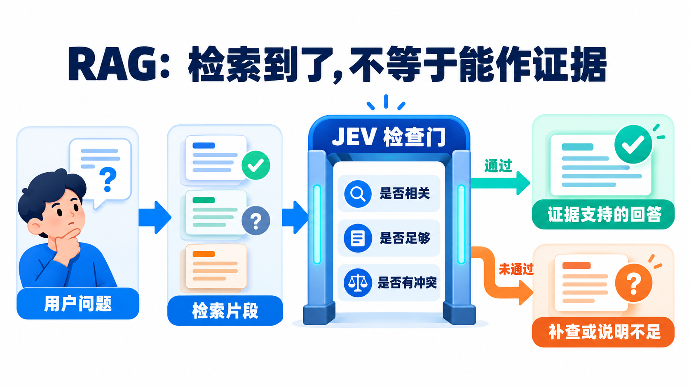
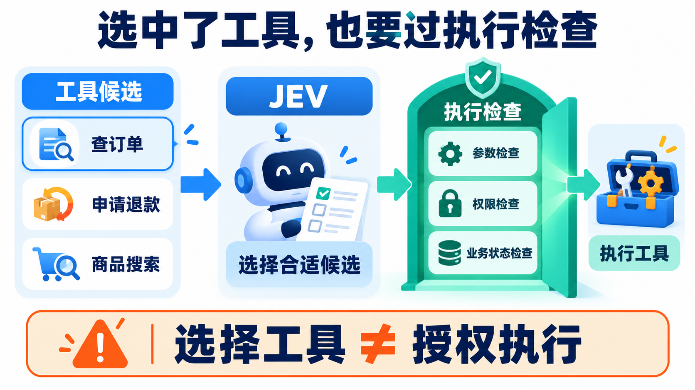
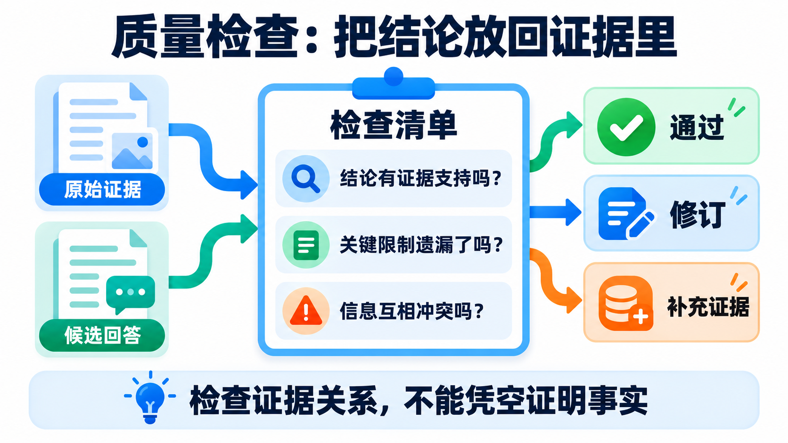

知道 Jev 能分类以后，容易产生一个冲动：把所有“需要智能”的地方都换成它。

更有效的做法，是先找到工作流里那些高频、边界明确、结果会直接影响程序分支的判断。客服路由是一种；检索证据筛选、工具候选选择、内容检查和任务评分也符合这个形状。

本篇区分两类内容：官方已有公开 cookbook 的能力用法，以及基于这些能力设计的教学场景。下文电商案例不代表某家企业已经部署，也没有宣称性能提升数字。

## 一、先判断任务是否适合

可以连续问三个问题：

1. 能否提供足够的判断材料？
2. 答案能否定义成有限选项、明确命题或有序等级？
3. 得到结果后，能否由确定代码决定下一步？

如果答案都是肯定的，Jev 值得做对比实验。如果任务是“写一篇产品发布文案”“独立完成未知问题的长链推理”，则仍需要生成或规划能力。

*图 1｜JEV 的应用地图。JEV 适合答案范围明确的判断环节，应用需配合具体的业务策略。*

## 二、客服分流：把请求送到恰当的处理器

输入是用户消息、相关对话与业务状态，输出是主要意图以及辅助判断。

查物流可以走确定的查询接口；商品问题可以交给带商品知识库的回复模型；复杂争议或明确的人工诉求进入人工队列。不同路径的成本与能力不同，没必要让所有请求都经过最复杂的 Agent。

适合衡量的指标不是“分类标签看起来对不对”，而是误路由率、一次解决率、转人工比例、完整响应时间和每个解决案例的成本。

## 三、RAG：判断检索片段能不能作为证据

检索找到了“退款”，却可能同时召回旧活动规则、退货流程和到账时限。相似文本不一定回答当前问题。

可以把用户问题与一个候选片段放在 state 中，分别判断是否相关、是否含有可支持答案的信息、是否与问题前提矛盾、是否包含试图指挥模型的内容。官方的 RAG cookbook 展示了这类中间筛选步骤。

业务代码把通过的片段交给生成模型，把冲突材料单独标注，把不相关内容排除。但 Jev 没有凭空扩大召回范围：如果正确文档根本没检索到，后面的判断无法弥补。因此它可以作为证据过滤或重排的候选方案，不能替代索引与召回。

假设用户问“会员价能不能叠加优惠券”，系统还需要根据活动 ID、日期和商品范围过滤。可以确定计算的字段，应先由代码处理，再让模型理解剩余语义。

*图 2｜RAG：检索到了，不等于能作证据。检索片段要检查相关性、充分性与冲突；证据不足时继续补查。*

## 四、Tool 与 Skill 选择：挑候选，不等于执行

工具数量多时，可以让 Jev 判断用户任务与工具描述的匹配程度。官方 Skill suggestion cookbook 使用两阶段方法：先筛候选，再读取少量候选的详细信息进行复核。

应用到电商系统时，可以在“查询订单”“查询退款”“创建售后申请”之间做选择。但候选集必须先经过权限过滤，模型只能看到当前允许考虑的操作。

如果用户需要“批量导出所有客户电话”，一个工具在语义上很匹配，不代表当前账号有权调用。模型选择后仍需参数校验、数据范围校验和必要的确认。调用失败也必须按真实错误返回，不能把“选中了工具”当成“操作已经完成”。

*图 3｜选中了工具，也要过执行检查。工具候选选择后，还需要参数、权限与业务状态检查。*

## 五、质量检查：核对证据与结论的关系

模型写出“该订单一定可以无条件退款”，并附上一条政策链接。链接存在，不代表内容支持这个结论。

官方 citation check cookbook 的思路是先做确定性核对，再做语义核对：先检查引文是否出现在源文档，再判断上下文是否支持主张。

在我们的教学客服系统中，可以把回复中的关键业务结论与真实查询结果、适用规则一起送检。遇到“证据不足”或“存在矛盾”，就重新组织回复或转人工。

这是一层质量检查，不能保证发现全部错误。检查器本身也需要标注评测，尤其要加入“引用原句真实但删掉限定条件”的样本。

*图 4｜质量检查：把结论放回证据里。质量检查围绕证据与结论的关系，不替代外部事实核验。*

## 六、评分与优先级：把多个维度留给代码组合

工单优先级不等于用户语气。说话客气的用户，也可能遇到全部订单无法支付的严重故障。

可以用不同的 Score 判断业务影响、时间紧迫性和证据完整度，再按经过业务认可的规则组合。例如，影响核心支付链路触发优先队列；证据不足则要求补充信息，而不是直接降低优先级。

如果各维度等级数量不同，先明确各自的范围与归一化方式。权重应由业务策略决定，不要让模型在一个模糊问题里自行权衡所有目标。对于不能被其他分数抵消的条件，应写硬规则，而不是只做加权平均。

## 七、这些地方不该强行使用

| 任务 | 更合适的首选 |
| --- | --- |
| 精确计算退款金额 | 确定的金额计算与账务规则 |
| 判断是否拥有订单权限 | 身份认证与权限系统 |
| 生成个性化完整回复 | 模板或生成式 LLM |
| 缺少资料时推断实时物流 | 先调用物流接口 |
| 长链研究和开放任务规划 | 能规划、调用工具并验证的 Agent |

Jev 比较适合填补“纯规则难以表达，但结果又足够受限”的语义判断环节。是否采用它，应与现有分类器、专用 reranker、通用模型结构化输出进行同条件比较。

## 面试怎么答

我会优先考虑客服分流、RAG 证据判断、工具候选选择、引用核验和分级评分。这些任务能把答案约束成可组合的决策。落地时先保留可确定计算的业务逻辑，把语义判断交给模型，再评估整条链路的质量、延迟和成本。它不负责替代数据库、权限系统或所有生成式任务。
