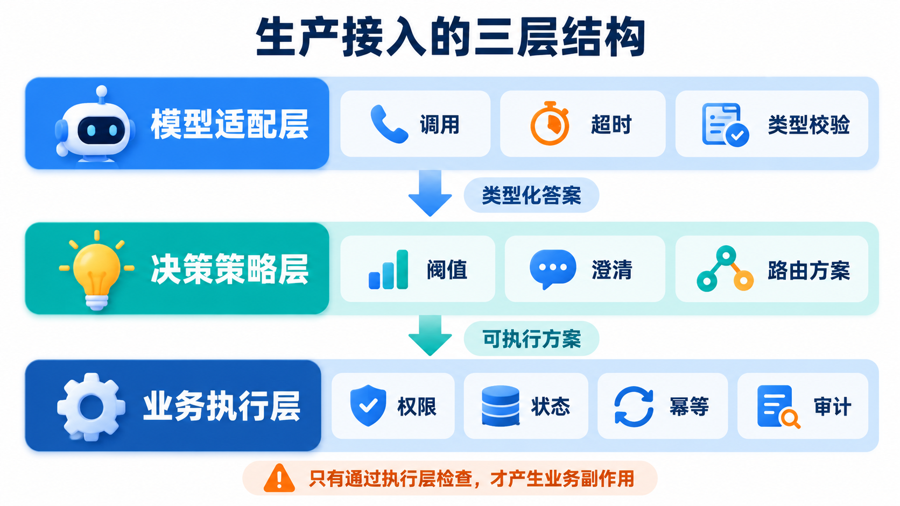
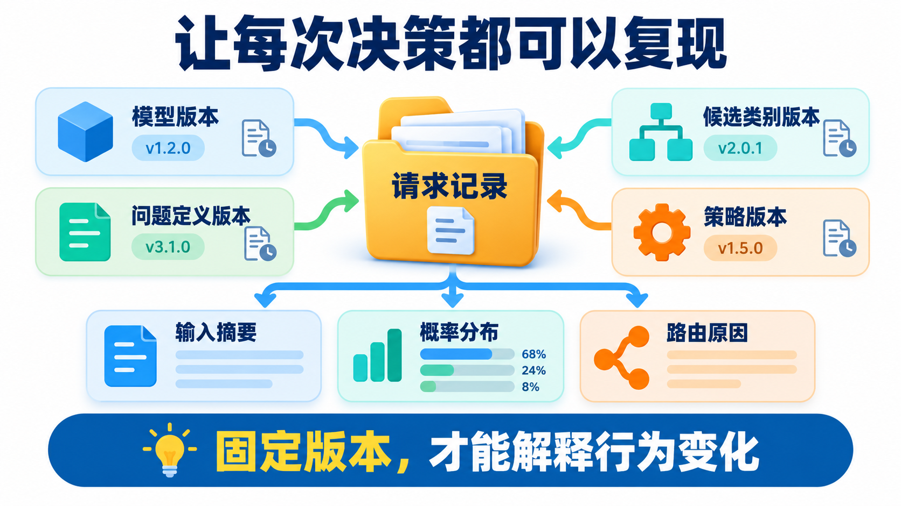
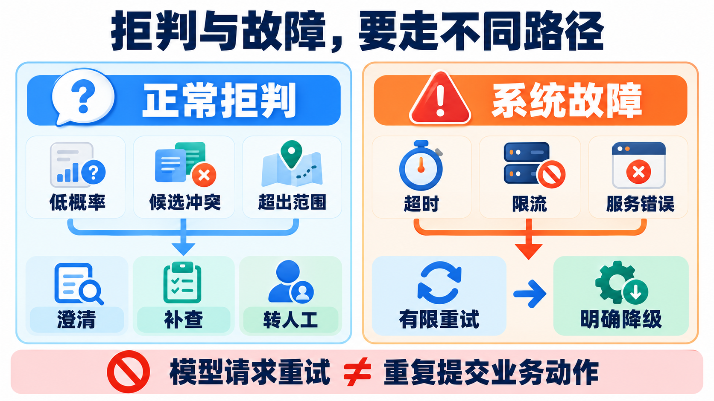
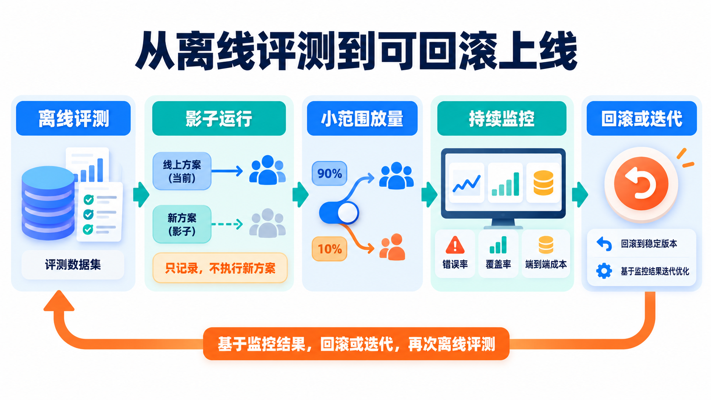

让示例返回一个意图标签，只能证明接口接通。真实客服系统还要回答：服务超时怎么办？模型换版本后阈值还有效吗？用户重复点击是否会创建两笔申请？判断错了能不能定位原因？

本篇给出一条最小工程路径：先把决策与动作拆开，在离线样本上选定策略，再以影子方式观察真实流量，最后逐步放量。

## 一、先建立三个明确边界

| 层次 | 输入与输出 | 责任 |
| --- | --- | --- |
| 模型适配层 | state、questions → 类型化答案 | 调用、超时、错误归一化、记录模型版本 |
| 决策策略层 | 答案与业务上下文 → 路由方案 | 阈值、澄清、转人工、处理器选择 |
| 业务执行层 | 合法方案 → 真实操作结果 | 权限、参数、状态、幂等与审计 |

这样，换模型时可以复用业务执行层，调整阈值时也不需要重写整个客服流程。



*图 1｜生产接入的三层结构。只有通过业务执行层检查后才产生业务副作用，模型适配与策略保持独立。*

## 二、让路由策略成为可检查的纯函数

以下函数只返回处理计划，不调用退款、取消等业务接口。输入是从官方 SDK 返回对象转换出的普通字段，属于应用层数据结构。

```python
def plan_route(choice, probabilities, in_scope, wants_human):
    # 以下数字仅用于演示，不是可直接上线的推荐阈值。
    if wants_human >= 0.80:
        return {"handler": "human", "reason": "explicit_human_request"}

    if in_scope < 0.80 or choice == "other":
        return {"handler": "clarify", "reason": "scope_uncertain"}

    ranked = sorted(probabilities.values(), reverse=True)
    p1 = ranked[0]
    p2 = ranked[1] if len(ranked) > 1 else 0.0
    if p1 < 0.85 or p1 - p2 < 0.20:
        return {"handler": "clarify", "reason": "ambiguous_intent"}

    handlers = {
        "track_order": "order_query",
        "cancel_order": "cancel_review",
        "refund_progress": "refund_query",
        "refund_request": "refund_review",
        "product_question": "product_rag",
    }
    return {
        "handler": handlers.get(choice, "clarify"),
        "reason": "intent_routed",
    }
```

调用这个函数前，适配层要校验字段完整、数值有限、概率范围有效、候选键与当前 schema 一致。不要把缺失字段默认填成“高置信度”，也不要在解析失败时默认执行最常用操作。

上述阈值只是帮助读懂控制流程；正式项目应按类别和风险分别调节。`cancel_review` 和 `refund_review` 明确表示进入检查流程，不表示动作已经获得批准。

## 三、生产环境固定模型与问题版本

官方 Models 文档说明，别名会随发布而移动，返回结果中的 `model` 字段提供实际处理请求的版本。

开发探索可以使用别名；上线时，如果阈值是针对一个版本调出来的，就固定对应 ID，并记录四个版本：模型、问题定义、候选类别、决策策略。

截至本文核对日期，官方已列出 `jev-1.14.0`。但文档中的别名映射与发布切换时间可能不同步，所以示例直接使用版本号，不假设 `jev-latest` 在任何时刻都指向同一个模型。



*图 2｜让每次决策都可以复现。同时记录模型、问题、类别与策略版本。图中的版本号和分布仅为示意。*

## 四、把正常拒判和系统故障分开

模型说“不确定”，是一次正常判断；网络超时、限流或服务错误，是调用失败。它们需要不同的日志和统计。

| 情况 | 建议处理 |
| --- | --- |
| 低概率、候选冲突、超范围 | 澄清、补查或转人工 |
| 超时或服务错误 | 在总时限内有限重试，随后降级 |
| 429 限流 | 遵循服务端等待信息，限制并发与重试总量 |
| 认证或请求参数错误 | 停止无意义重试，修复配置或 schema |
| 业务状态已变化 | 重新读取状态，重新检查动作条件 |

SDK 本身可能已带重试，外层再加一层循环时，要计算总尝试次数与最长耗时。 模型判断请求的重试，与业务动作的重试也必须分开。取消订单或创建退款申请，要使用业务请求 ID、幂等键和状态检查，不能因为模型调用重试就重复提交。



*图 3｜拒判与故障，要走不同路径。正常拒判走澄清或转人工路径，系统故障走有限重试与降级路径。*

## 五、评测数据要覆盖会造成业务错误的输入

建立三份互相隔离的数据：开发集用于改问题和类别描述，验证集用于选阈值，测试集用于最终验收。同一段对话的改写不要分散到不同集合，避免看似陌生的测试句其实已经被调过。

除了常规消息，还要加入容易混淆的退款与退款进度、缺订单号、否定句、多意图、跨轮纠正、无关请求和恶意指令。中文是本项目的主要输入，应该以真实中文分布评估，不能套用英文样本的结果。

至少记录五组指标：

1. 分类质量：各类别精确率、召回率、混淆矩阵和宏平均 F1。
2. 不确定性：概率分桶的实际正确比例，以及高置信错误样本。
3. 自动化质量：自动覆盖率、自动部分错误率、转人工负载。
4. 系统性能：端到端 P50/P95 延迟、超时、限流和重试比例。
5. 业务价值：一次解决率、每个已解决请求的总成本、重复操作数。

总成本应包含模型、检索、生成、重试与人工处理。官方演示的速度或价格倍数不等于你的系统收益，尤其在跨地区网络和复杂上下文条件下。

## 六、用影子流量和小范围放量完成上线

影子阶段只记录新方案会怎样路由，线上仍走原来的逻辑。重点检查新旧方案分歧：是新方案纠正了旧错误，还是引入了新的高风险误判？

放量后按类别观察，先覆盖低风险查询。日志保存请求 ID、版本、选项分布、策略原因、处理器、耗时与最终业务结果；敏感原始内容按需要脱敏和限期保留。阈值命中不能替代真实结果追踪。



*图 4｜从离线评测到可回滚上线。影子阶段只记录新方案；放量比例须按业务评估，图中比例仅为示意。*

## 面试怎么答

我会把模型适配、决策策略和业务执行分层。上线前固定模型和问题版本，使用独立数据调阈值并验收；线上区分拒判与故障，做好限流、有限重试、幂等和回滚。最终看自动部分的错误率、覆盖率以及端到端成本，而不只看一次模型调用有多快。
