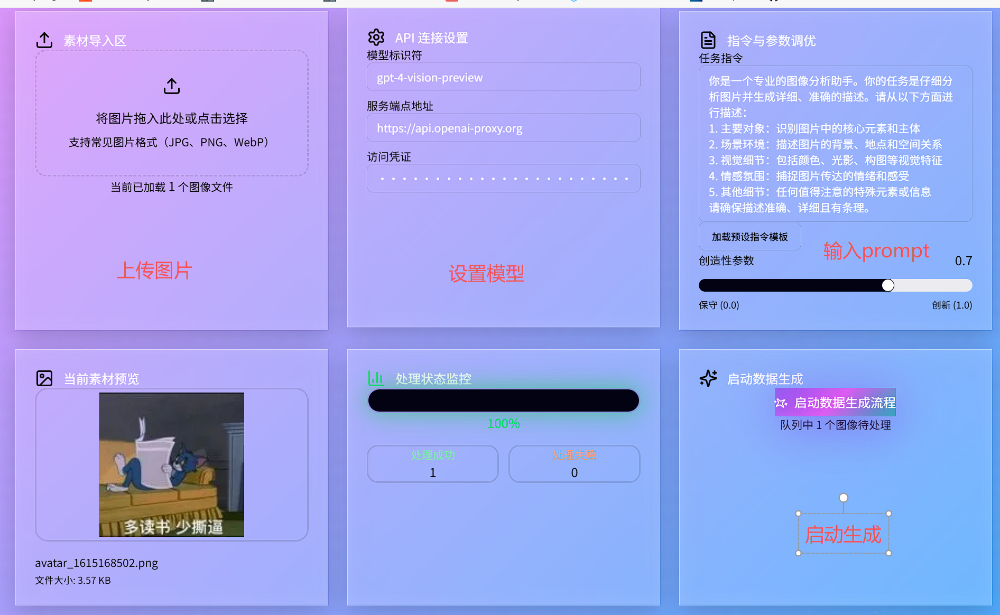
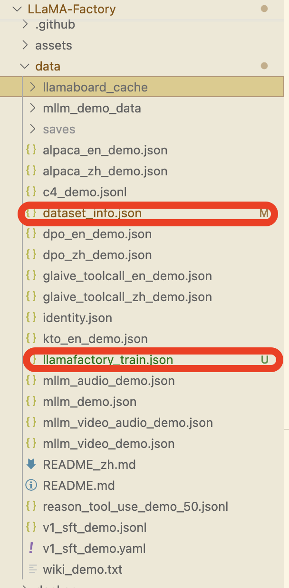
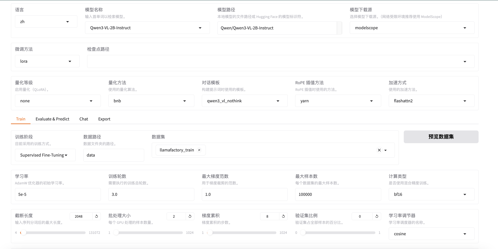
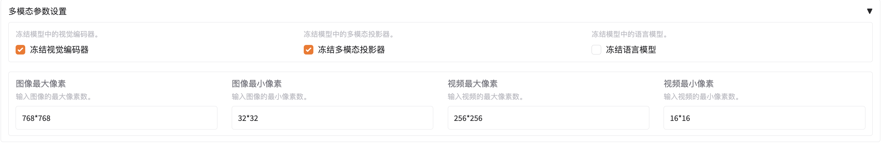
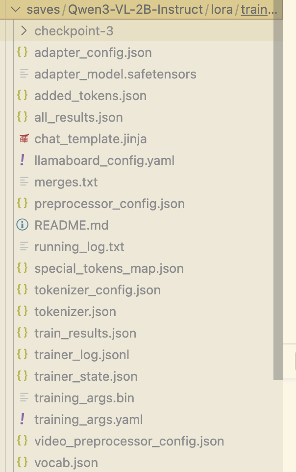
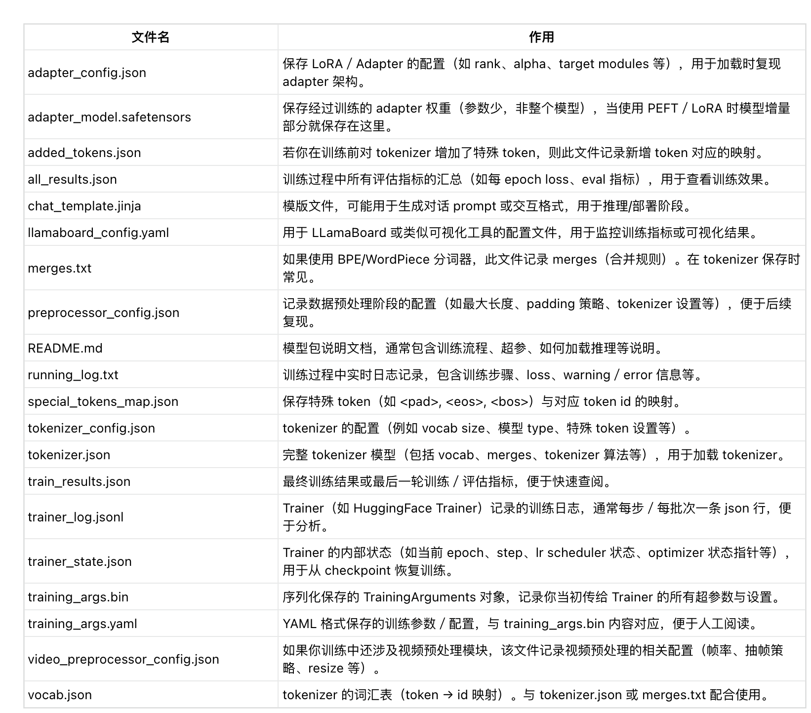
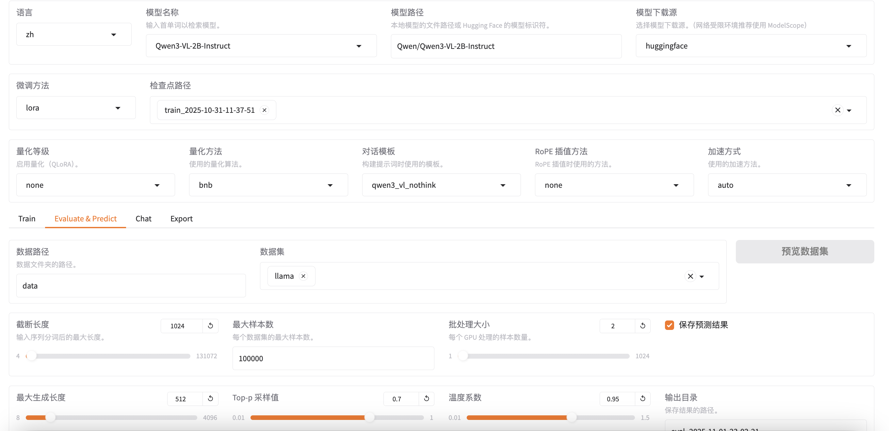

# 13. 多模态数据lora微调

> 来源（Source）：https://my.feishu.cn/wiki/JCarwjL10in68bk0nUucLtatnJe

本玩具项目主要有两个学习任务，目的是快速掌握多模态模型微调全流程：

1. 掌握多模态训练数据的构造方法：通过自研的多模态训练数据生成器，支持用户上传图片（兼容 JPG、PNG、WebP 格式）并结合自定义 Prompt，自动化生成标准化训练数据：



1. 学会使用 LLaMA-Factory 工具链，完成多模态模型的训练配置、参数调优与推理验证。

### 多模态大模型基础认知

多模态大模型（Multimodal Large Language Model, MLLM）是能够同时理解和处理文本、图像、语音、视频等多种信息形式的人工智能模型。它突破了传统大语言模型仅能处理文本的局限，赋予 AI 类人类的多感官感知与跨模态理解能力，更贴合现实世界中多源信息交互的场景需求。

#### 1.1 核心技术环节

1. **特征提取**：把不同类型输入（文本、图片、语音等）通过各自的编码器转化为向量表示。例如，文本由语言模型编码，图像由视觉模型提取特征，语音由声学模型处理；
2. **模态对齐与融合**：模型将不同模态的特征映射到同一语义空间，使“图像中的苹果”和“文字苹果”在语义上相似；
3. **统一推理与生成**：在融合后的语义空间中完成跨模态推理，支持输出文字、图像、语音等多种形式结果。

#### 1.2 常见任务类型

- **VQA**： 结合图像与问题，输出自然语言答案，考察图文对齐与推理能力；
- **OCR**： 从图片、票据、自然场景中识别文本并理解语义，适用于表单解析、题目识别等；
- **逻辑推理**：基于视觉输入完成多步关系推断（如物体逻辑关系、数量变化、因果事件等），适配数学与代码场景；
- **Grounding**:  将语言描述与图像具体区域精准对应，支持检测、框选、标注等操作；
- **视频理解**：结合时序帧与字幕信息，理解动作、事件及语义演变，考验动态感知能力；
- **Agent能力**：基于视觉环境执行操作（如识别界面元素、规划步骤、指令输入），实现视觉交互与智能体行为学习。

#### 1.3 现有多模态大模型

参考[多模态体系知识搭建](https://fp9qo5yj6d.feishu.cn/wiki/HxWSwlEFtiOzqWkYG9VcpsbHned)

### 代码讲解

#### 2.1 安装LLaMA-Factory

```
git clone --depth 1 https://github.com/hiyouga/LLaMA-Factory.git
cd LLaMA-Factory
pip install -e ".[torch,metrics]"
```

重点关注data目录：

- dataset_info.json注册所有可训练数据集的核心配置文件，LLaMA-Factory库里本身就有alpaca、glaive等数据集。 
- llamafactory_train.json是我自己创建的一个训练数据集，想使用这个数据集需要在dataset_info.json中注册，即添加以下内容。这里采用的是OpenAI格式的数据，具体介绍见2.2。

```json
"llamafactory_train": {
    "file_name": "llamafactory_train.json",
    "formatting": "sharegpt",
    "columns": {
      "messages": "messages",
      "images": "images"
    },
    "tags": {
      "role_tag": "role",
      "content_tag": "content",
      "user_tag": "user",
      "assistant_tag": "assistant"
    }
  },
```



#### 2.2 LLaMA-Factory 支持的数据格式

LLaMA-Factory 兼容三种主流数据格式，适配不同训练场景：

1. Alpaca 格式
- `instruction`：任务指令。
- `input`：输入内容，可为空。
- `output`：期望模型输出。
- `system`、`history` 可选，用于上下文和多轮增强。

```json
{
  "instruction": "请将下面的英文句子翻译成中文",
  "input": "Life is short, use Python.",
  "output": "人生苦短，我用 Python。",
  "system": "你是一个翻译助手",
  "history": [
      [
          "I love LLM",
          "我爱大模型"
      ]
  ]
}
```

对于上述格式的数据， `dataset_info.json` 中的 **数据集描述** 应为：

```json
"数据集名称": {
  "file_name": "data.json",
  "columns": {
    "prompt": "instruction",
    "query": "input",
    "response": "output",
    "system": "system",
    "history": "history"
  }
}
```

1. ShareGPT 格式

其中 human 和 observation 必须出现在奇数位置，gpt 和 function 必须出现在偶数位置。

```json
{
  "conversations": [
    {
      "from": "human",
      "value": "你好，我出生于1990年5月15日。你能告诉我我今天几岁了吗？"
    },
    {
      "from": "function_call",
      "value": "{\"name\": \"calculate_age\", \"arguments\": {\"birthdate\": \"1990-05-15\"}}"
    },
    {
      "from": "observation",
      "value": "{\"age\": 31}"
    },
    {
      "from": "gpt",
      "value": "根据我的计算，你今天31岁了。"
    }
  ],
  "tools": "[{\"name\": \"calculate_age\", \"description\": \"根据出生日期计算年龄\", \"parameters\": {\"type\": \"object\", \"properties\": {\"birthdate\": {\"type\": \"string\", \"description\": \"出生日期以YYYY-MM-DD格式表示\"}}, \"required\": [\"birthdate\"]}}]"
}
```

 `dataset_info.json` 中的 **数据集描述** 应为：

```json
"数据集名称": {
  "file_name": "data.json",
  "formatting": "sharegpt",
  "columns": {
    "messages": "conversations",
    "system": "system",
    "tools": "tools"
  }
}
```

1. OpenAI格式(**本项目采用**)

OpenAI 格式是 `sharegpt` 格式的一种特殊情况，其中第一条消息可能是系统提示词。因为其完全兼容OpenAI、Claude等API格式，支持多轮对话并可扩展角色，且上下文结构更清晰，目前正被越来越多的采用。

- **最外层是一个数组**：每个元素是一轮完整的对话（可多轮）。
- **messages**：表示一组连续的对话轮次。
    - `role`: 角色类型，可为：
        - `"system"`：系统提示词（可选，一般用于设定模型角色）
        - `"user"`：用户输入（必须）
        - `"assistant"`：模型回复（必须）
    - `content`: 对应角色说的内容。
- **images**：多模态训练必须，图像/视频/音频数据路径

```json
[
  {
    "messages": [
      {
        "role": "system",
        "content": "系统提示词（选填）"
      },
      {
        "role": "user",
        "content": "人类指令"
      },
      {
        "role": "assistant",
        "content": "模型回答"
      }
    ],
    "images": ["1.jpg"]
  }
]
```

`dataset_info.json` 中的 **数据集描述** 应为：

```json
"数据集名称": {
  "file_name": "data.json", 
  "formatting": "sharegpt",
  "columns": {
    "messages": "messages"
  },
  "tags": {
    "role_tag": "role",
    "content_tag": "content",
    "user_tag": "user",
    "assistant_tag": "assistant",
    "system_tag": "system"
  }
}
```

#### 2.3 多模态数据集构造工具

这里实现了一个多模态数据集构造工具，核心功能是通过 FastAPI 接口实现图片上传、Prompt 输入、训练数据自动生成，支持自定义创造性参数（0.0 保守～1.0 创新），代码已经放在百度网盘了。需关注的代码文件是：

- image_service.py：提供图片上传、训练数据文件下载等接口
- data_service.py：调用模型，结合图片与 Prompt 生成标准化训练数据

启动方式为：

```
# 启动后端
python -m venv venv
source venv/bin/activate  # Windows: venv\Scripts\activate
pip install -r requirements.txt
python backend/app.py
export PYTHONPATH=./ # Windows: set PYTHONPATH=./
# 如果没有设置apikey，可以改为python app_demo.py

# 启动前端
npm install
npm run dev
```

生成数据示例：

```json
{
  "messages": [
    {"role": "user", "content": "<image>请描述这张图片"},
    {"role": "assistant", "content": "这张图片中,有一只卡通猫正在沙发上悠闲地躺着看报纸。图片下方有中文文字写着“多读书 少撕逼”。"}
  ],
  "images": ["avatar_1615168502.png"]
}
```

#### 2.4 模型训练配置

- 命令行训练指令（Qwen3-VL-2B-Instruct 为例）

```sql
llamafactory-cli train \
    --stage sft \
    --enable_thinking: false \
    --do_train True \
    --model_name_or_path Qwen/Qwen3-VL-2B-Instruct \
    --preprocessing_num_workers 16 \
    --finetuning_type lora \
    --template qwen3_vl_nothink \
    --rope_scaling yarn \
    --flash_attn fa2 \
    --dataset_dir data \
    --dataset llamafactory_train \
    --cutoff_len 2048 \
    --learning_rate 5e-05 \
    --num_train_epochs 3.0 \
    --max_samples 100000 \
    --per_device_train_batch_size 2 \
    --gradient_accumulation_steps 8 \
    --lr_scheduler_type cosine \
    --max_grad_norm 1.0 \
    --logging_steps 5 \
    --save_steps 100 \
    --warmup_steps 0 \
    --packing False \
    --enable_thinking True \
    --report_to none \
    --output_dir saves/Qwen3-VL-2B-Instruct/lora/train_2025-10-31-17-51-39 \
    --bf16 True \
    --plot_loss True \
    --trust_remote_code True \
    --ddp_timeout 180000000 \
    --include_num_input_tokens_seen True \
    --optim adamw_torch \
    --lora_rank 8 \
    --lora_alpha 16 \
    --lora_dropout 0 \
    --lora_target all \
    --freeze_vision_tower True \
    --freeze_multi_modal_projector True \
    --image_max_pixels 589824 \
    --image_min_pixels 1024 \
    --video_max_pixels 65536 \
    --video_min_pixels 256
```

- 通过webui开启训练，这里介绍一些常用的参数设置：
1. **模型名称 ：**当前选择的模型，目前llamafactory 支持LLaMA、Qwen、ChatGLM等多系列的开源模型
2. **模型路径：**本地路径或 Hugging Face 模型仓库名。
3. **模型下载源 ：**支持modelscope、huggingface、openmind
4. **微调方法 ：**lora或者全量微调
5. **量化等级：**参数精度
6. **对话模板 ：**构建提示词时使用的模板，一般跟模型是绑定的
7. **RoPE 插值方法：**通常用`yarn` 支持更长上下文。
8. **加速方式：**指定训练加速库，如 `flashattn2` 提升Attention速度
9. **训练阶段：SFT、DPO、PPO、Rewardmodel、KTO、Pre-training**
10. **数据路径 ：**存放  `dataset_info.json` 的路径。
11. **数据集名称 ：**在 `dataset_info.json` 中定义的数据集名称。



以及一些多模态训练相关的参数设置：



#### 2.5 模型推理

训练完保存模型结构如下图，主要包括：





推理方式有两种：

- **WebUI 推理**：直接在 LLaMA-Factory 可视化界面选择模型路径、微调方法，输入 Prompt 与图片即可获取结果；
- **命令行推理**：通过指定模型路径、LoRA 检查点路径，结合推理参数（如最大生成长度、Top-p 采样值）执行推理。



#### 2.6 注意事项

1. **数据格式一致性**：确保训练数据格式与`dataset_info.json`配置严格匹配，避免角色标签、字段名称错误；
2. **多模态参数适配**：根据图片 / 视频分辨率调整像素范围参数，避免超出模型处理能力；
3. **训练环境要求**：建议使用 24G 支持 BF16 精度的 GPU，启用 FlashAttention2 加速训练效率；
4. **模型加载验证**：推理前需确认 LoRA 权重与基础模型正确融合，核对 tokenizer 配置一致性。
