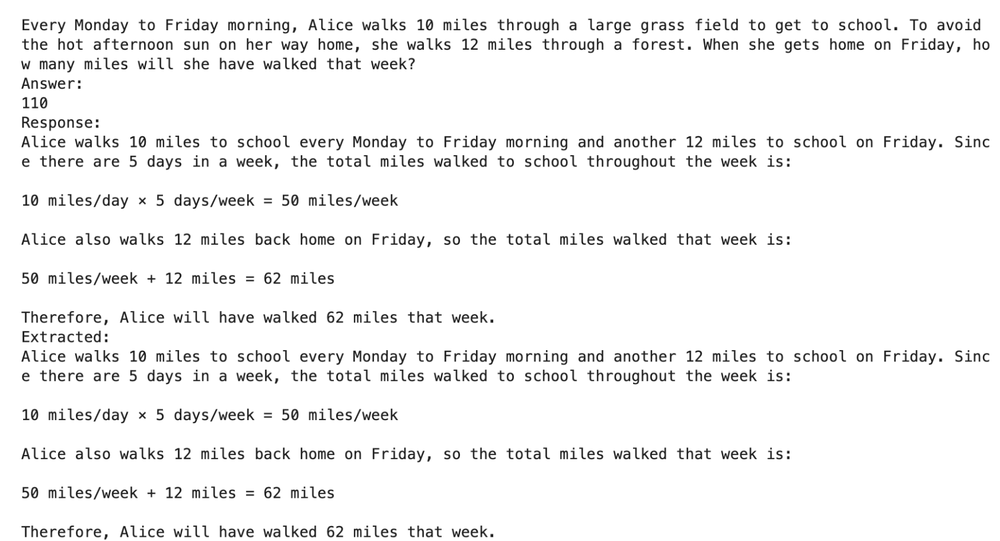
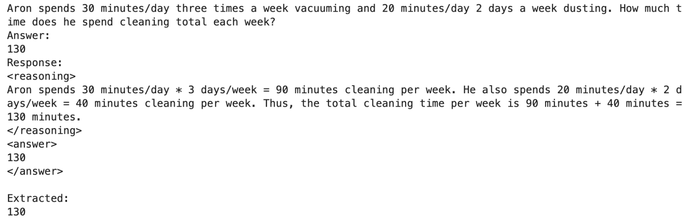
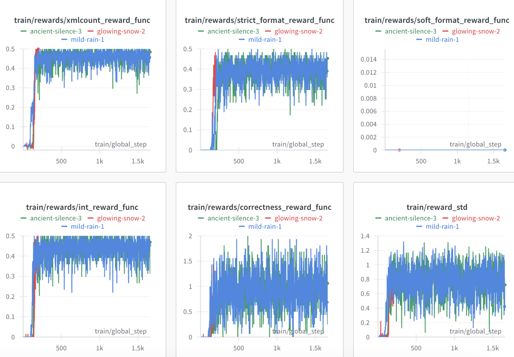
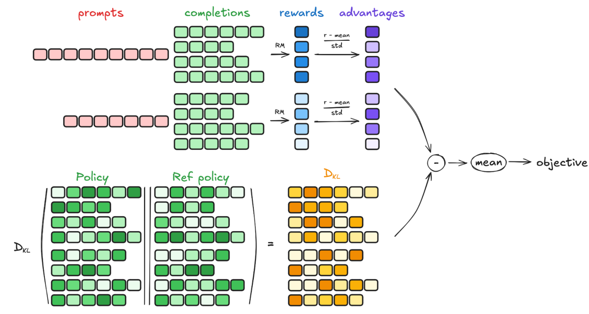

# 7. 基于GRPO的数学推理系统

> 来源（Source）：https://my.feishu.cn/docx/Fw3SdjFZuoYszGxacVmceZGrnDg

本项目基于 `Qwen2.5-0.5B` 进行训练，并使用 `gsm8k` 数据集进行微调。数据集及模型需自行下载。

数据集：https://huggingface.co/datasets/openai/gsm8k

模型：https://huggingface.co/Qwen/Qwen2.5-0.5B-Instruct

**目标**：在 `Qwen2.5-0.5B-Instruct` 小模型上训练数学推理能力+格式化输出的能力。

> 🎹 **项目简介**  
>
> 本项目旨在借助 `trl`（Hugging Face 的 `transformers` 相关强化学习库），复现 **DeepSeek R1** 的 **GRPO** 训练方法，并将其应用于 **Qwen2.5-0.5B-Instruct** 小尺寸模型，以提升其推理能力。
>
> **训练步骤**  
>
> 1. **准备数据**：使用openai/gsm8k数据集
> 2. **加载** `Qwen2.5-0.5B-Instruct` **模型**
> 3. **构造奖励模型**
> 4. **使用** `trl` 进行 GRPO 训练 
> 5. **评估推理能力提升**

## 训练前后效果对比

训练前：



训练后：





## 1. 问题设置

### 1.1 问题定义与评价标准

给定n道数学问题，模型需对每道题生成答案，并通过以下规则判断正确性：  

（1）**答案格式规范**

- **选择题**：答案必须严格限定为选项字母（如`A`/`B`/`C`/`D`），直接输出单个选项。  
- **解答题**：答案需以LaTeX格式包裹在`\boxed{}`中（如`\boxed{1/2}`），且必须为数学客观值（数值、分数、表达式等）。  

（2）**正确性判定规则**

若模型输出与标签的数学含义等价，则判定正确：  

1. **符号等价性**：允许不同表达形式（如`0.5`与`1/2`）。  
2. **格式一致性**：解答题必须通过`\boxed{}`明确标注最终答案（否则系统无法提取）。  
3. **严格映射**：选择题必须与标签选项完全一致（如标签为`B`时，仅`B`正确）。  

#### **评价指标**

计算准确率`acc = k/n`，其中`k`为正确回答数，`n`为总问题数。  

#### **训练挑战**

因数学答案存在多义表达（如分数/小数/约分形式），模型需同时学习数学等价性判断和格式规范，可能增加收敛难度。  

> **示例说明**  
>
> - 标准答案为`0.5`时，`\boxed{1/2}`判为正确，`0.5`（未包裹）或`\boxed{2/4}`判为错误。  
> - 标准答案为`B`时，输出`B`正确，其他选项或非选项内容均错误。  

### 1.2 CoT方法与扩展策略

针对数学问题，我们常采用以下五种 Prompt Engineering手段来促使模型给出答案：

1. **直接回答**  
    - 直接要求模型输出最终答案（如数值或选项）。  
    - **特点**：实现简单，但缺乏推理过程，准确率较低。  
2. **上下文学习（In-context Learning）**  
    - 在输入中添加"问题-答案"示例，引导模型模仿输出模式。  
    - **示例**：在选择题场景中，通过"问题：... 答案：B"的模板引导选项输出。  
    - **特点**：依赖示例设计质量，适用于简单问题快速适配。  
3. **思维链提示（Chain-of-Thought, CoT）**  
    - 在Prompt中提供结构化推理示例，要求模型生成"问题分析→分步推导→最终答案"的完整过程。  
    - **示例**：  
        ```
        问题：x + 2 = 5，求x的值。  
        解答：将等式两边减2得x = 5 - 2，计算结果为x = 3，因此答案是\boxed{3}。  
        ```
    - **优势**：显著提升复杂问题准确率。  
4. **自动思维链（Auto-CoT）**  
    - 使用通用Prompt（如"Let’s think step - by - step"）触发模型自主生成推理链，无需人工设计详细示例。  
    - **特点**：降低人工干预成本，但依赖模型自身的推理能力。  
5. **长思维链训练**  
    - **核心**：通过合成更复杂、多角度的推理链示例，并微调模型参数，使其内化结构化推理能力。  
    - **实现方式**：  
        - 提供包含多步骤验证、逻辑分支的长推理示例（如数学证明中的分情况讨论）。  
        - 使用单样本学习（One-shot）生成扩展推理链，强化模型对长逻辑路径的处理能力。  
    - **差异点**：  
        - 基础方法（2-4）依赖输入Prompt设计，而LongCoT通过参数微调直接改变模型行为，实现更稳定的推理能力。  

#### **目标与效果**

- **短期效果**：通过Prompt Engineering（方法2-4）可快速提升模型表现，但需持续优化示例设计。  
- **长期目标**：通过LongCoT将结构化推理能力固化到模型中，使其面对新问题时能自主生成长逻辑链，最终输出准确答案。  

从简单模仿到深度微调，CoT方法的演进方向是减少人工干预、增强模型内生逻辑能力，最终实现复杂数学问题的精准推导与解答。

### 1.3 训练数据与目标

**输入**：数学问题  q （如“求解方程 $x + 2 = 5$”）  

**输出**：模型需生成包含以下两部分的回答：  
    - **推理过程（CoT）**：分步逻辑推导（如“将等式两边减2得  x = 3 ”）  
    - **最终答案**：以指定格式呈现（如`\boxed{3}`）  

**正确性判定**：仅通过最终答案与标签的数学等价性判断正确性（例如 `0.5` 与 `1/2` 视为等价）。  

### 1.4 GRPO优化算法详解

GRPO（Group Relative Policy Optimization）是一种针对生成任务优化的强化学习算法，其核心目标是在提升模型答案准确率的同时，约束策略更新幅度以保持稳定性。  

#### **算法公式分解**

**优化目标函数**：  

$L_{\text{GRPO}}(\theta) = \frac{1}{G} \sum_{i=1}^{G} \sum_{t} \min \left(   
\frac{\pi_{\theta}(o_{i,t} \mid q, o_{i,<t})}{\pi_{\text{old}}(o_{i,t} \mid q, o_{i,<t})} \hat{A}_{i,t}, \   
\text{clip}\left( \frac{\pi_{\theta}}{\pi_{\text{old}}}, 1-\epsilon, 1+\epsilon \right) \hat{A}_{i,t}   
\right)$

**KL散度约束**：  

$D_{\text{KL}} [\pi_{\theta} \parallel \pi_{\text{ref}}] = \sum_{i,t} \pi_{\theta}(o_{i,t} \mid q, o_{i,<t}) \log \frac{\pi_{\theta}}{\pi_{\text{ref}}}$

**相对优势值计算**：  

$\hat{A}_{i,t} = \frac{r_i - \text{mean}(r)}{\text{std}(r)}, \quad \text{其中 } r = \{r_1, r_2, ..., r_G\}$



#### **关键步骤与逻辑**

1. **多组回答生成与采样策略**
    - **生成过程**：对每个问题$q$，模型生成 $G$个不同回答 $\{o_1, o_2, ..., o_G\}$，每组回答长度可能不同（即 $|o_i|$ 可变）。  
    - **逐token策略**：在解码的第 $t$步（生成第 $t$ 个token时），模型基于当前策略 $\pi_{\theta}$采样生成token $o_{i,t}$，其概率分布为  $\pi_{\theta}(o_{i,t} \mid q, o_{i,<t})$。  
2. **KL散度约束的优化特性**
    - **分布对齐**：通过 KL 散度 $D_{\text{KL}} [\pi_{\theta} \parallel \pi_{\text{ref}}]$约束当前策略 $\pi_{\theta}$ 与参考策略 $\pi_{\text{ref}}$（如预训练模型）的差异，避免策略突变。  
    - **方差控制**：KL 项的优化设计偏向降低策略更新的方差，确保训练稳定性。  
3. **组相对优势的计算逻辑**
    - **奖励标准化**：对每组回答的奖励  $r_i$ 进行标准化（减去均值、除以标准差），得到相对优势值 $\hat{A}_{i,t}$。  
    - **一致性分配**：同一组回答 $o_i$ 中，所有token $o_{i,t}$ 共享相同的优势值 $\hat{A}_{i,t}$，即整条推理链的奖励一致。  

#### **算法流程总结**

1. **生成阶段**：对每个问题 $q$ 采样 $G$ 组回答，每组回答按token逐步生成$t=1,2,...,|o_i|$。  
2. **策略更新**：  
    - 通过概率比 $\frac{\pi_{\theta}}{\pi_{\text{old}}}$衡量新旧策略差异，并用 `clip` 函数限制更新幅度（超参数 $\epsilon$控制裁剪范围）。  
    - 结合组相对优势 $\hat{A}_{i,t}$ 计算梯度，优先提升高奖励组的生成概率。  
3. **约束控制**：KL 散度项确保策略更新不偏离参考分布，同时优化设计降低方差。  

## 2. 在线采样与策略优化

### 2.1 结构化Prompt设计

**核心目标：**通过格式化Prompt约束模型输出结构，确保生成内容包含推理过程与标准化答案。  

**数学问题专用Prompt模板**

```
#SYSTEM: 你需在<THINK>标签内完成思考（以</THINK>结尾），答案需包裹在<ANSWER>标签中，最终数值用\boxed{}标注。  
#USER: 求函数 f(x) = x^3 - 3x +1  的极值  
#ASSISTANT:  
```

**模型正确输出格式示例**：  

```
<THINK>  
1. 求导得  f'(x) = 3x^2 - 3 。  
2. 令导数为零： 3x^2 - 3 = 0 ，解得 x = ±1 。  
3. 计算二阶导数判断极值类型...  
</THINK>  
<ANSWER>  
极值点为 \boxed{1} 和 \boxed{-1}。  
</ANSWER>  
```

**模型输出常见错误类型**：  

1. **无答案**：未输出`<ANSWER>`标签或最终数值。  
2. **无过程**：缺失`<THINK>`标签内的推导步骤。  
3. **逻辑错误**：推理过程存在数学错误（如错误求导）。  
4. **格式不符**：最终答案未用`\boxed{}`标注。  

### 2.2 GRPO在线采样策略

**核心机制**

- **On-policy采样**：不需要人工预先标注正确的解答过程（即无需准备完整的`{SOLUTION}`），而是直接使用当前策略模型 $\pi_\theta$生成多组回答（默认 $G=64$ 组）。  
- **探索目标**：通过大规模采样，尽可能覆盖潜在正确推理路径，即使部分路径存在过程错误。  

##### **问题1：应优先选择哪类错误样本？**

- **类型A**：推理过程错误且答案错误。  
- **类型B**：推理过程错误但答案正确。  
- **结论**：优先保留类型B样本。  
- **原因**：数学问题评判以结果为导向，答案正确性直接影响奖励信号。即使推理过程存在瑕疵，正确结果仍能提供有效训练信号。  

##### **问题2：训练后推理过程是否会优化？**

- **短期效应**：RL初期可能因结果导向优先优化答案准确性，过程严谨性提升有限。  
- **长期趋势**：随着模型对高质量推理链的累积学习，生成过程将逐步趋于逻辑严密（需配合过程奖励设计）。  

#### **潜在挑战与应对**

- **挑战1**：过程错误但答案正确的样本可能导致模型学习"走捷径"。  
    - **解决方案**：引入过程合理性奖励（如步骤连贯性评分）。  
- **挑战2**：初期采样可能无法覆盖正确推理路径。  
    - **应对策略**：增加采样组数 $G$ ，或结合curriculum learning逐步提升问题难度。  

## 3. 奖励与优势计算

### 3.1 奖励类型

**Model-based**（如PPO）：通过可学习的参数化模型（如神经网络）评估样本质量。 灵活性高，但依赖标注数据。  

**Rule-based**（数学问题适用）：直接通过规则判定（如答案等价性），示例：标签为`0.5`时，模型输出`\boxed{1/2}`判为正确  

### 3.2 规则化奖励实现

1. **答案提取**：解析`\boxed{}`内容（如`1/2`）  
2. **等价转换**：数学等价性判定（如`1/2 → 0.5`）  
3. **奖惩分配**：  
    - 等价：奖励+1  
    - 不等价：奖励-1  

### 3.3 GRPO

#### 公式与特性

$\hat{A}_{i,t} = \frac{r_i - \text{mean}(r)}{\text{std}(r)}$

- **组内一致性**：同一回答的所有token共享相同优势值  
- **标准化**：消除奖励量纲差异  

#### 代码实现

```
def grpo_advantage(rewards):  
    epsilon = 0.001 * torch.randn(1)  # 防除零  
    rewards = torch.tensor(rewards)  
    return (rewards - rewards.mean()) / (rewards.std() + epsilon)  
```

**极端场景处理**

- **全对/全错**：跳过更新（优势值无效）  
- **模型性能差**：增加采样组数（默认G=64）  

**示例**（采样6组）：  

| 组 | 答案正确性 | 原始奖励 | 标准化优势 |
|---|---|---|---|
| 1 | ✓ | +1 | +1.2 |
| 2 | ✓ | +1 | +1.2 |
| 3-6 | ✗ | -1 | -0.8 |

**效果**：正向优势驱动正确路径生成，负向抑制错误路径。

## 4. GRPO的KL散度优化设计

### 4.1 KL散度形式对比

#### **标准KL散度**

衡量策略分布 $\pi_\theta$与参考分布 $\pi_{ref}$的差异：  

$D_{\text{KL}}[\pi_\theta \parallel \pi_{ref}] = -\log \frac{\pi_{ref}(o_{i,t}|q, O_{i,<t})}{\pi_{\theta}(o_{i,t}|q, O_{i,<t})}$

#### **GRPO优化形式**

采用改进的KL表达式以降低方差：  

$D_{\text{KL}} = \frac{\pi_{ref}}{\pi_{\theta}} - \log \frac{\pi_{ref}}{\pi_{\theta}} - 1$

令 $\gamma = \frac{\pi_{ref}}{\pi_{\theta}}$，简化为：  

$D_{\text{KL}} = (\gamma - 1) - \log \gamma$

**优势**：相比标准KL，在保持无偏性的同时显著降低方差。  

### 4.2 手撕GRPO KL

#### **Token-level计算**

逐token计算KL散度，避免全局分布存储：  

```
def grpo_kl(pi_logprob, pi_ref_logprob):  
    # 利用对数概率计算，避免数值溢出  
    ratio = (pi_ref_logprob - pi_logprob).exp()  
    return ratio - (pi_ref_logprob - pi_logprob) - 1  
```

#### **计算示例**

```
pi = torch.randn(3, 5)  # batch，sequence 当前策略对数概率  
pi_ref = torch.randn(3, 5)  # batch，sequence 参考策略对数概率  
pi_logprob = torch.log_softmax(pi, dim=1)  
pi_ref_logprob = torch.log_softmax(pi_ref, dim=1)  
print(grpo_kl(pi_logprob, pi_ref_logprob))  
```

**输出特性**：所有元素为正数，与PPO不同，无需奖励重塑（Reward Shaping）。  

### 4.3 三种KL估计器对比

| 估计器 | 公式 | 无偏性 | 方差 | 特性 |
|---|---|---|---|---|
| **k1** | $-\log\gamma$ | ✓ | 高 | 理论无偏，但对数值波动敏感 |
| **k2** | $\frac{1}{2}(\log\gamma)^2$ | ✗ | 低 | 正偏，但计算稳定 |
| **k3** | $(\gamma-1) - \log\gamma$ | ✓ | 低 | **GRPO采用，无偏且低方差** |

**数学证明**：  

当 $\gamma \approx 1$ 时，泰勒展开 $(\gamma-1) - \log\gamma \approx \frac{1}{2}(\gamma-1)^2$，兼具无偏性与低方差特性。  

### 4.4 手撕KL

#### **场景设定**

- 真实分布：$p \sim \mathcal{N}(0, 1)$
- 近似分布：$q \sim \mathcal{N}(0.1, 1)$
- 真实KL值：0.005

```
p = dis.Normal(0, 1)  
q = dis.Normal(0.1, 1)  
x = q.sample((10_000_000,))  
true_kl = dis.kl_divergence(p, q)  

logr = p.log_prob(x) - q.log_prob(x)  
k1, k2, k3 = -logr, logr**2/2, logr.exp() -1 - logr  

# 计算相对偏差与方差  
for k in (k1, k2, k3):  
    print(f"偏差: {(k.mean()-true_kl)/true_kl:.2%} 方差: {k.std()/true_kl:.2f}")  
```

**输出结论**：  

- k3偏差接近0%（无偏），方差仅为k1的1/10  
- **验证**：GRPO的KL设计在保持无偏性的同时显著降低方差。

## 5. GRPO损失函数与训练机制

### 5.1 损失函数解析

#### 核心组成

$\mathcal{L}_{GRPO}(\theta) = -\frac{1}{G} \sum_{i=1}^{G} \frac{1}{|o_i|} \sum_{t=1}^{|o_i|} \left[ \min \left( \frac{\pi_\theta}{\pi_{\theta_{old}}} \hat{A}_{i,t}, \text{clip} \left( \frac{\pi_\theta}{\pi_{\theta_{old}}}, 1-\epsilon,1+\epsilon \right) \hat{A}_{i,t} \right) - \beta D_{KL} \right]$

1. **采样维度**  
    - $G$ : 每组问题采样回答数量  
    - $|o_i|$: 第 $i$条回答的token长度  
2. **策略优化项**  
    - 采用PPO的clip机制控制策略更新幅度  
    - Token-level计算：同一回答中所有token共享相同优势值  
3. **约束机制**  
    - KL散度约束当前策略与参考策略的偏离  
    - 超参数 $\beta$控制约束强度  

### 5.2 手撕GRPO

```
def grpo_loss(pi_logprob, pi_old_logprob, pi_ref_logprob, advantage, input_len, len_oi):  
    # 策略梯度计算  
    ratio = torch.exp(pi_logprob - pi_old_logprob)  
    ratio_clip = torch.clamp(ratio, 1-0.2, 1+0.2)  
    policy_grad = torch.min(ratio*advantage, ratio_clip*advantage)  
    
    # KL约束计算  
    kl = grpo_kl(pi_logprob, pi_ref_logprob)  # 使用改进的KL公式  
    
    # 加权平均与归一化  
    loss = (-1/group_num) * (1/len_oi) * (policy_grad - 0.01*kl).sum()  
    return loss  
```

#### 实现特性

1. **局部计算**：仅对生成内容（跳过prompt）计算损失  
2. **数值稳定**：使用对数概率避免指数运算溢出  
3. **高效存储**：仅需存储token级概率，无需完整分布  

### 5.3 训练动态分析

#### 演进机制

1. **初期阶段**  
    - 可能偶然强化"过程错误但答案正确"的路径  
    - 输出稳定性差，存在噪声  
2. **收敛阶段**  
    - 高质量CoT路径被持续强化  
    - 逐步形成稳定推理模式  
    - 生成更长、更准确的推理链（Long-CoT）  

#### 核心问题验证

| **问题类型** | **处理逻辑** |
|---|---|
| **过程正确但答案错误** | 奖励为负，抑制该路径生成 |
| **过程错误但答案正确** | 奖励为正，短期可能强化错误逻辑，长期因高质量CoT积累被淘汰 |

## 6. 核心结论

1. **理论验证**  
    - GRPO通过策略梯度可驱动模型发展推理能力，生成更精准、更长的CoT  
2. **工程挑战**  
    - **冷启动问题**：初期模型采样质量差导致正反馈稀缺，需设置较大采样组数（G≥64）  
    - **奖励稀疏性**：仅依赖结果奖励可能忽视过程优化，后期可引入步骤奖励  
3. **应用价值**  
    - 在无需人工设计 CoT 的情况下自动化提升模型推理能力

## 7.GRPO训练流程

### 7.1 数据集与模型选择

1. **数据集**：使用openai/gsm8k数据集，该数据集是数学问题数据集，适合与推理型的任务相结合。详见https://huggingface.co/datasets/openai/gsm8k。
2. **模型**：Qwen2.5-0.5B-Instruct，这个模型仅用作示例，**请根据个人熟悉哪个模型，用过那个模型，显卡支持多大的模型进行调整**。https://huggingface.co/Qwen/Qwen2.5-0.5B-Instruct。

### 7.2 代码讲解

通过huggingface 的 GRPO Trainer类实现https://huggingface.co/docs/trl/main/en/grpo_trainer，请配合百度网盘中的ipynb文件食用。

1. **加载模型数据集**

```python
from modelscope import AutoModelForCausalLM, AutoTokenizer
model_name = "./Qwen2.5-0.5B-Instruct"
# 加载模型和分词器
model = AutoModelForCausalLM.from_pretrained(
    model_name,
    torch_dtype="auto",
    device_map="auto"
)
tokenizer = AutoTokenizer.from_pretrained(model_name)
# 加载数据集
from datasets import load_dataset
data = load_dataset("openai/gsm8k", "main")
```

> 如果下载模型或者数据集卡顿，可以将下载的代码放到main.py中，然后运行
>
> ```python
> HF_ENDPOINT=https://hf-mirror.com python main.py
> ```

```
# linux jupyter看到自己的虚拟环境
python -m ipykernel install --user --name 虚拟环境名称 --display-name “虚拟环境名称”
```

1. **看一下数据的格式**

```python
data['train'][0]
#{'question': 'Natalia sold clips to 48 of her friends in April, and then she sold half as many clips in May. How many clips did Natalia sell altogether in April and May?',
# 'answer': 'Natalia sold 48/2 = <<48/2=24>>24 clips in May.\nNatalia sold 48+24 = <<48+24=72>>72 clips altogether in April and May.\n#### 72'}
```

抽出一条数据，进行tokenizer编码

```python
prompt = data['train'][0]['question']
# 按照 Qwen要求的格式构造数据
messages = [
    {"role": "user", "content": prompt}
]
text = tokenizer.apply_chat_template(
    messages,
    tokenize=False,
    add_generation_prompt=True
)
# 编码
model_inputs = tokenizer([text], return_tensors="pt").to(model.device)
text
# '<|im_start|>system\nYou are Qwen, created by Alibaba Cloud. You are a helpful assistant.<|im_end|>\n<|im_start|>user\nNatalia sold clips to 48 of her friends in April, and then she sold half as many clips in May. How many clips did Natalia sell altogether in April and May?<|im_end|>\n<|im_start|>assistant\n'
model_inputs
# {'input_ids': tensor([[151644,   8948,    198,   2610,    525,   1207,  16948,     11,   3465,
#             553,  54364,  14817,     13,   1446,    525,    264,  10950,  17847,
#             13, 151645,    198, 151644,    872,    198,     45,   4212,    685,
#            6088,  26111,    311,    220,     19,     23,    315,   1059,   4780,
#             304,   5813,     11,    323,   1221,   1340,   6088,   4279,    438,
#            1657,  26111,    304,   3217,     13,   2585,   1657,  26111,   1521,
#           41601,    685,   4559,  30055,    304,   5813,    323,   3217,     30,
#          151645,    198, 151644,  77091,    198]]), 'attention_mask': tensor([[1, 1, 1, 1, 1, 1, 1, 1, 1, 1, 1, 1, 1, 1, 1, 1, 1, 1, 1, 1, 1, 1, 1, 1,
#          1, 1, 1, 1, 1, 1, 1, 1, 1, 1, 1, 1, 1, 1, 1, 1, 1, 1, 1, 1, 1, 1, 1, 1,
#          1, 1, 1, 1, 1, 1, 1, 1, 1, 1, 1, 1, 1, 1, 1, 1, 1, 1, 1, 1]])})
# inputs_ids 对应embedding，token_type_ids表示属于第几个句子，attention_mask表示embedding中哪部分是真实有效的。
```

利用初始模型，看看输出

```python
generated_ids = model.generate(
    **model_inputs,
    max_new_tokens=512
)
# 只提取答案部分
generated_ids = [
    output_ids[len(input_ids):] for input_ids, output_ids in zip(model_inputs.input_ids, generated_ids)
]
# 解码得到文本
response = tokenizer.batch_decode(generated_ids, skip_special_tokens=True)[0]
response
# 输出比较混乱，说明模型还不具备比较强的推理能力，急需强化学习拯救世界
```

1. **配置wandb**

wandb可以帮助我们监控和分析大量的训练数据，支持以下功能：

- **实时可视化**：WandB可以实时展示训练过程中关键指标的变化，如损失函数、学习率、训练时间等。通过这些可视化数据，我们能够直观地了解模型的训练进展，快速发现训练中的异常或瓶颈。
- **自动记录与日志管理**：WandB会自动记录每次实验的参数、代码、输出结果，确保实验结果的可追溯性。无论是超参数的设置，还是模型的架构调整，WandB都能够帮助我们完整保留实验记录，方便后期对比与调优。
- **支持中断与恢复训练**：在长时间的预训练任务中，系统中断或需要暂停是常见的情况。通过WandB的checkpoint功能，我们可以随时恢复训练，从上次中断的地方继续进行，避免数据和时间的浪费。
- **多实验对比**：当我们尝试不同的模型配置或超参数时，WandB允许我们在多个实验之间轻松进行对比分析，帮助我们选择最优的模型配置。
- **团队协作**：WandB还支持团队协作，多个成员可以共同查看实验结果，协同调试模型。这对研究和项目开发中团队的合作非常有帮助。

注册账号https://wandb.ai/site

```python
wandb.login(key="your key")
wandb.init(project="project name")
```

1. **定义输出模板**

```python
import re
import torch
from datasets import load_dataset, Dataset
from transformers import AutoTokenizer, AutoModelForCausalLM
from trl import GRPOConfig, GRPOTrainer
# 定义系统模板
SYSTEM_PROMPT = """
Respond in the following format:
<reasoning>
...
</reasoning>
<answer>
...
</answer>
"""
# 最终的输出应该是这个格式的
XML_COT_FORMAT = """\
<reasoning>
{reasoning}
</reasoning>
<answer>
{answer}
</answer>
"""
```

1. **数据预处理**

定义输出和答案的提取函数

```python
# 按照输出模板，提取出模型的输出
def extract_xml_answer(text: str) -> str:
    answer = text.split("<answer>")[-1]
    answer = answer.split("</answer>")[0]
    return answer.strip()
# 按照数据集的格式，提取出答案
def extract_hash_answer(text: str) -> str | None:
    if "####" not in text:
        return None
    return text.split("####")[1].strip()
```

按照qwen的格式要求进行数据预处理

```python
def get_gsm8k_questions(data, split = "train") -> Dataset:
    data = data.map(lambda x: { # type: ignore
        'prompt': [
            {'role':'system', 'content': SYSTEM_PROMPT},
            {'role': 'user', 'content': x['question']}
        ],
        'answer': extract_hash_answer(x['answer'])
    }) # type: ignore
    return data # type: ignore
dataset=get_gsm8k_questions(data)['train']
dataset['answer'][0]
# '72'
dataset['prompt'][0]
# [{'content': '\nRespond in the following format:\n<reasoning>\n...\n</reasoning>\n<answer>\n...\n</answer>\n',
#   'role': 'system'},
#  {'content': 'Natalia sold clips to 48 of her friends in April, and then she sold half as many clips in May. How many clips did Natalia sell altogether in April and May?',
#   'role': 'user'}]
```

1. **定义基于规则的奖励函数**

判断答案是否正确的奖励函数

```python
# 答案完全正确得2分（是按照要求的xml格式，且是整数，且答案正确），否则0分
def correctness_reward_func(prompts, completions, answer, **kwargs) -> list[float]:
    responses = [completion[0]['content'] for completion in completions]
    q = prompts[0][-1]['content']
    extracted_responses = [extract_xml_answer(r) for r in responses]
    print('-'*20, f"Question:\n{q}", f"\nAnswer:\n{answer[0]}", f"\nResponse:\n{responses[0]}", f"\nExtracted:\n{extracted_responses[0]}")
    return [2.0 if r == a else 0.0 for r, a in zip(extracted_responses, answer)]
```

判断答案是整数的奖励函数

```python
# 答案是整数（是<answer></answer>得xml格式，且是整数）得0.5分，否则0分
def int_reward_func(completions, **kwargs) -> list[float]:
    responses = [completion[0]['content'] for completion in completions]
    extracted_responses = [extract_xml_answer(r) for r in responses]
    return [0.5 if r.isdigit() else 0.0 for r in extracted_responses]
```

判断答案是否严格符合输出模板的奖励函数

```python
# 答案严格符合<reasoning>{reasoning}</reasoning><answer>{answer}</answer>的格式（换行也要正确）得0.5分，否则0分
def strict_format_reward_func(completions, **kwargs) -> list[float]:
    """Reward function that checks if the completion has a specific format."""
    pattern = r"^<reasoning>\n.*?\n</reasoning>\n<answer>\n.*?\n</answer>\n$"
    responses = [completion[0]["content"] for completion in completions]
    matches = [re.match(pattern, r) for r in responses]
    return [0.5 if match else 0.0 for match in matches]
```

判断答案是否基本符合输出模板的奖励函数

```python
# 答案没有强制要求换行符，只要标签之间有任何空白字符（包括空格或换行符）即可，符合则得0.5分，否则得0分
def soft_format_reward_func(completions, **kwargs) -> list[float]:
    """Reward function that checks if the completion has a specific format."""
    pattern = r"<reasoning>.*?</reasoning>\s*<answer>.*?</answer>"
    responses = [completion[0]["content"] for completion in completions]
    matches = [re.match(pattern, r) for r in responses]
    return [0.5 if match else 0.0 for match in matches]
```

判断答案中是否存在标签，标签位置是否正确的奖励函数

```python
# 根据<reasoning><answer>标签是否出现，位置是否正确打分，0～0.5分
def count_xml(text) -> float:
    count = 0.0
    if text.count("<reasoning>\n") == 1:
        count += 0.125
    if text.count("\n</reasoning>\n") == 1:
        count += 0.125
    if text.count("\n<answer>\n") == 1:
        count += 0.125
        count -= len(text.split("\n</answer>\n")[-1])*0.001
    if text.count("\n</answer>") == 1:
        count += 0.125
        count -= (len(text.split("\n</answer>")[-1]) - 1)*0.001
    return count
```

计算GRPO一组输出的奖励

```python
#计算一个批次的xml得分
def xmlcount_reward_func(completions, **kwargs) -> list[float]:
    contents = [completion[0]["content"] for completion in completions]
    return [count_xml(c) for c in contents]
```

1. **GRPO训练**

训练参数设置

```python
model_name = "Qwen2.5-0.5B-Instruct"
output_dir="outputs/Qwen2.5-0.5B-reasoning-GRPO"
run_name="Qwen2.5-0.5B-GRPO-gsm8k"
training_args = GRPOConfig(
    output_dir=output_dir, # 输出目录
    run_name=run_name, # wandb 中的项目名称
    learning_rate=5e-6, # 强化学习学习率设置的比较小
    adam_beta1 = 0.9, # adam优化器
    adam_beta2 = 0.99,
    weight_decay = 0.1, # 正则
    warmup_ratio = 0.1, # 学习率预热比例
    lr_scheduler_type='cosine', # 学习率衰减策略
    logging_steps=1,
    bf16=True, # 混合精度训练
    per_device_train_batch_size=8, # 总的batch = per_device_train_batch_size * 显卡数
    gradient_accumulation_steps=4, # 累计gradient_accumulation_steps个batch更新一次模型
    num_generations=8, # GRPO中每个q输出num_generations个o
    max_prompt_length=256, # 限制prompt长度
    max_completion_length=200, # 限制模型输出上限 
    num_train_epochs=1,
    save_steps=100, # 每save_steps步保存一次模型
    max_grad_norm=0.1, # 梯度裁剪
    log_on_each_node=False,
    use_vllm=False,
    vllm_gpu_memory_utilization=.3, # vllm 加速
    vllm_device="cuda:0",
    report_to="wandb" 
)
```

Trainer设置，开始训练

```python
model = AutoModelForCausalLM.from_pretrained(
    model_name,
    torch_dtype=torch.bfloat16,
    device_map=None
).to("cuda")
tokenizer = AutoTokenizer.from_pretrained(model_name)
tokenizer.pad_token = tokenizer.eos_token
trainer = GRPOTrainer(
    model=model,
    processing_class=tokenizer,
    reward_funcs=[
        xmlcount_reward_func,
        soft_format_reward_func,
        strict_format_reward_func,
        int_reward_func,
        correctness_reward_func],
    args=training_args,
    train_dataset=dataset,
)
trainer.train()

trainer.save_model(output_dir)
```

### 训练细节

- 显存占用：18G
- 显卡：1张RTX4090（24G）
- 训练时长：2小时12分钟
- 训练轮数：1 epoch
- 训练数据集：gsm8k，训练集7473，测试集1319
- 学习率：5e-6（因为强化学习学习非常快，很容易过拟合，因此学习率设置的远小于sft微调）
- batch-size：8，batch-size越大显存占用越大，显存吃紧时优先调低batch-size，同时增大gradient_accumulation_steps来模拟大的batch-size训练的效果。
- GRPO组的大小：8
- 大致训练到150step，模型突然能按照格式进行输出，并且觉醒了CoT推理能力，就像是r1论文中的”aha moment“。

### 推理Bad case 分析

在测试集的其1319条数据上，答案的准确率达到xx%（如果训练的是7B左右的模型，可以写80左右，如果写的是0.5B的小模型，可以写70左右）。我对答案错误的进行了分析，发现主要有以下几个原因：

1. **语言理解偏差：**比如条件中说1分钟完成12个，大模型理解为12分钟完成1个。占比约50%

**原因**：

- 常识推理能力不足，缺乏对实际场景中数学问题的理解能力（例如速率、比例等概念）
- 大模型本身能力有限，对文本的理解错误。

**解决方案**：

- **预训练或微调**：先在数学问题数据集上对大模型做预训练或者微调，增强大模型对数学问题的理解能力。
- **增大模型规模**：增强模型文本理解能力

1. **逻辑推理不连贯**：比如分步计算错误，中间结果传递失效。占比约20%

**原因**：

- 模型可能遗忘早期步骤的关键信息，导致逻辑链断裂或错误传递。
- 模型生成答案时，缺乏对中间步骤或最终结果的逻辑自检能力。即使中间步骤错误，模型仍会继续生成后续内容，而不会主动发现矛盾。

**解决方案**：

- **分步推理框架**：在prompt中强制模型按“输入→问题分析→计算→验证”流程生成答案。
- **中间状态缓存**：记录每一步的变量值，确保后续步骤引用正确。

1. **格式错误**：未严格按照格式进行生成，导致无法提取出有效的答案（提取出的答案是文字而不是一个数字）。占比约15%

**原因**：

- 未明确要求输出格式（如“必须用阿拉伯数字”），导致模型自由生成文本。
- 奖励函数设置存在一定的问题，需要设置更严格的格式规范，并加大格式规范的得分

**解决方案**：

- 采用few-shot的方式，在prompt里明确规定每部分的格式，并给出样例
- 奖励函数优化，可能需要结合神经网络计算出的奖励。
