# 多模态体系知识搭建

> 来源（Source）：https://my.feishu.cn/wiki/HxWSwlEFtiOzqWkYG9VcpsbHned

> ✏️
>
> 大家好，这里是小红书@居丽叶 与 小红书@谷密欧 的多模态大模型知识库。
>
> 文档内容较多，可以按照以下时间安排以每天学习4h为宜：
>
> 学习计划表：[居丽叶的多模态大模型自学计划表(初版)](https://fp9qo5yj6d.feishu.cn/wiki/IGtgweQNyisjvFkMQ6zcd2Xsnah)
>
> 八股速记在：[居居的多模态八股速记](https://ai.feishu.cn/wiki/DvcUwrHhmizfkRk1eLfcxqo3npd)   密码在知识星球置顶【新人必读】的第三点

#### 1  多模态入门介绍

##### 1.1 VLM架构

**多模态大模型（VLM, Vision Language Model）**通常采用如下三层架构：

1. **视觉编码器（Visual Encoder）**：负责将图像、视频帧或者其他视觉输入转化为视觉特征向量。视觉编码器大多基于 **ViT** 架构。
2. **投影器（Projector）**：连接视觉编码器与语言模型的桥梁。该模块将视觉特征与语言特征对齐或融合，将图片的embedding信息映射到 LLM 的语义空间中。常见的结构有**多层MLP**、**cross attention**等
3. **大模型（Large Language Model）**：负责处理文本输入和视觉特征，生成文本输出。语言模型通常基于 **Transformer** 架构，用于理解语言、生成语言，并能与视觉特征进行交互。

下图展示了VLM输入到输出的完整过程：

1. **图像输入阶段**：模型首先接收图像输入，并通过 **视觉编码器（Vision Encoder）** 提取图像的高维语义特征。
2. **特征映射阶段**：提取到的视觉特征经过 **投影器（Projector）** 转换为与语言模型可理解的 **Image Tokens**。
3. **文本输入阶段**：Text Prompt会被直接编码为 **Text Tokens**。
4. **多模态融合阶段**：图像token与文本token一同输入LLM，在统一的上下文空间中进行交互与推理。
5. **输出阶段**：模型综合视觉与语言信息，生成相应的 **Text Output**，完成从“看图”到“理解”再到“表达”的全过程。

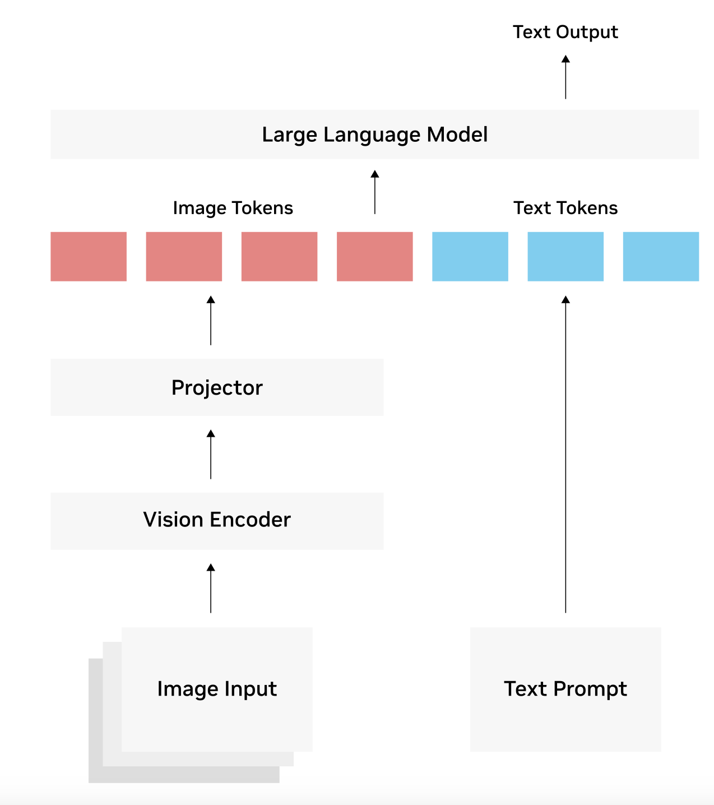

##### 1.2 VLM训练阶段

多模态大模型的训练通常分为以下几个关键阶段：

###### 预训练

**目的**：模型在海量的图像／视频与对应文本数据（包括标注、提示、描述）上训练，学习视觉特征、语言表征与跨模态对齐能力，将视觉编码器 、投影器  和 LLM 对齐，使其具备“看图识文”和“图文映射”基础能力。

下图以Qwen2.5 VL举例，预训练包括三个阶段：

- **第一阶段**：只训练ViT，以提升提取有意义的视觉表示的能力，从而更好的与语言模型融合，主要使用图像标题、视觉知识和OCR数据。
- **第二阶段**：训练ViT和 LLM，在视觉和语言模态之间建立更深层次联系的能力，引入了更复杂和推理密集型数据，包括交错数据（Interleaved Data）、多任务数据（如VQA、视频理解、视觉定位Grounding、Agent任务）以及纯文本数据。
- **第三阶段**：训练ViT和 LLM，增强长上下文能力。

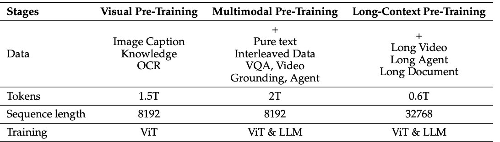

###### SFT

**目的：**基于特定任务，使用对应高质量的标注数据对模型进行适配，使其在目标场景表现更好。此阶段还往往会增强模型的指令遵循与对话能力，对所有参数进行联合训练。如Qwen2.5VL采用下图所示的ChatML格式构建指令遵循数据。

> ChatML（Chat Markup Language）是一种专为多轮对话训练设计的数据标注格式，用来清晰区分 **user** 和 **assistant** 的发言内容。
>
> 其基本结构如下：

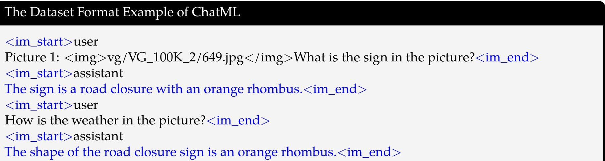

###### 强化学习

**目的：**利用**奖励模型（RLHF）**或者设计**奖励机制（RLVR）**来进一步优化模型的决策和生成策略，在所有多模态领域进行强化学习训练，提升模型推理能力。下图展示了GLM 4.5V中的奖励设计：

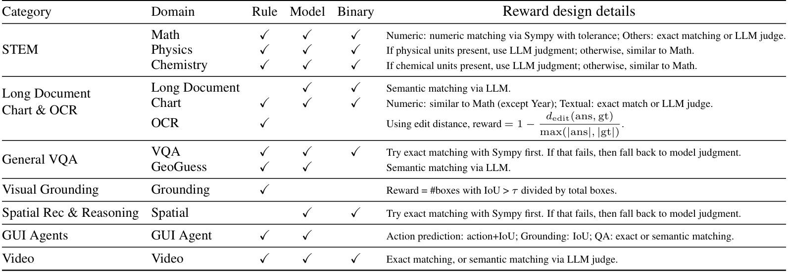

##### 1.3 开源模型

###### Qwen系列

- [Qwen-VL](https://arxiv.org/abs/2308.12966)：Qwen系列多模态模型开山之作，通过**视觉语言适配器**将**视觉编码器**与**大语言模型**集成在一起，采用**交叉注意力**机制来精确对齐视觉和语言数据。
- [Qwen2-VL](https://arxiv.org/abs/2409.12191) :  引入**原始动态分辨率（NaViT）**使模型能够处理任意分辨率的图像，**多模态旋转位置嵌入（M-RoPE）** 实现跨模态融合时的空间和时间理解能力。
- [Qwen2.5-VL](https://arxiv.org/abs/2502.13923): 引入**绝对时间编码和动态帧率（FPS）**使模型能够处理从高分辨率图像到数小时视频的多尺度输入，同时定位精度达到秒级。采用 **本地训练的动态分辨率 ViT**，结合 **窗口Attention** 降低计算负载，提升视觉理解与定位能力。
- [Qwen3-VL](https://qwen.ai/blog?id=99f0335c4ad9ff6153e517418d48535ab6d8afef&from=research.latest-advancements-list)：将Qwen2.5VL中使用MRoPE替换为**交错-MRoPE**，将时间、高度、宽度三个维度均匀分布在低频和高频带中，显著提升图像与视频中的时空建模能力。使用**Deepstack**技术，将ViT不同层的视觉token通过残差连接路由至对应的 LLM 层，能够有效保留从底层（low-level）到高层（high-level）的丰富视觉信息，强化视觉-语言对齐。采用**基于文本的时间对齐机制**，用显式的文本时间戳告诉模型这是第几帧，实现更精确的时空定位。

###### InternVL系列

- [InternVL](https://arxiv.org/abs/2312.14238) : InternVL系列开山之作，将视觉模型（6B 参数）与语言模型跨模态对齐，提出「**视觉-语言两阶段训练＋对比 + 生成联合训练**」流程。
- [InternVL1.5](https://arxiv.org/abs/2404.16821) ： 引入**视觉编码器强化**和**动态高分辨率分块策略 。**
- [InternVL2.5](https://arxiv.org/pdf/2412.05271): 采用**渐进式扩展策略**，从较小的 LLM 开始扩展，从而允许视觉编码器与较大的 LLM 进行有效对齐。
- [InternVL3](http://arxiv.org/abs/2504.10479) : 采用 Variable Visual Position Encoding（**可变视觉位置编码**）和 Native Multimodal Pre-Training（**原生多模态预训练**）机制，提升模型在跨模态推理与文本性能上的能力
- [InternVL3.5](http://arxiv.org/abs/2508.18265) : 提出 Cascade Reinforcement Learning（**级联强化学习**）框架，实现粗-细两阶段训练；引入 Visual Resolution Router（**视觉分辨率路由**）与 Decoupled Vision-Language Deployment（**视觉与语言分离部署**）策略

###### 其他优质开源模型

- [GLM 4.5V](http://arxiv.org/abs/2507.01006)：采用**预训练 + SFT + RLCS**（基于课程采样的强化学习）三阶段训练，为STEM、视频理解、文档理解、GUI等任务分别设计奖励。
- [MiniCPM-V 4.5](http://arxiv.org/abs/2509.18154)：在端侧设备上以 8 B 参数规模突破此前大型模型的性能，引入了三大核心提升：1.  **统一 3D-Resampler 架构** 实现对图像与视频的高压缩编码，令模型可在视频理解任务中用极少视觉 token 实现高帧率与长时段链路理解。2.  **统一文档与文本识别学习范式**，跳脱传统为 OCR、文档解析分别构建数据集的做法，而以统一网络处理视觉文本与结构化知识，使多模态文档理解效率大幅提升。3.  **混合强化学习策略** 实现「短链快速推理」与「长链深度思考」双模式并行，令模型在快速响应与复杂推理间自适应切换。
- [DeepSeek-VL2](https://arxiv.org/pdf/2412.10302)：在视觉编码器采用 **Dynamic Tiling 策略**，能够灵活处理不同纵横比与高分辨率图像，从而显著提升细节识别与大图场景理解能力。 在LLM引入 **MLA** 机制，将传统的 KV cache大幅压缩为潜在向量，有效提升推理吞吐与存储效率。
- [Kimi-VL](https://arxiv.org/pdf/2504.07491) ：采用 **MoE** 架构，通过动态激活机制仅唤醒约 2.8B 激活参数。其视觉编码模块 **MoonViT** 支持 **原生分辨率（NaViT）**输入，可处理高达数百万像素的图像，结合 **2D RoPE** 位置编码实现细粒度空间感知。
- [Seed1.5-VL](https://arxiv.org/pdf/2505.07062)：该模型提出了三大核心创新：1. 在视觉编码器采用了 **原生分辨率输入 + 动态帧／分辨率采样**  机制，使其能够高效处理图像和长视频输入，显著提升视觉长度与细节信息的理解能力。2. 架构设计采用了 **小视觉编码器（≈532M 参数） + 20B active 参数 MoE 语言模型** 的非对称组合，并引入了 **视觉 token 重分配** 与 **混合并行训练** 技术，从而在训练效率与推理成本之间达成平衡。3. 构建了一个覆盖 3D 理解、视频分析及 GUI 操作等多维能力的 3 万亿 token 数据集，采用 **(SFT) + LongCoT)+ RLHF/RLVR** 流程训练。
- [LLaVA-OneVision-1.5](https://www.arxiv.org/pdf/2509.23661)：1. 引入支持原生高分辨率图像输入的视觉编码器 **RICE-ViT**，提升了区域感知与细粒度理解能力。2. 构建了**预训练数据**（约 85 M 条）与**结构化指令微调数据**（约 26 M 条），通过全面数据质控和离线并行打包，实现高数据效率、多模态训练从零到一的社区开源框架。
- [SAIL-VL2](https://zhuanlan.zhihu.com/p/1953408884996809677)：1. 构建了大规模且高质量的视觉–语言数据筛选管道，利用评分和过滤机制显著提升图像、OCR、问答、视频数据的质量与分布均衡。 2. 引入渐进式训练框架，从**强视觉编码器（SAIL-ViT）**起步，经过多模态预训练，最终采用「思考融合 (thinking-fusion)」的 **SFT-RL** 混合范式，系统增强模型从感知到推理的能力。 3. 架构创新：在 2B / 8B 参数规模下，不仅使用传统密集大模型，也集成 MoE 模块，大幅提高参数效率与推理性能。
- [MiMo-VL](https://arxiv.org/abs/2506.03569)：采用**Mixture-of-Modalities (MiMo)** 架构，将图像、视频、音频、文本乃至结构化表格等多种模态统一映射到一个共享隐空间，使得每个模态都可交互、互补。引入了 **Hierarchical Cross-modal Routing (HCR)** 机制：在编码阶段，每条模态流先独立编码，再根据任务需求动态路由至不同融合层，使模型能专注于核心模态交互而不是盲目统一，提升了效率与准确性。训练策略上采用 **Progressive Multi-modality Curriculum (PMC)**：先在低维模态对（如图像＋文字）预训练，再引入音频／视频／表格等更复杂组合，最后再用混合强化学习提升推理与规划能力。

###### 其他优质闭源模型

- **GPT5（OpenAI）**
- **Gemini-2.5-Pro（Google）**
- **Claude Sonnet 4.5（ Anthropic）**
- **Grok-4（X）**

##### 1.4 BenchMark

多模态的训练和评测数据集主要可以分为以下几类：

- **VQA**:  提供图像与相关问题，训练模型理解视觉场景并输出自然语言答案，考察模型的图文对齐与推理能力。
- **OCR:** 涉及从图片、票据、文档或自然场景中识别文本内容，并结合上下文进行语义理解，用于表单解析、题目识别、场景文字分析等任务。
- **逻辑推理**：在视觉输入的基础上进行多步思考与关系推断，例如分析图像中物体间的**逻辑关系**、**数量变化**、**因果事件**等，以提升跨模态推理与决策能力，常见数学和代码场景。
- **Grounding**:  要求模型将语言中的实体或描述与图像中的具体区域精确对应，用于检测、框选、标注或视觉问答中的区域定位，衡量模型连接视觉语义与空间信息的能力。
- **视频理解**：通过时间序列帧与字幕信息训练模型理解动作、事件和语义演变，考察模型的时序感知与动态理解能力**。**
- **Agent能力**：基于视觉环境执行操作，如识别界面元素、规划步骤、点击或输入指令，实现视觉交互与多模态智能体行为学习。

以下介绍一些最有代表性的评测Benchmark：

###### VQA

###### MMMU & MMMU pro

一个大规模、多学科、多模态的评测数据集，旨在全面衡量多模态大模型在真实学术与专业场景中的理解与推理能力。考察模型在跨模态理解、知识推理与多步思考上的能力，常用于评测模型的 **VQA** 能力。

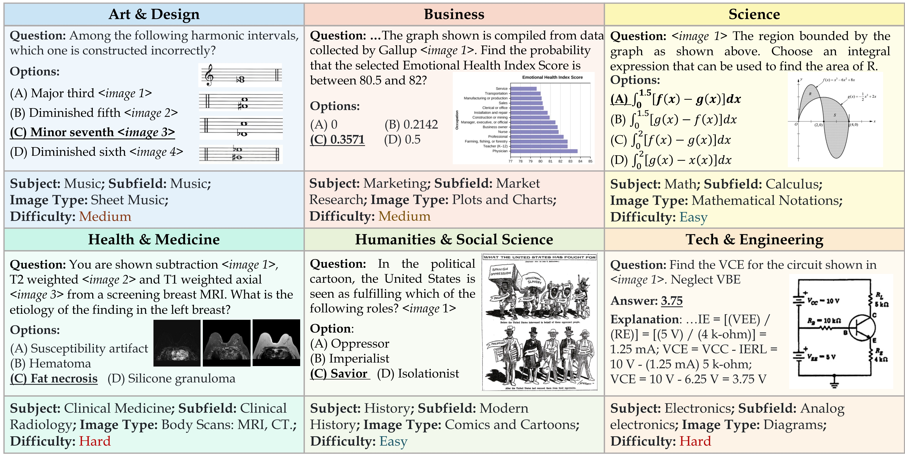

###### MMBench

它涵盖了感知、认知、推理、知识理解等多维度，涉及**视觉理解、图表分析、场景推理、文本阅读、常识问答**等任务。相比早期基准（如 VQA、OKVQA），MMBench 更注重模型的**通用多模态智能与细粒度推理能力**，是当前评测多模态大模型表现最广泛使用的权威基准之一，常用于评测模型的 **VQA** 能力。

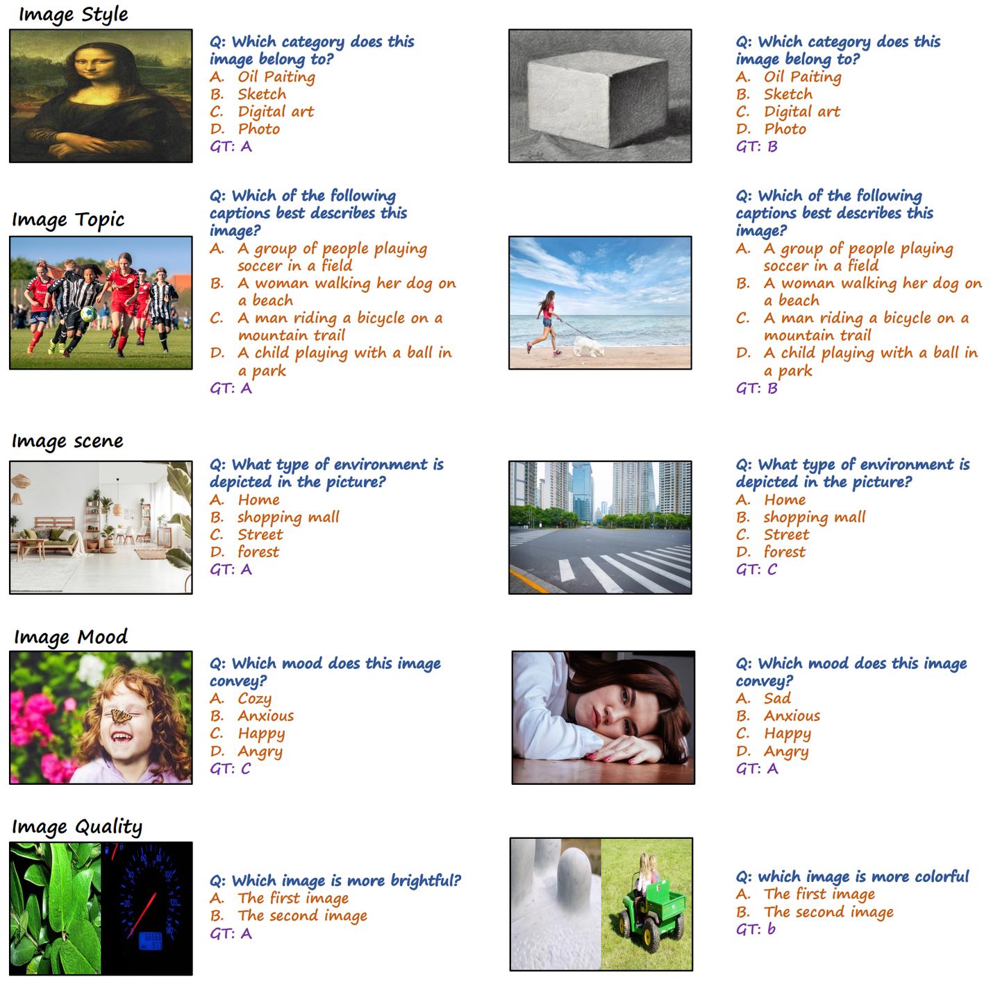

###### MMStar

针对现有BenchMark缺乏视觉依赖性，即可以仅使用文本知识就能回答问题，以及样本泄漏到LLM语料库的问题，人工精心挑选了 1,500 个样本，旨在对 6 个核心功能和 18 个维度进行基准测试。常用于评测模型的 **VQA** 能力。

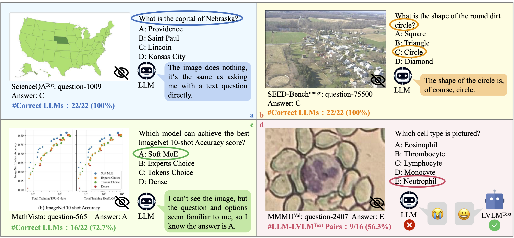

###### HallusionBench

针对“**语言幻觉**”与“**视觉错觉**”方面的诊断性基准，它设计的问题既包含必须依赖图像上下文才能回答的“视觉依赖型”问题，也包含可以仅凭文本回答但图像提供补充信息的“视觉补充型”问题。常用于评测模型的 **VQA** 能力。

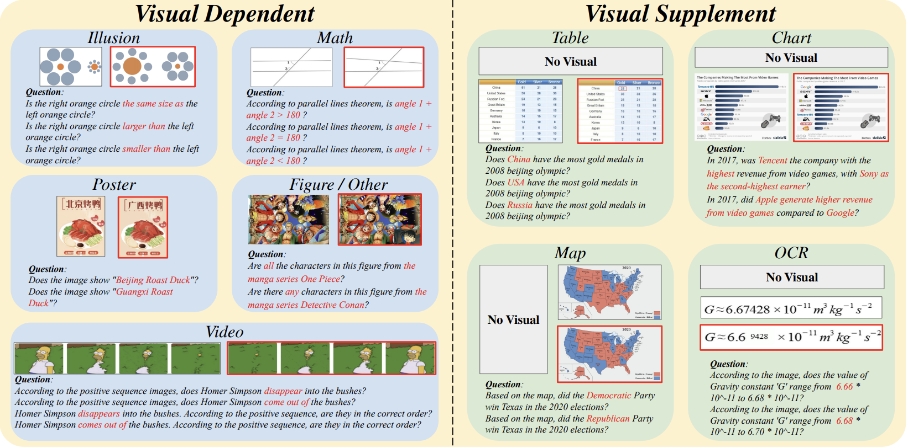

###### OCR

###### OCRBench

一个大规模双语文字识别与推理基准，不只是考“能否识字”，而是检验视觉语言模型在文本定位、识别、理解与推理方面的综合 OCR 能力。常用于评测模型的 **OCR** 能力。

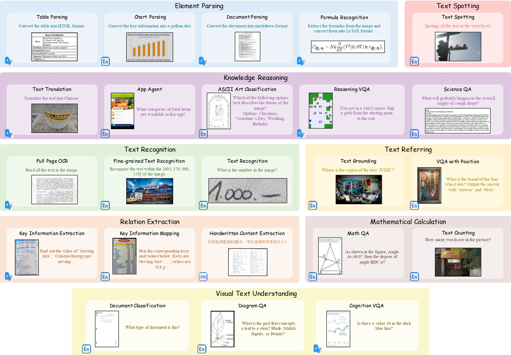

###### ChartQA & ChartQAPro

面向图表问答的基准数据集，设计用来考察模型在图表上的视觉＋逻辑推理能力。**不仅考察图像内容，还需要结合底层表格数据与图表结构做复杂逻辑/算术推理**。常用于评测模型的 **OCR** 能力。


###### 数学推理

###### MathVista

一个专门评估视觉上下文下的数学推理能力的多模态基准。它整合来自 28 个已有多模态数学 / 视觉问答数据集的样本，并新构建了 **IQTest、FunctionQA、PaperQA** 三个子集，以填补缺失的视觉场景任务。常用于评测模型的 **数学** 能力。

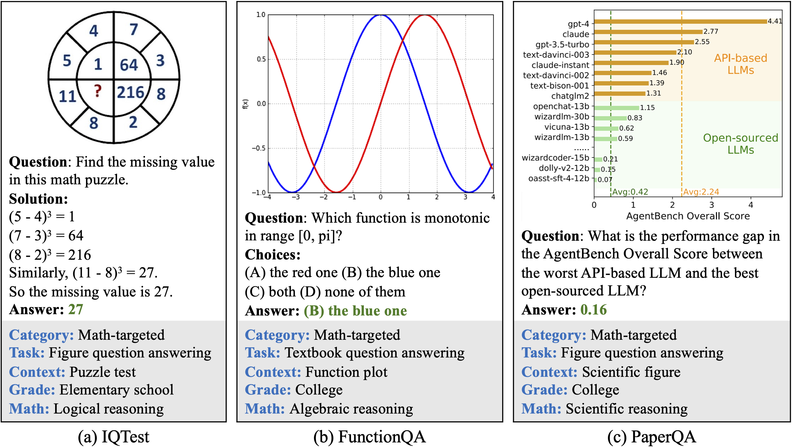

###### MathVision

收录了来自真实数学竞赛的 **3,040 道高质量带图像或视觉上下文的数学题目**，覆盖 **16 个不同的数学主题**（如代数、几何、组合、统计、拓扑等），并按照 5 个难度等级 （从容易到困难）进行分层设定。常用于评测模型的 **数学** 能力。

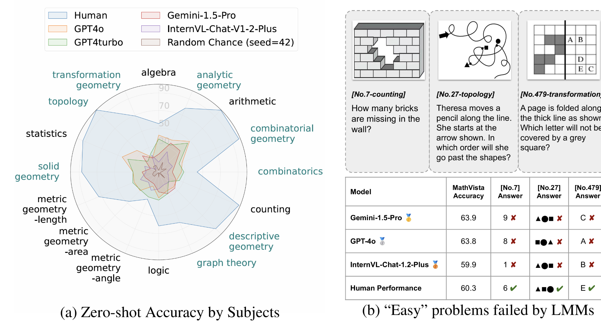

###### Grounding

###### RefCOCO & RefCOCO+ & RefCOCOg

经典的指代消解数据集，来源于 **MSCOCO** 。目标都是让模型根据一段自然语言描述，在图像中定位出对应的目标区域，常用于评测模型的 **Grounding** 能力。

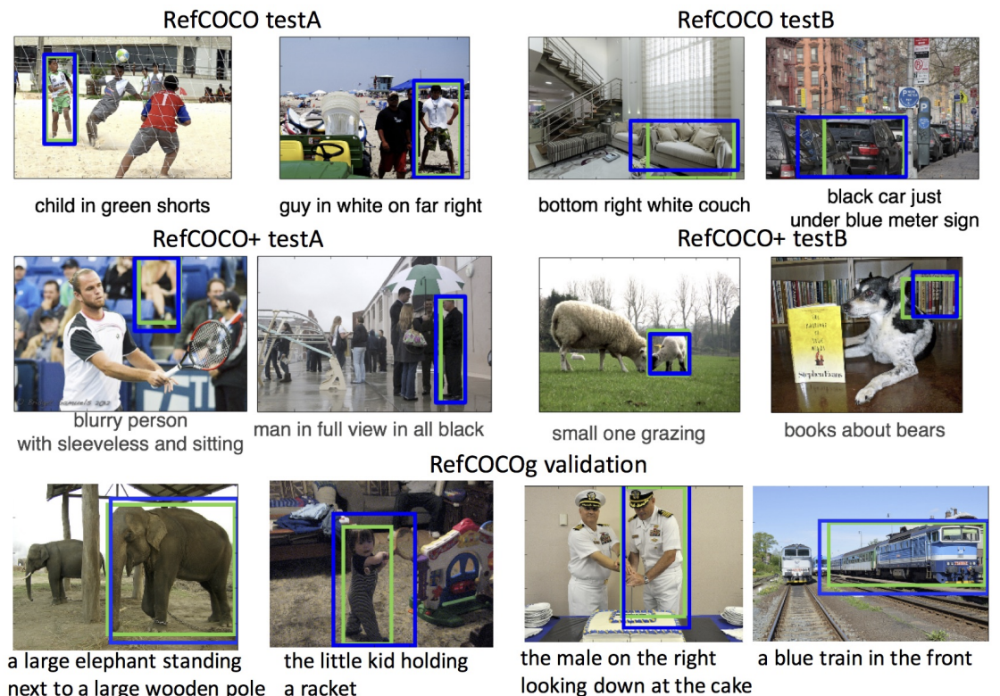

###### 视频理解

###### VideoMME

Video-MME 融合了视频帧、字幕与音频等多种模态输入，场景覆盖 6 大视觉域和 30 个子领域，注重考察模型的时间上下文理解、跨模态融合、以及长序列推理能力。常用于评测模型的 **视频理解** 能力。

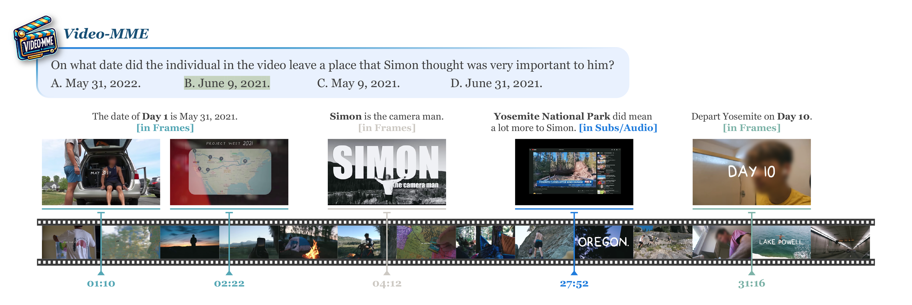

###### Video-Bench

系统地评估模型在视频专注理解（仅靠视频内容理解画面、动作、变化）、先验知识问答（结合视频与外部常识做推理，比如影视、体育、音乐等背景知识）和基于视频的决策（基于视频情景做判断、预测或规划能力）。常用于评测模型的 **视频理解** 能力。

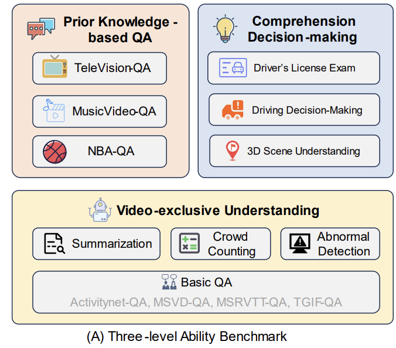

###### 代码生成

###### Web2Code

数据集分为“**网页 → 代码生成**”和“**网页理解**”两大子任务，分别用于评测多模态大语言模型在 **UI 还原、布局理解、文本内容抽取**等方面的能力。常用于评测模型的 **代码生成** 能力。

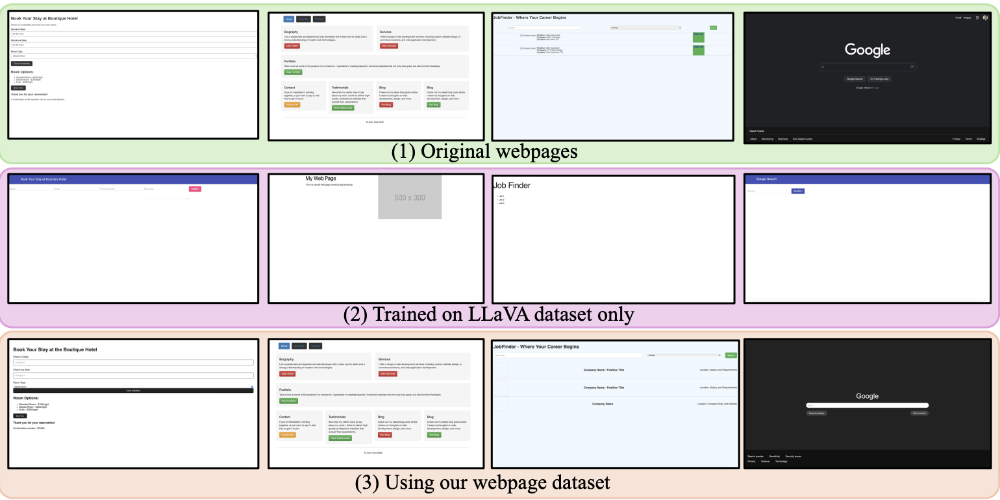

###### Design2Code

评估多模态大语言模型在“从视觉设计图直接生成网页代码”这一前端工程自动化任务上的真实世界基准。常用于评测模型的 **代码生成** 能力。

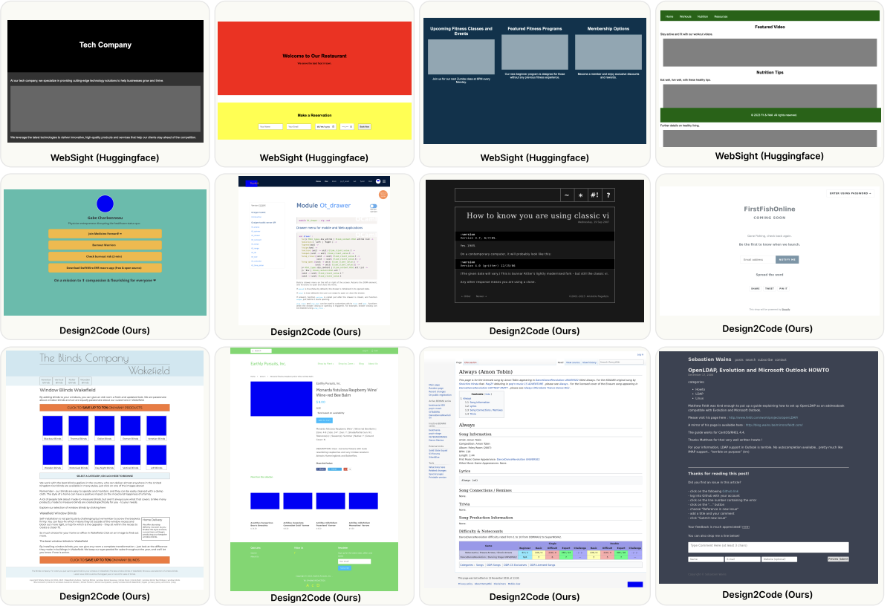

###### Agent

###### OSWorld

OSWorld 是一个用于评估多模态智能体在真实电脑环境（包括**桌面应用、浏览器、文件系统交互**等）中完成开放性任务的基准，提供了 369 个从真实电脑使用场景抽取的任务（涵盖 Ubuntu、Windows、macOS 平台），每个任务包括**初始化状态、环境配置、执行脚本**及评估标准。常用于评测模型的 **Agent** 能力。

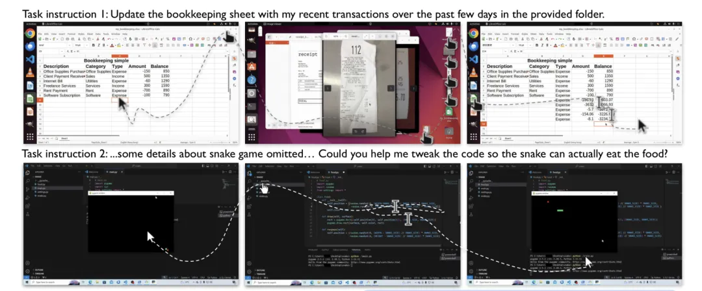

###### ScreenSpot

数据集涵盖了 iOS、Android、Windows、macOS 和 Web 等多个平台，并收录了超过 1,200 条指令，且每条样本都包含**屏幕截图、自然语言提示、目标元素的坐标框及元素类型（如 icon 或 text）**。常用于评测模型的 **Agent** 能力。


#### 2 基础模块：视觉与文本的共通底座

##### 2.1 ViT

论文链接：https://arxiv.org/pdf/2010.11929

代码链接：https://github.com/google-research/vision_transformer

大佬的视频讲解：【ViT论文逐段精读【论文精读】】 https://www.bilibili.com/video/BV15P4y137jb/?share_source=copy_web&vd_source=d0e4387a6f3f6598aa698f580507ec88

> ⛱️
>
> **论文总结**
>
> 2017 年，Transformer 架构首次在论文《Attention is All You Need》中被提出，自注意力机制（Self-Attention）自此成为自然语言处理领域的核心技术框架。随后，研究者也开始探索如何将 Transformer 引入计算机视觉领域，与传统的卷积神经网络（CNN）相结合以增强全局建模能力。
>
> 直到 2020 年，Google Research 在论文《An Image is Worth 16×16 Words: Transformers for Image Recognition at Scale》中正式提出 **Vision Transformer（ViT）** 模型。ViT 将图像划分为固定大小的 patch，并将每个 patch 线性映射为 token，再输入标准的 Transformer Encoder 进行特征建模。这一设计证明了——即便完全摒弃卷积结构，纯 Transformer 也能在大规模数据集（如 JFT-300M）上实现与 CNN 相当甚至更优的性能。
>
> ViT 的提出标志着视觉领域正式进入“Transformer 时代”。它展示了 Transformer 在捕捉全局依赖、可扩展性和模型泛化方面的优势，为后续的大规模视觉模型（如 DeiT、Swin Transformer）以及多模态模型（如 CLIP、BLIP、LLaVA、Qwen-VL 等）奠定了基础。

###### 从 CNN 到 ViT

Transformer 在自然语言处理领域取得成功后，研究者发现它似乎并没有明显的性能饱和趋势——即模型越大、数据越多，性能仍在持续提升。然而，将 Transformer 直接迁移到计算机视觉领域并不容易，主要困难在于：

1. **输入序列过长**：图像由大量像素组成，若将每个像素都视为一个 token，序列长度将远超文本。
2. **计算复杂度过高**：自注意力（Self-Attention）的计算量与序列长度呈平方关系，导致计算和显存消耗急剧上升。

为此，早期研究主要沿着两条路径尝试：

- **混合结构**：将 CNN 与自注意力机制结合使用。例如，只在卷积网络的高层特征图上引入自注意力（如 ResNet-50 的第 4 阶段，特征图大小约为 14×14），这样可以在不显著增加计算量的情况下，引入全局依赖建模能力。
- **完全替代卷积**：尝试用纯自注意力取代卷积操作，例如 *Stand-Alone Self-Attention*（在局部窗口内执行注意力）和 *Axial-Attention*（在水平和垂直两个维度上分别计算注意力）。

尽管这些工作验证了自注意力在视觉任务中的潜力，但它们在硬件上尚不具备良好的可扩展性（scalability），因此在当时仍难以撼动 ResNet 等 CNN 架构的主导地位。

Vision Transformer（ViT）突破性地提出了一种更高效的建模方式：**将输入图像划分为固定大小的 patch（例如 16×16），并将每个 patch 视作一个 token**。以一张 224×224 的图像为例，划分后得到 196 个 patch token，再输入标准的 Transformer 进行建模。ViT 采用纯监督学习，在大规模数据集上预训练后，在多个视觉任务上表现出色。

然而，作者也指出，当在中等规模的数据集（如 ImageNet）上训练时，ViT 的性能比同规模的 ResNet 仍略逊一筹。这是因为 Transformer 缺乏 CNN 的**归纳偏置（Inductive Bias）**。

> 归纳偏置（Inductive Bias）
>
> 在机器学习中，**归纳偏置**指的是模型在学习前就具备的**先验知识**。
>
> 在图像任务中，**卷积神经网络（CNN）**天生具有两种非常有用的归纳偏置：
>
> 1. **局部性（Locality）**  
>     CNN 假设图像上**相邻像素更可能存在相关性**。  
>     因此，它通过卷积核在局部区域内提取特征（如边缘、纹理），再逐层组合成更复杂的模式。
> 2. **平移等变性（Translation Equivariance）**  
>     这意味着对输入图像进行平移，卷积输出的特征也会相应平移。  
>     公式上可表示为：  
>      $f(g(x)) = g(f(x))$  
>      其中 $f$是卷积操作，$g$是平移操作。  
>      换句话说：无论物体出现在图像的哪个位置，卷积都能识别出相同的特征。

CNN 借助这些先验知识，即使在**相对小的数据集**上也能高效学习。而 ViT 需要在**更大规模的数据集**上通过预训练，才能学习到类似的空间结构感知能力。事实证明，当 ViT 在数亿级图像数据（如 JFT-300M）上预训练后，其性能显著超越传统 CNN，正式开启了“视觉 Transformer 时代”。

| **对比ViT和CNN** | ViT | CNN |
|---|---|---|
| **核心思想** | 基于 Transformer，将图像划分为 patch，序列化后用自注意力机制建模全局关系 | 基于卷积操作，通过局部感受野和层叠卷积核提取局部到全局特征 |
| **特征提取方式** | 自注意力机制，全局依赖建模能力强 | 卷积核提取局部特征，逐层堆叠形成全局信息 |
| **归纳偏置** | 几乎没有显式的归纳偏置，需要更多数据学习模式 | 内置平移不变性和局部连接等强归纳偏置 |
| **数据需求** | 需要大量训练数据（通常配合大规模预训练） | 中小规模数据也能有效训练 |
| **计算效率** | 注意力机制复杂度随序列长度二次增长，训练开销大 | 卷积计算高效，硬件和框架优化成熟 |
| **可扩展性** | 随模型和数据规模增长性能提升明显（Scaling Law友好） | 扩展性相对有限，深层网络可能面临梯度消失等问题 |
| **适用场景** | 大规模视觉任务（分类、检测、分割），特别是数据和算力充足时 | 图像识别、检测、分割等传统视觉任务，尤其适合数据有限的情况 |

###### ViT的模型架构

**Vision Transformer（ViT）** 的核心思想是——“把图像当作一串tokens来处理。”

它几乎不改变 Transformer 的原始结构，而是将图像分割成小块（patch），再将这些块线性映射成向量序列输入到 Transformer 中，就像 NLP 模型处理文本 token 一样。模型通过监督学习方式完成图像分类任务。

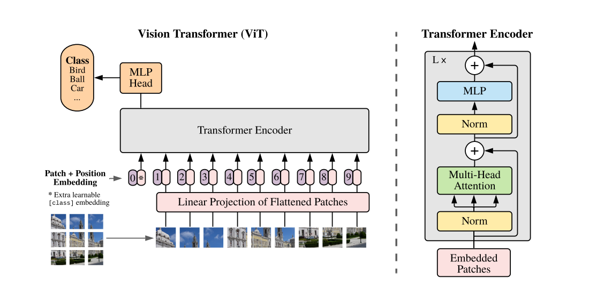

1. **输入处理（Patch Embedding）**
    输入图像 $x \in \mathbb{R}^{H \times W \times C}$ 会被切分成 $N$ 个不重叠的图像块（patch）： $x_p \in \mathbb{R}^{N \times (P^2 \cdot C)}$，其中：

    - $(H, W)$ 是**图像高宽**；
    - $C$ 是**通道数（RGB = 3）**；
    - P：每个 patch 的边长；
    - $N = \frac{HW}{P^2}$ patch 的数量，也就是 Transformer 的**输入序列长度**。

    每个 patch 被**线性投影**到维度 $D$，得到一系列 **patch embeddings**。
2. **位置嵌入（Position Embedding）**

在 ViT 中，会在所有图像块的嵌入序列前加入一个**可学习的 [class] token**，用来表示整张图像的全局语义。这个 token 的初始状态记作：$z_0^0 = x_{\text{class}}$

Transformer 编码器经过 $L$ 层后，第 0 个位置（即 class token）对应的输出向量 $z_0^L$ 被视为整张图像的语义表示：$y = z_0^L$

在分类任务中，模型会在 $z_0^L$ 上接一个分类头（MLP Head）：

- **预训练阶段**：通常使用带有一层隐藏层的 MLP；
- **微调阶段**：简化为单层线性映射，用于输出类别概率。

为了让模型感知图像块之间的空间位置关系，ViT 还会为每个块添加一个**可学习的一维位置嵌入（1D Position Embedding）**。  
最终输入序列由 class token、patch 嵌入和位置嵌入共同组成，用于捕捉图像的全局与局部结构。

3. **Transformer Encoder**：
    ViT 的核心在于 Transformer Encoder，它由多个相同的层堆叠组成，每层都包含：

    - 多头自注意力（Multi-Head Self-Attention, MSA）
    - 前馈网络（MLP）
    - 层归一化（LayerNorm）
    - 残差连接（Residual Connection）

对应的数学形式如下，Transformer Encoder 堆叠 LLL 层后输出 $z_L$，即整张图像的全局表示：

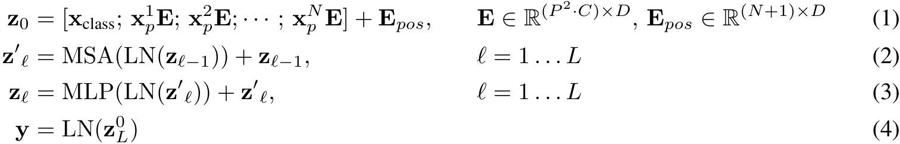

###### 代码解析

可视化样例参考：https://blog.mdturp.ch/posts/2024-04-05-visual_guide_to_vision_transformer.html

###### Patch Embedding

目的是将图像分割为patch，每个patch就等于一个token，然后把每个patch经过全连接网络转化成一维向量。那么怎么把图像展平成一维序列呢？

| 方法 | 核心步骤 | 优点 | 缺点 |
|---|---|---|---|
| **切块 + 展平 + 线性投影（Patchify + Flatten + Linear）** | 图像先被切成固定大小的小 patch（比如 P×P），每个 patch 包含所有通道信息；把 patch 的像素展平成一个长 vector（长度 = 通道 × $P^2$），然后通过一个全连接层（Linear projection）把这个向量变换到指定的 embedding 维度 D | 实现简单／直观；每个 patch 的表示完整保留像素信息；与原 ViT 最接近的方式 | 展平后维度很大（$P^2 C$），如果 patch 很大或者通道多，参数多、内存／计算量大；不分享 patch 之间局部空间的结构（展平破坏空间邻近结构，只能靠 Transformer 自己学习） |
| **使用 Conv2D 层（卷积）替代手动切块 + 展平 +线性投影** | 用 Conv2D（kernel_size = patch_size, stride = patch_size，通常不重叠）把图像“滑动窗口”分块 + 提取特征 + 输出通道数就是 embedding 维度；再 reshape / flatten / permute 得到序列形式 | 可以容易支持重叠 patch（重叠卷积 + stride < kernel_size）以捕获 patch 间的边缘信息 | 卷积的感受野／滤波器设计会影响 patch 的表达；也可能丢失展平 linear 的某些直观性（因为 conv 输出含有空间结构） |

ViT中使用的是第一种。输入图像 $x \in \mathbb{R}^{H \times W \times C}$ 会被切分成 $N$ 个不重叠的图像块（patch）： $x_p \in \mathbb{R}^{N \times (P^2 \cdot C)}$，其中：

- $(H, W)$ 是**图像高宽**；
- $C$ 是**通道数（RGB = 3）**；
- P：每个 patch 的边长；
- $N = \frac{HW}{P^2}$ patch 的数量，也就是 Transformer 的**输入序列长度**。

假设输入图像大小为224x224，卷积核大小为16×16，步长(stride)为16，卷积核个数为768，卷积后再展平，size变化为：[224, 224, 3] -> [14, 14, 768] -> [196, 768]。接下来通过Embedding层，把每个块被线性投影到维度D，得到块嵌入（**patch embeddings**）。每个patch对应一个token，作为LLM的输入。


1. **原始图像**


2. **图像分块**

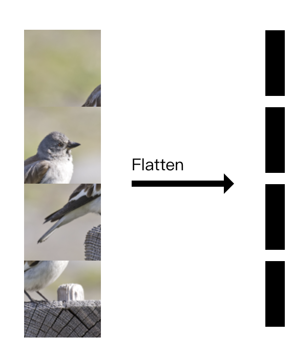

3. **图像展平**

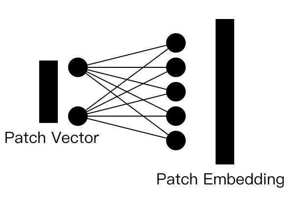

4. **块嵌入**

```python
class PatchEmbed(nn.Module):
    """2D Image → Patch Embedding

    把输入的 (B, C, H, W) 图像切 patch 并映射为 (B, N, embed_dim) 的 token 序列，
    optionally 加上归一化层。
    """
    def __init__(
        self,
        img_size=224,
        patch_size=16,
        in_chans=3,
        embed_dim=768,
        norm_layer=None,
        flatten=True
    ):
        super().__init__()
        # 把 img_size / patch_size 统一为 (h, w) 的 tuple
        img_size = to_2tuple(img_size)
        patch_size = to_2tuple(patch_size)
        self.img_size = img_size
        self.patch_size = patch_size

        # grid_size = 图像在 height / width 方向上能被多少个 patch 覆盖
        # 例如 224 / 16 = 14，则 grid_size = (14, 14)
        self.grid_size = (
            img_size[0] // patch_size[0],
            img_size[1] // patch_size[1]
        )
        # 一共多少个 patch = grid_size 高 × 宽
        self.num_patches = self.grid_size[0] * self.grid_size[1]

        self.flatten = flatten

        # 用一个 Conv2d 完成 patch 分块 + 线性投影
        # 输入通道 in_chans → 输出通道 embed_dim
        # kernel_size = patch_size, stride = patch_size 保证不重叠正好切分
        # 这里做的操作等价于 Unfold + Linear，但是 Conv2d 加速且实现简洁
        # 输入 (B, in_chans, H, W)
        # 输出 (B, embed_dim, grid_h, grid_w)
        self.proj = nn.Conv2d(
            in_chans,
            embed_dim,
            kernel_size=patch_size,
            stride=patch_size
        )

        # 如果提供了 norm_layer，就对 embed_dim 做规范化（如 LayerNorm）
        self.norm = norm_layer(embed_dim) if norm_layer else nn.Identity()

    def forward(self, x):
        # x: (B, C, H, W)
        B, C, H, W = x.shape
        assert H == self.img_size[0] and W == self.img_size[1], (
            f"Input image size ({H} × {W}) 不匹配模型设定 ({self.img_size[0]} × {self.img_size[1]})。"
        )

        # conv 后 x 的形状是 (B, embed_dim, grid_h, grid_w)
        x = self.proj(x)

        if self.flatten:
            # flatten(2) → 从第 3 维开始展平，把 spatial 维度展开：
            # (B, embed_dim, grid_h, grid_w) → (B, embed_dim, grid_h * grid_w)
            # transpose(1, 2) → 交换第 1 维和第 2 维，使 shape 变为
            # (B, N, embed_dim)，其中 N = grid_h * grid_w
            # 解释：每个 patch 对应一个 embed_dim 维度向量
            x = x.flatten(2).transpose(1, 2)
            # flatten(2) 是把维度 2 和 3 合在一起（grid_h × grid_w）
            # transpose(1,2) 把 shape 从 (B, embed_dim, N) → (B, N, embed_dim)

        # 对每个 token 做 norm（如果 norm 不是 Identity）
        # 注意 norm 一般沿 embed_dim 维度计算
        x = self.norm(x)

        # 返回 (B, N, embed_dim) 形式的 patch token 序列
        return x
```

> 💡
>
> **关于patch embedding的讨论点**
>
> 1. **为什么要切patch？**
>
> 如果不用 patch，而是把每个像素当成token，会导致序列很长，attention 的计算和内存开销会极大。切 patch 相当于在空间上压缩信息，把多个像素聚成一个 token，减少序列长度。
>
> 1. **patch Embedding的缺点**
>
> 把一个 patch 里的多个像素展平、再线性映射，会把局部像素间的空间结构“打碎”。通过在ViT中添加位置编码，能一定程度重建位置关系。
>
> 1. **patch-size的选择**
> - **小patch**：能捕捉细粒度特征、小物体、边界、纹理，更好把握复杂图像的特征；
> - **大patch**：序列长度更短，计算和推理的效率和成本更低；
> 2. **在不同分辨率下如何适配 patch embedding**？
>
> 为了适配推理时不同分辨率的图像，常见做法是在位置编码中做二维插值，并调整patch embedding 的权重；为了适应推理时不同大小的patch变化，可以在训练时就随机patch-size，或者不同层之间用不同的patch大小。
>
> 1. **embed_dim的选择**
>
> embed_dim维度越小，模型表达能力越弱，embed_dim维度越大，计算和推理开销越大。一般要求embed_dim是注意力头数的整倍数，并且embed_dim的数值要与模型深度协同，避免模型太胖或者太瘦。

###### Class token

类似于BERT的[class] token，在块嵌入序列的前面添加**可学习的嵌入** $z_0^0 = x_{\text{class}}$，其作用为：

- **全局信息聚合**：ViT 将输入图像划分为多个patch，每个patch通过线性投影转换为一个向量。Class Token 被添加到这些向量序列的开头，作为一个特殊的标记，旨在聚合整个图像的全局信息。
- **分类决策依据**：将class token的patch embedding输入到 Transformer encoder，处理完所有输入后，Class Token 的输出向量被提取出来，作为整个图像的表示。这个表示被送入一个多层感知机（MLP）分类器，用于预测图像的类别。
- **可训练的参数**：Class Token 是一个可训练的参数，初始时通常被随机初始化。在训练过程中，它不断更新，以学习如何有效地表示图像的全局特征。

> 🎁
>
> 继续之前的例子，Class token是一个1 x 768的向量，将其加到patch embedding前面，最终要输入到Transformer Encoder的序列维度为[197, 768]。

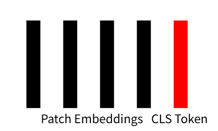

5. **添加Class token**

```python
self.cls_token = nn.Parameter(torch.zeros(1, 1, embed_dim))
cls_tokens = self.cls_token.expand(B, -1, -1)  # (B, 1, embed_dim)
patch_embeddings_wiconcath_cls = torch.cat((cls_tokens, x), dim=1)  # (B, N+1, embed_dim)
```

###### Position Embedding

Transformer 本身对输入 token 的顺序 /位置是不敏感的，也就是说它不会区分 token 来自序列的哪个位置。而图像 patch 序列每个 patch 在空间里有一个明确位置（行、列坐标）。位置嵌入就是把每个 patch 所在的空间位置信息编码进它的 embedding 里，让 Transformer 知道 patch 在图像里的位置关系。

在 ViT 中，在 patch 的 embedding 和 Class Token 上加（逐元素相加）一个与其对应的 **位置向量**，得到最终输入给 Transformer 的向量。这个位置向量是可训练的。位置编码更多讲解见[居丽叶LLM体系知识搭建](https://fp9qo5yj6d.feishu.cn/docx/AN61dRfiWoRUiRxhc6ucbmJwnGr)

下图中，在[197, 768]维的patch embedding和Class token向量的基础上，加上[197, 768]的位置向量。

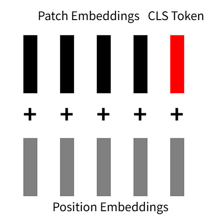

6. **位置向量**

```python
position_embeddings = nn.Parameter(torch.randn(1, num_patches + 1, emd_dim))
# 扩展 batch 维度
pos_embed = self.position_embeddings.expand(B, -1, -1)  # (B, N+1, embed_dim)

# 把位置 embedding 加到 patch_embeddings_wiconcath_cls 上
x = patch_embeddings_wiconcath_cls + pos_embed  
# 这样 x 的每个 token 都包含内容 embedding +其在空间上的位置信息
```

###### Transformer Encoder

> 🚅
>
> Transformer 编码器由**多头自注意力和MLP块交替组成，**输入是**concat(Patch Embedding +, cls token) + Position Embedding** 的token序列**，**Transformer Encoder 就在这个序列上做一系列自注意力 +前馈网络变换，把局部 patch 之间的信息融合起来、抽象成更高层语义的表示。
>
> 具体来说，包含以下L层叠加的模块：
>
> - **多头自注意力：**让每个 patch token 能“看”图像中其他 patch token，以捕捉全局依赖和上下文关系。
> - **FFN：**通常两层 MLP + GELU激活函数+Dropout，其中第一层MLP将输入维度拓展到[197, 3072]，第二个MLP再还原成[197, 768]，通过倒瓶颈的结构能在高维空间学习复杂特征，增强特征表达能力。
> - **LayerNorm**：对token做归一化处理，作用是稳定训练、控制内部激活分布、缓解梯度消失／爆炸问题，右图实现的是prenorm。这里之所以没有像传统CV一样使用batchnorm，是因为图片已经被切割成了patch序列，layernorm能更好的捕获patch之间patch之间的语义信息。
> - **残差链接**：为了让模型更容易训练，让梯度流动更好，不破坏原始特征。
>
> 多层叠加后，Transformer Encoder 的输出会让每个 token 的向量都变得语义更加丰富、互相“知道”对方的一些信息（类似于CNN通过逐层的卷积扩大感受野）。最终，从 encoder 的输出中提取 cls token 对应的位置向量作为整张图像的表示，用于分类 head 等下游任务。

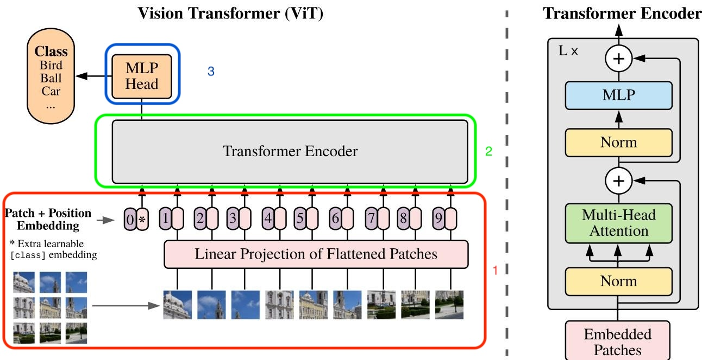

Transformer详细解释参考[居丽叶LLM体系知识搭建](https://fp9qo5yj6d.feishu.cn/docx/AN61dRfiWoRUiRxhc6ucbmJwnGr)

> 🎉
>
> 右图中，Encoder接受[197, 768]维的输入，经过：
>
> 1. LayerNorm → 多头自注意力（Q, K, V 由同一输入构造） → 残差连接，
> 2. LayerNorm → 前馈网络（MLP） → 残差连接
>
> 输出仍是[197, 768]维。

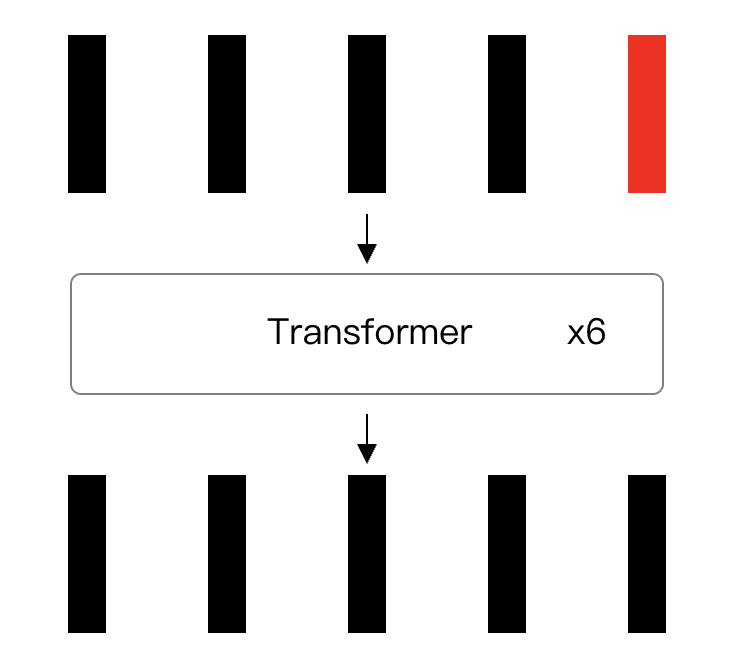

7. **Transformer Encoder**

```python
import torch
import torch.nn as nn
import torch.nn.functional as F

class MultiHeadSelfAttention(nn.Module):
    def __init__(self, embed_dim, num_heads, attn_dropout=0.0):
        super().__init__()
        assert embed_dim % num_heads == 0, "embed_dim 必须能被 num_heads 整除"
        self.embed_dim = embed_dim
        self.num_heads = num_heads
        self.head_dim = embed_dim // num_heads

        # 用于生成 Q, K, V 的线性层（把输入映射成 queries / keys / values）
        self.qkv = nn.Linear(embed_dim, embed_dim * 3, bias=False)
        # 最后把多头拼接后的输出再映射回 embed_dim
        self.proj = nn.Linear(embed_dim, embed_dim)
        self.attn_dropout = nn.Dropout(attn_dropout)

    def forward(self, x):
        # x: (B, N, D) — batch, token 数, embedding 维度 D
        B, N, D = x.shape

        # 1. 线性映射生成 Q, K, V，一次性生成
        # qkv 的输出 shape = (B, N, 3*D)
        qkv = self.qkv(x)  
        # 切分成 Q, K, V 三部分，每个 shape = (B, N, D)
        q, k, v = qkv.chunk(3, dim=-1)

        # 2. 把每个 head 拆出来：reshape → (B, num_heads, N, head_dim)
        q = q.view(B, N, self.num_heads, self.head_dim).transpose(1, 2)
        k = k.view(B, N, self.num_heads, self.head_dim).transpose(1, 2)
        v = v.view(B, N, self.num_heads, self.head_dim).transpose(1, 2)
        # 现在 q, k, v 都是 (B, num_heads, N, head_dim)

        # 3. 计算注意力权重
        # q @ k^T -> (B, num_heads, N, N)
        # 缩放因子 sqrt(head_dim)
        attn_scores = (q @ k.transpose(-2, -1)) / (self.head_dim ** 0.5)
        attn_probs = F.softmax(attn_scores, dim=-1)
        attn_probs = self.attn_dropout(attn_probs)

        # 4. 用注意力权重加权 V： (B, num_heads, N, head_dim)
        attn_out = attn_probs @ v

        # 5. 把多头拼接回去
        # 先 transpose → (B, N, num_heads, head_dim)
        attn_out = attn_out.transpose(1, 2).reshape(B, N, D)
        # 投影回 embed_dim（虽然这里已是 D，但作统一接口）
        out = self.proj(attn_out)
        return out

class FeedForwardNetwork(nn.Module):
    def __init__(self, embed_dim, hidden_dim, dropout=0.0):
        super().__init__()
        # 两层线性 + 中间激活 + dropout
        self.fc1 = nn.Linear(embed_dim, hidden_dim)
        self.act = nn.GELU()
        self.fc2 = nn.Linear(hidden_dim, embed_dim)
        self.dropout = nn.Dropout(dropout)

    def forward(self, x):
        # x: (B, N, D)
        x = self.fc1(x)          # (B, N, hidden_dim)
        x = self.act(x)          # GELU 激活
        x = self.dropout(x)      
        x = self.fc2(x)          # (B, N, D)
        x = self.dropout(x)
        return x

class TransformerEncoderBlock(nn.Module):
    def __init__(self, embed_dim, num_heads, mlp_ratio=4.0, dropout=0.0, attn_dropout=0.0):
        super().__init__()
        self.embed_dim = embed_dim
        self.num_heads = num_heads
        # 多头自注意力层
        self.attn = nn.MultiheadAttention(embed_dim, num_heads, dropout=attn_dropout, batch_first=True)
        # LayerNorm 在注意力前或后（这里用前置 LayerNorm 方案）
        self.norm1 = nn.LayerNorm(embed_dim)
        # 前馈网络部分（MLP）
        hidden_dim = int(embed_dim * mlp_ratio)
        self.mlp = nn.Sequential(
            nn.Linear(embed_dim, hidden_dim),
            nn.GELU(),
            nn.Dropout(dropout),
            nn.Linear(hidden_dim, embed_dim),
            nn.Dropout(dropout),
        )
        # 第二个 LayerNorm
        self.norm2 = nn.LayerNorm(embed_dim)

    def forward(self, x):
        # x: tensor of shape (B, N, embed_dim)   # N = token 数目（含 cls token + patches）

        # --- 第一步：自注意力子层 + 残差连接 ---
        # 先规范化
        x_norm = self.norm1(x)  # (B, N, embed_dim)
        # 注意：MultiheadAttention 的输入格式如果 batch_first=True，则 (B, N, D)
        attn_out, _ = self.attn(x_norm, x_norm, x_norm)  # self-attention(Q=K=V) → 输出 (B, N, embed_dim)
        # 残差连接：注意力输出 + 原始 x
        x2 = x + attn_out  

        # --- 第二步：MLP 子层 + 残差连接 ---
        x2_norm = self.norm2(x2)
        mlp_out = self.mlp(x2_norm)  # (B, N, embed_dim)
        out = x2 + mlp_out

        return out
```

###### MLP head

Transformer Encoder 输出的是一个 token 序列，其中 **cls token** 的输出向量被认为聚合了整张图像的信息。MLP Head 就是把这个 cls token 的最终表示，转换成类别 logits / 概率的模块。

> 🎉
>
> MLP Head 的常见结构为：**Linear → GELU → Linear → softmax。**
>
> 输入为[1， 768]维，输出为最终预测分类的logits。

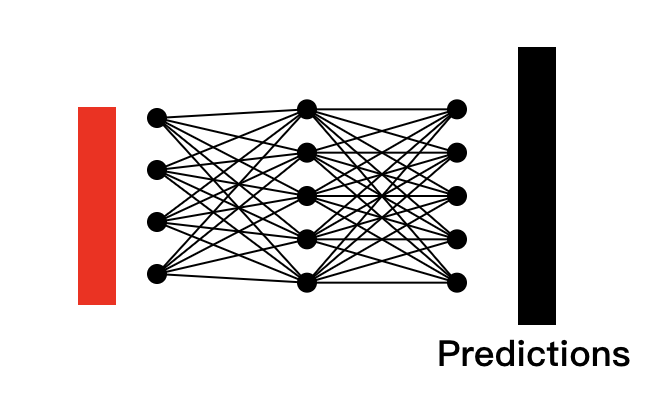

8. **MLP head**

```python
class MLPHead(nn.Module):
    def __init__(self, embed_dim, num_classes, hidden_dim=None):
        super().__init__()
        hidden = hidden_dim or embed_dim  # 如果隐藏层维度没给，就用 embed_dim 本身
        self.norm = nn.LayerNorm(embed_dim)  # 可选，在 head 前做规范化
        self.fc1 = nn.Linear(embed_dim, hidden)
        self.act = nn.GELU()
        self.fc2 = nn.Linear(hidden, num_classes)

    def forward(self, cls_token_embedding):
        # cls_token_embedding: (B, embed_dim)  
        x = self.norm(cls_token_embedding)  # 规范化
        x = self.fc1(x)
        x = self.act(x)
        x = self.fc2(x)  # 得到类别 logits (B, num_classes)
        return x
```

###### VIT 整体流程

[📎 5343dd80-72eb-11ec-b388-ba3d1869bcc4.mp4](多模态体系知识搭建/files/5343dd80-72eb-11ec-b388-ba3d1869bcc4.mp4)

另可以参考以下[数据流程图](https://amaarora.github.io/posts/2021-01-18-ViT.html)：

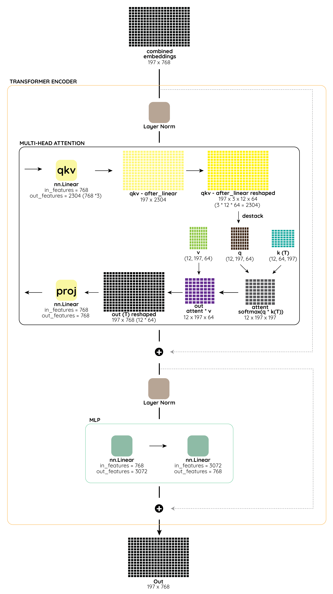

```python
class VisionTransformer(nn.Module):
    def __init__(self,
                 img_size=224,
                 patch_size=16,
                 in_c=3,
                 num_classes=1000,
                 embed_dim=768,
                 depth=12,
                 num_heads=12,
                 mlp_ratio=4.0,
                 qkv_bias=True,
                 qk_scale=None,
                 representation_size=None,
                 distilled=False,
                 drop_ratio=0.,
                 attn_drop_ratio=0.,
                 drop_path_ratio=0.,
                 embed_layer=PatchEmbed,
                 norm_layer=None,
                 act_layer=None):
        """
        构造 ViT 模型，主要包含 patch embedding、位置编码、多个 Transformer block、分类头等
        """
        super(VisionTransformer, self).__init__()
        self.num_classes = num_classes
        self.num_features = self.embed_dim = embed_dim  # 最终特征维度

        # 如果支持 distillation，则有两个 token（cls + distill token），否则只有 cls token
        self.num_tokens = 2 if distilled else 1

        # 设定 layernorm 和激活函数默认
        norm_layer = norm_layer or partial(nn.LayerNorm, eps=1e-6)
        act_layer = act_layer or nn.GELU

        # patch embedding 层：把 (B, C, H, W) → (B, num_patches, embed_dim)
        self.patch_embed = embed_layer(img_size=img_size, patch_size=patch_size,
                                       in_c=in_c, embed_dim=embed_dim)
        num_patches = self.patch_embed.num_patches

        # 可训练的分类 token（cls token）
        self.cls_token = nn.Parameter(torch.zeros(1, 1, embed_dim))
        # 如果使用 distillation（如 DeiT），还会有一个 distill token
        self.dist_token = nn.Parameter(torch.zeros(1, 1, embed_dim)) if distilled else None

        # 可训练的位置嵌入（position embeddings），包括 cls + patch tokens 的位置
        self.pos_embed = nn.Parameter(torch.zeros(1, num_patches + self.num_tokens, embed_dim))
        self.pos_drop = nn.Dropout(p=drop_ratio)

        # stochastic depth 的 drop path rate（每层的不同率）
        dpr = [x.item() for x in torch.linspace(0, drop_path_ratio, depth)]

        # 构造多个 Transformer Block（depth 层）
        self.blocks = nn.Sequential(
            *[
                Block(dim=embed_dim, num_heads=num_heads, mlp_ratio=mlp_ratio,
                      qkv_bias=qkv_bias, qk_scale=qk_scale,
                      drop_ratio=drop_ratio, attn_drop_ratio=attn_drop_ratio,
                      drop_path_ratio=dpr[i],
                      norm_layer=norm_layer, act_layer=act_layer)
                for i in range(depth)
            ]
        )

        # 最后一层的规范化
        self.norm = norm_layer(embed_dim)

        # 如果设置了 representation_size，则在 cls token 前加一个 pre_logits 层
        if representation_size and not distilled:
            self.has_logits = True
            self.num_features = representation_size
            self.pre_logits = nn.Sequential(OrderedDict([
                ("fc", nn.Linear(embed_dim, representation_size)),
                ("act", nn.Tanh())
            ]))
        else:
            self.has_logits = False
            self.pre_logits = nn.Identity()

        # 分类头（head）：把 cls token 表示映射到类别维度
        self.head = nn.Linear(self.num_features, num_classes) if num_classes > 0 else nn.Identity()
        self.head_dist = None
        if distilled:
            # 如果有 distill token，也给它一个 head
            self.head_dist = nn.Linear(self.embed_dim, self.num_classes) if num_classes > 0 else nn.Identity()

        # 权重初始化
        nn.init.trunc_normal_(self.pos_embed, std=0.02)
        if self.dist_token is not None:
            nn.init.trunc_normal_(self.dist_token, std=0.02)
        nn.init.trunc_normal_(self.cls_token, std=0.02)
        self.apply(_init_vit_weights)

    def forward_features(self, x):
        """
        得到 ViT 特征表示（不经过分类头）：
        包括 patch embedding + 添加 cls token + pos embedding + Transformer blocks + norm + pre_logits
        """
        # x: (B, C, H, W) → patch embeddings (B, num_patches, embed_dim)
        x = self.patch_embed(x)

        # 扩展 cls_token 到 batch 大小： (1,1,dim) → (B,1,dim)
        cls_token = self.cls_token.expand(x.shape[0], -1, -1)
        if self.dist_token is None:
            # 拼接 cls token 与 patch tokens 序列
            x = torch.cat((cls_token, x), dim=1)
        else:
            # 有 distill token 的情况：cls + distill + patch
            x = torch.cat((cls_token, self.dist_token.expand(x.shape[0], -1, -1), x), dim=1)

        # 加位置编码 + dropout
        x = self.pos_drop(x + self.pos_embed)

        # 经过多个 Transformer block
        x = self.blocks(x)
        # 最后做规范化
        x = self.norm(x)

        # 如果有 pre_logits，则在 cls token 上再做一层映射；否则直接返回 cls token 表示
        if self.dist_token is None:
            return self.pre_logits(x[:, 0])  # cls token 在序列的第 0 个位置
        else:
            return x[:, 0], x[:, 1]

    def forward(self, x):
        """
        正式前向：得到特征 → 分类头 → 输出 logits 或 (logits + distill logits)
        """
        x = self.forward_features(x)
        if self.head_dist is not None:
            x, x_dist = self.head(x[0]), self.head_dist(x[1])
            if self.training and not torch.jit.is_scripting():
                # 训练时返回两个 head 的输出；推理时取它们平均
                return x, x_dist
            else:
                return (x + x_dist) / 2
        else:
            # 普通情况只用一个 head
            x = self.head(x)
        return x
    def _init_vit_weights(m):
        """
        ViT 权重初始化函数
        """
        if isinstance(m, nn.Linear):
            nn.init.trunc_normal_(m.weight, std=.01)
            if m.bias is not None:
                nn.init.zeros_(m.bias)
        elif isinstance(m, nn.Conv2d):
            nn.init.kaiming_normal_(m.weight, mode="fan_out")
            if m.bias is not None:
                nn.init.zeros_(m.bias)
        elif isinstance(m, nn.LayerNorm):
            nn.init.zeros_(m.bias)
            nn.init.ones_(m.weight)
```

###### 模型训练

###### **数据集**

> 📍
>
> - **预训练数据集**：
>     - ILSVRC-2012 ImageNet（1k类，1.3M图像）
>     - ImageNet-21k（21k类，14M图像）
>     - JFT-300M（18k类，303M高分辨率图像）
>     - 通过去重避免与下游任务测试集重复

> 🎼
>
> **下游迁移(微调)任务**：
>
> - ImageNet（原始标签和ReaL标签）
> - CIFAR-10/100
> - Oxford-IIIT Pets
> - Oxford Flowers-102
> - VTAB分（19个任务，每任务1000训练样本），分为三组：
>     - Natural（如自然场景）
>     - Specialized（如医学图像）
>     - Structured（需几何理解的任务）

###### **模型设置**

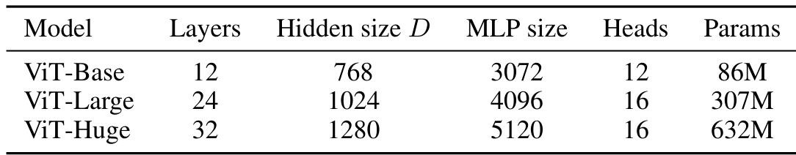

- 分**Base、Large、Huge**三种规模
- 命名规则：ViT-L/16表示Large模型，输入块尺寸16×16，Transformer序列长度与patch尺寸平方成反比（小尺寸patch计算成本更高）

###### 模型训练

采用预训练（负责学习通用的视觉特征）+微调（适应特定任务）两阶段训练。

###### 预训练

1. **模型架构**
- **训练模型**：完整ViT，预训练采用线性分类头做预测。
- **特殊标记**：在序列首部添加可学习的[class]标记，其输出作为图像表征，用于MLP做预测。
- **位置编码**：默认使用1D可学习位置编码，未显式注入2D结构信息
- **输入处理**：统一使用224x224，微调时再引入更高分辨率的图像。
2. **训练配置**
- **优化器**：Adam (β₁=0.9, β₂=0.999)，批量大小4096，权重衰减0.1
- **正则化**：在每层全连接层后应用dropout（除qkv投影层）
- **学习率**：线性warmup + 余弦衰减，基础学习率需根据模型规模调整

###### **微调**

1. **架构调整**
- **替换分类头**：移除预训练MLP头，替换为零初始化的D×K线性层（D为Transformer输出维度，K为下游类别数）。
- **分辨率调整**：保持patch大小不变，通过双线性插值扩展位置编码至新分辨率
2. **训练策略**
- 优化器：SGD with momentum=0.9，批量大小512
- 学习率：网格搜索范围（ImageNet：0.03-0.06，小数据集：0.001-0.01）
- 正则化：使用Polyak平均（因子0.9999）提升稳定性

###### 实验结论

1. ViT模型性能全面领先于对照的Resnet模型，且预训练计算成本低于对比模型。

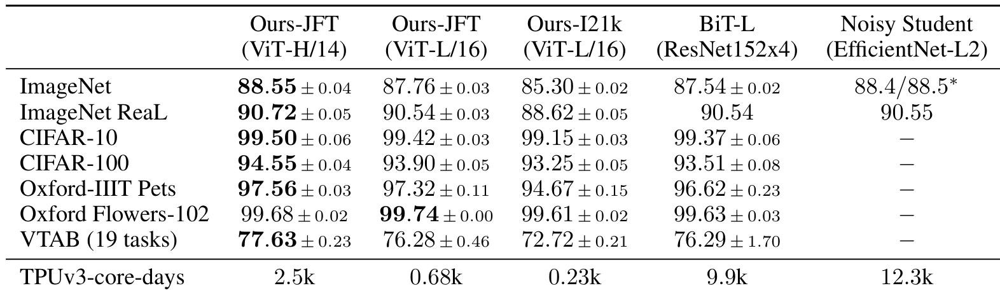

1. ViT在小数据集（如ImageNet）上表现受限，需依赖大规模数据（如JFT-300M）才能充分发挥ViT潜力。这是因为ViT中的**归纳偏置**显著少于CNN，例如局部性**、**平移等变性等，这也就导致ViT更容易过拟合。而再更大规模的数据集上，ViT可以充分学习数据的模式，不需要归纳偏置。

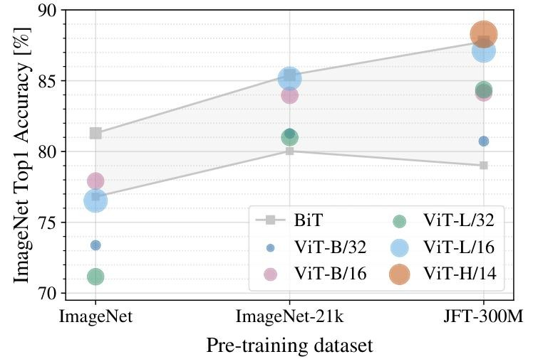

1. ViT模型的拓展性更好，具体表现为在未训练的数据集上：
- ViT在性能与计算成本显著优于ResNet，达到相同性能时计算量减少2-4倍。
- 混合模型在小计算预算下略优于纯ViT，但随着模型规模增大，差异消失。
- ViT未在实验规模内出现性能饱和，表明进一步扩展模型规模可能提升性能。
2. 自监督训练（之前的ImageNet-21k、JFT等都是有监督数据）
- 掩码块预测（类似BERT）使ViT-B/16在ImageNet上达到79.9%准确率，较从头训练提升2%，但仍落后监督预训练4%。

> ⛱️
>
> **总结ViT的优缺点**
>
> **优点**：
>
> - ViT模型继承了transformer模型的**全局依赖建模能力**，通过自注意力机制直接捕捉图像长距离特征关联，无需像 CNN 依赖卷积核逐步扩大感受野。
> - ViT架构可直接复用 NLP 领域的成熟技术，并且ViT输出的视觉特征可以与文本模态的特征融合，因此主流多模态大模型也使用ViT作为视觉模块。
> - ViT的特征表达能力强，并且由于transformer模型良好的遵循scaling law，ViT模型随着模型规模和数据量大增大，性能能持续得到提升。
>
> **缺点：**
>
> - **固定分辨率**：需要将输入图像resize为指定的分辨率，导致模型接收到的图像是失真的，影响学习效果
> - **固定patch-size**：patch越小模型性能越好，但训练和推理的速度越差。训练和推理时必须采用相同的patch-size。
> - **计算成本高：**自注意力机制的复杂度随图像像素数平方增长，达到相同效果需要的算力比CNN更高。
> - **数据依赖性强：**小数据集上训练易过拟合，需要大量标注数据才能发挥优势。
> - **缺乏归纳偏置**：对局部细节捕捉不足，ViT更容易过拟合。

参考文章：

- 《https://datawhalechina.github.io/thorough-pytorch/%E7%AC%AC%E5%8D%81%E7%AB%A0/ViT%E8%A7%A3%E8%AF%BB.html#patch-embedding-linear-projection》
- 《https://blog.mdturp.ch/posts/2024-04-05-visual_guide_to_vision_transformer.html》
- 《https://blog.csdn.net/weixin_43334693/article/details/131836233》

##### 2.2 NaViT

论文链接：https://arxiv.org/pdf/2307.06304

代码链接：https://github.com/kyegomez/NaViT

> 📌
>
> **论文总结**
>
> 将图像统一处理成固定分辨率再交给视觉模型的效果不佳。NaViT利于ViT支持不同长度输入序列的特性，在训练过程是采用序列打包技术（**sequence packing**），支持**任意分辨率（arbitatry resolution）和长宽比的输入**，在推理阶段在多种分辨率下均能实现高性能，目前已经被应用到Qwen2-VL、Seed1.5 VL等多模态大模型。

1. **研究背景：ViT由于位置编码是可学习的1D绝对位置编码，**因此只能处理固定分辨率和长宽比的输入**。ViT** 通过将图像调整为固定正方形长宽比，再把图像分割为固定数量的patch进行处理，每个patch映射为一个token。
2. **方法创新：**NaViT首先将位置编码修改为分解位置编码，支持**原生分辨率**和**任意长宽比（**现在更常用的还是**M-RoPE）。NaViT 将不同图像的patch打包至单一序列（Patch n' Pack）**
3. **性能优势：**
    - **训练效率**：相同计算预算下，NaViT性能优于ViT，左图中以1/4计算量匹配ViT最佳性能。这是因为NaViT在相同计算预算内训练样本更多，NaViT-L/16训练时处理图像数量是ViT的5倍。
    - **性能优势**：模型在预训练和微调阶段引入多种分辨率的图像，在多种分辨率评估中表现优异（见图右）；

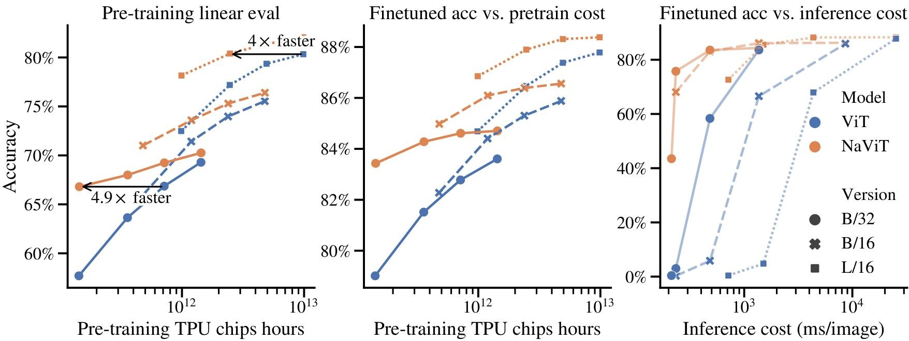

###### 掩码自注意力与掩码池化

- **掩码自注意力**：通过引入注意力掩码，本质就是一个对角分块mask矩阵，防止不同图像之间的跨样本信息交互，确保每个图像仅关注自身内部特征。
- **掩码池化**：在编码器输出端对每个图像的token进行独立池化，从而在序列中为每个样本生成单一的向量表示。
    

###### **分解式位置嵌入**

- 传统的ViT使用**1D绝对位置编码**，只能支持固定分辨率的输入图片，如果想拓展到更高分辨率的图像，需要对学习到的位置嵌入进行插值，非常麻烦。
- Pix2Struct 在训练时学习尺寸为 `[maxLen,maxLen]` 的**2D绝对位置编码**，通过每个图像块的`(x, y)`坐标进行索引，这样就能支持最高分辨率为$P⋅maxLen$的图片，$P$是patch-size，然而这需要在训练时见到过所有 `(x,y)`组合，也很麻烦。
- **分解式位置嵌入**：将图像的长和宽分别进行编码，使用两个分离的嵌入$ϕ_x,ϕ_y$ 来表示位置 `(x,y)`处的位置编码，然后将它们相加。$\phi$有两种实现方式：
    - **绝对位置嵌入**：$ϕ(p): [0,maxLen] →R^D$
    - **相对位置嵌入**：$ϕ(r): [0,1] →R^D,r=p/sideLen$，$r$是图像上的相对距离，支持任意分辨率外推，提供了与图片大小无关的位置编码，但部分掩盖了原始长宽比，此时长宽比仅通过块的数量隐式体现。

使用分解式位置嵌入，一方面参数量从平方级降低为线性级，另一方面外推性更好，因为即使训练数据中没有`(x,y)`分辨率的数据，但可能有宽为$x$和高为$y$的图像，也能学习到对应的位置关系。对于位置编码的具体形式，作者也考虑了**可学习**、**正弦**和**傅里叶**三种形式。

###### 训练策略优化

1. **continuous token dropping：**token dropping指的是训练时随机丢弃一些输入patch以用来加速训练。但之前的方法对所有样本都丢弃相同比例的token，NaViT 采用 sequence packing 之后我们可以进行 **continuous token dropping**，每个图像的token记丢弃率可以有所不同。这在保持较快吞吐量优势的同时，仍能观察到部分完整图像，从而减少了训练与推理之间的差异，且丢弃率可以在训练过程中变化，遵循某种预定义的调度策略

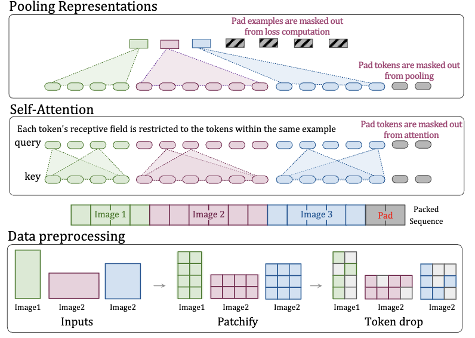

1. **分辨率采样：**在ViT中存在一个权衡：**更高的吞吐量（使用较小图像进行训练）与更高的性能（使用较大图像进行训练，以便在评估时实现高分辨率），**一般ViT模型会先在较小分辨率下进行预训练，然后在更高分辨率下进行微调**。**而NaViT可以随时调整图像大小分布来进行混合分辨率训练，能在提升性能的同时降低训练推理成本。

###### 效率分析

- **自注意力开销：**将多张图片 packing 到一个序列中，必然会导致序列长度增加，而注意力计算复杂度又是$O(n^2)$的。但是随着模型规模和隐层维度的增加，packing 带来的额外开销是不断减小的。此外长序列导致的内存开销也会更高，但可以通过Flashattention缓解。

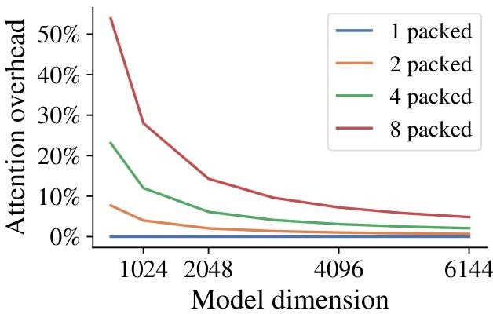

- **打包与序列填充：**需要保障一个batch中 packing 后的多张图片序列长度一样，采用**贪心策略或者动态规划**做packing，对于达不到序列长度的序列进行padding，整体padding率低于2%。
- **Padding example：**做packing后可以直接计算 token-level 的损失，却很难计算 example-level 损失，而很多视觉模型都是基于 example-level 损失计算的，通常应用于池化后的表示，首先要进行掩码池化，从每个序列中提取多个池化表示。如果需要固定batch size，就需要设定每个序列最多包含 $E_{max}$个图像，超过的图像丢弃，缺少的序列用padding填充。

##### 2.3 MRoPE

###### 引言

从纯文本迈向多模态，最大的挑战之一是如何在 Transformer 的线性序列中，保留图像的二维空间结构与视频的三维时序信息。若简单地沿用 1D 位置编码，图像 Patch 在展平后会丢失关键的空间关联（如垂直相邻关系），视频帧之间的时空逻辑也难以被单一维度捕捉。

为此，Qwen2-VL 提出了 **M-RoPE**，一种通用的 3D 旋转位置编码方案。它将位置信息拆解为 Time、Height、Width 三个正交维度，让模型能同时感知序列的先后与空间的时空坐标。

本文将以**原理演进 + 源码拆解**为主线，按以下逻辑展开解析：先从基础的 1D RoPE 切入，回顾文本位置编码的数学原理；再拓展至 2D RoPE，说明图像空间结构的编码方法；随后核心讲解 M-RoPE 如何通过新增时间维度实现多模态统一编码；而 position_ids 作为贯穿各类 RoPE 编码的关键输入，将在 1D、2D RoPE 原理铺垫后提前拆解，为后续 M-RoPE 的深入理解奠定基础，最终完整呈现这一让 LLM 精准捕捉多模态位置信息的核心机制。

###### 1D RoPE

在进入多模态之前，我们需要回顾一下 RoPE 的数学基础。它的核心思想是将**位置信息**通过“旋转角度”注入到向量中。

###### **数学原理**

RoPE 的灵感源于复数运算：将 token 的嵌入向量视为复数，通过旋转矩阵改变向量方向，旋转角度与 token 的位置正相关。位置越近的 token，旋转后的向量相似度越高，模型由此捕捉位置关系。

**简化案例（d=2 维度）**

假设某 token 的嵌入向量为$\mathbf{x} = \begin{bmatrix} x_1 & x_2 \end{bmatrix}$，我们将其表示为复数 $x=x_1+i⋅x_2$（$i$为虚数单位, $i^2 = -1$）。

根据欧拉公式$e^{im\theta} = \cos(m\theta) + i\sin(m\theta)$ ，对复数施加旋转操作：

$$
\begin{aligned}
x' &= x \cdot e^{\mathrm{i} m \theta_1} \\
   &= (x_1 + \mathrm{i}\, x_2)\bigl(\cos(m\theta_1) + \mathrm{i}\, \sin(m\theta_1)\bigr) \\
   &= x_1\cos(m\theta_1) + \mathrm{i}\,x_1\sin(m\theta_1)
      + \mathrm{i}\,x_2\cos(m\theta_1) + \mathrm{i}^2 x_2\sin(m\theta_1) \\
   &= \bigl(x_1\cos(m\theta_1) - x_2\sin(m\theta_1)\bigr)
      + \mathrm{i}\,\bigl(x_1\sin(m\theta_1) + x_2\cos(m\theta_1)\bigr)
\end{aligned}
$$

其中：

- $m$ 是 token 的位置索引，即第$m$个token；
- $\theta_k = 10000^{\frac{-2k}{d}}$（预定义频率参数，控制旋转角度的缩放，确保不同位置的旋转差异可区分）。

将复数运算展开为实数矩阵形式，可得：

$$
\mathbf{x'} = 
\begin{pmatrix}
\cos(m\theta_1) & -\sin(m\theta_1) \\
\sin(m\theta_1) & \cos(m\theta_1)
\end{pmatrix}
\begin{pmatrix}
x_1 \\
x_2
\end{pmatrix}
$$

这个矩阵就是 1D RoPE 的核心 —— **通过旋转向量，将位置信息编码到向量的维度关系中。**

**维度扩展：从 2 维子空间到任意维度 d**

实际应用中，token 的嵌入维度 d 远大于 2（如 128、256）。RoPE 的处理方式是：

1. 将 d 维向量按顺序两两分组，形成 $d/2$ 个复数对（如 $[x1,x2]、[x3,x4]、...、[x_{d-1},x_d]$）；
2. 对每个复数对应用上述旋转操作，使用不同的频率参数 $\theta_k$（k为分组索引）；
3. 将旋转后的复数对重新拼接为 d 维向量，作为最终的位置编码嵌入。

这种**分组旋转**的设计，让 RoPE 既能适配任意维度，又能保持计算效率（旋转矩阵为对角矩阵，计算量低）:

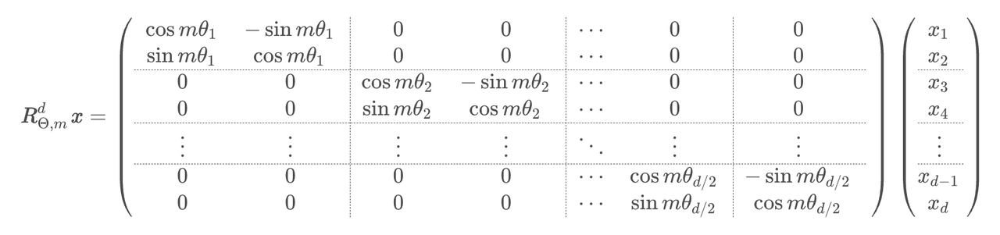

省略掉矩阵中的0，就能得到常见的1D RoPE的旋转矩阵:

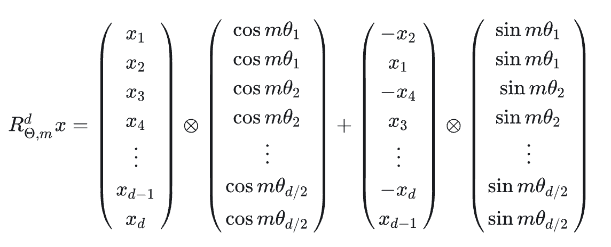

###### 2D RoPE

当场景从文本拓展到图像，1D RoPE 开始捉襟见肘：图像是 2D 平面结构（高度 H + 宽度 W），如果将图像 patch （按行或按列）展平为 1D 序列，会丢失相邻 patch 的空间关联性（比如同一列的两个 patch，展开成序列后可能相隔数十个 token）。

**2D RoPE** 的核心思想是**将位置编码拆分为两个独立维度，分别编码高度和宽度的空间信息**。它不再试图用整个特征向量去编码一个单一的线性位置，而是将特征向量（Embedding Vector）切分为两个独立的子空间：

1. **X轴子空间：** 使用向量的一半维度，专门编码宽度信息（Width）。
2. **Y轴子空间：** 使用向量的另一半维度，专门编码高度信息（Height）

假设特征维度为 $d$，则用于旋转的频率对数量为 $d/2$。在 2D RoPE 中，我们将这 $d/2$ 对频率一分为二：

- 前 $d/4$ 组复数对频率用于编码 x 坐标。
- 后  $d/4$ 组复数对频率用于编码 y 坐标。

（注：每组复数对占用 2 个维度，因此总维度为 $d/4 \times 2 + d/4 \times 2 = d$，与原向量维度一致）

这意味着，对于同一个特征向量 $\mathbf{x}$，其位置编码计算公式如下：

$$
R^{d}_{\Theta, x, y} \mathbf{x} =
\begin{pmatrix}
x_1 \\
x_2 \\
\vdots \\
x_{d/2-1} \\
x_{d/2} \\
x_{d/2+1} \\
x_{d/2+2} \\
\vdots \\
x_{d-1} \\
x_d
\end{pmatrix}
\otimes
\begin{pmatrix}
\cos x \theta_1 \\
\cos y \theta_1 \\
\vdots \\
\cos x \theta_{d/4} \\
\cos y \theta_{d/4} \\
\cos x \theta_1 \\
\cos y \theta_1 \\
\vdots \\
\cos x \theta_{d/4} \\
\cos y \theta_{d/4}
\end{pmatrix}
+
\begin{pmatrix}
-x_{d/2+1} \\
-x_{d/2+2} \\
\vdots \\
-x_{d-1} \\
-x_d \\
x_1 \\
x_2 \\
\vdots \\
x_{d/2-1} \\
x_{d/2}
\end{pmatrix}
\otimes
\begin{pmatrix}
\sin x \theta_1 \\
\sin y \theta_1 \\
\vdots \\
\sin x \theta_{d/4} \\
\sin y \theta_{d/4} \\
\sin x \theta_1 \\
\sin y \theta_1 \\
\vdots \\
\sin x \theta_{d/4} \\
\sin y \theta_{d/4}
\end{pmatrix}
$$

- 可以看到，向量中的不同部分分别与 $\cos x\theta$ (横向) 和 $\cos y\theta$ (纵向) 相互作用。
- 通过这种方式，模型能够同时捕捉图像在 **水平** 和 **垂直** 两个方向上的相对距离信息，且能够原生支持任意分辨率的输入（**无论图像是 224x224 还是 1024x1024，只需根据实际分辨率生成对应的（h_pos, w_pos）索引，即可动态计算旋转编码，完美适配多分辨率输入场景**）。

###### **代码实现（结合 Qwen2.5-VL 源码）**

- [步骤 1：生成 2D 位置索引 (pos_ids)](https://github.com/huggingface/transformers/blob/main/src/transformers/models/qwen2_5_vl/modeling_qwen2_5_vl.py#L337)：

这一步的目标是为每个 patch 生成 (height, width) 的坐标对。

```python
def rot_pos_emb(self, grid_thw):
    pos_ids = []  # 存储所有位置ID的列表
    
    for t, h, w in grid_thw:
        # --------------------------------------------------------
        # A. 构建高度方向的 Grid (Height IDs)
        # --------------------------------------------------------
        # 初始形状: [h, w]，每行的值相同 (0, 1, ..., h-1),表示该行的高度位置
        hpos_ids = torch.arange(h).unsqueeze(1).expand(-1, w)
        
        # 处理 spatial_merge (窗口化/降采样)，根据空间合并大小重塑张量，将空间分成多个块
        # 形状变换: [h, w] -> [h//size, size, w//size, size]
        # 这相当于将 h×w 的空间分成多个 size × size 的块
        hpos_ids = hpos_ids.reshape(
            h // self.spatial_merge_size,      
            self.spatial_merge_size,           
            w // self.spatial_merge_size,     
            self.spatial_merge_size,           
        )
        
        # 维度置换并展平为一维向量，得到重新排列后的高度位置ID
        hpos_ids = hpos_ids.permute(0, 2, 1, 3)
        hpos_ids = hpos_ids.flatten()

        # --------------------------------------------------------
        # B. 构建宽度方向的 Grid (Width IDs)
        # --------------------------------------------------------
        # 初始形状: [h, w]，每列的值相同 (0, 1, ..., w-1)
        wpos_ids = torch.arange(w).unsqueeze(0).expand(h, -1)
        
        # 同样的 spatial_merge 处理逻辑
        wpos_ids = wpos_ids.reshape(
            h // self.spatial_merge_size,      
            self.spatial_merge_size,           
            w // self.spatial_merge_size,      
            self.spatial_merge_size,           
        )
        wpos_ids = wpos_ids.permute(0, 2, 1, 3)
        wpos_ids = wpos_ids.flatten()
        
        # --------------------------------------------------------
        # C. 堆叠生成坐标对
        # --------------------------------------------------------
        # 将高度和宽度 ID 堆叠，形成 [N, 2] 的坐标对，其中每行是 [h, w]
        # repeat(t, 1): 视频的每一帧共享相同的空间网格结构 (2D Grid)
        # 因此，我们将计算好的一帧空间坐标 (H, W) 在时间维度上复制 t 次
        # [注意]：此处仅处理空间坐标，时间维度 (Time ID) 会由 M-RoPE 的其他逻辑单独注入
        pos_ids.append(torch.stack([hpos_ids, wpos_ids], dim=-1).repeat(t, 1))
    
    # 拼接所有图像/视频的坐标，pos_ids 的形状: [t * h * w, 2]
    # 每行是 [h, w]，表示该 patch 在帧内的 2D 坐标 (不包含时间信息)
    pos_ids = torch.cat(pos_ids, dim=0)
    
    # --------------------------------------------------------
    # D.后续查表逻辑
    # --------------------------------------------------------
    # 找到所有网格中的最大空间尺寸（高度或宽度的最大值）
    max_grid_size = grid_thw[:, 1:].max()
    
    # 设head_dim为hidden_size / num_heads
    # self.rotary_pos_emb = Qwen2_5_VisionRotaryEmbedding(head_dim // 2)
    # rotary_pos_emb_full 的形状: [max_grid_size, head_dim//4]，存储每个patch在x和y的旋转角度
    rotary_pos_emb_full = self.rotary_pos_emb(max_grid_size)
    
    # 根据位置ID从完整的旋转位置编码中索引出对应的编码, 
    # 每一个patch具有两个position id, [t * h * w, 2, head_dim//4] -> [t * h * w, head_dim//2]
    rotary_pos_emb = rotary_pos_emb_full[pos_ids].flatten(1)
    return rotary_pos_emb
       
```

- 步骤 2：计算旋转频率 (freqs)

这一步实现了标准的 RoPE 频率计算公式 $\theta_i = 10000^{-2i/d}$，并生成对应的频率表。

```python
class Qwen2_5_VisionRotaryEmbedding(nn.Module):
    inv_freq: torch.Tensor  # fix linting for `register_buffer`

    def __init__(self, dim: int, theta: float = 10000.0) -> None:
        super().__init__()
        # 计算逆频率：1 / (10000^{2i/d})
        # 形状: [dim//2]
        inv_freq = 1.0 / (theta ** (torch.arange(0, dim, 2, dtype=torch.float) / dim))
        self.register_buffer("inv_freq", inv_freq, persistent=False)

    def forward(self, seqlen: int) -> torch.Tensor:
        """         
        生成频率表 freqs。         
        返回形状: [seqlen, dim//2]         
        """
        seq = torch.arange(seqlen, device=self.inv_freq.device, dtype=self.inv_freq.dtype)
        
        # 计算每个位置对应的频率：freqs[pos, i] = pos * inv_freq[i]
        # 每一行包含了一个位置 pos 在所有频率分量上的旋转角度
        freqs = torch.outer(seq, self.inv_freq)
        return freqs
```

- [步骤 3：应用旋转编码到 Q/K 矩阵](https://github.com/huggingface/transformers/blob/main/src/transformers/models/qwen2_5_vl/modeling_qwen2_5_vl.py#L130)

基于计算出的每个patch在高度和宽度的旋转角度，就可以计算出`Cos` 和 `Sin`。最后一步是将计算好的 `Cos` 和 `Sin` 注入到 Attention 的 Query 和 Key 中，完成位置信息的融合。

```python
# 将输入向量的后半部分取负号并与前半部分交换位置，相当于对向量应用了90度的旋转操作。
def rotate_half(x):
    # 对于向量 x = [x1, x2]，其中 x1 是前半部分，x2 是后半部分
    # 旋转操作：rotate_half(x) = [-x2, x1]
    x1 = x[..., : x.shape[-1] // 2]  
    x2 = x[..., x.shape[-1] // 2 :]  
    return torch.cat((-x2, x1), dim=-1)
def apply_rotary_pos_emb_vision(
    q: torch.Tensor, k: torch.Tensor, cos: torch.Tensor, sin: torch.Tensor
) -> tuple[torch.Tensor, torch.Tensor]:
    orig_q_dtype = q.dtype
    orig_k_dtype = k.dtype
    #使用float32可以避免精度损失
    q, k = q.float(), k.float()
    cos, sin = cos.unsqueeze(-2).float(), sin.unsqueeze(-2).float()
    
    #将位置信息编码到query和key中，等价于应用旋转矩阵：
    # [cos(θ)  -sin(θ)]  [x1]   [cos(θ)*x1 - sin(θ)*x2]
    #                         = 
    #[sin(θ)   cos(θ)]  [x2]   [sin(θ)*x1 + cos(θ)*x2]
    q_embed = (q * cos) + (rotate_half(q) * sin)
    k_embed = (k * cos) + (rotate_half(k) * sin)
    
    # 将结果转换回原始数据类型，以保持与模型其他部分的一致性
    q_embed = q_embed.to(orig_q_dtype)
    k_embed = k_embed.to(orig_k_dtype)
    return q_embed, k_embed
```

###### 计算position_ids

position_ids 是 M-RoPE 编码的基础输入，用于定义每个 token 在时空维度的具体位置，是连接模态数据与旋转编码的关键桥梁。其核心逻辑是为文本、图像、视频 token 分配对应的三维（时间 T、高度 H、宽度 W）位置索引，最终输出维度为 [3, batch_size, sequence_length]。

> 📚
>
> **纯文本 embedding：旋转位置编码和 LLM 中的 1D 位置编码没有区别**，三个维度的位置编码都一样：
>
> - input_ids: `[T T T T T],` 其中`T`表示文本
> - 时间维度（temporal position_ids）: `[0, 1, 2, 3, 4]`
> - 高（height position_ids）: `[0, 1, 2, 3, 4]`
> - 宽（width position_ids）: `[0, 1, 2, 3, 4]`
>
> **视觉和文本混合 embedding：对视觉部分计算 3D 旋转位置编码，对文本部分计算 1D 旋转位置编码：**
>
> - 假设有一个视频输入，包含3个temporal patches，2个height patches和2个width patches，共计12个视觉token。输入序列为`[V V V V V V V V V V V V T T T T T]`，`V`表示视觉token
> - vision temporal position_ids: `[0, 0, 0, 0, 1, 1, 1, 1, 2, 2, 2, 2]`
> - vision height position_ids: `[0, 0, 1, 1, 0, 0, 1, 1, 0, 0, 1, 1]`
> - vision width position_ids: `[0, 1, 0, 1, 0, 1, 0, 1, 0, 1, 0, 1]`
> - **文本的起始位置 = 视觉部分最大位置ID + 1**
> - text temporal position_ids: `[3, 4, 5, 6, 7]`
> - text height position_ids: `[3, 4, 5, 6, 7]`
> - text width position_ids: `[3, 4, 5, 6, 7]`

接下来结合Qwen 2VL的[源码](https://github.com/huggingface/transformers/blob/main/src/transformers/models/qwen2_vl/modeling_qwen2_vl.py#L952)，讲解怎么计算视觉和文本token的position_ids，最终输出的postion_ids维度是`[3, batch_size, sequence_length]`

1. 初始化，input_ids表示输入的token序列。

```
input_tokens = input_ids.tolist()  
llm_pos_ids_list: list = []  # 存储每个片段（文本或视觉）的位置ID
st = 0  # 当前处理的起始位置
remain_images, remain_videos = image_nums, video_nums  
```

1. 遍历所有图像和视频，按它们在序列中出现的顺序处理

```python
for _ in range(image_nums + video_nums):
    # 查找下一个图像token的位置（从st开始）
    if image_token_id in input_tokens and remain_images > 0:
        ed_image = input_tokens.index(image_token_id, st)
    else:
        ed_image = len(input_tokens) + 1  # 设为无效值（大于序列长度）
    
    # 查找下一个视频token的位置（从st开始）
    if video_token_id in input_tokens and remain_videos > 0:
        ed_video = input_tokens.index(video_token_id, st)
    else:
        ed_video = len(input_tokens) + 1  # 设为无效值
    
    # 比较位置，谁先出现就处理谁（保持序列顺序）
    if ed_image < ed_video:
        # 处理图像：获取该图像的(时间, 高度, 宽度)网格信息
        t, h, w = (
            image_grid_thw[image_index][0],  # 时间维度
            image_grid_thw[image_index][1],  # 高度维度
            image_grid_thw[image_index][2],  # 宽度维度
        )
        image_index += 1
        remain_images -= 1
        ed = ed_image  # 设置结束位置为图像token位置
    else:
        # 处理视频：获取该视频的(时间, 高度, 宽度)网格信息
        t, h, w = (
            video_grid_thw[video_index][0],  # 时间维度
            video_grid_thw[video_index][1],  # 高度维度
            video_grid_thw[video_index][2],  # 宽度维度
        )
        video_index += 1
        remain_videos -= 1
        ed = ed_video  # 设置结束位置为视频token位置
```

1. 计算LLM中的网格尺寸，即图像按照patch_size做切分

```python
llm_grid_t, llm_grid_h, llm_grid_w = (
    t.item(),  # 时间维度直接使用（通常是1，对于图像）
    h.item() // spatial_merge_size,  # 高度除以合并大小
    w.item() // spatial_merge_size,  # 宽度除以合并大小
)
text_len = ed - st  # 计算当前文本片段的长度（st到ed之间的文本token数）
```

1. 计算文本片段的位置ID

```python
# 计算起始位置ID：如果已有位置列表，取最后一个的最大值+1，否则从0开始
# 这确保了文本和视觉片段之间的位置ID连续递增
st_idx = llm_pos_ids_list[-1].max() + 1 if len(llm_pos_ids_list) > 0 else 0
# 为文本片段创建位置ID：三个维度（时间、高度、宽度）使用相同的1D位置编码
# 形状从(text_len,) -> (1, text_len) -> (3, text_len)，然后加上起始索引
llm_pos_ids_list.append(torch.arange(text_len).view(1, -1).expand(3, -1) + st_idx)
```

1. 生成时间维度索引

```python
# 原理：对于每个时间步，所有空间位置共享相同的时间索引
# 例如：llm_grid_t=3, llm_grid_h=2, llm_grid_w=2
# torch.arange(3) -> [0, 1, 2]
# .view(-1, 1) -> [[0], [1], [2]]
# .expand(-1, 2*2) -> [[0,0,0,0], [1,1,1,1], [2,2,2,2]]  (每行重复4次)
# .flatten() -> [0,0,0,0, 1,1,1,1, 2,2,2,2]  (12个元素)
t_index = torch.arange(llm_grid_t).view(-1, 1).expand(-1, llm_grid_h * llm_grid_w).flatten()
```

1. 生成高度和宽度维度索引

```python
# 原理：在每个时间步内，高度索引按照网格模式重复
# torch.arange(2) -> [0, 1]
# .view(1, -1, 1) -> [[[0], [1]]]
# .expand(3, -1, 2) -> [[[0,0], [1,1]], [[0,0], [1,1]], [[0,0], [1,1]]]
# .flatten() -> [0,0,1,1, 0,0,1,1, 0,0,1,1]  (每个时间步内：高度0重复2次，高度1重复2次)
h_index = torch.arange(llm_grid_h).view(1, -1, 1).expand(llm_grid_t, -1, llm_grid_w).flatten()
# 原理：在每个时间和高度组合内，宽度索引按照网格模式重复
# torch.arange(2) -> [0, 1]
# .view(1, 1, -1) -> [[[0, 1]]]
# .expand(3, 2, -1) -> [[[0,1], [0,1]], [[0,1], [0,1]], [[0,1], [0,1]]]
# .flatten() -> [0,1,0,1, 0,1,0,1, 0,1,0,1]  (每个空间位置：宽度0和1交替)
w_index = torch.arange(llm_grid_w).view(1, 1, -1).expand(llm_grid_t, llm_grid_h, -1).flatten()
```

1. 组合三个维度的索引并加上偏移量

```python
# 将[t_index, h_index, w_index]堆叠成形状(3, num_patches)
# 加上text_len + st_idx确保视觉片段的位置ID紧跟在文本片段之后
# 最终形状：(3, llm_grid_t * llm_grid_h * llm_grid_w)
llm_pos_ids_list.append(torch.stack([t_index, h_index, w_index]) + text_len + st_idx)
# 更新起始位置：跳过当前视觉片段的所有token
# 包括：图像/视频token本身 + 视觉特征token（llm_grid_t * llm_grid_h * llm_grid_w个）
st = ed + llm_grid_t * llm_grid_h * llm_grid_w
```

###### M-RoPE

当模型需要同时处理视频（3D 时空）、图像（2D 空间）和文本（1D 序列）时，2D RoPE 仍有不足：缺少时间维度的编码。**M-RoPE（Multimodal RoPE）在此基础上增加时间维度（T）**，实现**时间 + 高度 + 宽度**的三维统一编码，成为多模态融合的核心技术。

M-RoPE 的本质是**维度拆分 + 协同编码**，核心设计包括：

1. **三维位置索引**：为每个 token（文本 / 视觉）分配（T, H, W）三维位置 ID，分别对应时间、高度、宽度维度；
2. **通道分区策略**：将嵌入向量的通道按维度分区（如时间占 16 维、高度占 24 维、宽度占 24 维），每个分区应用对应维度的旋转编码；
3. **跨模态兼容性**：文本 token 的三维位置 ID 保持一致（T=H=W），确保与 LLM 原有的 1D 编码逻辑兼容，不破坏文本理解能力。


图 1：M-RoPE 坐标分配示意图。左侧为视频帧的 3D 坐标扫描（T, H, W），中间展示了文本 Token 如何通过对角线方式（T=H=W）紧跟在视频之后。

从图中我们可以清晰地看到两个策略：

1. **视觉部分（左侧）：** 采用真实的 3D 扫描。例如第 1 帧左上角是 `(0,0,0)`，第 3 帧右下角是 `(2,2,3)`。
2. **文本部分（中间）：** 紧接在视觉部分最大 ID 之后（图示为从 4 开始），并采用 **(4,4,4), (5,5,5)...** 这种三个维度数值相同的形式，以保持 Token 间的线性相对距离。

###### 实例解析

以 “视频 + 文本” 输入为例，说明 M-RoPE 的位置 ID 分配逻辑：

- 视频输入：3 个时间帧（T=3），每帧切分为 2x2 网格（H=2, W=2），共 12 个视觉 token（V）；
- 文本输入：5 个文本 token（T）。

**视觉 token 的三维位置 ID**

**文本 token 的三维位置 ID**

- 起始位置：文本的位置 ID 从视觉 token 的最大位置 ID+1 开始（视觉最大时间 ID=2 → 文本起始 ID=3）；
- 维度策略：文本无空间信息，因此三维位置 ID 完全一致，保持 1D 编码特性；
- 最终 ID：时间 ID=[3,4,5,6,7]，高度 ID=[3,4,5,6,7]，宽度 ID=[3,4,5,6,7]。

这种设计确保了：

- 视觉 token 的时空关系被精准编码；
- 文本与视觉的位置 ID 连续递增，无模态间冲突；
- 文本仍保持 1D 编码逻辑，兼容 LLM 的文本理解能力。

###### 源码实现

**步骤1：**[**旋转嵌入（cos/sin）的计算**](https://github.com/huggingface/transformers/blob/main/src/transformers/models/qwen2_5_vl/modeling_qwen2_5_vl.py#L574)

- 首先基于位置 ID 和频率公式，计算出**时间、高度、宽度三个维度各自的 cos/sin 信息**。代码实现如下：

```python
class Qwen2_5_VLRotaryEmbedding(nn.Module):
    def forward(self, x, position_ids):
        # position_ids 形状：(3, batch_size, sequence_length) → 对应时间、高度、宽度3个维度的位置ID
        # 1. 扩展频率矩阵：self.inv_freq = 1/(10000^(2i/d))，扩展为 (3, batch_size, head_dim//2, 1)
        inv_freq_expanded = self.inv_freq[None, None, :, None].float().expand(3, position_ids.shape[1], -1, 1)
        
        # 2. 扩展位置ID矩阵：匹配频率矩阵形状 → (3, batch_size, 1, sequence_length)
        position_ids_expanded = position_ids[:, :, None, :].float()  

        device_type = x.device.type if isinstance(x.device.type, str) and x.device.type != "mps" else "cpu"
        
         # 3. 计算每个维度的旋转角度：freqs = 位置ID × 频率 → 形状 (3, batch_size, sequence_length, head_dim//2)
        with torch.autocast(device_type=device_type, enabled=False):  
            freqs = (inv_freq_expanded.float() @ position_ids_expanded.float()).transpose(2, 3)
            
          # 4. 拼接实部+虚部（旋转编码需要成对维度）→ 形状 (3, batch_size, sequence_length, head_dim)
            emb = torch.cat((freqs, freqs), dim=-1)
            
          # 5. 计算cos/sin，并应用缩放因子
          # (3, batch_size, sequence_length, head_dim)
            cos = emb.cos() * self.attention_scaling
            sin = emb.sin() * self.attention_scaling
        return cos.to(dtype=x.dtype), sin.to(dtype=x.dtype)
```

**步骤2：**[**将旋转嵌入应用到 Attention 的 Q/K 矩阵**](https://github.com/huggingface/transformers/blob/main/src/transformers/models/qwen2_5_vl/modeling_qwen2_5_vl.py#L574)

以 `head_dim=128` 为例：步骤 1 已得到 **时间、高度、宽度**3 个维度各自的嵌入 （形状为 `[3, batch_size, sequence_length, 128]`），但需将其 **分通道拼接** 为最终位置编码（区别于 2D RoPE 的拼接逻辑）。

**与 2D RoPE 的核心差异在于：**

- **2D RoPE**：直接将 “高度、宽度” 两个维度的嵌入**完整拼接**，覆盖所有通道；
- **M-RoPE**：为 “时间、高度、宽度” 各分配**部分通道**，仅取每个维度的部分嵌入拼接（既保留多模态位置信息，又控制计算量）。

最终位置编码会与 Token 的 Q/K 矩阵通过 **逐元素乘 + 旋转乘** 融合：

$$
R_{\Theta, t, x, y}^d \mathbf{x} = 
\begin{pmatrix}
x_1 \\
\vdots \\
x_{16} \\
x_{17} \\
\vdots \\
x_{40} \\
x_{41} \\
\vdots \\
x_{64} \\
x_{65} \\
\vdots \\
x_{80} \\
x_{81} \\
\vdots \\
x_{104} \\
x_{105} \\
\vdots \\
x_{128}
\end{pmatrix}
\otimes
\begin{pmatrix}
\cos t\theta_1 \\
\vdots \\
\cos t\theta_{16} \\
\cos x\theta_1 \\
\vdots \\
\cos x\theta_{24} \\
\cos y\theta_1 \\
\vdots \\
\cos y\theta_{24} \\
\cos t\theta_1 \\
\vdots \\
\cos t\theta_{16} \\
\cos x\theta_1 \\
\vdots \\
\cos x\theta_{24} \\
\cos y\theta_1 \\
\vdots \\
\cos y\theta_{24}
\end{pmatrix}
+
\begin{pmatrix}
-x_{65} \\
\vdots \\
-x_{80} \\
-x_{81} \\
\vdots \\
-x_{104} \\
-x_{105} \\
\vdots \\
-x_{128} \\
x_1 \\
\vdots \\
x_{16} \\
x_{17} \\
\vdots \\
x_{40} \\
x_{41} \\
\vdots \\
x_{64}
\end{pmatrix}
\otimes
\begin{pmatrix}
\sin t\theta_1 \\
\vdots \\
\sin t\theta_{16} \\
\sin x\theta_1 \\
\vdots \\
\sin x\theta_{24} \\
\sin y\theta_1 \\
\vdots \\
\sin y\theta_{24} \\
\sin t\theta_1 \\
\vdots \\
\sin t\theta_{16} \\
\sin x\theta_1 \\
\vdots \\
\sin x\theta_{24} \\
\sin y\theta_1 \\
\vdots \\
\sin y\theta_{24}
\end{pmatrix}
$$

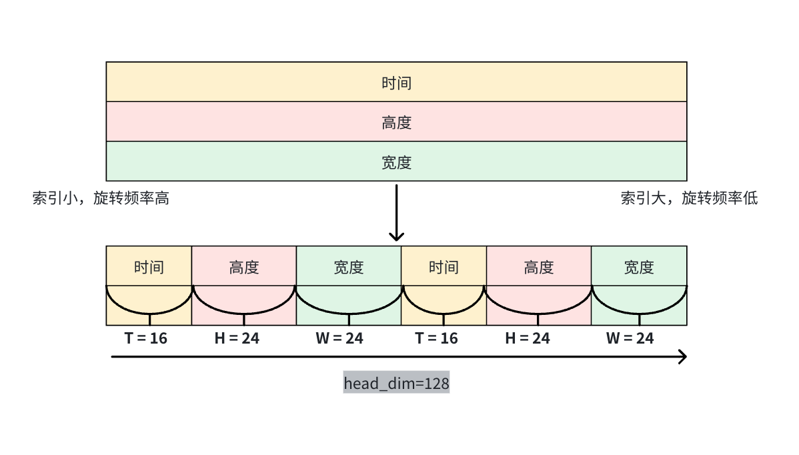

> 一个token的sin/cos向量

```python
def apply_multimodal_rotary_pos_emb(q, k, cos, sin, mrope_section, unsqueeze_dim=1):
    """对查询和键张量应用带多模态分区的旋转位置编码。
    参数:
        q (`torch.Tensor`): 查询张量，[batch_size,n_head,sequence_length,128]
        k (`torch.Tensor`): 键张量，[batch_size,n_head,sequence_length,128]
        cos (`torch.Tensor`): 旋转嵌入的余弦部分，[3, batch_size, sequence_length, 128]
        sin (`torch.Tensor`): 旋转嵌入的正弦部分，[3, batch_size, sequence_length, 128]
        mrope_section(`List(int)`): 
            多模态rope分区，用于rope计算中时间、高度和宽度的通道维度
            例如：[16, 24, 24] 表示时间维度16，高度维度24，宽度维度24
    """
    # 将mrope_section列表重复一次，因为每个位置编码需要成对的维度（实部和虚部）[16, 24, 24, 16, 24, 24]
    mrope_section = mrope_section * 2
    # 1. cos.split(mrope_section, dim=-1) 按照列表中的大小在最后一个维度上分割cos张量
    #    块0: [0:16] (时间维度1), 块1: [16:40] (高度维度1), 块2: [40:64] (宽度维度1),
    #    块3: [64:80] (时间维度2), 块4: [80:104] (高度维度2), 块5: [104:128] (宽度维度2)
    # 2. [m[i % 3] for i, m in enumerate(cos.split(mrope_section, dim=-1))]  
    #    为每个分割块分配索引i：i=0对应块0, i=1对应块1, ..., i=5对应块5
    #    这样每个块都使用对应维度的旋转位置编码，实现了多模态的旋转位置编码
    # 3. torch.cat(..., dim=-1) 将所有选中的块在最后一个维度上拼接，[batch_size, sequence_length, 128]
    # 4.unsqueeze(unsqueeze_dim) 在指定维度上增加一个维度，以便后续与q和k进行广播 [1, batch_size, sequence_length, 128]
    cos = torch.cat([m[i % 3] for i, m in enumerate(cos.split(mrope_section, dim=-1))], dim=-1).unsqueeze(
        unsqueeze_dim
    )
    sin = torch.cat([m[i % 3] for i, m in enumerate(sin.split(mrope_section, dim=-1))], dim=-1).unsqueeze(
        unsqueeze_dim
    )
    q_embed = (q * cos) + (rotate_half(q) * sin)
    k_embed = (k * cos) + (rotate_half(k) * sin)
    return q_embed, k_embed
```

##### 2.4 以Qwen2.5VL-7B为例，计算ViT部分的参数量、显存占用和计算量

> 🎨
>
> 首先回忆一下Qwen2.5VL中做的创新点：
>
> - **动态帧率 (FPS)** ：通过适应变化的帧率，模型可以更好地捕捉视频内容的时态。通过3D图像块划分扩展了视频输入的处理能力，两个连续的帧被组合在一起，显著减少了输入到语言模型的token数量。
> - **窗口注意力机制：**加速ViT计算，确保计算成本随patch数量呈线性增长而不是二次增长，只有四层使用完全自注意力机制，而其余层则使用最大窗口大小为112×112（对应8×8 patch）的窗口注意力。对于小于112x112的区域不用填充。
> - 在时间域中升级了 **MRoPE**，通过与**绝对时间对齐**，促进了更复杂的时间序列学习。
>
> 本文关注窗口注意力对于Qwen2.5VL参数量、计算量和显存占用的影响。先说结论：**对参数量没有影响，会加速ViT的计算速度以及节省显存占用。**

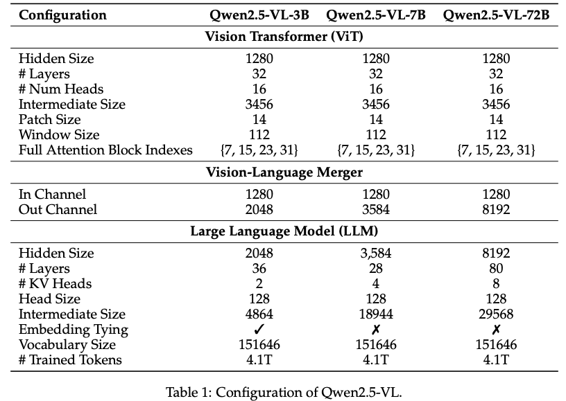

###### 参数量计算

首先打印一下Qwen2.5VL-7B的模型架构，本文重点关心ViT 和 Merger部分的参数。

```sql
Qwen2_5_VLForConditionalGeneration(
  (model): Qwen2_5_VLModel(
    (visual): Qwen2_5_VisionTransformerPretrainedModel(
      (patch_embed): Qwen2_5_VisionPatchEmbed(
        (proj): Conv3d(3, 1280, kernel_size=(2, 14, 14), stride=(2, 14, 14), bias=False)
      )
      (rotary_pos_emb): Qwen2_5_VisionRotaryEmbedding()
      (blocks): ModuleList(
        (0-31): 32 x Qwen2_5_VLVisionBlock(
          (norm1): Qwen2RMSNorm((1280,), eps=1e-06)
          (norm2): Qwen2RMSNorm((1280,), eps=1e-06)
          (attn): Qwen2_5_VLVisionAttention(
            (qkv): Linear(in_features=1280, out_features=3840, bias=True)
            (proj): Linear(in_features=1280, out_features=1280, bias=True)
          )
          (mlp): Qwen2_5_VLMLP(
            (gate_proj): Linear(in_features=1280, out_features=3420, bias=True)
            (up_proj): Linear(in_features=1280, out_features=3420, bias=True)
            (down_proj): Linear(in_features=3420, out_features=1280, bias=True)
            (act_fn): SiLUActivation()
          )
        )
      )
      (merger): Qwen2_5_VLPatchMerger(
        (ln_q): Qwen2RMSNorm((1280,), eps=1e-06)
        (mlp): Sequential(
          (0): Linear(in_features=5120, out_features=5120, bias=True)
          (1): GELU(approximate='none')
          (2): Linear(in_features=5120, out_features=3584, bias=True)
        )
      )
    )
    (language_model): Qwen2_5_VLTextModel(
      (embed_tokens): Embedding(152064, 3584)
      (layers): ModuleList(
        (0-27): 28 x Qwen2_5_VLDecoderLayer(
          (self_attn): Qwen2_5_VLAttention(
            (q_proj): Linear(in_features=3584, out_features=3584, bias=True)
            (k_proj): Linear(in_features=3584, out_features=512, bias=True)
            (v_proj): Linear(in_features=3584, out_features=512, bias=True)
            (o_proj): Linear(in_features=3584, out_features=3584, bias=False)
            (rotary_emb): Qwen2_5_VLRotaryEmbedding()
          )
          (mlp): Qwen2MLP(
            (gate_proj): Linear(in_features=3584, out_features=18944, bias=False)
            (up_proj): Linear(in_features=3584, out_features=18944, bias=False)
            (down_proj): Linear(in_features=18944, out_features=3584, bias=False)
            (act_fn): SiLUActivation()
          )
          (input_layernorm): Qwen2RMSNorm((3584,), eps=1e-06)
          (post_attention_layernorm): Qwen2RMSNorm((3584,), eps=1e-06)
        )
      )
      (norm): Qwen2RMSNorm((3584,), eps=1e-06)
      (rotary_emb): Qwen2_5_VLRotaryEmbedding()
    )
  )
  (lm_head): Linear(in_features=3584, out_features=152064, bias=False)
)
```

- **patch_embed**：将图像分割为patch，每个patch就等于一个token，然后把每个patch经过全连接网络转化成一维向量，包含一个3D卷积层`Conv3d(3, 1280, kernel_size=(2, 14, 14), stride=(2, 14, 14), bias=False)`，
    - **参数量**：$3 (输入通道) * 2 (卷积核深度) * 14 (卷积核高度) * 14 (卷积核宽度) * 1280 (输出通道) = 6 * 196 * 1280 = 1176 * 1280 = 1,505,280$
- **norm1 & norm2**：RMSNorm归一化层，只有一个可学习的 `weight`  参数
    - **参数量**：$1280 * 2 = 2560$
- **attn.qkv**：注意力计算的QKV向量，包含3个线性层，`Linear(in_features=1280, out_features=3840, bias=True)`，之所以是3840，是因为要从输入特征（维度 1280）一次性生成Q、K、V三个向量，$3840 = 3 * 1280$。
    - **参数量**：$(1280 * 3840) + 3840 = 4915200 + 3840 = 4919040$
- **attn.proj**： 融合多头注意力的输出，得到最终的注意力输出，包含一个线性层，`Linear(in_features=1280, out_features=1280, bias=True)`
    - **参数量**：$(1280 * 1280) + 1280 = 1638400 + 1280 = 1639680$
- **mlp**：为了让ViT架构与LLM更统一，采用SwiGLU结构，包含gate、up、down三个线性层，`Linear(in_features=1280, out_features=3420, bias=True)`* 2、`Linear(in_features=3420, out_features=1280, bias=True)`
    - **参数量**：$(1280 * 3420) + 3420  + (1280 * 3420) + 3420 + (3420 * 1280) + 1280 = 13140920$

    > 🌰
    >
    > **SwiGLU**
    >
    > 结合了线性单元和GLU（Gated Linear Units）门控机制，GLU通过两个不同的线性层和一个sigmoid门控来控制信息流，SwiGLU则是将sigmoid替换为Silu激活函数。$Silu(x)=x⋅σ(βx)$, σ为sigmoid函数, $SwiGLU(x,W,V)=Silu(xW)⊗(xV)$
    >
    > Swish函数的平滑性使得反向传播的梯度更新更稳定, 能够更好地捕获序列中的远程依赖关系，避免神经元死亡，梯度消失和爆炸问题。尽管引入了额外的非线性激活函数，SwiGLU的计算开销相对较小，适合大型模型。
- **merger**：为了提升长序列图像特征的计算效率，将空间上相邻的四个patch特征进行分组，然后将分组后的特征连接起来。通过一个两层的MLP将它们投影到与LLM中使用的文本嵌入对齐的维度，包含1个RMSNorm层和2个线性层
    - **参数量**：$1280 + (5120 * 5120) + 5120 + (5120 * 3584) + 3584 = 44,574,464$
- **Vision Encoder总参数量**：$1505280 + 32 * (2560 + 4919040 + 1639680 + 13140920) + 44,574,464= 676,550,144 = 676M$
- 剩余的**LLM Decoder（**`language_model`**）** 和 生成最终输出的`lm_head` 层分别有7.07B和545M参数。
- **Qwen2.5VL-7B总参数量**：$Vision Encoder + LLM Decoder + lm\_head = 8.3B$

###### 训练时显存占用

有了Qwen2.5VL-7B参数量后，就很方便计算其显存占用。与LLM的计算是一样的。这里以全精度训练举例，设模型参数量为$M$，主要显存占用来自：

- **模型参数**：$4M$
- **梯度**：$4M$
- **优化器参数**：假设采用AdamW优化器，需要存储一阶动量和二阶动量，$8M$
- **激活值**：前向传播过程中计算得到的中间激活值，可以通过激活检查点减少占用显存。
- **其他占用**：显存碎片、临时缓存等

Qwen2.5VL与其他模型的显存区别在于使用了窗口注意力，首先结合[源码](https://github.com/huggingface/transformers/blob/main/src/transformers/models/qwen2_5_vl/modeling_qwen2_5_vl.py#366)看下窗口注意力是怎么实现的。

```python
def get_window_index(self, grid_thw):
    """
    计算窗口注意力机制中的窗口索引
    Args:
        grid_thw: 每个视频帧的网格尺寸列表，每个元素为 (grid_t, grid_h, grid_w)
                 grid_t: 时间维度（帧数）
                 grid_h: 高度维度的网格数
                 grid_w: 宽度维度的网格数
    Returns:
        window_index: 所有窗口中的token索引，用于重新组织序列
        cu_window_seqlens: 累积窗口序列长度，用于flash attention等操作
    """
    window_index: list = []  # 存储每个窗口的token索引
    cu_window_seqlens: list = [0]  # 累积序列长度，从0开始
    window_index_id = 0  # 窗口索引的全局偏移量
    
    # 原始窗口大小经过空间合并和patch划分后的实际窗口尺寸
    # Qwen2.5VL 中 window_size 112，spatial_merge_size 2，patch_size 14
    vit_merger_window_size = self.window_size // self.spatial_merge_size // self.patch_size

    for grid_t, grid_h, grid_w in grid_thw:
        # merge后的网格数量
        llm_grid_h, llm_grid_w = (
            grid_h // self.spatial_merge_size,  
            grid_w // self.spatial_merge_size,  
        )
        # 索引: (grid_t, llm_grid_h, llm_grid_w)
        index = torch.arange(grid_t * llm_grid_h * llm_grid_w).reshape(grid_t, llm_grid_h, llm_grid_w)
        
        # 填充的高度和宽度，使网格尺寸能够被窗口大小整除
        pad_h = vit_merger_window_size - llm_grid_h % vit_merger_window_size
        pad_w = vit_merger_window_size - llm_grid_w % vit_merger_window_size
        # 填充后的窗口数量
        num_windows_h = (llm_grid_h + pad_h) // vit_merger_window_size
        num_windows_w = (llm_grid_w + pad_w) // vit_merger_window_size
        # 对索引进行填充，使用-100作为填充标记（后续会过滤掉）
        index_padded = F.pad(index, (0, pad_w, 0, pad_h), "constant", -100)
        
        # 填充后的索引重新组织为窗口结构: (grid_t, num_windows_h, vit_merger_window_size, num_windows_w, vit_merger_window_size)
        index_padded = index_padded.reshape(
            grid_t,
            num_windows_h,
            vit_merger_window_size,
            num_windows_w,
            vit_merger_window_size,
        )
        
        # 将同一个窗口的索引放在一起
        # 最终形状: (grid_t, num_windows_h * num_windows_w, vit_merger_window_size, vit_merger_window_size)
        index_padded = index_padded.permute(0, 1, 3, 2, 4).reshape(
            grid_t,
            num_windows_h * num_windows_w,
            vit_merger_window_size,
            vit_merger_window_size,
        )
        
        # 对窗口的高度和宽度维度求和，计算每个窗口中的有效token数量：16
        # 形状：（grid_t * num_windows_h * num_windows_w, 1）
        seqlens = (index_padded != -100).sum([2, 3]).reshape(-1)
        
        # 将索引展平为一维，过滤掉填充标记（-100），只保留有效的token索引
        index_padded = index_padded.reshape(-1)
        index_new = index_padded[index_padded != -100]
        
        # 将当前帧的窗口索引添加到全局列表，并加上全局偏移量
        window_index.append(index_new + window_index_id)
        
        # 计算累积序列长度，16表示一个窗口中的patch数量
        # seqlens.cumsum(0) = 【16，32，48...】，
        # self.spatial_merge_unit =spatial_merge_size * spatial_merge_size = 4
        # cu_window_seqlens：窗口的索引间隔 ([0，64, 128, 192, ....]) 
        cu_seqlens_tmp = seqlens.cumsum(0) * self.spatial_merge_unit + cu_window_seqlens[-1]
        cu_window_seqlens.extend(cu_seqlens_tmp.tolist())
        
        # 更新全局窗口索引偏移量
        window_index_id += (grid_t * llm_grid_h * llm_grid_w).item()
    
    # 将所有帧的窗口索引拼接成一个一维张量
    window_index = torch.cat(window_index, dim=0)

    return window_index, cu_window_seqlens
```

在 [Qwen2_5_VisionTransformerPretrainedModel](https://github.com/huggingface/transformers/blob/main/src/transformers/models/qwen2_5_vl/modeling_qwen2_5_vl.py#L448) 前向传播中，只有第$7、15、23、31$层使用全注意力，剩余层都使用窗口注意力：

```python
for layer_num, blk in enumerate(self.blocks):
    if layer_num in self.fullatt_block_indexes:
        cu_seqlens_now = cu_seqlens
    else:
        cu_seqlens_now = cu_window_seqlens
    
    hidden_states = blk(
        hidden_states,
        cu_seqlens=cu_seqlens_now,
        position_embeddings=position_embeddings,
        **kwargs,
    )
```

> 🏖️
>
> 在transformers官方代码中，采用的 [eager_attention_forward](https://github.com/huggingface/transformers/blob/main/src/transformers/models/qwen2_5_vl/modeling_qwen2_5_vl.py#L156) 仍然是先计算完整注意力再用mask实现窗口注意力，因此没有节省计算量。但在flash_attention_2等优化中会进行优化。

接下来我们对比ViT模型使用全注意力和窗口注意力的激活值显存占用情况，在这里假设所有激活值都采用半精度存储，单位为字节。

$$
Q = xW_Q, K = xW_K, V = xW_V
$$

$$
y = softmax\left(\frac{QK^T}{\sqrt{h}}\right) \cdot V \cdot W_o + x
$$

###### 全注意力

1. **输入**$x$：不考虑batch-size，需要存储计算QKV矩阵的$x$，维度为$HW \times d$，其中  H 是高度，W是宽度（设如数图像分辨率是224，Qwen2.5VL-7B 中patch_size=14，$H=W=224/14=16$），d表示隐藏层维度（Qwen2.5VL-7B 中为1280），h是注意力中间层维度（Qwen2.5VL-7B 中为3840）。显存占用量$2 HWd$
2. $QK^T$：需要存储$Q、K$矩阵，维度为$HW \times h$，显存占用量$4 HWh$
3. **softmax**：假设有n个注意力头，每个注意力头的维度是$n \times HW \times \frac{h}{n}$，需要存储输入$QK^T$，维度为$n \times HW \times HW$，显存占用量$2 （HW）^2h$
4. **注意力与V矩阵乘积**：需要保存$softmax\left(\frac{QK^T}{\sqrt{h}}\right)$，维度为$n \times HW \times HW$，显存占用量$2 （HW）^2h$。需要保存$V$矩阵，维度为$HW \times h$，显存占用量$2 HWh$。
5. **输出映射**：乘映射矩阵$W_o \in R^{h \times d}$，需要保存$softmax\left(\frac{QK^T}{\sqrt{h}}\right) \cdot V$，维度为$HW \times h$。显存占用量$2 HWh$。

全局注意力的激活值显存占用量为：$8HWh + 2HWd + 4 （HW）^2 h$。

###### 窗口注意力

窗口注意力的区别在于每个窗口的大小是$M \times M$，完整输入变成了$\frac{HW}{M^2}$个窗口，每个窗口内的计算与全注意力一致。使用窗口注意力只有第3和4部分受影响，单个窗口显存占用量为$2 M^4h$，所有窗口的计算量为$2 HW M^2h$。

窗口注意力的激活值显存占用量为$8HWh + 2HWd + 4 HW M^2h$。对比可以发现**窗口注意力将激活值的显存占用量从**$(HW)^2$**平方级降低到**$HW$**线性级。**

###### 训练时计算量对比

> 🎨
>
> 使用窗口注意力不仅能降低训练时显存占用，也能加速ViT计算。本文用FLOPS（浮点数计算次数）来很衡量计算量，对于矩阵乘法$A B, A \in R^{a \times b}, B\in R^{b \times c}$而言，需要执行$abc$次的乘法和加法计算，因此总共需要$2abc$次浮点数计算。基于这个公式，就可以对比ViT使用窗口注意力和全注意力的区别了。

$$
Q = xW_Q, K = xW_K, V = xW_V
$$

$$
y = softmax\left(\frac{QK^T}{\sqrt{h}}\right) \cdot V \cdot W_o + x
$$

###### 全注意力

1. **计算QKV**：不考虑batch维度，输入维度$x$是$HW \times d$，权重矩阵$W_q、W_k、W_v \in R^{d \times h}$，其中  H 是高度，  W是宽度，d表示隐藏层维度，  h是注意力中间层维度。计算量$6 HW d h$。
2. **计算注意力**：$QK^T$矩阵乘法，假设有n个注意力头，每个头的维度是$n \times HW \times \frac{h}{n}$，输入输出维度为：$[n \times HW \times \frac{h}{n}] \times [n \times \frac{h}{n} \times HW ] = [n \times HW \times HW]$。所有头的计算量$2 （HW）^2 h$。
3. **注意力与V矩阵乘积**：$softmax\left(\frac{QK^T}{\sqrt{h}}\right) \cdot V$。输入输出维度为：$[n \times HW \times HW] \times [n \times HW  \times \frac{h}{n}] = [n \times HW \times \frac{h}{n}]$，所有头的计算量为$2 （HW）^2 h$。
4. **输出映射**：乘映射矩阵$W_o \in R^{h \times d}$，输入输出维度为：$[ HW \times h] \times [h \times d ] = [ HW \times d]$,计算量为$2HW dh$。

全局注意力计算的复杂度为：$8HW dh + 4 （HW）^2 h$。

###### 窗口注意力

窗口注意力的区别在于每个窗口的大小是$M \times M$，完整输入变成了$\frac{HW}{M^2}$个窗口，每个窗口内的计算与全注意力一致。单个窗口的计算量为$8 M^2 dh + 4 M^4 h$，所有窗口的计算量为$8 HW dh + 4 M^2 HW h$。可以看到，**窗口注意力将计算量从**$(HW)^2$**平方级降低到**$HW$**线性级。**

##### 2.5 多模态模型LoRA的另一种范式：VoRA

参考论文：https://arxiv.org/pdf/2503.20680

> 🥇
>
> **论文总结**
>
> 看了无数篇多模态模型技术报告的你，是否会疑问：这些模型的SFT阶段都是怎么进行LoRA训练的呢？最通用的方式是直接对LLM或者ViT进行LoRA训练。VoRA提出了一种新的训练范式，即**将视觉的LoRA层集成到LLM中**，将LLM转化成了能处理视觉特征的MLLM，而无需依赖外部视觉模型。VoRA从预训练ViT将视觉特征添加到LoRA层中以加速训练，通过双向注意力掩码以捕捉图像的上下文信息。

- 常见的多模态大模型大多采用如左图的架构，即视觉特征通过ViT和Connector后与LLM对齐，这种架构存在一些问题：
    - 一方面引入额外的ViT模型增加了计算成本，还带来分辨率限制（虽然可以通过[**NaViT**](https://fp9qo5yj6d.feishu.cn/wiki/HxWSwlEFtiOzqWkYG9VcpsbHned#share-KYefdZyx7oW9jLxi0N7c76Z7nsg)等方式解决）。
    - 限制了处理流程：LLM只能在ViT和Connector处理图像后才能处理
- 一种新的架构如右图，即**只通过LLM处理视觉特征**，但仍面临模态冲突导致的训练不稳定和灾难性遗忘的问题。VoRA就采用了这种架构，做了以下优化：
    - 在LLM中注入可训练的LoRA层编码视觉信息，冻结原始LLM参数保留语言能力，如右图所示。并且无需在推理时保留视觉参数，无需额外开销。
    - 利用预训练ViT作为教师模型，将知识注入LoRA层中，采用**分块蒸馏**的策略，每个LLM块都要与教师模型提取的块特征对齐。
    - 采用双向注意力掩码，以更好的补捕获图像的上下文信息，并且利用LLM处理长度可变序列的能力，支持原生图片分辨率。

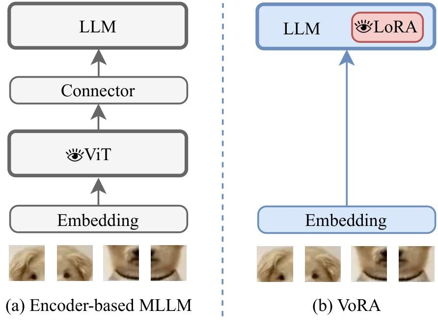

> 🥇
>
> **对比基于编码器的MLLM和无编码器的MLLM**
>
> - **基于编码器的MLLM：**大多数多模态模型都采用ViT+Connector+LLM的模型架构，依赖额外的视觉编码器会导致参数增加，且由于ViT模型的固定分辨率特性，输入分辨率受到限制。
> - **无编码器的MLLM：**代表工作是**MONO-INTERNVL**和**EVEv2**，虽然取消了ViT模块，但缺导致了双倍的LLM参数，反而加剧了参数量膨胀。
>
> 而在VoRA中，完全移除了ViT，直接通过LoRA参数将视觉能力内化到LLM中。

###### 模型架构

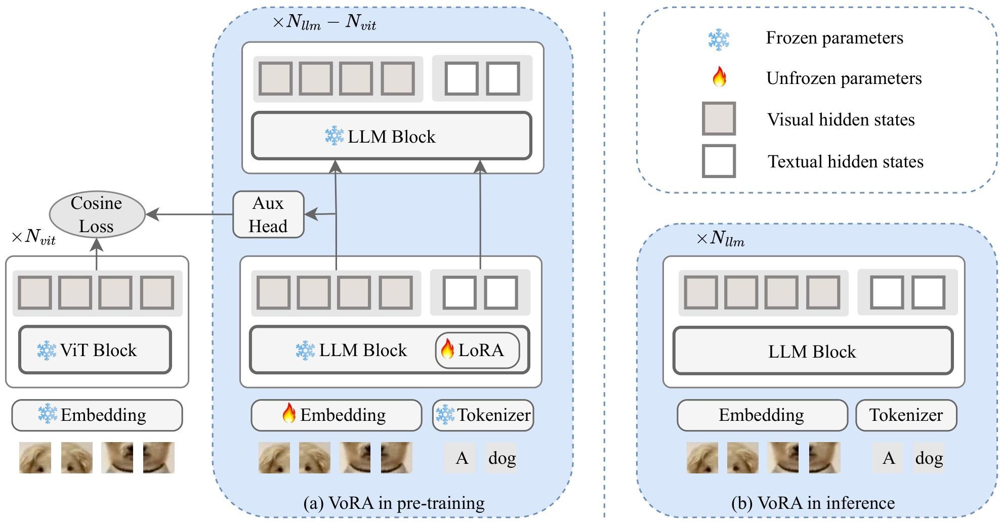

如左图所示，用$N_{ViT}$和$N_{LLM}$表示ViT和LLM的块数。

- 在预训练时，图像首先通过Embedding层（6M参数+位置编码）转换成视觉embedding。
- **在 LLM 的前** $N_{\text{vit}}$ **个块的线性层（包括 QKV 投影和 FFN）中插入 LoRA 层，仅更新 LoRA 参数和视觉Embedding层，冻结原始 LLM 参数。**
- 视觉与语言参数解耦，避免模态冲突，提升训练稳定性。并且推理时 LoRA 参数可无缝合并至 LLM，消除额外计算开销。

###### 分块蒸馏

- **目标**：通过知识蒸馏从ViT注入视觉先验知识，加速训练并减少对大规模视觉数据的依赖。
- **蒸馏损失**：对于第$i$个transformer块，将其与ViT中的第$i$个块对齐，最大化余弦相似度：

$$
\mathcal{L}_{\text{distill}}^i = \frac{1}{S} \sum_{s=1}^{S} \left( 1 - \frac{\text{AuxHead}(\boldsymbol{h}_{\text{llm}}^{i,s})^\top \boldsymbol{h}_{\text{vit}}^{i,s}}{\|\text{AuxHead}(\boldsymbol{h}_{\text{llm}}^{i,s})\|_2 \|\boldsymbol{h}_{\text{vit}}^{i,s}\|_2} \right),  \mathcal{L}_{\text{distill}} = \frac{1}{N_{\text{vit}}} \sum_{i=1}^{N_{\text{vit}}} \mathcal{L}_{\text{distill}}^i. \tag{2}
$$

$h_{\text{llm}}^{i,s}、h_{\text{vit}}^{i,s}$表示第$s$个token的hidden state，$AuxHead(\cdot)$是一个投影层(RMSNorm + 线形层)。

- **语言模型损失**：对于图像标题对，使用交叉熵损失，其中$T$表示总序列长度：

$$
\mathcal{L}_{\text{LM}} = -\sum_{t=t_0}^{T} \log P(w_t|w_{<t}, \boldsymbol{x}_{\text{image}})
$$

最终损失结合块级蒸馏损失（跨 $N_{\text{vit}}$ 块平均）和语言建模损失（交叉熵）。

- **效果**：
    - 仅蒸馏最后一层时，训练效率提升（损失降低 0.016，性能提升 2.7 分）；
    - 块级蒸馏（所有块对齐）进一步优化性能（额外提升 2.7 分，损失再降 0.016）。

###### 双向注意力掩码

- 对视觉 token 使用双向注意力掩码（捕捉全局图像上下文），文本 token 保留因果掩码（保持自回归生成能力）。

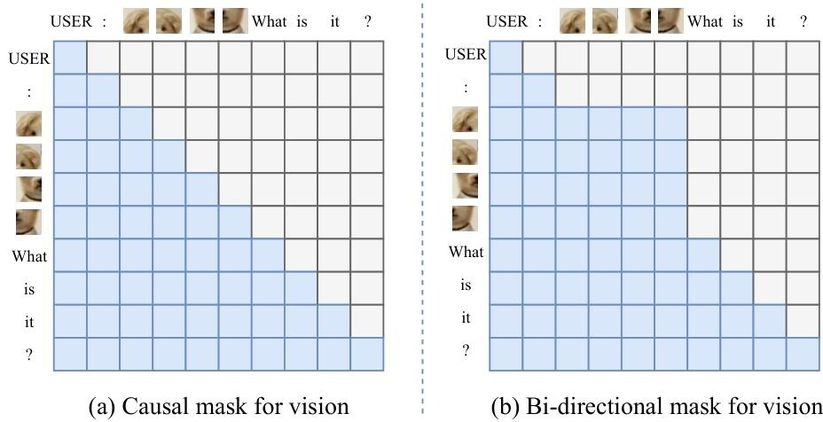

#### 3 Qwen VL系列模型

##### 3.1 Qwen-VL

> 🌟
>
> 作为Qwen系列多模态模型的开山之作，作者小吹了一下Qwen-VL的优秀特点：
>
> - **领先性能**：Qwen-VL  在视觉任务（**图像描述captioning**、**问题回答VQA**、**定位grounding**）基准测试中都更优。
> - **多语言**：Qwen-VL 在**多语言图像-文本数据**上进行了训练，支持英语、中文和多语言指令。
> - **多图像**：在训练阶段，允许将任意交错的图像-文本数据作为Qwen-VL的输入，Qwen-Chat-VL能够在提供多个图像时比较、理解和分析上下文。
> - **细粒度视觉理解**：得益于更高的输入分辨率和我们在训练中使用的细粒度语料库，Qwen-VL 展现出了极具竞争力的细粒度视觉理解能力，在语义对齐、文本阅读、面向文本的问题回答和细粒度对话方面表现得更为出色。

**论文地址**：https://arxiv.org/pdf/2308.12966

**项目地址**：https://github.com/qwenLM/qwen-VL

###### 模型架构

- **llm（7.7B）**：负责文本的理解和生成。使用Qwen-7B的预训练权重
- **视觉Encoder（1.9B）**：负责图像的处理。使用ViT架构，用OpenCLip的ViT-bigG预训练权重初始化，训练和推理时将数据调整为特定分辨率，分割图像为14x14的patch，生成一组图像特征。
- **位置感知视觉-语言Adapter（0.08B）**：为了解决长图像特征序列导致的效率问题，引入**视觉-语言Adapter**以压缩图像特征，包含一个随机初始化的单层cross-attention模块。使用一组可训练的查询向量Embedding作为query，视觉Encoder的图像特征作为key进行交叉注意力，从而将将视觉特征压缩到256。为了缓解压缩导致的位置信息损失，将**2d绝对位置编码**加到cross-attention中，以增强细粒度视觉理解，然后将256维的压缩图像特征输入到大模型中。

###### 输入输出格式

输入包括两部分：图像和文本。图像通过**视觉Encoder**和**Adapter**处理，生成固定长度的图像特征序列。为了识别视觉和文本输入，在图像特征起始添加特殊token`<image>和</image>`

为了增强模型对细粒度视觉理解和定位的能力，训练时加入区域描述、问题和检测形式的数据，要求模型准确理解和生成指定格式的区域描述。边界框归一化到[0, 1000) ，作为文本不需要额外的位置信息，并添加`<box>和</box>`以区分，为了将边界框与其相应的描述性词或句子关联起来，添加`<ref>和</ref>`以区分。

###### 模型训练

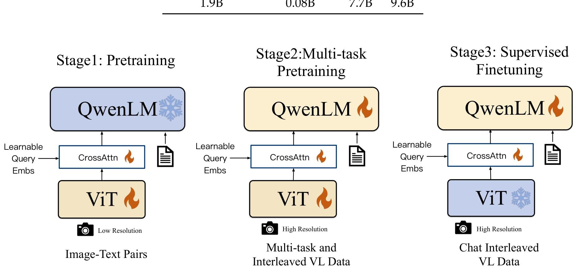

1. **第一阶段预训练**：
    - **训练目标**：对齐视觉和语言模型的特征
    - **数据构成**：利用大规模弱标注的图像文本对，经过过滤得到14亿数据，其中77.3%为英文（文本）数据，22.7%为中文（文本）数据。输入图像被调整为224 × 224。
    - **损失函数**：交叉熵损失函数
    - **训练模块**：本阶段只训练视觉Encoder和Adapter
    - **优化器**：Adam W优化器，$\beta_1=0.9, \beta_2=0.98, \epsilon = 1e^{-6}$
    - **学习率**：余弦学习率调度，最大学习率为2e-4，最小学习率1e-6，学习率预热500步。
    - **batch-size**：30720
    - **训练步数**：50000，消耗1.5亿图像-文本对

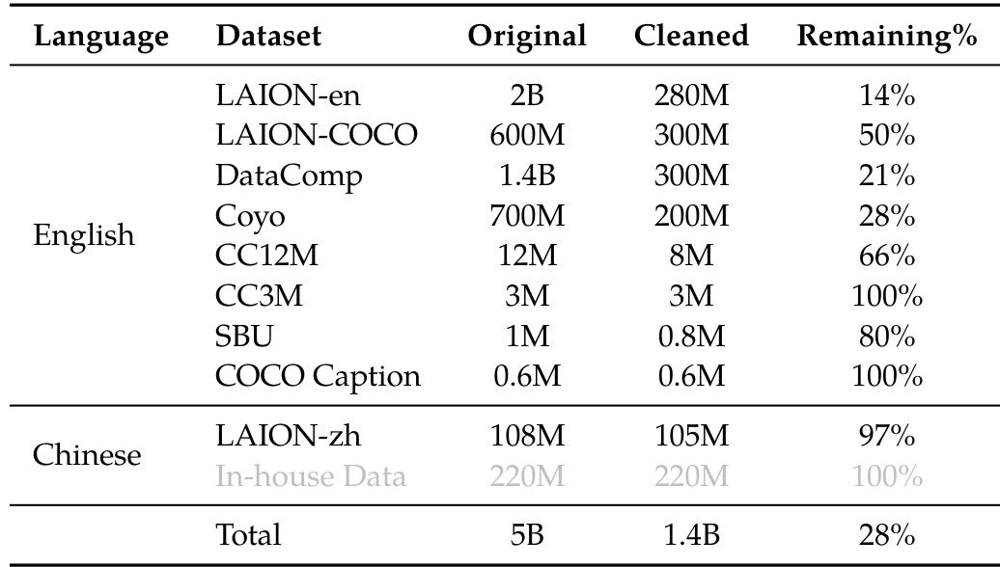

1. **多任务预训练**：
    - **训练目标**：提升在多任务上模型对于图像和文本的理解能力
    - **训练模块**：所有模块
    - **训练任务**：与第一阶段相同
    - **数据构成**：引入高质量视觉-文本对，具有更大的输入分辨率和交错的图像-文本数据。将相同任务的数据打包成长度为 2048 的sequence，构建了交错的图像-文本数据。将视觉Encoder的输入分辨率提高到 448 × 448，减少了因图像降采样导致的信息损失。
    - **训练任务**：
        - **Text Generation**（纯文本生成）：内部收集的语料库。
        - **Captioning**（图像描述）：与上表相同，但数据更少且不包括LAION-COCO。
        - **VQA**（视觉问答）：GQA、VGQA、VQAv2、DVQA、OCR-VQA、DocVQA
        - **Grounding**（定位任务）：使用GRIT数据进行定位任务，做少量修改
        - **Ref grounding & Grounded Cap**（物体定位，定位+图像描述）：GRIT、Visual Genome、RefCOCO、RefCOCO+、RefCOCOg。
        - **文本导向的任务**（OCR）：从Common Crawl收集PDF和HTML格式的数据，然后合成了具有自然风景背景的英文和中文合成 OCR 数据。
    - **优化器**：Adam W优化器，$\beta_1=0.9, \beta_2=0.98, \epsilon = 1e^{-6}$
    - **学习率**：余弦学习率调度，最大学习率为5e-5，最小学习率1e-5，学习率预热400步。
    - **batch-size**：4096
    - **训练步数**：19000

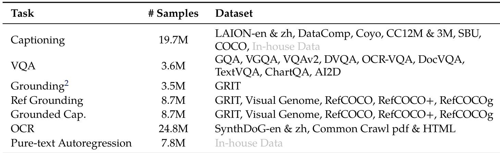

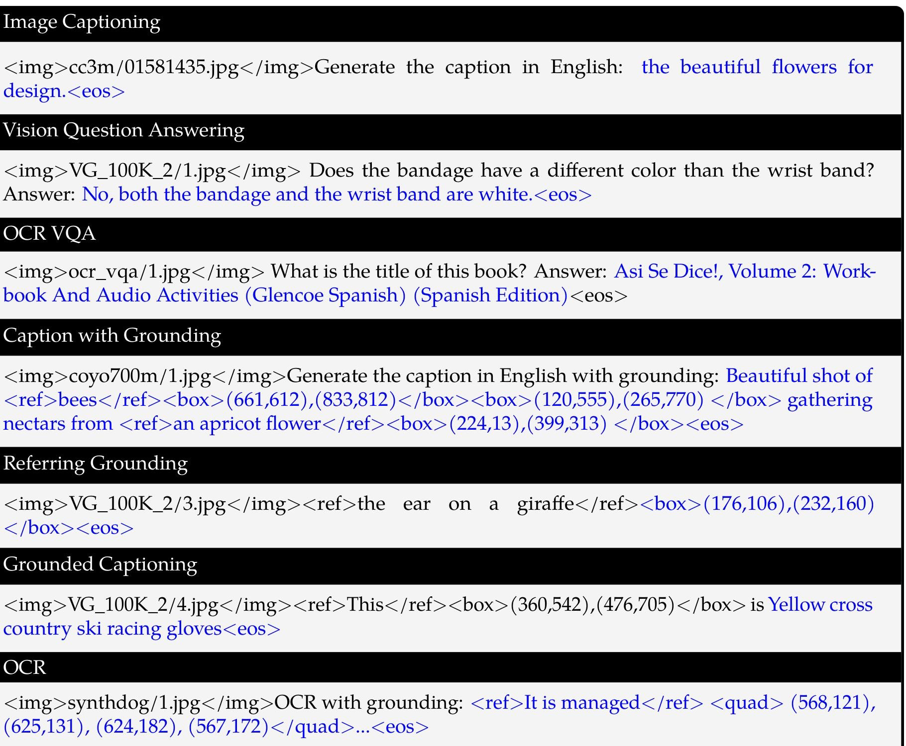

1. **SFT**：
    - **训练目标**：增强模型指令跟随和对话能力，得到Qwen-VL-Chat模型
    - **训练数据**：数据主要来自LLM生成的标题或对话，这些数据只涉及单图对话和推理。为了增强多图理解和定位能力，又够造了一些额外的对话数据。总共350k数据。
    - **训练模块**：只训练llm和Adapter
    - **训练模板**：采用**ChatML**格式构建指令调优数据集，用`<im_start><im_end>`标注对话起始。
    - **优化器**：Adam W优化器，$\beta_1=0.9, \beta_2=0.98, \epsilon = 1e^{-6}$
    - **学习率**：余弦学习率调度，最大学习率为1e-5，最小学习率1e-6，学习率预热3k步。
    - **batch-size**：128
    - **训练步数**：8000


##### 3.2 Qwen2-VL

论文地址：https://arxiv.org/pdf/2409.12191

代码链接：https://github.com/xwjim/Qwen2-VL

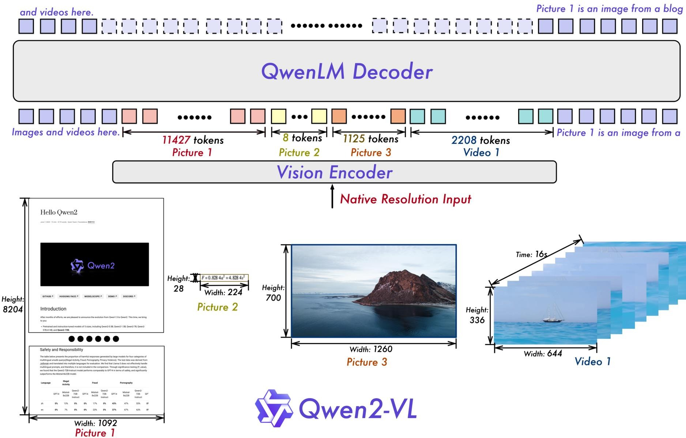

- **面临问题1**：2024年的多模态模型大多通过下采样和上采样，以及先缩放后填充等方式，限制图像编码为固定分辨率（例如224 x 224），限制了模型在不同尺度捕捉信息的能力，特别是对高分辨率图像细节容易丢失。另外这些模型采用静态的、冻结的CLIP风格的视觉编码器，限制了在复杂推理任务中的表现。
- **解决方法1**：引入动态分辨率，通过使用2DRoPE，捕捉不同空间尺度的信息。
- **面临问题2**：视频可以理解为一系列的帧，现有模型将其视为独立的模态。
- **解决方法2**：用MRoPE，用不同的模块表示时间和空间信息，使得模型能理解动态内容如视频和流数据。

多模态模型还在验证scaling law的阶段，即探索增加模型和数据规模对性能的影响

###### 模型架构

保留了Qwen-VL的基础架构

- **视觉编码器**：675M参数的ViT模型，使用从 DFN 导出的 ViT 进行初始化，将原始的绝对位置编码替换为2D-RoPE。
- **语言模型**：Qwen2初始化

在此基础上做了以下改进：

1. **Naive 动态分辨率**：
- 通过改进 ViT 结构支持动态分辨率，移除传统绝对位置编码并引2D-RoPE 捕捉图像二维位置信息。
- 为了减少每个图像的视觉token数量，在 ViT 之后使用了一个 MLP 层，将相邻的 2 × 2 token压缩成一个token，在视觉token前后加上特殊标记做区分。分辨率为 224 × 224 的图像，使用 patch_size=14 的 ViT 编码后，将在进入 LLM 之前被压缩为 66 个 token。
- 推理时动态打包不同分辨率图像，既保持原生分辨率信息又优化GPU内存使用。
2. **M-RoPE**：将原始的RoPE分解为三个部分：时间、高度和宽度。
- 对于文本，这三部分都采用相同的ID，等同于RoPE。
- 对于图像，时间部分使用相同的ID，高度和宽度根据标记在图像中的位置分配不同的ID。
- 视频的ID随每帧递增，高度宽度同图像。
- 模型输入包含多种模态的情况下，每种模态的位置编号通过将前一模态的最大位置ID递增一来初始化。
3. **统一的图像和视频理解** ：Qwen2-VL 采用了一种混合训练方案，结合了图像和视频数据，确保在图像理解和视频理解方面的能力。
- 为了尽可能完整地保留视频信息，以每秒两帧的速度对每个视频进行采样。
- 集成了两层的3D卷积以处理视频输入，使模型能够处理3D tubes而不是2D patch，从而在不增加序列长度的情况下处理更多的视频帧。为了保持一致性，每张图像被视为两个相同的帧。
- 为了平衡长视频处理的计算需求与整体训练效率，动态调整每个视频帧的分辨率，将每段视频的总token数限制在16384。这种训练方法在模型理解长视频的能力和训练效率之间找到了平衡。

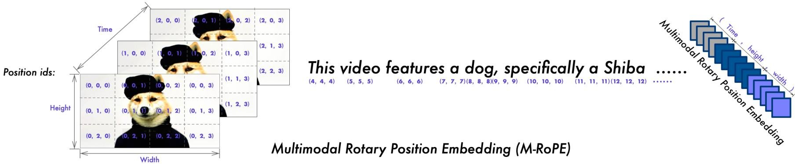

###### 模型训练

和Qwen-VL一样，采用三阶段训练：

- **第一阶段**：冻结语言模型参数，仅训练视觉编码器（ViT），使用约600B token学习图像语义理解、OCR文本识别和图像分类任务。该阶段将DFN的ViT位置编码替换为**RoPE-2D**以增强空间位置建模。
- **第二阶段**：训练全部参数，使用扩展至800B token的混合模态数据进行多任务学习，该阶段通过多模态数据增强模型的跨模态关联能力，同时保持纯文本数据的语言能力。前两阶段的预训练阶段只对文本标记提供监督。
- **第三阶段**：只训练LLM，专注于语言模型的指令微调。使用ChatML格式构建的多模态对话数据集（含图像问答、文档解析、多图对比、视频理解等场景）提升模型的任务执行能力。

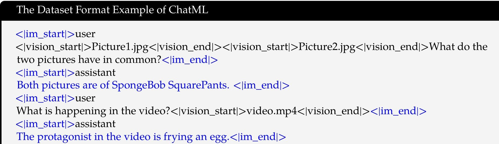

##### 3.3 Qwen 2.5VL

论文链接：https://arxiv.org/pdf/2502.13923

代码链接：https://github.com/QwenLM/Qwen2.5-VL

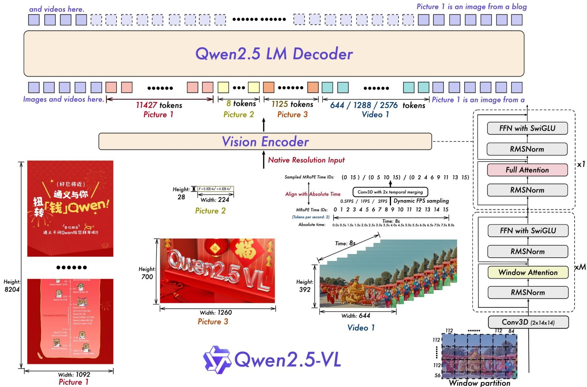

> 🏕️
>
> **论文贡献**
>
> 1. 在视觉编码器中实现了**窗口注意力机制**，以优化推理效率；
> 2. 引入了动态 FPS 采样，将**动态分辨率**扩展到时间维度，能够处理不同大小的图像和长达数小时的视频
> 3. 在时间域中升级了 **MRoPE**，通过与**绝对时间对齐**，促进了更复杂的时间序列学习，实现秒级事件定位
> 4. 将预训练语料库从 1.2 万亿个扩展到 4.1 万亿个token。

###### 模型架构

- **LLM**：使用**Qwen2.5的预训练权重初始化**，为了适应多模态理解，将1D RoPE修改为绝对时间对齐的多模态RoPE。
- **视觉Encoder**：训练和推理过程中，输入图像的高度和宽度会被调整为 28 的倍数，然后输入到 ViT 中。视觉Encoder通过以 14 的步长将图像分割成块，生成一组图像特征。
    - **模型架构**：使用**ViT**架构，**RMSNorm**和**SwiGLU**等经典设置。
    - **ViT训练**：包括三个阶段：**CLIP预训练、视觉-语言对齐和端到端微调**，根据图像原始纵横比随机采样，使模型能够有效地泛化到不同分辨率的输入。
    - **原生动态分辨率**：引入了 2D-RoPE 从而支持原始输入的分辨率，。直接使用输入图像的实际维度来表示边界框、点和其他空间特征，而不是传统的归一化坐标方法，以有效捕捉二维空间中的空间关系
    - **动态帧率 (FPS)** ：通过适应变化的帧率，模型可以更好地捕捉视频内容的时态。通过3D图像块划分扩展了视频输入的处理能力，两个连续的帧被组合在一起，显著减少了输入到语言模型的token数量。
    - **窗口注意力机制：**加速Encoder计算，确保计算成本随patch数量呈线性增长而不是二次增长，只有四层使用完全自注意力机制，而其余层则使用最大窗口大小为112×112（对应8×8 patch）的窗口注意力。对于小于112x112的区域不用填充。
    - **MRoPE**：与Qwen2-VL一样，将MRoPE分解为时间、高度和宽度三个维度。
        - **文本**：使用相同的位置ID，等同于传统的1D RoPE。
        - **图像**：时间ID保持不变，高度和宽度根据每个token在图像中的空间位置分配唯一ID。
        - **视频**：时间ID随每一帧递增，而高度和宽度与图像相同。未能考虑内容变化的速度或视频内事件的绝对时间

        在此基础上，Qwen2.5 VL将MRoPE ID直接与时间戳对齐，使得模型能够通过时间维度ID之间的间隔理解时间节奏，模型可以学习在不同FPS采样率的视频中的一致时间对齐，而不需要额外的计算开销。
- **MLP-Based Adapter**：为了提升长序列图像特征的计算效率，将空间上相邻的四个patch特征进行分组，然后将分组后的特征连接起来，通过一个两层的MLP将它们投影到与LLM中使用的文本嵌入对齐的维度。

###### 预训练

###### 预训练数据

- 从1.2万亿个token增加到约4万亿个token，包括多种多模态数据，如图像标题、交错的图像-文本数据、光学字符识别（OCR）数据、视觉知识、多模态学术问题、本地化数据、文档解析数据、视频描述、视频本地化和基于代理的交互数据。
- 针对交错的图像-文本数据，为了过滤出高质量的数据，从以下四方面评价数据：（1）纯文本质量，（2）图文相关性，（3）图文互补性，以及（4）信息密度平衡。
- 不对坐标进行标准化，使用输入图像的实际尺寸来表示边界框、点和其他空间特征，提高了处理不同分辨率图像的能力。
- **定位数据**：将数据合成为XML、JSON和自定义格式，通过copy-paste增强、使用模型Grounding DINO、SAM合成。数据来源包括**PixMo**的点和计数数据、可公开访问的对象定位数据（来自对象检测和实例分割任务），以及通过自动化管道生成的精确指向特定图像细节的合成数据。
- **文档解析数据**：合成并格式化了大量文档数据（如表格、图表、公式、音乐乐谱、化学式等），通过 HTML 格式集成布局和文本信息，以提升文档理解能力。
- **OCR 数据**：使用合成数据、开源数据和内部收集数据增强 OCR 性能，涵盖多种语言（如法语、德语、日语、韩语等），并针对图表和表格数据进行扩展。
- **视频数据**：通过动态采样每秒帧数（FPS）增强模型对视频的理解能力，并针对长视频（超过半小时）构建了多帧描述数据。
- **代理数据**：通过收集移动设备、网页和桌面平台的截图数据，以及合成的多步骤轨迹数据，增强模型的感知和决策能力。

###### 预训练流程

从头训练ViT，使用**DataComp**和内部数据集，LLM用预训练的Qwen2.5初始化。

- 第一阶段：只训练ViT，以提升提取有意义的视觉表示的能力，从而更好的与语言模型融合，主要使用图像标题、视觉知识和OCR数据，
- 第二阶段：训练ViT和llm，在视觉和语言模态之间建立更深层次联系的能力，引入了更复杂和推理密集型数据，包括交错数据、多任务学习数据集、视觉问答（VQA）、多模态数学、基于代理的任务、视频理解以及纯文本数据集
- 第三阶段：增强长上下文能力，序列长度从8192增加到32,768

###### 后训练

包括**SFT和DPO**两阶段，冻结ViT参数

- SFT采用ChatML格式构建指令遵循数据，包含200万条数据，其中50%纯文本和50%多模态，多模态数据消耗的token数更多。
- 采用多阶段数据过滤，以提升SFT数据的质量：基于Qwen2-VL-Instag对QA对进行分类，为每个类别制定数据清洗策略。
    - 公用的过滤策略有基于规则的和基于模型的。
    - 通过拒绝采样增强推理数据的质量

###### **指令数据**

- **目标**：旨在增强模型在多种模态下的指令遵循能力。
- **数据格式**：采用ChatML格式构建指令遵循数据，包含200万条数据，其中50%纯文本和50%多模态，但由于嵌入的视觉和时间信息，多模态数据消耗的token数更多。
- **适应性调整**：通过三种关键适应来优化模型：
    1. 显式对话角色标签，用于多模态对话语境。
    2. 结构化注入视觉embedding和文本指令。
    3. 通过格式感知打包保持跨模态的位置关系。

###### 数据过滤

1. 基于Qwen2-VL-Instag对QA对进行分类，为每个类别制定数据清洗策略。
2. 针对不同类别的数据，开发基于规则和模型驱动的过滤策略，以验证中间推理步骤的准确性。

###### **拒绝采样**

- **目的**：通过拒绝采样策略进一步优化数据集，以提高视觉语言模型（VLM）的推理能力。
- **方法**：
    1. 使用包含真实标注的丰富数据集，特别针对需要多步推理的任务（如数学问题解决、代码生成、领域特定的视觉问答）。
    2. 通过中间版本的Qwen2.5-VL模型评估生成的响应，并仅保留与预期答案匹配的样本。
    3. 应用额外的过滤标准（如排除代码切换、过长或重复的响应）以提高数据质量。
    4. 开发基于规则和模型驱动的过滤策略，以验证中间推理步骤的准确性。

###### **后训练流程**

包括SFT和DPO两阶段，冻结ViT参数

- **SFT阶段**：训练数据包括图像-文本对、视频和纯文本数据，来自通用视觉问答、拒绝采样和专门数据集（如文档和OCR、定位、视频和代理任务）。
- **DPO阶段**：专注于图像-文本和纯文本数据，利用偏好数据来对齐模型与人类偏好。每个样本仅处理一次，以确保高效的优化。

##### 3.4 Qwen2.5-Omni

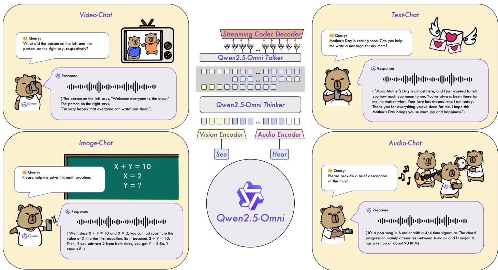

论文链接：https://arxiv.org/pdf/2503.20215

代码链接：https://github.com/QwenLM/Qwen2.5-Omni

> 🥛
>
> **论文总结**
>
> Qwen2.5-Omni是一种端到端的多模态模型，能感知包括文本、图像、音频和视频在内的多种模态，同时以流式方式生成文本和自然语音响应。
>
> - 为了实现多模态信息输入的流式处理，**音频和视觉编码器采用了块处理方法**，解耦了多模态数据长序列的处理，将感知责任分配给多模态编码器，而将长序列的建模任务交给大型语言模型，通过共享注意力机制增强了不同模态的融合。
> - 为了同步视频输入与音频的时间戳，以交错的方式组织音频和视频，并提出了一种新的位置嵌入方法，命名为**TMRoPE（Time-aligned Multimodal RoPE）**
> - 为了同时生成文本和语音，同时而避免两种模态之间的干扰，使用**Thinker-Talker**架构，Thinker作为大型语言模型负责文本生成，而Talker是一个双轨自回归模型，直接利用来自Thinker的隐表示生成音频令牌作为输出。Thinker和Talker模型均采取端到端训练和推理。
> - 为了以流式解码音频token，引入了一个**滑动窗口的DiT**，限制了接收域，减少初始包延迟。

###### 模型架构

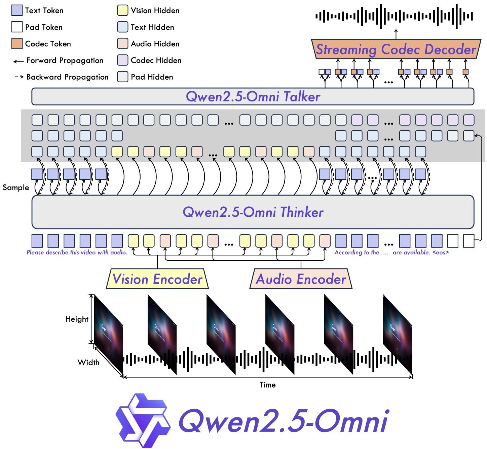

采用**Thinker-Talker**架构，前者的输入来自多模态数据融合后的embedding向量，负责理解多模态数据，Talker的输入来自Thinker的输出，负责生成语音。

- **Thinker模块：** 作为"大脑"，由Transformer解码器构成，集成音频/图像编码器从而实现多模态感知：
    - 处理文本、音频、图像及无音轨视频输入
    - 生成高级语义表征及文本输出
- **Talker模块：** 作为"嘴巴"，采用双轨自回归Transformer解码器设计：
    - 流式接收Thinker的高层连续特征表示和文本
    - 输出离散语音token
- 在训练和推理过程中，Talker 直接接收来自 Thinker 的高维表示，并共享 Thinker 的所有历史上下文信息。整个架构作为一个整体模型运行，支持端到端的训练和推理，实现了文本与语音的同步生成。

###### 数据处理

###### **输入数据**

- **文本处理**：采用Qwen 的字节级BPE分词器进行编码
- **音频处理**：重采样16kHz音频，通过25ms窗口/10ms步长转化为128通道 mel-spectrogram 图，使用Qwen2-Audio编码器（每帧表征对应40ms音频信号）
- **图像/视频（无音频）处理**：基于6.75亿参数ViT架构的视觉编码器，采用图像和视频数据混合训练的方式，采用动态帧率采样策略，单图像视为两个相同的帧。

###### **时序对齐位置编码(TMRoPE)**


目的：将时序信息融入到多模态数据编码，做法与Qwen2.5-VL一致。

将原始旋转嵌入分解为三个维度：**时间、高度和宽度**（统称空间维度）：

| **模态类型** | **时间ID处理** | **空间ID处理** | **注释** |
|---|---|---|---|
| **文本** | 所有token使用相同位置ID | 与时间ID相同 | 等同于1D-RoPE |
| **音频** | 每个帧对应40ms时间跨度，使用绝对位置编码 | 所有token使用相同位置ID |  |
| **图像** | 固定时间位置 | 根据图像行列位置分配 |  |
| **视频** | 动态调整时间ID，每帧对应实际时间(按40ms/ID)。通过最大位置ID递增，实现跨模态时序同步 | 与图像处理相同 | 时间交替排列：视觉表征在前，音频表征在后（每2秒分块） |

###### 模型生成

1. **文本生成（Thinker）**
- 采用标准自回归生成模式，与主流大语言模型一致，负责语义理解和逻辑推理
- 集成重复惩罚（repetition penalty）和top-p采样技术以增强生成多样性
2. **语音生成（Talker模块）**
- 接收来自Thinker的双通道输入：高层语义表示 + 离散文本标记
- **高维语义表示**：传递语音的语调、情感等隐含特征，支持流式生成的预判能力（在完整文本生成前启动语音合成）
- **离散文本标记**：消除语义空间中的同音词歧义，确保发音准确性（这也是架构图中为什么Talker还在输出文本token，只有训练时时需要，推理时就不需要了）。
- 创新设计的**qwen-tts-tokenizer**语音编解码器：
    - 以流式因果解码器实现实时音频合成
    - 音频生成与文本生成异步进行，无需词级/时间戳对齐
    - 显著降低训练数据要求和推理复杂度

###### 流式交互

- **初始包延迟影响因素**
    - 多模态信息输入的处理延迟；
    - 首个文本输入至首个语音token生成的延迟；
    - 首段语音转音频的延迟；
    - 模型架构固有延迟（与参数量、计算量相关）。

- **分块预填充：**通过改进音频和视觉编码器实现时序分块注意力
    - **音频编码器**：将全序列注意力改为每2秒一个块的注意力；
    - **视觉编码器**：采用Flash Attention加速训练与推理，并通过MLP层合并相邻2×2图像token，使用14×14的块尺寸适配多分辨率输入，将不同分辨率的图像打包成一个序列。
- **流式编解码生成：**滑动窗口块注意力机制限制上下文范围
    - **Flow-Matching DiT模型**：将相邻的代码分组为块，并使用这些块作为我们的注意力掩码。将输入编码转换为梅尔频谱图，上下文窗口限制为4块（前向2块+后向1块）；
    - **BigVGAN改进**：采用固定感受野的分块解码策略生成波形，支持流式音频生成。


###### 模型训练

###### 预训练

1. **增强语义理解能力**
- 冻结LLM（Qwen 2.5）参数，专注训练视觉编码器（Qwen2.5-VL）和音频编码器（Whisper-large-v3初始化）
- 使用大规模音频-文本和图像-文本对数据增强多模态语义理解，用自然语言提示替换了层级标签，这可以提高更好的泛化能力和更好的指令跟随能力。
- 编码器采用两阶段适配策略：先训练适配器（Adapter），再微调解码器。
2. **多模态能力增强**
- 解冻所有模型参数，引入更丰富的多模态数据：
    - 8,000亿token的图文/视频数据
    - 3,000亿token的音频数据
    - 1,000亿token的视听联合数据
- 通过多任务混合训练加强多模态交互能力，保留纯文本数据以维持语言理解能力
- 最大序列长度扩展至8,192 token
3. **长序列训练**
- 扩展原有文本/图像/视频数据的训练长度至32k。

###### 后训练

1. **Thinker**
- 采用 **ChatML格式**构建指令微调数据，支持文本、视觉（图像/视频）、音频及混合模态的对话场景，负责文本生成和多模态信息的高层语义融合。
2. **Talker：**
- **上下文学习（ICL）**：除了利用类似于Thinker的文本监督外，还通过下一个token预测执行语音延续任务，利用包含多模态上下文和口语响应的大量对话数据集，学习语义到语音的单调映射。此外还实施了音色解耦技术，以防止模型将特定的声音与不频繁的文本模式关联起来。
- **强化学习优化（DPO）**：为了缓解预训练阶段数据噪声带来的幻觉，基于词错误率（WER）和停顿错误率构建三元组数据 $(x,yw,yl)$，利用强化学习提升生成稳定性。


- **多说话者微调**：针对特定音色进行优化，提升语音的自然度和可控性。

##### 3.5 Qwen3-Omni

论文链接：https://arxiv.org/pdf/2509.17765

代码链接：https://github.com/QwenLM/Qwen3-Omni


> 📍
>
> **论文总结**
>
> 采用与Qwen2.5-Omni相同的**Thinker-Talker 架构**，为降低流式生成中的首包延迟，**Talker 模块采用multi-codebook scheme，自回归预测离散语音编码**。利用这些scheme的表征能力，我们以轻量级因果 ConvNet 替代计算密集型的块状diffusion模型，实现从首个编码帧即开始流式输出。为进一步增强多模态推理能力，还引入了一个思考模型，可对任意模态输入进行显式推理。

- **面临问题**：人类通过并行处理视觉、听觉等多模态信息实现智能交互，但当前的多模态模型常面临**模态权衡问题**（提升某一模态性能导致其他模态退化）。
- **研究方法**：Qwen3-Omni模型通过联合多模态训练实现各模态性能的平衡（无退化），同时增强跨模态能力（如视频理解），在Qwen2.5-Omni的基础上，做了以下修改：
    - **MoE**：Thinker （负责文本生成）和 Talker（接受Thinker的输出，生成流式语音token） 采用MoE设计
    - **Audio Transformer**：用自监督训练的 AuT（Audio Transformer）编码器替代 Whisper 音频编码器，该编码器在 2000 万小时的监督音频数据上从头训练，生成更强的通用音频表示。采用分块窗口注意力机制，支持实时预填充缓存。
    - **multi-codebook**：采用多码本进行语音生成，提升对噪声的建模能力。
    - Talker 从单轨转向多轨编码器建模，通过 **MTP 模块（multi-token prediction）**自回归预测多个multi-codebook 层，而波形阶段（Code2Wav）则将分块 DiT 替换为轻量级卷积网络（ConvNet），实现逐帧流式生成。
    - 输入和输出音频码率降低至 12.5 Hz，输出编码器支持单帧、即时语音合成。


###### 模型架构

在Qwen2.5-Omni的基础上，进行了以下核心改进：

1. **MoE架构：**Thinker和Talker模块均采用**混合专家模型（MoE）**，支持高并发推理。
2. **模态解耦：** Talker不再直接使用Thinker的文本表示（上图中紫色文本token直接输入到Talker中），改由纯音视频多模态特征进行条件生成。
    - **原因**：(i) 文本离散token与embedding信息等价，无需重复传递；(ii) 音视频协调生成需独立的多模态条件生成（如语音翻译中的保持语调/音色）
    - 允许外部模块（RAG/函数调用/安全过滤）干预Thinker输出, 并在需要时通过受控预处理向Talker提供文本，以实现流式合成。
    - 训练和推理过程中，Talker 直接接收来自 Thinker 的高维多模态特征，并共享对完整对话历史的访问权限。因此，该系统作为一个连贯的单一模型运行，支持端到端训练和统一推理。
3. **独立风格控制：**由于文本表示解耦，Thinker与Talker使用不同系统提示词，分别控制文本响应风格和语音风格 。
4. **多码本流式生成**
    - Talker采用自回归多码本方案：Talker每步生成单帧编解码，MTP模块预测残差码本
    - Code2Wav模块替换为轻量级因果卷积网络，简化音频合成阶段

###### AuT


1. **模型架构**
    - 基于**编码器-解码器结构，在Qwen3-Omni中作为音频编码器，参数规模约0.6B**
    - 输入音频特征：128通道梅尔频谱图（25 ms窗口，10 ms跳跃）
    - 预处理：通过Conv2D块对滤波器组特征进行8倍下采样，音频码率降至12.5 Hz
2. **训练策略:** 2000万小时监督音频数据（含多任务学习）
    - 80% 中英文伪标签ASR数据
    - 10% 其他语言ASR数据
    - 10% 音频理解数据
3. **关键技术**  ：
    - 采用**Flash Attention**加速计算
    - **块状窗口注意力**：实现实时预填充缓存
    - 支持1-8秒的注意力查询模式，平衡实时预填充缓存与离线任务性能

###### 输入数据感知

1. **多模态输入编码**
- **文本**：采用Qwen的tokenizer，使用**BBPE**编码（词汇量151,643）
- **音频**：
    - 重采样至16kHz，转换为128通道梅尔频谱图（25ms窗口，10ms跳跃）
    - 使用AuT音频编码器（20M小时音频数据训练）
    - 每帧对应原始音频80ms片段
- **图像/视频**：
    - 采用Qwen3-VL视觉编码器（基于SigLIP2-So400m，5.43亿参数）
    - 动态帧率采样保持视频信息完整性
2. **时间对齐多模态旋转位置编码（TM-RoPE）**
- 与Qwen2.5-Omni一样，扩展自M-RoPE，新增绝对时间信息维度
- 三维分解：
    - 时间维度（24个旋转角度）
    - 高度/宽度维度（各20个角度）
    - 通过角度重分配平衡局部细节与长程依赖
- 模态差异化应用：
    - **文本：等效一维RoPE**
    - **音频：使用共享的位置 ID，每个时间 ID 对应 80 毫秒的时长**
    - **图像：固定时间ID+空间ID**
    - **视频：时间ID递增（80ms分辨率）+空间ID**
3. **多模态流式对齐**
    - 采用连续位置编号策略避免模态间冲突，后续每种模态均从前一种模态的最大位置ID加一的位置开始。
    - 直接通过时间ID实现音视频对齐（相比Qwen2.5Omni中的2秒分块方案），支持任意时长的流式输入处理

###### 语音生成

- Talker模块负责多轮对话语音合成，其上下文信息继承自Thinker组件，包含历史文本token、多模态表征和当前轮次流式文本
- 直接操作RVQ（Residual Vector Quantization）token，采用层次化预测机制，使得模型能学习声学细节的完整表征：
    - 主干网络处理当前帧的聚合码本特征，通过线性头预测第0码本
    - MTP模块生成剩余码本
- 波形重建采用轻量级因果卷积网络（Code2Wav），相比基于DiT的声码器，降低83%推理延迟 ，减少75%计算量（FLOPs）  ，同时实现更高音频保真度

###### 流式与并发设计

主要目的是为了降低首包延迟TTFT。

1. **分块预填充与MoE架构**
    - **异步分块预填充**：同Qwen2.5-Omni ，Thinker与Talker模块采用异步预填充机制。当Thinker完成当前分块预填充后，其高层表征立即异步预填充Talker的当前分块，同时Thinker开始处理下一分块。这种流水线设计显著降低Thinker与Talker模块的TTFT。
    - **MoE架构优势**：Thinker和Talker均采用MoE设计，相比密集模型，显著减少长序列处理时的KV cache 的IO消耗，提升生成速度（TPS）与服务吞吐量。
2. **流式多码本编解码生成**
    - **仅关注左上下文的多码本生成机制**。Talker生成首个token后，MTP模块立即预测当前帧剩余token，流式多码本解码器仅依赖左上下文解码波形。相比Qwen2.5需等待完整上下文，Qwen3-Omni可逐token输出波形，首包延迟大幅降低。
3. **轻量化组件设计**
    - **MTP模块（80M）**：轻量固定步长自回归Transformer，支持高效批量推理，使用固定KV缓存空间加速推理。
    - **ConvNet解码器（200M）**：基于卷积的编解码器，受益硬件加速支持，低延迟高吞吐。
4. **端到端延迟优化**
    - Thinker和Talker的尺寸影响预处理延迟（音频/视觉编码器）与TTFT，MTP和编解码器设计影响推理延迟。由于这些组件之间存在串行依赖关系，因此总首包延迟等于这些延迟之和。
    - **理论首包延迟**：在冷启动（无上下文）下，理论端到端总首包延迟为234 ms。
    - **实时生成因子（RTF）**：音频生成速率12.5Hz（1token合成80ms音频），RTF（Thinker 和 Talker 生成一个 token 所需的时间 + MTP 模块 和 编码解码器处理时间/80ms）在高并发下始终低于1，保障流式连续性。

###### 预训练

1. **编码器对齐阶段 (S1)**
- **参数初始化**：LLM（Thinker）继承Qwen3参数，视觉编码器来自Qwen3-VL，音频编码器基于AuT初始化。
- **训练策略**：冻结LLM参数，先训练适配器再训练视觉/音频编码器，而不是传统联合训练编码器+适配器的方法，避免编码器试图弥补冻结LLM导致的感知能力退化。
2. **通用训练阶段 (S2)**
- **数据规模**：2万亿token多模态混合数据：文本(0.57T) | 音频(0.77T) | 图像(0.82T) ｜视频(0.05T) | 音视频(0.05T)
- **训练策略**：解冻所有参数进行端到端训练
3. **长上下文阶段 (S3)**
- **上下文扩展**：最大序列长度从8K扩展到32K，提升长音频/视频数据比例。

###### 后训练

###### Thinker后训练（三阶段）

目的是增强指令遵循能力，数据集采用ChatML格式，涵盖纯文本对话、视觉对话、音频对话及混合模态对话数据  。

1. **SFT**
    - **目标**：弥合预训练表征与下游任务需求之间的差距
    - **方法**：保持模型架构与预训练一致，数据模式偏移预训练，以实现高效知识迁移。
2. **知识蒸馏** ：包含两个阶段
    - **off-policy蒸馏**：教师模型生成响应，使学生模型获得基础推理能力
    - **on-policy蒸馏**：学生模型基于采样提示生成响应，通过最小化KL散度对齐教师模型（Qwen3-32B/Qwen3-235B-A22B）的预测分布。
3. **GSPO多模态增强**
    - 采用**规则奖励**（可验证任务）与**模型奖励**（无客观指标任务，Qwen3用于通用任务，Qwen2.5-VL用于视觉任务  ）

###### Talker后训练（四阶段）

目的是能够在生成文本的同时生成语音回应，数据集采用ChatML格式。

1. **多模态映射训练** ：利用数亿级带多模态上下文的语音数据  ，建立多模态表征到语音的单调映射
2. **继续预训练（CPT）**：使用高质量数据减少第一阶段噪声引起的幻觉，还进行长上下文训练，增强处理复杂输入的能力  。
3. **DPO：**  构建多语言语音偏好对，提升多语言生成泛化能力与系统稳定性 。
4. **speaker微调**  ：支持特定音色适配 ，优化语音自然度、表现力与可控性。

##### 3.6 Qwen3-VL

论文链接：https://arxiv.org/pdf/2511.21631

代码链接：https://github.com/QwenLM/Qwen3-VL

> ⚽
>
> **论文总结**
>
> Qwen3-VL实现了三方面能力的突破：
>
> 1. 更强的**纯文本理解能力**，在多个场景下超越同类纯文本模型
> 2. 更强的**长上下文理解能力**，支持文本及交错多模态输入的 256K token窗口。
> 3. 更强的对单图、多图和视频的**多模态推理能力**。
>
> 在架构方面，做了以下改进
>
> 1. **交错-MRoPE**，原始MRoPE将特征维度按照时间（T）、高度（H)和宽度（W)的顺序分块划分，使得时间信息全部分布在高频维度上。Qwen3-VL将时间、高度、宽度三个维度均匀分布在低频和高频带中，显著提升图像与视频中的时空建模能力；
> 2. **DeepStack** ，ViT不同层的视觉token通过残差连接路由至对应的 LLM 层，能够有效保留从底层（low-level）到高层（high-level）的丰富视觉信息，在不增加额外上下文长度的情况下增强多层级融合，强化视觉-语言对齐；
> 3. 采用**基于文本的时间对齐机制**，通过显式的文本时间戳对齐替代 Qwen2.5-VL 中通过位置编码实现的绝对时间对齐，采用“时间戳-视频帧”交错的输入形式，实现更精确的时空定位。为平衡纯文本与多模态学习目标，采用平方根重加权策略，在不损害文本能力的前提下显著提升多模态性能。
>
> Qwen3-VL的训练流程：
>
> - **预训练**：四阶段（**视觉语言对齐→全参数多模态训练→长上下文适应→超长上下文优化**）
> - **后训练**：三阶段（**监督微调→知识蒸馏→强化学习**）


###### 模型架构

如上图所示，Qwen3-VL仍然采用**ViT+Merger+LLM**的架构，**重点关注下面架构中红色的部分**：

- **LLM**：包含3种dense模型和2种MOE模型，旗舰模型为 Qwen3-VL-235B-A22B。使用了QK-Norm，并且在前3层进行Deepstack特征融合。
- **ViT**：复用**SigLIP-2架构，**在其基础上进行继续预训练（Qwen2.5-VL重新训练ViT）。
    - patch_embed中开启了bias，**patch-size变成16**（Qwen2.5-VL关闭 bias，patch-size14）。
    - MLP中激活函数变成`PytorchGELUTanh`（Qwen2.5-VL `SiLU`）。
    - 位置编码仍然采用**2D-RoPE**，支持动态分辨率，并根据输入尺寸插值绝对位置嵌入。
    - 采用**LayerNorm**（Qwen2.5-VL 采用RMSNorm）。
    - 定位从绝对坐标又改回了相对坐标。
- **Merger**：与Qwen2.5-VL一样采用两层的MLP，将$2 \times 2$视觉特征压缩为1个token。区别是采用LayerNorm，并使用了DeepStack机制(后面介绍)。

```sql
Qwen3-VLMoeForConditionalGeneration(
  (model): Qwen3-VLMoeModel(
    (visual): Qwen3-VLMoeVisionModel(
      (patch_embed): Qwen3-VLMoeVisionPatchEmbed(
        (proj): Conv3d(3, 1152, kernel_size=(2, 16, 16), stride=(2, 16, 16))
      )
      (pos_embed): Embedding(2304, 1152)
      (rotary_pos_emb): Qwen3-VLMoeVisionRotaryEmbedding()
      (blocks): ModuleList(
        (0-26): 27 x Qwen3-VLMoeVisionBlock(
          (norm1): LayerNorm((1152,), eps=1e-06, elementwise_affine=True)
          (norm2): LayerNorm((1152,), eps=1e-06, elementwise_affine=True)
          (attn): Qwen3-VLMoeVisionAttention(
            (qkv): Linear(in_features=1152, out_features=3456, bias=True)
            (proj): Linear(in_features=1152, out_features=1152, bias=True)
          )
          (mlp): Qwen3-VLMoeVisionMLP(
            (linear_fc1): Linear(in_features=1152, out_features=4304, bias=True)
            (linear_fc2): Linear(in_features=4304, out_features=1152, bias=True)
            (act_fn): PytorchGELUTanh()
          )
        )
      )
      (merger): Qwen3-VLMoeVisionPatchMerger(
        (norm): LayerNorm((1152,), eps=1e-06, elementwise_affine=True)
        (linear_fc1): Linear(in_features=4608, out_features=4608, bias=True)
        (act_fn): GELU(approximate='none')
        (linear_fc2): Linear(in_features=4608, out_features=4096, bias=True)
      )
      (deepstack_merger_list): ModuleList(
        (0-2): 3 x Qwen3-VLMoeVisionPatchMerger(
          (norm): LayerNorm((4608,), eps=1e-06, elementwise_affine=True)
          (linear_fc1): Linear(in_features=4608, out_features=4608, bias=True)
          (act_fn): GELU(approximate='none')
          (linear_fc2): Linear(in_features=4608, out_features=4096, bias=True)
        )
      )
    )
    (language_model): Qwen3-VLMoeTextModel(
      (embed_tokens): Embedding(151936, 4096)
      (layers): ModuleList(
        (0-93): 94 x Qwen3-VLMoeTextDecoderLayer(
          (self_attn): Qwen3-VLMoeTextAttention(
            (q_proj): Linear(in_features=4096, out_features=8192, bias=False)
            (k_proj): Linear(in_features=4096, out_features=512, bias=False)
            (v_proj): Linear(in_features=4096, out_features=512, bias=False)
            (o_proj): Linear(in_features=8192, out_features=4096, bias=False)
            (q_norm): Qwen3-VLMoeTextRMSNorm((128,), eps=1e-06)
            (k_norm): Qwen3-VLMoeTextRMSNorm((128,), eps=1e-06)
          )
          (mlp): Qwen3-VLMoeTextSparseMoeBlock(
            (gate): Qwen3-VLMoeTextRouter(in_features=4096, out_features=128, bias=False)
            (experts): Qwen3-VLMoeTextExperts(
              (act_fn): SiLU()
            )
          )
          (input_layernorm): Qwen3-VLMoeTextRMSNorm((4096,), eps=1e-06)
          (post_attention_layernorm): Qwen3-VLMoeTextRMSNorm((4096,), eps=1e-06)
        )
      )
      (norm): Qwen3-VLMoeTextRMSNorm((4096,), eps=1e-06)
      (rotary_emb): Qwen3-VLMoeTextRotaryEmbedding()
    )
  )
  (lm_head): Linear(in_features=4096, out_features=151936, bias=False)
)
```

> Qwen3-VL 模型架构

> 🏝️
>
> **QK Norm**
>
> **论文链接**：https://arxiv.org/pdf/2010.04245
>
> **应用**：在Qwen3、LLaMA4等模型都应用
>
> **面临问题**：**注意力计算中的**$\frac{QK^T}{\sqrt{d}}$**是无界的，导致**$SoftMax(\frac{QK^T}{\sqrt{d}})$**容易饱和**
>
> **原理**：对 Q 和 K 分别沿头维度进行 L2 归一化，这样就**将点积注意力转换为余弦相似度注意力**，将$\hat{Q}  \hat{K}^T$限制在$[-1, 1]$区间，避免softmax饱和导致的梯度消失爆炸
>
> $$
> \hat{Q} = \frac{Q}{\|Q\|_2}, \quad \hat{K} = \frac{K}{\|K\|_2}, \hat{Q}  \hat{K}^T = cosine\_similarity(\hat{Q}, \hat{K})
> $$
>
> **工程实现**：在这篇论文中，用可学习参数 $g$ 代替标准注意力中的固定缩放因子 $\frac{1}{\sqrt{d}}$
>
> $$
> Attention = softmax(g * Q̂K̂ᵀ)V
> $$
>
> 但在大模型中，选择用**RMSNorm**实现QKNorm
>
> $$
> Q̂ = Q / \sqrt{(E[Q²] + ε)} * γ
> $$
>
> $$
> K̂ = K / \sqrt{(E[K²] + ε)} * γ
> $$
>
> 其中 γ 是可学习的缩放参数，ε 是防止除零的小常数，γ 与$g$的本质是一样的，都是为了将$\hat{Q}  \hat{K}^T$的取值范围从$[-1, 1]$拓展到更大的区间（但不是$\frac{QK^T}{\sqrt{d}}$那种无界），避免softmax输出差异过小，难以区分 token 间的关联性。

###### **交错-MRoPE**

回忆一下Qwen2.5VL 中的MRoPE，使用3D位置信息**（时间，高度，宽度）。**其位置向量的组成方式为：


> 一个token的sin/cos向量

但这种方式存在问题，即RoPE中$\theta_i = 10000^{\frac{-2i}{d}}$，$i$表示索引，由于旋转频率随着索引增加而降低，MRoPE会导致时间维度的信息全部在高频维度上，不利于长序列的理解，会导致注意力随着时间快速衰减。

为此，Qwen3-VL在LLM中采用[Interleaved MRoPE](https://arxiv.org/pdf/2510.23095)，以细粒度的轮询方式将特征通道分配到**时间，高度，宽度**轴上，确保每个位置轴都使用从高到低的完整频谱进行编码。


> 上图中黄、粉、绿分别表示T、H、W维度，T=24，H和W=20，1:4缩小，所以最后会有一个单独的时间块。

接下来结合[Qwen3-VLTextRotaryEmbedding](https://github.com/huggingface/transformers/blob/main/src/transformers/models/qwen3_vl/modeling_qwen3_vl.py#L278) 源码理解交错MRoPE的实现。类的定义跟Qwen2.5VL类似，定义了频率$\theta_i = 10000^{\frac{-2i}{d}}$，交错MRoPE的分段$[24,20,20]$

```python
class Qwen3-VLTextRotaryEmbedding(nn.Module):
    inv_freq: torch.Tensor  

    def __init__(self, config: Qwen3-VLTextConfig, device=None):
        super().__init__() 
        self.max_seq_len_cached = config.max_position_embeddings 
        self.original_max_seq_len = config.max_position_embeddings  
        self.config = config
        self.rope_type = self.config.rope_parameters["rope_type"]

        # 默认使用标准的 RoPE 参数计算函数
        rope_init_fn: Callable = self.compute_default_rope_parameters
        if self.rope_type != "default":
            rope_init_fn = ROPE_INIT_FUNCTIONS[self.rope_type]
        # 计算频率和注意力缩放因子
        inv_freq, self.attention_scaling = rope_init_fn(self.config, device)

        self.register_buffer("inv_freq", inv_freq, persistent=False)
        self.original_inv_freq = inv_freq  

        # MROPE 的分段配置，默认为 [24, 20, 20]，分别对应 T（时间/序列）、H（高度）、W（宽度）三个维度的分段数
        self.mrope_section = config.rope_parameters.get("mrope_section", [24, 20, 20])

    @staticmethod
    def compute_default_rope_parameters(
        config: Optional[Qwen3-VLTextConfig] = None,
        device: Optional["torch.device"] = None,
        seq_len: Optional[int] = None,
    ) -> tuple["torch.Tensor", float]:
        base = config.rope_parameters["rope_theta"]
        dim = getattr(config, "head_dim", None) or config.hidden_size // config.num_attention_heads
        attention_factor = 1.0  
        # theta_i = 1 / (10000^{2i/d})
        inv_freq = 1.0 / (
            base ** (torch.arange(0, dim, 2, dtype=torch.int64).to(device=device, dtype=torch.float) / dim)
        )
        return inv_freq, attention_factor 
```

接下来关注`forward`函数

- 首先将`inv_freq` 扩展到 `(3, batch_size, head_dim//2, 1)`，将`position_ids`拓展为`(3, batch_size, 1, seq_len)`，两者相乘得到频率矩阵`freqs`。
- `freqs`布局为$[TTT...HHH...WWW]$，时间信息全部分布在高频维度上，不利于长序列的理解。这就需要用到交错MRoPE，将其重组为$[THWTHWTHW...TT]$。
- 最后将位置编码拼接，与`attention_scaling`相乘计算出`cos`和`sin`向量。

```python
@torch.no_grad()  
@dynamic_rope_update  
def forward(self, x, position_ids):
    # 如果 position_ids 是 2D 的（batch_size, seq_len），则扩展为 3D（3, batch_size, seq_len）
    if position_ids.ndim == 2:
        position_ids = position_ids[None, ...].expand(3, position_ids.shape[0], -1)
    #从 inv_freq (head_dim//2,) 扩展到 (3, batch_size, head_dim//2, 1)
    inv_freq_expanded = self.inv_freq[None, None, :, None].float().expand(3, position_ids.shape[1], -1, 1)

    # 扩展position_ids以匹配inv_freq_expanded的形状：从 (3, batch_size, seq_len) 扩展到 (3, batch_size, 1, seq_len)
    position_ids_expanded = position_ids[:, :, None, :].float() 

    device_type = x.device.type if isinstance(x.device.type, str) and x.device.type != "mps" else "cpu"

    with torch.autocast(device_type=device_type, enabled=False):  
        # 计算频率：inv_freq_expanded @ position_ids_expanded 进行矩阵乘法
        # 结果形状为 (3, batch_size, head_dim//2, seq_len)，然后转置为 (3, batch_size, seq_len, head_dim//2)
        freqs = (inv_freq_expanded.float() @ position_ids_expanded.float()).transpose(2, 3)
        # 应用交错 MROPE：将分块的频率布局 [TTT...HHH...WWW] 重组为交错布局 [THWTHWTHW...TT]
        freqs = self.apply_interleaved_mrope(freqs, self.mrope_section)
        # 这是因为旋转位置编码需要成对的维度（实部和虚部）,(batch_size, token_number, head_dim)
        emb = torch.cat((freqs, freqs), dim=-1)
        # emb.cos() 计算每个角度的余弦值，* self.attention_scaling 应用缩放因子（通常为1.0）
        cos = emb.cos() * self.attention_scaling
        sin = emb.sin() * self.attention_scaling

    return cos.to(dtype=x.dtype), sin.to(dtype=x.dtype)
```

关注交错位置编码的具体实现，以 T 维度为基础，遍历 H 和 W 维度。

- offset=1 对应 H 维度在交错序列中的位置，idx 为$[1, 4, 7, 10, ...]$,替换掉T维度中对应位置的值
- offset=2 对应 W 维度在交错序列中的位置，idx 为 $[2, 5, 8, 11, ...]$,替换掉T维度中对应位置的值
- 超过length的低频维度还是采用T维度的值。

```python
def apply_interleaved_mrope(self, freqs, mrope_section):
    # 以 T 维度为基础，形状为 (batch_size, seq_len, head_dim // 2)
    freqs_t = freqs[0] 
    
    # 遍历 H 和 W 维度（索引从 1 开始，对应 dim=1 和 dim=2）
    for dim, offset in enumerate((1, 2), start=1): 
        # 计算当前维度在交错序列中的总长度
        # mrope_section[dim] 是该维度的分段数，乘以 3 是因为交错模式是 THW 三个一组
        length = mrope_section[dim] * 3
        # 例如 offset=1 时，idx 为 [1, 4, 7, 10, ...]，对应 H 维度在交错序列中的位置
        # 例如 offset=2 时，idx 为 [2, 5, 8, 11, ...]，对应 W 维度在交错序列中的位置
        idx = slice(offset, length, 3)
        # 将对应维度的频率值复制到 freqs_t 的相应位置，实现交错排列
        freqs_t[..., idx] = freqs[dim, ..., idx]
    return freqs_t
```

###### DeepStack

从 ViT的中间层提取视觉标记，注入到LLM的多个层中，保留了从低级到高级表示的丰富视觉信息。从视觉编码器的三个$[8, 16, 24]$不同层级选择特征，使用Merger将这些特征投影为视觉token，然后添加到前三个LLM层的对应hidden states中。


接下来结合[Qwen3-VLVisionModel](https://github.com/huggingface/transformers/blob/main/src/transformers/models/qwen3_vl/modeling_qwen3_vl.py#L594)源码理解DeepStack的实现。首先关注类的定义，

- `pos_embed`表示绝对位置编码，目的是为了适应动态分辨率，支持任意分辨率图像输入，将输入图像的坐标映射到 48 * 48的网格上，得到浮点数坐标，再计算双线性插值的位置编码。
- `merger`：接受ViT输出的特征，将$2 \times 2$视觉特征压缩为1个token
- `deepstack_merger_list`：取出ViT的第$[8, 16, 24]$层输出的hidden_state，经过各自的Merger后作为deepstack 特征，然后与前三个LLM层的对应hidden states相加。

```python
class Qwen3-VLVisionModel(Qwen3-VLPreTrainedModel):
    config: Qwen3-VLVisionConfig
    _no_split_modules = ["Qwen3-VLVisionBlock"]

    def __init__(self, config, *inputs, **kwargs) -> None:
        super().__init__(config, *inputs, **kwargs)
        # spatial_merge_size = 2
        self.spatial_merge_size = config.spatial_merge_size
        # patch_size = 16
        self.patch_size = config.patch_size
        self.spatial_merge_unit = self.spatial_merge_size * self.spatial_merge_size

        # 将图像块转换为嵌入向量Conv3d(3, 1152, kernel_size=(2, 16, 16), stride=(2, 16, 16), bias=True)。
        self.patch_embed = Qwen3-VLVisionPatchEmbed(
            config=config,
        )
        # 可学习的绝对位置编码，(2304, 1152)
        self.pos_embed = nn.Embedding(config.num_position_embeddings, config.hidden_size)
        # 为适应动态分辨率，支持任意分辨率图像输入，根据输入尺寸插值绝对位置嵌入
        # 将输入图像的坐标映射到 48 * 48的网格上，得到浮点数坐标，再计算双线性插值的位置编码。
        self.num_grid_per_side = int(config.num_position_embeddings**0.5)

        # head_dim = 72
        head_dim = config.hidden_size // config.num_heads
        # 旋转位置嵌入角度
        self.rotary_pos_emb = Qwen3-VLVisionRotaryEmbedding(head_dim // 2)
        self.blocks = nn.ModuleList([Qwen3-VLVisionBlock(config) for _ in range(config.depth)])
        # 注意merger这里use_postshuffle_norm = False
        self.merger = Qwen3-VLVisionPatchMerger(
            config=config,
            use_postshuffle_norm=False,
        )

        # 指定哪些层需要进行deepstack处理 [8, 16, 24]
        self.deepstack_visual_indexes = config.deepstack_visual_indexes
        # 注意merger这里use_postshuffle_norm = False
        self.deepstack_merger_list = nn.ModuleList(
            [
                Qwen3-VLVisionPatchMerger(
                    config=config,
                    use_postshuffle_norm=True,
                )
                for _ in range(len(config.deepstack_visual_indexes))
            ]
        )
        self.gradient_checkpointing = False
```

Qwen3-VLVisionPatchMerger的实现就是一个两层的MLP层，`merger`与`deepstack_merger_list`区别在于是先归一化还是先合并。

- `use_postshuffle_norm = True`：在合并后的特征空间中进行归一化，可以更好地处理合并后的特征分布
- `use_postshuffle_norm = False`：先对每个原始特征进行归一化，然后再合并，保持原始特征的统计特性

```python
class Qwen3-VLVisionPatchMerger(nn.Module):
    def __init__(self, config: Qwen3-VLVisionConfig, use_postshuffle_norm=False) -> None:
        super().__init__()
        # 计算合并后的隐藏层维度：原始维度（1152） × 空间合并尺寸的平方（4）= 4608
        self.hidden_size = config.hidden_size * (config.spatial_merge_size**2)
        self.use_postshuffle_norm = use_postshuffle_norm
        self.norm = nn.LayerNorm(self.hidden_size if use_postshuffle_norm else config.hidden_size, eps=1e-6)
        self.linear_fc1 = nn.Linear(self.hidden_size, self.hidden_size)
        self.act_fn = nn.GELU()
        self.linear_fc2 = nn.Linear(self.hidden_size, config.out_hidden_size)

    def forward(self, x: torch.Tensor) -> torch.Tensor:
        # use_postshuffle_norm=True (后置归一化):
        #   1. 先将x reshape到(-1, 4608) - 即先进行空间合并，进行2x2视觉特征堆叠
        #   2. 然后在合并后的特征上进行归一化
        #   3. 最后reshape到(-1, 4608)
        #
        # use_postshuffle_norm=False (前置归一化):
        #   1. 直接在原始x（1152）上进行归一化
        #   2. 然后reshape到(-1, 4608)
        x = self.norm(x.view(-1, self.hidden_size) if self.use_postshuffle_norm else x).view(-1, self.hidden_size)
        x = self.linear_fc2(self.act_fn(self.linear_fc1(x)))
        return x
```

在[Qwen3-VLVisionModel](https://github.com/huggingface/transformers/blob/main/src/transformers/models/qwen3_vl/modeling_qwen3_vl.py#L594)的前向传播过程中，首先在`hidden_states`上添加绝对位置编码，然后计算出注意力中的旋转位置编码，对于ViT的第$[8, 16, 24]$层计算deepstack特征。返回merger特征和deepstack特征。

```python
def forward(self, hidden_states: torch.Tensor, grid_thw: torch.Tensor, **kwargs) -> torch.Tensor:
    # 通过图像分割成patch，并投影为为嵌入向量。
    hidden_states = self.patch_embed(hidden_states)
    # 通过双线性插值获取绝对位置编码，支持任意分辨率的输入
    pos_embeds = self.fast_pos_embed_interpolate(grid_thw)
    # 将绝对位置编码添加到hidden_states中
    hidden_states = hidden_states + pos_embeds
    # 计算注意力中的旋转位置编码（RoPE）
    rotary_pos_emb = self.rot_pos_emb(grid_thw)

    seq_len, _ = hidden_states.size()
    hidden_states = hidden_states.reshape(seq_len, -1)
    # 将旋转位置编码重塑为(seq_len, head_dim//2)形状
    rotary_pos_emb = rotary_pos_emb.reshape(seq_len, -1)
    # 旋转位置编码需要成对的维度（实部和虚部）,得到完整的旋转嵌入维度
    emb = torch.cat((rotary_pos_emb, rotary_pos_emb), dim=-1)
    position_embeddings = (emb.cos(), emb.sin())

    cu_seqlens = torch.repeat_interleave(grid_thw[:, 1] * grid_thw[:, 2], grid_thw[:, 0]).cumsum(
        dim=0,
        #  Select dtype based on the following factors:
        #  - FA2 requires that cu_seqlens_q must have dtype int32
        #  - torch.onnx.export requires that cu_seqlens_q must have same dtype as grid_thw
        # See https://github.com/huggingface/transformers/pull/34852 for more information
        dtype=grid_thw.dtype if torch.jit.is_tracing() else torch.int32,
    )
    cu_seqlens = F.pad(cu_seqlens, (1, 0), value=0)

    # deepstack特征列表
    deepstack_feature_lists = []
    for layer_num, blk in enumerate(self.blocks):
        hidden_states = blk(
            hidden_states,
            cu_seqlens=cu_seqlens,
            position_embeddings=position_embeddings,
            **kwargs,
        )
        # [8, 16, 24]
        if layer_num in self.deepstack_visual_indexes:
            deepstack_feature = self.deepstack_merger_list[self.deepstack_visual_indexes.index(layer_num)](
                hidden_states
            )
            deepstack_feature_lists.append(deepstack_feature)

    # 使用merger处理最终的hidden_states
    hidden_states = self.merger(hidden_states)
    # hidden_states: 最终处理后的视觉特征，将输入到LLM
    # deepstack_feature_lists: 特定层的deepstack特征，将在LLM的前3层中使用
    return hidden_states, deepstack_feature_lists
```

然后在[Qwen3-VLTextModel](https://github.com/huggingface/transformers/blob/main/src/transformers/models/qwen3_vl/modeling_qwen3_vl.py#L793)的前向传播中，在LLM前3层中添加deepstack视觉特征到`hidden_states`中。

```python
for layer_idx, decoder_layer in enumerate(self.layers):
    layer_outputs = decoder_layer(
        hidden_states,
        attention_mask=attention_mask,
        position_ids=text_position_ids,
        past_key_values=past_key_values,
        cache_position=cache_position,
        position_embeddings=position_embeddings,
        **kwargs,
    )
    hidden_states = layer_outputs

    # 在LLM前3层中添加deepstack视觉特征到hidden_states中，len(deepstack_visual_embeds) = 3
    if deepstack_visual_embeds is not None and layer_idx in range(len(deepstack_visual_embeds)):
        hidden_states = self._deepstack_process(
            hidden_states,
            visual_pos_masks,
            deepstack_visual_embeds[layer_idx],
        )
hidden_states = self.norm(hidden_states)
return BaseModelOutputWithPast(
    last_hidden_state=hidden_states,
    past_key_values=past_key_values,
)
```

LLM的`hidden_states`与deepstack特征的融合方式如下，由于Merger特征和deepstack 特征维度一致，直接将hidden_states中视觉token的位置与deepstack的视觉特征相加。

```
def _deepstack_process(
    self, hidden_states: torch.Tensor, visual_pos_masks: torch.Tensor, visual_embeds: torch.Tensor
):
    visual_pos_masks = visual_pos_masks.to(hidden_states.device)
    visual_embeds = visual_embeds.to(hidden_states.device, hidden_states.dtype)
    hidden_states = hidden_states.clone()
    # visual_pos_masks是一个布尔掩码，只有视觉token位置为True，其他位置为False
    # 将hidden_states中视觉token的位置与deepstack的视觉特征相加
    # 相当于在ViT模型和LLM前三层的hidden_states之间添加了残差连接
    local_this = hidden_states[visual_pos_masks, :] + visual_embeds
    hidden_states[visual_pos_masks, :] = local_this
    return hidden_states
```

###### 基于文本的时间对齐机制

Qwen2.5VL将时间位置 ID 直接关联到绝对时间（即3DRoPE，时间维度的值对应帧数），该方法在处理长视频时会产生过大且稀疏的时间位置 ID，削弱模型对长时序上下文的理解能力。 并且为了有效学习，需要在不同帧率（fps）下进行广泛且均匀的采样，显著增加了训练数据构建的成本。

Qwen3-VL采用**基于文本的时间对齐机制**，为每个视频时序patch都添加时间戳前缀，在训练过程中添加了“秒”和“时:分:秒”两种格式的时间戳以确保模型能够学习理解多种时间码表示。这种方法会带来适度的上下文长度增加。

代码实现与[Qwen2.5VL中的get_rope_index](https://ai.feishu.cn/wiki/HxWSwlEFtiOzqWkYG9VcpsbHned#share-RgSldTS4moEoYNxC5OQc4wOonRe)中基本一致，区别只在于每个帧都被视为独立的图像，时间维度都设置为1。

```
if video_grid_thw is not None:
    # 根据时间维度（第0列）重复每个视频的grid_thw，将多帧视频拆分为单帧
    video_grid_thw = torch.repeat_interleave(video_grid_thw, video_grid_thw[:, 0], dim=0)
    # 将时间维度设置为1（因为每帧单独处理，时间维度为1）
    video_grid_thw[:, 0] = 1
```

在数据预处理时就已经在文本中添加了时间戳，输入是`聪明的<t1> <vision_start> <video_token> [视觉特征token序列] <vision_end> 小羊`。其中`<t1>`表示时间戳，`[视觉特征token序列]`包含1个帧，每一帧是2×2 网格`（llm_grid_h=2, llm_grid_w=2）`。


###### 预训练


###### 四阶段预训练

Qwen3-VL的预训练分为四个阶段

1. **视觉-语言对齐：**弥合视觉编码器与LLM的模态差距
- **训练策略**：**仅训练MLP merger参数**，冻结ViT和LLM主干
- **数据**：约67B tokens的高质量图像-文本对、视觉知识库和OCR数据
- **序列长度**：8,192 tokens
2. **多模态预训练：**全参数端到端联合训练
- **训练策略**：**解冻视觉编码器、合并器和LLM所有参数**
- **数据**：约1T tokens混合数据（视觉语言数据+纯文本数据） ，前者包含交错图文文档、视觉定位、VQA、STEM领域数据及少量视频数据
- **序列长度**：保持8,192 tokens
3. **长上下文预训练：**扩展上下文处理能力
- **训练策略**：**训练所有模型参数，序列长度增至32,768 tokens**
- **数据**：约1T tokens数据，增加纯文本数据比例，强化长文本理解；增加视频和agent指令遵循数据
4. **超长上下文适应**：将上下文窗口扩展至极限
- **关键改进**：**训练所有模型参数，序列长度增至262,144 tokens**
- **数据**：100B tokens数据集 ，重点是长视频理解和长文档分析。

###### 训练数据处理

1. **图像-标题对与图文交错数据**
- **图像-标题对**：对于网页多语言图文对，**用Qwen2.5-VL-32B重写描述**，强化视觉元素与语义表达；基于**语义相似性进行语义去重**，通过**聚类**识别稀疏数据，并进行针对性增强。
- **图文交错**：采集中英文文档，基于**微调后的轻量级 Qwen 的评分器进行领域分类**，过滤广告等低价值内容；对书籍类数据**用微调后的 Qwen2.5-VL-7B 模型进行解析**，精确提取并对齐文本与嵌入的图表、示意图和照片。**合并页面生成最长256K tokens的序列**，实现超长上下文建模。
2. **知识类数据**
- 覆盖10+语义类别。采用**重要性采样平衡长尾分布**：高频实体多采样，低频实体少量保留；替换稀疏标注为LLM生成的包含属性、场景等的详细描述。
3. **OCR、文档解析与长文档理解**
- **OCR**：构建粗到精的流水线，**利用OCR模型和Qwen2.5VL优化OCR标注**。包含3000万内部样本+3000万多语言合成样本。
- **文档解析**：包含300万Common Crawl PDF+400万内部文档，先用**模型标注文本区域和非文本区域的顺序和边界**，**用Qwen2.5-VL-72B进行区域识别**，最后将输出结果重新组合为具有位置感知、版面对齐的解析数据。
- **长文档理解**：将单页文档合成长文档解析序列，生成长文档VQA数据，并平衡问题类型分布。
4. **Grounding 与计数**
- **边界框 Grounding**：整合COCO等开源数据集，开发自动化合成标注（**Qwen2.5-VL提取物体候选+Grounding DINO标注+过滤低置信样本**）。
- **点 Grounding**：融合PixMo等公开数据并合成聚焦细粒度图像细节等标注数据。
- **计数**：包含直接计数、框计数、点计数三类任务，**采用[0,1000]归一化坐标**，提升分辨率适应性。
5. **空间理解与3D识别**
- **空间理解**：为了让模型能够推理二维场景中的空间关系、物体可操作性以及可行操作，**构建了一个包含提升含关系标注（如“杯子在电脑左侧”）、可操作性标签（如“可抓取”）、动作规划查询（如“为了拿到显示器后面的书，我应该先移动什么？”）的数据集**，采用**相对坐标**鼓励关系推理。
- **3D 定位**：构建3D视觉定位数据集（**图像+自然语言指代+边界框**），将所有数据统一到一个相机坐标系。
6. **代码数据**
- **纯文本代码**：复用**Qwen3 和 Qwen3-Coder系列数据集**，覆盖软件开发、算法、数学推理等场景。
- **多模态代码**：包含**截图转HTML/CSS、图像转SVG代码、视觉编程题、流程图转代码**等任务。
7. **视频数据**
- **时序感知视频理解**：**长视频采用从短到长字幕生成策略**，利用字幕生成模型生成细粒度的标注；为增强模型的时空定位能力，构建时空定位数据，在物体、动作和人物层面进行了标注。
- **数据平衡**：按数据来源平衡分布，**根据不同的序列长度约束，动态调整采样参数，如每秒帧数（fps）和最大帧数，进行长度自适应采样**。
8. **STEM类数据**
- **视觉感知**：通过程序生成几何图表，包含100万点定位样本、200万面向感知的视觉问答对；经过两阶段标注+模型验证，生成600万图表描述数据集。
- **多模态推理**：6000万K12至本科习题，清洗低质量数据、统一答案格式；采用推理模型合成1200万带图像的长CoT样本，**基于规则和模型验证推理轨迹**，筛选高难度问题。
- **语言推理**：复用**Qwen3的推理数据，因为多模态推理能力在很大程度上源于语言推理能力。**
9. **智能体数据**
- **GUI**：GUI界面感知包含元素描述、密集标注等任务；智能体能力方面，构建多步骤任务轨迹+人工审核；补充CoT推理，强化规划与自我修正能力。
- **函数调用**：多模态函数调用轨迹合成流水线（生成查询、函数定义、调用逻辑、响应，此过程重复进行，直到用户查询被认为已解决）。
- **搜索**：结合图像与文本搜索工具收集多模态事实查询轨迹**，鼓励模型对陌生实体主动搜索。**

###### 后训练

###### 3阶段后训练

1. **SFT：**激活指令遵循能力和潜在推理技能
- 分两阶段实施：**32k上下文长度训练 + 扩展到256k上下文窗口**，专注长文档/长视频数据
- 训练数据分两类：**用于非思考型模型的标准格式，以及用于思考型模型的CoT格式。**
2. **强弱知识蒸馏：**将教师模型能力迁移到学生模型
- **使用纯文本数据进行LLM微调**，显著提升文本/多模态任务的推理能力
3. **强化学习：**分两个阶段：
- **推理RL**：覆盖数学、编码、逻辑推理、视觉基础等任务
- **通用RL**：增强指令跟随和人类偏好对齐

###### SFT阶段

###### SFT数据

在Qwen2.5VL的基础能力上（包含分成 8 个核心领域，30 个细粒度领域），新增了以下能力：

- **具身智能的空间推理**
- **细粒度视觉理解的图像推理**

- **视频时空定位的鲁棒目标追踪**
- **数百页的长技术文档的理解**

- **数据集构成** ：**约 120 万样本 ，1/3 为纯文本  ，2/3 为图像-文本和视频-文本对** 。（对比Qwen2.5用了200万数据，文本多模态1:1）。引入单轮和多轮对话，支持单图、多图序列的对话动态模拟。包含交错图像-文本示例，用于工具增强的图像搜索和视觉推理 。
- **训练策略**
    1. 第一阶段：**32K token** 序列长度，训练 1 epoch
    2. 第二阶段：**256K token 序列长度**，32k 和 256k 数据混合的训练，训练 1 epoch
- **数据质量控制**
    - **查询过滤**：
        - **使用 Qwen2.5-VL 筛选不可验证的查询**
        - **修正模糊指令**，去除无实质内容的网络来源查询
        - 所有剩余的查询经过**复杂度和上下文相关性**的最终评估，仅保留适当难度且相关的样本进入下一阶段。
    - **响应过滤**：
        - **规则过滤**：**去除重复、不完整或格式错误的响应，过滤偏离主题或有害内容**
        - **模型过滤**：**基于 Qwen2.5-VL 的奖励模型**，评估答案正确性、完整性、语言一致性等维度；视觉任务验证视觉信息的准确应用；以及过滤掉规则方法难以识别的问题，如不恰当的语言混用或突兀的风格转换

###### 冷启动数据

- **数据构成与领域覆盖：**（**视觉语言:纯文本 ≈ 1:1**），多模态部分覆盖 VQA、OCR、2D/3D 定位、视频分析等传统领域，特别强化 **STEM 和Agent**相关任务；文本部分跟Qwen3数据一致。
- **数据过滤**：
    - 先做难度过滤：只保留**base模型做不对和回复更长更详细的数据**。
    - 多模态必要性过滤：过滤掉Qwen3-30B-nothink 能**不依赖图片就能做对的题**
    - 与Qwen3一样对相应进行处理：过滤到错误、重复、语言混乱、**猜答案**（Qwen3-VL 中新提到的）、缺乏推理步骤的数据。

###### 强到弱蒸馏

使用纯文本数据进行LLM微调，分为两个阶段

- **off-policy蒸馏**：直接把教师模型回复给学生模型做微调。
- **on-policy蒸馏**：**最小化教师和学生模型的logits之间的KL散度。**

###### 强化学习

###### 推理强化学习

目的：提升模型推理能力

1. **数据准备**
- **数据来源**：包含**文本和多模态数据**，覆盖数学、编程、逻辑推理、视觉定位和视觉谜题领域。
- **数据预处理**：使用Qwen3-VL-235B-A22B对每个查询生成16个响应，若全部做错则丢弃该查询（**删掉太难的**）。
- **数据筛选**：**每个数据源单独做实验，如果RL实验之后没提升就剔除**（看起来工作量巨大）。最终得到30K数据。
- **训练阶段过滤**：训练时rollout16次，通过率>90%的简单查询进行过滤掉（**删掉太简单的**）。
- **批次构建**：**一个batch混合不同任务数据，每个batch的比例固定，通过预实验确定各任务样本比例**。
2. **奖励系统设计**
- 构建统一的奖励框架，不同任务的奖励需要分别实现，共享数据预处理、工具函数、奖励管理器等。
- **删除格式奖励**：**通过prompt引导模型输出规范格式，无需显式格式奖励**
- **语言惩罚**：**对输出语言与prompt中要求语言不一致的情况添加惩罚。**
3. **RL算法：**采用**SAPO**，对比GRPO/GSPO，能更长时间的稳定学习，达到更高的Pass@1准确率。主要创新为：
    1. 用**受温度控制的软门控机制替代了硬裁剪**
    2. **为负token设置更高的温度**，使得负token上的梯度衰减得更快，从而提升训练的稳定性和性能

###### 通用强化学习

目的：提升模型的泛化能力和鲁棒性，进行多任务RL训练。

1. **多任务奖励机制** ：基于SFT阶段的多个任务（VQA、图像描述、OCR、文档解析、grounding、时钟识别等）构建综合奖励函数，优化以下两个维度：
    - **指令遵循**：评估模型对显式用户指令的遵守能力，包括**内容、格式、长度和结构化输出的约束**。
    - **偏好对齐**：针对开放式或主观性查询，优化**输出的帮助性、事实准确性和风格适宜性**，以符合人类偏好。
2. **错误先验纠正：**通过**设计可验证任务（如反直觉对象计数、复杂时钟时间识别）触发SFT阶段形成的错误知识先验，用事实知识替代错误先验**。
3. **低频问题抑制**  ：针对**不恰当语言混合、过度重复、格式错误等低频问题**，跟着其他数据一起做RL训练样本效率太低，因此**构建会诱发此类不良行为的prompt的数据集专门训练**，通过高频有针对性的惩罚策略抑制这些错误。
4. **混合奖励设计：**
    - **规则奖励**：可验证问题基于明确规则（如格式遵循）提供高精度反馈，缓解**奖励劫持**。
    - **模型奖励**：开放性问题利用**Qwen2.5-VL-72B-Instruct或Qwen3作为评估模型**，对比模型生成回复与真实答案。

###### Think with Image

目标：**增强多模态模型的工具调用能力**

1. 创建一个冷启动agent数据集，包含10k个视觉问答任务，对Qwen2.5-VL-32B微调，模拟视觉agent的行为：`think → act → analyze feedback → answer`，最后进行**多轮、工具集成的RL**。
2. 再用训练好的Qwen2.5-VL-32B蒸馏出120k的多轮agent交互数据。用这些数据对Qwen3-VL进行相同的SFT+RL流程。

强化学习采用三种奖励信号：

- **准确性奖励**：用 Qwen3-32B 来衡量**最终答案是否正确**
- **多轮推理奖励：**利用 Qwen2.5-VL-72B 评估agent的**推理过程奖励**
- **工具调用奖励**：对比实际工具调用次数与 Qwen2.5-VL-72B估算的调用次数，**鼓励适当的工具调用，防止hack到不调用工具或者只调用一次工具的情况。**

###### Infrastructure

训练使用PAI-Lingjun，基于**Megatron**进行分布式训练（整合了张量并行（TP）、流水线并行（PP）、上下文并行（CP）、专家并行（EP）以及 ZeRO-1 数据并行（DP）），在万卡规模仍能保持高吞吐量和低通信延迟。

本地部署采用**vLLM**或**sglang**，前者通过PageAttention实现高吞吐量，后者能更好的结构化生成和处理复杂提示。

###### 实验

技术报告的实验部分前面是在各种任务上赢麻了，本文只关注消融实验。

###### Vision Encoder

**在进行预训练之前，Qwen3-VL中的ViT是在SigLIP-2的基础上，使用动态分辨率进行CPT得到的**。因此为了证明CPT训练的有效性，本文对比了Qwen3-ViT和原始的SigLIP-2模型。

指标如下图，在clip预训练的指标上与SigLIP-2基本相同，当拼接上1.7B的Qwen3 语言模型并训练1.5T token后，在VLM Bench上取得更高的性能。


###### DeepStack

内部15B-A2B LLM上对DeepStack进行消融实验，消耗200B token进行预训练，证明了**deepstack的有效性，能够整合丰富的视觉信息，从而有效增强细粒度视觉理解能力。**


###### Needle-in-a-Haystack

**评估模型处理长上下文的能力**，在 Qwen3-VL-235B-A22B-Instruct 上构建了一个视频版的“大海捞针”评估任务。**在视频中插入一帧含有答案的内容，让模型长视频中准确定位目标帧并回答相关问题**。视频以 1 FPS 的频率统一采样，帧分辨率动态调整以保持恒定的视觉标记预算。

- 在256k token上下文，对应30分钟的视频上，准确率100%。
- 在使用YaRN将序列长度外推到1M token上下文，对应2小时的视频上，准确率99.5%。证明了该模型强大的长序列建模能力。


论文链接：https://www.arxiv.org/pdf/2601.04720

代码链接：https://github.com/QwenLM/Qwen3-VL-Embedding

大家好，我是居丽叶。

过去我们做多模态 RAG，要么拿 VLM 给图片写个 Caption，然后当纯文本搜；要么就是用 CLIP 或者 SigLIP 这种模型去做端到端，虽然 SigLIP 作为 CLIP 的改进版，在 Zero-shot 场景下确实能打，处理非统一分辨率图片时也更灵活。但是，在某些情况下，这两种方法都不太够用——比如当你的知识库里混合了长文本、复杂的统计图表、视频流时，单纯依靠 CLIP 这种粗粒度的双塔结构，往往需要大量的预处理和微调工作，而且很难捕捉到细粒度的图文交互信息。

今年 6 月份，Qwen3-Embedding（纯文本版）刚出时我就测过，它在跨语言检索和自定义维度（MRL）上的表现确实不错。而就在最近，Qwen 团队把这个能力延伸到了多模态领域，发布了 Qwen3-VL-Embedding 和 Reranker。

它不仅在 MMEB-v2 榜单上以 77.8 分拿下了 SOTA，它还两个工程上的痛点：一是统一了视觉文档（Visual Document）和视频的检索空间，不再需要拼凑多个模型；二是继承了**套娃表示（MRL）**和**量化训练（QAT）**。这意味着我们在部署时，可以像处理纯文本一样灵活地用 Int8 甚至更低精度来换取显存和速度，这对生产环境很友好。

今天这篇文章，我们就来解读一下Qwen3-VL-Embedding&Reranker的原论文吧，本文目录如下：

1. 架构解析
2. 训练方法：三阶段训练流水线
3. 工程落地实战：MRL、QAT 与架构权衡

##### 3.7 Qwen3-VL Embedding & Reranker

论文链接：https://www.arxiv.org/pdf/2601.04720

代码链接：https://github.com/QwenLM/Qwen3-VL-Embedding

###### 架构解析


> 模型架构概览：**左图 (Embedding)**：展示了 Vision Encoder 和 LM Dense Decoder 的结合。注意末尾提取 embedding 的位置是在 PAD token 处，这与 BERT 时代的 `[CLS]` 类似，但适配了 LLM 的 Decoder-only 架构。 **右图 (Reranking)**：Query 和 Document 被拼接输入，通过 LM Head 直接输出“yes/no”的概率，实现了 token 级别的细粒度交互。

**Embedding 模型**

Embedding 模型采用双塔架构（Bi-encoder），负责将多模态输入转化为稠密向量。

- **核心机制**：输入不仅支持 Text，还支持 Image 和 Video Token。模型巧妙地使用了最后一个 PAD token (`<|endoftext|>`) 的隐藏状态（Last Hidden State）作为整个输入的向量表示。
- **输入模板**：

```
<|im_start|>system {Instruction} <|im_end|>
<|im_start|>user {Instance} <|im_end|><|endoftext|>
```

- 这里 `Instance` 可以是纯文本、图片或视频。

**Reranker 模型 (Cross-encoder)**

Reranker 模型采用交叉编码器架构（Cross-encoder），虽然计算成本高，但能捕捉深层的图文交互。

- 判定逻辑：它不再输出向量，而是作为一个二分类器。通过计算模型预测下一个 Token 是“yes”还是“no”的概率差值，来得出相关性分数。
- 公式：$s = \text{sigmoid}(\text{logit}(\text{yes}) - \text{logit}(\text{no}))$

###### 训练方法：三阶段训练流水线

本文中采用了精心设计的**三阶段训练范式**。这套流程将海量弱监督数据转化为高质量的检索能力，也很值得我们借鉴。

###### 训练数据

1. **构建种子池**：对原始图像/视频进行分辨率、长宽比、完整性过滤。再进行跨模态对齐，排除置信度低的标注和视觉-文本对应性差的样本。最后基于 Qwen3-VL-32B生成类别标签，对类别进行平衡（包括3类图像和4类视频任务）。
2. **正负样本优化**：两阶段实现：
    - **Recall阶段**：基于余弦相似度，筛选查询最相关的候选文档。
    - **相关性过滤**：保留高相关性正样本，以及与正样本相似度接近的硬负样本，提升模型判别能力。

###### 三阶段训练策略


> Qwen3-VL-Embedding 和 Qwen3-VL-Reranker 的多阶段训练流程

**Stage 1: 对比预训练 (Contrastive Pre-training)**

在海量弱监督、噪声数据上进行对比学习，建立相关性理解的基本能力，产出 s0 版本模型。

- **检索任务：**第一阶段采用InfoNCE损失：

 

$$
L_{\text{retrieval}} = - \frac{1}{N} \sum_{i}^{N} \log \frac{e^{s(q_i, d_i^+)/\tau}}{Z_i}
$$

其中$s()$表示余弦相似度， $Z_i$ 聚合了正样本$d_i^+$、难负样本$\{d_{i,k}^-\}_{k=1}^K$、其他批次$\{q_j\}_{j \neq i}$、其他批次中文档$\{d_j\}_{j \neq i}$与$d_i^+$对比、其他批次中文档$\{d_j\}_{j \neq i}$与$d_i^+$对比：

$$
Z_i = e^{(s(q_i, d_i^+) / \tau)} + \sum_{k}^{K} m_{ik} e^{(s(q_i, d_{i,k}^-) / \tau)} + \sum_{j \neq i} m_{ij} e^{(s(q_i, q_j) / \tau)} + \sum_{j \neq i} m_{ij} e^{(s(d_i^+, d_j) / \tau)} + \sum_{j \neq i} m_{ij} e^{(s(q_i, d_j) / \tau)}
$$

$$
m_{ij} = \begin{cases} 
0, & \text{if } s_{ij} > s(q_i, d_i^+) + 0.1 \text{ or } d_j = d_i^+, \\ 
1, & \text{otherwise}, 
\end{cases}
$$

$s_{ij}$表示相似度得分

第二阶段移除了query-query/doc-doc对比项。

- **分类数据：**也视为对比学习，待分类样本视为查询，其类别的标签视为文档$d^+$,负样本视为错误标签。
- **语义文本相似度**：数据是对称的（没有query和document区别），采用Cosent损失

$$
L_{\text{sts}} = \log \left( 1 + \sum_{\hat{s}(q_i, d_j) > \hat{s}(q_m, d_n)} \exp \left( \frac{\cos(q_m, d_n) - \cos(q_i, d_j)}{\tau} \right) \right)
$$

$\hat{s}(q_i, d_j)$表示这对数据的ground-truth分数。

**Stage 2: 多任务对比学习 (Multi-Task Contrastive Learning)**

基于s0模型数据挖掘出高质量数据，在各类任务上进行对比学习微调，每类任务采用定制化的对比目标，产出 s1 版本 Embedding 模型。损失函数与上一致。并同时训练出 Reranker 模型，训练目标为二分类交叉熵损失：其中标签 $l$ 为“yes”或“no”

$$
L_{\text{reranking}} = - \log p(l|I, q, d)
$$

最终相关性分数通过 logit 差值计算：$s = \text{sigmoid}(\text{logit}(\text{yes}) - \text{logit}(\text{no}))$

**Stage 3: 蒸馏与模型合并 (Distillation & Merging)**

利用 Reranker 的精细判别能力对 Embedding 模型进行知识蒸馏（产出 s2 版本 Embedding 模型）。最后通过模型合并技术平衡各项任务表现，得到最终的 s3 版本Embedding 模型。蒸馏损失为交叉熵，1个正样本，k个负样本：

$$
\mathcal{L}_{distill} = -\sum_{i=1}^{k+1} P_{reranker}\left(d_{i} | q\right) \log P_{embedding}\left(d_{i} | q\right)
$$

###### 工程落地实战：MRL、QAT 与架构权衡

###### MRL：自定义维度的魔法

引入了 **Matryoshka Representation Learning (套娃表示学习)**。

- **原理**：训练时强迫模型把核心语义“往前排”。
- **效果**：你可以把 4096 维的向量直接砍成 512 维用。论文数据显示，从 1024 维降到 512 维，检索性能几乎无损，但存储成本砍半，检索速度翻倍。这对于拥有十亿级向量库的业务来说，是巨大的成本节省。

###### QAT：量化感知训练

支持 **Int8 甚至 Binary（二进制）量化**。

- **技术细节**：采用了 **LSQ (Learned Step Size Quantization)**，让模型在训练时就适应量化带来的噪声。这意味着我们可以直接部署 Int8 版本的向量，显存占用减少 75%，而不用担心精度崩塌。

###### 架构选择

最后，我们需要理性看待一个数据：在 MTEB 纯文本检索榜单上，Qwen3-VL-Embedding (69.4分) 确实略低于纯文本版的 Qwen3-Embedding (74.3分)。这是多模态对齐带来的必然代价（Alignment Tax）。因此：

- **如果你的业务主要是文字，偶尔有图**：建议依然采用双流架构。文字部分继续用 BGE 或 Qwen-Text 这种特种兵，保证高精度；只把 Qwen3-VL 当作处理图片的外援。最后用 **Qwen3-VL-Reranker** 做统一收口，因为它在重排序阶段能同时看懂图文，哪怕召回源头不同也能排得准。
- **如果你的业务是视觉密集型（如 PDF 解析、视频库）**：直接上全套 Qwen3-VL。在这种场景下，统一表征空间带来的维护便利性和对视觉信息的理解能力，远大于那 5% 的纯文本指标损失。特别是对于 Visual Document（图表混排文档），Qwen3-VL 的效果是碾压级的。

##### 3.8 Qwen3.5

> 🏆
>
> **总结**
>
> Qwen3.5 公开了 **Qwen-3.5（Dense）** 和 **Qwen-3.5-MOE** 两类多模态模型。这篇文章重点讲解Qwen-3.5的模型创新。
>
> - **Qwen-3.5 (Dense)**：使用了**Qwen3-Next**中的混合架构，每三层标准注意力插入1层线性注意力。在Qwen3-Next的基础上接入 ViT 和 PatchMerger 模块，从而同时支持纯文本和多模态输入。
> - **Qwen-3.5-MOE**：将Dense模型的LLM 主干网络中的FFN 替换为了 Qwen3 中的 MoE 架构。

###### Qwen3.5的文本基座：Qwen3-Next

在分析Qwen3.5之前，先看下Qwen3-Next中的架构。

1. **混合注意力机制 (Hybrid Attention)：**每 4 层中包含 **3 层 线性注意力 和 1 层 标准注意力**。线性注意力打破了标准注意力的二次方复杂度，极大提升了处理长文本时的效率，而保留部分标准注意力层则确保了强大的推理和召回能力。
    - 标准注意力的额外设计：（1）沿用[前作 Gated attention](https://arxiv.org/abs/2505.06708)中的输出门控机制，缓解注意力中的低秩问题。（2）将单个注意力头维度从128扩展256。（3）仅对注意力头前 25% 的位置维度添加旋转位置编码，提高长度外推效果。

> 📍
>
> **Gated Attention简介**
>
> 该机制的核心是在**Scaled Product Dot-Product Attention** （即
>
> $$
> \text{Attention}(Q, K, V) = softmax
> (\frac{QK^T}{\sqrt{d_k}})V
> $$
>
> ）输出之后，插入一个依赖于输入的、特定于每个注意力头（Head-specific）的门控。
>
> $$
> Y' = \text{Attention}(Q, K, V) \odot \sigma(X W_{gate})
> $$
>
> - 其中 $\sigma$ 是 Sigmoid 函数，$X$ 是进入注意力层前的隐藏状态，$W_{gate}$ 是可学习的门控参数。
>
> 这套门控机制通过几个关键维度提升了模型性能：
>
> - **引入非线性（Non-linearity）**：传统的 Softmax 注意力本质上是低秩映射。门控机制在注意力输出和随后的线性投影之间引入了关键的非线性变换，显著增强了模型的表达能力。
> - **输入相关的稀疏性（Sparsity）**：Sigmoid 激活函数允许门控值趋近于 0。模型可以根据当前的查询内容（Query-dependent），动态地抑制不相关的信息或噪声，使注意力模式更加聚焦。
> - **消除注意力池（Attention-Sink-Free）**：在标准模型中，第一个 Token（如 BOS）往往会积累极高的注意力分数，即使它没有实际语义意义（即注意力池现象）。输出门控允许模型主动将这些无效的注意力过滤掉。实验表明，引入门控后，沉没注意力比例可从 46.7% 降至 4.8%。

1. **MoE模型：**总参数量高达 **80B**，但每处理一个 Token 仅激活 **3B** 参数。包含 **512 个路由专家** 和 **1 个共享专家**，每次激活 10 个专家。
2. **长文本处理能力：**原生支持**256K**的上下文窗口，可以通过YARN进一步扩展至**1M**。
3. **训练稳定性**：针对 Qwen3中使用的 [QK-Norm](https://my.feishu.cn/wiki/HxWSwlEFtiOzqWkYG9VcpsbHned#share-XwwhdS6ncolcROxw8RdcifNZnzc) 出现的部分层Norm weight值异常高的现象，进一步采用了**Zero-Centered RMSNorm + weight decay**的方法，避免权重无界增长。此外还在初始化时归一化MoE router的参数，确保每个 expert 在训练早期都能被无偏地选中，减小初始化对实验结果的扰动。

> 🏆
>
> **Zero-Centered RMSNorm + weight decay**
>
> Qwen3 中使用传统的 QK-Norm时，部分Norm的权重（即可学习的缩放因子 $\gamma$）会变得**异常大**。这种权重的无限制增长会导致数值不稳定。为了解决上述问题，Qwen3-Next 对归一化层做了两项关键改进：
>
> - **零中心化 (Zero-centered)**：传统的 RMSNorm 只缩放不平移，而零中心化版本确保了输出分布的均值为 0。有效防止了激活值的偏移，有助于消除Attention Sink和Massive Activation现象，确保数值在深层网络中保持稳定。
> - **权重衰减 (Weight-decay)：**显式地对QK-Norm的超参数$\gamma$Weight Decay，防止权重无限制增长。

1. **极致的效率表现**
- **训练效率**：仅使用 Qwen3-32B 训练成本的 **10%**，便在多个下游任务中实现了反超。
- **推理速度**：引入 MTP 机制，支持一次推理生成多个 Token，进一步优化投机采样的效率。

###### Qwen3.5模型架构

**Qwen3.5 是一个 Causal LM with Vision Encoder**模型。

多模态架构**去除了Qwen3-VL中的DeepStack架构**，仍采用传统的ViT + PatchMeger + LLM的架构

LLM模块总共60层，包含 **15 个循环块，**每个循环块包含 $3 \times (\text{Gated DeltaNet} )$ 和 $1 \times (\text{Gated Attention} )$

- **Gated DeltaNet**： 64 个用于 V 的线性注意力头，以及 16 个用于 QK 的头。注意力头维度128。这种设计倾向于大词表（Embedding 维度 248,320）下的快速特征提取。
- **Gated Attention**： 采用GQA，2个Q头和2个KV头，注意力头维度256，RoPE 嵌入维度为 64。

MoE模型总共 **512** 个专家，每次推理仅激活**10个路由专家+1个共享专家，**专家中间维度1024。总参数量为 397B，实际激活参数量 17B。


###### Qwen3.5 核心代码解读

###### MRoPE

之前提到，Qwen3.5只仅对注意力头前 25% 的位置维度添加旋转位置编码。因此首先关注`Qwen3_5TextRotaryEmbedding`类。Qwen3.5采用了Qwen-VL系列一直采用[MRoPE](https://my.feishu.cn/wiki/HxWSwlEFtiOzqWkYG9VcpsbHned#share-Gk92dtYIGoXaqNx0uEWcEOI6nx5)，支持T/H/W三个维度。

1. 初始化方法中关注几个变量：
    - `mrope_section`：默认`[11, 11, 10]`，MRoPE分段长度，对应T/H/W三个维度
    - `partial_rotary_factor`：默认`0.25`，即只对QK矩阵的1/4的维度旋转以减少计算量。每个注意力头的维度`head_dim=256`，这里实际旋转维度`dim=256*0.25=64`。
    - `inv_freq`：$\theta_i = 1 / (10000^{2i/d})$ ，MRoPE 逆频率`D=[dim//2]=32`（只计算偶数维度，因为成对旋转）
2. 接下来关注`forward`函数，在矩阵乘法计算每个维度的旋转角度后，应用交错MRoPE，从分块布局 `[TTT...HHH...WWW]` 重组为交错布局 `[THWTHWTHW...TT]`，最后计算cos和sin。

```python
def forward(self, x, position_ids):
    # ...
    # [3, bs, D, 1]
    inv_freq_expanded = self.inv_freq[None, None, :, None].float().expand(3, position_ids.shape[1], -1, 1)
    # [3, bs, 1, seq_len]
    position_ids_expanded = position_ids[:, :, None, :].float()  
    with maybe_autocast(device_type=device_type, enabled=False): 
        # [3, bs, seq_len, D] 
        freqs = (inv_freq_expanded.float() @ position_ids_expanded.float()).transpose(2, 3)
        # [bs, seq_len, D] 
        freqs = self.apply_interleaved_mrope(freqs, self.mrope_section)
        # (bs, seq_len, dim)
        emb = torch.cat((freqs, freqs), dim=-1)
        cos = emb.cos() * self.attention_scaling
        sin = emb.sin() * self.attention_scaling
    return cos.to(dtype=x.dtype), sin.to(dtype=x.dtype)
```

1. 交错MRoPE的实现跟Qwen3-VL类似，区别在于从`[16, 24, 24]`修改成`[11, 11, 10]`（对应MRoPE 逆频率`D=[dim//2]=32`）。代码中以 T 维度为基础，遍历 H 和 W 维度。
    - offset=1 对应 H 维度在交错序列中的位置，idx 为$[1, 4, 7, 10, ...]$, 替换掉T维度中对应位置的值
    - offset=2 对应 W 维度在交错序列中的位置，idx 为 $[2, 5, 8, 11, ...]$, 替换掉T维度中对应位置的值

```python

def apply_interleaved_mrope(self, freqs, mrope_section):
    """Apply interleaved MRoPE to 3D rotary embeddings.
    Reorganizes frequency layout from chunked [TTT...HHH...WWW] to
    interleaved [THWTHWTHW...TT], preserving frequency continuity.
    args:
        x: (3, bs, seq_len, head_dim // 2)
        mrope_section: (3,)
    returns:
        x_t: (bs, seq_len, head_dim // 2)
    """
    freqs_t = freqs[0]  # just overwrite the first dimension T
    for dim, offset in enumerate((1, 2), start=1):  # H, W
        length = mrope_section[dim] * 3
        idx = slice(offset, length, 3)
        freqs_t[..., idx] = freqs[dim, ..., idx]
    return freqs_t
```

1. 最后将计算好的 `cos` 和 `sin` 注入到 Attention 的 Query 和 Key 中，完成位置信息的融合。

```python
# 将输入向量的后半部分取负号并与前半部分交换位置，相当于对向量应用了90度的旋转操作。
def rotate_half(x):
    # 对于向量 x = [x1, x2]，其中 x1 是前半部分，x2 是后半部分
    # 旋转操作：rotate_half(x) = [-x2, x1]
    x1 = x[..., : x.shape[-1] // 2]  
    x2 = x[..., x.shape[-1] // 2 :]  
    return torch.cat((-x2, x1), dim=-1)
def apply_rotary_pos_emb(q, k, cos, sin, unsqueeze_dim=1):
    cos = cos.unsqueeze(unsqueeze_dim)
    sin = sin.unsqueeze(unsqueeze_dim)
    # 只对前1/4的维度进行旋转q_rot
    rotary_dim = cos.shape[-1]
    q_rot, q_pass = q[..., :rotary_dim], q[..., rotary_dim:]
    k_rot, k_pass = k[..., :rotary_dim], k[..., rotary_dim:]

    #将位置信息编码到query和key中，等价于应用旋转矩阵：
    # [cos(θ)  -sin(θ)]  [x1]   [cos(θ)*x1 - sin(θ)*x2]
    #                         = 
    #[sin(θ)   cos(θ)]  [x2]   [sin(θ)*x1 + cos(θ)*x2]
    q_embed = (q_rot * cos) + (rotate_half(q_rot) * sin)
    k_embed = (k_rot * cos) + (rotate_half(k_rot) * sin)

    # 拼接不旋转的部分
    q_embed = torch.cat([q_embed, q_pass], dim=-1)
    k_embed = torch.cat([k_embed, k_pass], dim=-1)
    return q_embed, k_embed
```

###### LLM

Qwen3.5采用交错的线性注意力和全注意力组合，具体比例为3:1。

```python
self.layer_types = layer_types
if self.layer_types is None:
    interval_pattern = kwargs.get("full_attention_interval", 4)
    self.layer_types = [
        "linear_attention" if bool((i + 1) % interval_pattern) else "full_attention"
        for i in range(self.num_hidden_layers)
    ]
```

###### 线性注意力

`Qwen3_5GatedDeltaNet`类实现了线性注意力，基于 Delta Rule + 门控机制，实现**线性复杂度**的长序列注意力计算。

- **传统注意力的问题：**每个 token 需要与所有历史 token 计算注意力分数。
- **Gated DeltaNet 的解决方案：**使用**状态空间模型（SSM）**的思想，通过递归状态更新和门控机制实现线性复杂度。换句话说，维护一个压缩的状态表示，而不是存储所有历史信息。这种方式既保持了$O(1)$的推理速度，也保留了传统注意力计算的训练并行特点。递推公式为：

$$
h_t = h_{t-1} * exp(g_t) + (v_t - k_t^T h_{t-1}) * \beta_t \\
output_t = q_t^T h_t
$$

其中g是衰减门控，beta是更新步长。


1. 初始化方法中关注几个变量：
- `num_v_heads = 32， num_k_heads = 16`，这里通过 `repeat_interleave` 将 key 头映射到到更多 value 头。
- `conv_dim = head_k_dim * num_k_heads*2 + head_v_dim * num_v_heads`：QKV总维度，Q、K、V 共享同一个卷积核，减少参数量，提高计算效率
- 因果分组卷积层
    - 分组卷积（`groups=conv_dim`）：每个QKV维度独立卷积。
    - 因果填充（`padding=conv_kernel_size-1`）：保证卷积仅依赖历史信息，不泄露未来token。
    - 作用：捕捉局部序列依赖，补充DeltaNet的全局建模能力。

```python
self.conv1d = nn.Conv1d(
    in_channels=conv_dim, out_channels=conv_dim,
    bias=False, kernel_size=conv_kernel_size,
    groups=conv_dim, padding=conv_kernel_size-1 ）
```

- SSM的可学习参数
    - **dt_bias**：时间步投影的偏置，用于计算衰减门控 g
    - **A_log**：SSM 的状态矩阵，控制状态衰减速度，对数形式避免负数值，最终通过`exp()`转为衰减系数A
- `Qwen3_5RMSNormGated`：使用 `z` 作为门控信号，`output = RMSNorm(attention) * SiLU(z)`。

```python
class Qwen3_5RMSNormGated(nn.Module):
    def __init__(self, hidden_size, eps=1e-6, **kwargs):
        super().__init__()
        self.weight = nn.Parameter(torch.ones(hidden_size))
        self.variance_epsilon = eps

    def forward(self, hidden_states, gate=None):
        input_dtype = hidden_states.dtype
        hidden_states = hidden_states.to(torch.float32)
        variance = hidden_states.pow(2).mean(-1, keepdim=True)
        # Norm before gate
        hidden_states = hidden_states * torch.rsqrt(variance + self.variance_epsilon)
        hidden_states = self.weight * hidden_states.to(input_dtype)
        hidden_states = hidden_states * F.silu(gate.to(torch.float32))

        return hidden_states.to(input_dtype)
```

1. 前向传播
    1. 输入处理和缓存检查
        - **训练/预填充**：`use_precomputed_states = False`，使用 `chunk_gated_delta_rule`
        - **推理/增量解码**：`use_precomputed_states = True`，使用 `recurrent_gated_delta_rule`

    ```python
    # 给padding位置应用掩码，避免无效计算。
    hidden_states = apply_mask_to_padding_states(hidden_states, attention_mask)
    # 触发条件：有缓存 + 历史状态 + 单token输入（生成式任务） + 缓存位置有效
    use_precomputed_states = (
        cache_params is not Noneand cache_params.has_previous_state
        and seq_len == 1and cache_position is not None
    )
    ```

    1. 输入投影

    ```python
    mixed_qkv = self.in_proj_qkv(hidden_states).transpose(1, 2) 
    z = self.in_proj_z(hidden_states).reshape(bs, seq_len, num_v_heads, head_v_dim)# 门控信号
    b = self.in_proj_b(hidden_states)  
    a = self.in_proj_a(hidden_states)  
    ```

    1. 利用因果分组卷积层，捕捉局部特征
        - **训练/预填充**：对整个序列进行并行卷积

        ```python
        mixed_qkv = F.silu(self.conv1d(mixed_qkv)[:, :, :seq_len])
        ```

        - **推理**：只处理新 token，使用缓存的 `conv_state`，仅更新当前token的卷积结果（时间复杂度O(1)）

        ```python
        def torch_causal_conv1d_update(
            hidden_states,
            conv_state,
            weight,
            bias=None,
            activation=None,
        ):
            _, hidden_size, seq_len = hidden_states.shape
            state_len = conv_state.shape[-1]
            # 拼接历史与当前输入
            hidden_states_new = torch.cat([conv_state, hidden_states], dim=-1).to(weight.dtype)
            # 更新缓存
            conv_state.copy_(hidden_states_new[:, :, -state_len:])
            # 计算卷积提取局部特征
            out = F.conv1d(hidden_states_new, weight.unsqueeze(1), bias, padding=0, groups=hidden_size)
            out = F.silu(out[:, :, -seq_len:])
            out = out.to(hidden_states.dtype)
            return out
        ```
    2. 恢复QKV的形状，确保 Q、K、V 之前经过相同的特征提取

    ```python
    mixed_qkv = mixed_qkv.transpose(1, 2)  
    query, key, value = torch.split(
        mixed_qkv,
        [self.key_dim, self.key_dim, self.value_dim],
        dim=-1,
    )
    # 重塑为多头形状
    query = query.reshape(batch_size, seq_len, -1, self.head_k_dim)
    key = key.reshape(batch_size, seq_len, -1, self.head_k_dim)
    value = value.reshape(batch_size, seq_len, -1, self.head_v_dim)
    # K头数 < V头数时，Q/K重复插值匹配V头数
    if self.num_v_heads // self.num_k_heads > 1:
        query = query.repeat_interleave(self.num_v_heads // self.num_k_heads, dim=2)
        key = key.repeat_interleave(self.num_v_heads // self.num_k_heads, dim=2)
    ```

    1. **门控参数计算**：

    ```python
    beta = b.sigmoid()  # 更新步长，范围 [0, 1]
    g = -self.A_log.float().exp() * F.softplus(a.float() + self.dt_bias)  # Delta Rule的衰减系数
    ```

    1. **Delta Rule注意力计算（线性复杂度核心）**
        - **训练/预填充**：分块(块大小64)计算长序列注意力，块内并行计算，块之间通过递归状态传递，使用衰减掩码处理块内的位置关系。核心代码：

        ```python
        def torch_chunk_gated_delta_rule(
            query,
            key,
            value,
            g,
            beta,
            chunk_size=64,
            initial_state=None,
            output_final_state=False,
            use_qk_l2norm_in_kernel=False,
        ):
            initial_dtype = query.dtype
            # ：对query和key进行L2归一化，防止数值爆炸
            if use_qk_l2norm_in_kernel:
                query = l2norm(query, dim=-1, eps=1e-6)
                key = l2norm(key, dim=-1, eps=1e-6)
            # 转置维度：(batch, seq_len, heads, head_dim) -> (batch, heads, seq_len, head_dim)
            query, key, value, beta, g = [
                x.transpose(1, 2).contiguous().to(torch.float32) for x in (query, key, value, beta, g)
            ]
            batch_size, num_heads, sequence_length, k_head_dim = key.shape
            v_head_dim = value.shape[-1]
            # 计算需要填充的大小，使序列长度能被chunk_size整除
            pad_size = (chunk_size - sequence_length % chunk_size) % chunk_size
            query = F.pad(query, (0, 0, 0, pad_size))  # 在序列维度末尾填充
            key = F.pad(key, (0, 0, 0, pad_size))
            value = F.pad(value, (0, 0, 0, pad_size))
            beta = F.pad(beta, (0, pad_size))  
            g = F.pad(g, (0, pad_size))
            total_sequence_length = sequence_length + pad_size
            # 计算注意力缩放因子（标准的缩放点积注意力）
            scale = 1 / (query.shape[-1] ** 0.5)
            query = query * scale
            v_beta = value * beta.unsqueeze(-1)  
            k_beta = key * beta.unsqueeze(-1)
            
            # 将张量重塑为分块格式：(batch, heads, num_chunks, chunk_size, head_dim)
            query, key, value, k_beta, v_beta = [
                x.reshape(x.shape[0], x.shape[1], -1, chunk_size, x.shape[-1]) for x in (query, key, value, k_beta, v_beta)
            ]
            g = g.reshape(g.shape[0], g.shape[1], -1, chunk_size)
            # 创建上三角掩码（包含对角线），用于后续的掩码操作
            mask = torch.triu(torch.ones(chunk_size, chunk_size, dtype=torch.bool, device=query.device), diagonal=0)
        
            # 计算分块内的衰减掩码，g的累积和用于计算衰减因子
            g = g.cumsum(dim=-1)  # 在chunk_size维度上累积求和
            # 计算衰减掩码
            decay_mask = ((g.unsqueeze(-1) - g.unsqueeze(-2)).tril().exp().float()).tril()
            # 计算初始注意力矩阵，应用衰减掩码
            attn = -((k_beta @ key.transpose(-1, -2)) * decay_mask).masked_fill(mask, 0)
            
            # 块内更新：迭代更新注意力矩阵，在chunk内进行传播
            for i in range(1, chunk_size):
                row = attn[..., i, :i].clone()  
                sub = attn[..., :i, :i].clone()
                attn[..., i, :i] = row + (row.unsqueeze(-1) * sub).sum(-2)
            # 添加单位矩阵（对角线元素加1）
            attn = attn + torch.eye(chunk_size, dtype=attn.dtype, device=attn.device)
            # 使用注意力矩阵更新value和计算累积衰减的key
            value = attn @ v_beta
            k_cumdecay = attn @ (k_beta * g.exp().unsqueeze(-1))
            
            last_recurrent_state = (
                torch.zeros(batch_size, num_heads, k_head_dim, v_head_dim).to(value)
                if initial_state is None
                else initial_state.to(value)
            )
            core_attn_out = torch.zeros_like(value)
            # 创建新的上三角掩码（不包含对角线），用于后续的掩码操作
            mask = torch.triu(torch.ones(chunk_size, chunk_size, dtype=torch.bool, device=query.device), diagonal=1)
            # 块间更新：对每个分块进行迭代处理
            for i in range(0, total_sequence_length // chunk_size):
                # 提取当前分块的query、key、value
                q_i, k_i, v_i = query[:, :, i], key[:, :, i], value[:, :, i]
                # 计算当前分块内的注意力矩阵，应用衰减掩码和上三角掩码
                attn = (q_i @ k_i.transpose(-1, -2) * decay_mask[:, :, i]).masked_fill_(mask, 0)
                # 计算从历史状态传播过来的value部分
                v_prime = (k_cumdecay[:, :, i]) @ last_recurrent_state
                # 计算新的增量value（当前value减去从之前状态传播的部分）
                v_new = v_i - v_prime
                # 计算与之前状态的交互注意力
                attn_inter = (q_i * g[:, :, i, :, None].exp()) @ last_recurrent_state
                # 组合交互注意力和分块内注意力，得到当前分块的输出
                core_attn_out[:, :, i] = attn_inter + attn @ v_new
                
                # 更新循环状态：
                # 1. 衰减之前的状态（乘以g的最后一个元素的指数）
                # 2. 加上新的增量贡献（key与v_new的加权组合）
                last_recurrent_state = (
                    last_recurrent_state * g[:, :, i, -1, None, None].exp()
                    + (k_i * (g[:, :, i, -1, None] - g[:, :, i]).exp()[..., None]).transpose(-1, -2) @ v_new
                )
            if not output_final_state:
                last_recurrent_state = None
            # 将输出重塑回原始形状，去除填充部分
            core_attn_out = core_attn_out.reshape(core_attn_out.shape[0], core_attn_out.shape[1], -1, core_attn_out.shape[-1])
            core_attn_out = core_attn_out[:, :, :sequence_length]  # 只保留原始序列长度部分
            core_attn_out = core_attn_out.transpose(1, 2).contiguous().to(initial_dtype)
            return core_attn_out, last_recurrent_state
        ```

        - **推理/增量解码**：递归计算，复用历史递归状态，仅计算当前token，时间复杂度$O(1)$。核心代码：

        ```c++
        for i in range(sequence_length):
            q_t = query[:, :, i]
            k_t = key[:, :, i]
            v_t = value[:, :, i]
            g_t = g[:, :, i].exp()  
            beta_t = beta[:, :, i]  
            # 状态衰减
            last_recurrent_state = last_recurrent_state * g_t
            # 计算记忆中的值
            kv_mem = (last_recurrent_state * k_t.unsqueeze(-1)).sum(dim=-2)
            # Delta 更新：新信息 - 记忆中的信息
            delta = (v_t - kv_mem) * beta_t
            # 更新状态：旧状态 + 新信息
            last_recurrent_state = last_recurrent_state + k_t.unsqueeze(-1) * delta.unsqueeze(-2)
            # 计算输出：查询与状态的交互
            core_attn_out[:, :, i] = (last_recurrent_state * q_t.unsqueeze(-1)).sum(dim=-2)
        ```
    2. 门控归一化，输出投影

```python
core_attn_out = core_attn_out.reshape(-1, head_v_dim)
z = z.reshape(-1, head_v_dim)
core_attn_out = self.norm(core_attn_out, z)
# 投影回hidden_size维度
output = self.out_proj(core_attn_out.reshape(bs, seq_len, -1))
```

###### 全注意力

`Qwen3_5Attention` 是全注意力类，使用了**带门控的多头注意力**。做了以下改进：

- **门控机制**：`q_proj` 的输出被分成两部分：Query 和 Gate，Gate用于在注意力输出后应用查询依赖的门控，增强模型表达能力
- **RMSNorm 归一化**：对 Query 和 Key 分别做Zero-Centered RMSNorm 归一化，提升训练稳定性
- **KV Cache**：适配KV cache的增量推理


1. 初始化方法中关注以下变量：
- `q_proj`: Query 投影层，输出维度为 `num_attention_heads * head_dim * 2`，因为同时生成 Query 和 Gate
- `q_norm 和 k_norm`：对QK添加 Zero-Centered RMSNorm，相比于传统的RMSNorm 添加了减去均值操作。

```python
class Qwen3_5RMSNorm(nn.Module):
    def __init__(self, dim: int, eps: float = 1e-6):
        super().__init__()
        self.eps = eps
        self.weight = nn.Parameter(torch.zeros(dim))

    def _norm(self, x):
        return x * torch.rsqrt(x.pow(2).mean(-1, keepdim=True) + self.eps)

    def forward(self, x):
        output = self._norm(x.float())
        # Llama does x.to(float16) * w whilst Qwen3_5 is (x * w).to(float16)
        # See https://github.com/huggingface/transformers/pull/29402
        output = output * (1.0 + self.weight.float())
        return output.type_as(x)
```

1. `forward`函数：
    1. Query 和 Gate 的分离：

    ```python
    query_states, gate = torch.chunk(
        self.q_proj(hidden_states).view(*input_shape, -1, self.head_dim * 2), 2, dim=-1
    )
    gate = gate.reshape(*input_shape, -1)  # 重塑为 (bs, seq_len, num_heads×head_dim)
    ```

    1. 对QK应用 Zero-Centered RMSNorm

    ```python
    query_states = self.q_norm(query_states.view(hidden_shape)).transpose(1, 2)
    key_states = self.k_norm(self.k_proj(hidden_states).view(hidden_shape)).transpose(1, 2)
    value_states = self.v_proj(hidden_states).view(hidden_shape).transpose(1, 2)
    ```

    1. 应用MRoPE、增量推理、计算注意力。最后使用 sigmoid 门控对注意力输出进行控制，防止attention sink。

```python
query_states, key_states = apply_rotary_pos_emb(query_states, key_states, cos, sin)
if past_key_values is not None:
    cache_kwargs = {"sin": sin, "cos": cos, "cache_position": cache_position}
    # 复用历史K/V，仅更新当前token的K/V
    key_states, value_states = past_key_values.update(
        key_states, value_states, self.layer_idx, cache_kwargs
    )
    
...

attn_output = attn_output * torch.sigmoid(gate)
```

###### ViT

舍弃了Qwen3-VL中的Deepstack架构，还是采用NaViT架构

###### Merger

沿用了Qwen-VL系列采用的PatchMerger结构，采用一个两层的MLP层，将相邻的2x2的patch合并。

###### Qwen3.5MoE核心代码解读

在了解了Qwen3.5的核心代码后，接下来关注MoE版本模型的改动点。主要差异是将MLP替换为MoE架构`Qwen3_5MoeSparseMoeBlock`，主要包含TopKRouter、experts和shared_expert，最终输出为路由专家输出 + 共享专家输出。

- TopKRouter：`Qwen3_5MoeTopKRouter`
    - 计算每个 token 对所有专家的得分（logits）
    - 使用 softmax 归一化
    - Top-K 选择：每个 token 只激活 top_k 个专家
    - 归一化权重：确保选中的专家权重和为 1

```python
class Qwen3_5MoeTopKRouter(nn.Module):
    def __init__(self, config):
        super().__init__()
        self.top_k = config.num_experts_per_tok
        self.num_experts = config.num_experts
        self.hidden_dim = config.hidden_size
        self.weight = nn.Parameter(torch.zeros(self.num_experts, self.hidden_dim))

    def forward(self, hidden_states):
        hidden_states = hidden_states.reshape(-1, self.hidden_dim)
        router_logits = F.linear(hidden_states, self.weight)  # (seq_len, num_experts)
        router_logits = torch.nn.functional.softmax(router_logits, dtype=torch.float, dim=-1)
        router_top_value, router_indices = torch.topk(router_logits, self.top_k, dim=-1)  # (seq_len, top_k)
        router_top_value /= router_top_value.sum(dim=-1, keepdim=True)
        router_top_value = router_top_value.to(router_logits.dtype)
        router_scores = router_top_value
        return router_logits, router_scores, router_indices
```

- experts：`Qwen3_5MoeExperts`
    - 参数以 3D 张量存储：(num_experts, intermediate_dim, hidden_dim)
    - 稀疏激活：只计算被选中的专家
    - 加权聚合：按路由权重加权求和

```python
@use_experts_implementation
class Qwen3_5MoeExperts(nn.Module):
    """Collection of expert weights stored as 3D tensors."""

    def __init__(self, config):
        super().__init__()
        self.num_experts = config.num_experts
        self.hidden_dim = config.hidden_size
        self.intermediate_dim = config.moe_intermediate_size
        self.gate_up_proj = nn.Parameter(torch.empty(self.num_experts, 2 * self.intermediate_dim, self.hidden_dim))
        self.down_proj = nn.Parameter(torch.empty(self.num_experts, self.hidden_dim, self.intermediate_dim))
        self.act_fn = ACT2FN[config.hidden_act]

    def forward(
        self,
        hidden_states: torch.Tensor,
        top_k_index: torch.Tensor,
        top_k_weights: torch.Tensor,
    ) -> torch.Tensor:
        final_hidden_states = torch.zeros_like(hidden_states)
        with torch.no_grad():
            expert_mask = torch.nn.functional.one_hot(top_k_index, num_classes=self.num_experts)
            expert_mask = expert_mask.permute(2, 1, 0)
            expert_hit = torch.greater(expert_mask.sum(dim=(-1, -2)), 0).nonzero()

        for expert_idx in expert_hit:
            expert_idx = expert_idx[0]
            if expert_idx == self.num_experts:
                continue
            top_k_pos, token_idx = torch.where(expert_mask[expert_idx])
            current_state = hidden_states[token_idx]
            gate, up = nn.functional.linear(current_state, self.gate_up_proj[expert_idx]).chunk(2, dim=-1)
            current_hidden_states = self.act_fn(gate) * up
            current_hidden_states = nn.functional.linear(current_hidden_states, self.down_proj[expert_idx])
            current_hidden_states = current_hidden_states * top_k_weights[token_idx, top_k_pos, None]
            final_hidden_states.index_add_(0, token_idx, current_hidden_states.to(final_hidden_states.dtype))

        return final_hidden_states
```

- shared_expert：`Qwen3_5MoeMLP`
    - 共享专家对所有 token 都处理
    - 通过门控（sigmoid）控制共享专家的贡献

```python
self.shared_expert = Qwen3_5MoeMLP(config, intermediate_size=config.shared_expert_intermediate_size)
self.shared_expert_gate = torch.nn.Linear(config.hidden_size, 1, bias=False)
```

#### 4 Intern VL系列模型

##### 4.1 InternVL

论文链接：https://arxiv.org/pdf/2312.14238

代码链接：https://github.com/OpenGVLab/InternVL


> 👍
>
> **论文总结**：
>
> **InternVL** 包含两部分：
>
> - **InternViT（6B）：**作为 InternVL 系列多模态模型使用的**视觉编码器**，在ViT的基础上，引入了 QK-Norm、 RMSNorm等策略。
> - **Projector（llama 8B）**：如上图c所示，视觉编码器和大模型可灵活组合，适用于**对比和生成**两种任务。
>
> 为了对齐两个模型，首先在大规模噪声图像-文本数据上进行对比学习，随后在细粒度数据上的生成学习。

###### InternViT模型架构

InternVit采用与ViT相同的模型架构，即：

- Patch Embedding + Position Embedding
- Transformer Encoder
- MLP head

在此基础上，引入了如下的技术

###### RMSNorm

替代传统 **LayerNorm** 的归一化方案，只考虑输入的**均方根值（RMS）**而**不做中心化（减均值）**，通常计算更简洁且在超大模型训练中稳定性好。目前被包括LLaMA、Qwen等多个系列的语言和多模态模型采用。

对于给定的输入$X$(其中  $X$是一个$n\times d$的矩阵，$n$是批次大小，$d$是特征维度)，RMSNorm 的计算可以表示为:

1. 首先计算每个样本的特征平方的**均方根（均值的平方根）**：

$$
\mu = \frac{1}{d} \sum_{i=1} ^d x_i^2
$$

1. 接着计算均方根的倒数，同时**加上一个小的常数**$\sigma$**以避免除以零**：

$$
RMS = \sqrt {\frac{1}{\mu +\sigma}}
$$

1. 最后，使用得到的 RMS 值对输入 $X$ 进行归一化，并乘以**可学习的权重参数** $w$:

$$
Y = X * RMS * w
$$

```python
class RMsNorm(torch.nn.Module):
    def __init__(self, dim:int, eps:float =1e-6):
        super()._init_()
        self.eps=eps
        self.weight =nn.Parameter(torch.ones(dim))
    def _norm(self，x):
        return x*torch.rsqrt(x.pow(2).mean(-1,keepdim=True)+ self.eps)
    def forward(self，x):
        output =self._norm(x.float()).type_as(x)
        return output* self.weight
```

###### QKNorm

在自注意力模块中，对 Q 和 K 在计算注意力前进行归一化，目的是控制 attention logit 的范围、避免 softmax 饱和、提升训练稳定性。

$S = \frac{QK^T}{\sqrt{d}}$，在进行点积前，对每个 token 的 **Q 与 K 向量逐头做归一化，**一般采用**L2-Norm：**

$$
\tilde{Q} = \gamma_Q \cdot \frac{Q}{\lVert Q \rVert_2 + \epsilon}, 
\tilde{K} = \gamma_K \cdot \frac{K}{\lVert K \rVert_2 + \epsilon}, 
S = \frac{\tilde{Q}\tilde{K}^\top}{\sqrt{d}}
$$

```
q = q / (q.norm(p=2, dim=-1, keepdim=True) + self.eps)
k = k / (k.norm(p=2, dim=-1, keepdim=True) + self.eps)
```

###### DropPath

类似于**Dropout**，随机丢弃神经元的激活值。而**DropPath** 随机丢弃整个 Transformer 块（即跳过一个残差块）的，用于深层网络的正则化、增强训练时的鲁棒性、减少过拟合。

```python
def drop_path(x, drop_prob: float = 0.0, training: bool = False):
    """
    x: 输入张量
    drop_prob: 丢弃比例（如 0.1 表示 10% 的样本随机跳过残差分支）
    training: 是否在训练模式
    """
    if drop_prob == 0.0 or not training:
        return x
    keep_prob = 1 - drop_prob
    # 按 batch 维度生成随机 mask
    shape = (x.shape[0],) + (1,) * (x.ndim - 1)
    random_tensor = keep_prob + torch.rand(shape, dtype=x.dtype, device=x.device)
    binary_mask = torch.floor(random_tensor)  # 0 或 1
    output = x / keep_prob * binary_mask
    return output

class DropPath(nn.Module):
    def __init__(self, drop_prob=None):
        super().__init__()
        self.drop_prob = drop_prob

    def forward(self, x):
        return drop_path(x, self.drop_prob, self.training)
```

###### LayerScale

在 Transformer 残差连接中，对残差部分乘以一个可学习的缩放系数（通常初始化很小），用于控制残差对主信号的干扰、避免深层网络训练不稳。

```python
class LayerScale(nn.Module):
    def __init__(self, dim: int, init_value: float = 1e-5):
        """
        dim: 残差分支的维度（通常等于隐藏维度）
        init_value: gamma 的初始值，典型取 1e-5~1e-6
        """
        super().__init__()
        # 每个通道都有独立的可学习缩放系数 γ
        self.gamma = nn.Parameter(init_value * torch.ones(dim))

    def forward(self, x):
        return self.gamma * x
class TransformerBlock(nn.Module):
    def __init__(self, dim, mlp_ratio=4.0):
        super().__init__()
        self.norm1 = nn.LayerNorm(dim)
        self.attn = nn.MultiheadAttention(dim, num_heads=8)
        self.ls1 = LayerScale(dim, init_value=1e-5)

        self.norm2 = nn.LayerNorm(dim)
        self.mlp = nn.Sequential(
            nn.Linear(dim, int(dim * mlp_ratio)),
            nn.GELU(),
            nn.Linear(int(dim * mlp_ratio), dim)
        )
        self.ls2 = LayerScale(dim, init_value=1e-5)

    def forward(self, x):
        x = x + self.ls1(self.attn(self.norm1(x), self.norm1(x), self.norm1(x))[0])
        x = x + self.ls2(self.mlp(self.norm2(x)))
        return x
```

###### QLLaMA模型架构

**QLLaMA** 用于对齐视觉与语言特征。QLLaMA 用预训练的多语言 LLaMA 初始化，并新增了96个可学习查询和交叉注意力层，这些部分均随机初始化（类似QFormer）。

相比于用轻量级Projector（如 **QFormer** 和 **MLP**），QLLaMA参数量更大，可以将 InternViT 生成的图像token转换为与大语言模型对齐的表示。即使 LLM 解码器冻结的情况下，InternVL也能直接应用于多模态对话任务。还可以应用于对比学习，为图像-文本对齐任务提供文本表示。


- **视觉感知**：InternViT 作为独立视觉网络，输出特征图（密集预测）或全局特征（分类）
- **对比任务**：提供两种推理模式：
    - **InternVL-C**（上图a）：仅用视觉编码器
    - **InternVL-G**（上图b）：结合视觉编码器+QLLaMA

    视觉特征$I_f$通过注意力池化处理InternViT的视觉特征和QLLaMA的查询特征。从QLLaMA语言模型的[EOS]标记提取文本特征$T_f$。通过计算全局视觉特征$I_f$与文本特征$T_f$之间的相似度得分，模型可支持多种对比学习任务。
- **生成任务**：将InternViT的视觉特征作为QLLaMA的前缀文本，然后QLLaMA生成图像描述。
- **多模态对话**：可以使用**InternViT+LLM**或者**InternViT+QLLaMA+LLM**（上图c/d）

###### 训练流程


###### 视觉-语言对比训练

- **目标**：初步对齐InternViT-6B（使用BEiT的初始化） 与QLLaMA（使用预训练的多语言LLaMA-7B权重进行初始化），训练全量参数。
- **数据**：使用公开的 49.8 亿对多语言图像-文本数据（来源包括 LAION、COYO、Wukong 等），196×196 分辨率掩码 50% 的图像token，在最后 5 亿个样本中切换至 224×224 分辨率，不再进行掩码。
- **方法**： 采用 CLIP 的**对称交叉熵损失**，最小化图像-文本对的相似度得分。

###### 视觉-语言生成训练

- **目标**：通过生成任务增强视觉与语言特征的深度对齐。
- **数据**：精选的 10.3 亿对高质量图像-文本数据（过滤低质量描述），分辨率为 224×224。
- **方法**：
    - 冻结 InternViT-6B 和 QLLaMA，仅训练新添加的 96 个可学习查询（queries）和交叉注意力层（1B 参数）。
    - 联合优化三种损失：**图像-文本对比损失（ITC）**、**图像-文本匹配损失（ITM）**和**基于图像的文本生成损失（ITG）**。

> 🥇
>
> - **图像-文本对比损失**（**ITC，Image-Text Contrastive Loss**）
>
> ITC 的目标是让模型学会**全局对齐**图像与文本语义，通过拉近匹配样本（正样本）的特征距离、推远不匹配样本（负样本）的距离，实现跨模态的表示对齐。通常使用 **InfoNCE 对比学习形式**，即将一批图像与文本送入视觉编码器和文本编码器，计算两者的嵌入相似度矩阵，然后用 softmax + cross-entropy 进行监督。代表性方法包括 CLIP 和 ALIGN，它让模型具备“看图理解文字”的全局对齐能力。
>
> - **图像-文本匹配损失**（**ITM，Image-Text Matching Loss**）
>
> ITM 关注的是**局部或细粒度匹配关系**，通过二分类任务判断一对图像与文本是否语义一致。它通常在 ITC 的基础上进一步细化训练，用于让模型理解图像与文字间的**句子级语义一致性**。实现上通常通过在 `[CLS]` token 上添加分类头，预测“匹配 / 不匹配”标签，从而增强模型在多模态检索和问答任务中的判别能力。BLIP、ALBEF 等模型广泛使用 ITM 来提升跨模态理解的鲁棒性。
>
> - **基于图像的文本生成损失**（**ITG，Image-to-Text Generation Loss**）
>
> ITG 训练模型在给定图像的情况下**生成对应文本**，即让语言模型学习从视觉特征中解码出描述性语句。它通常采用标准的 **自回归语言建模损失（Cross-Entropy Loss）**，计算预测 token 与真实 caption 间的差距。相比 ITC/ITM 仅建立匹配关系，ITG 使模型具备真正的“视觉到语言”生成能力，是连接视觉理解与语言生成的关键环节，广泛用于 BLIP-2、LLaVA 等视觉指令微调阶段。

###### SFT

- **目标**：适配多模态对话系统，连接InternVL与大语言模型。
- **数据**：约 400 万高质量指令数据（涵盖图像描述、视觉问答、多轮对话等）， 分辨率364×364。
- **方法**：  通过 MLP 层将 InternVL 的特征空间与 LLM 对齐，可以使用**InternViT+LLM**或者**InternViT+QLLaMA+LLM**两种方式，都是分两阶段微调MLP和LLM。

##### 4.2 InternVL3

论文链接：https://arxiv.org/pdf/2504.10479

代码链接：https://github.com/OpenGVLab/InternVL

> 📌
>
> **论文总结**
>
> InternVL3 的架构仍是经典的**ViT + MLP + LLM**，引入了**可变视觉位置编码（V2PE）**以支持扩展的多模态上下文，采用**Native Multimodal Pre-Training+SFT+MPO**三阶段训练策略，区别于先训练文本大模型再进行多模态对齐的策略，InternVL3 预训练阶段在用多模态数据的同时也引入了纯文本数据，实现更高效的跨模态表征对齐，推理时采用**test-time scaling**。

###### 模型架构

> 🚅
>
> 1. **基础架构：**采用**ViT-MLP-LLM**范式。
>     - ViT提供两种配置：**InternViT-300M和InternViT-6B**；
>     - LLM基于**Qwen2.5系列**和**InternLM3-8B**的预训练基础模型（非指令微调版）。
>     - MLP是采用**随机初始化一个两层网络**。


> InternVL2.5 的架构图，重点关注左图的动态分辨率

> 📚
>
> 2. **动态高分辨率策略**
>
> **面临问题**：传统 VLM 通常把 patch（例如 14×14像素）嵌入为视觉 token，token 数量patch 数量成正比；高分辨率 → token 数量大 →计算／显存成本高。
>
> 而动态高分辨率策略中，模型允许对输入图像的分辨率做动态适配，这样就能适应不同比例的图像，同时降低计算成本。具体来说，包含以下流程：
>
> 1. 为每张输入图像判断其 **原始纵横比 (width/height)**，并从**预设的纵横比集合**中选出最接近的一个。 预设纵横比集合`target_ratios`，如 $\{1:1, 1:2, 1:3, 1:4, 1:5, 1:6, 2:3, 3:2, 2:6…\}$（由 min_num / max_num 控制）
> 2. 计算输入的 `aspect_ratio = width / height`。遍历目标纵横比集合 ，找出使 `|aspect_ratio – (i/j)|` 最小的 `(i,j)` 组合。若出现差异相同情况，选择目标比例下图像面积的一半 大于 原图面积 的比例。
> 3. 确定纵横比后，将图像调整到对应分辨率（例如将 800×1300 图像调整为 896×1344），再切分成若干448×448 的tile。训练阶段为**1 到 12 个tile**；推理阶段最多可扩展到 **40 tile。**
> 4. **全局上下文缩略图（Thumbnail）**：同时会调整原始图像到448x448，作为模型的额外输入，帮助模型理解整体场景，兼顾上下文与细节。

```python
def dynamic_preprocess(image, min_num=1, max_num=6, image_size=448, use_thumbnail=False):
    orig_width, orig_height = image.size
    aspect_ratio = orig_width / orig_height

    # calculate the existing image aspect ratio
    target_ratios = set(
        (i, j) for n in range(min_num, max_num + 1) for i in range(1, n + 1) for j in range(1, n + 1) if
        i * j <= max_num and i * j >= min_num)
    target_ratios = sorted(target_ratios, key=lambda x: x[0] * x[1])

    # find the closest aspect ratio to the target
    target_aspect_ratio = find_closest_aspect_ratio(
        aspect_ratio, target_ratios, orig_width, orig_height, image_size)

    # calculate the target width and height
    target_width = image_size * target_aspect_ratio[0]
    target_height = image_size * target_aspect_ratio[1]
    blocks = target_aspect_ratio[0] * target_aspect_ratio[1]

    # resize the image
    resized_img = image.resize((target_width, target_height))
    processed_images = []
    for i in range(blocks):
        box = (
            (i % (target_width // image_size)) * image_size,
            (i // (target_width // image_size)) * image_size,
            ((i % (target_width // image_size)) + 1) * image_size,
            ((i // (target_width // image_size)) + 1) * image_size
        )
        # split the image
        split_img = resized_img.crop(box)
        processed_images.append(split_img)
    assert len(processed_images) == blocks
    if use_thumbnail and len(processed_images) != 1:
        thumbnail_img = image.resize((image_size, image_size))
        processed_images.append(thumbnail_img)
    return processed_images
```

> 💡
>
> 3. **pixel unshuffle** ：将高分辨率图像（如448×448图块）的视觉token数量压缩为原始的1/4，每个图块仅保留256个视觉token以提升计算效率(设patch-size=16，$\frac{448^2}{16^2} = 1024$个视觉token，再压缩后256个token)。类似于Qwen2 VL中的ViT之后的MLP层，将相邻的 2 × 2 token压缩成一个token。

```python
def forward(self, x: torch.Tensor) -> torch.Tensor:
        """
        x: Tensor of shape (B, C, H * r, W * r)
        returns: Tensor of shape (B, C * r^2, H, W)
        where r = downscale_factor
        """
        r = self.downscale_factor
        B, C, H_r, W_r = x.size()
        assert H_r % r == 0 and W_r % r == 0, "H and W must be divisible by downscale_factor"
        H = H_r // r
        W = W_r // r

        # reshape: (B, C, H*r, W*r) → (B, C, H, r, W, r)
        x = x.view(B, C, H, r, W, r)
        # permute to bring r-dimensions next to channel: (B, C, r, r, H, W)
        x = x.permute(0, 1, 3, 5, 2, 4).contiguous()
        # finally reshape channels: C * r^2
        x = x.view(B, C * r * r, H, W)
        return x
```

> 🏆
>
> 4. **可变视觉位置编码（V2PE）：**利用更小、更灵活的视觉token位置增量，从而能更好的处理多模态上下文，而不会过度拓展位置窗口。给定训练样本：
>     $$
>     \begin{equation}
>     \mathbf{x} = (x_1, x_2, \dots, x_L)
>     \end{equation}
>     $$
>
>     $x_i$可以是文本、视觉或视频模态的嵌入，其位置索引按如下方式计算：
>
>     $$
>     \begin{equation}
>     p_i =
>     \begin{cases}
>     0, & \text{if } i = 1,\\
>     f_{\rm pos}(p_{i-1}, x_i), & \text{for } i = 2,3,\dots,N,
>     \end{cases}
>     \end{equation}
>     $$
>
>     对视觉token采用更小的位置增量（$\delta \;\in\; \Delta \;=\; \left\{\,1,\; \tfrac12,\; \tfrac14,\; \tfrac18,\; \tfrac1{16},\; \tfrac1{32},\; \tfrac1{64},\; \tfrac1{128},\; \tfrac1{256}\right\}$）用于减缓视觉 token 位置索引的增长速度。而文本token保留标准增量1。
>
>     $$
>     \begin{equation}
>     p_i = p_{i-1} +
>     \begin{cases}
>     1, & \text{if } x_i \text{ is a textual token},\\
>     \delta, & \text{if } x_i \text{ is a visual token}.
>     \end{cases}
>     \end{equation}
>     $$
>
>     - **训练时**：为每张图像随机选择δ值，保持同一图像的视觉token相对位置关系；
>     - **推理时**：根据输入序列长度动态调整δ，平衡任务性能与位置索引在模型的有效上下文范围内。

###### 原生多模态预训练

> 🦄
>
> 区别于先训练文本大模型再进行多模态对齐的策略，InternVL3 预训练阶段在用多模态数据的同时也引入了纯文本数据，使得模型在预训练阶段就能同时学习语言和多模态能力，最终增强其处理视觉-语言任务的能力。
>
> 1. **多模态自回归：**采用标准左到右**自回归目标函数**：
>
> $\mathcal{L}_{\text{full}}(\theta) = - \sum_{i=2}^{L} w_i \cdot \log p_{\theta}(x_i \mid x_1, \dots, x_{i-1})$。
>
> **仅对文本token计算损失**，视觉token作为条件上下文参与梯度传播：
>
> $$
> \mathcal{L}_{\text{text‐only}}(\theta) = - \sum_{\substack{i=2 \\ x_i \in \text{Text}}}^{L} w_i \cdot \log p_{\theta}(x_i \mid x_1, \dots, x_{i-1})
> $$
>
> 同时采用平方平均权重策略平衡长/短文本样本的梯度偏差，其中$l$表示计算损失的文本token数量：
>
> $$
> w_i = \begin{cases}
> \frac{1}{l^0}, & \text{for token averaging}, \\
> \frac{1}{l^{0.5}}, & \text{for square averaging}, \\
> \frac{1}{l^1}, & \text{for sample averaging}.
> \end{cases}
> $$
>
> 1. **联合参数优化：**区别于语言模型预训练+多模态适配的范式，前者在多模态适配的时候往往冻结LLM组件中的某些层，甚至是在ViT编码器中。而InternVL3 在预训练阶段，混合多模态数据（图像-文本/视频-文本）与纯文本语料，**同步更新视觉ViT、MLP、LLM的所有参数**，实现跨模态特征的协同演化。
> 3. **数据配置：**采用两阶段采样策略确定最优数据配比：
> - 第一阶段：分别在单模态数据集上训练基准模型
> - 第二阶段：固定总训练预算下，通过实证研究确定语言与多模态数据 **1:3** 的最优比例，总共2000亿token。

###### 后训练

> 🎉
>
> 1. **SFT：**沿用 InternVL2.5 的**随机 JPEG 压缩**、**平方损失重加权**和**多模态数据打包**技术 。InternVL3 扩展了领域覆盖，包括工具使用、3D 场景理解、GUI 操作、长上下文任务、视频理解、科学图表、创意写作、多模态推理等。训练样本量从 16.3M (InternVL2.5) 提升至 21.7M 。

> 🏆
>
> 2. **混合偏好优化 (MPO)**
> - **目标**：缓解真实token与模型预测token的分布偏移问题，提升CoT能力。
> - **方法**：MPO结合三种损失函数：
>     - **偏好损失** ：采用 **DPO** 损失，通过正/负样本对**学习相对偏好** ，其中$y_c$和 $y_r$ 分别表示prefer和disprefer回答
>         $$
>         \mathcal{L}_{DPO} = -\log \sigma\!\Bigl( \beta \log \frac{\pi_\theta(y_c \mid x)}{\pi_0(y_c \mid x)} - \beta \log \frac{\pi_\theta(y_r \mid x)}{\pi_0(y_r \mid x)} \Bigr)
>         $$
>     - **质量损失** ：采用 **BCO** 损失，独立**评估正/负样本绝对质量**，其中通过先前奖励的移动平均值$δ$稳定训练奖励稳定训练：
>
>     $$
>     \mathcal{L}_{BCO} =  -\log \sigma\!\Bigl( \beta \log \frac{\pi_{\theta}(y_c \mid x)}{\pi_{0}(y_c \mid x)} \;-\; \delta \Bigr)  -\log \sigma\!\Bigl( -\Bigl( \beta \log \frac{\pi_{\theta}(y_r \mid x)}{\pi_{0}(y_r \mid x)} \Bigr) \;-\; \delta \Bigr)
>     $$
>
>     - **生成损失**：**语言模型损失**，学习偏好响应的生成过程:
>
>     $$
>     \mathcal{L}_{LM}(\theta) = - \sum_{\substack{i=2 \\ }}^{L} w_i \cdot \log p_{\theta}(x_i \mid x_1, \dots, x_{i-1})
>     $$
> - **数据**：基于 MMPR v1.2 构建 300K 样本，覆盖视觉问答、科学、图表、数学、OCR、文档等领域

###### Test Time Scaling

- 采用**Best-of-N**评估策略，使用VisualPRM-8B作为评判模型筛选最佳响应。对逐步解决方案的每一步分配质量评分，最终取平均分作为整体评分。
- 将评分过程建模为**多轮对话任务**，首轮输入图像$I$、问题$q$和解决方案第一步$s_0$，后续每轮新增一步$s_i$。
    - **训练阶段**：模型需预测每一步的正确性，$c_i \sim M(y_i \mid I, q, s_{\le i})$，$c_i \in \{+, -\}$表示第 i 步的正确性。
    - **推理阶段**：以生成“+”符号的概率作为单步得分。

##### 4.3 InternVL3.5

论文链接：https://arxiv.org/pdf/2508.18265

代码链接：https://github.com/OpenGVLab/InternVL


> 🎹
>
> **论文总结**
>
> 基于Cascade RL，通过两阶段增强推理能力：**离线强化学习**实现稳定收敛，**在线强化学习**实现精细化对齐。采用**视觉分辨率路由器（ViR）**动态调整视觉token的分辨率，采用解耦视觉-语言模型部署（DvD）策略将视觉编码器与语言模型分别部署在不同的 GPU 上，有效平衡了计算负载。

- **问题1**：需要稳定高效且可拓展的强化学习框架，以进一步增强多模态大模型的性能。
- **解决方案1**：在 Intern VL3的基础上，提出**Cascade RL框架，**通过 **offline RL** 高效性能收敛，作为预热确保后续能生成高质量的轨迹；**online RL** 实现细致地优化输出分布的两阶段训练策略，显著提升模型推理能力。
- **问题2**：如何提高 VLM 推理速度，降低推理成本。
- **解决方案2**：通过**视觉分辨率路由，**动态选择视觉令牌的最佳分辨率，在几乎不损失性能的前提下降低推理成本**。**区别于只从图像宽度和高度分解图像patch的动态高分辨率方法，ViR还考虑了语义信息。将视觉编码器与语言模型部署于不同GPU，最大化硬件利用率**。**

###### 模型架构


保留了动态高分辨率策略，仍然采用**ViT - MLP - LLM**的架构：

- **ViT**：采用 **InternViT** 进行初始化，基于固定分辨率，使用BEiT初始化，通过与QLLaMA联合训练得到，具体详见 InternVL 篇。
- **Projector（MLP）**：分为InternVL3.5和InternVL3.5Flash两种
    - **InternVL3.5**：每张图像块最初由视觉编码器表示为 1024 个视觉token，随后通过一个**像素重组模块**压缩为 256 个标记，再传递给LLM。
    - **InternVL3.5Flash**：采用 **ViR** ，对于每个图像块，块路由器通过评估其语义丰富度来确定合适的压缩率（最多压缩到64个视觉token），并相应地将其路由至对应的像素重组模块。得益于这种感知块的压缩机制，InternVL3.5-Flash 在将视觉标记数量减少50%的同时，仍能保持接近InternVL3.5的100%性能。
- **LLM**：可以使用Qwen3系列或者GPT-OSS。

###### 预训练

1. **训练目标与损失计算**
    - 更新模型所有参数，通过大规模文本和多模态语料库进行优化 ，使用 **Next Token Prediction 损失**：

    $$
    \mathcal{L}_{\text{NTP}} = -\sum_{i=1}^N \log P(x_i | x_{<i})
    $$

    $x_i$表示预测的token，$x_{<i}$可以是文本或者图像token，仅计算响应部分的损失。 采用 **平方平均策略** 平衡长/短回复偏差，其中$N$表示响应token数：

    $$
    \mathcal{L}_i' = \frac{w_i}{\sum_j w_j} \cdot \mathcal{L}_i, \quad 
    w_i = \frac{1}{N^{0.5}}
    $$

    - 为了模拟模型在现实场景的表现，加入**随机JPEG压缩**增强模型鲁棒性。
2. **数据构成**
    - **多模态数据**：源自InternVL3训练语料，覆盖：图像描述 、 通用QA 、 数学/科学、 图表分析 、 OCR 、 文档理解、 多轮对话 、 医学数据。
    - **纯文本数据**：基于InternLM系列语料
    - **总量**：250BToken，文本:多模态 ≈ 1:2.5
    - **最大序列长度**：32K Token

###### 后训练


包含三个阶段：

1. **SFT：**与预训练目标一致，通过高质量对话数据提升模型能力。
2. **级联强化学习（Cascade RL）：**结合离线和在线强化学习方法，以提升模型的推理能力。
3. **视觉一致性学习（ViCO）：**通过最小化不同视觉压缩率下的输出差异，将视觉分辨率路由模块（ViR）整合到InternVL3.5中，构建InternVL3.5-Flash。

###### **SFT**

- **训练目标**：延续预训练目标，通过**平方平均策略** 计算 **Next Token Prediction 损失。**
- 新增更多的训练数据：
    - **指令遵循数据**（保持任务覆盖广度）
    - **多模态推理数据**（含数学/科学领域的长思维链）
    - **能力扩展数据**（GUI交互、具身交互、SVG理解等新技能）

###### **级联强化学习（Cascade RL）**

- **离线RL阶段**：使用**MPO**算法（**混合偏好优化**）
    - 损失函数：$L = w_pL_p + w_qL_q + w_gL_g$，包含**偏好损失（DPO）**、质量损失（BCO）和生成损失（LM），参考[InternVL3](https://fp9qo5yj6d.feishu.cn/wiki/PvYuw7kHLiKuPhked0tcWjP0nCd)。
    - 训练效率更高，性能上限低于在线强化学习算法，作为预热保障后续阶段生成高质量的轨迹。
- **在线RL阶段**：采用[**GSPO**](https://fp9qo5yj6d.feishu.cn/docx/AN61dRfiWoRUiRxhc6ucbmJwnGr#share-DvuMdut3xoYdH2xnImVcjGvynVb)算法，去掉参考模型约束（即KL散度）。
    - **优势**计算：

        $$
        \hat{A}_i = 
        \frac{
        r(x, y_i) - \text{mean}\left( \{ r(x, y_i) \}_{i=1}^{G} \right)
        }{
        \text{std}\left( \{ r(x, y_i) \}_{i=1}^{G} \right)
        }
        $$

        ，$y_i$表示对查询$x$的第$i$个响应，$G$表示组的大小。
    - **目标**函数：

        $$
        \mathcal{L}_{\mathrm{GSPO}}(\theta) = 
        \mathbb{E}_{x \sim \mathcal{D}, \{y_i\}_{i=1}^{G} \sim \pi_{\theta_{\text{old}}}(\cdot|x)}
        \left[
        \frac{1}{G} \sum_{i=1}^{G}
        \min\left(
        s_i(\theta) \hat{A}_i,
        \text{clip}(s_i(\theta), 1 - \varepsilon, 1 + \varepsilon) \hat{A}_i
        \right)
        \right]
        $$
    - **重要性采样**：

        $$
        s_i(\theta) =
        \left(
        \frac{\pi_\theta(y_i | x)}{\pi_{\theta_{\text{old}}}(y_i | x)}
        \right)^{\frac{1}{|y_i|}}
        =
        \exp\left(
        \frac{1}{|y_i|}
        \sum_{t=1}^{|y_i|}
        \log
        \frac{
        \pi_\theta(y_{i,t} | x, y_{i,<t})
        }{
        \pi_{\theta_{\text{old}}}(y_{i,t} | x, y_{i,<t})
        }
        \right)
        $$

        ，$\pi_\theta(y_{i,t} | x, y_{i,<t})$和$\pi_\theta(y_{i} | x, y_{i,<t})$表示token $y_{i, t}$和响应$y$的概率。
- **核心优势**：
    - **训练稳定性提升**：离线RL阶段解耦参数更新和轨迹收集，有效缓解了**奖励劫持，**在在线RL阶段增强了GSPO算法的稳定性。
    - **训练效率提升：**MPO阶段共享轨迹，降低采样成本。
    - **性能上限突破：**在在线强化学习阶段只需要更少的步数就能达到更高性能，进一步降低训练开销。

###### **视觉一致性学习（ViCO）**

- 集成**视觉分辨率路由器（ViR）**到InternVL3.5中，得到更高效的InternVL3.5-Flash。分为两阶段训练：
    - **一致性训练**：最小化不同压缩率（256/64 tokens）的响应分布的**KL散度**
        $$
        \mathcal{L}_{\text{ViCO}} = 
        \mathbb{E}_{\xi \sim \mathcal{R}} 
        \left[
        \frac{1}{N} \sum_{i=1}^{N} 
        \mathrm{KL}\!\left(
        \pi_{\theta_{\text{ref}}}(y_i \mid y_{<i}, I)
        \;\bigg\|\;
        \pi_{\theta_{\text{policy}}}(y_i \mid y_{<i}, I_{\xi})
        \right)
        \right],
        $$

        这里$\pi_{\theta_{ref}}$是用InternVL3.5初始化的参考模型，参数被冻结。$ξ$表示压缩率，在$\{\frac{1}{4}, \frac{1}{16}  \}$中均匀采样，每个图像分别是256和64个token。参考模型始终$ξ = \frac{1}{4}$。
    - **路由器训练**：此阶段训练 ViR 为不同输入选择合适的分辨率。ViR是一个**二分类器**，首先计算未压缩token（每个patch 256token）的模型输出和压缩token（每个patch 64 token）的模型输出之间的KL-散度，在此阶段只训练ViR，冻结ViT、MLP和LLM。每个patch的损失比率为：
        $$
        r_i = 
        \frac{
        \mathcal{L}_{\text{ViCO}}\!\left(y_i \mid I_{\tfrac{1}{16}}\right)
        }{
        \mathcal{L}_{\text{ViCO}}\!\left(y_i \mid I_{\tfrac{1}{4}}\right)
        },
        $$

        $r_i$低于阈值$\tau$时被认为压缩没有影响，选择$ξ = \frac{1}{16}$，反之认为有影响，选择$ξ = \frac{1}{4}$。训练过程中保存滑动窗口内的历史 $r_i$ 值，$τ$ 是根据历史$r_i$ 值的第 $k$ 百分位数动态计算的阈值。
- **效果**：InternVL3.5-Flash 减少50%视觉token，保持99%原始性能。

###### **数据配置**

- **SFT阶段：**56M样本（文本:多模态≈1:3.5）
- **离线RL**：MMPR-v1.2（200K样本对）
- **在线RL**：根据响应筛选准确率在$[0.2, 0.8]$之间的样本（70k样本）
- **ViCO**：一致性训练复用SFT数据，路由器训练侧重OCR/VQA样本。

###### Test-Time-scaling

- **深度推理：** 激活**Thinking**模式，强制模型进行逐步推理，将复杂问题分解为逻辑步骤并验证中间结论的合理性，提升多步推理能力。
- **广度推理：**  采用**Best-of-N**策略，从多个候选答案中筛选最优解，扩展推理覆盖范围。

###### 解耦视觉和语言模型部署

- **视觉模型ViT**：不依赖历史状态，高度并行。
- **语言模型LLM**：自回归推理，依赖历史状态。

因此如果把视觉模型和语言模型部署在同一设备时，经常会互相堵塞带来更高的推理开销。


如上图所示，将ViT&MLP&ViR 与LLM 分别部署在独立的GPU上，最大化计算并行性与硬件利用率。对于prefill阶段，VIT批处理的进行图像特征提取，在decode之前与文本的上下文融合。视觉处理、特征传输和语言处理被组织成异步的三阶段流水线，实现重叠执行并最大限度减少流水线停顿。

- **视觉处理**：批量处理图像生成视觉特征embedding（BF16格式传输）。
- **特征传输**：通过高速通信链路（如**NVLink**）传输特征。
- **语言处理**：融合视觉embedding和文本上下文并解码，专注于LLM的预填充prefill和decode。

**效果**

- 密集模型（如InternVL3.5-38B）加速**1.97**倍，MoE模型（如InternVL3.5-241B-A28B）加速**2.01**倍。
- 结合ViR技术，整体推理效率提升达**4.05倍**。
- **支持对视觉模块和语言模块分别进行独立的硬件成本优化**（如为ViT分配更多计算卡，无需修改LLM的部署）。

#### 5 GLM VL系列模型

##### 5.1 GLM-4.1V-Thinking


论文链接：https://arxiv.org/pdf/2507.01006

代码链接：https://github.com/zai-org/GLM-V

> 💡
>
> **论文总结**
>
> - **训练目标**：通过可扩展的强化学习全面增强模型的推理能力，
> - **训练阶段：**GLM-4.1V-Thinking和GLM-4.5V模型的训练包含三个阶段：
>     - **预训练**：通过大规模知识密集型多模态数据（图像-文本对、学术语料、有标注的图表视频、定位数据）构建基础能力。
>     - **监督微调**：使用领域专用数据集，标准化推理格式以增强跨任务泛化性。
>     - **强化学习**：引入**RLCS**（Reinforcement Learning with Curriculum Sampling），结合了课程学习与难度感知采样机制，通过动态调整任务难度提升训练效率，结合多领域训练实现推理能力增强。
> - **模型贡献**：**GLM-4.1V-9B-Thinking**和 **GLM-4.5V**（106B-A12B，总计1060亿参数，激活参数120亿）。
> - **关键发现**
>     - 多领域强化学习**跨领域泛化与相互促进作用**：单领域训练可提升其他领域表现，多领域联合训练效果更显著。
>     - 动态选择**最具信息量的rollout问题**对性能和效率至关重要：采用RLCS策略采样和基于比率的指数移动平均（EMA）的动态采样。
>     - 精确**奖励**系统对多领域强化学习至关重要：训练模型的多种技能时，单一能力的奖励存在问题可能导致整个模型崩溃。

###### 模型架构

上图展示了GLM-4.1V-Thinking与GLM-4.5V的共享架构，包含三个部分：

1. **视觉编码器** ：采用AIMv2-Huge预训练模型初始化，通过3D卷积替代原始2D卷积，实现视频输入的时间维度2倍下采样，提升计算效率。
2. **MLP适配器** ：作为视觉编码器与语言模型间的桥梁，将视觉编码器输出的视觉特征与LLM的 token 特征对齐，实现跨模态信息融合。
3. **LLM：** GLM-4.1V-Thinking采用GLM-4-9B-0414，GLM-4.5V采用MoE架构的GLM-4.5-Air。接受多模态和文本token，负责生成文本输出

**关键技术**：

- **支持任意分辨率视频和宽高比图像**
    - 把2D-RoPE集成到ViT的自注意力层，支持极端长宽比（>200:1）和超4K分辨率图像处理。为了保留预训练ViT的基础能力，保留了其原始的可学习绝对位置嵌入。
    - 通过双三次插值（**bicubic interpolation**）动态调整预训练位置嵌入，兼容可变分辨率输入。
        - 首先将图像 patch 的整数坐标归一化到 [-1, 1] 范围，其中$g_{norm}$为归一化后的patch坐标：

        

        - 再通过双三次插值从原始位置嵌入表$P_{orig}$中采样，生成适配当前分辨率的位置嵌入$P_{adapted}$：

        $$
        P_{adapted} = I_{bicubic}(g_{norm}, P_{orig})
        $$
- **3D-RoPE 增强空间感知：**在LLM中扩展 RoPE 至 3D-RoPE，在保持原始模型文本相关能力的同时，为多模态上下文提供了更优的空间理解能力。
- **视频时序建模：**对视频输入，在每个帧的 token 后插入时间索引 token（通过将每个帧的时间戳编码为字符串来实现），明确告知模型帧的时序关系和时间距离，提升视频的时序理解与定位能力。

###### 预训练

**目标**：引入多样化的数据集，构建一个高性能的视觉语言基础模型。

###### **数据构建**

- **图像描述数据（Caption）**：基于100亿图像文本对，通过四阶段处理流程（启发式规则过滤→相关性过滤→概念平衡重采样→事实中心重标注（去除噪声和幻觉））从中筛选。
- **交错图像文本数据**：
    - **网页数据**（MMC4/OmniCorpus）利用 CLIP-Score去除与上下文语义无关图像，移除广告 / QR 码等噪声，训练 “高知识密度” 图像分类器优先保留学术图表、工程示意图等有价值内容。
    - **学术书籍**（STEM领域PDF解析）：使用 PDF 解析工具提取高质量交错图文内容，强化专业领域知识。
- **OCR数据**：包含2.2亿图像数据集，包含合成文档（将文本渲染到LAION图像背景）、自然场景文本（Paddle-OCR提取）和学术文档。
- **定位数据（Grounding）**：
    - **自然图像 grounding**：利用 GLIPv2 模型对 LAION-115M 图像的 caption 解析，并自动预测每个名词短语对应的边界框，生成 4000 万 + 带边界框的标注数据（只保留含≥2 个有效框的样本）。
    - **GUI grounding**：从 CommonCrawl 提取网页截图，结合 Playwright 框架与网页进行交互，解析 DOM 元素及边界框，生成 1.4 亿 + 针对 GUI 的指代生成与理解问答对。
- **视频数据**：过滤损坏文件，采用多模态嵌入去重策略移除语义冗余样本。
- **指令微调数据**：包含 5000 万样本，为增强模型的多样性和泛化能力，设计分类体系以优化数据采样，拓展知识覆盖范围，增强复杂场景的数据，对开源数据集进行审查避免数据污染。

###### **训练策略**

1. **多模态预训练**
    - **训练目标**：构建强大的通用多模态能力基础。
    - **训练配置**：序列长度8k，batch size 1536，120k步
    - **并行策略优化**：GLM-4.1V采用张量并行（TP=2），GLM-4.5V采用专家并行（EP=8）+流水线并行（PP=4）
    - **MoE均衡**：采用无损失路由方案，将路由器偏置更新率设置为 1e-3，并施加一个系数为 1e-4 的辅助序列级平衡损失
    - **训练数据**：使用除了视频外的所有数据，通过数据打包策略将多段可变长度样本拼接至最大长度，提升计算效率。
2. **长上下文持续训练**
    - **训练目标**：提升模型对高分辨率图像、视频及长序列的处理能力。
    - **训练配置**：额外训练 10,000 步，序列长度扩展至 32k，额外引入了 4 路上下文并行混合策略，batch size 1536
    - **训练数据**：加入视频输入及超过 8k token 的长序列交错数据。

###### SFT

**目标**：将视觉-语言模型（VLM）转变为具备**CoT** 能力的模型，CoT语料包含可验证和不可验证数据，不使用短CoT数据，因为**此阶段不注入新知识**，只是为了将模型现有的视觉-语言理解能力与更高效的思考和应答风格对齐，为RL奠定更强的冷启动基础。SFT阶段最重要的是让模型学会“如何思考”（也就是要遵循推理格式和风格），稳定的推理风格能有效减少RL阶段的噪声，提升奖励信号的有效性，而非“思考什么”。

###### **数据构建**

- **数据组成**：主要是**可验证任务**（可通过RL严格评估与优化），还包括一些**不可验证任务**以增强模型的通用推理能力。  主要是中英文数据，通过预训练模型过滤过易或过难样本，保持整体难度适中。
- **数据格式**：`<think> {think_content} </think> <answer> {answer_content} </answer>`。对于可验证任务，新增一个区域 `<|begin_of_box|>{FINAL_ANSWER}<|end_of_box|>`用于包裹最终答案 ，便于RL阶段准确提取（其他模型采用\boxed{} ，当回复部分内容很多、有多次循环和过长等现象时，提取的答案可能产生歧义且难以自动解析）。 需要这些特殊标记添加到此表中。
- **数据清洗**： 过滤**格式不一致**、**推理风格不一致**、**混合语言**和**冗余思维链**的样本，避免训练不稳定。
- **数据增强**：将RL阶段的高质量样本添加至SFT数据集，提升数据挑战性。

###### 训练策略

- **参数设置**：全参数微调，序列长度32K，全局批次大小32；
- **数据混合**：结合多模态与纯文本长推理数据（如数学问题、多轮对话、agent planning和指令遵循），以保留模型的语言理解能力和通用推理能力。
- **观察**：即使SFT数据含噪声，后续RL仍有效，这表明不完善的推理轨迹也能提供有效的指导，但干净数据可提升收敛稳定性。

###### RL（重头戏）

**目的**：结合RLHF和RLVR（可验证奖励RL），在所有多模态领域进行强化学习训练，提升模型推理能力。

###### 数据构建

要在每个多模态领域中定义适合**可验证奖励（用于RLVR）**或**基于模型的奖励（用于RLHF）**的子任务，作为监督信号，并确保难度水平适当且覆盖范围广泛，具体流程包括：

1. **任务识别**：每个多模态子领域定义可验证任务（如视频时间定位可明确判断正确性，而视频 caption 因开放性难以严格评估）。
2. **数据筛选与生成**：从任务中过滤或生成可被验证器精准评估的问答对，将多选题转为填空题以减少随机猜测干扰。
3. **质量验证与难度分级**：通过多模型评估（pass@k）和人工标注，对数据进行细粒度难度分级。
4. **试点实验**：在各子领域进行初步 RL 实验，验证数据质量及模型性能提升潜力。

###### 奖励机制

- **核心机制**
    - **RLVR任务**：通过提取输出中的最终答案段（需用特殊标记 `<|begin_of_box|>...<|end_of_box|>` 包裹），与参考答案对比生成二元(0/1)或连续奖励
    - **RLHF任务**：直接使用奖励模型对答案段进行评分
- **技术挑战与解决方案**

| **挑战类型** | **具体问题** | **解决方案** |
|---|---|---|
| **答案提取** | 问题和答案多样性增加时，LLM提取复杂答案不准确。 | 强制模型用`<\|begin_of_box\|>`和`<\|end_of_box\|>`标记最终答案，仅对比标记内容。 |
| **奖励劫持** | 模型利用奖励漏洞提升奖励，并非真正改善任务表现，比如对于计数问题，模型会回答`“0到10之间的一个正确数字”`；对于关于速度的相对性问题，模型会回答`“一个非常接近光速的速度”` | - **共享验证函数**：**格式验证**、**框内内容提取**和**精确匹配**等通用检查。<br>- **领域特定模块**：例如图表问答中，数值答案会根据相对容差阈值进行验证；文本答案首先检测是否完全匹配，再基于大模型进行语义等价性。<br>- **格式检查**：非可验证数据若含`<\|begin_of_box\|> <\|end_of_box\|>`，则进行惩罚<br>- **风格检查**：中英混杂/大量重复文本低奖励<br>- **文本质量模型**：评估**指令遵循度**与**逻辑严谨性** |
| **单一领域奖励缺陷的连锁反应** | 某一领域奖励信号薄弱，也可能导致全局训练崩溃。 | 为每个领域设计的输出分布进行单元测试，并根据测试结果迭代优化奖励逻辑。 |


> GLM-4.1V-Thinking和GLM-4.5V奖励系统中的领域特定奖励设计

###### 基于课程采样的强化学习（RLCS）

- **面临问题**：随着训练接行模型训练效率降低，因为很多样本变得过于简单（即GRPO算法中模型采样的一组回复全部正确，没有梯度）。训练了200个step后，超过一半的prompt准确率超过了90%。另外训练时间大部分花在了采样过程，采样效率是主要瓶颈。
- **解决方法：**通过课程学习优化在线采样策略，动态调整训练样本难度以匹配模型当前能力，最大化每次梯度更新的信息量。具体来说，同时在离线和在线环境中评估样本难度
    - **离线评估**：训练前，使用预训练视觉语言模型（或早期RL检查点）进行pass@k评估，结合专家人工标注，将数据划分为多级难度（极易 - 易 - 中 - 难 - 极难）。
    - **在线评估**：训练中，记录每个rollout的pass@k结果，以训练轮数为粒度，动态调整不同难度样本的采样比例，减少极易（>90% 正确率）和极难样本的采样频率，优先选择中等难度样本（对模型提升空间最大）。
- **提升模型性能的策略**：
    - **更大的batch-size**：混合多领域数据时，较大的batch-size可提升长期性能上限。
    - **基于比率EMA动态扩展采样**：由于在GRPO中，全正确和全错误的样本无法提供梯度，当全对或者全错样本波动时，可能会导致batch中有效数据剧烈变化，降低训练稳定性。因而对每次采样，首先计算

$$
\text{expansion\_ratio} = \frac{1}{1 - \text{not\_valid\_sample\_rate}}
$$

其中$not\_valid\_sample\_rate$表示上一轮全对或者全错的样本比例。然后计算指数移动平均（EMA）$expansion\_ratio\_ema$来控制过采样系数（比如EMA等于50%，下次采样量为1/0.5=2倍），平衡有效批次大小与并行效率。

- **强制回答**：在思维过程过长时插入`<think>`强制输出答案，这样也有一定概率能做对，避免因截断导致奖励归零，同时支持动态思维预算控制。
- **去除KL损失**：类似DAPO，发现KL损失会限制多模态模型能力提升，直接移除。
- **Clip-Higher技术**：类似DAPO，提高重要性采样比率的上界，改善off-policy性能并防止熵崩溃。
    > 👍
    >
    > **RL训练时观察到的现象**：
    >
    > - **RL峰值性能与SFT性能无关**：SFT训练步数从1k增加到2k能提升SFT模型性能2个点，但RL训练后这种性能领先被抹平了。
    > - RL训练中领域之间的互相干扰比SFT阶段更少，并且经常观察到跨领域泛化现象，**即一个领域的提升也能提升其他领域的性能。**

- **提升模型稳定性的策略**：
    - **SFT 数据质量对稳定性至关重要**：低质量SFT数据虽然对模型性能没有影响，但含无意义推理链的 SFT 数据会导致 RL 训练崩溃。
    - **移除熵损失**：熵损失虽能促进多样性，但会导致输出混乱，最终引发训练失败，因此去除熵损失。
    - **采样参数**：top-p=1（而非 0.9）确保了词表的完整覆盖，可避免稀有 token 学习不足，减少后期输出乱码。虽然引入了更强的随机性，但稳定性更强。
    - **按样本计算损失：**比较了**按样本**（在每个样本内平均token的损失，然后在样本间平均）和**按token**（在一批次内平均所有token的损失，然后在批次间平均）的损失计算方法，发现平均奖励无显著差异，但按样本计算损失可带来更稳定的训练。
    - **格式学习前置**：SFT 阶段就让模型完全掌握输出格式，不然 RL 阶段格式奖励与正确性奖励的混合可能会导致训练不稳定。

###### 训练基础设施

为了最大化强化学习训练的效率和性能，优化了训练基础设施：

1. **跨DP任务的序列长度负载均衡**：由于每个样本的 rollout 长度事先未知，某些任务可能会被分配到大量极长的序列（例如视频或长文档提示，或需要长时间回复的复杂问题），这些慢的任务影响了整体的训练进程。需要根据序列长度动态分配DP 任务的计算资源  。
2. **序列打包与梯度累积**：在DP任务内，RL中样本长度无法预测，因此将每个step中的多个样本拆分为多个固定长度（32K tokens）的micro-step，每个micro-step进行前向/反向传播，然后根据样本数量对micro-step的梯度进行加权平均。这样使得前向/反向传播速度提升了一倍。
    举个例子，某个DP任务分配到长度为33k的样本集合，超过了32k，因此拆分为两个micro-step，

    - 样本A（10K）+B（15K）=25K，剩余7K填充
    - 打包样本C（8K），剩余24K填充

然后计算梯度时，第一个micro-step都权重时$\frac{2}{3}$,第二个micro-step都权重时$\frac{1}{3}$,累计两个micro-step再执行一个优化器更新。

1. **动态采样扩展实现**：结合比率 EMA 算法预计算采样量，提升训练效率。

#### 6 Seed 系列模型

##### 6.1 Seed1.5 VL

论文链接：https://arxiv.org/pdf/2505.07062

代码链接：https://github.com/ByteDance-Seed/Seed1.5-VL


> 🏖️
>
> **论文总结**
>
> Seed 1.5 VL的结构为：
>
> 1. **SeedViT（532M ViT模型）**：用于接受并编码图像和视频输入。
> 2. **MLP 适配器：**将视觉特征投影到多模态token中
> 3. **LLM**：处理文本、图像、视频多模态输入
>
> Seed 1.5 VL有以下特点：
>
> 1. **接受不同分辨率的图像**，并使用原生分辨率转换来保留最大图像细节。
> 2. 对于视频，采用动态帧分辨率采样策略，该策略**动态调整采样帧率和分辨率。**
> 3. 在每一帧之前添加**时间戳标记**以增强模型的时间感知能力。

###### 模型架构

1. **SeedViT**
- **动态分辨率支持**：通过**2D旋转位置编码（RoPE）**实现任意分辨率输入，无需插值或裁剪
- **高效特征提取**：输入图像预处理为28×28像素倍数，分割为14×14非重叠块，通过线性投影生成token序列
- **跨图像注意力控制**：使用注意力掩码确保不同图像的token不相互关注
- **特征压缩**：对输出特征进行2×2平均池化，再通过两层MLP适配器输入语言模型


1. **MLP Adapter**
- 由2层MLP组成，目的是将视觉特征投影到多模态token中，作为LLM的输入。预训练stage 0 只训练MLP Adapter。
2. **LLM**
- 使用Seed1.5 LLM（20B参数量的MoE模型）

> ✍️
>
> **动态帧-分辨率采样：**通过时间与空间维度的联合优化实现语义丰富性与计算效率的平衡：
>
> - **时间维度**：动态调整帧采样率
>     - 默认1帧/秒（FPS）实现通用视频理解
>     - 复杂时序任务提升至2 FPS（如动作识别）
>     - 高动态任务达5 FPS（如运动追踪/计数）
>     - 每帧前缀时间戳标记（如[1.5秒]）增强绝对时间感知
> - **空间维度**：动态分辨率分配
>     - 单视频最大token预算81,920
>     - 六级分辨率预设：{640,512,384,256,160,128}
>     - 长视频触发备用机制：均匀降采样保持全局表征

###### 预训练

###### 数据构成

包含3T的token，分为以下几部分：

1. **通用图文对：**通过大规模网络爬取的图文对数据（含替代文本、图像描述和上下文文本），采用 CLIP 分数阈值、图像尺寸筛选、文本长度过滤、去重策略（如近重复图像移除）等技术降低噪声。针对长尾分布问题，提出基于语义域和低频实体的数据增强方法，通过自动标注和样本复制平衡视觉概念分布。
2. **OCR：**构建包含 10 亿样本的 OCR 数据集，覆盖文档、场景文本、表格、图表等。结合真实文档解析（提取布局信息）和合成数据（使用 SynthDog 和 LaTeX 生成 2 亿张文本密集图像），并通过模糊、摩尔纹和图像扭曲增强鲁棒性。图表数据通过传统工具（Matplotlib）和 LLM 生成代码渲染，表格数据从网页和学术文献中提取并渲染为图像。
3. **Grounding & Counting 视觉定位与计数：**使用边界框、中心点标注和计数数据训练模型。整合开源数据集（如 Objects365、RefCOCO）并构建自动标注流程（基于 Grounding DINO 和 CLIP 过滤），生成 2 亿样本。点标注数据通过 Molmo 和 CountGD 生成，计数数据基于边界框和点标注构建，输出坐标归一化至 [0, 999] 以适配任意分辨率。
4. **3D 空间理解：**包括：
    - **相对深度排序**：利用 DepthAnything V2 从 200 万互联网图像推断物体深度关系，生成 32 亿 token 数据；
    - **绝对深度估计**：基于公开深度图标注，生成 1800 万指令对（28 亿 token）；
    - **3D 定位**：将公开数据集重构为 QA 对，生成 77 万指令（13 亿 token）。
5. **视频数据**
    - **通用视频理解**：整合公开数据集和内部视频-描述对，支持视频描述、问答和动作识别；
    - **时间定位**：直接预测时间戳以增强时序感知；
    - **流媒体数据**：构建交错式字幕/QA 数据、主动推理数据（逐帧响应）和实时评论数据，支持动态视频流处理。
6. **STEM（科学、技术、工程、数学）**
    - **图像理解数据**：收集 320 万教育标注样本（数学、物理等），合成 1000 万结构化表格、450 万化学结构图和 150 万坐标图；
    - **问题解决数据**：清洗 1 亿 K12 习题，整合成人数百万中文题和数百万英文图像关联问题，覆盖文本、视觉和图表表示。
7. **图形用户界面（GUI）：**基于 UI-TARS 构建大规模界面数据，涵盖网页、应用和桌面环境。每张截图附带结构化元数据（元素类型、边界框、文本、深度），支持：
    - **感知任务**：元素描述、密集标注和状态变化检测；
    - **定位任务**：从文本描述预测坐标；
    - **推理任务**：多步骤任务轨迹（观察-思考-动作）。

###### **SeedViT预训练**

1. **掩码图像建模（MIM， Masked Image Modeling）与2D RoPE**
- **目标**：增强视觉几何与结构感知能力。
- **方法**：
    - 使用EVA02-CLIP-E作为教师模型，随机初始化学生模型。
    - 对图像块及其RoPE随机掩码75%，以教师模型生成的CLIP特征为重建目标，通过两个模型输出之间被屏蔽的块的余弦相似度损失优化。
    - 学生模型采用2D RoPE位置编码，支持动态分辨率输入。
2. **原生分辨率对比学习**
- **目标**：提升图像-文本对齐能力。
- **方法**：
    - 视觉编码器初始化自MIM阶段，文本编码器初始化自EVA-02-CLIP-E。
    - 视觉编码器提取的patch特征通过注意力池化为1280维嵌入，联合优化SigLIP损失和SuperClass损失。
3. **全模态预训练**
- **目标**：学习跨模态统一表征，提升ViT在图像和视频理解任务上的性能。
- **方法**：
    - 基于MiCo框架构建视频帧、音频、视觉/音频描述的多模态对齐元组。
    - ViT 编码视频帧和音频，而独立的文本编码器处理字幕

###### Seed1.5-VL预训练

在视觉编码器训练完成后，进行VLM的预训练，包含3个步骤：

1. **阶段0**
- 目标：对齐视觉编码器与语言模型的表征空间
- 仅训练MLP适配器，冻结视觉编码器和语言模型。省略此阶段会导致训练损失上升和性能下降
2. **阶段1**
- 目标：知识积累阶段，建立全模态数据的基本理解能力
- 训练所有模块参数，使用3万亿token的多模态数据，包含：
    - 图像描述
    - 图文交替数据
    - 视觉定位数据
    - OCR数据
- 加入5%纯文本数据保持语言能力
- 引入少量指令跟随数据提升评估可靠性
3. **阶段2**
- 目标：拓展上下文能力
- 所有参数可训练，优化数据混合比例，新增视频理解、编程、3D空间理解等数据
- 将序列长度从32,768扩展至131,072，增强长程依赖建模能力

###### Seed1.5-VL Scaling Law


- 训练损失随训练数据量的增加遵循幂律关系：$L  \sim \frac{A}{N^\alpha} + \frac{B}{D^\beta}$，其中N为参数的数量，D为训练token数量，$\alpha$和$\beta$为模型相关参数。由于在预训练阶段参数量是固定的，可以简化为：$L  \sim  \frac{B}{D^\beta}$, 进而简化为$log(L) = -alog(D) + b$。
- OCR和视觉定位（grounding）等子任务的损失都呈现对数线性缩放规律（图a、d）
- 特定数据子类别的训练损失可预测相关下游任务性能（如OCR损失与ChartQA/InfographicVQA准确率呈对数线性关系，图b、c，grounding损失与RefCoCo评测集准确率，图e、f）。

###### 后训练


后训练整体流程如上图，在冷启动数据上训练SFT模型，然后通过data pipeline持续收集困难且多样的提示，这些提示通过拒绝采样改进SFT数据并输入到RL中。也就是说，后训练的迭代方式为：SFT模型通过从RL模型在多样提示上的学习中提取知识而逐步增强。

###### SFT

1. **目标** ：为Seed1.5-VL提供基础的指令跟随和推理能力，为后续强化学习（RL）阶段奠定基础。
2. **数据集组成**
    - **通用指令数据：**覆盖多样化、复杂的指令，强调生成简洁且准确的响应。
    - **长链推理数据**：通过提示工程和拒绝采样生成，专注于生成详细的逐步推理过程。支持动态切换LongCoT推理模式（通过系统提示控制）。
3. **数据构建方法**
    1. **初始阶段**：通过crowdsourcing收集网络图像，生成约13,000条高质量指令调整数据（问答对）。
    2. **增强阶段**：
    - 从开源仓库筛选150万条高质量数据，通过图像-文本嵌入模型聚类，按任务类别降采样以保持多样性。
    - 利用SFT模型生成多轮响应，结合LLM评判筛选最优结果。
    - 在此基础上，我们进一步采用了奖励模型从保留的结果中筛选出最符合人类偏好的响应，从而获得了最终的3万条拒绝采样微调数据，其余数据用于预训练。
    3. **复杂度迭代提升**：使用Self-instruct合成复杂提示，融合多个简单逻辑结构的问题，人工二次验证以修正错误。
4. **训练方法**
- **数据集规模**：约5万个多模态样本，结合内部纯文本SFT数据和LongCoT数据。
- **训练配置**：
    - 训练2个epoch，冻结视觉编码器参数。
    - 序列长度131,072 tokens，批量大小为序列长度的16倍。
    - 优化器：AdamW（β₁=0.9，β₂=0.95，权重衰减0.1）。
    - 学习率：峰值2×10⁻⁵，经10%的预热步后余弦衰减至2×10⁻⁶。

###### **Reinforcement Learning with Verifiable Rewards (RLVR)**

1. **核心思想**：通过可验证的规则或外部执行器直接计算奖励，替代传统基于模型的奖励估计，适用于数学推理、编码、视觉任务等具有明确答案或约束的场景。
2. **适配任务**：
    - **Grounding**：模型需输出边界框（`<bbox>`）或中心点（`<point>`），奖励基于预测与真实值的交并比（IoU）或位置匹配。
    - **视觉指令遵循**：合成多样化视觉指令，通过正则表达式验证模型输出格式与答案的正确性。
    - **视觉谜题与游戏**：答案需用`\boxed{answer}`格式包裹，通过字符串匹配验证。
    - **STEM任务**：收集超百万STEM问题（数学为主），筛选困难问题（SFT模型准确率0%–75%），答案需用LaTeX格式（如`\boxed{answer}`），通过符号表达式（SymPy）匹配验证。

###### RLHF

1. **偏好数据**
    - 人工标注：采用5级评分系统，覆盖所有通用视觉理解能力，平衡不同能力的数据比例。通过核采样随机抽取响应，先基于编辑距离、语义相似度和长度平衡策略筛选，再进行人工对响应进行排名，人类还需要选择一个需要最少编辑来提高其质量的模型响应，以提升多样性；还要对幻觉、有用性、信息性等问题提供解释。在标注过程中使用建立模型预标注以帮助人类标注。
    - 合成数据：通过格式约束（如“Final Answer:”）和正确性验证建立明确的响应排名（正确且格式合规 > 错误但格式合规 > 错误且格式不合规）。
2. **奖励模型RM训练**
    - 架构：基于指令调优的Seed1.5-VL，作为奖励模型直接输出响应偏好标签, $\hat{I} \sim \pi_\phi(I |x, y_1, y_2)$
    - 抗偏策略：计算两种响应顺序$(x, y1, y2) 和 (x, y2, y1)$的概率，消除位置偏差。
    - 迭代学习：动态更新训练数据和标注标准，保持奖励模型与标注原则的一致性。
3. **强化学习**
    - **算法设计**：基于PPO变体，奖励信号来自于奖励模型和RLVR，对生成的回答token所分配的概率。参考答案选择真实答案或者SFT模型的最佳响应。
    - **数据策略**：多阶段数据清洗（标签分类→分层抽样→响应生成与过滤），保留奖励模型区分能力强的提示。
    - **奖励设置：**设计格式奖励，要求回复必须遵循`<think>{though}</think><solution>`格式；以及混合奖励（根据任务分为一般提示和可验证提示，分别由RM和RLVR验证器进行奖励）。RM忽略CoT思考，只专注于为最终解决方案提供奖励，减轻对思考的限制，鼓励模型探索更有效的CoT思考。
    - **共享Critic模型**：RM和RLVR的奖励信号都在相同的归一化范围【0， 1】，每个输出都在这个区间内，因此可以共享Critic模型，使用预训练奖励模型的权重进行初始化，然后利用SFT模型生成的轨迹进行100步预训练。

###### 拒绝采样微调进行迭代更新

采用迭代训练策略以在RL阶段增强Seed1.5-VL。

1. **冷启动SFT模型**
    - 初始训练基于少量低质量LongCoT样本（通过上下文提示生成）
    - 更强的冷启动SFT模型会导向更优的最终RL模型
2. **拒绝采样微调**
    - 每轮RL模型迭代后，收集新的挑战性提示
    - 使用最新RL模型生成响应，仅保留正确回答（通过验证器确认）
    - 设计了正则表达式过滤器，用于过滤掉无限重复、过度思考等问题
    - 将正确回答纳入后续SFT训练数据

#### 7 Deepseek系列

##### 7.1 DeepSeek-OCR

论文链接：https://www.arxiv.org/pdf/2510.18234

代码链接：https://github.com/deepseek-ai/DeepSeek-OCR


> 🍞
>
> **论文总结**
>
> DeepSeek-OCR 由两个组件构成：**DeepEncoder** 和 **DeepSeek3B-MoE-A570M** 。DeepEncoder 旨在**高分辨率输入下维持低激活状态**，同时实现**高压缩比**，以确保视觉token数量处于最优且可管理的范围。实验表明，当文本token数量不超过视觉token数量的 10 倍时（即压缩比 < 10×），模型可实现 97% 的解码（OCR）精度。这为历史长上下文压缩以及大语言模型中的记忆遗忘机制等研究领域展现出广阔前景。

###### 引言

- **研究背景：**当前大语言模型处理长文本时面临**序列长度的二次方计算复杂度**问题。研究提出**利用视觉模态作为文本信息的高效压缩媒介**，因为单张包含文档文本的图像信息量更丰富，将图像输入转化成少量视觉token，其数量远少于文本token，可实现比数字更高的压缩比（9-20倍）。
- **研究动机**：**OCR任务**作为连接视觉与语言的中间模态，在视觉表征与文本表征之间建立了自然的压缩-解压缩映射关系，同时提供了可量化的评估指标，因此通过OCR任务来研究如何通过视觉编码器提升LLM文本处理效率。
- **面临问题**：**给定一个 1000 词的文档，至少需要多少个token才能完成解码**？ DeepSeek-OCR就是通过图像来表示文字，探索视觉和文本模态之间映射关系。
- **核心贡献**

1. **视觉-文本压缩比的定量分析：**在Fox基准测试上的实验结果：
    - **9-10×压缩比**: OCR解码精度达到96%+
    - **10-12×压缩比**: 精度约90%
    - **20×压缩比**: 精度仍有约60%
    - 这些结果表明，**语言模型可以有效学习解码压缩的视觉表示**，为LLMs处理长上下文提供了新方向，比如在多轮对话中对超过 𝑘 轮的对话历史专成图像再进行光学处理，以达到 10× 的压缩效率。


2. **DeepEncoder架构**：通过**16×卷积压缩器**，链接**窗口注意力**和**全局注意力**模块，使得窗口注意力能处理大量视觉token（支持从512×512到1280×1280的多种分辨率），同时在进入密集的全局注意力组件之前，压缩器减少视觉token数量，从而实现有效的内存和token压缩（1024×1024图像仅生成256视觉token）。

3. **DeepSeek-OCR模型**：基于DeepEncoder 和 DeepSeek3B-MoE构建的DeepSeek-OCR在OmniDocBench上以最少视觉token实现SOTA性能：
    - 使用仅100个视觉token超越GOT-OCR2.0（256 tokens/页）
    - 使用少于800个视觉token超越MinerU2.0（平均6000+ tokens/页）
    - 生产能力:  可利用 20 个节点（每个节点配备 8 块 A100-40G GPU）为 LLM 或 VLM 生成 3300 万页数据。
    - 同时支持解析图表、化学公式、简单几何图形和自然图像的能力


4. **分辨率降级策略**：通过**渐进的图像分辨率降级**模拟人类记忆衰减机制，对近期信息保持高保真度，而遥远的记忆则因压缩比增加而自然淡化，以进一步降低分词消耗。具体到多轮对话场景，将先前轮次的历史文本渲染到图像上进行初始压缩，然后逐步缩小较旧图像的尺寸，实现多级压缩，其中标记数量逐渐减少，文本变得越来越模糊，从而完成文本遗忘。


> ⚽
>
> **典型视觉编码器架构**
>
> 当前VLMs主要采用三种视觉编码器架构，如下图所示：
>
> 1. **双塔架构（如 Vary）**
>     - 使用并行 SAM 编码器扩展视觉词汇参数，**同时采用低分辨率语义编码器和高分辨率编码器**来分别提取粗语义与细节特征，然后将两者融合支持高分辨率图像处理。
>     - **缺陷**：需双路图像预处理（部署复杂）、训练时编码器流水线并行困难。
> 2. **分块处理架构（如 InternVL2.0）**
>     - 将图像分割为小块并行计算，降低高分辨率下的激活内存 。例如给定一张1536×1536的图，将其划分为 4×4 个 448×448 tile，**每块单独编码，然后将这些编码序列拼接或汇总**，再作为语言模型输入。
>     - **缺陷**：原生分辨率低（低于512×512），大图像过度碎片化导致视觉token激增。关键物体或跨块语义被拆开，可能损失整体结构信息，模型可能难以理解跨 tile 的关系。
> 3. **自适应分辨率编码（如 Qwen2-VL）**
>     - 基于 NaViT 范式直接处理完整图像，无需分块并行，将原始图拆成14x14的patch，然后**利用 sequence packing 将这些 patch 组成一个视觉 token 序列**，再送语言模型处理。
>     - **缺陷**：大图像处理时视觉token比较多，长序列训练需求导致 GPU 内存溢出，同时降低推理时prefill效率。
>
> **现有方法局限性**：这些架构均无法同时满足：**高分辨率图像处理**、**低激活内存**、**少视觉token**、**支持多分辨率图像**、**适中参数量**，而本文中 **DeepEncoder 能**。


###### 模型结构

DeepSeek-OCR架构为：`SAM (80M参数, 局部注意力) → Conv 16× 压缩 → CLIP (300M参数, 全局注意力) → DeepSeek-3B-MoE(3B参数, 570M激活参数)`

- **编码器第一部分**: SAM-base，使用窗口注意力
- **编码器压缩模块**: 2层卷积，实现16×下采样（4096 token → 256 token）
- **编码器第二部分**: CLIP-large（300M参数），使用全局注意力
- **解码器**: DeepSeek-3B-MoE（570M激活参数）

###### DeepEncoder

**总结**：**窗口注意力**提取局部特征 + **卷积压缩**做 token 降维 + **全局注意力**提取全局语义

1. **感知特征提取器：**基于 **SAM-base**
- 使用 **窗口注意力机制，**每个 token 只与邻域内固定大小窗口的 token 做 attention**，计算量 ∝ 图像大小。**
- 负责提取图像的局部、细节特征。
2. **知识特征提取器：**基于 **CLIP-large，**由于其输入已不再是图像而是前一阶段的输出标记，移除了第一个 patch embedding 层。
- 使用 **全局注意力，**每个 token 与图上所有位置做 attention**，计算量 ∝ 图像面积²**
- 负责提取图像的语义、全局信息
3. **连接模块**：通过**两层卷积模块**对视觉token做16x下采样压缩。
- 卷积核大小为 3，步长为 2，padding 为 1，通道数从 256 增加到 1024
- 例如输入图像为 1024×1024，patch size 为 16×16，SAM-base分割为1024/16 × 1024/16 = 4096个patch token，压缩模块再压缩为 4096/16 = 256个token。

**优点**：

- 窗口注意力由于参数量很少，处理大量 token 时激活值不会内存溢出
- 全局注意力处理压缩后少量的 token，更加节省计算资源

###### 多分辨率支持


> 上图中Token数表示压缩后最终送入 MoE 解码器的token数量

DeepEncoder支持多种分辨率，分为**原生分辨率**和**动态分辨率**。

- **原生分辨率**：对应4种档位，
    - 对于低分辨率Tiny和Small，为避免浪费视觉标记，直接**调整图像原始形状**。比如768x640的图像，resize为640x640.
    - 对于高分辨率Base和Large，为了保持原始宽高比，将**图像填充到对应尺寸**。比如1024x768的图像，填充为1024x1024，padding的空白区域不算为有效token，有效token数的计算公式为：


> 🎁
>
> 以上操作不影响模型架构，只图像预处理脚本不同。

- **动态分辨率：**
    - **Gundam 模式**：由多个**局部图（tile）**（ 640×640）+ 一个**全局图**（ 1024×1024）组成
    - **参考策略**：类似 InternVL2.0 的 tile 并行策略，但 tile 数量更少，原始分辨率更大。Tiling 作为二级窗口注意力，显著减少激活内存
    - **使用场景**：支持超高分辨率图像（如报纸）
    - **Token 数量** = n×100 + 256（n 为局部图数量，$n ∈ [2, 9]$，n = 0 时自动退化为原生分辨率Base模式，$256=(1024/16)^2/16$）
- 以上五种分辨率混合训练，共享权重；**Gundam-master** 是基于已训练的 DeepSeek-OCR 模型进行持续训练获得的，因为分辨率过大，避免与前几个一起训练降低整体训练速度。
    

###### MoE 解码器

使用 **DeepSeek-3B-MoE**，推理时激活 2个共享专家和 top6 of 6个路由专家（总共64个路由专家），激活参数 570M。

- **工作原理**：基于DeepEncoder输出的压缩后的latent 视觉token 重建原始文本表示


其中 $Z$是 DeepEncoder 提取的latent 视觉token表示，$\hat{X}$ 是重构的文本表示。

###### OCR数据

> 🌰
>
> 训练数据主要包含四个部分：OCR1.0，OCR2.0（1+2共70%），通用视觉任务数据（20%），纯文本数据（10%）。
>
> 1. **OCR 1.0数据**
>     - **文档数据**：采集30M页多语言PDF（覆盖约100种语言，中英占25M），标注分为两类：
>         - 粗标注：直接通过`fitz`提取，用于训练基础文字识别（尤其是小语种）
>         - 细标注：使用layout模型（PP-DocLayout）和OCR模型（MinuerU、GOT-OCR2.0）生成2M页中英数据，格式为 layout + 文本
>     - **自然场景OCR**：基于LAION和Wukong数据集，通过PaddleOCR标注20M中英图像（各10M），支持检测框输出控制
>     - **其他数据**：3M Word数据生成高质量图像-文本对，增强公式与HTML表格解析能力（word不需要layout，只有文本）。以及开源数据集[olmocr](https://olmocr.allenai.org/)、[vary-toy](https://github.com/Ucas-HaoranWei/Vary-toy)  。
> 2. **OCR 2.0数据**
>     - **图表解析**：通过`pyecharts`/`matplotlib`渲染10M图表图像，图表参考[OneChart](https://github.com/LingyvKong/OneChart)的流程进行渲染，但是不同于OneChart的字典格式，而是使用html格式表示的表格形式。
>     - **化学公式**：基于PubChem的SMILES格式，用RDKit生成5M图像-文本对
>     - **平面几何**：基于Slow Perception方法构建 1M 数据，采用几何平移不变性增强，即同一几何图像在原图像中进行平移，对应于坐标系中心位置绘制相同的标注真值。
> 3. **通用视觉数据**
>     - 包括caption、detect、grounding等各类常用视觉任务的数据
> 4. **纯文本数据**
>     - 引入内部纯文本预训练数据（处理为8192 tokens长度），保持语言模型能力


###### 训练流程

包含2个训练阶段：1）独立训练 DeepEncoder；2）训练 DeepSeek-OCR。其中 **Gundam-master** 模式是在预训练的 DeepSeek-OCR 基础上，继续用 6M sample 数据继续训练得到的，其训练策略相同。

###### DeepEncoder

- **训练方式：**参照 Vary，使用 **next token prediction** 训练
- **数据集**：采样 OCR 1.0 和 OCR 2.0，LAION 中采样 100M 通用数据；
- **参数设置**：batch size 1280，训练 2 epoch，AdamW + 余弦退火，学习率5e-5，序列长度 4096。

###### DeepSeek-OCR

- **数据集**：使用全量数据训练 DeepSeek-OCR。
- **并行训练**：采用流水线并行，并分为 4 个部分，DeepEncoder 占两个部分，解码器占两个部分。
    - 对于 DeepEncoder，将 SAM 和压缩模块视为视觉tokenizer，放在 PP0 中并冻结参数。将 CLIP 部分视为输入embedding 层，放置在 PP1 中并设置为可训练。
    - 对于解码器，DeepSeek3B-MoE 有 12 层，在 PP2 和 PP3 上各放置 6 层。
    - 使用 20 个节点（每个节点配备 8 个 A100-40G GPU）进行训练，数据并行（DP）为 40。全局batchsize 640，AdamW + 基于步数的调度器，学习率3e-5

###### 总结


这篇论文研究了 “上下文光学压缩” 的价值，实验结果表明，10× 压缩比下实现了接近无损的 OCR 压缩，而 20× 压缩比下仍能保持 60% 的准确率，**为** LLM **长上下文**提供了 “低开销、高潜力” 的新解决方案**。**

- **多轮对话历史光学处理：**多轮对话往往会导致长上下文，而 DeepSeek-OCR 可以将对话历史渲染为图像，用视觉token替代文本token，只需要1/10的token就可以保留97%的信息精度，从而显著降低内存占用和计算成本。
- **遗忘机制**：在认知心理学中，人的记忆随着时间推移会逐渐模糊（近期记忆清晰、远期记忆淡化）， 而在视觉信息处理中，图像分辨率由高至低，其细节也会逐步丢失——例如，一张 1280 × 1280 的图像可能保留丰富细节，而缩为 512 × 512 后变得模糊。因此可以设计**多阶段上下文压缩策略**：
    - **近期上下文：**使用高分辨率图像（例如 Base／Large 模式，视觉 token 数为 256／400），确保语义与格式信息的完整性。
    - **远期上下文**：采用逐步降低图像分辨率的方式（例如从 Large → Small → Tiny，token 量由 400 递减至 100 再至 64），以更高的压缩比（例如 10× → 20×）模拟“记忆淡化”的过程。

    这种机制突破了传统语言模型上下文管理的两极范式——“**要么全部保留、要么直接丢弃**”，而是引入一种渐进式“淡存”机制，更贴近人类认知的记忆模型，为语言模型设计“长效记忆”路径提供了一种新的范式。


##### 7.2 Deepseek V4 VLM

> 官方论文已下架，【居丽叶的大模型视界】公众号后台回复“deepseek”，即可获取论文原文pdf。

想象一个场景：


这张图里有十五个人站一排，你让模型描述每个人都穿了什么，它一个一个讲没问题。


但你让它“从左往右数，第十个人手里拿的什么”，它就开始乱指（正确答案应该是行李箱，右手拿冰淇淋的是第十一个人）：


我们看一下模型的思考过程：


模型用自然语言在脑子里推理的时候，说'红发女生'、'黄色头发的女生'——这种描述方式，可能本身就有问题：

因为人类在处理这样的问题时，会用手指一个一个点。而现在的多模态模型，它们的 CoT 推理里全是文字——面对一张复杂的图，全程在用模糊的语言描述来替代精确的空间定位。这说明**指代机制本身就有缺陷**。

如果我们换一种方式，让模型像人一样，不是用文字脑补，而是直接用**点和框**来指着想。


而这正是 DeepSeek 给出的答案：

它直接把 “点、边界框” 这类视觉原语，变成了模型的**基础推理单元**。面对 “从左数第十个” 这种问题，它不再靠模糊的自然语言描述去猜位置，而是从左到右，一个点、一个框，就像人用手指着一个一个数一样，数到第几个，就把画面里的那个人圈出来，这样就不会数错顺序、搞混目标了。

数到第 10 个，就精准框住第 10 个，再聚焦识别手里的东西。

###### 背景

现有多模态大模型（MLLM）的推理范式，长期卡在两个瓶颈里：

| **Gap** | **本质** | **已有解法** |
|---|---|---|
| **Perception Gap（感知差距）** | **模型看不清图像细节**，例如分辨率不足、小目标模糊 | 高分辨率裁剪、动态分块（Thinking with Images 等） |
| **Reference Gap（指代差距）** | **自然语言天生做不到 精准指向**——在稠密计数、多步空间推理、拓扑导航场景中，语言思路无法准确追踪所引用的视觉实体，导致cascading hallucinations（连环幻觉） | 无 |

而当前的 Chain-of-Thought（CoT）推理，完全是为语言世界设计的，和视觉空间几乎脱节：模型想了很多，但这些想法没有真正锚定到图像里的任何一个位置。

- **类比一下**：人类数人时会用手指着数，走迷宫时会在心里标记走过的路。DeepSeek v4 的核心思路，就是让模型也学会 “边推理、边指向”—— 把空间坐标直接当成思维单元，插进推理链里。
- **这是一次范式级的转变**：过去的模型，把「定位 / 标注坐标」当成一个输出任务，或是对结果的事后验证；而这篇论文把坐标变成了推理本身的一部分，让 “指向” 就是思考。

**这套 “坐标思维” 具体是怎么实现的？**

1. **把 Visual Primitives（视觉原语）变成最小思维单元**

**直接把边界框（Box）和点（Point）这两种 CV 标注格式，嵌入 CoT 的每一步里：**：

```
传统范式：  [图像] → 语言推理... → 最终答案（可能含坐标）
本文范式：  [图像] → 语言推理₁ + [[坐标]] → 语言推理₂ + [[坐标]] → ... → 最终答案
```

每一个推理步骤都可以即时指向图像中的实体，从根本上消除语言描述的指代歧义。

1. **将坐标 Token 视为普通词表 Token：**`<|box|>`、`<|point|>` 等是词表中的**特殊 token**，坐标值是离散整数 $[0, 999]$。这意味着 模型可以像生成文字一样生成坐标，推理和定位在同一个 token 序列中统一完成，完全不需要外挂模块。
2. **专家分离 + 统一蒸馏避，免能力互相干扰：**为了让模型同时精通两种视觉原语（Box 负责计数 / 空间推理，Point 负责拓扑导航），它采用了 “先分后合” 的训练策略：
    1. 先分别训练 Box 专家模型 $E_{\text{TwG}}$ 和 Point 专家模型 $E_{\text{TwP}}$（防止两种模式互相干扰）
    2. 再通过 **On-Policy Distillation** ，把两个专家的能力蒸馏进同一个统一模型里。
3. **用全新的任务设计，突破拓扑推理的天花板**：纯语言 CoT 天生不适合描述迷宫路径或曲线追踪，因为这类推理的中间状态是坐标序列，而不是文字命题。论文为此专门设计了**迷宫导航和路径追踪两类任务**，强制模型用点序列作为 “认知轨迹”，最终实现了此前所有前沿模型都达不到的拓扑推理能力：在 DS_Maze_Navigation 上达到了 66.9% 的准确率，而当时业界平均水平只有约 50%。


> 左图：Deepseek v4采用了CSA来压缩视觉token，token消耗量更低；右图：在计数和空间推理任务熵的性能，Deepseek v4更强

###### Visual Primitives 视觉原语

这套方案把两种计算机视觉标注格式，直接变成了模型推理链里的最小思维单元—— 也就是论文里说的**视觉原语（Visual Primitives）**。它们和文字一样，能参与每一步思考的基础符号。

| **类型** | **格式** | **核心优势** | **适用场景** |
|---|---|---|---|
| **Bounding Box（边界框）** | \[\[x1, y1, x2, y2\]\] | **同时捕捉物体的精确位置和尺寸信息** | 计数、目标识别、空间推理 |
| **Point（点）** | \[\[x, y\]\] | **轻量级的抽象视觉引用，计算成本极低** | 轨迹追踪、拓扑推理、路径标记 |

*注：所有坐标均归一化为 [0,999] 范围内的离散整数，让模型能像处理普通文本 token 一样无缝生成和理解。*

###### 两种原语的输出格式

为了让坐标能直接融入大模型的词表，论文为两种原语都设计了特殊的 token 包裹格式：

- **边界框格式：**

```
<|ref|>TARGET<|/ref|><|box|>[[x1,y1,x2,y2],[x3,y3,x4,y4]...]<|/box|>
```

`<|ref|>` **和** `<|box|>` **都是词表中的特殊 token，用来区分对象描述和坐标序列。**`x1,y1` 是左上角坐标，`x2,y2` 是右下角坐标；多目标场景下，边界框会按从左到右的顺序排列。

- **点格式：**

```
<|point|>[[x1,y1],[x2,y2]...]<|/point|>
```

与边界框不同，点格式**不需要额外标注对象名称**。这让它可以拓展到更抽象的场景，比如用一整串点序列，来表示迷宫里的一条路径。

> 🐵
>
> 为什么论文优先用Bounding Box做大规模训练？
>
> 在两种原语中，论文优先对边界框数据进行了大量扩充，这背后有三个考量：
>
> 1. **标注确定性**：边界框紧密包围目标物体，标注相对客观。相比之下，点标注高度模糊——物体内任意坐标都是合法标注，在遮挡场景中尤其混乱。
> 2. **任务泛化性**：掌握 bounding box 的模型可轻松泛化到点格式，因为边界框本质上由两个点（左上角+右下角）定义，天然包含了点的表示能力。
> 3. **信息丰富性**：边界框同时提供空间位置和几何尺寸（宽、高），支持更复杂的推理；而点仅提供位置信息。

###### 模型架构


>  模型架构与训练流程


> 为平衡性能与计算成本，ViT 输出的视觉 token 数量限制在 **81 ～ 384** 之间。超出此范围的图像在保持原始宽高比的前提下缩放。

###### 预训练

预训练阶段就是要让模型具备输出视觉原语的能力。

Deepseek整理了**97,984 个** box grounding 相关数据源，做以下过滤：

- **语义质量过滤**：使用 MLLM 对每个数据集采样 3 张图像，打质量分（0-10）并给出 KEEP/DISCARD 决策。重点剔除乱码、不可泛化私有实体、模糊缩写与主观评价三类数据。保留**43,141 个**数据源。
- **几何质量过滤**：检查标注框的几何合理性，剔除漏标、截断与偏移、过大的框三类数据，保留**31,701 个**数据源

为了类别平衡采样，每个数据集内的每个类别随机采样 1000 张图像，再全局去重，累计4000万高质量样本。

###### 后训练

###### 冷启动数据

后训练采用**先训专家 → 再合并**策略，需要一个小而精确的冷启动数据集，让模型能在视觉原语输出上激活指令遵循和奖励学习能力。覆盖四类任务：

1. **计数：**针对密集场景计数不准问题，用边界框作为视觉原语提供精准参照锚点，分为粗粒度计数（通用类别）与细粒度计数（带属性/空间约束）两类。
2. **空间推理与通用视觉QA：**将两类任务合并，以缓解纯语言描述的指代歧义与语义漂移，优先空间推理。覆盖了自然场景和合成场景。还加入了以负样本增强可靠性。
3. **迷宫导航**：用点作为认知单元解决拓扑推理问题，判断迷宫是否可解并输出路径。
4. **路径追踪**：在交错曲线中沿指定路径找到终点，核心是交叉处的几何连续性判断。

```python
预训练 Pretraining
      ↓
专项 SFT（Specialized SFT）
  ├── 两路并行，分别使用 Box 冷启动数据 和 Point 冷启动数据
  ├── F_TwG（框SFT专家模型）+ F_TwP（点SFT专家模型）
      ↓
专项 RL（Specialized RL，使用 GRPO 算法）
  ├── 独立对 F_TwG 和 F_TwP 分别做 RL
  ├── E_TwG（框专家 RL 后版本）+ E_TwP（点专家 RL 后版本）
      ↓
统一 RFT（Unified RFT）
  ├── 使用两个专家模型 E_TwG + E_TwP 对数据池做 rollout
  ├── 筛选 Normal-Level 数据 + 5% Easy-Level 数据
  └── 从预训练基础模型出发，重新训练统一模型 F
      ↓
On-Policy Distillation（OPD）
  └── 学生模型 F → 教师 E_TwG + E_TwP，全词表 logit 蒸馏 → 最终模型
```

###### SFT

- **数据配比**：70% 通用多模态 + 纯文本数据，30% 专项视觉原语数据
- **Box 和 Point两路分别训练**，目的是防止专项数据量相对较少时出现模式冲突**，**训练完成后得到 $F_{\text{TwG}}$ 和 $F_{\text{TwP}}$

###### RL

采用 **GRPO**算法，对 $F_{\text{TwG}}$ 和 $F_{\text{TwP}}$ **分别独立执行。**在 RL 阶段**不显式监督思维过程中的视觉原语**。

- **奖励信号**：

| **RM 类型** | **类别** | **监督内容** |
|---|---|---|
| **Format RM** | 规则奖励（0～1） | 验证视觉原语格式是否正确；对 Box 任务额外检测重复框（防止无限循环生成） |
| **Quality RM** | LLM-based GRM（0.0 / 0.5 / 1.0） | 评估回复冗余性、思维回复一致性、自我矛盾、实体有意义性、奖励劫持 |
| **Accuracy RM** | 各任务专项 | - **计数奖励**：不使用二值精确匹配，而是提供连续学习信号<br>$R(\hat{y}, y) = \alpha \cdot \exp\left(-\beta \cdot \frac{\|\hat{y} - y\|}{\|y\| + 1}\right)$<br>- **空间推理和通用 VQA 奖励**：将思维内容、最终回复、用户问题和真值答案一起喂入 GRM，对CoT和回复分别算奖励<br>- **迷宫奖励**：包括探索进度，探索完整性，穿墙惩罚，最终路径合法性，答案正确性<br>- **路径追踪奖励**：轨迹精度，起点终点精度，轨迹连续性惩罚，答案正确性 |

- **数据难度过滤**：用 SFT 冷启动模型对数据集做N次 rollout，基于奖励模型统计正确回复的数量：

| **难度级别** | **标准** | **处理方式** |
|---|---|---|
| **Easy** | 全部正确 | RL 不使用（RFT 阶段随机保留 5%，防止灾难性遗忘） |
| **Normal** | 部分正确 | RL 训练的主要来源，有效监督信号 |
| **Hard** | 全部错误 | 丢弃（无有效监督信号，GRPO 无法学习） |

RL训练完成后得到 $E_{\text{TwG}}$ 和 $E_{\text{TwP}}$。

###### RFT

用 $E_{\text{TwG}}$ 和 $E_{\text{TwP}}$ 对数据池做 rollout，生成 RFT 数据，应用RL阶段的难度过滤方式，保留Normal 和 5%的Easy数据。基于**预训练模型**重新训练，训练超参数与 SFT 冷启动阶段相同，训练得到模型 $F$。

###### OPD

学生模型（$F$）基于自己生成的轨迹，学习两个专家教师模型（ $E_{\text{TwG}}$ 和 $E_{\text{TwP}}$）的输出分布。使用全词表 logit 蒸馏**：**

$$
\mathcal{L}_{\text{OPD}}(\theta) = \sum_{i=1}^{N} w_i \cdot D_{\text{KL}}\left(\pi_\theta | \pi_{E_i}\right)
$$

###### 局限性

Deepseek 技术报告也直面了自己当前的缺点：

1. 模型的精细感知能力仍受输入分辨率制约，在极小物体、密集重叠、模糊纹理场景中，视觉原语的定位精度会明显下降，无法完全脱离高分辨率方案独立工作。
2. 当前机制需要**显式触发词**才能启动 “用坐标思考” 的模式，尚不能像人类一样自主判断何时需要空间定位，智能化程度仍有提升空间。
3. **点原语的跨场景泛化有限**：基于点的拓扑推理在跨场景泛化上较弱，面对结构差异较大的迷宫、复杂交错路径时，稳定性会显著降低。

这也说明：**用坐标补全指代鸿沟只是第一步，真正的通用多模态推理，仍需要视觉原语、感知增强、世界模型三者深度协同，才能走向更接近人类的视觉理解。**

#### 8 Kimi系列

##### 8.1 Kimi K2.5

当大模型从单模态的文本理解，走向多模态的融合交互，再到Agent的落地应用，**群体智能**正在成为下一代 AI 的突破方向。

近期 Claude Code 提出的 Agent team 让 Agent 集群概念持续升温，而 Moonshot AI 推出的 Kimi K2.5，更是进一步落地了 Agent 集群的概念 —— 其提出的 Agent Swarm框架，通过并行智能体编排，实现了从**单体智能**到**群体智能**的关键跨越。


本文将层层拆解 Kimi K2.5 的技术架构、创新亮点与落地价值，带你看清并行 Agent 时代的技术底层与发展趋势。

> 技术报告：https://arxiv.org/abs/2602.02276

> 🦿
>
> ###### 现有问题：为什么单一 Agent 撑不起下一代 AI？
>
> 在 Agent 落地的实际场景中，单一智能体的设计思路，已经无法匹配复杂的现实任务需求，问题集中在以下三个方面，成为制约 Agent 规模化应用的瓶颈：
>
> 1. **任务承载能力有限**：面对多文档分析、大规模信息检索、长视频理解等复杂任务，单一 Agent 难以兼顾多维度的分析与处理需求，比如让 Agent 结合 100 份文档回答专业问题，极易出现信息遗漏、分析不深入的问题；
> 2. **串行执行效率极低**：单一 Agent 的推理与操作遵循 “一步一执行” 的串行逻辑，任务复杂度每提升一个层级，执行时间就会呈线性增长，在大规模任务中效率极其低下；
> 3. **系统鲁棒性差**：单一 Agent 成为整个系统的单点故障，一旦 Agent 出现崩溃、卡顿，整个服务会直接中断，缺乏容错与替代机制。
>
> 针对这些问题，Agent 集群的概念应运而生 —— 将复杂任务拆解为多个可并行的子任务，分配给不同的子 Agent 独立处理，再通过统一的调度中心聚合结果。但 Agent 集群的难点，在于如何让多个 Agent 实现**高效协作、动态调度、资源协调**。
>
> 而 Kimi K2.5 提出的 **PARL（Parallel Agent Reinforcement Learning，并行智能体强化学习）**框架，正是解决这一问题的方案，本质是训练一个**智能编排器**，像专业的产品经理一样，拆解任务、分配角色、协调资源，而子 Agent 则像专业的程序员，专注于各自的子任务，最终实现 1+1>2 的群体智能效果。

###### 技术创新总览：Kimi K2.5 的五大技术突破

作为一款面向 Agentic AI 的多模态模型，Kimi K2.5 构建了 “文本底座 + 视觉编码器 + 并行编排框架” 的全栈架构，从模型设计、多模态融合到 Agent 集群，实现了五大技术创新，为并行 Agent 的落地奠定了技术基础：

1. **模型架构：**采用MoE架构，总参数量高达 **1.04 万亿**，但每个 Token 推理时仅激活 **320 亿** 参数；
2. **MLA**: 支持 **256K** 的超长上下文，MLA 通过低秩压缩技术显著减少了 KV Cache 的内存占用；
3. **原生视觉编码器 (MoonViT-3D)**: 400M 参数的视觉编码器，支持 **NaViT 打包策略**，可原生处理任意分辨率的图片；针对视频理解做了专属优化，能在相同上下文窗口内处理 4 倍时长的视频，实现图像与视频的统一理解；
4. **文本 - 视觉联合优化**：打破传统多模态视觉附属于文本的训练思路，通过早融合、纯文本 SFT、多模态 RL 的全流程设计，实现 “文本引导视觉，视觉精炼文本” 的双向增强；
5. **PARL 训练范式**：为 Agent Swarm 量身打造的训练框架，训练专属编排器实现子 Agent 的动态创建、任务分派与并行调度，让 Agent 集群的高效协作成为可能。

这五大创新并非独立存在，而是相互支撑、形成闭环：

MoE 架构与超长上下文为模型提供了基础能力，MoonViT-3D 与文本 - 视觉联合优化实现了多模态的高效融合，而 PARL 范式则让模型从单体思考升级为群体协作，最终构成 Kimi K2.5 的核心技术竞争力。

###### 文本 - 视觉联合训练

多模态模型最大的难题，始终是**如何让文本与视觉能力相互增强，而非相互制约**。

传统多模态训练往往将视觉作为文本的附加模块，后期注入大量视觉 Token，结果导致模态域偏移、文本性能下降。而 Kimi K2.5 通过**预训练、SFT、RL**三个阶段的精细化设计，实现了文本与视觉的深度融合与双向优化。

###### 多模态预训练

在固定的视觉 - 文本 Token 预算下，传统观点认为预训练后期注入高比例视觉 Token能加速多模态能力构建，但 Kimi K2.5 的实验结果彻底推翻了这一认知。

如下图所示，实验对比了早、中、晚三种融合时机，以及 10:90、20:80、50:50 三种视觉 - 文本 Token 比例，结果显示：**早期融合（0% 训练阶段即注入）+ 低视觉比例（10:90）** 的方案，在视觉知识、视觉推理、OCR 等视觉任务，以及文本知识、文本推理、代码等文本任务上，均取得了最优性能。


###### 纯文本SFT

Kimi K2.5 做出了大胆尝试：**仅使用纯文本 SFT 数据，激活模型的视觉推理与工具使用能力**。其核心逻辑是，通过 IPython 的程序化操作代理图像处理 —— 比如用代码实现图像二值化、目标计数、OCR 识别等，让模型通过文本逻辑理解视觉操作的本质。实验结果表明，纯文本 SFT 比图文混合 SFT，在视觉任务和 Agent 任务上的表现更优；而如果在 SFT 阶段加入人工设计的视觉轨迹，反而会损害模型的泛化性。

这一发现证明，只要文本与视觉的基础对齐足够扎实，仅通过文本 SFT 就能实现视觉能力的激活，大幅降低了多模态模型的微调成本，同时提升了模型的泛化能力。

###### 多模态RL

Kimi K2.5 在多模态 RL 阶段的发现，堪称多模态融合的aha moment：**基于结果的视觉 RL 训练，不仅能提升模型的视觉能力，还能让文本任务的性能实现 1.7%~2.2% 的显著提升**。

在视觉 RL 阶段，模型针对视觉定位、目标计数、图表 / 文档理解、视觉 STEM 问题四大类任务做专项训练，而这些训练让模型在结构化信息提取中的校准能力大幅增强，减少了计数、OCR 等类视觉推理任务的不确定性 —— 这些能力迁移到文本任务中，让模型在 MMLU-Pro、GPQA-Diamond、LongBench v2 等文本基准测试中表现更优。

这一结果完美印证了 Kimi K2.5 的多模态设计理念：**文本引导视觉，视觉精炼文本**，两种模态可以通过全流程的联合优化，实现能力的双向迁移与增强。

###### Agent swarm


> Agent Swarm的核心是一个编排器模型，负责创建冻结的工作子Agent，并将复杂任务分解问可并行化的子任务。

- **Agent Swarm 解耦架构**：一个**可训练的编排器（Orchestrator）** + 多个**冻结的子智能体（Sub-agent）**。子智能体从固定的策略检查点实例化，训练时仅更新编排器，这种解耦的设计避免了端到端联合优化的**信用分配模糊**和**训练不稳定性**问题。编排器负责动态创建子智能体、分解任务、调度并行执行，聚合子智能体结果输出最终答案。

> Agent Swarm是否、何时以及如何进行并行化的决策，都是通过环境反馈和强化学习驱动的探索来明确学习的。

- **PARL 奖励机制：** 奖励函数为
    

    - $r_{perf}$表示给定任务x的即决方案的整体成功度和质量
    - $r_{parallel}$ 激励子Agent的创建以减轻串行崩塌
    - $r_{finish}$ 确保分配给子Agent的任务能够被有效完成（防止虚假并行导致的奖励劫持）
    - $\lambda_1和 \lambda_2$在训练过程中逐渐降低到0

    为量化并行场景的计算时间成本，定义**关键步骤**作为资源约束：


其中$S_{main}^{(t)}$是编排器在 t 阶段的步骤数，$S_{sub,i}^{(t)}$是 t 阶段第i个子智能体的步骤数，一个episode总共有T个阶段。该公式鼓励均衡的任务分解以缩短最长分支任务，确保模型优化**端到端延迟**而非单纯的并行度，避免无效的子任务创建。

实验结果也印证了这一设计的有效性：在大规模搜索任务中，Kimi K2.5 的 Agent Swarm 不仅将**执行时间缩短了 4.5 倍**，还提升了任务的准确率。

###### 模型架构

Kimi K2.5 的所有创新，都建立在扎实的模型架构与精细化的训练流水线之上。Kimi K2.5 基于**Kimi K2 MoE 大模型**文本底座，融合**MoonViT-3D 原生分辨率视觉编码器**，构建了 “视觉编码器 - MLP 投影层 - 文本 MoE 模型” 的统一多模态架构，同时设计了分阶段的训练流水线和高效的训练基础设施。

###### 文本基座：Kimi K2 MoE 模型

- 激活参数 320 亿，384 个专家，每个token激活 8 个专家（稀疏度 48）
- 预训练采用了15 万亿高质量文本token
- 支持 256k 超长上下文，为长文本 / 长视频理解奠定基础。
- 采用token-efficient的**MuonClip**优化器替换掉AdamW优化器，后者容易在出现注意力logit爆炸，从而导致loss spike。

> 🌰
>
> **MuonClip简要介绍（详见**[居丽叶LLM体系知识搭建](https://my.feishu.cn/docx/AN61dRfiWoRUiRxhc6ucbmJwnGr)**）**  
> MuonClip的核心理念是**几何感知**：
>
> - **正交矩阵更新**：MuonClip 利用 Newton-Schulz 迭代将梯度矩阵转换为正交矩阵，确保参数更新在所有方向上是均匀的。
> - **Token 效率**：由于更精准地利用了损失平面的曲率信息，Muon 的收敛效率远高于 AdamW，能以更少的算力达到同样的精度。
>
> 此外还采用了 **QK-Clip** 机制：监控注意力层的$QK^T$,超过预设阈值 $\tau$ 时，则对权重矩阵进行等比例缩放。保证了预训练阶段没有出现 **loss spike**

###### 视觉编码器：MoonViT-3D

MoonViT-3D 是 Kimi K2.5 的核心视觉组件，400M 参数的轻量级设计，却实现了**图像与视频的共享参数、统一嵌入空间**：

1. 基于 **NaViT 的 patch packing** 策略，支持任意分辨率的图像输入，即将单张图像分割成patch，进行扁平化处理，然后按顺序拼接成一维序列。
2. 视频处理采用**每四帧分为一组，** 这些帧的2D patch展平并打包成单个一维序列，使得注意力无缝应用到时间和空间维度，在进入MLP Projector之前对每个时间块内的分块进行聚合，对视频处理长度提升 4 倍。
3. 图像和视频编码器**完全权重共享**，最大化视觉知识的跨模态迁移。

###### 预训练pipeline


1. **ViT 训练阶段**：在 1 T视觉 - 文本token上训练，采用 **SigLIP 对比损失 + caption 生成交叉熵损失**。又可以分为了两个子阶段：
    1. 第一阶段只优化交叉熵损失，先对齐MoonViT-3D 与Moonlight-16B-A3B，只更新ViT模块
    2. 很短的第二阶段只训练MLP，用于连接MoonViT-3D与 Kimi K2
2. **联合预训练阶段**：在 15 T 视觉 - 文本token上联合训练 ViT 与 Kimi K2，采用**早期融合 + 低视觉比例（10:90）**，序列长度 4k。
3. **长上下文阶段**：利用高质量训练数据，通过**Yarn插值**扩宽上下文长度到256K。

###### 后训练pipeline

SFT阶段与Kimi K2一致，在大规模的纯文本指令微调数据集上微调。这里重点介绍RL阶段：

- 策略优化**目标函数**为：
    

    使用从旧策略$\pi_{old}$采样的K条数据更新策略模型$\pi_\theta$，$\alpha、\beta、\tau$是超参数，$\hat{r}(x) = \frac{1}{K}\sum_{j=1}^Kr(x, y_j)$表示所有响应的平均奖励。

    通过 **token-level clip** 和 **对数比的L2正则项** 缓解训练和推理框架之间的off-policy漂移，确保了多步工具调用推理的稳定性。另外这里区别于标准PPO算法，**没有考虑优势的符号**。
- **奖励函数：**针对不同任务类型设计专属化、细粒度的奖励函数：
    - **可验证任务**（推理、智能体任务）：采用**基于规则的结果奖励**，直接根据任务完成度/正确性打分，还引入了预算控制奖励以提高token效率（下面详细介绍）。
    - **通用任务**：采用**生成式奖励模型（GRMs）** 进行评估，扩展到聊天助手、编程agent、搜索agent等场景。区别于可验证任务，通用任务从**有用性、上下文相关性、细节适配度、美观度、严格指令遵循**等维度做细粒度打分，贴合用户实际体验需求，能更好的捕捉细微的偏好梯度。不同任务采用各自的GRM评分标准，以减轻hacking行为和对单一偏好信号的过拟合。
    - **视觉任务**：设计任务专属奖励，如视觉定位用IoU软匹配的F1奖励、OCR用归一化编辑距离、计数用预测与真实值的绝对差；还合成复杂视觉谜题，用Kimi K2作为LLM验证器提供反馈。
- **Token-efficient RL**：提出Toggle启发式训练策略：
    - **预算限制阶段**：仅当模型在某个任务的平均准确率超阈值λ时，强制在这类任务在token预算内求解，避免为效率牺牲性能。
    - **标准缩放阶段：**模型可使用最大token，鼓励利用更多计算量提升复杂任务推理性能。


$\lambda、m$是超参数，每个问题生成K个响应，每m次迭代就在两个阶段之间交替。每类任务的预算是由正确响应token长度的ρ分位数确定，训练前一次性计算并固定。实验结果表明，平均减少25~30%的输出token，性能无显著损失，能大幅减少推理链中的冗余步骤（重复验证、机械计算），且具备很强的领域泛化能力。

###### 总结：并行 Agent，开启 AI 落地的新时代

从技术层面来看，Kimi K2.5 的创新为行业提供了三大参考：

1. **多模态训练的新范式**：文本与视觉的早融合 + 纯文本 SFT + 多模态 RL，实现了双向增强，打破了视觉附属于文本的传统思路；
2. **Agent 集群的落地思路**：解耦的编排器 + 冻结子 Agent 架构，搭配 PARL 奖励机制，让 Agent 的高效并行协作成为可能，为复杂任务的处理提供了新方案；
3. **大模型的效率优化**：MoE 稀疏激活、MuonClip 优化器、Toggle 令牌高效 RL 等策略，实现了能力与效率的平衡，为大模型的规模化落地降低了算力成本。

当然，并行 Agent 的发展仍处于早期阶段，如何让编排器更智能、子 Agent 的协作更高效、多 Agent 的知识更互通，仍是未来需要解决的问题。但 Kimi K2.5 已经让我们看到了群体智能的落地可能。

**并行 Agent 的时代，已经来了。**

#### 8.2 Kimi K3

2026.7.28 Kimi K3 发布了技术报告，其中很亮眼的是这三个数字：**2.8T 总参数、104B 激活参数、100 万 token 上下文。**

这些数字说明 K3 同时拉大了模型容量、单次激活规模和上下文长度。报告接下来要回答的是：规模扩大以后，训练和运行怎样保持稳定。

K3 同时处理四类工程问题：

1. **长序列：**训练上下文从 128K 扩展到 1M，标准全局注意力的计算量和 KV-cache 随序列增长；
2. **深网络：**层数从 61 增加到 93，早期表示经过连续残差累积后，深层模块很难按需取回；
3. **高稀疏 MoE：**路由专家从 384 个增加到 896 个，每个 token 激活 16 个专家，激活异常和专家负载不均都会影响训练；
4. **长轨迹 Agent：**一次任务可能经历几百到几千次工具调用，单条 rollout 还会跨越多轮 RL iteration，模型缓存与 sandbox 执行状态需要暂停后继续恢复。


*K3 的四类工程问题、对应方案和直接作用*

对应的方案也分成四组：

1. **Hybrid Attention：**三个 KDA layer 后接一个 Gated MLA layer。KDA 全称 Kimi Delta Attention，是一种基于 delta rule、用固定尺寸递归状态压缩历史信息的线性注意力；Gated MLA 定期执行全局 token 交互；
2. **Block AttnRes：**当前层根据学习到的权重读取 embedding 和历史 block 表示，缩短信息跨层传递的路径；
3. **Stable LatentMoE：**路由专家在低维 latent space 中计算，再用 RMSNorm、SiTU-GLU 和 Quantile Balancing 控制激活尺度与专家负载；
4. **Agent 后训练与基础设施：**SFT、三领域 RL 和多教师蒸馏负责训练能力，partial rollout、外部 KV-cache 与可恢复 microVM sandbox 负责保存长轨迹状态。

K3 还增加了原生多模态路线。MoonViT-V2 负责把图片和视频编码成视觉 token，再经过轻量 projector 接入语言模型。它属于输入与预训练设计，和三种 backbone 信息流模块分开讨论。

先看 K2 到 K3 的主要架构变化：


在 backbone 内部，报告又用三个信息流维度组织架构：

- **沿序列长度流动：**KDA 与 Gated MLA；
- **沿网络深度流动：**AttnRes；
- **沿通道宽度流动：**Stable LatentMoE。

这三个维度描述 Figure 2 中的模型结构。前面说的第四项“长轨迹 Agent”位于 backbone 之外，落在后训练和 RL 基础设施中；MoonViT-V2 则是图 2 左下角的视觉输入通路。后文也按这几组方案依次展开。


*图2：Kimi K3 整体架构。右侧是 3 层 KDA + 1 层 Gated MLA 的重复结构，红色连线表示 AttnRes 对历史 block 的选择性读取。*

##### 一、KDA + AttnRes：一个管长序列，一个管深网络

###### KDA 为什么适合百万 token

KDA 全称 **Kimi Delta Attention**，可以先把它理解成一种“把历史 token 写进固定状态”的线性注意力。它基于 delta rule 更新记忆，并加入逐通道 forget gate，让不同通道分别决定旧信息保留多少。

标准 Softmax Attention 需要显式保留历史 token 的 Key 和 Value。序列越长，计算量和 KV-cache 越大。

KDA 改变了这条数据路径。它维护一个固定尺寸的递归状态 $S_t$，每读入一个 token，就执行一次“遗忘旧信息 + 写入新信息”的更新：

$$
S_t = (I-\beta_t k_tk_t^\top)\operatorname{Diag}(\alpha_t)S_{t-1}+\beta_tk_tv_t^\top
$$

其中，$\alpha_t$ 是逐通道的保留系数，决定旧状态保留多少；$\beta_t$ 控制当前 token 写入状态的强度。输出再由 query 从这个状态中读取。

你可以把它理解成一块会持续改写的记忆矩阵。历史信息被压进固定尺寸的 state，缓存不再跟序列长度同步增长，这为 1M token 提供了计算基础。

KDA 也付出了代价。Softmax Attention 可以让当前 token 直接读取任意历史 token；递归状态会把很多历史内容压缩到同一个矩阵中，对精确 token-to-token 关系的保留能力更受约束。

K3 没有把所有层都换成 KDA。每个 block 使用 **3 层 KDA + 1 层 Gated MLA**，形成 3:1 的混合结构，backbone 最后再放一层 Gated MLA，确保最终输出经过一次全局注意力。

四层完成一轮配合：

- 前三个 KDA layer 用递归 state 压缩并更新历史信息，缓存大小不随序列同步增长；
- 第四个 Gated MLA layer 让每个 token 直接访问完整前缀，补充递归压缩中容易损失的细粒度联系；
- MLA 把每个 token 的 Key、Value 压缩到低维 latent 中，继续降低全局注意力层的 KV-cache。

因此，3:1 可以读成一个计算预算安排：大部分层用 KDA 控制长序列成本，每隔三层用 MLA 做一次全局读取。最后再补一层 MLA，保证输出前仍有一次完整的全局交互。

**K3 的 backbone 采用 NoPE（No Position Encoding），没有使用 RoPE。** 对 MLA 层来说，query 和 key 不叠加旋转位置编码，也不加入其他显式位置 embedding。

NoPE 不等于模型分不清先后顺序。穿插在 MLA 之间的 KDA 按 token 顺序递归更新 state，并用逐通道 decay 表达信息的远近与保留程度，位置和近因信息由这条路径进入 backbone。

由于 backbone 中没有 RoPE 参数，上下文从 128K 扩到 1M 时，也无需调整 RoPE base 或应用 YaRN 插值。

###### KDA 还做了一次数值与 kernel 的协同设计

KDA 在训练和 prefill 时采用 chunkwise 计算：chunk 内并行，chunk 之间递归传递 state。

这里会遇到一个数值问题：chunk 内计算需要使用累计衰减的倒数。如果单步衰减可以无限接近 0，多步连乘后的倒数就可能越过 BF16 的动态范围。

K3 将 log-decay 下界固定为 $g_{\min}=-5$，使单步保留系数满足：

$$
\alpha > e^{-5}\approx 6.7\times10^{-3}
$$

在 16-token tile 中，累计 log-decay 被约束在 $(-80, 0)$，倒数小于 $e^{80}$，仍处于 BF16 可表示范围。这个改动让对角 tile 也能使用稠密 Tensor Core 矩阵乘，不再保留特殊的 position-pair 路径。


*图 3：KDA 的 lower-bounded decay。左边约束数值范围，右边把对角 tile 也放上了 Tensor Core。*

这是一种“算法—系统”的协同：公式中的一个边界设计，直接改变了 kernel 可以走哪条硬件路径。

###### AttnRes 把注意力从 token 轴搬到了层轴

普通残差连接会把前面所有层的信息不断累加到一个 hidden state 中。网络加深后，早期信息只能沿着这条链逐层传递。

AttnRes 的做法，是让第 l 层拥有一个可学习的 pseudo-query $w_l$，对 embedding 和此前各层的输出计算权重，再按权重组合：

$$
h_l=\sum_{i=0}^{l-1}\alpha_{i\rightarrow l}v_i
$$

从结构上看，它像是在“层的历史记录”上做一次注意力。当前层可以提高某个早期表示的权重，也可以降低无关层的影响。

完整 AttnRes 需要保留所有层输出，内存和跨 pipeline stage 通信成本都是 $O(Ld)$。K3 使用 Block AttnRes：block size 为 12，跨 block 做选择性读取，block 内继续使用部分和。报告中 K3 被划分为 8 个网络 block，最后一个是未满 12 层的 partial block；加上 embedding 后共有 9 个读取来源。

这样，历史状态的保存成本从 $O(Ld)$ 降到 $O(Nd)$。它增强的也不只是梯度流动，更重要的是前向计算时的表示检索：深层模块可以绕过漫长的逐层累积，直接拿到较早的 block 表示。

两者分别处理不同方向的信息传递：

- KDA 解决 token 轴上的长距离信息流；
- AttnRes 解决 layer 轴上的长距离信息流；
- Gated MLA 定期恢复全局 token 交互。

K3 的长上下文能力，来自这三条路径共同工作。

##### 二、Stable LatentMoE：896 个专家，为什么还能稳定训练

K3 每一层都有 896 个 routed expert，每个 token 激活 16 个，稀疏度约为 56。这里的“56”表示专家池规模与激活数之比 896/16。

如果 16 个专家都在 7168 维 hidden state 上计算并通信，权重读取、token dispatch 和聚合成本都会很重。LatentMoE 先把 token 从 7168 维投影到 3584 维 latent space，让 routed expert 在半宽空间里工作；两名 shared expert 继续走全宽路径，负责更通用的变换。

整体数据流是这样的：

1. shared expert 直接处理原始 hidden state；
2. routed path 通过 $W^\downarrow$ 降到 latent space；
3. router 从 896 个专家中选择 16 个；
4. 聚合专家输出；
5. RMSNorm 后经 $W^\uparrow$ 投回全宽；
6. 与 shared path 相加。

Latent 空间让“多激活几个专家”在通信和权重流量上变得可承受，但高稀疏度会放大两个问题：内部激活容易爆，专家负载容易偏。

K3 为此加了三道稳定机制。

###### Up-projection 前加 RMSNorm

不同 token 选择的专家组合不同，聚合后的 latent 表示尺度也会变化。K3 在 $W^\uparrow$ 前加入 RMSNorm，先把 routed path 的尺度整理好，再投回 7168 维。

这层 normalization 很朴素，却卡在最容易放大异常值的位置：专家聚合之后、全宽投影之前。

###### SiTU-GLU 给 SwiGLU 的两条分支加平滑上限

SwiGLU 的 gate 分支和 up 分支都可能无界增长。两边恰好同时出现大值时，乘积会制造 activation outlier，在低精度训练里带来更高的溢出风险。

SiTU-GLU 对两条分支分别使用 $\beta\tanh(x/\beta)$ 做 soft cap：

$$
\left[\beta_1\tanh\left(\frac{W_gx}{\beta_1}\right)\odot\sigma(W_gx)\right] \odot \left[\beta_2\tanh\left(\frac{W_ux}{\beta_2}\right)\right]
$$

K3 取 $\beta_1=4$、$\beta_2=25$，所以单个坐标的输出上界为 $4\times25=100$。

在原点附近，tanh 仍接近线性，SiTU-GLU 保留了 SwiGLU 的局部形状；进入大值区域后，曲线逐渐饱和，避免乘积继续无界增长。


*图4：GLU、SwiGLU 与 SiTU-GLU 的分支和响应曲线*

与 hard clamp 相比，hard clamp 到达边界后梯度会直接消失；tanh 是平滑饱和，边界附近仍保留连续梯度。

###### Quantile Balancing 直接按目标负载调 router bias

896 个专家一旦分配不均，会出现两个后果：

- expert parallel 的整批训练速度被最忙的 rank 拖住；
- 长期收不到 token 的专家也会逐渐失去训练价值。

K3 延续 auxiliary-loss-free routing：expert bias 只参与 Top-k dispatch，不进入最终 mixture weight。这样，负载调节不会直接改写专家输出的混合权重。

旧方法使用固定步长更新 bias，步长小了追不上负载变化，步长大了又容易振荡。

Quantile Balancing 换了一种思路。

假设一个 batch 有 m 个 token、n 个专家、每 token 选择 k 个专家，那么每个专家的目标负载为：

$$
q=\frac{mk}{n}
$$

QB 先记录每个 token 进入 Top-k 的分数门槛，再对每个专家计算“专家分数减去 token 门槛”的分位点，直接求出下一步 bias，使该专家预计恰好接收 q 个 token。


*图 5：Quantile Balancing 示意图。示例把负载从 (4,3,1,0) 调整到 (2,2,2,2)。*

大规模训练无法把全局 batch 的数百万个 margin 全部 gather 到一起。K3 为每个专家维护直方图，各 rank 只需 all-reduce 几百个 bin 的计数，再从合并后的直方图估计 quantile。

这里的工程收益有两层：

- 路由层：让 896 个专家都获得稳定训练信号；
- 系统层：让 expert parallel 拥有更规整的计算形状，减少负载长尾。

Stable LatentMoE 这个名字因此非常准确：它的贡献除了让专家更多，还包括让半宽路由、极高稀疏度和低精度训练能够同时成立。

##### 三、MoonViT-V2：视觉编码器也跟着 next-token prediction 从零训练

多数多模态模型会先拿一个对比学习预训练好的视觉编码器，比如 SigLIP，再接入 LLM 做对齐。

K3 选择从零训练 MoonViT-V2，并让它从训练开始就接受同一个 next-token prediction 目标。报告给出的首要理由是优化稳定性。

SigLIP 初始化的 MoonViT-3D 接入 LLM 后，vision tower 的梯度范数长期更高，并频繁出现尖峰；MoonViT-V2 的梯度更低，波动也更少。


*图 6：视觉塔梯度范数对比，裁自技术报告 Figure 6。红线是从零训练的 MoonViT-V2。*

这条路线还有一个**表示学习**层面的解释：对比学习更偏向图像级语义对齐，next-token prediction 会直接奖励对后续文本生成有用的视觉表示。OCR、小字、布局、图表结构、代码渲染结果等细粒度信息，都可以通过语言建模损失进入视觉编码器。

MoonViT-V2 本身是 27 层、约 401M 参数的 Vision Transformer，使用 RMSNorm，并移除 linear 与 attention projection 的 bias。图片和视频共享参数，空间注意力与时间注意力分开计算；2×2 pixel shuffle 在 projector 前把视觉 token 数缩小 4 倍，最高支持 3584×3584 输入进入 1M context。

报告称 MoonViT-V2 在视觉评测上达到 SigLIP 初始化基线，同时获得更稳定的训练过程。这个结论应该限定在 K3 的模型规模、数据配方和联合训练设置中。它说明“对比预训练并非这套系统的必要初始化”，还不足以推出任何规模的多模态模型都可以直接删掉对比预训练。

##### 四、预训练的其他改动

K3 报告中的其他预训练改动，可以关注这四点：

###### 1M 上下文采用渐进式课程

训练上下文依次从 8K 扩到 64K，在 cooldown 阶段再从 256K 扩到 1M。昂贵的超长序列计算集中在较小一段训练预算里。

团队还合成了需要跨越整段 1M context 才能完成的任务，避免模型只在长输入里学习局部模式。窗口长度只是容器，模型还需要在训练中反复处理分散在远距离位置的证据。

###### Per-Head Muon

K3 对 Q、K、V projection 的 momentum 按 head 分块做 Newton–Schulz 正交化，减少大尺度 head 对共享更新方向的支配，让各 head 的更新尺度更均衡。

###### 原生多模态从训练起点开始

文本、图片、视频被放进同一套 next-token prediction 流程，没有额外的后接视觉对齐阶段。视觉编码器与语言 backbone 从一开始就共同适应。

###### 2.5× 指 scaling efficiency

报告根据 OOD validation loss 拟合 scaling-law curve，给出相对 K2 约 2.5× 的 overall scaling efficiency 提升。


*图 7：Scaling law 与架构对比。*

这个数字描述“达到相同 loss 所需的训练计算量”，不能直接翻译成推理速度快 2.5 倍，也不能归功于某一个模块，架构、数据、优化器和训练配方都参与了这条曲线的移动。

##### 五、后训练：训练九个专家，再合并成一个模型

K3 的后训练分成三阶段：

1. SFT 建立 Agent 冷启动能力；
2. RL 在三类领域、三档 reasoning effort 上训练；
3. Multi-Teacher On-Policy Distillation 将多个策略合并回统一模型。

###### 三类领域 × 三档 effort

RL 覆盖三类任务：

- **通用任务：**知识、推理、视觉、faithfulness、搜索和专业知识工作；
- **通用 Agent：**长时助手、Deep Research、段落级写作；
- **编程 Agent：**软件工程、Coding Experience、GPU kernel、Web 开发。

每类领域再训练 low、high、max 三档 reasoning effort，一共得到 9 个 expert policy。

Reasoning effort 并非只靠提示词控制。K3 会先为每道题估计一个初始 token $budget b_0(x)$，当轨迹消耗超过$\tau b_0(x)$ 时，把任务奖励改为 -1。先用较大的 $\tau$ 训练 max，再逐步减小预算得到 high 和 low。

对于 Agent 任务，预算统计包含 reasoning trace 和 tool-call argument 的累计输出 token。它训练的是“能力—成本”曲线，而非只追求思考越长越好。

报告中的 RL 曲线还展示了一个有意思的现象：RL FLOPs 增加时，多项任务得分上升，平均 assistant step 也同步增长。模型学到的能力包含更长的工具交互过程。


*图 8：RL 扩展曲线.*

###### 任务合成依赖自进化知识图谱

大规模 RL 的难点往往不在算法公式，而在于这些问题：任务从哪里来、覆盖是否足够、奖励能不能验证。

K3 构建了一张分层知识图谱，从 CS/AI、化学、物理、数学、人文、生物医学等粗粒度节点出发，让 Agent 通过网页探索继续扩展到原子概念。系统再按目标领域和任务类型抽取相关节点，检索公开论文、博客和代码仓库，合成知识、编程、视觉等任务。


*图 9：知识图谱引导的任务合成。*

这种设计同时控制两个变量：概念粒度与领域覆盖。只随机抓网页，热门主题会占满数据；只用人工来分类，长尾概念又很难持续扩展。

###### 同一批任务会在不同 Harness 中运行

K3 的 white-box RL environment 把 Harness 拆成可组合模块：tool interface、system prompt、context strategy、Skill、Memory、Sub-agent 等。

训练时可以动态组合出 Kimi Code、Claude Code、Codex、OpenClaw、Hermes 等 Harness 形态。这样做是为了降低模型对某套 tool schema、system prompt 或 context management 规则的依赖。

这一点对 Agent 开发很有启发：模型在固定 Harness 上得分高，可能学会了环境习惯；跨 Harness 训练更接近通用工具使用能力。

###### 奖励同时看正确性、过程和投机行为

不同任务使用不同 verifier：

- 搜索与专业工作流检查最终交付物和证据；
- GPU kernel 先比较数值正确性，再比较性能；
- Web 开发检查 build、运行状态、结构与像素相似度；
- 视觉推理让模型在 sandbox 中用 Python crop、zoom、计算并验证中间结果；
- 非确定性通用任务使用 Agentic GRM，先读结果，再生成 rubric，逐项评分并写入 scorepad。

Kernel 任务还会检测 CUDA graph replay、input caching、偷降精度等 reward hacking。Web 任务一旦 build 失败、运行报错或伪造产物，奖励会被清零。

所以，K3 的后训练更像一套大规模可验证环境工程。RL 算法负责更新策略，环境和 verifier 决定模型最终会学会哪种行为。

###### 百万 token Agent RL 依靠“可恢复状态”

长时任务存在很严重的 straggler ：同步 RL 如果等待所有 trajectory 完成，几条超长轨迹就会拖住整轮训练。

K3 使用 partial rollout：当一部分轨迹完成后就进入 policy optimization，未完成的轨迹暂停并排队，下一轮继续。这样，一条 trajectory 可以跨越多次训练 iteration。

这又带来两个新问题：旧轨迹会变得 off-policy，暂停的 1M context 也不能丢。

K3 用 per-token regularization 容忍 stale rollout，并把可复用 prefix 写回 CPU DRAM 的 external KV-cache pool；GPU 只保留正在 decode 的 block。KDA state 与对应 MLA KV block 一起换入换出，避免两类缓存生命周期错位。

Sandbox 也要同步保存。AgentENV 基于 Firecracker microVM，支持 Pause/Resume、Fork 和 Snapshot。报告给出的最低 checkpoint 与 resume 延迟分别为 133ms 和 49ms；暂停期间 sandbox 不占 CPU 和内存，而等待模型推理可能占 sandbox 生命周期的 98%。


*补充图 B：partial rollout 达到完成阈值后，已完成轨迹进入策略更新，未完成轨迹分别保存模型缓存与 sandbox 状态，再在下一轮恢复。*

整个 K3 训练与评估阶段创建了 **51,219,741 个 sandbox，覆盖 1,505,678 个镜像**。

这组数字反映出，百万 token Agent RL 的瓶颈已经横跨模型、缓存、调度和环境状态。只把上下文窗口做大，无法自动得到能够运行数小时的 Agent。


*图 10：黑盒相机维修系统复刻任务。横轴是 executor tool-call 进度，纵轴是 verifier 判定的任务完成度。*

##### 总结一下

**Kimi K3 的总框架**：K3 用三类模块扩展三种信息流：Hybrid KDA–MLA 处理序列长度，Block AttnRes 处理网络深度，Stable LatentMoE 处理通道宽度，MoonViT-V2 把视觉输入并入统一 next-token 目标。

**机制**：每个 block 是 3 层 KDA + 1 层 Gated MLA；KDA 用固定尺寸递归状态压缩历史，MLA 周期性恢复全局交互。AttnRes 用 learned pseudo-query 选择性读取历史 block。MoE 在 3584 维 latent space 中从 896 个专家激活 16 个。

**稳定性**：KDA 用 lower-bounded decay 控制 BF16 数值范围；MoE 用 RMSNorm、SiTU-GLU 和 Quantile Balancing 处理激活与负载；MoonViT-V2 从零接受 next-token prediction，梯度比 SigLIP 初始化基线更稳定。

**系统边界**：1M Agent RL 依赖 partial rollout、外部 KV-cache、动态调度和可恢复 microVM sandbox。窗口、模型、Harness、Verifier 与基础设施要一起看。
