# 居居的大模型八股速记

> 来源（Source）：https://my.feishu.cn/docx/KonZd1ykIoQRnGxDJxIccd18nCe

优先看和自己简历相关的八股，Transformer相关的必看，其他的被问到之后再看。

正确记忆八股的方式见：https://t.zsxq.com/K7cPo

## 基础知识篇

### 位置编码

#### 旋转位置编码ROPE

**ROPE**利用复数的形式巧妙地将相对位置编码和绝对位置编码融合在一起， 设计思路是通过在特征向量空间中引入旋转操作，使得每个位置的向量在旋转之后仍然能表示它与其他位置的**相对位置关系**。优点：

①相比其他相对位置编码来说，实现简单，计算量少。

②可以应用于线性注意力。  

③RoPE具有**远程衰减**的特性，使得每个位置天然能够更关注到附近的信息。

缺点：RoPE相比训练式的绝对位置编码具有一定的外推能力，如可以在2k数据长度训练的模型进行略长于2k的推理。但是相比于Alibi等位置编码，其直接外推能力并不算特别好，需要通过**线性插值、NTK插值、YaRN**等方式来优化外推能力。

> 线性 Attention 试图通过一些优化方法，使 Attention 的复杂度从$O(n^2)$ 降低到 *O*(*n*) 或 *O*(*n*log*n*)，从而能够处理更长的序列。具体方法包括将 Attention 的点积运算转化为线性运算，例如通过内核化技巧（kernelization）或者对权重矩阵进行分解等。
>
> 通常，**相对位置编码**在传统的 Attention 机制中是通过复杂的计算来实现的，因此当 Attention 机制简化为线性形式时，很多相对位置编码方法无法直接应用。而 RoPE 通过将相对位置编码转化为**绝对位置的旋转式表示**，成功实现了与线性 Attention 兼容。这就是为什么 RoPE 被称为唯一适用于线性 Attention 的相对位置编码。

#### 其他的位置编码

位置编码大体上分为两类，一类是绝对位置编码，就是想办法将位置信息融入到输入中，另一类是相对位置编码，就是想办法微调一下Attention结构，使得它有能力分辨不同位置的Token。

**绝对位置编码**比如像BERT中那种可学习的位置编码、attention is all you need 论文中使用的正弦余弦位置编码，一般的认为绝对位置编码的缺点是没有外推性，即如果预训练最大长度为512的话，那么最多就只能处理长度为512的句子，再长就处理不了了。不过也可以将超过512的位置向量随机初始化，然后继续微调。但也有一些最近的研究表明，通过层次分解的方式，可以使得绝对位置编码能外推到足够长的范围，同时保持还不错的效果，因此，外推性也不是绝对位置编码的明显缺点。

所谓**相对位置编码**，是将本来依赖于二元坐标(i,j)的位置向量，改为只依赖于相对距离i−j，并且通常来说会进行截断，以适应不同任意的距离。进行截断后，尽管相对距离 i−j 可能会随着序列长度增长而增大，但通过对极端值的截断操作，模型只需要学习处理有限范围内的相对位置编码（例如，距离为 ±10 以内）。这样，模型可以使用有限个编码来表示并处理任意长度的相对位置，从而避免了处理非常大或非常小的相对距离带来的复杂度问题。

相对位置编码**Alibi** 的关键是在 Attention 计算中为不同位置的 Query 和 Key 对添加一个**位置偏置项**。这个偏置项是根据token之间的相对距离计算的，距离越远，惩罚越大，从而减少远距离token之间的相互影响。

在长文本中，远距离的词语之间通常存在较弱的关联性。如果模型对所有词语之间都赋予相同的重要性，Attention 机制可能会把太多注意力分配给远距离的无关词语，降低模型效率。Alibi 通过引入偏置项，自然地降低了远距离词语之间的注意力权重，但仍然允许模型关注这些信息，只是权重较低。因此Alibi能够提升模型处理长上下文的能力，同时不会增加显著的计算复杂度或训练开销。

### tokenizer

**BPE：**先进行词频的统计，再进行词表的合并，每合并一次，词汇表的大小就会+1

**BBPE：**是对BPE的改进，因为BPE存在一个缺点，例如中文中，需要将所有的Unicode字符都视为基本字符，这就会导致词表可能会很大，因此BBPE就将一个byte视为基本token，两个字节合并即可以表示Unicode

**WordPiece：**大体和BPE类似，只不过使用的不是词汇出现的次数，而是类似联合概率，就是pair得分，pair得分定义为：

$\text{pair得分} = \frac{\text{pair出现的次数}}{\text{token1出现的次数} \cdot \text{token2出现的次数}}$

也就是优先考虑合并那些单个 token 在词表中不太频繁的 pair。

**Unigram：**是先初始化一个很大的词表，设置一个阈值作为删减的次数，逐步删去对词表的表达能力影响不大的token。

**如何删减token？**

就是每次尝试删去一个token，并计算对应的loss（负对数似然），删除使得loss增加最少的token。

**SentencePiece：**是一种通用的 tokenizer 工具，可以使用 BBPE 或 Unigram 算法。它不依赖空格分词，可直接对原始文本进行处理，并使用特殊符号 `▁` 表示空格，统一了中英文及多语言的分词方式。

### Normalization

#### RMSNorm

LayerNorm每次都需要计算均值和方差，而RMSNorm去中心化的操作，只有缩放的操作，**只需要计算方差计算量更小**。这也是Llama模型使用的Normalization方法。

对于给定的输入$X$(其中  $X$是一个$n\times d$的矩阵，$n$是批次大小，$d$是特征维度)，RMSNorm 的计算可以表示为:

1. 计算均方根，同时加上一个小的常数$\sigma$以避免除以零：

$RMS(x)= \sqrt {\frac{1}{d} \sum_{i=1} ^d x_i^2 +\sigma}$

1. 最后，使用得到的 RMS 值对输入 $X$ 进行归一化，并乘以可学习的权重参数 $w$:

$Y = X * \frac{1}{RMS(x)} * w$

#### RMSNorm对比LayerNorm的优点

- RMSNorm 不计算均值，计算效率更高，更适合大规模数据计算。
- RMSNorm 减轻了内部协变量偏移的影响，仅对输入的均方根值进行归一化，受异常特征值导致的梯度不稳定影响更小，训练更加稳定。
- RMSNorm 可以加快模型收敛速度，降低了训练初期模型需要调整的幅度

### Decode

#### 介绍常见的Decode方式

- **Greedy Search**：每一步都选择概率最高的词，生成速度快但容易陷入局部最优。
- **Beam Search**：同时保留若干条候选路径，综合概率选择最佳序列，平衡准确率和多样性。
- **Top-k Sampling**：每一步只在概率前 k 个候选中随机采样，避免低概率词干扰。
- **Top-p (Nucleus) Sampling**：在累积概率达到 p 的候选集中采样，自适应调整候选规模，兼顾灵活性。
- **Temperature**：通过缩放概率分布来控制随机性，温度高更随机，温度低更确定。

### transformer相关

#### self-attention有哪些问题

1. 计算复杂度：自注意力的计算复杂度为 O($n^2d$)，其中 n 是序列长度，d 是特征维度，训练计算量大，内存消耗大。常见的改进有稀疏注意力、Reformer等。
2. 长文本理解能力有限：虽然理论上Self-Attention可以建模任意距离的依赖关系，但在实际中由于注意力权重衰减（长距离位置的注意力分数可能被稀释，尤其是Softmax归一化后)和在反向传播时，梯度可能难以有效传递到远距离位置，导致模型可以较好理解开头和结尾的内容，但对中间文本理解很差。常见改进有插值和位置外推等。
3. 依赖位置编码：Self-Attention本身是位置无关的，因此依赖位置编码来获取序列顺序信息，依赖位置编码，增加了模型的复杂性。
4. 深度学习模型常见的问题：需要大量的数据来训练，过拟合，梯度消失，梯度爆炸，初始化敏感，缺乏可解释性，超参数敏感等。

#### KV Cache

推理阶段最常用的缓存机制，用空间换时间。

原理：

在进行自回归解码的时候，新生成的token会加入序列，一起作为下一次解码的输入。

由于单向注意力的存在，新加入的token并不会影响前面序列的计算，因此可以把已经计算过的每层的kv值保存起来，这样就节省了和本次生成无关的计算量。

通过把kv值存储在速度远快于显存的L2缓存中，可以大大减少kv值的保存和读取，这样就极大加快了模型推理的速度。

分别做一个k cache和一个v cache，把之前计算的k和v存起来。

##### 追问：为什么没有Q cache？

在大模型的推理阶段，主要分为两个部分：预填充和解码。

1. **预填充**：在计算注意力时，加载键值缓存（kv cache）。此阶段会获取所有的tokens，并生成每个token的Q参数。这意味着可以并行计算当前的Q。
2. **解码**：根据历史tokens解码当前token。

在解码过程中，所需的参数远小于预填充阶段。然而，推理过程不能直接跳过预填充阶段；如果跳过，就会导致建模不完整。每次输出一个token时，需要生成一个新的Q。从计算逻辑来看，Q不需要缓存，因为当前的Q会在下一个kv cache中被包含。因此，Q cache并没有被单独缓存的必要。

#### GQA

目的：优化KV Cache所需空间大小

原理是共享k和v，但是使用MQA效果会差一些，于是又出现了GQA这种折中的办法。MQA 直接将 KV Cache 减少到了原来的 1/h。

**为什么要优化KV Cache所需空间大小？**

一般情况下 LLM 的推理都是在 GPU 上进行，单张 GPU 的显存是有限的，一部分我们要用来存放模型的参数和前向计算的激活值，这部分依赖于模型的体量，选定模型后它就是个常数；另外一部分我们要用来存放模型的 KV Cache，这部分不仅依赖于模型的体量，还依赖于模型的输入长度，也就是在推理过程中是动态增长的，当 Context 长度足够长时，它的大小就会占主导地位，可能超出一张卡甚至一台机（8 张卡）的总显存量。

在 GPU 上部署模型的原则是：能一张卡部署的，就不要跨多张卡；能一台机部署的，就不要跨多台机。这是因为“卡内通信带宽 > 卡间通信带宽 > 机间通信带宽”，由于“木桶效应”，模型部署时跨的设备越多，受设备间通信带宽的的“拖累”就越大，事实上即便是单卡 H100 内 SRAM 与 HBM 的带宽已经达到了 3TB/s，但对于 Short Context 来说这个速度依然还是推理的瓶颈，更不用说更慢的卡间、机间通信了。

所以，减少 KV Cache 的根本目的是实现在更少的设备上推理更长的 Context，从而实现更快的推理速度以及更低的推理成本。

效果方面，目前看来大部分任务的损失都比较有限，且 这部分损失也可以通过进一步训练来弥补回。此外，由于 MQA 共享了 K、V，将会导致 Attention 的参数量减少了将近一半，而为了模型总参数量的不变，通常会相应地增大 FFN/GLU 的规模，这也能弥补一部分效果损失。

也有人担心 MQA 对 KV Cache 的压缩太严重，以至于会影响模型的学习效率以及最终效果。为此，一个 MHA 与 MQA 之间的过渡版本 GQA（**G**rouped-**Q**uery **A**ttention）应运而生。

在 llama2/3-70B 中，GQA 的g=8 ，其他用了 GQA 的同体量模型基本上也保持了这个设置，这并非偶然，而是同样出于推理效率的考虑。我们知道，70B 这个体量的模型，如果不进行极端的量化，那么不可能部署到单卡（A100/H100 80G）上。

单卡不行，那么就能单机了，一般情况下一台机可以装 8 张卡，Attention 的每个 Head 实际上是独立运算然后拼接起来的，当g=8 时，正好可以每张卡负责计算一组 K、V 对应的 Attention Head，这样可以在尽可能保证 K、V 多样性的同时最大程度上减少卡间通信。

#### self-attention公式

$\text{Attention}(Q, K, V) = Softmax（\frac{Q K^T}{\sqrt{d_k}}）{V}$

#### 为什么除以 $\sqrt{d_k}$

压缩softmax输入值，以免输入值过大，进入了softmax的饱和区，导致梯度值太小而难以训练。

#### Multihead的好处

1、每个head捕获不同的信息，多个头能够分别关注到不同的特征，增强了表达能力。多个头中，会有部分头能够学习到更高级的特征，并减少注意力权重对角线值过大的情况。

比如部分头关注语法信息，部分头关注知识内容，部分头关注近距离文本，部分头关注远距离文本，这样减少信息缺失，提升模型容量。

2、类似集成学习，多个模型做决策，降低误差

#### decoder-only模型在训练阶段和推理阶段的input有什么不同？

- **训练阶段**：模型一次性处理整个输入序列，输入是完整的序列，掩码矩阵是固定的下三角矩阵。
- **推理阶段**：模型逐步生成序列，输入是一个初始序列，然后逐步添加生成的 token。掩码矩阵需要动态调整，以适应不断增加的序列长度，并考虑缓存机制。

#### 为什么用layer norm不用Batch norm

LN的主要作用是使得整个损失函数的曲线更为平滑，从而使得我们可以更平稳地进行训练。使用LN而不用BN处于以下几个角度的原因考虑：

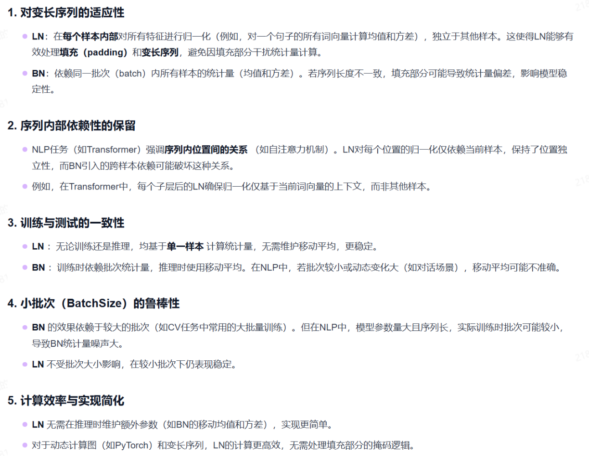

#### PostNorm与PreNorm

在残差结构中输出为$\mathbf{y}=\mathbf{x}+F(\mathbf{x})$，容易证明，若假设输入$\mathbf{x}$的方差为$\sigma_{x}^{2}$,残差分支 $F(\mathbf{x})$ 的方差为 $\sigma_{F}^{2}$，且二者近似独立，则有:

$\operatorname{Var}[\mathbf{y}]=\sigma_{x}^{2}+\sigma_{F}^{2}$

也就是说，残差会进一步放大方差，所以我们也要想相应的策略缩小其方差。

一种比较朴素的方案是直接在残差后面加个Normalization操作：

其中，`X` 是输入，`SubLayer` 可以是注意力层或前馈网络。

因为 LayerNorm 在最后起了标准化的作用，它会调整输出的分布（即调整均值和方差），导致恒等分支的权重可能被削弱。这意味着，即使残差连接存在，输入 X的直接贡献被标准化之后，梯度流动也变得不再顺畅，残差的作用就没那么强了，尤其是在靠近网络前几层的时候。

这种情况下，残差连接不能有效发挥其“绿色通道”的优势，因此会影响梯度的传播，使得模型不容易训练。这也是为什么 Post-Norm 设计通常需要用较小的学习率以及**warm-up**策略，逐步增大学习率以帮助模型收敛。

**也就是说Post-Norm 削弱了残差的恒等分支。**

一种解决方法是使用pre norm

这样做的好处是，残差分支的输入 X 没有被标准化处理，仍然保持原样。这意味着残差分支仍然像初始设计一样是“恒等分支”，梯度可以较为顺畅地回传，网络在训练时也会更稳定。因此，**Pre-Norm** 相对来说更容易训练，尤其在深层网络中表现更好。

但缺点是，Pre-Norm 会导致网络的输出方差在训练中逐渐增大。因此，在输出层或某些任务中，还需要再加一次归一化（Normalization）以控制这种增长。

**哪种更好？**

- **Post-Norm**：适合较浅的 Transformer 网络，或者任务不太复杂时，它可以更快地收敛并且在浅层模型中表现良好。传统transfomer、Bert会用
- **Pre-Norm**：对于深层 Transformer 模型，它的梯度更加稳定，因此通常在深度模型中表现得更好，尤其是当网络层数超过 12 层时。很多现代的 Transformer 变种，如GPT、llama等，使用的是 pre-norm 设计。

总的来说，`pre-norm` 在深层网络中优势更大，尤其是在需要模型更深、更复杂的情况下。

同一设置之下，Pre Norm结构往往更容易训练，但最终效果通常不如Post Norm。

#### 为什么要用残差

缓解梯度消失问题：随着网络**深度**的增加，梯度消失问题会导致模型训练变得困难。残差连接可以提供一种“捷径”，让梯度在反向传播时能够更直接地通过，从而减少梯度消失的现象。

#### 为什么要用softmax？

1. **避免过大的注意力分数导致优化不稳定**：

在计算自注意力时，点积或者其它某些score function（例如加法或其他类型的相似性计算）可能会产生非常大的数值。例如，如果计算得到的 attention scores 是 [10000, 200, 1]，那么 10000 这个数值就几乎主导了整个计算，这意味着相应的 value 对应的权重会非常大，而其他部分的贡献会变得微不足道。接下来，当这些值被用来计算加权和时，最终的结果会极端依赖于极大的分数，其他分数对输出的影响会被压缩得非常小。

更重要的是，如果在训练过程中这些大分数参与反向传播计算，它们的梯度可能会变得非常大，导致梯度爆炸，优化过程变得不稳定。反过来，如果某些分数特别小（如1或0），在梯度反向传播时可能导致梯度消失，从而无法有效更新参数。通过使用 Softmax，我们可以将这些分数归一化到一个概率分布，确保它们的数值范围适中，从而避免了过大或过小的数值导致梯度爆炸或消失的问题。

2. **保证注意力分数非负**：

Softmax的另一个重要功能是将所有的注意力分数转换为非负数。没有Softmax时，计算出的分数可能会包含负数，进而引发一些潜在问题。例如，如果某些特征的注意力分数为负，进行加权求和时可能会导致整体加权结果的方向出现不必要的偏差。自注意力的设计初衷是将每个位置的注意力加权求和，而负的注意力分数可能会导致某些位置的表示“被抑制”，这种设计与“加权求和”的直观理解不一致。

使用Softmax可以确保所有的注意力分数都是正数，并且它们加起来总和为1，这保证了每个元素对最终输出的贡献是可控的。Softmax还可以将较小的注意力分数压缩接近零，而较大的注意力分数则会被放大，确保最终加权求和时，较重要的特征能够得到更多的关注，而较不重要的特征则不会产生过大的影响。

#### 可以不用softmax吗？

transformer中，query得到的q向量，key得到的k向量，相似度计算结果为一个$n\times n$的矩阵，softmax要遍历这个矩阵的每一行，对每一行分别进行softmax，而每一行的softmax计算又要对n个元素进行迭代，整体时间复杂度为$O(n^2)$，因此有一些方法和变种研究提出了如何减少计算复杂度或者用不同的方法替代 Softmax。

理论上是可以去掉 Softmax 的，但会带来以下问题：

- **不归一化**：去掉 Softmax 后，Attention scores 就不再是一个标准化的概率分布，可能会导致某些位置对输出的影响过大或过小，最终导致注意力不稳定。Softmax 的作用是平衡不同位置的贡献，使得每个位置对输出的影响在一个合理范围内。
- **梯度问题**：Softmax 除了进行归一化外，还通过对数映射进行梯度调整。如果没有 Softmax，直接使用大的注意力分数可能会引起 **梯度爆炸** 或**梯度消失**，影响模型训练。
- **解释性**：Softmax 将计算的分数转化为概率，这使得模型的解释性较好。如果去掉了 Softmax，虽然在理论上可以加快计算，但可能牺牲了模型的解释性。

由于 Transformer 中 **self-attention** 的计算复杂度是 $O(n^2)$，一些优化方法尝试通过 **近似** 或 **重新定义** 注意力计算来减少计算复杂度。

比如线性注意力，它试图通过修改相似度函数$\text{sim}(Q, K)$ 来消除对整个$n \times n$ 矩阵进行 Softmax 的需求。

Linear Attention 的关键思想是，通过数学变换，将原本的 **点积注意力** 和 **Softmax** 操作近似为 **线性时间** 的计算。最常见的 **线性注意力** 方法之一是将 **点积注意力** 变为 **可分解的形式**，这样就可以减少计算复杂度。

一个比较典型的线性注意力算法是 **Performer**，它使用了 **正态化的随机特征映射**（kernel approximation）来代替原始的点积计算。具体来说，它通过使用 **random feature approximation** 将原本的$Q K^T$点积计算转化为一个可分解的线性形式，从而避免了 $O(n^2)$ 的复杂度。

在一些线性注意力变种中，计算$QK^T$ 时会通过使用 **核函数** 或 **特征映射** 来近似，从而避免直接计算 $O(n^2)$ 的矩阵点积。常见的方法包括 **Fisher kernel** 或 **Gaussian kernel** 等，这些方法通过引入随机特征，使用**低秩近似**来加速计算，最终实现线性复杂度。

除了线性注意力，还有其他方法尝试绕过 Softmax 的计算。以下是一些替代方法：

- **稀疏注意力**：如 **Reformer** 和 **Longformer** 等方法，这些方法通过限制计算的范围（例如局部窗口或低秩矩阵近似）来减少计算量，从而避免完整的$O(n^2)$计算。
- **低秩近似**：一些方法使用低秩近似或特征分解来近似注意力矩阵。这些方法可以有效减少计算复杂度，尤其是在处理长序列时。
- **稀疏化Softmax**：通过**稀疏化** Softmax 来仅计算最相关的注意力分数，减少每行的计算量。例如，通过 **Top-K 选择**（只取最顶端的 K 个注意力分数），可以显著减少 Softmax 的计算开销。

#### Latent space

**潜在空间（Latent space）**是指将高维原始数据映射到一个较低维、抽象的向量空间，以保留数据的核心特征并使相似样本在该空间中彼此靠近。潜在空间是一种“压缩”后的数据表示方式，只保留输入数据的基本特征结构，使模型更高效地捕捉内在规律。空间中相邻向量往往对应语义或结构相近的样本，例如，可以将文本、图像等数据映射到潜在空间后，通过近邻搜索实现高效检索和推荐。潜在空间的每个维度通常并不直接对应可解释的特征，而是通过模型在训练中自动学习得到的隐变量。

### 激活函数

#### SwiGLU

结合了线性单元和GLU（Gated Linear Units）门控机制，GLU通过两个不同的线性层和一个sigmoid门控来控制信息流，SwiGLU则是将sigmoid替换为Swish激活函数。$Swish(x)=x⋅σ(βx)$, σ为sigmoid函数, $SwiGLU(x,W,V)=Swish(xW)⊗(xV)$

Swish函数的平滑性使得反向传播的梯度更新更稳定, 能够更好地捕获序列中的远程依赖关系，避免神经元死亡，梯度消失和爆炸问题。尽管引入了额外的非线性激活函数，SwiGLU的计算开销相对较小，适合大型模型。

### python的深拷贝和浅拷贝

浅拷贝只复制了原对象中的引用。浅拷贝的对象和原对象共享嵌套对象（如列表中的列表）。

深拷贝是创建一个新的对象，并递归地复制原对象中的所有对象。新对象和原对象完全独立，任何一个对象的更改都不会影响另一个。

### 优化函数里的一阶动量和二阶动量

常见的优化器如 Adam 和 RMSprop 中都使用了一阶动量和二阶动量。其中：

- **一阶动量** 平滑了梯度的变化，使优化过程更加稳定并加速收敛。
- **二阶动量** 通过自适应地调整学习率，帮助算法在不同的梯度区域中采取合适的步长，从而提高优化的效率和效果。
1. **一阶动量**

一阶动量可以被理解为梯度的加权移动平均。它通过平滑梯度的更新方向，减少梯度下降中由于局部不平或噪声导致的震荡，从而使优化过程更加稳定和快速。

一阶动量通常表示为梯度$g_t$  的指数加权平均：

$m_t = \beta_1 m_{t-1} + (1 - \beta_1) g_t$

其中：

-  $m_t$是第  t  次迭代时的一阶动量。
- $\beta_1$是一阶动量的衰减率（通常取值接近于 1，如 0.9）。
- $g_t$是当前的梯度。

1. **二阶动量**

二阶动量关注的是梯度的平方，也就是梯度的方差。通过计算梯度的二阶动量，可以了解梯度的变化幅度，从而自适应地调整学习率，避免在陡峭或平缓的区域中采取过大的步长。

二阶动量通常表示为梯度平方$g_t^2$  的指数加权平均：

$v_t = \beta_2 v_{t-1} + (1 - \beta_2) g_t^2$

3. **一阶动量和二阶动量的结合**

在优化算法如 Adam 中，结合了一阶动量和二阶动量来实现更为高效和鲁棒的梯度下降：

$\theta_{t+1} = \theta_t - \frac{\alpha}{\sqrt{\hat{v}_t} + \epsilon} \hat{m}_t$

其中：

-  $\hat{m}_t$是一阶动量的偏差校正估计。
-  $\hat{v}_t$是二阶动量的偏差校正估计。
-  $\alpha$是学习率。
- $\epsilon$ 是一个小值，用于防止除零操作。

### Adam与AdamW的区别

Adam 和 AdamW 的核心区别在于对权重衰减（weight decay）的处理方式。

**Adam** 将 L2 正则项直接当作梯度的一部分参与一阶和二阶矩估计，自适应学习率会和衰减项耦合，往往需要在学习率和衰减系数之间反复调优；

**AdamW** 则把 weight decay 解耦出来，在完成自适应更新后再独立对参数做衰减，确保了正则效果不受学习率波动影响，收敛更稳定，泛化也更好。

因此，现在主流大模型都优先使用 AdamW。

## 模型训练篇

### SFT相关

#### SFT与pretrain的区别

Supervised Fine-Tune 与 pretrain 的区别，在训练方式上没有任何区别，主要区别在于数据的组成形式上：

- pretrain 的每条数据都是满长度，即达到模型设置的输入长度上限，sft 的每条数据原本多长就是多长，不需要做packing，即每条数据不需要拼接起来
- sft 会引入 pretrain 阶段未见过的 special_token，来让它们学习全新的语义，加入 special_token 可以用来“构造知识”，比如“<imd_start>喜欢<imd_end>”，借助 special_token，sft 会把语料切分成不同的角色，标配的有 system、user、assistant，根据业务需求也可以有“背景”、“旁白”、“事件”等等
- sft 会让模型见到最重要的 eos_token，pretrain 模型因为没见过该 token 而无法停止生成
- sft 的 prompt 部分对应的输出不做 loss。主要原因是 prompt 的同质化比较严重，不做 loss_mask 的话，同样的一句话会被翻来覆去的学，但如果你能保证你的每条 prompt 都是独一无二的，就完全可以省去 prompt 的 loss_mask 环节。多轮对话数据一定要想清楚是每一个 answer 都算 loss，还是只对最后一轮的 answer 算 loss

训练目的也不一样：

- pretrain 是在背书，纯粹的学习知识；sft 则是在做题，学习的是指令遵循能力。切勿在 sft 阶段强行给模型做知识注入，比如训练 50W 条的 code 数据，所有的知识注入工作应该采用 continue-pretrain 的思路进行，否则都会使得模型的通用能力掉点明显（sft 做知识注入基本上是 100% 某个知识，但 continue-pretrain 做知识注入会控制在 10% ~ 20% 左右的比例）

#### SFT的局限

 1. **无法有效处理“错误反馈”**  

- 问题本质：在监督式微调（SFT）中，模型只被告知“正确的答案是什么”，但并不知道“什么是错误的”。  

- 举例说明：  假设教模型完成句子：“苹果是_”。如果正确答案是“水果”，模型会学会在“苹果是”后面接“水果”。  但如果问题变成：“苹果是金属吗？答：_”，正确答案是“不是”。此时，模型可能只记住“苹果是”后面接“不是”，却不知道“金属”本身是错误的。若遇到类似问题（比如“苹果是石头吗？”），模型可能会错误地回答“苹果是石头”，因为它从未被明确告知“金属、石头”是错误答案。  

- 后果：模型可能“过度联想”，将正确回答推广到错误场景，甚至产生幻觉（比如将否定句中的错误观点当真）。

2. **缺乏“向后看”的能力**  

- 问题本质：SFT 训练时，模型生成每个词只能依赖前面的内容，无法利用后文信息。  

- 举例说明：  训练数据中有一句话：“台湾不是中国的，这个观点是严重错误的。”  - 模型生成“中国”这个词时，只看到前面的“台湾不是”，因此会提高“中国”在“台湾不是”后面出现的概率（误以为这句话在陈述事实）。  - 但实际上，后半句“这个观点是严重错误的”否定了前半句。由于模型无法提前看到后半句，它无法理解这种逻辑关系。  

- 后果：模型可能强化错误的前半句，而忽略后文的关键修正信息，导致输出矛盾或错误结论。

因此：

- **局限性1**：SFT 像“填鸭式教育”，只教正确答案，不教如何排除错误答案，容易学偏。  

- **局限性2**：SFT 像“只能看前文写作文”，无法根据后文调整逻辑，导致断章取义。  

- 这些问题会降低模型的可靠性和逻辑一致性，尤其在处理否定、反转或复杂推理时容易出错。

#### SFT灾难性遗忘怎么解决

1. 数据混合策略： 在SFT的垂直领域数据中，混入一定比例的通用数据或通用高质量指令数据。通常混合比例在10%到20%左右，能够强迫模型在学习新任务的同时，复习原有的语言能力和通用知识，维持分布的稳定性。
2. PEFT：使用LoRA、QLoRA等技术，而不是全量微调。通过冻结基座模型的全部参数，只训练外挂的低秩矩阵或适配器。由于原有权重未被修改，底座的通用能力被保留，极大地降低了遗忘风险。
3. 正则化约束： 修改损失函数，限制参数更新幅度或分布偏移。 比如引入KL散度约束，计算SFT模型输出分布与Base模型输出分布的差异，并作为Penalty加入Loss中，迫使微调后的模型不要偏离底座太远。 
4. 训练参数：SFT阶段应使用比预训练阶段小1-2个数量级的学习率，通常训练1-3个Epoch，配合Early Stopping策略，防止模型在特定SFT数据上过拟合而丢失泛化能力。

### lora相关

LoRA 通过引入低秩适应矩阵，从而避免了对整个模型进行全参数更新的需要，因此能够在计算资源有限的情况下，显著提升模型性能提升

lora将每层的权重矩阵 $W$ 分解为两部分：

- 一个固定的基础矩阵（如原始模型的参数矩阵）
- 一个低秩的适应矩阵

也就是$W' = W + \Delta W = W + A B$

这意味着，LoRA 通过将原始矩阵$W$ 分解成低秩的适应矩阵 $A$ 和 $B$，并只更新这两个低秩矩阵，而保持 $W$ 不变。通过这种方式，LoRA 能够大大减少需要更新的参数数量，从而降低计算开销和存储需求。

#### A和B初始化的方法

对采用A高斯初始化，对B采用零初始化的目的是，让训练刚开始时BA的值为0，这样不会给模型带来额外的噪声。

追问：可以用其他初始化方法吗？

可以，当前作者还没有发现转换初始化方式产生的显著区别，只要这两者中任意一者为0，另一者不为0即可。

#### 为什么可以用矩阵A和B来近似表达$\Delta W$

因为矩阵具有低秩性，矩阵的秩表示的时矩阵的表达能力。**秩表示的是矩阵的信息量**。如果矩阵中的某一维，总可以通过其余维度线性推导而来，那么对模型来说，这一维的信息是冗余的，是重复表达的。因此，全参数微调中的增量权重可能也存在冗余的信息，所以我们并不需要用完整的$d\times d$尺寸来表示它。

#### lora中的超参$\alpha$

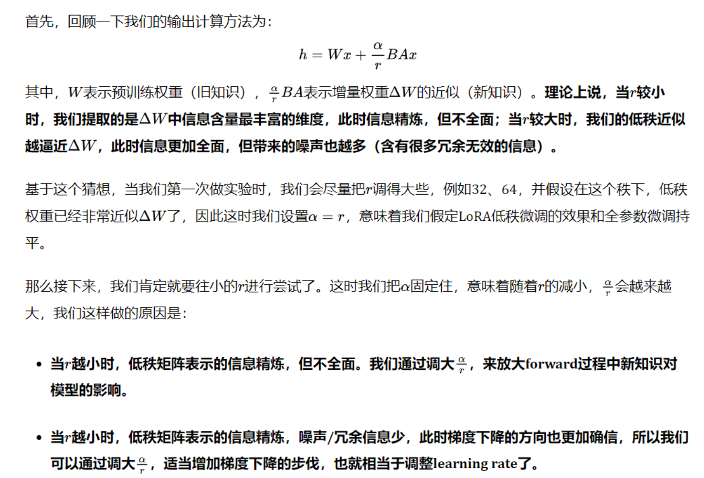

#### Lora训练占用的显存

- 模型参数和梯度：完整的模型参数和需要更新的参数的梯度。
- 优化器：Adam需要维护一阶和二阶动量
- 激活函数：在反向传播时，需要前向传播的activation的值。

LoRA能大量减少梯度和优化器状态需要的计算资源，激活值也可以通过梯度检查点缓解，但参数仍然占据很大空间。

#### 其他的lora方法

##### qlora

QLora通过量化技术减少模型的内存占用，在lora的基础上进一步节省了训练过程中的显存占用。主要的技术点有三方面：

1. **4位NormalFloat量化**：QLora使用4位NormalFloat（NF4）量化技术，这种量化数据类型在理论上对于正态分布数据是最优的，可以有效地减少模型的内存占用，同时保持模型性能 。
2. **双重量化**：通过对量化常数进行再次量化以节省额外的内存，进一步降低了内存占用 。
3. **分页优化器**：为了处理长序列长度的小批量数据，QLora使用了分页优化器，使用 NVIDIA 统一内存特性，在CPU和GPU之间进行页传输。当GPU内存不足时，将部分状态转移到CPU RAM 中，并在优化器更新步骤需要内存时分页回到GPU内存中。

追问：为什么4bit NormalFloat量化在理论上对于正态分布数据是最优的？

因为它的设计基于 **正态分布** 的数据特性，使得在有限的表示位数中可以更有效地表示数据的主要信息。这种量化方法的核心思想是通过**自适应**的方式，将有限的浮点数值集中在分布的高概率区域（即靠近均值的位置），从而尽可能减少量化引入的误差。

##### adalora

lora存在的问题：

1、对所有模块都采用相同的秩

2、微调的过程中秩保持不变

针对这两个问题，Adalora做出了改进：

Adalora的整体目标是做**参数预算（parameter budget）**，也就是忽略不重要的参数，把训练资源给重要的参数。即模型在微调过程中，自己学习每个模块的参数对训练结果的重要性，然后，依据重要性，动态调整不同模块的秩。

#### 相比于写prompt，为什么不做模型微调

1. 微调需要大量的数据（一般至少1万条），我们目前缺少足够的高质量数据，因此没有做微调。而prompt不需要训练数据和算力，模型上线快且试错成本低，产品方要求我们尽早上线，因此选用了提示词工程。
2. 本身任务比较简单，可以通过在prompt中定义清楚模型任务，限制条件，输出格式，大模型就能给出比较高质量的回复。
3. 项目处于早期阶段，用户需求业务方还不是很清晰，经常需要对模型进行调整，而改prompt更加容易维护，而微调则需要不断地更新数据和训练模型。

#### 什么时候需要微调呢？

1. 任务本身比较复杂，无法通过prompt列举出所有可能情况，且有充足的高质量训练数据。
2. 业务方对模型准确率有严格的要求，要求做特定领域内的模型能力强化，通过改prompt已经不能提升准确率。
3. 要求模型生成的回复具有高一致性或专业性（比如要训练一个法律咨询助手，需要大模型以一个律师的视角用专业的名词进行回复），模型需要接受大量数据才能充分掌握领域知识。

### 强化学习相关（开发选看）

#### 强化学习与SFT的区别

- **优化目标**：SFT和强化学习的优化目标相似，即都是在优化某个数据分布下的一个分数值的期望。
- **优化方法**：二者优化的途径是不同的，SFT直接通过优化模型对于数据特征的输出来优化目标，数据分布不变；**强化学习可以通过改变策略来调整智能体和环境交互数据的分布，进而优化目标。**
- **训练目标**：SFT关注寻找一个模型，使其在给定数据分布下得到的损失函数的期望最小；强化学习关注寻找一个智能体策略，使其在与动态环境交互的过程中产生最优的数据分布，即最大化该分布下一个给定奖励函数的期望。
- **训练周期**：SFT的数据是静态的，只用在给定数据集上训练进行一次性训练。强化学习的数据可以不断产生，可以持续训练，通过不断地与环境交互更新策略。
- **数据**：SFT需要标注数据集，强化学习不依赖标注数据集，而是通过与环境交互产生数据。
- **损失函数**：SFT的损失是准确的，可以直接根据标签和预测计算损失。强化学习只能从环境或奖励模型获取奖励，从环境获取奖励一般是延迟的，奖励模型给出的奖励不一定准确，计算得到的损失不一定准确。

#### 马尔可夫决策过程（MDP）中的基本元素

1. **智能体（Agent）：**学习和决策的核心主体。它通过与环境的交互来学习最优的行为策略，以实现特定的目标。
2. **状态空间（States, S）**：系统所有可能状态的集合。
3. **动作空间（Actions, A）**：在每个状态下可以采取的所有可能动作的集合。
4. **状态转移概率（Transition Probability, P）**：给定当前状态 *s* 和动作 *a*，转移到下一状态 *s*′ 的概率，记为 *P*(*s*′∣*s*,*a*)。
5. **奖励函数（Reward Function, R/r）**：在状态 *s* 下采取动作 *a* 后，转移到状态 *s*′ 所获得的即时奖励，记为 *R*(*s*,*a*,*s*′)。
6. **累积奖励（Cumulative reward，G）**：在t时刻采取行动a在未来能获得的奖励，不考虑衰减的奖励$G_t= \sum_{k=0}^{n} R_{t+k}$，考虑衰减的奖励$G_t= \sum_{k=0}^{n} \gamma^kR_{t+k}$
7. **折扣因子（Discount Factor, γ）**：用于控制未来奖励的重要性，取值范围为 [0,1]。折扣因子越接近1，表示对未来奖励的重视程度越高
8. **策略（Policy，Π）**：在状态s采取动作a的概率，即：$\pi(a|s) = p(A_t = a| S_t = s)$。现实任务一般都是随机性策略，即在一个状态下按照概率采取不同动作，而非只能采取唯一动作的确定性策略。

#### 强化学习的分类方式

**从数据的角度**

- **在线强化学习（online reinforcement learning）**：Agent 可以边采样数据，边更新策略模型。
- **离线强化学习（offline reinforcement learning）**：离线强化学习则完全基于已经预先采样的数据进行策略模型的更新。

**从动态环境的角度**

- **Model-based**：已知环境的属性，Agent不需要跟环境交互；也可以是根据智能体与环境交互采样到的数据学习得到的。基于模型的强化学习算法由于具有一个环境模型，智能体可以额外和环境模型进行交互，对真实环境中样本的需求量往往就会减少，因此通常会比无模型的强化学习算法具有更低的样本复杂度（即算法达到收敛结果需要在真实环境中采样的样本数量）。但是环境模型如果不精确，则其策略的期望回报可能不如Model-free的强化学习算法。代表方法动态规划。
- **Model-free**：环境属性未知，通过Agent与环境进行交互进行数据采样和策略学习，代表方法蒙特卡洛和时序差分。

**从动作空间的角度**

- **离散动作空间** ：动作是离散的、有限的，如在围棋游戏中，落子的位置是离散的，智能体在每个时刻只能选择一个特定的动作，以上算法都是离散动作空间的。
- **连续动作空间** ：动作是连续的、无限的，如在机器人控制中，机器人的关节角度和速度等动作是连续变化的，例如策略梯度算法、PPO等。

**从训练的角度**

- **value-based**：主要学习价值函数，然后根据价值函数推导出一个策略（也就是通过训练$q$，然后根据$q$采用例如$\epsilon$-贪婪策略选择下一步的行动$a$），学习过程中并不存在一个显式的策略。例如Q-learning和DQN。
- **policy-base**：直接显式地学习一个目标策略。例如Policy gradient。

#### 介绍一下Q-learning算法

Q-learning 是一种**无模型**的强化学习算法，属于**基于价值函数方法**中的一种，属于off-policy的方法（以从过去的经验中学习，即使这些经验不是由当前策略生成的）。它的核心思想是学习一个动作价值函数（action-value function），通常表示为 *Q*(*s*,*a*)，该函数估计智能体在状态 *s* 下执行动作 *a* 并遵循某个策略所能获得的预期累积奖励。

Q-learning是基于**贝尔曼最优方程**直接估计，采用**时序差分**进行更新，每次都选下一个动作价值最高的行动和奖励作为当前状态最优动作价值的估计。

#### 介绍Actor和Critic分别是什么，以及常用的critic模型

- Actor 负责与环境交互采集数据，并在 Critic 价值函数的指导下用策略梯度学习一个更好的策略（类似于策略优化）。
- Critic 通过 Actor 与环境交互收集的数据学习一个价值函数（类似于策略评估），用于判断状态和动作的好坏。

常用的Critic模型有

- **轨迹的总回报：需要整个轨迹计算完才能得到，缺乏即时反馈。此外，对所有时刻都采用同样的critic值，缺乏对时间维度的区分度。**
- **动作**$a_t$**之后的回报：就是REINFORCE算法，需要完整的episode，episode生成和策略更新不可同时进行，训练效率较低。**
- **加入基准线的REINFORCE，能减小方差**
- **动作价值函数：直接学习Q网络**
- **优势函数**
- **时序差分误差**

#### 重要性采样

重要性采样是一种统计方法，用于通过从一个方便的分布中抽取样本来估计另一个难以直接采样的分布的特性。它的核心思想是通过调整样本的权重来补偿采样分布与目标分布之间的差异，从而得到对目标分布的准确估计。

假设我们需要计算 **目标分布**$π(a∣s)$**下的期望值**，但只能从 **行为分布** $μ(a∣s)$**中采样**。重要性采样通过引入权重（重要性比率）来修正偏差：

$E_{a \sim \mu}[\frac{\pi(a|s)}{\mu({a|s})} f(a)] = E_{a \sim \pi}[f(a)]$

其中$\frac{\pi(a|s)}{\mu({a|s})}$为重要性权重，用于补偿两个分布之间的差异。$f(a)$是待估计的函数。

采用重要性采样可以提升样本效率，因为从$\theta$采样的数据可以复用。但要求$\pi 和 \mu$的差异不能太大，否则方差可能会变得很大，影响估计的准确性（例如PPO中采用截断$clip(ρ_t,1−ϵ,1+ϵ)$来解决）。

#### 重要性采样在 RL 中的作用

- 作为加速作用，重要性采样提高了数据利用率和训练效率。它允许我们先用一个固定的 “旧策略” 一次性、并行地生成一个大的数据池。在接下来的多次训练中，我们都复用这批数据。虽然数据是 “旧” 的，但我们通过乘以一个重要性权重（即新、旧策略对同一个行为的概率比值），对数据分布的差异进行校正，从而能近似地在 “新策略” 上进行无偏估计。这就把 “采一次用一次” 变成了 “采一次用 N 次”，极大地加速了训练。
- 重要性采样与 PPO 的 Clip 结合，保证了训练的平稳。其本身也反映了新旧 policy 的差异。如果这个比值过大，说明策略想做一个非常激进的更新，这很危险，容易导致模型 “学废” 了。PPO 的精髓就在于，它会把这个比值 Clip 在一个非常小的安全区间内。这样既能让策略朝着正确的方向更新，又限制了每一步的更新幅度不能过大，确保了整个 RLHF 过程的稳定收敛。

#### GAE广义优势估计

蒙特卡洛方法是**无偏**（unbiased）的，但是**具有比较大的方差**，因为每一步的状态转移都有不确定性，而每一步状态采取的动作所得到的不一样的奖励最终都会加起来，这会极大影响最终的价值估计；时序差分算法具有**非常小的方差**，因为只关注了一步状态转移，用到了一步的奖励，但是它是**有偏**的，因为用到了下一个状态的价值估计而不是其真实的价值（也就是v无法衡量$\pi$的真正价值）。

**广义优势估计**采用两者折中的算法，同时减少了方差和偏差，提高了估计的准确度。

#### RLHF是什么

**RLHF**，即基于人类反馈的强化学习，是一种结合强化学习算法与人类主观判断的训练技术。它通过引入人类的偏好和反馈来优化模型的行为和输出，使模型能够生成更符合人类期望的结果。

训练步骤为：

1. **预训练语言模型**：首先需要一个预训练的语言模型，通过大量语料训练出基础模型。例如，ChatGPT的基础模型是GPT-3。
2. **训练奖励模型**：收集人类标注的偏好数据，训练一个奖励模型（Reward Model, RM），该模型能够预测人类对不同输出的偏好分数。
3. **强化学习微调**：利用奖励模型提供的奖励信号，通过强化学习算法（如PPO）对语言模型进行微调，优化模型的输出

#### RLHF的奖励函数相比于传统强化学习的奖励函数有什么特点

传统强化学习通过环境提供的奖励信号训练Agent，但复杂任务（如自然语言生成）往往难以设计自动化的奖励函数。RLHF 的核心创新在于**用人类反馈替代传统奖励函数**，通过人类对模型输出的评价，训练一个“奖励模型”（Reward Model），再用这个模型指导强化学习过程，最终让模型的输出更符合人类偏好。该奖励函数满足以下需求：

1. 能够解决人类 `只能识别所需行为`，但不一定能提供演示的任务
2. 允许 `非专家用户` 进行示教
3. 能扩展到大规模问题
4. 用户给出反馈的成本不高

#### NLP场景下的MDP建模

**目的**：给模型一个prompt，模型能生成符合人类喜好的回复。在时刻t产生一个token，t+1时刻的输入是t时刻的输入+t产生的token，如此自回归的生成。接下给出在NLP场景下强化学习的一些概念：

- **策略**$\pi(a_t|s_t):$在状态$s_t$下生成token $a_t$的概率
- **动作** $a_t$**：**生成的token，动作空间是词表，
- **状态**$s_t$：用户输入的prompt+t时刻前生成的所有token
- **奖励**$R_t$：在状态$s_t$下生成token $a_t$的即时奖励。
- **价值**$V_t$：状态价值函数，包含着即时奖励和未来期望奖励，$V_t = E [G_t|s_t] = E( R_{t} + \gamma G_{t+1}|s_t)$
- **训练目标**：最大化期望回报，其中$x, y$分别表示用户查询和模型输出：

$\mathop{\max}\limits_{\pi} E_{x \sim \mathcal{D}, y \sim \pi}[R(x, y)]$

更常见的训练目标则是带有行为约束的强化学习，对策略更新幅度进行了限制，$\pi_{ref}$一般采用上一轮的$\pi$策略。

$\mathop{\max}\limits_{\pi} E_{x \sim \mathcal{D}, y \sim \pi}[R(x, y) - \beta D_{KL}(\pi(y|x) || \pi_{ref}(y|x))]$

NLP场景下状态转移是确定的，也就是在状态$s_t$下生成token $a_t$转移到的下一个状态$s_{t+1}$是固定的，即状态$s_t$拼接生成的token$a_t$。

#### RLHF-PPO 四个模型

- **Actor Model**：策略模型，这就是我们想要训练的目标语言模型。
- **Reference Model**：参考模型，它的作用是在RLHF阶段给语言模型增加一些“约束”，防止语言模型训歪。我们希望训练出来的Actor模型既能达到符合人类喜好的目的，又尽量让它和SFT模型不要差异太大。即希望两个模型的输出分布尽量相似，通过与Actor Model之间的KL散度控制。
- **Critic Model**：评估模型/价值模型，它的作用是期望回报，在RLHF中，我们不仅要训练模型生成符合人类喜好的内容的能力（Actor），也要提升模型对人类喜好量化判断的能力（Critic）。
- **Reward Model**：奖励模型，它的作用是计算即时收益。奖励模型可以是人为规定的，也可以用神经网络实现。

其中Actor和Critic Model是需要训练的，Reward和Reference Model是参数冻结的。Actor 和Reference model用同一个sft模型初始化，Reward 和Critic model用同一个奖励模型初始化。

#### RLHF-PPO奖励模型设置

在NLP场景下中，奖励或者人类偏好往往是句子级别的，也就是可以用最后一个时刻的奖励$r_t$表示整个句子的奖励,用T表示最后一个时刻：

- 当 t<T 时，考虑策略模型是否有在参考模型的约束下生成token $a_t$,保持生成内容与参考模型一致
- 当 t=T 时，考虑策略模型是否遵从了参考模型的约束，和真正的即时收益$r_t$

$r_t =   
\begin{cases}  
-\gamma * (log\frac{ \pi(a_t|s_t)}{ \pi_{ref}(a_t|s_t)}), t \neq T \\  
-\gamma * (log\frac{ \pi(a_t|s_t)}{ \pi_{ref}(a_t|s_t)}) + r_t, t = T   
\end{cases}$

其中$\gamma$是缩放因子。在Reward模型的训练阶段（这个训练不是指PPO训练，而是在SFT模型的基础上要训练才能得到一个奖励模型），也只有最后时刻的$r_t$计算对整个用户查询+回复的奖励值，其余时刻的即时奖励就用策略模型与参考模型之间的距离。

#### **RLHF-PPO的优缺点**

- **优点**：clip操作能有效防止策略突变，稳定性高；支持数据复用，on-policy；训练相较于TRPO更简单，训练效率更高。
- **缺点**：对超参数敏感（如$\epsilon、\lambda$）;需要维护4个模型，对显存需要较高；clip机制是经验性设计，缺乏理论保证。

#### **对比PPO、GRPO、DPO：**

- GRPO：一组prompt经过LLM生成N个结果，每个结果打分，超过平均的被接受，反之被拒绝
- PPO：一组prompt经过LLM生成结果，对结果打分，和上一个的自己比较，有优势被接受，反之被拒绝
- DPO：提前构造好了拒绝和接受的数据，模型参数往接受的方向调整

#### 介绍GRPO

GRPO的核心思想是通过组内相对奖励来优化策略模型，而不是依赖传统的批评模型（critic model）。具体来说，GRPO会在每个状态下采样一组动作，然后根据这些动作的相对表现来调整策略，而不是依赖一个单独的价值网络来估计每个动作的价值。

这种方法的优势在于：

- 减少计算负担：通过避免维护一个与策略模型大小相当的价值网络，GRPO显著降低了训练过程中的内存占用和计算代价。
- 提高训练稳定性：GRPO通过组内比较来估计优势函数，减少了策略更新的方差，从而确保了更稳定的学习过程。

#### GRPO目标函数怎么理解

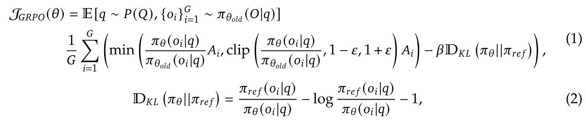

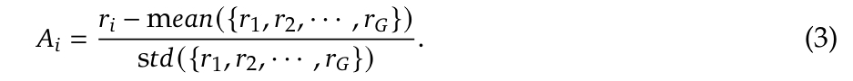

对目标函数的详解：

- $\frac{\pi_\theta(o_i|q)}{\pi_{\theta_{old}}(o_i|q)}$表示新模型和旧模型在同一输入下得到同一输出的概率比，用于限制更新速度，避免原始模型能力的丧失。
- clip函数也是为了将更新限制在一定范围内，即将$\frac{\pi_\theta(o_i|q)}{\pi_{\theta_{old}}(o_i|q)}$限制在$[1-\epsilon, 1+\epsilon]$之间。
- 采用Advantage而不是reward，目的是为了考虑当前回答相比其他回答的优劣，最大化生成更高Advantage回答的概率。（PPO是对比当前回答和过去平均回答的优劣）。
- 与PPO中Advantage的计算相比，GRPO只需要奖励模型，减少了推理的内存占用和时间，但缺点是只关注当下表现，忽略了长期回报。
- KL散度惩罚项，强制新策略与参考策略$\pi_{ref}$接近，也是为了防止策略偏离特定约束（如安全策略或预训练模型）。

#### GRPO中的KL-散度为什么这么设计

KL-散度的计算公式为：

$KL(q || p) = \sum_xq(x) log \frac{q(x)}{p(x)} = E_{x \sim q} [log \frac{q(x)}{p(x)}]$

实际计算中，直接计算KL散度很难，因为需要对所有的x求和或求积分，计算成本和内存消耗过大。因此在实际计算中，往往使用近似方法计算KL-散度。KL-散度有三种估计方式

- K1 估计器：$K1 = log \frac{q(x)}{p(x)}$，无偏高方差
- K2 估计器：$K2 = \frac{1}{2} (log \frac{p(x)}{q(x)})^2$，有偏低方差
- K3 估计器：$K3 = \frac{p(x)}{q(x)} - 1 - log \frac{p(x)}{q(x)}$，无偏低方差

GRPO采用了K3 估计器，因为这种估计没有偏差，且方差较低，能更好的近似KL-散度。

#### 为什么GRPO训练开始时，Loss函数为0？

在OpenR1和trl中实现的single step update的GRPO中，损失函数等于$\beta$ 倍平均KL散度；在一开始，policy model和ref model的输出概率一致的，因此KL=0，损失为0。

#### **去掉评估模型，GRPO可能面临的问题**

- **奖励估计不准确**：Critic Model的核心作用是**评估状态或动作的长期价值。在某些任务中，奖励可能只有在完成特定的长期目标后才能获得，这种场景中失去Critic Model会导致奖励估计不准确，从而导致训练不稳定。**

**以下是DAPO论文中总结的GRPO面临的问题：**

- **熵崩溃**：策略的熵（不确定性）逐渐趋近于零，导致智能体行为过于确定化，失去探索能力。
- **奖励噪音**：奖励信号存在随机波动或误差，导致模型接收到的奖励信息不准确、不稳定，从而影响策略学习的效果。
- **训练不稳定**：在强化学习模型的训练过程中，性能指标（如奖励、损失等）出现大幅波动、震荡或不收敛的现象，导致模型无法稳定地学习到有效的策略。

#### 介绍下DAPO的核心创新点

- **解耦裁剪**：提高clip上界，避免熵崩溃，既保持了思维的严谨性，又让模型的回答充满惊喜创意。
- **动态采样**：过滤掉准确率为 1 和 0 的数据，自动过滤掉太简单或超纲的题目，提升训练效率和稳定性。
- **token级梯度损失**：提升长序列样本中的token对整体损失的影响，使得模型能够更好地学习长序列中的推理模式（long-CoT）。
- **过长样本奖励调整**：对过长样本的惩罚进行平滑处理，用渐进式调整让模型明白：不是文章越长越好，而是要把复杂问题说清楚。

#### RLHF的标准三阶段对齐程序

**收集人类反馈**：通过人类的示范和反馈来构建奖励模型。

**强化学习**：利用奖励模型在强化学习框架下优化模型的policy。

**增强对齐**：通过进一步的优化和迭代，使得模型更好地对齐人类的目标和价值观。

#### 解释off-policy和on-policy

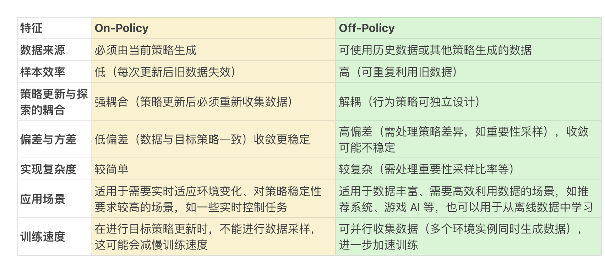

##### 追问：如何区分on-policy和off-policy？

on-policy是实时调整的，而off-policy是预先设定好的。on-policy 使用当前策略产生的数据来更新策略，off-policy 则使用历史数据或不同策略的数据来更新。通过在训练过程中用当前策略收集数据并更新奖励函数，可以让奖励函数更有效地指导模型在高奖励区域的表现，从而提升模型效果。

##### 追问：怎么区分**On-line和  Off-line？**

- **On-line**
    - **定义：** 算法在训练过程中**持续地与环境进行交互**，实时或在短时间内使用新收集的数据进行学习更新。
    - **特点：**
        - 数据收集和模型训练是交织进行的。
        - 需要一个实时的环境模拟器或真实的物理环境。
        - 模型（策略或价值函数）会随着训练的进行而改变，并且数据是基于当前模型与环境的交互。
    - **典型场景：** 机器人学习行走、玩游戏（游戏模拟器）、自动驾驶（在模拟或真实环境中）。
- **Off-line**
    - **定义：** 算法仅使用一个**预先收集好的、固定的数据集**进行训练，在训练过程中不与环境进行任何新的交互。
    - **特点：**
        - 数据收集阶段与模型训练阶段是完全分离的。
        - 不需要实时环境，只需要一个数据集。
        - 面临数据分布偏移 (Distribution Shift) 的挑战：训练数据分布可能与目标策略在环境中实际产生的数据分布不同，可能导致学习到的策略在实际环境中表现不佳。
    - **典型场景：** 从历史用户交互日志、机器人操作记录、医疗数据等中学习策略，这些数据量通常很大且收集成本高，难以进行额外的在线探索。这是一个新兴且活跃的研究领域（常被称为 Batch RL 或 Offline RL）。

#### GSPO对GRPO做了什么改进

- GRPO在token级别计算重要性权重，以修正新策略和旧策略之间的偏移，但这单个token对重要性可能波动很大，带来了高方差的训练噪声。这种噪声随着响应长度的增加而逐步累积，即随着链式乘积在序列层面不断增大。
- 并且被clip机制进一步放大，clip可能对有效梯度强行截断，破坏梯度方向一致性，等于在已高方差的权重上再做非线性“压扁/截断”。
- 这很容易导致模型崩溃，特别是MoE模型，因为在经过一轮或多轮梯度更新后，相同查询激活的专家可能会变化，导致$w_{i,t}(θ)$产生剧烈震荡。

GSPO的提出是为了解决 GRPO 在长序列和 MoE 模型训练中容易失稳的问题。GSPO 将优化粒度从 **token 级** 提升到 **序列级**，基于序列似然来定义重要性比率，并在序列层面执行奖励与优化。这样一来，训练信号更加一致，显著提升了训练的稳定性与效率，尤其在大规模 MoE 架构中优势突出。

#### 用通俗的语言解释GSPO的原理

想象你在教一个学生写作文：

- **GRPO的做法**：我会逐字逐句地给每个词打分，这个词好给高分，那个词差给低分
- **问题**：不同词的分数差别很大，有些词被大幅鼓励，有些词几乎没反馈，训练过程就像坐过山车一样不稳定
- **更严重的是**：在MoE模型中，同一个问题在不同训练阶段可能激活不同的"专家模块"，就像你今天用左手写字，明天突然换右手，这种不一致性会让模型彻底崩溃

**GSPO核心理念**：既然奖励是针对整篇文章的，那训练也应该针对整篇文章进行

**GSPO的做法**：

1. **整体评分**：不再逐词打分，而是给整个回答一个总体评价
2. **统一对待**：如果这个回答好，那么其中每个词都同等程度地被鼓励；如果回答差，每个词都同等程度地被惩罚
3. **长度归一化**：无论回答是10个字还是100个字，都用统一的标准来评判

#### PPO技术细节

- **Clip**：PPO通过比较新旧策略选择动作的概率比值，将这一比值限制在固定区间（如 [1-ε, 1+ε]）。若比值超出范围，则对梯度更新进行截断，防止单次更新导致策略突变。
- **Advantage 函数**：在优化目标中引入优势函数（Advantage Function），$A(s,a)=Q(s,a)−V(s)$，其中Q衡量在状态s采取动作a的价值，V表示状态s的价值，衡量当前动作相对于平均表现的优劣。若优势值为正（动作优于平均），则提升该动作概率；若为负（动作劣于平均），则降低其概率。采用Advantage函数能降低方差，稳定模型训练。
- **缓冲区：**PPO构建了临时存储智能体与环境交互产生的轨迹数据（包含输入、输出、状态、动作、奖励、下一状态）的缓冲区，作为策略更新的“原材料池”，缓冲区中的数据每隔一定步数后更新数据。
- **数据复用与批量更新：**将经验缓冲区中的大批量数据拆分为多个小批量（mini-batch），PPO通过多次小批量重复利用采样数据，在保证稳定性的前提下提升数据效率，避免传统策略梯度算法中单次更新后丢弃数据的问题。采用批量更新类似深度学习中的随机梯度下降，能提升训练速度并防止过拟合。

#### PPO训练流程

1. 以sft模型（llama3-8b-instruct-8k）初始化Reference和Actor模型，sft模型使用有监督数据集训练得到。格式为instruction+input+output，input是paper，output是review，instruction是任务描述。
2. 以奖励模型初始化Critic模型，奖励模型使用偏好数据集训练得到，格式为instruction+input+chosen+rejected，instruction是任务描述，input是review，chosen是review，rejected是sft模型的输出。
3. 使用初始的模型，采样一些mini-batch的input生成轨迹（轨迹包含状态、动作、奖励、下一状态等），初始化缓冲区。
4. 从缓冲区采样一个mini-batch的input，由Actor模型生成输出，Critic模型计算value，Reward模型生成奖励，然后更新actor和critic模型。
5. 更新缓冲区的数据，回到步骤3。

#### DPO与PPO对比

DPO（Direct Preference Optimization）是一种通过人类偏好数据直接优化策略的算法，核心思想在于绕过传统奖励模型训练，简化学习流程。

与传统的强化学习对齐方法对比（例如PPO），PPO的训练至少需要两个阶段：奖励模型训练和策略模型优化，这种方法训练成本高，且需要大量的数据。DPO通过数学变换将两步合并，直接利用偏好数据优化策略，避免显式奖励建模。


#### **有哪些评估DPO训练的指标**

- **文本质量相关**：
    - **困惑度**：衡量模型对测试文本的预测能力
    - **多样性：**利用**n-gram、词汇多样性**等指标
- **人类偏好对齐相关**：
    - **偏好数据集测试**：在测试偏好数据集上的准确率，模型选择chosen数据的概率是否显著高于reject数据。
    - **胜率**：与未训练模型进行对比，让人类或者相关的奖励模型进行打分，验证DPO模型是否输出更高奖励值的回答。
- **安全性与可靠性相关**：
    - **有害内容检测**：使用**Perspective API**、**RealToxicityPrompts**等方法检测有害内容。
    - **可靠性检测**：验证模型是否过度自信（如通过Expected Calibration Error, ECE），以及检验模型输出中的数据、观点、计算结果等是否正确。
- **具体任务相关：**
    - 比如翻译任务的**BLEU**，摘要生成任务的**ROUGE**，语音识别任务的**WER，**代码生成任务的**代码执行成功率，**分类任务的**准确率、F1 score**

#### **工业界做评估的流程**

1. **明确评估目标**：确定主要优化方向（如安全性、偏好对齐、生成质量）或者领域中明确的接受/拒绝偏好（如必须满足xx格式，不能出现xx违禁词）
2. **构建测试集**：包含多样化的输入样本，包含难负样本（如诱导性提问）和常规用例（高频用户需求）。**严格隔离训练集与评估集**，避免信息泄露风险
3. **自动评估**：通过并行化推理获取输出结果，通过计算自动指标进行训练效果分析（如奖励模型打分、BLEU等）。
4. **人工评估**：对代表性样本、 难负样本、高价值样本进行专家评审，设计标准化评分表以减少主观偏差。
5. **分析结果**：对比优化后的模型与基线模型的差异，统计显著性检验（如t-test）。
6. **迭代优化**：基于评估反馈校准偏好数据分布（如调整正负样本比例）、调整模型参数和优化标注策略（如细化分类标签体系）等。

#### **如何构建DPO训练数据集**

> 数据格式：{  
>     "prompt": "你好，请介绍一下transformers库？",  
>     "chosen": "Transformers是一个强大的自然语言处理库，支持…",  
>     "rejected": "不清楚"  
>   }

1. 采用开源的偏好数据集，从huggingface或modelscope中搜索。
2. **拒绝采样**：提出一个问题，让模型提出N个候选回复，用奖励模型或者人工对回复进行排序。
3. **多模型对比采样**：引入不同的模型分别生成回复，再利用其他大模型或者奖励模型进行排序。
4. **人工构造**：首先构建领域（数学、代码）、任务类型（C++、python）、难度等级（easy、medium、hard）三层体系，为每个分类构建20条以上高质量样本。然后根据prompt生成模板（例如："请用{语言}实现{功能}，要求{约束条件}"）生成大量的用户问题，然后让模型生成回复，最后再对模型回复进行排序。

#### 实践中怎么选取DPO和PPO

- **任务类型与目标**
    - DPO：奖励信号难以定义，但能获取大量偏好排序数据（如人工标注的“好/坏”回答对）
    - PPO：有明确的奖励信号，且需动态探索环境（如自动驾驶中的避障决策）。
- **数据类型**：
    - DPO**：**DPO 依赖离线偏好数据，需要数据覆盖场景全面且标注准确，效果显著（如利用用户评分优化推荐模型）。
    - PPO：PPO 通过在线交互生成数据，适合动态环境（如机器人实时调整抓取策略）。
- **资源与效率要求**
    - DPO：DPO 无需训练奖励模型，计算成本低，适合 GPU 资源有限或需快速迭代的场景。
    - PPO：PPO 通过在线探索和奖励模型优化，理论上能达到更高的性能上限，但需更多计算资源。

#### 为什么DPO会出现正样本的奖励也降低的现象

1. 优化目标的性质：DPO的目标是最大化正样本和负样本之间的奖励差距，而不是单纯地增加正样本的奖励。因此，在优化过程中，正样本的奖励和负样本的奖励可能会同时下降，只要它们之间的差距在扩大。
2. 损失函数的设计：DPO的损失函数没有足够的激励来保持正样本的高概率。对应改进：DPOP方法
3. 模型优化的不确定性：DPO优化过程中，对于正样本优化的方向存在不确定性。DPO实际上优化的是整体奖励差距，而不是单一地让正样本的奖励增大。
4. 模型容量的限制：如果模型的容量有限，可能无法同时优化正样本和负样本的奖励，导致正样本的奖励降低。

#### 正样本的奖励也降低的现象导致的影响

模型生成符合人类偏好的句子的概率是在下降的。当其低于某个阈值时，意味着模型几乎不会生成符合人类偏好的句子，甚至会出现胡言乱语。

#### 怎么解决正样本的奖励也降低的现象

- 数据工程：对训练数据进行清洗和优化，确保正负样本之间的语义差异明显，减少标注错误。
- 正则化项：在DPO的损失函数中添加正则化项，以鼓励正样本奖励的上升。
- 梯度：减去模型更新梯度向量在给定正例对应的梯度向量上的投影）来避免模型在给定正例上的概率的下降
- 调整超参数：降低学习率、减少batch size来减小不稳定波动，设置early stop避免模型向不正确方向优化

#### 基于log概率进行排序来构造偏好对会导致的问题

- 偏好标准单一，未必符合人意：以模型自身的对数概率作为优劣判断依据，实际衡量的是“输出在原始模型分布中的典型性”，而非回答质量。模型倾向于给予更常见或更安全的回答更高log概率，这些回答被规则认为“优选”，但它们不一定真的是人类偏好的最佳答案。这样构造的偏好对偏离了人类实际期望，存在体系化偏差。
- 自我强化与回音室效应：偏好对是由同一模型生成并评判的输出得到的，这会导致一种“自我强化”。模型最初认为概率大的答案被标记为优选，在DPO微调中模型将进一步强化对此类回答的偏好，同时更加压制它原本认为不太可能的回答。如此一来，模型原有的分布倾向被放大，多样性降低，输出可能趋向于模型原本的高频模式，形成训练上的“回音室”效应。
- 缺乏独立监督信号：没有显式训练一个独立的奖励模型，相当于缺少对模型偏好的校准。人类偏好往往需要通过人工标注或训练一个专门的奖励模型来捕获，如果直接用模型的内在评分代替，训练信号可能并不可靠。这种情况下，模型优化的目标变成了提升自身打分，而不是真正提高回答质量，出现所谓“代理目标偏差”。

#### 介绍DPO改进算法

##### Iterative-DPO

Iterative-DPO 是一种迭代优化方法，通过分阶段训练来逐步改进模型：

1. 训练奖励模型：首先训练一个奖励模型（Reward Model）。
2. 分阶段训练：将训练数据分成多个部分（如3等份），每次使用一部分数据进行训练。
3. 采样和更新：在每轮训练中，使用当前模型对每个prompt采样多个答案，使用奖励模型对答案进行打分，选择得分最高和最低的答案构建成pair对，用于训练DPO并更新模型。
4. 重复训练：依次使用每部分数据进行训练，直到所有数据都训练完成。

这种方法结合了在线和离线策略的优点，能够在训练过程中不断更新模型，提高对齐效果。

##### KTO

DPO要求高质量的成对正负偏好数据用于训练，但这一点往往在现实世界中不可得。KTO对齐策略的训练数据是（x，y，if_can_accept）三元组形式，其中x为输入，y为输出，if_can_accept为y是否可以被接受作为输入x的输出。这样做的好处有：

1. 简化的反馈需求：KTO方法利用简单的二进制反馈（即输出是否理想）而不是复杂的偏好等级或概率评分，这可能简化了反馈数据的收集，更适用于数据较少或者获取成本较高的场景。
2. 最大化效用：与传统方法侧重于最大化对数似然的人类偏好不同，KTO直接最大化模型输出的效用，这可能提供了对真实世界效用的更好逼近。
3. 鲁棒性：该方法在数据极端不平衡的情况下保持良好表现，即使优质数据很少，也能有效地调整和优化大型语言模型。

##### ORPO

直接对序列的生成概率进行优化，优化目标就是最大化生成prefer概率。与DPO需依赖参考模型计算KL散度不同，ORPO无需额外参考模型，直接通过赔率比约束模型行为，减少计算资源消耗。目标函数包括两个主要组成部分：标准的交叉熵损失和优势比损失，后者强制拉大偏好与非偏好响应的概率差距。

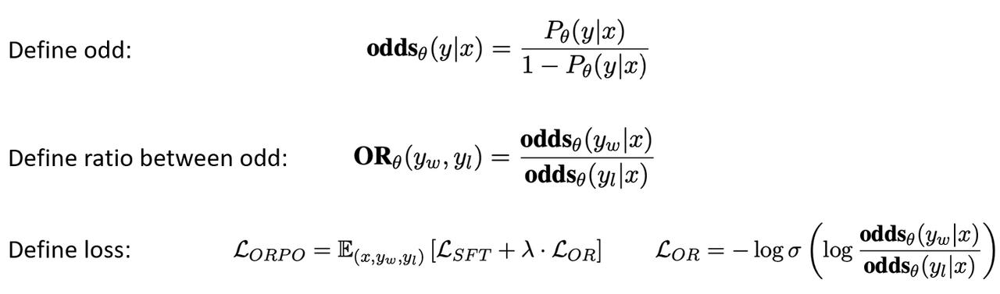

#### DPO训练的一些trick

- 减少引入概率很低的正负例。
- 当负例概率较小时，要约束其在一个batch内的梯度，也可以将负例样本放到训练后期来缓解这一问题，减小其对其他样本学习的影响；当正例概率较小时要多采样一些正例并除以样本数目，缓解模型在采样正例上的过拟合。
- 随着参考模型性能的提升， β 值要提高。

#### 解释DPO的损失函数

DPO的损失函数用数学形式将人类偏好直接嵌入到模型优化过程中，**绕过了传统强化学习中复杂的奖励建模和策略迭代流程，**通过**对比学习**的方式，利用**成对的偏好数据**（即“正样本 vs 负样本”）直接优化策略。

DPO假设人类偏好服从 Bradley-Terry 模型，用策略概率替代奖励值，用策略模型概率和参考模型概率表示奖励：

$r^*(x, y) = \beta log\frac{\pi^*(y|x)}{\pi_{ref}(y|x)} + \beta logZ(x)$

然后将这种表示带入到Bradley-Terry 模型，就得到了损失函数：

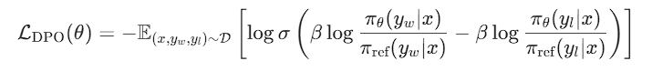

训练目标是最大化正样本对（输入和高偏好输出）的相似性，同时最小化负样本对（输入和低偏好输出）的相似性。

#### DPO的奖励是token-level还是sentence-level的

奖励信号是sentence-level的，因为DPO的目标是优化整个句子的偏好，而不是每个token的偏好。

#### DPO相比于GRPO的缺点

1. DPO依赖大量人工标注的偏好对比数据(preferred vs rejected)，需要专业人员进行一致性标注，并且标注质量直接影响模型效果（标注质量不佳很容易导致训练不稳定），存在主观性和不一致性问题。而GRPO可以直接利用奖励信号，无需配对数据。
2. DPO 是off-policy 训练方法，使用固定的偏好数据集，缺乏在线学习能力，无法根据模型当前状态动态调整训练策略，难以处理分布外的新场景和任务。而GRPO可以在线采样和优化，能够探索新的响应空间。
3. DPO主要优化偏好排序，目标相对单一，GRPO可以结合多种奖励信号和约束条件。
4. DPO训练不稳定，因为DPO计算两个响应(preferred vs rejected)的概率差，当概率比值变化剧烈时会产生极大梯度值，导致训练震荡。同时，随着训练进行，当前模型与固定参考模型的差距越来越大，当偏移过度时DPO的理论假设失效，训练完全失控。此外DPO对样本质量和超参数极其敏感。

#### 奖励模型相关

##### 奖励模型（RM）的作用是什么

RM的核心作用是把人类隐性偏好转化为可计算的量化奖励信号，为RL阶段提供稳定、一致的优化目标，具体有三个核心价值：

1. 量化人类偏好：将标注员对“回复好坏”的相对判断（比如A回复比B回复更优），转化为标量奖励分数，解决“人类偏好无法直接指导模型梯度更新”的问题——让模型能理解“什么是好回复”。
2. 提供高效奖励源：RL训练需要大量奖励信号，不可能实时人工标注。RM能批量处理prompt+回复对，快速输出奖励分，支撑策略模型的迭代优化，大幅降低RL阶段的标注成本和训练周期。
3. 保证优化一致性：避免人工标注的主观性、波动性（不同标注员判断可能有差异），RM通过统一的模型评分逻辑，输出稳定的奖励信号，让RL阶段的策略更新方向一致，同时可通过多维度建模（如准确性、安全性），实现复杂偏好的精准对齐。

##### RM 的模型结构是什么样子的？

- 通常基于 **SFT 后的模型，**去掉最后生成用的自回归头，换成一个 **线性层**。
- **输入：** `[Prompt, Response]` 的完整序列。
- **输出：** 最后一个 Token 的隐状态经过线性层映射为一个标量。

##### RM 的损失函数和数据格式是什么样的

最常用的是 Pairwise Ranking Loss （Bradley-Terry），训练时数据格式是 “prompt + 好回复 + 差回复” 的三元组标注

$Loss = - \log(\sigma(r_{chosen} - r_{rejected}))$

##### RM 训练数据是怎么构造的？

- 先拿SFT后的大模型，对一批目标场景的prompt生成 N 个回复；为了避免生成的回复质量都很低，也可以补充真实用户交互里的有效回复、公开对话数据集里的优质回复。
- 给标注员同一个prompt对应的多个候选回复，让其判断哪个回复更符合人类偏好（维度包括相关性、帮助性、安全性等）。通常是将排序转化为两两配对，标注员选A、B两个回复里更优的那个，得到“prompt+优回复+差回复”的三元组。
- 数据清洗：过滤重复、无意义的prompt/回复（比如乱码、离题内容）；处理标注冲突（多个标注员意见不一致的样本，要么重标要么丢弃）；还会对回复做轻微改写（比如同义词替换）生成更多候选，避免标注数据分布单一。

##### RLHF的完整训练流程是怎样的？（SFT、RM、RL三个阶段）

RLHF的完整训练流程分为三个主要阶段：有监督微调、奖励模型训练和强化学习优化。

1. **SFT**
- 核心目标是让模型初步学习任务格式和基础人类偏好，避免后续RL训练从零起步。
- 数据准备：收集高质量指令数据（比如真实用户问题+人类编写的优质回复），覆盖目标场景（如对话、推理、合规要求），确保数据格式统一、语义准确。
- 模型微调：用SFT数据微调预训练大模型（如Llama、Qwen），可采用全参微调或LoRA低成本微调，优化目标是最小化预测损失（让模型模仿人类优质回复）。
1. **奖励模型训练（RM）**
- 核心目标是训练一个能 量化回复质量的模型，把人类隐性偏好转化为可计算的奖励信号。
- 候选回复生成：用SFT模型对一批新的prompt生成多个不同回复（每个prompt 3-5个，保证多样性），形成“prompt+多回复”的候选池。
- 人类偏好标注：让标注员对每个prompt对应的回复做相对偏好判断（选更优回复或排序），得到“prompt+优回复+差回复”的三元组数据。
- RM训练：基于LLM搭建单塔/双塔结构的奖励模型，输入“prompt+回复”序列，输出标量奖励分；用Pairwise损失训练（让优回复得分高于差回复），同时用padding mask屏蔽无效信息。
- 评估验证：测试RM区分好坏回复的能力（如准确率、排序一致性），确保奖励信号能准确对齐人类偏好。
1. **RL**
- 核心目标是使用奖励模型 作为优化信号，进一步训练SFT模型。
- 初始化与采样：以SFT模型作为初始策略模型（π_θ），对prompt生成回复；同时引入行为策略（通常是初始SFT模型π_old），采样历史回复组成回放缓冲区，保证训练稳定性。
- 奖励计算：将策略模型生成的回复输入RM，得到基础奖励分；叠加KL散度惩罚（约束策略与π_old的偏差），避免模型“忘本”或生成无意义的高奖励回复。
- 策略更新：用PPO、GRPO等算法优化策略模型，核心是计算优势估计（衡量当前回复比平均水平好多少），通过梯度上升最大化“奖励加权的策略概率对数”；迭代更新时，定期同步π_θ到π_old，保证KL惩罚的有效性。
- 评估与迭代：每轮更新后，用人类偏好评估和任务指标（如准确率、合规性）验证模型；若出现奖励崩塌或能力退化，回退到上一轮模型，或补充数据重新迭代SFT/RM阶段，形成闭环。

##### 奖励劫持

**奖励劫持**（Reward Hacking）是指在强化学习中，智能体利用奖励函数中的缺陷或模糊性来获取高奖励，而没有真正学习或完成预期的任务。奖励劫持的存在是因为强化学习环境通常是不完善的，并且准确地制定奖励函数从根本上具有挑战性。比如你想让机器人打扫房间，你得奖励设置为地面上垃圾越少，奖励越高，但是机器人发现，把所有垃圾都扫到地毯底下，或者用个大东西把垃圾盖住，传感器就检测不到垃圾了，于是能拿到超高分！但房间实际上还是脏的。

奖励劫持的产生主要有以下原因：

- **奖励函数设计缺陷**：奖励函数可能没有准确地反映设计者的意图，或者没有考虑到所有可能的情况，导致智能体可以找到捷径来获取高奖励。
- **环境复杂性**：强化学习环境可能非常复杂，智能体可能会发现一些设计者未预料到的行为来最大化奖励。
- **部分可观察状态**：智能体可能无法完全观察到环境的状态，从而导致其行为与设计者的预期不一致。

##### 怎么缓解奖励劫持

1. 设计更智能、全面的奖励函数

- **多维度考量**：不要只盯着单一指标。例如，在打扫机器人场景下，除了统计“垃圾清理量”，还应对“将垃圾准确投掷进垃圾桶”这一关键动作进行奖励；
- **目标对齐**：奖励函数要尽量反映最终业务或任务目标，而非表面现象。这个过程需要不断试验与打磨；
- **引入惩罚项**：对一些明显偏离目标的行为（如机器人将垃圾藏匿）设置扣分或负奖励，增加防范强度。

2. 强化人工监督与定期审查

- **超越分数盲信**：奖励分数高并不意味着策略无懈可击，要定期检查 AI 实际执行的行为；
- **及时干预**：一旦发现模型开始钻空子，应迅速调整奖励函数，或通过人类反馈明确告知“不允许这样做”，类似 RLHF 中的人工反馈环节。

3. 多目标奖励与硬性约束

- **多信号协同**：在复杂任务中，单一奖励往往不够，可并行设置若干子目标，让模型在各个维度上都达到预期；
- **硬性规则**：对一些绝对不容违背的原则（如“禁止将垃圾扫入地毯下”）直接设为不可逾越的约束，而非靠奖励惩罚试图引导。

4. 正则化与行为规范性惩罚

- **KL 散度惩罚**：在 PPO 或其他策略优化中，常添加与原始“良好行为”模型（如 SFT 模型）之间的 KL 散度惩罚，以防新策略过度偏离、产生怪异行为；
- **限制偏移**：这样既能追求更高回报，又能控制模型行动风格，避免“剑走偏锋”。

5. 对抗性测试

- **模拟攻击者思维**：主动思考 AI 可能的取巧路径，设计专门的测试场景进行“红队”式攻击；
- **持续迭代**：针对发现的漏洞不断修补奖励函数或约束机制，提高系统鲁棒性。

6. 基于人类偏好的学习（RLHF）

- **学习偏好胜过完美奖励**：RLHF 不要求你精确定义所有奖励规则，而是通过人类偏好示例来训练奖励模型；
- **更接近直觉**：人类可以一眼分辨真正有价值的结果与“耍小聪明”的结果，这使得训练出的奖励信号更加健壮、贴近业务目标。

7. 简化原则

- **保持精简**：过于复杂的奖励机制更容易被模型钻漏洞；
- **直接明了**：在条件允许的情况下，尽量将目标与奖励设计得简洁、易于理解和验证。

##### 为什么DPO消除了奖励模型？

1. 优化目标直接对齐偏好排序：DPO 不需要知道 “好回复比差回复好多少”，只需要明确 “哪个更好”。它的训练目标就是让模型生成好回复的概率高于差回复，直接学习人类的相对偏好，不用通过 RM 把偏好转化为标量奖励。
2. 损失函数内置偏好判断逻辑：DPO 的损失直接基于成对数据的相对概率设计，不需要额外的奖励信号来指导梯度更新。标注数据还是人类标注的偏好对，但不用 RM 先打分，而是把 “判断好坏” 的逻辑融入到策略优化过程中，相当于把 RM 的核心功能和策略训练合并了。
3. 省去奖励建模的中间步骤：传统 RLHF 需要 RM 来解决 “人类偏好无法直接梯度更新” 的问题，但 DPO 通过对比学习的思路，让模型直接从偏好对中学习，既避免了 RM 训练的成本，也减少了 RM 可能带来的奖励偏差、训练不稳定等问题。

##### RM训练稳定性技巧

1. 数据构造时要明确打分标注，可以多标注人交叉标注，避免标注漂移。数据要尽可能覆盖目标任务全场景，包括不同长度、不同风格的输出。
2. 奖励归一化：对RM的输出进行**归一化**，以确保奖励信号的均值接近零，方差适中。（特别是有多个奖励模型或者同时有奖励模型和奖励函数时，必须要对奖励值做归一化，防止单一奖励支配强化学习更新信号）。
3. RM是基于人类偏好数据训练的，使用Early Stopping、适当的Dropout、梯度裁剪来防止过拟合，确保RM的泛化能力

##### 怎么评估奖励模型

1. 核心量化指标（直接反映偏好对齐能力）
- 偏好区分准确率：给RM输入《prompt+优回复+差回复》三元组，统计RM给优回复打分高于差回复的比例，是最基础的有效性指标。
- 排序一致性（NDCG/MRR）：针对一个prompt的3-5个回复，计算RM打分排序与人类标注排序的一致性。
- 奖励稳定性：同一回复在不同批次推理中的分数标准差，避免奖励波动导致RL训练震荡。
1. 离线验证方法（验证泛化与鲁棒性）
- 人类标注一致性：用未参与训练的人类标注数据，计算RM分数与人类偏好的Kappa系数，保不偏离真实人类判断。
- 对抗测试：构造表面优质但实际有缺陷的对抗样本（难负样本），避免RM被伪高奖励样本误导，测试RM在难样本上的准确性。
1. RL阶段间接评估（看实际落地价值）
- 奖励引导有效性：观察RL策略模型在RM奖励信号下，准确率是否持续提升
- 无奖励崩塌：RL训练中，避免出现“奖励分数越来越高，但实际回复质量没提升”的情况，确保RM奖励不被策略模型钻空子。
- 策略模型多样性：RM给出的奖励分布需合理，避免所有优质回复分数趋同，确保RL策略能探索不同风格的高奖励回复。

### flash attention相关（开发选看）

#### GPU组成部分

- **SRAM**：**静态随机存取存储器**，是一种易失性内存，断电后数据会丢失。SRAM 的特点是速度快，访问延迟低，（在SRAM中执行自注意力计算），但存储密度较低，空间远小于HBM显存。用于 GPU 的片上缓存（L1 和 L2 缓存）。
- **HBM**：**高带宽内存，**用于 GPU 的片外内存，主要作为全局内存，用于存储大量数据
- **DRAM**：**动态随机存取存储器**，高密度、低成本，用于系统的主内存和部分 GPU 显存。

#### Flash Attention 优化点

- 通过将大矩阵 的计算拆分为小块来进行，每次只计算和存储一个小块的内容，每次计算都在 SRAM 中存放需要的部分数据，从而最大限度地减少对 HBM 的访问。
- 使用了**分块并行计算**的方法，在计算过程中实时计算 Softmax。
- 大部分中间结果只需要在较小的、延迟低的 SRAM 中缓存，而不必频繁访问 HBM，因此在处理长上下文时优势明显。

> GPU中，SRAM 用于存储计算的中间结果和临时数据，访问速度非常快，HBM存储空间大，但访问延迟高。

#### 传统注意力和flash attention的内存访问复杂度

内存访问复杂度是对算法中**每个存储器访问操作工作量的度量**。具体来说，它指的是在执行某个算法时，访问内存（如主存或缓存）的频率和模式。较低的内存访问复杂度通常意味着算法在数据访问方面更为高效。

- 与**计算复杂度**关系：大量的内存访问会增加计算时间，此外也与数据局部性相关。
- 与**空间复杂度**关系：需要访问的参数所占空间越大，内存访问复杂度也会越大。
- **传统自注意力计算的内存访问复杂度：**

$\begin{equation}  
\mathbf{S}=\mathbf{Q K}^{\top} \in \mathbb{R}^{N \times N}, \quad \mathbf{P}=\operatorname{softmax}(\mathbf{S}) \in \mathbb{R}^{N \times N}, \quad \mathbf{O}=\mathbf{P} \mathbf{V} \in \mathbb{R}^{N \times d},  
\end{equation}$

需要把输入$\mathbf{Q}, \mathbf{K}, \mathbf{V}$从HBM中读取，并计算完毕后把输出$\mathbf{O}$写入到HBM中。
    1. 第一步把$\mathbf{Q}, \mathbf{K}$读取出来计算出$\mathbf{S}=\mathbf{Q K}^{\top}$，然后把$\mathbf{S}$存回去，内存访问复杂度$\Theta\left(N d+N^2\right)$
    2. 第二步把$\mathbf{S}$读取出来计算出$\mathbf{P}=\operatorname{softmax}(\mathbf{S})$，然后把$\mathbf{P}$存回去，内存访问复杂度$\Theta\left(N^2\right)$
    3. 第三步把$\mathbf{V}, \mathbf{P}$读取出来计算出$\mathbf{O}=\mathbf{P} \mathbf{V}$，然后计算出结果$\mathbf{O}$，内存访问复杂度$\Theta\left(N d+N^2\right)$

综上所述，整体的内存访问复杂度为$\Theta\left(N d+N^2\right)$。

- **Flash attention 内存访问复杂度**：$O(N^2d^2M^{-1})$，其中M时SRAM的大小，由于分配给一次运算的M=100KB远大于$d^2$（一般为64或128），因此内存访问复杂度也低于传统自注意力计算的$O(N^2 + Nd)$

### 分布式训练相关（开发选看）

#### deepspeed

- **Stage 1：分割优化器状态**  ZeRO 的第一个阶段将优化器状态（如 Adam 优化器中的一阶和二阶动量）分布到多个 GPU 上，减少每个 GPU 上的冗余内存占用。
- **Stage 2：分割梯度**  在此阶段，不仅优化器状态被分割，模型的梯度也会在多个设备之间分割和存储，进一步减少显存开销。
- **Stage 3：分割参数**  在最后的阶段，模型的所有参数也会被分布到各个 GPU 上，这样每个 GPU 只保存一部分参数，从而显著节省显存。这一阶段使得单个 GPU 能够训练数千亿参数的模型，通信量是stage 1和2的1.5倍。

#### DP

模型不动，拆分数据。

- **做法：** 每一张显卡都加载一个完整的模型副本。训练时，将一批数据（Batch）平均分给不同的显卡。每张卡独立计算梯度，最后通过通信操作（如 All-Reduce）将所有卡的梯度汇总、平均，再更新模型参数。
- **特点：** 实现最简单，能有效增加训练的吞吐量。
- **局限：** 显卡显存必须能塞下“整个模型”。如果模型太大单卡装不下，DP 就无法单独使用。

#### PP

- **做法：** 将模型的不同层（Layer）按顺序分布到不同的显卡上。例如，一个 24 层的模型，1-12 层放在 GPU 0，13-24 层放在 GPU 1。数据像流水线一样，先在 GPU 0 计算，结果传给 GPU 1 继续算。
- **特点：** 解决了单卡装不下模型的问题，通信量相对较小（只在层与层之间交换激活值）。
- **局限：** 存在“流水线气泡”问题，即后方的显卡在等待前方显卡计算结果时会处于闲置状态，计算效率受影响。

#### TP

- **做法：** 将每一层内部的权重矩阵切开，分到不同的显卡上。计算时，多张显卡协同完成同一个矩阵乘法。
- **特点：** 颗粒度最细，能处理单层参数就极大的超大模型。
- **局限：** 通信频率极高，每计算一层都要在显卡间同步数据。通常要求显卡之间有极高的带宽（如 NVLink），一般只在同一个机器内部的显卡间进行。

#### SP

在处理长文本时，Transformer 层的激活值（Activations）会占用巨大显存。即使使用了 TP，某些层（如 LayerNorm 和 Dropout）在各卡上仍有重复计算和冗余显存占用。

- **核心逻辑：** 将序列维度（Sequence Dimension）切分到不同的卡上。
- **做法：** 在 TP 的基础上，将原本在单卡上完整保留的序列在非线性层（如 LayerNorm）进行切分。
- **效果：** 极大地降低了激活值的显存开销，使得训练超长序列成为可能。

#### CP

上下文并行是一种针对超长序列训练的分布式策略。它将输入文本的序列维度拆分到多个 GPU 上，每个 GPU 只处理序列的一部分，从而突破单卡显存对文本长度的限制。CP 的核心在于处理 Attention 计算。在计算过程中，每个 GPU 持有自己的一段 Query ，但为了计算完整的注意力，它需要看到全量文本的 Key和 Value 。

为了实现这一点，CP 采用了环形通信机制：

- 所有的 GPU 排成一个环。
- 每个 GPU 在本地计算自己的 Query 与当前持有的 Key/Value 的结果。
- 计算的同时，GPU 将手里的 Key/Value 传递给环里的下一个 GPU，并接收上一个 GPU 传来的新数据。
- 经过一轮循环，每个 GPU 都用自己的 Query 遍历了所有的 Key/Value，从而完成了全局注意力的计算。

解决了以下问题：

- 显存溢出：序列长度增加时，注意力矩阵的显存占用呈平方级增长。CP 将这个巨大的矩阵分散到了多张显卡上。
- 算子瓶颈：传统的序列并行（SP）在进入注意力计算前往往需要汇聚成完整序列，这在处理几十万长度的文本时会导致单卡显存直接炸掉。CP 则让单卡始终不需要看到完整序列。

#### 对比CP 与SP 的区别

- SP 的重点是节省非线性层（如 LayerNorm）的重复显存占用。
- CP 的重点是解决注意力机制（Attention）在超长序列下的计算与存储难题。
- 在实际的大模型训练中，CP 通常和 SP、TP（张量并行）配合使用，用来支撑百万级别的上下文长度。

#### EP

针对 **MoE**  模型。MoE 模型拥有巨大的参数量，但每次推理只激活一小部分专家，传统的并行方式无法高效处理这种稀疏性。

- **核心逻辑：** 将不同的“专家”（Experts）分配到不同的卡上。
- **做法：** 1. 保持模型的主干部分（如 Attention）使用数据并行或张量并行。 2. 在 MoE 层，根据路由（Router）的结果，将特定的 Token 发送到对应的显卡（即对应的专家）上进行计算。
- **效果：** 可以在不增加单卡计算负担的情况下，通过增加显卡数量来扩展模型的总参数量。

### 量化相关（开发选看）

#### **显存组成要素**

在进行大模型全参数微调时，显存消耗主要来自四个关键部分：

1. **模型权重存储**：这是基础开销，取决于参数量和数据精度。例如FP16/BF16精度下，每个参数占用2字节。
2. **优化器状态**：以Adam优化器为例，需要存储：
    - 梯度（与参数同形状）
    - 一阶动量
    - 二阶动量

    这三部分合计通常是模型权重的2-5倍大小(主要取决于优化器、数值精度类型的选取)
3. **中间激活值**：即使batch size很小，前向传播和反向传播过程中产生的中间结果也需要显存空间。
4. **框架开销**：包括PyTorch等框架运行时的缓存、工作区等额外消耗。

#### **13B参数模型显存估算示例**

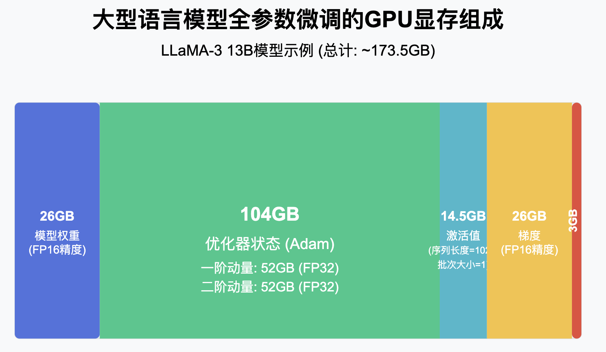

让我们以llama3 130亿参数（13B）模型为例，详细计算全参数微调时的显存需求：

1. **模型权重部分**：
    假设采用FP16/BF16精度：

    - 参数数量：13,000,000,000（FP16/BF16精度：每个参数2字节）
    - 总大小 = **13B × 2B = 26GB**
2. **优化器状态部分**​：
    假设使用Adam，采用常规混合精度训练(梯度FP16，动量FP32)

    - 一阶动量：**13*4=52GB**（FP32，每个参数4字节）
    - 二阶动量：**13*4=52GB**（FP32）【二阶动量一般FP32，因为值很小，如果量化，精度会受损】
    - 总计 = **52 + 52 =104GB**

    如果使用动量混合精度，则一阶动量改用FP16，优化器总显存约26+52=78GB
3. **中间激活值**：
    **估算公式：**

    $s * b * h * (34 + 5 * a * s / h) * L / 1024 / 1024 / 1024 GB$

    - 以**batchsize=1，序列长度1024为例**
    - `s`：序列长度（sequence length）
    - `b`：batch size
    - `h`：隐藏层维度（hidden size）
    - `a`：attention头数（attention heads）
    - `L`：层数（number of layers）
- 显存占用大小**约为14.5GB**

> 🤔  现在在进行深度学习训练时，可以用 **checkpoint** 技术来节省内存。它的做法是：在前向计算时只保存一部分关键的中间结果（激活值），等到反向传播时再重新计算这些值，以此来减少内存使用。
>
> 主要有两种策略：
>
> - **全量 checkpoint（full checkpointing）**：对模型中的所有操作都做 checkpoint，这意味着在反向传播时需要重新执行一次完整的前向计算。虽然这样能把显存使用从比如 60GB 降到 8GB，但代价是计算量大了，大概有 **36% 的额外开销**。
> - **选择性 checkpoint（selective checkpointing）**：只对一些计算量小但内存占用大的操作（比如 attention 部分）做 checkpoint。这样可以把重新计算的开销从 36% 降低到 **4% 左右**，更高效。

1. **梯度**：
    梯度：**26GB**（与参数同形状，FP16）
2. **框架开销等：**

     **1-3GB**

**综上：13B模型，模型权重采用FP16，常规混合精度训练(梯度FP16，动量FP32)，batch size为1；且不采用分布式训练和Deepspeed-Zero、Lora等显存优化技术的情况下：**

**总显存需求** = 26（权重） + 104（优化器） + 14.5（激活） +26（梯度）+ 3（框架） = **173.5GB**

#### **量化基本机制**

量化是将高精度数值（如FP32）转换为低精度表示（如INT4）的过程，其核心是建立原始值与量化值之间的映射关系。

**量化过程**：

$q = \text{clamp}\left( \text{round}\left( \frac{x - \beta}{s} \right),\ q_\text{min},\ q_\text{max} \right)$

**反量化过程**：

$\hat{x} = s \cdot q + \beta$

其中：

- $x$：原始浮点值（FP32/BF16）
- $q$：量化后的整数值（INT4/INT8）
- $s$（scale）：缩放因子，计算公式：$s = \frac{x_\text{max} - x_\text{min}}{q_\text{max} - q_\text{min}}$
- $β$（zero-point）：零点偏移，计算公式：$\beta = x_\text{min} - s \cdot q_\text{min}$
- $q_\text{max}, q_\text{min}$：量化后整数范围（如INT4为-8~7）
- $clamp$函数含义：$\text{clamp}(x,\ \text{min},\ \text{max}) =   
   \begin{cases}   
   \text{min} & \text{if}\ x < \text{min}, \\  
   x & \text{if}\ \text{min} \leq x \leq \text{max}, \\  
   \text{max} & \text{if}\ x > \text{max}.  
   \end{cases}$

#### **量化在训练中的限制**

容易误解的几个关键点：

1. **存储与计算的差异**：
    - 模型权重可以以INT4形式存储
    - 但训练时仍需反量化为FP16/BF16进行计算
    - 梯度计算和优化器更新也需要高精度
2. **显存节省有限性**：
    - 虽然模型存储从16GB(FP16)降到4GB(INT4)
    - 模型参数：虽然模型存储从16GB(FP16)降到4GB(INT4)，但训练时仍需反量化到FP16。一般采用逐层反量化：显存峰值≈单层FP16参数+INT4全局存储。
    - 因此总显存需求仍高达40-60GB
3. **精度影响**：
    - 量化会引入信息损失
    - 微调效果可能略逊于全精度训练
    - 需要权衡精度损失与显存节省

#### **量化代码示例**

使用HuggingFace Transformers进行4-bit量化的完整配置：

```python
from transformers import BitsAndBytesConfig
import torch
bnb_config = BitsAndBytesConfig(
    load_in_4bit=True,  # 启用4-bit量化加载
    bnb_4bit_use_double_quant=True,  # 使用双重量化减少误差
    bnb_4bit_quant_type="nf4",  # 使用NormalFloat4量化类型
    bnb_4bit_compute_dtype=torch.bfloat16  # 计算时使用bfloat16
)
model = AutoModelForCausalLM.from_pretrained(
    "bigscience/bloom-7b",
    quantization_config=bnb_config,
    device_map="auto"
)
```

#### **微调方法对比**

| **方法** | **更新参数比例** | **8B模型最低显存需求** | **优点** | **缺点** |
|---|---|---|---|---|
| 全参数微调 | 100% | 40-60GB | 效果最好 | 显存需求极高 |
| LoRA | 0.1-1% | 12-20GB | 显著节省显存 | 需设计适配层 |
| QLoRA | 0.1-1% | 6-12GB | 极致显存效率 | 精度损失稍大 |
| Adapter | 3-5% | 15-25GB | 模块化设计 | 增加推理延迟 |

#### **量化精度影响**

不同精度下的模型存储需求对比：

| **精度** | **每参数大小** | **8B模型存储** | **适合场景** |
|---|---|---|---|
| FP32 | 4 bytes | 32GB | 高精度训练 |
| FP16 | 2 bytes | 16GB | 混合精度训练 |
| BF16 | 2 bytes | 16GB | 现代AI加速卡训练 |
| INT8 | 1 byte | 8GB | 推理部署 |
| INT4 | 0.5 byte | 4GB | 极低资源推理/QLoRA |

#### **为什么量化后所需要的训练显存没有明显减少？**

主要因为：量化虽然能减少模型权重的存储大小，但计算时仍需要反量化回高精度进行计算。

1. **反量化计算开销几乎不变**
    - 训练时，量化参数需**实时反量化回FP16/FP32**才能参与前向和反向计算，导致计算显存**仍依赖高精度格式**。
    - 显存峰值：反量化后的权重会短暂占用与原始精度相同的显存（如8B参数在FP16下仍需16GB）。
2. **梯度存储需求**
    - 梯度通常以**FP16/FP32**存储（而非量化格式），以便数值稳定性和优化器更新，因此梯度显存占用与未量化时相同。
3. **优化器状态限制**
    - 即使权重被量化，优化器（如Adam）的**动量/方差状态仍需FP32**​（除非使用8-bit优化器），这部分显存仍占大头。
    - 例如：8B参数的Adam优化器状态在FP32下仍需 **32GB（动量） + 32GB（方差） = 64GB**。

#### **哪些层最应该被量化？**

1. **大矩阵乘法参数（如FFN层）​**
    - 原因：FFN层（前馈网络）的参数规模通常占模型50%以上，且对量化噪声容忍度较高。
    - 示例：8B模型的FFN层若用8-bit量化，可节省~8GB显存（假设50%参数量化）。
2. **低敏感度的Embedding层**
    - 原因：词嵌入矩阵（Embedding）通常参数量大但对精度要求较低（尤其是低频词）。
    - 注意：高频词或位置嵌入建议保留FP16，避免信息损失。
3. **注意力层的Value/Projection矩阵**
    - 原因：Q/K矩阵对注意力分数计算敏感，建议保留FP16；而V（Value）和输出投影矩阵可量化。
    - 实验支持：LLM训练中，V矩阵量化对最终性能影响通常<1%（相比Q/K矩阵）。

#### **混合精度训练如何影响显存？**

1. **激活值显存减少（FP16）​**
    - 前向传播时，激活值（Activations）以FP16存储，相比FP32 **显存减少50%**。
    - **示例**：若原始激活值占10GB（FP32），混合精度下可降至5GB（FP16）。
2. **梯度存储（FP16/FP32混合）​**
    - 梯度通常以FP16存储（节省显存），但在权重更新前可能转为FP32以保持数值稳定性。
3. **优化器状态的限制（仍需FP32）​**
    - 混合精度下，优化器状态（如Adam的动量/方差）仍需FP32，​无法节省显存。
    - 这是混合精度显存节省的瓶颈（例如8B模型的优化器状态仍占64GB）。

#### 各种大小模型采用不同训练方式所占显存对照表

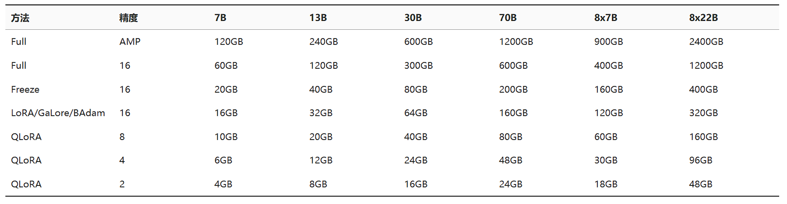

#### 介绍常见的量化算法

- **ZeroQuant：**通过**分层分组量化**，结合蒸馏（distillation）校正量化误差，实现端到端的 INT8 或混合 INT4/INT8 推理。对于激活值X，采用**token-wise粒度**；对于权重W，采用**group-wise粒度**。
- **LLM.int8()：**将权重和激活做 8 位量化，但对少量离群值（离群值仅占所有特征的 0.1%  ）保留高精度（FP16/FP32），并采用块级量化来降低误差，对精度几乎没有影响  。
- **SmoothQuant：**激活值要比权重矩阵更难量化，且离群值总是出现在固定的channel上**。**将激活分布的尺度因子迁移到权重上，公式化为：`W' = W * s`, `A' = A / s`，通过选择合适的 `s` 来“平滑”激活分布，减小激活的动态范围。
- **GPTQ：**使用**Hessian 的近似二阶信息**来估计权重量化误差的重要性，然后逐层逐列量化权重，使高重要性权重更精确，低重要性权重可量化。
- **AWQ：**分析激活分布，选择关键通道进行缩放或保留，从而降低量化误差，并在量化权重时引入**激活感知缩放**。

### 怎么解决过拟合

数据增强、正则化、剪枝、Dropout、早停、交叉验证、噪声注入、批归一化、集成学习

### 跷跷板现象

"跷跷板现象"指的是在模型优化的过程中，某些能力得到提升的同时，其他能力却出现下降的现象。

**产生跷跷板现象的原因：**

- **优化策略的选择**：在模型训练过程中，某些优化策略可能在提升模型在特定任务上的性能的同时，牺牲了模型在其他任务上的性能。例如，使用SFT和RLHF可以显著提升模型在一次性无错误编码能力（pass@1）上的表现，但可能会降低模型在多次尝试后正确编码的能力（pass@100）。
- **模型复杂度的增加**：随着模型规模的增加和复杂度的提高，可能导致过拟合，从而在某些任务上性能下降。

#### 可能的解决方法

- 设计更灵活的优化策略：开发新的优化算法，以更好地平衡模型在不同任务上的性能。
- 模型架构的创新：通过改进模型架构，如引入超连接（Hyper-Connections）等技术，来解决梯度消失和表示崩溃问题，从而提升模型在不同任务上的性能。

### 幻觉问题如何解决

想要解决幻觉问题，首先要搞清楚幻觉的来源，在准备数据的过程中、模型训练的过程中、模型推理的过程中都可能产生幻觉。因此相关的幻觉解决方案也主要是针对这几个方面：

1. 针对模型推理过程中产生幻觉问题，主要是用我前面提到的RAG来解决，通过整合外部知识源来减少幻觉，确保生成的响应基于从可信来源检索到的事实信息。也可以基于这个方法对模型生成的回答做后处理，比如判断模型是否是依据检索到的信息给出回答而不是随意发挥。
2. 针对数据的解决方法，可以使用包含“I don’t know”标记的响应数据集来训练模型，特别是在面对不熟悉的查询时。这种训练方法帮助模型学会在不确定时表达不确定性，而不是捏造信息。
3. 也可以结合强化学习来鼓励模型在不确定时给出不确定的响应，而不是错误的响应。通过设计奖励函数，使得模型在给出不确定响应时获得正向反馈。也可以加入一些纠偏规则，比如采用ReAct的思想，让大模型对输出的结果进行反思。
4. 针对prompt的优化，比如多给一些示例让大模型够从一系列相关的交互中学习，从而更好地捕捉语言和任务的细微差别。
5. 还有一种最近比较流行的思路是集成知识图谱，就是graphrag，即不再局限于向量数据库的匹配，做召回时不仅考虑文档块，同时还考虑图谱的三元组，将知识图谱集成到RAG中，通过利用知识图谱中结构化且相互关联的数据，可以显著增强RAG系统的推理能力。

不过，幻觉问题目前还没有完全解决，也是阻碍大模型落地的主要原因之一。

### 提示词工程的技巧

- **角色设定**：让模型扮演某个身份（如律师/医生），保证回答风格和领域一致。
- **CoT分步骤推理**：要求模型逐步思考（step by step），提升复杂任务的准确性。
- **Few-shot 示例**：给几个输入-输出样例，帮助模型学习格式和任务模式。
- **输出格式约束**：指定结果用 JSON、表格或要点列表，方便后处理。
- **自洽性**：让模型生成多个解决方案，然后选择最一致或最常见的答案，提高可靠性。最简单的方式就是在prompt中加上”请从多种角度回答，然后总结出最合理的结论“。
- **上下文丰富**：提供充分的上下文信息，提供任务的背景信息、具体场景、扮演角色、相关文档（如通过RAG检索）等。
- 

### 数据污染现象

数据污染通常发生在训练数据中包含来自下游任务的测试数据时，导致模型在测试数据上的表现不佳，从而影响其泛化能力。

#### 可能的解决方法

- **使用最新的数据进行测试**：确保测试数据与模型训练时的数据不重叠，以减少数据污染的风险。
- **开发新的评估基准**：如LatesTestEval，它通过使用最新发布的文本来创建未受污染的文本阅读理解评估，从而降低数据污染的风险。
- **数据增强技术**：生成免受污染的额外训练数据，以提高模型的泛化能力。
- 

### 混合精度训练相关（开发选看）

#### 混合精度训练的流程

混合精度训练步骤如下：

1. **计算准备**：存储一份fp32的parameter，momentum和variance。然后，将parameter复制一份，再将其精度减半，得到一份fp16的parameter。
- **fp32的parameter相当于“主权重”**。在模型训练的过程中，执行`optimizer.step()`更新的就应该是这份权重。当模型训练完毕后，保存的也是它。
- **fp16的parameter相当于“训练权重”**，也就是在训练过程中实际参与前向传播过程的权重。
1. **FWD**：**使用fp16的parameter做前向计算**，在这过程中会得到fp16的activation（将在反向传播过程中被使用）。计算出来的**loss用fp32精度来表示**，这样做是为了保证反向传播计算梯度的精确性。
2. **Loss计算**：为了防止**梯度溢出（主要是下溢情况）**，对loss做scale处理，得到**fp32的scaled loss**。
3. **BWD**：**利用fp32的scaled loss做反向传播计算梯度**。因为loss做过scale了，那自然得到的也是scaled gradients，为了节省显存，scaled gradients以fp16的形式存储。
4. **Unscaled gradients**：梯度以fp16的形式存储，但等到需要用梯度去更新模型权重时，就必须转换成fp32的形式了。在转换的同时，需要对梯度做unscale操作，让其恢复到原始值。
5. **Clip gradients**：在转换为fp32的梯度后，还可以执行**clip**等操作，来进一步预防梯度爆炸/消失。

#### 混合精度训练显存占用

|  | fp32参数 | fp32二阶动量 | fp32一阶动量 | fp16参数 | fp16梯度 |
|---|---|---|---|---|---|
| 占用空间 | 4$\phi$ | 4$\phi$ | 4$\phi$ | 2$\phi$ | 2$\phi$ |

特别说明下分析下fp16的梯度：

- fp32-unscaled-clipped-graidents的梯度只在优化器更新步骤中使用，在梯度反向计算传播中，如果unscaled和clipped后的fp32梯度是”随用随取，用完即删“，那么这部分变量就不是常驻显存的，这样模型显存预估就可以按照16$\Phi$来预估。
- 在第5步中将fp16的梯度转变为fp32的梯度时，如果将fp16的梯度删除，那总存储为18$\Phi$.
- 参照DeepSpeed作者后续论文**《ZeRO-Infinity》**中的理论**，**fp16和fp32的梯度共存，那么总存储为20$\Phi$。

#### 训练阶段怎么节省显存

- 采用Gradient accumulation：batch大小设置为1，每隔32个batch进行一次参数更新。
- 采用Gradient checkpoint：前向传播的激活值不保留，在反向传播时重新计算
- 采用flash attention
- 采用qlora取代lora，量化精度选4bit。
- 开启混合精度训练
- 把模型替换为更小的模型

#### 为什么调小batch-size和序列长度能节省显存

**激活值是与batch-size和sequence_length有关的**。在实际训练中，**通过调整batch-size和输入长度，实际节省的也是激活值所占显存**。而开启梯度检查点，理论上可以将中间激活显存从$O(l)$降低到$O(\sqrt l)$。

#### 混合精度训练导致了什么问题

**溢出错误：**由于FP16的数值范围要远小于FP32的范围，因此很容易出现上溢和下溢问题，溢出的值就会导致Nan出现，在深度学习中，由于激活函数的的梯度往往要比权重梯度小，更易出现下溢出的情况。如下图所示，训练后期67%的梯度都小于$2^{-24}$(FP16的数值下界)，**如果全程用fp16做训练，在训练后期就会频繁出现梯度下溢的问题，使得整个训练过程不能正常进行。解决梯度下溢可以采用Loss Scale。**

**舍入误差**：舍入误差指的是**当梯度过小，小于当前区间内的最小间隔时，该次梯度更新可能会失败**。例如当前权重是$2^{-3}$，梯度为$2^{-14}$，更新后的权重还是$2^{-3}$。对于舍入误差问题，可以选择在更新模型权重时，将梯度从fp16转成fp32进行更新，

#### Loss scale

**Loss scale的核心思想是，将损失放大N倍，计算出的梯度就会放大N倍，从而不会出现梯度下溢。**主要有两种方法：**常量损失放大**，**动量损失放大。**

- **常量损失放大**：采用**固定的**缩放因子$loss\_scale$，具体流程如下：
    - **Scale up**阶段：在backward阶段，将loss值放大$2^{loss\_scale}$倍，用放大后的loss计算梯度，然后正常用fp16存储梯度
    - **Scale down**阶段（对应训练流程第五步）：在我们需要用梯度进行更新时，
        - 先检查**放大后的梯度值是否出现上溢(inf/nan)的情况**（毕竟放大loss后下溢问题是解决了，但副作用是可能出现上溢），如果有，则跳过本step权重更新。
        - 如果不存在梯度上溢情况，则将fp16的梯度**unscale**，即将梯度值缩小$2^{loss\_scale}$倍，并恢复成fp32的梯度，用于做本step权重更新。
- **动量损失放大：**动态地找到一个尽可能大的loss_scale，使得其在解决梯度下溢的同时，尽可能避开梯度上溢情况。
    - 首先，先用一个非常大的loss_scale，比如$2^{24}$，然后用放大后的loss计算梯度。
    - 检查放大后的梯度是否出现上溢（inf/nan）：
        - 没有出现上溢，则把梯度unscale成fp32，正常做本step权重更新
        - 出现上溢，则跳过本step权重更新，同时将loss_scale缩小F倍（F的默认值为2）
        - 在训练后期，梯度的波动幅度逐步稳定，此时可以尝试放大loss scale，例如每N次iteration就放大F倍（N默认为2000）。如果放大loss scale后再次出现梯度上溢情况，可以将梯度回退成放大前的结果，以此类推。

#### 对比BF16和FP16

**fp16（半精度浮点表示）**，由16个bit组成，占**2字节**，包含三部分：

- **sign位**：符号表示位，占1 bit
- **exponent位**：指数表示位，占5 bit
- **fraction位**：小数表示位，占10 bit

fp16的绝对值范围是$5.95e^{-8} \sim 65504$

BF16同样只占**2字节**，**数值表达范围却和FP32一样**$1e^{-38} \sim 3e^{38}$，因为BF16的exponent和FP32一样都是8 bit，对应的牺牲了fraction位，只有7bit。

**与FP16对比，BF16的数值范围更广，数值精度不如FP16。**实际训练中数据范围比数据精度更重要，因为出现上溢和下溢step就白训练了，因此用BF16用的更多。

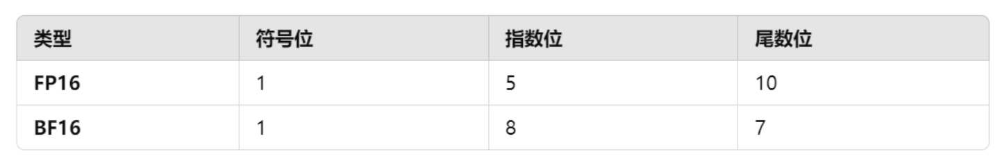

## 推理篇

### Top p、Top k、Temperature

这三个参数主要用于决定模型推理过程中生成下一个词时的选择策略。

1. **Top-k采样**：
    - 在生成文本时，模型会输出一个词汇表中每个单词的概率分布。`Top-k`采样限制了选择的范围，只从概率最高的`k`个词中进行选择。
2. **Top-p采样（又称核采样）**：
    - `Top-p`是基于累积概率的采样方式。它选择概率加起来大于`p`的最小词集。`p`是一个介于0到1之间的值，表示选择的词汇集的累计概率阈值。
3. **Temperature（温度）**：
    - `Temperature`是控制概率分布平滑度的一个参数。它对模型生成单词的“随机性”进行调节。
    - 在推理时，模型通常会输出每个单词的概率分布。`Temperature`的作用是将这个概率分布“温度化”，通过对概率进行缩放来调节选择的多样性。
        - 当`temperature=1`时，使用原始的概率分布；
        - 当`temperature<1`时，越接近0，模型越保守，越会选择概率最高的下一个词，生成确定性的内容，接近1的时候会引入一些随机性；
        - 当`temperature>1`时，模型的生成会更加多样，低概率词有更大机会被选择，生成的内容可能更有创意或不太连贯。

### 推理两个阶段是什么

1. **预填充（Prefill）阶段**：对完整的输入prompt进行一次性并行计算，为每一个token生成并缓存键（Key）和值（Value）向量（即KV cache）。这一步只需运行一次，缓存内容将用于后续的生成步骤；
2. **解码（Decode）阶段**：模型以自回归方式逐步生成新 token。每一轮仅需计算当前要生成的 token，并与此前缓存的 KV （包括用户查询和已经生成的token）进行注意力计算，从而避免对整个历史序列重复计算，显著降低了计算量。

#### 为什么要做prefill

- **避免重复计算**：每一步解码都依赖于之前所有生成的中间结果，如果不在prefill阶段缓存 KV，每生成一个新 token，都需要对整个历史序列（prompt + 已生成的 tokens）重新跑一次完整的自注意力计算，计算复杂度为 O($seq\_len^2$)，效率很低。
- **提高GPU 利用率**：Prefill阶段是典型的**计算密集型任务**，需要进行大规模的矩阵乘法运算。由于输入prompt是完整的，可以通过高度并行来最大化发挥 GPU 的算力优势。
- **便于并行优化**：**将prefill和decode阶段解耦后，可以分别在不同的GPU上执行**。prefill 阶段适合**张量并行**来加速首token的生成，提升TTFT（Time To First Token），而decode 阶段则适合用**数据并行或流水线并行**来提升逐token的生成吞吐量，也就是TPOT（Tokens Per Output Time，生成两个连续生成的词元之间的平均时延）。这种解耦方式可以针对不同阶段采用最合适的并行策略，既能缩短首token的响应时间，也能提升整体生成速度。

#### **Prefill和Decode阶段的一些优化方法**

1. **DistServe：**将预填充（prefill）和解码（decode）阶段解耦，分配到不同的GPU上，避免两阶段在同一设备上的互相争抢资源，从而提升整体性能。
2. **SARATHI** ：针对不同长度的Prompt 导致的 Padding 冗余，采用Chunked Prefill技术， 将较长的输入拆分为等长的chunk，每个chunk都能充分利用算力。同时，将Decode阶段的请求则“捎带”到空闲时段并行处理。
3. **缓解 KV cache带来的显存压力：**通过**分组查询注意力GQA**、将KV cache分布在多张GPU上存储与计算、或者建立CPU-GPU之间的KV cache调度机制，减轻单张显卡的显存压力。
4. **KV cache复用**：在客服、检索等高并发场景下，许多请求共享相同的prompt 前缀，可以跨请求复用已计算好的KV cache，节省重复计算资源。
5. **自注意力机制优化**：比如**FlashAttention**、**SparseAttention**等高效算法。

#### KV cache的原理

在 Transformer 解码时，把每一步生成中间计算的 **Key 和 Value 向量**缓存起来。

正常情况下，每生成一个新 token，都要把它和之前所有 token 一起做一次全量 self-attention，复杂度是 $O(n^2)$。但因为前面算过的 token 的 Key/Value 不会变，所以我们只需要 **缓存旧的 Key/Value，下一步计算时只新增当前 token 的 Query 和 Key/Value**，再和缓存拼接。这样模型在推理时不用重复计算历史部分，把复杂度降到近似$O(n)$，大幅加速长文本生成。

#### KV cache的优缺点

**KV cache的优点**

通过缓存 Key 和 Value，解码器在生成新 token 时只需要计算当前 token 的 Query 并与缓存的 KV 交互，计算复杂度从 O(N²) 降到 O(N)，显著加速推理。

**KV cache面临问题：**

1. 存储碎片化，通过pagedattention解决。
2. 所需存储空间巨大，通过Multi-Query Attention解决

**训练阶段不需要KV cache，因为token可以并行计算，不存在计算冗余。而推理采用自回归的方式，每次只能生成一个token，需要KV cache存储之前计算的K和V，避免重复计算并加速推理。**

#### 为什么KV cache显存利用率很低

kv cache实际的显存利用率只有20%-40%，大部分都被浪费了：

1、LLM在推理时，总是按照可生成最长序列长度预分配显存。但实际上可能并不会用到那么长。

2、LLM在推理时，当生成第一个token时，剩下的显存已经被预分配了，这就导致无法同时响应其他的请求，不能并行处理多个请求

3、输入的prompt的长度不同，会导致显存之间的间隔碎片，而这些碎片又不足以预分配给下一个文本生成

### vllm

#### PagedAttention

PagedAttention通过将KV（Key-Value）缓存划分为固定大小的块（类似于虚拟内存中的页），实现了对内存的高效管理。这种设计允许系统根据实际需求动态分配和管理显存，从而提高了推理速度和资源利用率。

优化策略

- **连续批处理**：利用连续批次操作完成多个序列的推理，提高了GPU的利用率。
- **调度与抢占**：采用先来先服务的vllm是先进的大语言模型推理框架调度策略，并在需要时抢占资源，以处理更多的请求。
- **分布式管理**：优化了通信机制，提高了系统的扩展性和性能。

#### **PagedAttention的优点**

1. **页按需分配：**PagedAttention 将每个请求的 KV Cache 拆分为若干固定大小的页，并仅在生成新 tokens 时按需分配物理页，无需提前为最大序列长度预留内存，从而大幅降低 KV Cache 内存占用。
2. **跨请求 KV Cache 共享：**相同前缀的多个请求可共用 KV pages，大幅降低内存占用，适用于beam search、A/B test等场景。
3. **消除zero-padding：**传统方法往往需将所有序列填充到同一最大长度，导致短序列浪费大量内存和计算。PagedAttention 只在实际需要的 blocks 上分配内存，短序列不会因对齐而被额外填充，从而**zero-padding**问题被根本杜绝。
4. **提升推理吞吐：**由于减少了内存浪费和碎片，GPU 可以在同等显存下加载更多并发请求，vLLM 的实测表明 PagedAttention 能带来 2–4× 的整体吞吐提升，且在中长序列下优势更明显。

#### **Continuous Batching**

在大模型推理时，不再等一批请求都到齐才统一处理，而是把不同请求的 token 按时间轴拼接成一个“大批次”连续送入显卡，每个请求的状态（KV Cache）单独维护。

具体来说：

- 普通 batching 需要“齐头并进”，一批请求里最短的结束后，长请求还要继续跑，GPU 利用率会下降。
- Continuous batching 会把已经结束的请求踢出去，把新来的请求动态加入，把它们的输入 token 和历史 KV Cache 合并在一起，这样 GPU 始终保持高并发。
- 关键点是显存里要**独立保存每个请求的 KV Cache**，并用调度器管理不同请求的进度，才能保证模型对每个用户的上下文是独立正确的。

### 压测

#### 压测的概念

**大模型压测指是针对LLM及其服务系统进行的压力测试。**它的核心目的是**评估和验证大模型服务在接近或超过其设计负载极限情况下的性能、稳定性和资源利用情况**。压力测试通过在超出正常使用条件下模拟高并发、大负载场景，能够全面评估系统在极端情况下的表现和稳定性，为保障服务质量、发现性能瓶颈、进行容量规划、优化成本以及验证系统架构和优化效果提供科学依据。

可以把它简单理解为：**模拟大量用户同时向大模型服务发起请求，看看这个系统会不会“崩”、反应有多快、能撑住多少并发量**。

#### 压测的指标

1. **性能指标**：
- **延迟**：
    - **平均延迟**：客户端发送请求到收到完整响应所消耗的平均时间。
    - **尾部延迟（P90/P95/P99）**：分别表示 90%、95%、99% 的请求响应时间低于该值，用于评估极端情况下的响应性能。
- **吞吐量**：QPS/TPS，系统在单位时间内处理的请求数或事务数。
- **并发用户数**：模型服务能够同时承载的活动会话或并发请求数，直接关联架构的并行处理能力。
1. **系统稳定性与可靠性** 
- **错误率**：在高负载下产生的超时、异常或错误码的比例，反映服务的鲁棒性与容错设计。
- **崩溃/宕机检测**：验证在极限压力条件下服务是否发生进程崩溃或自动重启，评估故障恢复能力。
- **长时间稳定性**：持续在高压环境下运行数小时至数天，观察性能指标是否漂移或出现内存泄漏等问题。
1. **资源利用率** 
- **CPU/GPU 使用率**：监控计算资源的占用率，识别是否存在计算瓶颈或资源闲置。
- **内存/显存使用率**：防止因超出内存上限导致的 OOM（Out Of Memory）错误，同时为动态批处理或缓存机制提供决策依据。
- **网络带宽与磁盘 I/O**：评估数据传输与模型加载过程对网络和存储的压力，尤其在分布式部署或远程模型拉取场景下。
1. **可扩展性**
- **水平扩展性能**：在增加服务实例或 GPU 卡数后，吞吐量与延迟指标的提升比例，用于验证部署架构的横向扩展效率 。
- **动态伸缩能力**：结合自动伸缩策略测试系统对突增流量的响应速度与资源调整准确性 。

### PD分离

1. **Prefill 阶段**：在这个阶段，模型并行处理用户输入的Prompt，并生成第一个输出 token。这个过程的延迟一般用 **TTFT** 来衡量。Prefill阶段是计算密集型任务，对计算资源的消耗很大。即使batch-size不大，但如果用户的输入很长，依然可能使得GPU的计算能力达到极限。
2. **Decoding 阶段**：进入这个阶段后，模型会基于已生成的 token ，逐步生成接下来的每一个 token。这个阶段的延迟通常用 **TPOT** 来衡量。Decoding计算是通信密集型任务，每步只处理一个新token，只有更大的batch-size才能充分利用GPU算力，但受到GPU内存带宽的制约（因为KV-Cache的读取与存储）。

**PD分离的解决方案**：

1. **硬件分离**：用不同类型的硬件处理不同阶段 
    - Prefill用GPU集群：发挥高并行计算优势
    - Decode用CPU或专门优化的硬件：处理串行生成
2. **服务分离**：部署独立的Prefill服务和Decode服务 
    - 可以独立扩缩容
    - 根据负载特点优化资源配置

#### TTFT和TPOT

- **首词元输出时间（TTFT**， time-to-first-token**）**：生成第一个 token 的等待时间。
- **每词元输出时间（TPOT**，time-per-output-token**）**：连续生成 token 之间的平均时间间隔。

#### Chunked-prefill

Sarathi是解决大模型推理中批处理效率问题的调度系统。传统方法中，长短请求混合在同一batch中会导致短请求被长请求阻塞。Sarathi通过Chunked Prefill技术，将长输入切分成小块，配合动态批处理调度，让不同请求的处理块可以灵活组合。这样短请求可以快速完成，不用等待长请求，同时通过pipeline并行保持GPU高利用率。最终实现了延迟降低、吞吐量提升和更好的请求公平性，特别适合多样化请求场景的大模型服务

### 投机解码

投机解码（Speculative Decoding）的核心思想是 **“先预测（draft），再验证（verify）”**。

具体来说：

1. 用一个轻量的 **drafter 模型** 一次性预测多个候选 token（比如 K 个）。
2. 再用目标大模型 **并行验证** 这些候选 token 是否符合自身分布。
    - 如果候选 token 和大模型的预测一致，就直接接受。
    - 一旦发现不一致，就用大模型的结果来纠正，并丢弃之后的候选。
3. 这样可以保证最终输出与大模型的生成完全一致，同时减少大模型逐步解码的次数，从而提升推理吞吐量。

之所以能加速，是因为：

- 很多“简单 token”其实小模型就能预测对，减少了大模型重复计算。
- 解码阶段本质上是通信密集型，投机解码通过减少大模型调用次数，显著降低内存带宽开销。

#### 投机解码和自回归解码有什么区别？

自回归解码每次只能生成一个 token，生成 N 个 token 就要做 N 次前向传播，虽然结果准确，但效率很低。

投机解码的思路是先用一个轻量 drafter 一次性预测一串 token，再让大模型批量验证。只要候选通过，就能一次性接受多个 token，从而减少计算。

它的加速效果主要取决于 **接受率**，接受率越高，推理越快。通常能带来 1.5 到 5 倍的提速，但需要额外的 drafter 和对齐手段，比如知识蒸馏等。

### CoT

#### CoT定义

**思维链（Chain-of-Thought, CoT）** 是一种提示和推理方法，它的核心思想是让大模型在回答复杂问题时，**显式写出中间的推理步骤**，而不是直接给出最终答案。

比如算一道数学题，如果直接让模型输出结果，容易出错；但如果提示模型“请逐步推理”，模型会像人类解题一样写出思考过程，再得出结论，正确率会明显提升。

- 用户问题：小红有10块钱，她坐地铁花了5块，妈妈又给了她十块，问现在她有多少钱？
- 模型回复：<think>小红有10块钱，她花了5块钱做地铁，现在还剩5块，妈妈又给了她10块，她有15块现在，所以答案是15。</think>\n<answer>15</answer>

<think></think>之间的内容就是推理链。

#### 推理链为什么能提升回复质量

- **分解复杂任务**：很多问题需要多步推理，如果直接输出答案，模型容易漏掉关键环节；让它逐步写出推理过程，就像人类解题拆步骤一样，更容易得到正确结论。
- **减少思维跳跃**：显式写出中间步骤，相当于把“隐含在概率分布里的推理”展开，避免模型从输入直接跳到输出时走捷径或犯错。
- **增强可解释性与纠错性**：有了推理过程，用户和模型都可以检查中间步骤，一旦出错更容易发现和修正

#### 推理链会带来什么问题

由于LLM decode 的自回归性质，推理延迟与生成序列长度成正相关。为了提升模型回复速度（TTFT），避免用户长时间等待，就需要对推理链进行压缩，而压缩推理链又会不可避免的影响模型生成质量。

#### 思维链长返回慢、思维链短结果不准，你会如何平衡？

思维链长确实能提升复杂问题的准确率，但也容易“想太多”，带来高延迟和高成本；思维链太短虽快，却在复杂任务上掉点明显。我的做法是把它做成动态可调的问题，从三层去平衡：

**第一，模型层面**：做渐进式微调，让模型在长/短 CoT 混合数据上删除冗余保留要点（SFT/LoRA），配偏好式目标（如 DPO/GRPO：更短但同样正确的样本记为“更优”），再用长度奖励的 RL（答对才奖更短、超长惩罚）收紧推理习惯；工程上可结合蒸馏/模型融合把长链模型的能力迁到更简洁的学生上。实践里，像 DeepSeek-R1、QwQ-32B 都用过长度奖励思路。

**第二，输出层面**：做动态早停与压缩。当多路候选已高度一致（自一致性/奖励分过阈），就提前收敛；不一致才加预算。压缩方面，既有后处理（先长 CoT，再用规则或强模型精简，典型如 TokenSkip），也有在线压缩（推理时控长：LearnSkip 跳过非关键步骤、Token-Budget 限定 token、Self-Training 选最短正确路径回流训练）。如果场景允许，还可用潜在空间压缩，把部分中间思考放进隐向量（如 Coconut 的“连续思维 token”），减少可见文本长度。

**第三，任务层面**：自适应路由与提示控长。简单题走短链/小模型，复杂或不确定再触发长链/强模型；或者在提示里直接给规则，如：`Let's think step by step, but within 30 tokens.` / `Be concise.` 

总结一下，我会通过**模型优化、推理过程控制和任务自适应**三方面结合，把思维链从“固定长短”变成“动态可调”，既保证用户不会等太久，又能维持复杂问题的解题能力。

### LLM复读机现象

成因：

- 贪心解码导致的自我强化效应：greedy decoding策略会基于已有的输入tokens选择下一个概率最大的token，随着重复token的生成，模型会产生概率增强效应（self-reinforcement），即一旦某个词或短语被解码生成，其后续出现的概率会增加，导致连续重复的概率单调递增。
- 信息熵与复杂度：模型在训练时，loss降低，在这个过程中模型追求更低的熵，对于那些复杂度较高、句式不常见的输入/已生成文本，模型更难以预测下一个合适的词，因此更有可能从已有的预测中选择最匹配的词，进而造成重复。例如，在电商标题这一类连贯性弱、信息熵高的文本中，模型难以确定下一个词的选择，导致了重复现象。
- 训练脏数据未洗干净：如果训练数据集中的重复信息没有被洗干净，模型可能会在生成响应时模仿这些重复模式。
- 输入prompt设计问题：模糊或不明确的prompt可能导致模型生成冗长且相似的内容；缺乏足够的上下文，模型可能无法理解所需信息，从而重复之前提到的内容。

#### 可能的解决方法

调整解码策略：采用Beam Search或者Random Search代替Greedy Decoding，以缓解重复生成的问题。例如，将beam search中的seeds设置为2，可以显著降低重复率；同时，适当提高采样的temperature、使用top k/top p采样、增加repetition penalty等也能缓解模型的重复现象。

提高数据质量：提升sft阶段的指令丰富度，清洗出高质量的回答，使模型在训练时见到更广泛复杂的样本分布，可以提升模型在各种复杂指令下的输出质量，从而减少重复/乱码等恶性模式。

引入RL来惩罚重复：通过构造重复的负样本或者rule-based reward，使用DPO/PPO/ReFT等强化学习的算法。

### 制约上下文长度的因素？

**计算复杂度**

自注意力机制需要对每个 token 与其他所有 token 进行注意力计算，导致当上下文长度增加时，注意力矩阵的规模随之成倍增长。

对于非常长的上下文，计算开销变得不可接受，会显著拖慢模型推理速度，并占用大量硬件资源。

**显存限制**

随着序列长度的增加，自注意力矩阵的大小也会增加，导致显存消耗急剧上升。

**模型架构**

标准 Transformer 模型不具备天然的扩展性来处理超长序列。每个 token 都需要与其他所有 token 进行全局交互，这种机制虽然有效，但随着序列长度增加，其复杂度呈现出指数级增长。

- **有 Softmax 时**：Softmax 是基于 $n\times n$  矩阵操作的，所以整个 Attention 过程的复杂度是 $O(n^2)$。
- **没有 Softmax 时**：可以先计算 $K^\top V$，再左乘 $Q$，利用矩阵乘法的结合律将复杂度降低为$O(n)$，因为 $d \ll n$。

因此，Softmax 的引入增加了额外的计算，导致 Attention 的复杂度上升为$O(n^2)$。

**模型的参数量**

大模型虽然可以处理更长的上下文，但由于参数量巨大，加上长序列的输入，会加重计算负担，使得推理时间显著延长。

**模型的训练方式**

如果模型在预训练时没有接触过较长的序列，那么在推理阶段处理长序列时可能性能不佳。

### 扩展上下文长度的方法？

1. **外推法（Extrapolation）**：通过特定方式实现模型对长距离上下文的理解和处理，例如增添位置编码的方式。
2. **专门的注意力机制**：例如“LongNet: Scaling Transformers to 1,000,000,000 Tokens”，利用特殊的注意力机制来处理长上下文。
3. **窗口方法**：通过不断扩大处理上下文的窗口来提升模型对长上下文的理解，例如“Landmark Attention: Random-Access Infinite context length for Transformers”。
4. **基于记忆或检索的增强方法**：通过增加模型的内存空间和检索能力来增强其处理长上下文的能力，例如“Think-in-Memory: Recalling and Post-thinking Enable LLMs with Long-Term Memory”。
5. **零样本和微调的插值方法**：将短上下文的处理能力通过某种方式，如专门的注意力机制或者位置插值，拓展到长上下文，例如“LM-Infinite: Simple On-the-Fly Length Generalization for Large Language Models”。
6. **基于提示压缩的方法**：例如“LongLLMLingua: Accelerating and Enhancing LLMs in Long Context Scenarios via Prompt Compression”，通过压缩输入来高效处理长篇幅的输入。
7. **位置编码技术**：如旋转位置嵌入（RoPE）和具有线性偏见的注意力（ALiBi），解决位置编码无法扩展至训练期间未观察到的上下文窗口的问题。
8. **长度可推断的Transformer（LEX Transformer）**：使用可推断位置嵌入（Extrapolatable Position Embedding, xPoS）来增强对顺序敏感性和平移不变性的处理能力。
9. **随机位置编码**：通过随机选择一个有序子集以符合序列的长度，来模拟更长序列位置的插入。
10. **记忆增强架构**：如LONGMEM框架，允许模型将大量的先前上下文缓存在一个不可微的记忆库中，并采用一个解耦的记忆模块。

这些方法涵盖了从改进模型内部机制到外部增强，再到训练策略的创新等多个方面，共同推进了大型语言模型在处理更长上下文方面的能力。

### 为什么大模型大多是decoder-only的架构？

2024-2025 年几乎所有主流 LLM 都回归或延伸自 decoder-only：

- **表达能力**：Decoder-Only模型的自回归注意力矩阵为严格下三角形式并含单位对角线，**在理论上保持满秩**。Encoder-Decoder结构可能破坏注意力矩阵的满秩性，**潜在限制了模型性能上限。**
- **工程角度**: Decoder-only 的 KV-Cache 机制天然适配流水线并行和显存优化（如 vLLM 的 PagedAttention）。Megatron-LM、FlashAttention 等底层优化均优先支持因果（Causal）路径。MoE、量化、蒸馏等技术在decoder-only结构上更易实现。
- **预训练难度**：每一步都只看左侧信息，任务难度大，因此大模型+大数据下能逼出更通用的表征上限。并且由于训练任务是因果语言模型，不需要人工划分输入输出。
- **few-shot/zero-shot**：Prompt 在所有层都可注入梯度（隐式微调），比 Enc-Dec 两段式更直接。
- **隐式位置编码与外推优势**：Decoder-Only 将输入输出视为单一连续序列，仅依赖相对位置关系，无需显式对齐Enc-Dec的绝对位置索引。训练后可通过微调或插值轻松扩展上下文窗口（如 LongRoPE），而 Enc-Dec 需处理两套位置系统的兼容性问题。
- **多模态角度**: 主流方案（Gemini/GPT-4o）直接将视觉/音频 tokens 拼接至文本序列，由同一decoder处理，实现“早融合”的工程最优解。
- **轨迹依赖**：openai率先验证了该架构的训练方法和scaling law，后来者鉴于时间和计算成本，自然不愿意做太多结构上的大改动，就继续沿用decoder-only架构，迭代 MoE、长上下文、多模态。

像RWKV这种基于RNN的比较另类的模型结构，也有其适用场景，比如端侧小模型，但并非主流。

### 为什么大模型都开始转向MoE？

现在大模型扎堆用 MoE，最核心的原因是它把**参数够大**和**算力不爆炸**这两个看起来冲突的目标揉到了一起。可以把几百亿、几千亿甚至上万亿的参数塞进去，但每次只激活当前最相关的那几位专家（通常是几十亿级别），其他的都不动，这样训练/推理的 FLOPs 跟一个中等规模的 dense 模型差不多，算力没涨几倍，容量却大幅增加了。

所以在长上下文、多语言、多模态、复杂推理等场景里，模型好像有了一个更大的‘知识库’随时可以动态调用最合适的子模块。

像 Qwen3-235B-A22B、Llama 4 Maverick/Scout、DeepSeek-R1、Gemini 1.5 Pro、kimi K2 这些新一代旗舰配置里，MoE 几乎成了标配；背后还有成熟的训练/推理链路在撑腰——Megatron-LM 做大规模分布式、vLLM/FlashAttention-3 提升稀疏场景下的吞吐，外加最近对稀疏 Scaling Law 的理论支持，说明这种**条件激活扩容量**的玩法在效率和性能上都经得起验证。

### 现在的大模型为什么都是左padding？

参考回答：

> 🎼  decoder‑only 大模型在**推理**时通常选左padding。原因是生成时模型默认用序列最后一个 token 的 logits 采样下一步。如果右 padding，最后一个位置是 <pad>，采样逻辑会拿到无意义的 logits；而左 padding 保证最后一个位置永远是真实 token。
>
> 此外左 padding 让不同长度句子右对齐，KV‑cache 能复用，在线推理显存和吞吐都更高效。
>
> 训练的时候左padding还是右padding没有影响，因为可以自行设置ignore_label忽略掉padding的位置，但训练资源紧张，一般也不padding，直接constant length data loader。

**什么叫 padding？**

- **在训练和推理中，为了批量并行处理可变长度的序列，需要对短序列进行填充。**
- **做法**：往句子里塞“占位符 token（`<pad>`）”。
    - **左padding**：`<pad> <pad> 我 喜欢 苹果`
    - **右padding**：`我 喜欢 苹果 <pad> <pad>`

**为啥“大模型”几乎都用左 padding？**

1、生成时只看“最后一个”logit

generate()的过程中需要从最后一个token的probability中sample下一个token，但right padding时最后一个token是<pad>，模型就会用 **占位符的 logits 来采样**，直接翻车。HF Transformers 因此会警告

 *“A decoder-only architecture is being used, but right-padding was detected! For correct generation results, please set* `padding_side='left'` *when initializing the tokenizer.”* 

2、KV-cache

在线服务时会把已算好的 Key/Value 缓存住。左 padding 让“真正的 token”在每条序列的 **右端对齐**，这样批里不同长度请求共用同一块 KV‑cache，GPU 读写整齐，像 vLLM 的 paged‑attention 就是这么设计的。

**那右 padding 就一无是处吗？**

- **BERT/encoder-only** 这种一次性读完再做分类的模型，输出不依赖“最后一个位置”，左右 padding 都行，很多教程还是右 padding。
- **训练阶段切固定长度块**（pre‑training “pack” trick）：干脆不用 `<pad>`。所以论文里常见“我们没用 padding”。

实战小贴士

```python
tok = AutoTokenizer.from_pretrained("meta-llama/Llama-3-8B")
tok.pad_token = tok.eos_token        # Llama 没有原生 pad
tok.padding_side = "left"            # 关键行
out = tok(texts, padding=True, return_tensors='pt')
```

### 推理阶段显存怎么计算？

**推理阶段没有优化器状态和梯度，也不需要保存中间激活，显存大头来自模型参数，如果采用fp16推理，那就是**$2\Phi$**。**

另外的主要显存占用来自**KV cache**，设输入序列的长度为$s$，输出序列的长度为 $n$ ，float16精度保存KV cache，KV 占用的显存约为$b(s+n)h*l*2*2 = 4blh(s+n)$，以GPT3-175B为例，设$b=64, s = 512, n= 512$，KV cache所占显存约为164GB，大约$0.5\Phi$。

### 项目中为什么用xx模型

1. 我们调研了市面上其他大模型，人工采样评估了一些模型回复，通过对比发现xx模型更好（怎么采样数据，采了多少，怎么定义哪个回复更好要预先想好）。
2. 如果本地部署的模型，7B模型的模型能取得很好的准确率，并且推理速度更快。我们也尝试训练过更大的模型，用更大的模型成本太高且准确率基本没有明显提升。我们的训练数据采用大模型蒸馏的数据，因此小模型性能也能接近大模型。
3. 参考了huggingface上的open llm leaderboard大模型排行榜，xx模型在与我们场景类似的任务上效果最好。

#### 为什么用xx模型拓展回复

可以拓展的一些点，前提是你懂这些概念

1. 推理速度方面：ttft和tpot和吞吐量，部署采用什么并行方案（pp dp tp都是几），部署框架相关八股（一般说vllm就行）。
2. 部署成本：每千token成本，moe模型为什么成本更低
3. 排行榜：大模型排行榜都评了什么benchmark，哪些benchmark跟你的任务相关
4. 其他：知识蒸馏，模型量化，多卡通信等

## RAG篇

### RAG的流程

- **简略版**

RAG一般分为三步：首先将文本分割成块；然后使用embedding编码模型将这些块嵌入到向量中，将所有这些向量放入索引中；最后为LLM创建一个提示，告诉模型根据我们在搜索步骤中找到的上下文来回答用户的查询。

在运行时，使用相同的embedding编码器模型将用户查询向量化，然后针对索引执行该查询向量的搜索，找到前k个结果，从向量数据库中检索相应的文本块，并将他们作为上下文输入到LLM提示中，最后总结输出答案。

- **复杂版**
    **Indexing：建库**

    - **数据收集与处理**：系统从各种数据源（如文本文件、PDF、网站、数据库或API）中收集数据，并转换成统一的纯文本格式。
    - **数据分割**：将处理后的文本分割成适当大小的块，以便于后续的检索和管理，常用分割方法有固定长度分块、重叠分块等
    - **向量化表示**：使用预训练的模型（如BERT、BGE等）将文本块转换为向量表示，这些向量捕获了文本的语义信息。
    - **索引构建**：将这些向量存储在专门的数据库中，构建索引结构（如倒排索引或向量索引），以便快速检索。

    **Retrieval：检索**

    - **查询编码**：当用户提交查询时，使用相同的编码器将查询转换为向量表示。
    - **相似性计算**：计算查询向量与索引中的文档向量之间的相似度，常用的相似性度量方法包括余弦相似度和欧氏距离。
    - **排序与选择**：根据相似度得分对文档进行排序，并选取排名最高的前K个文档或文档片段作为与查询最相关的文档。
    - **查询优化（可选）**：进行重新排序或过滤，以提高检索结果的质量。

    **Generation**

    - **上下文整合**：将检索到的文档片段与用户的原始查询结合，形成一个连贯的提示（prompt），为生成模型提供丰富的上下文信息。
    - **生成响应**：生成llm模型基于这些上下文信息和原始查询生成最终的回答。生成的文本不仅利用了检索到的信息，还结合了模型的语言生成能力，以确保回答的准确性和流畅性。
    - **输出优化**：在生成阶段，可能会加入后处理步骤，如答案的置信度评估、多候选答案筛选、格式解析等，以确保生成的答案是相关且准确的。

#### 追问：实际项目中可以有哪些优化

召回源可以考虑多路召回，例如稀疏召回，语义召回，字面召回等。对于多路召回阶段和召回分数对齐的问题，还会采用在召回后面加一个重排序的阶段，精简召回数并提升召回的质量。另外，其中的embedding模型、rerank模型、以及生成模型，都可以根据系统回答的指标情况，进行针对性的微调。

#### 追问：RAG一般怎么做效果评估

RAG做效果评估主要针对检索和生成两个环节。

对于检索环节，可以采用MRR即平均倒排率，前k项的Hits Rate命中率，NDCG排序指标等。

对于生成环节，首先是量化指标，例如Rouge-L，文本相似度，关键词重合度等指标；第二个是多样性，除了准确度，还可以评估生成答案的多样性，看看模型是否能够生成多种合理且相关的答案；除此之外，还需要引入人类评估，进行人工评估，一般是负责该项目的产品经理和测试人员，以及内测的普通用户对模型的回答进行质量、准确性、连贯性的评分；另外，还应该考虑资源效率，尤其是在资源受限的环境中，看看RAG是否能够以合理硬件资源效果提供更好的性能。

### 使用RAG解决了哪些问题

- **提升生成内容的准确性**：通过引入外部知识库的信息，能够在生成文本时补充模型自身的知识缺陷，提高生成内容的准确性和可靠性。尤其是在特定领域中，RAG可能检索到相比模型训练时更丰富的知识。
- **即时更新知识**：RAG模型具备检索库的更新机制，可以实现知识的即时更新，无需重新训练模型，从而提供与最新信息相关的回答。
- **增强可解释性**：由于RAG模型的答案直接来自检索库，其回复具有很强的可解释性，用户可以核实答案的准确性，从信息来源中获取支持。
- **缓解幻觉问题：**让大模型避免对不了解的内容进行胡说八道。

### Query重构的方法

1. **Query Translation**
- **Multi-Query**：把用户的原始问题从多个角度重写（同义替换、语义扩展、纠错、标准化），分别检索，再合并结果，提升召回全面性。
- **RAG Fusion**：对多个改写查询的检索结果进行互惠排名融合（Reciprocal Rank Fusion），得到更稳健的排序。
- **Decomposition**：将复杂问题拆解成多个子问题，可以逐步依赖，也可以独立求解后合并答案。
- **Step Back**：把具体问题提升为更抽象的问题，方便召回更广泛的相关文档。
- **HyDE**：先用大模型生成一个假设性的答案文档，再将其作为查询向量去检索，从而提升长尾或专业问题的召回。
1. **Query Routing**
- 目的：把用户问题送到最相关的数据源或索引。
- 方法：
    - 基于规则：依靠关键词或模式匹配（简单但需人工维护）。
    - 基于机器学习：用分类模型（如 BERT）识别意图，鲁棒性更强。
    - 基于 Prompt：直接让大模型判断意图类别，适合零样本或少样本场景。
- 路由方式：
    - **Logical routing**：不同问题送到不同资源库。
    - **Semantic routing**：基于 embedding 相似度，把 query 路由到合适的 prompt 或库。
1. **Query Construction**
- 核心思想：把自然语言 query 转换成结构化搜索参数。
- 方法：通过 NER、关键词抽取等技术，把 query 转成更标准的检索条件。

### GraphRAG

#### 基于RAG的大模型应用面临的问题

- **平面检索**: RAG 将每个文档作为一个独立的信息。想象一下，阅读单独的书页，却不知道它们之间是如何连接的。这种方法错过了不同信息片段之间更深层次的关系。
- **语境缺陷**: 如果不理解关系和语境，人工智能可能会提供不连贯的反应。这就像有一个图书管理员，他知道在哪里可以找到书，但是却不知道书中的故事之间的联系。
- **可伸缩性问题:** 随着信息量的增长，寻找正确的文档变得越来越慢，也越来越复杂，就像试图在不断扩展的库中找到一本特定的书一样。
- **全局语义理解**：RAG在对大型数据集进行总结和理解的任务上表现不佳，难以把握全局语义

#### 介绍GraphRAG

GraphRAG 不使用非结构化的文本，而是利用**知识图谱**，利用图结构捕捉数据中的实体、关系及复杂依赖，从而更高效地检索相关信息并生成准确答案。GraphRAG 的一大特色是利用图机器学习算法针对数据集进行**语义聚合和层次化分析**，因而可以回答一些相对高层级的抽象或总结性问题, 这一点恰好是常规 RAG 系统的短板(例如：用户提问一个问题，需要全局搜索整个数据集，而不是搜索相似性片段，在这种场景下rag性能比较差)。

#### 知识图谱的构建流程

1. **输入文档**：GraphRAG 将一组文本文档的chunking作为输入，这些输入一般存储在**图形数据库**中。
2. **实体和语义关系提取**: LLM 用于从输入文档中自动提取实体(人、地点、概念)以及它们之间的关系。这是使用**命名实体识别**和**关系提取**等自然语言技术完成的。
3. **知识图谱生成**: 利用提取的实体和关系构造知识图谱数据结构，通过**知识融合**对数据进行逻辑归属和冗杂/错误过滤。
4. **分层社区检测**: 使用图算法（例如Leiden），找出紧密相关的实体群体形成的**社区**。这些社区代表了跨越多个文档的主题或主题。社区按等级组织，高层次社区包含低层次的子社区。
5. **生成信息摘要**：利用LLM为每个社区生成摘要，包括社区中的实体、关系。此外再将社区的分层结构保留在分层摘要中。

#### GraphRAG中常见的检索样式

- **局部检索**: 局部搜索旨在理解和回答关于特定实体及其相关概念的详细问题。将用户查询与社区摘要进行匹配，以查找最相关的高社区，在社区中检索相关信息。
- **全局检索**: 全局搜索是为了理解和回答关于整个文档集的综合性问题，如“数据中的前N个主题是什么？”这类需要跨文档聚合信息的查询。利用知识图的分层结构对整个数据集进行搜索，以查找回答查询所需的特定实体、关系和信息。这包括了遍历知识图谱和组合来自多个社区的信息，可以提供全面的响应。

#### 社区检测算法Leiden：

Leiden算法是一种用于**复杂网络社区检测**的高效算法，它是对Louvain算法的改进，解决了Louvain在社区划分中存在的两大问题：

- **分辨率限制（Resolution Limit）**：无法检测小规模社区。
- **不连通社区（Disconnected Communities）**：算法可能生成内部不连通的社区。

Leiden算法通过引入**迭代细化和严格保证社区连通性**，显著提升了社区检测的准确性和稳定性。Leiden算法的核心步骤为：

1. **局部节点移动（Local Moving）**
- 每个节点尝试移动到相邻社区，选择使模块度增益最大的社区。
- 与Louvain不同，Leiden采用**快速启发式策略**，避免陷入局部最优。
1. **社区细化（Refinement）**
- 将当前社区进一步划分为**子社区**，通过递归划分提升模块度。
- 保证每个子社区内部高度连通，避免不完整划分。
1. **社区聚合（Aggregation）**
- 将每个社区视为超级节点，构建新的网络层次结构。
- 重复上述步骤，直到模块度不再提升。

### 介绍下Agentic RAG

**Agentic RAG 的核心思想**就是把 **Agent 的自主性** 融入 RAG，让检索和生成不再是一次性的静态流程，而是一个 **动态、迭代、可优化的过程**。

关键特性包括：

1. **自主决策**：代理会根据查询复杂度，动态选择和管理检索策略，而不是固定调用。
2. **迭代改进**：引入反馈循环，模型可以反思和修正自己的检索或回答，逐步提高结果质量。
3. **工作流优化**：能动态编排任务，比如调用外部 API、数据库或工具，保证在实时应用里效率更高。

在实现方式上，Agentic RAG 还引入了典型的 Agent 模块：

- **LLM** 作为推理引擎；
- **记忆（短期/长期）** 保持上下文和经验；
- **规划（Planning & Reflection）** 用于任务分解和结果校验；
- **工具调用**，比如向量库检索、网络搜索、API；
- **多 Agent 协作**，不同代理分工合作（如政策检索 Agent、物流 Agent、财务 Agent），最后整合结果

### 文档解析

#### **文档解析的作用是什么，解析不好会造成什么影响？**

  
在RAG体系里，文档解析是将原始文档转换为可检索的内容的第一步，对后续的向量检索和生成式模型至关重要。它的核心价值在于：

1. **提取关键信息**：准确地从文档中获取可用文本、结构化数据以及上下文关系。
2. **保留文档结构**：对章节层次、表格、列表等结构的保留能帮助检索阶段更精准地定位答案。
3. **保证文本质量**：减少OCR或编码格式导致的噪音与错误，从而提高检索召回的精准度。

如果解析不当，容易导致：

- **召回错误或缺失**：信息被遗漏或文本打乱后，检索阶段就很难拿到正确答案。
- **上下文扭曲**：段落或跨页内容被拆分错位，模型生成时会出现无关或错误的回答。
- **系统不稳定**：一些质量很差的解析结果可能在下游产生连锁反应，导致用户体验大幅下降。

#### 给你一些不同格式的文档，文档解析的大致思路？

1. **格式识别与路由**：首先根据文件类型（PDF、DOCX、图片、HTML等）将文档路由给不同的解析子模块。
2. **文本抽取**： 
    - **PDF/Word**：使用现成的解析库或自研工具来获取文本内容和粗略的排版信息。
    - **扫描版PDF/图片**：通过OCR引擎识别文本，并尽量恢复段落、表格或公式等结构。
3. **布局和结构化处理**：利用布局分析或者自然语言处理手段恢复文档的层级和排版，对表格、标题、列表等进行拆分或标注。
4. **切分与清洗**：在提取到的内容基础上进行去噪（比如去除页眉页脚、重复水印等），并按照自然段或逻辑单元做分块。
5. **元数据标注**：给每个切分后的片段添加文档名、章节标题、页码等元数据，方便后续检索和溯源。

#### 怎么提升OCR的准确率？

1. **图像预处理**：在OCR之前进行去噪、增强对比度、纠偏等操作，减少因扫描质量造成的识别错误。
2. **分块识别**：针对文档中表格、公式、文本区域，采用分块方式单独识别并保留其结构，而不是一次性把整页识别完。
3. **OCR引擎选择**：结合场景特点（如语种、字体）选择适配性高的OCR模型，有些模型对手写体或模糊文字有更好的鲁棒性。
4. **字典和语言模型约束**：基于领域词库（例如医学术语、财会术语）对OCR输出做二次校正，修正常见拼写和字符混淆。
5. **多通道对比**：对重要文档，可能用不同OCR引擎并对结果进行对比或融合，尽量降低漏识别或误识别的概率。

#### 多级文档怎么保证在检索阶段保留层级信息？

1. **结构化存储**：将文档各个章节、子章节的标题层级以及表格、图例的位置都转换成可索引的元数据，例如使用JSON、XML或者数据库的方式存储。
2. **Chunk附带上下文**：在每个Chunk的属性里记录其在文档中的位置（页码、章节索引）以及父子关系（上级标题、下级标题），必要时也可以记录所有祖先节点的名称。
3. **检索策略**：对查询做匹配时，可以先通过Chunk的文本向量相似度检索出候选结果，再根据层级信息来做二次过滤或排序。例如，如果用户想查“第二章里的某个概念”，那么就可以优先考虑第二章内的Chunks。
4. **可视化回溯**：当将答案呈现给用户时，可以用层级信息告诉用户“本段内容位于第3节第2小节”，让用户更好地理解上下文并找到原文位置。

#### 怎么评价文档解析效果？

1. **OCR准确率**：统计从图片或扫描PDF中提取的文本与人工校对文本的差异（字符级或词级错误率）。
2. **段落完整度**：对自然段、列表或表格进行完整性对比，看是否有切分过度或拼接错误。
3. **结构保真度**：如果文档包含表格、分栏、多级标题等结构，评估解析后是否能够正确地保留和表示。
4. **检索测试**：在上线阶段，用一组真实查询对解析结果做向量检索，查看召回率和准确率是否符合预期；如果解析质量高，相关查询自然能得到更准确的Chunks。
5. **可溯源性**：是否能通过解析后的结果快速定位到文档原始位置（页码、段落），这也可以作为衡量解析质量的一个指标。

### 设计一套企业级别RAG检索方案

- **查询扩展**：结合语义理解、用户历史数据和行业术语优化搜索词。
- **检索优化**：结合实体识别、知识图谱、向量检索等技术，提升相关性。
- **网页筛选**：基于权威度、PageRank、时间相关性等筛选Top 50，并优化至Top 32。
- **回答生成**：融合LLM知识与搜索信息，使用Markdown格式，确保结构清晰。
- **后处理**：整理信息提纲，并提供个性化推荐。

#### 查询扩展

在接收到用户输入后，首先对查询进行智能扩展或改写，以准确捕捉用户意图并提高检索覆盖范围。主要包括：

- **语义同义词扩展**：利用自然语言处理理解查询含义，识别其中的同义词、相关词以及行业术语，将这些词加入或替换原查询词。这样可以更准确地描述用户的信息需求，减少查询歧义并提高检索准确度。同义词扩展通常结合用户搜索日志和点击日志，从中挖掘与原查询类似的高频词汇作为扩展候选。模型可通过词向量（如 **Word2Vec**）计算查询词的语义相似度，自动选择语义相关度最高的词来扩充查询。
- **拆解长查询**：对于过长或复杂的查询，将其拆分为多个有意义的子句或关键词组合，以分别进行检索。查询分段技术会把长查询划分为一系列语义单元，每个单元包含一个或多个关键词。例如，一个冗长的问题可以按子主题拆解成若干短语分别搜索，扩大覆盖面的同时确保每个子查询都有较明确的焦点。然后，再综合各子查询的结果，以完整回答原始长查询。
- **本地知识库 + Web 搜索结合**：同时利用本地知识库和外部搜索引擎对查询进行检索，拓宽信息来源，提高结果多样性。对于特定领域的问题，内部知识库往往包含权威的专业数据，而Web搜索能提供最新、全面的补充信息。通过并行查询本地知识库和互联网，融合两边的结果，可以获取更丰富且最新的资讯。这种结合方式确保在利用领域语义丰富性的同时，兼顾通用搜索的广度和实时性。

#### 检索优化

查询扩展生成多个增强版的查询后，进入检索阶段。该阶段重点在于**提高搜索的精准率**和**去除噪音**，具体措施如下：

- **搜索引擎与多渠道检索**：执行 Web 检索，获取初步的候选结果列表。同时结合内部索引或数据库（如企业文档、FAQ 等）进行检索，将内部结果与Web检索结果合并。这样既利用了强大的网页搜索能力，又不会遗漏企业内部的有用信息，实现外部信息与内部知识的同步检索。
- **实体识别与知识图谱加强**：对用户查询应用**命名实体识别 (NER)**，提取其中的人名、地名、专业名词等关键实体。根据识别的实体借助**知识图谱**扩展查询含义，了解实体间的语义关系并加入相关概念词汇，从而使检索更加精确。例如，查询中出现某专业术语时，知识图谱可提供该术语的上下位概念或关联词，一并用于检索以提高召回率。通过实体理解和知识关联，搜索引擎可以更好地“理解”用户想找的对象或主题。
- **语义向量检索融合**：引入**embedding** 嵌入向量检索技术，将查询和候选文档映射到向量空间中，通过计算语义相似度来匹配相关内容。这补充了传统关键词检索的不足，能够找到那些与查询语义相符但未必包含相同关键词的结果。例如，对于描述性的自然语言问题，向量检索可以根据语义相关性找到潜在答案出处，提高搜索覆盖面。实践中通常采用**混合检索**（Hybrid Search）方式，将关键词匹配与向量语义检索相结合，以兼顾精确度和召回率。
- **结果去重与初步过滤**：针对检索得到的大量网页结果，设置规则清理噪音和重复项。首先对Top 50左右的初始结果进行去重，移除URL重复或内容高度相似的页面，避免冗余。随后应用**过滤规则**剔除与查询无关或低质量的结果，例如排除标题或摘要不含查询要点的条目，以及明显广告或泛内容页。可以考虑根据发布时间过滤（确保信息新鲜度）以及根据摘要相关度打分，淘汰关联度差的结果。经过这一轮处理，剩余结果按照相关性重新排序，只保留最相关的候选集用于深度分析。最终大约筛选出Top 32条高质量结果进入下一阶段，用于生成回答 。

#### 信息筛选

在获取候选网页列表后，需要对其内容进行深入的筛选评估，提炼出可供回答的问题相关知识点。主要从以下方面入手：

- **地区与语言匹配**：识别网页内容的语言和地域属性，优先选择与用户偏好相符的结果。例如，针对中文提问者应优先提供中文网页的信息，英文页面则作为次选。类似地，若用户关注本地资讯，则本地来源的网站更具参考价值。通过过滤语言不匹配或地域不相关的内容，可以提高最终答案对用户的适用性和亲切感。
- **权威度与可信度评估**：参考搜索引擎的排名算法（如PageRank）和站点权威性指标，对候选网页的可靠性进行评估。PageRank通过分析网页链接关系来衡量网页的重要性和权威性，更受其他页面引用的网页往往更重要 。因此优先保留权威网站的信息，例如知名新闻媒体、政府或机构官网、学术期刊等来源，因为它们提供的数据通常更准确可信。通过剔除来源可疑、内容陈旧或缺乏引用支持的页面，确保传递给模型的是高质量的信息。
- **内容要点提取与问答对构建**：对筛选后的网页内容进行解析，提炼出能够直接回答用户问题的关键信息点，并将其组织为问答形式的数据。例如，从网页中抽取与查询相关的段落，总结其要旨，形成“问题-回答”对：问题可以是用户查询本身或细分出的子问题，回答则来自网页的事实陈述。这样构造出的问答对不仅浓缩了网页中的有用信息，也方便后续的大语言模型快速查找和引用答案要点。通过将非结构化的网页文本转换为结构化的问答知识，保证提供给模型的是干净且与查询高度相关的资料。这一过程最终产出高质量的知识片段集，为生成回答奠定坚实基础。

#### 回答生成

经过上述检索和信息整理，系统进入由LLM生成自然语言回答的阶段。本环节注重将检索知识与模型自身的语言生成能力相结合，以生成准确、流畅且结构清晰的答案：

- **融合检索信息与模型知识**：利用**检索增强生成 (RAG)** 的思路，将筛选后的相关信息片段作为提示上下文提供给大型语言模型。在生成答案时，LLM会参考这些外部知识进行回答，从而补充模型参数中未包含或最新的内容 。同时，模型自身的常识和语言理解能力有助于将检索片段串联成连贯的说明。通过将检索得到的事实与模型已有的知识综合，回答既包含了精确的查证信息，又能根据需要进行推理和组织，使内容更加完善。
- **Markdown 格式结构化输出**：为了提高答案的可读性和条理性，生成内容采用 Markdown 语法进行排版。答案根据内容自然分段，使用适当的标题、列表、表格等格式来呈现信息。例如，对于步骤流程类的问题，用有序列表逐步列出解决方案；对于要点汇总类的问题，可用无序列表整理关键点；涉及数据对比时则以表格形式展示。清晰的层次结构便于用户快速浏览定位所需信息。与此同时，在答案中嵌入原始来源的引用链接，以支持关键论述并增强答案的可信度（如引用事实数据时附上来源）。整个回答保证语言简洁明了，专业术语配以通俗解释，避免冗长生涩，确保用户易于理解。

#### 后处理与个性化推荐

答案生成后，可以进行结果的后续处理和个性化优化，以提升用户体验：

- **提纲式总结**：在完整答案的基础上，提炼核心结论或步骤要点，形成简短的摘要供用户参考。这个摘要可以作为答案开头的概览，帮助用户快速了解主要结论。提纲列举了本次回答涉及的关键点，让用户一目了然内容结构。如果用户需要深入细节，可以继续阅读后面的详细解答；如果只是寻找概括性的答案，摘要部分即可满足需求。这样的层次化呈现满足不同深度需求的用户，提高了信息获取效率。
- **个性化推荐**：系统结合用户的历史查询记录和行为偏好，对答案进行个性化调整和扩展。通过构建用户画像模型，分析用户以往的搜索主题、点击习惯以及感兴趣的领域，推断其关注点 。基于这些偏好，在提供通用答案的基础上增加个性化内容推荐。例如，如果检测到用户长期关注某一领域的进展，则在回答末尾附上该领域的最新动态或深入阅读链接；如果用户多次询问相关话题，则提供“您可能还想了解…”的扩展问答或相关工具资源。这种个性化策略确保答案对每个用户都具有更高的相关性和实用价值，提升用户满意度和参与度。同时，系统也利用用户反馈不断迭代推荐策略——根据用户对推荐内容的点击和评价，调整后续推荐以更加贴合用户需求。

#### 怎么评估RAG系统的效果

可以从以下角度进行评估：

- 召回率/准确率: 使用BLEU、ROUGE、MRR等指标评估问答匹配情况（这些指标都是nlp领域常用的指标）。
- 可信度: 计算答案与支持文档的匹配度，例如检索文档的覆盖率。
- 响应速度: 记录系统的查询时间并进行统计。
- 可扩展性: 通过不同规模的数据集测试RAG系统的稳定性。
- 用户体验: 进行人工评估和反馈收集。

### Chunking

#### 为什么要做Chunking

- RAG需要先将长文档拆分成可检索的文本块（chunks）供向量检索或索引，以保证检索效率和模型处理的上下文长度限制。
- 不经过合理切分，会导致检索和生成时出现重要信息丢失或上下文拼接不完整等问题。
- 适当切分可以减轻检索负担，提高检索准确度和后续模型生成效果。

#### RAG 建库时怎么做chunking

基于Langchain的分块方案：

- **Character**：按固定字符数分割。 可以设置重叠字符来保持上下文
- **Recursive**：Langchain的默认文本分割器，它按不同的字符递归地分割文档（默认使用[“\n\n” ,"\n" ," ",""]），按照顺序逐个遍历列表中的分隔符直到块足够小为止。 可以设置重叠字符来保持上下文。
- **Token**：按照token数量进行分块。常用的分词器有BPE、tiktoken等
- **Document**：使用特定的分隔符或规则进行分割，如markdown中的标题符号、Python代码中的类和函数等。 
- **Semantic**：通过计算句子间embedding距离，把具有相似主题或内容的句子分为一块。 
- **Agentic**：最高级别的chunking方法，通过LLM做决策，将文本分块为独立的命题。

##### 追问：chunking**时应该考虑的因素**

1. 被索引内容的性质是什么? 是处理较长的文档(如文章或书籍)，还是处理较短的内容(如微博或即时消息)？
2. 使用的是哪种Embedding模型？例如，sentence-transformer模型在单个句子上工作得很好，但像text- embedt-ada -002这样的模型在包含256或512个tokens的块上表现得更好。
3. 对用户查询的长度和复杂性有什么期望？用户输入的问题文本是简短而具体的还是冗长而复杂的？这也直接影响到我们选择分组内容的方式，以便在嵌入查询和嵌入文本块之间有更紧密的相关性。
4. 如何使用检索结果？ 例如，它们是否用于语义搜索、问答、摘要或其他目的？

#### **一个比较好的Chunk切分方案（规则 + 语义融合）**

- **基于规则的切分**：利用文档格式特征，如章节标题、段落换行、列表项、表格边界等作为切分点。一旦检测到新的章节点或列表起始，就结束当前Chunk开启新Chunk。对于表格、代码块和图片，整段内容视为一个Chunk，避免中途截断。
- **语义连贯的调整**：在规则初切分后，检查相邻Chunks的内容连贯性。如果发现某Chunk过短且与前后段落语义上紧密相关（例如上一个Chunk以冒号结尾或内容未完结），则可以和相邻Chunk合并，确保信息完整。例如跨页的段落，如果下页开头并非新章标题，则应与前页末尾合并为同一Chunk。再如表格跨越多页时，将各页片段合成为一个整体表格Chunk。通过简单的NLP或embedding相似度检测，也可判断段落主题是否延续，辅助决定是否合并或继续切分。
- **长度和平衡**：在保证语义完整的前提下控制Chunk长度，使其适合向量检索和后续模型处理（例如不超过512字或一定token数）。过长则适当按语义次级节点再拆分，过短则与相邻补充。最终每个Chunk都应是自含意义明确的一段内容。

#### 怎么保证跨页图片和表格不被拆分到不同的chunk中？

- 在解析阶段标记表格/图片的起始和结束位置，将它们视为不可拆分单元；
- 引入版面检测或分页信息（如PDF解析时的page number、坐标等）来判定表格或图片是否被跨页切断，然后在合并逻辑中优先“整块”保留。
- 当其Token大小超过预设阈值时，需将其单独放进一个Chunk，而不是与其他文本混合。

#### 如何避免将一个完整段落或语义单元拆分到多个Chunk中？

- 通过句子边界检测、段落级ID或layout信息（如行距、换行检测）标识完整段落，确保同一段落内的语义单元尽可能保留在同一个Chunk。
- 引入Token计数逻辑时，先检查合并后的长度是否超过阈值。若不会超，则整段放在一个Chunk，否则在自然的语义边界（如句号、分号等）进行拆分。

#### 如何根据chunk定位到原文位置？

- 在每个Chunk中记录其对应的页码、段落ID、或者其他排版信息（如“(p1)”、“paragraph_id=xxx”）；
- 通过结构化的元数据（JSON或数据库字段）与检索系统集成，能让RAG在检索结果中快速定位到原文位置；
- 这样不仅能在检索环节准确找到对应Chunk，也方便前端应用在输出时展示文档来源。

#### 如何评价Chunk切分效果？

- **信息完整度**：表格/图片/标题等是否完整保留，量化为“完整保留率”或“信息缺失率”；
- **语义连贯度**：检查原文被过度割裂的比例，如“句子被打断”的次数占比；
- **段落/标题结构准确率**：切分后标题与对应正文保持正确层级的比例；
- **搜索检准率**：在RAG场景下，经切分后的文档块能否有效提升检索与回答准确率；

### 检索

#### RAG怎么做检索

主要的检索算法有稀疏检索和密集检索两种：

- **稀疏检索**代表算法BM25，是一种基于关键词的检索算法，通过计算查询词与文档中的关键词匹配程度来评估文档的相关性。它使用TF-IDF（词频-逆文档频率）权重来衡量关键词的重要性。
    - 词频（TF）：一个词在文档中出现的频率。一个词在文档中出现的次数越多，它就越重要：

    $TF(t, d) = \frac{词汇t再文档d中出现的次数}{文档d中的总词数}$

    - 逆文档频率（IDF）：反映了一个词在整个文档集合中有多罕见。如果一个词在很多文档中都出现，那么它的重要性就低；反之，如果它在少数文档中出现，则它的重要性就高。

    $IDF(t) = log(\frac{文档总数}{包含词汇t的文档数量})$

    - TF-IDF：$TF-IDF(t,d)=TF(t,d)×IDF(t)$

    BM25的核心思想是计算查询词项和文档词项之间的相关性得分，然后综合这些得分来评估整个文档的相关性。BM25的优点在于其简单性和有效性，它能够快速计算文档与查询的相关性得分，并且通常在实际应用中表现良好。然而，BM25也有局限性，例如它不考虑词语的顺序和语义，也不考虑文档的长度对相关性的影响。
- **密集检索：**直接计算用户查询向量与文档之间的相似性，代表性指标有：

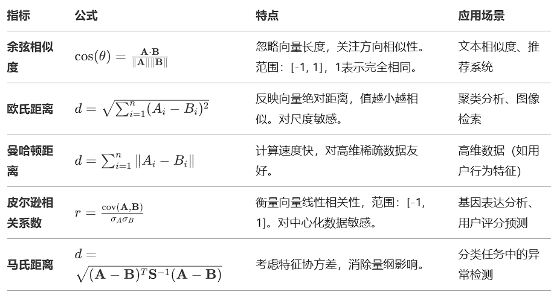

#### 混合检索方案

1. **意图识别与路由**：通过简单的规则或训练分类模型对查询进行分类。如果检测到查询是流程/制度类问题（通常包含“制度”、“流程”等关键词），则可以对BM25检索给予更高权重；如果是开放性思考类问题（包含“如何”、“怎么办”等），则侧重向量检索结果。此前置步骤保证不同查询走最合适的检索路径。
2. **BM25检索**：构建文档的关键词倒排索引（可使用Elasticsearch或其他搜索库），检索出Top N候选文档片段。BM25根据查询词在文档中的频率、文档长度等打分。对于短查询，可直接采用BM25结果；对于长查询，BM25结果可作为补充。
3. **向量检索**：利用Embedding模型将查询编码成向量，在Milvus向量数据库中进行近邻搜索，获取Top N候选片段。向量检索能找出语义相关的内容，即使字面不匹配。
4. **结果合并与去重**：将两种检索的候选列表合并。由于BM25分数和向量相似度分值不在同一量纲，需进行归一化处理。例如，可将BM25分数归一到0-1区间，向量相似度天然在0-1（如余弦相似度）。然后按一定策略融合，如线性加权组合或者直接取两者结果集的并集。在组合过程中处理重复文档（相同chunk多次出现）以避免干扰。
5. **提高召回率**：混合检索确保潜在相关结果进入候选集。尤其在只用向量或只用BM25无法检索到某些答案时，另一种方式可以补充，使真正相关的片段不被漏掉。

#### 生成面临的问题

1. **多轮对话的语义连贯性不足**：在用户多轮提问时，如果新问题是对上一轮回答的跟进（例如用户问：“这个怎么申请？”），系统需要理解“这个”指代什么。缺少对话上下文的关联可能导致LLM误解提问，给出不相关或幻觉的答案。
2. **多模态知识的利用困难**：金融保险领域的知识库包含PDF手册、PPT演示、文本说明、视频讲解等多种形式。如果不对这些不同格式的数据进行预处理和结构化，检索时可能遗漏关键信息，导致答案不全面。
3. **缺少来源引用降低可解释性**：用户希望了解答案出处以建立信任。如果生成的答案没有标注来源，用户无法追溯信息真实性。特别是从长文档提取内容时，不注明具体出处会降低答案的可信度和可检查性。

#### 怎么提高生成的质量

1. **维护对话上下文，确保连贯**：在每次用户提问时，检测问题是否包含代词或省略（如“这个”“它”等）以判断是否为跟进问答。如果是跟进问题，将**之前的相关问答摘要**或**关键术语**添加到当前查询中。一种常见做法是**问题重写**：将用户的新问题与上下文合并重写成完整问题，再送入检索和LLM。与此同时，系统应维护一个对话历史状态，让LLM参考之前的问答或已检索的知识，避免因缺少背景造成误解。
2. **整合多模态知识，提高答案全面性**：预先对PDF、PPT、文本、视频等资料进行解析和结构化处理，存入统一的向量数据库以便检索。比如：
    - **PDF/PPT**：提取文字内容，保留章节标题、表格数据等结构信息，将长文档按段落或页面切分成知识片段（chunks），并为每个片段添加文档名称、页码/幻灯片编号等元数据。
    - **视频**：对讲解视频执行语音转文本（ASR），获得字幕稿。根据时间戳将字幕稿切分成短段，并存储视频ID和时间段元数据。必要时可结合视频说明文字或关键帧截图的文字说明。
    - 将不同模态的数据转换为统一的文本嵌入向量，以便用同一种检索方式获取相关片段（例如使用同一嵌入模型表示文本和语音转文本）。或者采用**多模态检索**策略：分别在文本库、图像/视频库中检索，再融合结果。
    - 在生成答案时，允许LLM综合多个来源的片段。例如同时引用保单PDF中的条款和培训视频中的说明，以形成完整答案。

3. **在答案中加入来源引用，增强可解释性**：设计提示（Prompt）要求LLM在给出答案时**标注信息来源**。例如，让模型在句末用括号注明来源文档名称或索引编号。实现方法可以是：在将检索到的文档片段传递给LLM时，附加标记（如【1】、【2】）或者直接提供“引用格式”的文本，让模型仿照引用格式回答。对于长文档的引用，如果答案来自同一资料的不同部分，可以拆分引用为【文档A，第10页】、【文档A，第15页】等，精确指明出处。生成策略上，可以使用RAG的**引用增强模式**，即模型严禁脱离提供的知识片段编造答案，确保每句都有据可依。最终答案输出时，将源文件名称或链接映射为用户可查看的引用，以便用户点开核实内容。这种动态插入引用的方式保证了答案的可溯源性，减少幻觉，增加用户信任。

### 索引

#### RAG怎么做索引

RAG将embedding后的向量存储在专门的数据库中，构建索引结构（如倒排索引或向量索引），以便快速检索。这就需要用到向量数据库了。向量数据库是一种专门用于存储、索引、查询和检索高维向量数据的数据库系统。它特别适合处理非结构化数据，如图像、音频和文本，能够实现传统数据库难以完成的高级分析和相似性搜索，具备高效存储和处理高维向量数据的能力。

##### 追问：**如何选择向量数据库**

常见的向量数据库包含**milvus、Elasticsearch、Faiss、Chroma**等，选择时可以考虑的因素有：

1. **数据规模和速度需求**：考虑你的数据量大小以及查询速度的要求。一些向量数据库在处理大规模数据时更加出色，而另一些在低延迟查询中表现更好。
2. **持久性和可靠性**：根据你的应用场景，确定你是否需要数据的高可用性、备份和故障转移功能。
3. **易用性和社区支持**：考虑向量数据库的学习曲线、文档的完整性以及社区的活跃度。
4. **成本**：考虑总体拥有成本，包括许可、硬件、运营和维护成本。
5. **特性**：考虑你是否需要特定的功能，例如多模态搜索等。
6. **安全性**：确保向量数据库符合你的安全和合规要求。

##### 追问：常见向量索引算法

- **IndexFlatL2**：直接对所有向量进行精确搜索，计算每个查询向量与数据集中所有向量的L2距离。
- **IVF**：使用如K-means聚类等技术将整个数据分成多个簇，每个向量被分配到一个特定的簇。查询时识别最近或最相似的簇，并在这些簇内搜索特定的文档。
- **HNSW**：创建了类似概率跳表的层，节点之间建立图形化的连接。每一层的节点不仅连接到当前层的节点，还连接到下层的节点。查询时从最顶层的预定义节点开始，逐步向下移动到较低的层，直到达到最后一层或到达与所有其他连接节点距离最小的节点。
- **DiskANN**：DiskANN是一种基于磁盘的高性能向量近邻搜索算法，旨在解决大规模向量数据检索中的内存消耗问题。通过将轻量级的索引结构置于内存中，而将海量的原始数据和构建好的图结构存放在磁盘上，DiskANN能够在保持高召回率和低时延的同时，大幅减少对内存资源的依赖。

#### 文档嵌入做索引的时候，很多文档特别相似怎么区别

1. **语义去重：**用LSH算法检测近重复文档（>90%相似），保留唯一副本，过滤掉重复的内容。
2. **文档分块**：将长文档分割成更小的片段（如段落或句子级别），然后分别进行嵌入。这样可以更细致地捕捉文档的语义信息，提高相似文档的区分度
3. **元数据注入**：为文档添加时间戳、来源、作者等字段到文档头部等关键实体作为标签
4. **嵌入模型优化**：使用性能更优的嵌入模型，在下游领域微调嵌入模型，
5. **索引优化**：采用密集向量检索+稀疏检索+多向量检索的方式，构建多级索引结构，如树状索引（如RAPTOR），通过分层的方式提升信息检索的效率和精度，同时适应不同粒度的查询需求
6. **检索优化**：采用粗排+精排。

### RAG中为什么会出现幻觉？

幻觉问题是大模型的一个通病，出现幻觉问题的原因主要分为两大类，一类是生成结果与数据源不一致，自相矛盾。另一类是用户问题超出了大模型的认知。

针对前者可能是训练数据和源数据不一致、数据没有对齐或者编码器理解能力的缺陷和解码器策略错误可能导致幻觉，后者则是因为用户的问题不在语言模型认知范围内。

### RAG加速

1. **Embedding 阶段**
    - **批量请求**：一次传多个文本到 API，避免逐条调用造成的网络开销。
    - **异步并发**：用 asyncio 等框架并行请求 embedding，提升吞吐。
    - **缓存**：常见 query 的 embedding 直接存 Redis 或内存，下次直接命中。文档 embedding 尽量预先算好。
2. **向量检索阶段**（以 Milvus 为例）
    - **高效索引**：选用 IVF、HNSW 等近似最近邻索引，并调优参数（nlist、nprobe、efSearch）。
    - **批量/并发查询**：一次性搜索多个 query，减少调度和网络开销。
    - **分区/过滤**：只在相关分区检索，避免全库扫描；定期清理过期向量。
3. **系统架构层面**
    - **异步流水线**：embedding、检索、生成并行化，避免串行等待。
    - **任务队列+批量处理**：对高并发请求做聚合，统一 embedding 或检索。
    - **多实例/多 API Key**：负载均衡避免单点瓶颈。

### Chunking-free RAG

传统 RAG 要把长文档切成 chunk，再生成 embedding，但这样会破坏上下文连贯性，重要信息可能被切丢。为了解决这个问题，提出了 **Chunking-free RAG**，代表方法是 **Landmark Embedding**。

1. **核心思想**
    - 在长文档里，不切块，而是以句子为最小单元，每个句子末尾加一个特殊标记 **Landmark (LMK)**。
    - LMK 和句子上下文一起编码，得到该句子的 embedding。这样能保留完整上下文信息，同时还能精确对齐到用户 query。
2. **位置感知目标函数**
    - 长文档中有用信息往往是连续句子组成的，所以训练时对这些句子赋予不同权重，靠近核心信息的句子权重更高。
    - 用对比学习优化，让 query 与相关句子的 Landmark Embedding 相似度最大化。
3. **多阶段训练**
    - **远程监督**：用 MS MARCO 初始化成基本的句子级 embedding 模型。
    - **弱监督**：拼接不同 query 的答案，打乱形成伪长文档，训练模型在长上下文中区分句子。
    - **微调**：在真实长文档（如 Wikipedia）上生成伪 query 做微调，增强模型在长文本上的表现

### Embedding

#### 怎么选择合适的embedding模型

可以参考huggingface上的排行榜：mteb，它提供了一个公开的embedding模型排行榜，用于展示各个模型在不同任务上的表现。覆盖了 8 类任务和 58 个数据集，涉及 112 种语言，是目前最全面的文本嵌入评估基准之一。虽然可以通过 MTEB 排行榜对比不同向量模型的差异，但也只能作为一个参考，这些模型在公开数据集上的benchmark 在垂直领域、企业自身的业务领域不一定成立，具体选择哪个向量模型还需结合业务特点进行综合比较、权衡。可以从以下几个角度考虑：

1. **语言支持和性能**：大部分开源向量模型只支持单一或者有限的文本语言，所以需要确保 Embedding 模型支持的语言种类。多语言模型如 OpenAI Embedding 和 bge-m3 等模型能够处理多种语言。bge-m3 支持 100 多种语言，适合多语言需求的场景。另外，某些模型在主要语言（如中文）中的表现较好，但在处理较少使用的语言时可能会表现不佳。因此，需要评估模型在所有必需语言中的准确性，以确保一致的性能。
2. **处理长文本的能力**：切分的文本片段后续需要通过 Embedding 模型进行向量化，所以必须考虑向量模型对输入文本块的 tokens 长度限制，超出这个限制则会导致模型对文本进行截断，从而丢失信息，影响下游任务的性能。不同的 Embedding 模型对文本块长度的支持能力不同。比如，BERT 及其变体通常支持最多 512 个tokens，处理长文本时则需要将文本分成更小的块，意味着需要更加精细化的分块策略。而 Jina AI 的 Embedding 模型和 bge-m3 模型则支持 8K 的 tokens 输入，适合处理长文本块。
3. **模型在特定领域的表现**：通用 Embedding 模型在特定垂直领域（如医学、法律和金融等）可能不如专用模型有效。这些领域通常需要专门训练 Embedding 模型来捕捉特定的专业术语和语境。为特定业务需求优化的 Embedding 模型能够显著提升检索和生成的质量。例如，通过结合向量检索和重排序（reranking）技术，可以进一步优化结果。
4. **存储和内存等资源需求**：高维向量需要更多的存储空间，这可能会带来长期成本。例如，较高维度的模型如 text-embedding-ada-002 需要更多的存储资源。另外，较大的模型可能会占用更多内存，因此不适合内存有限的设备。
5. **模型响应时间**：Embedding 模型的处理速度在实时应用中尤为关键。例如，intfloat/e5-base-v2 模型在处理速度上表现优异，但需要在 GPU上 运行以达到最佳性能。在选择模型时，需要评估其在嵌入和检索过程中的延迟。例如，OpenAI 的 Embedding 模型在许多基准测试中显示出较高的性能和较低的延迟。

通用的 Embedding 模型通常是在大规模、多样化的数据集上训练的，可能不完全适合特定领域的任务，比如医学、法律等专业领域，它们无法很好的理解一些专有词汇。如果模型在业务数据集上表现不能满足预期，可以通过微调，让模型学习到特定领域的词汇和概念，使其在特定应用场景中表现更佳。

因此，在特定领域，对向量模型进行 Finetune 的主要目标是提高 **Recall@N** （前 N 个检索结果中包含相关文档的比例）的准确率和优化正例与负例的 similarity 值域分布。通过微调，模型可以更好地适应特定领域，提高 Embedding 表示的质量，减少检索结果中的噪声，提高相关文档的检索准确性。同时，微调可以更好地分辨正例和负例，使它们在向量空间中的分布更加明显，形成清晰的边界。这样，当检索结果的相似度值低于某个阈值时，可以舍弃对它们的召回，减少误判风险，从而减少生成模型的负担和幻觉风险，提升整体系统性能和用户体验

#### 你了解哪些embedding模型？

**bge模型**，全称BAAI General Embedding，是智源研究院提出的，有多个版本，比如v1、v1.5、m3等，还有对应的中文和英文版，bge v1版本的训练分为3个阶段：

（1）预训练：用Wudao数据集纯文本语料训练，利用了RetroMAE，重建污染的编码向量；

（2）弱监督学习：用C-MTP无标签数据集训练，对比学习从负样本学习中如何区分出成对的文本，在这一步中使用in-batch负采样+大的batch size的方法避免了挖掘难负样本。

> in-batch负采样是：假设你有一个batch内的m条文本，然后你对每条文本p都配对加入其对应的一条正样本文本q（即相关文本），这样，在该btach内，除了跟你相关的正文本，其他文本都是跟你不相干的负文本，可以组成负样本集合。

（3）有监督微调：用C-MTP有监督数据集训练，由于标签数据是多任务的，所以加入了指令微调实现多任务下的微调。在这一步中使用了ANN-style采样策略来挖掘难负样本。

**conan-embedding**，腾讯提出的最近在C_MTEB霸榜的embedding模型。主要通过挖掘更多质量更高的负样本的方法提升了embedding模型的能力。训练过程可以分为两个阶段：弱监督预训练和有监督微调。

其中弱监督预训练阶段主要收集了大量高质量的负样本，使用了一些过滤方法，比如使用bge-large-zh-v1.5模型对数据进行评分，过滤掉得分低于0.4的低质量数据。然后就是常规的in-batch对比学习训练。

在有监督微调阶段，将训练数据分为retrieve和STS两种任务类型，使用了两种优化技巧：

- 动态硬负样本挖掘：每经过一段时间，重新计算在最新模型下hard negative的得分，如果得分太低，就重新挖掘。
- 跨GPU批次平衡损失：提出了联合损失函数，平衡retrieve任务和STS任务的训练损失，避免模型优化方向不一致。

##### 追问：对比学习是怎么做的

对比学习是一种自监督学习方法，目的是要通过将相似的样本（positive pair）拉近距离，将不相似的样本推远，从而学习到数据的有效表示。在对比学习中，我们通过设计合适的loss函数来度量样本对之间的相似性，并优化模型。

##### 追问：loss是怎么算的

常用的loss函数包括对比损失、InfoNCE损失和Triplet Loss等。InfoNCE损失通过类似softmax的公式，计算目标样本与正负样本之间的相似度，并用温度参数τ来调节区分度；Triplet Loss则通过三元组的方式确保锚点和正样本的距离小于锚点和负样本的距离。

**1. 对比损失（Contrastive Loss）**

对比损失是基于样本对来工作的，目标是使得相似的样本在嵌入空间中距离更近，不相似的样本距离更远。具体来说，损失函数会计算样本对之间的欧几里得距离。如果样本对是正样本（相似的），它会鼓励这两个样本的距离变小；如果是负样本（不相似的），它会惩罚这两个样本的距离过大。具体来说，对于每一对样本，损失是正样本对距离的平方加上一个负样本对的距离。为了防止负样本过度影响，负样本对距离的平方通常会加上一个阈值，这个阈值通常叫做 margin。这样做的目的是要控制负样本的影响，不让负样本距离过小。

2. **InfoNCE损失（Information Noise Contrastive Estimation）**

InfoNCE损失的公式有点类似softmax的形式。它的目的是通过计算样本之间的相似度来区分正样本和负样本。具体来说，它的分子是目标样本和正样本的相似度（通常用余弦相似度或点积来表示），而分母是所有样本与目标样本的相似度的总和。为了让模型能够更好地区分正负样本，分母中会包括多个负样本的相似度。因此，分母不仅仅是负样本，而是整个候选样本集。这个损失函数的一个关键点是它有一个温度参数τ，用来控制相似度值的缩放，τ越小，正负样本的区分越明显。

3. **Triplet Loss**

Triplet Loss的设计使用了三元组结构，由一个锚点（anchor），一个正样本和一个负样本组成。锚点和正样本之间应该更相似，而锚点和负样本之间应该更不相似。具体来说，损失函数计算锚点与正样本之间的距离，并与锚点与负样本之间的距离做对比。目标是确保锚点与正样本的距离小于锚点与负样本的距离，且两者的距离差应该大于一个指定的margin。损失函数通过确保锚点和负样本之间的距离至少比锚点和正样本之间的距离大一个margin来推动模型进行优化。

##### 追问：InfoNCE loss中参数$\tau$的作用

τ的作用类似于softmax中的“温度”，它决定了这些分数的“平坦度”。较小的τ值会使得分数差异变大，梯度更新变得更加尖锐，这样训练过程中，模型会更加强调正样本与负样本之间的区别，可能会导致模型对负样本的区分更加敏感，从而加速收敛，但也可能导致训练过程中的不稳定，容易过拟合或者训练不充分。

而较大的τ值则会使得分数差异变小，更新变得更加平滑，这样训练过程中，模型对于正负样本的区别会变得不那么明显，训练会变得更加稳定，但可能会导致收敛速度变慢，模型学习到的区分能力较弱，进而需要更多的训练迭代来达到较好的性能。

##### 追问：bge-m3原理介绍

BGE-M3是面向统一检索的多任务表征模型，核心采用**单一Transformer编码器+多目标联合训练**，同时输出稠密、稀疏、多向量三类表征，实现单模型兼容Dense、Sparse、Multi-Vector三种检索范式。

训练上以统一基座共享参数，通过对比学习优化稠密向量的全局语义匹配；引入词项级监督信号训练稀疏向量，增强关键词精准匹配能力；对文本做chunk级切分，利用局部匹配损失学习多向量以提升细粒度检索效果；将三类损失加权联合优化，解决传统稠密模型关键词不敏感、稀疏模型语义弱的问题。

模型支持多语言与8192token长文本，在RAG等场景可直接替代BM25+Dense组合，有效降低工程复杂度并提升检索召回精度。

#### 怎么提升Embedding模型效果

- **有监督微调**：使用领域问答对或相关性标注的数据，通过**度量学习**损失函数（如**Triplet Loss**或**MultipleNegativesRankingLoss**等）训练模型，使得相似问句-文档对的向量距离更近，不相关对更远。
- **继续预训练**：将Embedding模型（如BGE）在大量无监督文本上继续训练（如通过**Masked Language Model**任务或者**对比学习**），让模型嵌入空间更贴合领域分布。
- **Cross-Encoder蒸馏**：用一个强大的**交叉编码器**（如一个微调后的BERT问答模型）生成query-doc相关性得分，然后微调bi-encoder的Embedding模型去拟合这些得分，实现知识蒸馏。

#### Embedding模型在下游任务表现不佳有什么体现

预训练的Embedding模型可能在下游任务上表现不佳，体现在以下方面：

- **语义理解偏差**：模型可能将一般语境下相似的词判为相关，但在下游领域可能意义不同（例如“保费” vs “费用”）。
- **同义词识别**：领域内常见的不同表述（如“推广”与“推销”）需要模型识别为相似。
- **重点概念强化**：通过训练让模型强调领域高频概念，从而在嵌入空间上将相关主题的文档聚类更紧密，提升召回**准确率**和**召回率**。

### Rerank

#### RAG中embedding与rerank之间的区别？

Embedding 阶段是将查询和文档（或候选答案）映射到向量空间，并通过向量之间的相似度来进行文档检索，目的是从大量文档中快速找到相关的候选文档。

而 Re-ranking 阶段则是在初步检索到的候选文档中，使用更复杂的模型对文档进行深度排序，以提高结果的精确度。重排序器通过查询和文档的深度交互来进一步优化相关性排序，确保最相关的文档被排在前面。

#### 为什么要做Rerank

经过混合检索得到的文档可能只有部分与问题相关（这一过程也被称为粗排），这就需要进行rerank精排。常用的rerank模型是**Cross-Encoder**架构：将查询和候选段落拼接输入一个Transformer模型，直接输出一个相关性分数，然后根据分数对候选段落排序。由于Cross-Encoder在编码时考虑到了查询和文档之间的双向交互（Attention），相关性判断更准确，但计算成本较高，只适合对少量候选做精排。

##### 追问：**embedding模型存在的问题**

- embedding模型只是将文本信息压缩为固定长度的向量，可能会导致**语义信息丢失**、**理解多义词困难**、**长文本语义平均化**等问题。
- 因为**在用户提出问题之前就已经为文档创建了嵌入，无法理解用户问题的上下文信息。**
- embedding模型计算整个查询和文档之间的相似度，难以捕捉**捕捉词级、句级或精确语义关系**。

##### 追问：embedding与rerank的模型架构的区别？

**embedding模型**通常使用bi-encoder的架构 ，负责快速将查询和文档转化为向量表示并进行相似度检索。查询和文档是独立编码的，可以在检索时使用预先计算好的向量进行快速匹配，这使得它可以高效处理大规模文档库的检索任务，但由于缺乏查询和文档的交互，精度可能较低。  
**re-ranking模型**通常使用cross-encoder的架构，它将查询和文档拼接在一起并共同输入同一个模型，查询和候选文档 拼接（例如通过 "[QUERY] [SEP] [DOCUMENT]" 的格式）一起输入到同一个模型中，模型通过 自注意力机制（self-attention） 计算查询和文档之间的交互关系，输出一个**联合表示**，通过计算这个联合表示的相关性分数，对候选文档进行排序。由于查询和文档之间有了深度的交互，模型能够更好地捕捉两者之间的细节关系，因此精度通常比bi-encoder更高，适合于重排序阶段以精细化检索结果。但又由于每次都需要重新计算查询和文档的交互，它的计算效率相对较低，特别是在面对大量文档时。  
总结：在大规模文档检索时，**bi-encoder** 更为高效，而在需要更高精度的排序时，**cross-encoder** 具有优势。

##### 追问：了解哪些rerank模型

- **cohere-reranker-v3.5**：Cohere Reranker v3.5 是由人工智能公司 Cohere 推出的一款先进的重排序模型，旨在提高搜索和检索增强生成（RAG）系统中呈现信息的相关性。拥有多语言能力、长上下文理解、更强的推理能力，这是一个闭源模型，暂不了解更多的技术细节。
- **BGE-M3：**由北京智源研究院（BAAI）开发，基于交叉编码器（Cross-Encoder）架构，使用预训练的Transformer模型（ XLM-RoBERTa）对用户查询和文档进行联合编码，直接输出二者的相关性分数。该模型支持多语言、多种检索方式。主要技术特点有：
    - 混合检索：统一了密集检索、词汇（稀疏）检索和多向量检索。
    - 自蒸馏：集成不同检索功能的教师信号，显著提升模型鲁棒性
    - 高效批处理：保障训练时batch-size足够大，充分学习文本之间的差异。
- **mGTE**：阿里巴巴通义实验室推出的GTE-Multilingual系列模型，具备高性能、长文档支持、多语言处理及弹性向量表示等特性，显著提升了RAG系统的检索与排序效果。mGTE构建了两阶段RAG的训练流程：
    - 首先利用**RoPE和unpadding**方法训练的编码器，该编码器经过两阶段**MLM**预训练得到
    - 基于编码器训练用于检索的**混合文本表示模型**（TRM）用作第一阶段粗排，和**rerank模型**用作第二阶段精排。

#### Rerank的作用

- **提升检索结果相关性：**RAG粗排返回的文档质量和相关性可能较差，rerank采用更精细的语义匹配模型，过滤掉与用户问题相关性较低的文档，以及噪声和不相关的信息。
- **复杂语义理解：**rerank能帮助大模型更好地理解和利用检索到的信息，强化相关文档的影响，从而提升生成结果的相关性和准确性。
- **降低生成模型负担：**RAG检索到的文档数量较多，通过Rerank能减少输入文档数量，缩短上下文长度。

#### 为什么Rerank精度更高？

- reranker不进行预计算，而是将用户查询和一个文档一起输入到transformer中，能更好的捕捉两者之间语义和上下文信息。
- embedding模型将用户查询和文档压缩到低维向量中，可能丢失细粒度语义。

#### 总结下ReRank模型的一些技术特点

- 使用**Cross-Encoder**，将用户查询和文档拼接起来，交给Transformer编码器，能更好的建模两者之间的语义关系。
- 一般都采用**多阶段训练**的方式，逐步扩充上下文长度。
- 损失函数大多采用**InfoNCE**损失，并在对比学习中加入**难负样本**，增强模型的鲁棒性。
- 为了加速训练和节省显存，可能采用deepspeed、混合精度训练、激活检查点、动态批次划分等技术。
- 在性能上，使用了Rerank模型后的精度往往更高

### 长上下文相关

#### 长上下文带来的问题

1. **计算复杂度**：自注意力的计算和内存开销随序列长度平方级增长。
2. **显存限制**：长上下文会显著增加 KV Cache 的大小，显卡很容易爆显存。
3. **推理延迟**：输入越长，解码每个 token 时需要处理的历史信息也越多，导致响应速度下降。

#### **常见的长上下文方法**

1. **长度外推**：在短上下文模型基础上，通过位置编码改造或训练技巧，让模型泛化到更长输入，而不用完全重训。
2. **注意力近似**：比如稀疏注意力、低秩分解，把计算集中在最相关的部分，降低复杂度。
3. **注意力替代**：用卷积、状态空间模型等替代 Transformer 的自注意力，规避二次复杂度。
4. **模型压缩**：量化、蒸馏、剪枝，减少算子成本，从而在长输入下还能跑得动。
5. **硬件优化**：通过算子层面的改进（比如 FlashAttention），让长序列的矩阵计算更高效。

#### 插值方法是什么

插值方法的核心是 **在推理阶段将位置编码线性缩放/映射**，让模型在没有结构修改的情况下处理更长的上下文。具体来说，就是把训练时的位置范围（比如最大2048 tokens）映射到新的更大范围（如32768 tokens）内，让模型“以为”位置并未超出训练范围，从而避免因直接外推位置编码导致的注意力失真和性能崩溃。这种Down-scaling 的插值方式比直接外推更稳定且能显著提升长上下文性能。

#### 常用的插值方法

- **位置插值（PI）**：通过线性缩放把长序列的位置映射回训练时的窗口范围，例如把 0–8192 的位置压缩到 0–2048，这样模型仍然在熟悉的位置分布内工作，实现简单，但当扩展比例过大时容易损失高频位置信息，导致远距离性能下降。
- **NTK-aware 插值**：在 RoPE 的基础上结合神经切线核（NTK）理论，对频率缩放进行重新设计，使注意力的核函数在更长的序列下分布更平滑，避免了线性插值的不稳定问题，因此能把上下文窗口扩展到几十倍仍保持较低困惑度，是目前 LLaMA 等模型常用的扩展方式。
- **YaRN 插值**：在插值时采用分段缩放的方式，近距离位置保持高分辨率，远距离逐步放大缩放比例，并通过正则化降低失真，这种方法兼顾了局部精度和远程稳定性，相比单纯的 NTK-aware 插值在超长文本任务中表现更好。
- **LongRoPE**：在 RoPE 基础上提出系统化改进，包括频率重新参数化、分层插值以及额外微调，使模型在百万级 token 的超长上下文中仍能保持良好性能，被认为是 RoPE 插值方法的前沿发展方向，在整本书级别的处理等极长任务中尤为有效。

#### 上下文窗口分割

通过将上下文分割成段，并采用滑动窗口方法来处理上下文。

- **PCW** 的核心思路是利用滑动窗口来模拟连续的长上下文，把文档分成重叠的片段逐步送入模型，相邻窗口之间共享一部分上下文，从而让模型在有限的窗口内也能保持跨段理解。它的优势是实现简单，兼容现有架构，但因为窗口重叠会带来冗余计算，而且远距离依赖会逐渐衰减。
- **Streaming-LLM** 面向流式输入场景，采用分批输入和高效的 KV Cache 管理，只保留近期的局部上下文并压缩远程上下文，从而保证模型在持续推理时的低延迟和长时记忆。它特别适合对话或实时文档处理这类在线应用，能够在长时间交互中保持上下文连续性，但也会因为压缩导致远程信息部分丢失。
- **NBCE** 则是基于朴素贝叶斯的思想，把长文本分成多个片段，对每个片段单独建模，在预测时再综合不同片段的贡献来扩展上下文能力。它的优点是实现直观、成本低，不需要改动模型结构，但因为依赖于独立性假设，效果在复杂依赖任务中可能不如专门的深度优化方法

#### 提示词压缩常见方法

- 基于信息熵（information entropy）/ 困惑度（perplexity）：使用小模型计算原始prompt中每个token的困惑度，删除困惑度较低的标记。例如Selective Context、LLMLingua 和 LongLLMLingua。
- 基于 soft prompt tuning ：引入一组可学习的连续向量（通常称为"soft prompts"），在下游领域对LLM进行微调，但不能应用于黑盒LLM。如AutoCompressor。
- 基于数据蒸馏：先进行数据蒸馏，再训练模型生成可解释性强的摘要，适用于黑盒LLM。如LLMLingua-2 和 RECOMP

### 怎么评价RAG

#### 准确率/召回率评评估

- **MRR（Mean Reciprocal Rank，平均倒数排名）**：关注第一个相关结果出现的位置，反映用户是否能很快找到答案 。MRR是所有查询 Reciprocal Rank 的平均值，其中每个查询的 Reciprocal Rank = 1/(相关结果的排名)。如果相关结果总是排在第一，MRR=1；如果相关结果平均排在第三位，MRR≈0.33。MRR适合评估问答场景下**第一个正确答案**的易得性。
- **NDCG（Normalized Discounted Cumulative Gain，归一化折损累计增益）**：考察整个排名列表的质量，包括多个相关结果的贡献 。它考虑结果的相关性等级和排名次序，通过折损因子（如1/log2(rank+1)）给排名靠后的相关结果降低权重。NDCG进行归一化以便不同查询间可比，值在0到1之间，1表示理想排序。NDCG@K通常用于评估Top K结果的综合相关性排序。
- **Precision@K（P@K，前K精度）**：衡量在返回的前K个结果中，有多少比例是相关的。例如Precision@5 = 前5个结果中相关结果数量/5。它直接反映用户看前K条结果能找到多少正确答案，**不考虑顺序**（非rank-aware指标）。常和**Recall@K**（在所有相关文档中前K找到多少）一起使用。
- **Recall@K（召回率）**：相关文档中有多大比例在前K结果里。由于问答系统往往每问只需一两个相关片段即可回答，有时Precision和MRR更受关注，但在多文档综合场景下Recall也重要。

#### 可信度评估

衡量生成的答案在多大程度上有文档支持，以及答案内容和检索到的文档是否一致、可靠。具体包括：

- **答案与支持文档匹配度**：验证生成答案中的关键信息是否能在检索文档中找到。可以计算答案和支持文档之间的相似度或重合率，例如关键词重叠度。
- **文档覆盖率**：检查检索到的文档是否覆盖了回答所需的所有要点。如果答案涉及多个要点，评估这些要点是否均能在提供的文档集合中找到依据。

#### 响应速度评估

评估RAG系统处理查询的速度，包括：

- **平均响应时间**：系统处理单个查询的平均用时。
- **P95/P99 延迟**：95%和99%的请求在多少时间内完成（尾部延迟），用于评估最慢响应的情况。
- **整体响应分布**：可以绘制响应时间分布图（如直方图）来了解大部分查询的延迟范围。

#### 可扩展性评估

测试RAG系统在不同数据规模和负载下的性能表现，包括：

- **数据规模扩展**：增大知识库或文档集规模，观察检索和生成性能的变化（如响应时间是否随数据量线性增长，检索准确率是否保持稳定）。
- **吞吐量**：衡量系统每秒可处理的查询数（QPS），以及在高并发情况下的性能表现。

#### 用户体验评估

系统给用户带来的主观感受和易用性，包括：

- **人工满意度评价**：通过人工评估或用户反馈来打分，衡量用户对答案的满意度。例如收集用户评分（1-5分）或对答案是否解决问题的二元反馈，以计算平均满意度分或满意率。
- **答案可读性**：评价生成答案表述的清晰易懂程度。可以使用**可读性评分**（如基于句子长度和词汇复杂度的指标）来定量分析答案文本的可读性，确保答案语言简洁明了，便于用户理解。

## Agent篇

### Agent包含哪些模块，实现了什么功能

Agent 就像一个多功能的接口，它能够接触并使用一套工具。根据用户的输入，Agent会规划出一条解决用户问题的路线，决定其中需要调用哪些工具，并调用这些工具。Agent = 大语言模型+规划+记忆+工具使用，具备以下关键能力：

- **规划（Planning）**：最核心最关键的部分，负责拆解复杂任务为可执行的子任务，并规划执行任务的流程。同时Agent还会对任务执行的过程进行思考和反思，决定是否继续执行任务，并改进决策策略。
    - **任务分解**：将复杂任务分解为可执行的子任务，让大模型逐步解决，例如将订外卖分解为选择餐厅+选择菜品两步。关键技术例如CoT、LLM+P等。
    - **反思**：Agent 通过完善过去的行动决策和纠正以前的错误来不断改进。关键技术例如React、Reflexion等。
- **记忆（Memory）**：包括短期记忆和长期记忆，用于存储会话上下文和业务数据等信息，来优化未来行为。
    - **短时记忆**：即上下文学习，由于受到Transformer上下文窗口长度的限制，它是短暂的和有限的。
    - **长期记忆**：则可对应为外部的向量数据存储，Agent 可在查询时引用，并可通过快速检索进行访问。
- **工具使用（Tools）**：通过调用外部工具（如API、插件）扩展Agent的能力，如文档解析、代码编译等。

### 你有开发过Agent吗，知道哪些Agent开发平台

- 扣子coze（字节）
- 通义千问（阿里）
- 元器智能体（腾讯）
- 文心智能体（百度）
- Dify
- Fastgpt

### 开放式问题：谈谈你对Agent的理解

在Agent诞生之前，有两种方式能使机器智能化：

- **基于规则的方法**：将人类指令转化成机器能理解的规则符号，这需要有丰富经验的人类专家，并且容错很低。
- **基于强化学习的方法**：构建策略模型和奖励模型，需要大量的数据进行训练。

随着大模型的诞生，人类利用其在逻辑推理、工具应用、策略规划等方面的能力，构建以大模型为核心的Agent系统，极大的提升了机器的智能化程度。当然，为了进一步提升Agent的性能，还提出了CoT等规划方法、引入记忆和工具模块，使得Agent越来越逼近人类的思考方式。

从人机合作的角度出发，Agent 改变了人机合作的方式。截至现在，主要有三种模式：

- **人类主导**：代表是**SaaS+AI模式**，人类完成大多数工作，而AI只负责完成特定任务。例如AI只负责实现人脸识别、OCR等能力，嵌入到人类操作的SaaS软件中，其他功能AI不参与。
- **AI作为人类助手**：代表是**Copilot模式**，AI可以随时辅助人类完成各种任务，不再局限于特定的功能。
- **AI主导**：代表**Agent模式**，人类只负责提出需求，在AI负责完成的过程中，可能需要人类进行进一步的描述需求、点评AI生成内容质量、矫正AI理解等。而Agent正式通往AGI（Artificial General Intelligence）的必经之路。

### 你怎么对Agent进行分类

按照工作模型可以分为单Agent、多Agent和混合Agent三种。

**单Agent**：
    - **特点**：由一个独立的智能体构成，所有的决策和执行都集中在一个智能体上，没有与其他智能体的协调和通信需求，适用于单一任务或相对简单的任务。
    - **优点**：不需要处理多个智能体之间的协调问题，也不需要额外的资源来管理多个智能体。
    - **缺点**：难以处理复杂、多变的环境，并且如果Agent出现故障，整个系统都将瘫痪。
    - **应用场景**：比如专门用于进行市场分析调研的Agent。

**多Agent**：
    - **定义**：多个Agent协同工作，相互交流信息，共同完成更复杂的任务或目标。多个智能体在分布式环境中独立运行，每个智能体可以自主决策，需要处理智能体之间的通信、协调和竞争等问题。
    - **优点**：能够处理复杂、动态和多变的环境，可以完成单个智能体难以完成的任务。多个智能体之间可以相互协作，即使部分智能体出现故障系统仍然可以正常工作，鲁棒性强。能根据环境和任务需求动态调整，具有可拓展性。
    - **缺点**：需要大量的通信和协调来确保智能体之间的同步和协作。
    - **应用场景**：比如一家公司就可以视为一个多Agent系统，由Agent来扮演产品经理、UI设计师、研发工程师、测试人员、项目经理等角色。
    - **例子**：斯坦福小镇

**混合Agent：**
    - **定义**：Agent系统和人类共同参与决策过程，交互合作完成任务，强调的是人机协作的重要性和互补性。这种系统通常包含一个或多个智能体，以及与人类用户的交互接口。
    - **优点**：通过人类的参与，混合Agent系统可以更好地处理复杂和多变的任务，提高任务完成的质量和效率，灵活地调整人类和智能体的角色和任务分配，提供更个性化和人性化的服务。
    - **缺点**：开发难度和复杂度较高。
    - **应用场景：**医生和Agent可以共同进行病情诊断，Agent负责快速分析病人的医疗记录、影像资料等，提供初步的诊断建议；而医生则可以基于Agent的分析结果和自己的专业知识和经验，做出最终的诊断决定。

### Planning是怎么实现的

目前Agent大部分的planning逻辑，是通过提示词（**prompt**），手动告诉 LLM 它该怎么思考、怎么分步执行的。实际系统里常常先通过**人工/程序硬编码**固定主干流程以及有严格要求的核心业务，再在需要模型能力的节点中（例如创新、总结、标注、推理等任务），通过 Prompt 来让模型做局部规划或执行，从而在灵活和可控之间找到平衡。

- **Prompt 更像“指导”或“原则”**，让模型在这些原则内自由思考、制定和执行流程，适合需要**灵活应变**、**创造性**或**自动化**程度高的场景。
- **人工/程序硬编码的流程**，适合高度**可控、可预测、合规、安全**的任务；这些场景往往我们不希望模型自由发挥。

举个例子，比如在电商系统中，身份信息验证不能出错，售后政策有明确规定，这些都适合人工编码。而智能客服则可以通过prompt指导LLM来进行回复。

### CoT

思维链将复杂的问题分解为更简单的任务，逐步解决问题，使用CoT能在算数、常识和推理任务都提高了性能。但这会增加推理的时间。CoT可以分为Few-Shot 和Zero-Shot（Zero-Shot 只需要在prompt中加入“让我们一步步的思考”）两种。

### ToT

在需要多步骤推理的任务中，引导语言模型搜索一棵由连贯的语言序列（解决问题的中间步骤）组成的思维树，而不是简单地生成一个答案。ToT框架的核心思想是：让模型生成和评估其思维的能力，并将其与搜索算法（如广度优先搜索和深度优先搜索）结合起来，进行系统性地探索和验证。对于每个任务，将其分解为多个步骤，为每个步骤提出多个方案，在多条思维路径中搜寻最优的方案。

### ReAct

ReAct的任务解决轨迹是**Thought-Action-Observation，**可以简化为模型按照**Reasoning-Acting**框架。Reasoning包括了对当前环境和状态的观察，并生成推理轨迹。这使模型能够诱导、跟踪和更新操作计划，甚至处理异常情况。ReAct的每一个推理过程都会被详细记录在案，这也改善大模型解决问题时的可解释性和可信度；Acting在于指导大模型采取下一步的行动，比如与外部源（如知识库或环境）进行交互并且收集信息，或者给出最终答案。

### Reflexion

Redlextion采用了强化学习的方法，Reflexion代理在生成每一个轨迹后，进行启发式评估，生成反思文本并保留在记忆缓冲区中，以诱导在随后的尝试中做出更好的决策。

### 你还了解哪些比较新的planning算法

我了解BabyAGI和AutoGPT

BabyAGI 使用一个“**Task List**”来管理所有待办任务。它有三个主要组件：

1. **Task Creation Agent**: 根据当前任务、执行结果，不断新建子任务。
2. **Task Prioritization Agent**: 对现有任务重新排序，决定执行顺序。
3. **Execution Agent**: 真正去执行当前的任务（通常是调用LLM/工具等）。

**循环流程**

1. 从 “**Task List**” 中取出最高优先级的任务。
2. 调用 **Execution Agent** 去执行。
3. 把执行结果（Result）交给 **Task Creation Agent**，是否需要生成新的子任务？
4. 把更新后的任务列表给 **Task Prioritization Agent**，排序并循环。

AutoGPT 也有一个任务/目标管理系统，也能生成子任务并执行。它侧重更丰富的“工具”支持，如联网、读取/写入文件、执行代码等，包含以下模块：

1. **AI Config**: 存放 AI 的角色、名称、目标等基础信息。
2. **Memory**: 把过去的重要信息存下来，供下一步参考。
3. **Planner**（或类似角色）: 生成下一步要干啥。
4. **Command Executor**: 解析 LLM 返回的命令，然后在外部执行相应操作。

### 介绍一下记忆模块

记忆模块是智能体存储内部日志的关键组成部分，负责存储过去的思考、行动、观察以及与用户的互动。

- **短期记忆**关注于当前情境的上下文信息，是短暂且有限的，通常通过上下文窗口限制的学习实现。
- **长期记忆**储存智能体的历史行为和思考，通过外部向量存储实现，以便快速检索重要信息。
- **混合记忆** -通过整合短期和长期记忆，不仅优化了智能体对当前情境的理解，还加强了对过去经验的利用，从而提高了其长期推理和经验积累的能力。

### 为什么要使用Memory-based agent

- **从认知心理学角度**：对于人类的认知来说，记忆重要的模块，agent想要替代人类完成一些任务，就要表现的像人类，为agent设置代理模块。
- **从自我进化角度**：在完成任务的过程中，agent也需要在与环境交互时自我进化。记忆能帮助agent积累经验、探索更多的环境、抽象出概括性信息以增强泛化性。
- **从agent应用角度**：在很多应用中记忆是不可取代的，例如chatgpt、虚拟角色。

### Function call

#### **为什么要用function call？**

以前的LLM只能依靠自己已有的知识回答问题，无法直接获取实时数据、也无法与外部系统交互。

Function Call 是一种实现大型语言模型连接外部工具的机制。通过 API 调用 LLM 时，调用方可以描述函数，包括函数的功能描述、请求参数说明、响应参数说明，让 LLM 根据用户的输入，合适地选择调用哪个函数，同时理解用户的自然语言，并转换为调用函数的请求参数（通过 JSON 格式返回）。调用方使用 LLM 返回的函数名称和参数，调用函数并得到响应。最后，如果需要，把函数的响应传给 LLM，让 LLM 组织成自然语言回复用户。

#### 大模型的function call能力是如何获得的？

主要通过对基础模型进行sft获得，基础模型需要先具备良好的指令遵循和代码/结构化数据生成能力。

**sft的核心思想，是要教会LLM两件事：**

1、识别意图：理解用户的请求是否需要借助外部工具/函数来完成，而不是直接生成文本回答。

2、参数提取与格式化：如果需要调用函数，需要能够正确地从用户请求中抽取出所需的参数，并按照预先定义的格式（通常是json）生成函数调用的指令。

**sft的过程如下：**

- 步骤 1：数据集构建：构建包含 Function Calling 场景的指令微调数据集，每条数据样本包含用户输入（可能需调用函数或直接回答的请求）、可用函数 / 工具描述（函数用途、参数类型等结构化文本）、期望输出（需调用函数时为含函数名与参数的 JSON，否则为直接文本回答）。
- 步骤 2：选择基础模型：选用具备强大指令遵循能力的预训练大模型（如 Llama、GPT、Qwen 等）。
- 步骤 3：格式化训练数据：将 “用户输入” 与 “可用函数描述” 拼接为模型输入（Prompt），“期望输出”（JSON 函数调用或文本回答）作为目标输出（Completion/Target），通过特定分隔符或模板区分。
- 步骤 4：进行微调：使用标准 SFT 方法（全参数微调或 PEFT 如 LoRA）在数据集上训练，优化目标为最小化预测输出与期望输出的差异（如交叉熵损失），使模型学会根据输入与函数描述，决定直接回答或生成特定格式的函数调用 JSON。

通过上述监督微调流程，大模型掌握识别意图（判断是否需调用外部工具）与参数提取格式化（正确抽取参数并生成规范函数调用指令）的能力，从而获得 Function Call 能力。

#### Function - Call 数据集的基本结构包含哪些部分？

Function - Call 数据集基本结构通常包含：

- [系统提示 / 全局指令]（可选）：设定角色、能力边界等。
- [可用函数 / 工具描述区]：详细列出每个可用函数的结构化描述。
- [对话历史]（可选，多轮对话重要）：记录用户（User）和助理（Assistant）的交互历史及当前用户请求。
- [触发指令 / 分隔符]：提示模型开始思考或生成，如 “Assistant:”。

#### **Function - Call数据集中可用函数/工具描述区的格式是怎样的？**

通常使用JSON列表或结构化文本，包含以下核心字段：  

```
[  
    {  
        "name": "函数名",  
        "description": "函数功能描述",  
        "parameters": {  
            "type": "object",  
            "properties": {  
                "参数名": {  
                    "type": "数据类型",  
                    "description": "参数含义描述"  
                }  
            },  
            "required": ["必填参数名列表"]  
        }  
    }  
]  
```

例如：  

```
{  
    "name": "get_weather",  
    "description": "查询指定城市和日期的天气信息",  
    "parameters": {  
        "type": "object",  
        "properties": {  
            "city": {  
                "type": "string",  
                "description": "需要查询天气的城市名称，例如：北京"  
            },  
            "date": {  
                "type": "string",  
                "description": "需要查询的日期，例如：今天、明天、2023 - 10 - 26"  
            }  
        },  
        "required": ["city", "date"]  
    }  
}  
```

#### **Function - Call数据集的关键要素有哪些？**

- **name**：函数的唯一标识符。  
- **description**：用自然语言清晰描述函数的功能和适用场景，是模型判断何时调用的关键。  
- **parameters**：定义函数接受的参数，包含：  
    - **type**：通常为`"object"`。  
    - **properties**：列出每个参数的名称、数据类型（如`string`、`integer`）和描述。  
    - **required**：必须提供的参数名称列表。  

#### **Function - Call数据集中对话流程的格式是怎样的？**

1. **用户请求**：用户发出指令（如“帮我查一下明天上海的天气，然后给张三发邮件”）。  
2. **模型首次响应（Function Call）**：模型识别后生成调用函数的JSON（如`get_weather`）。  
3. **外部执行**：应用程序调用实际工具（如天气API）。  
4. **结果喂回模型**：将工具执行结果格式化后再次输入模型（如天气结果`{"temperature": "25°C", "condition": "晴朗"}`）。  
5. **模型再次响应**：可能再次调用函数（如`send_email`）或生成最终回答（如“已查询并发送邮件”）。  

#### **如何将下游工具、插件转化为模型可理解的方式？**

核心是**标准化描述**和**执行对接**：  

- **标准化描述（Standardized Description）**：  
    - 为工具设计符合Function Call格式的结构化描述（如JSON Schema），包含唯一名称（Name）、功能描述（Description）、参数定义（Parameters）。  
    - 描述语言自然准确，避免歧义。  
- **执行对接（Execution Bridging）**：  
    - 将工具描述作为上下文传递给模型。  
    - 解析模型输出的Function Call JSON，调用实际工具，处理参数校验和结果，再将结果反馈给模型。  

#### **简述Function Call的工作原理**

1. **LLM接收用户提示**：用户输入请求。  
2. **LLM决定所需工具**：根据提示判断调用哪些工具。  
3. **程序处理调用请求**：开发者实现逻辑，接收LLM的工具调用请求并准备参数。  
4. **执行函数调用**：将带参数的函数调用传递给后端服务执行，结果再反馈给LLM用于后续处理。 

### HuggingGPT

HuggingGPT是由大型语言模型（LLM）驱动的，设计用来自主处理一系列复杂的人工智能任务。HuggingGPT融合了**ChatGPT**与**HuggingFace**。具体来说，LLM在这里扮演着大脑的角色，一方面根据用户请求拆解任务，另一方面依据任务描述选择适合的模型执行任务。通过执行这些模型并将结果整合到计划的任务中，HuggingGPT能自主完成复杂的用户请求。下图展示了从任务规划到模型选择，再到任务执行，最后是响应生成的完整流程：

- 首先，HuggingGPT利用ChatGPT分析用户的请求以理解他们的意图，并将其分解为可能的解决方案。
- 接下来，它会选择Hugging Face上托管的、最适合执行这些任务的专家模型。每个选定的模型被调用并执行，其结果将反馈给ChatGPT。
- 最终，ChatGPT将所有模型的预测结果集成起来，为用户生成响应。

### Training‑Free

Training‑Free并不是说模型完全不动，而是指在不对模型权重做 **任何** 梯度更新或微调的前提下，通过设计prompt、解码策略或外部算法来挖掘和提升模型能力的方法。

- **典型手段**
    1. **Prompt Engineering**：通过精心构造指令或示例（few‑shot）来引导模型产生所需输出；
    2. **Zero‑Shot / In‑Context Learning**：完全依赖预训练时学到的知识和上下文提示，不做额外训练；
    3. **后处理策略**：如对输出进行检验、重排序、自检 等，也不改变模型参数；
    4. **Adapter‑Free Inference**：不用轻量级适配器用原始模型做推理。

### **介绍一下MCP协议，与function calling有什么区别？**

MCP（Model Context Protocol）定义了一套标准化的工具发现、调用和管理机制。MCP协议的核心思想是让AI模型能够动态发现和使用各种工具，实现能力的扩展。MCP协议的主要特点包括：首先，它支持动态工具发现，AI模型可以在运行时发现新的可用工具，无需重新训练或部署。其次，它提供了标准化的工具接口定义，包括工具名称、描述、参数格式、返回值等，确保工具调用的规范性。第三，它支持多种传输方式，包括stdio、HTTP、WebSocket等，适应不同的部署环境。最后，它有良好的错误处理机制，能够优雅地处理工具调用失败、参数错误等异常情况。

与传统的function calling相比，MCP协议有几个明显优势：首先，function calling通常需要将工具函数直接集成到模型代码中，工具更新需要重新部署整个系统，而MCP协议支持动态工具发现，可以在运行时添加新工具，大大提高了系统的灵活性。其次，function calling缺乏标准化的工具管理机制，不同工具的参数格式、返回值格式可能不一致，而MCP协议提供了统一的工具接口规范，确保工具调用的规范性。第三，function calling通常只能在单个应用中使用，而MCP协议支持跨应用的工具共享，一个MCP服务器可以被多个客户端使用，提高了工具的复用性。

### TodoList

#### TodoList是什么

在 Agent 框架中，TodoList 是 **规划（Planning）** 模块的具体体现。当用户给出一个模糊的复杂目标时，Agent 不会直接输出结果，而是先将目标拆解为一系列可执行的子任务，这些有序或并行的子任务列表就是 TodoList。

**其核心作用包括：**

- **任务拆解：** 将非结构化目标转化为结构化的执行步骤。
- **边界控制：** 明确每一步需要调用的工具和预期的输出。
- **进度追踪：** 记录哪些任务已完成（Done）、正在进行（Doing）或待处理（Todo），防止 Agent 在长上下文对话中迷失方向。

#### TodoItem应该包含哪些元素，举例说说

- ask_id：唯一标识
- description：任务描述
- status：状态（pending /running/done /failed/skipped）
- dependencies：依赖任务 ID
- priority：优先级
- tool_require：需要调用的工具
- input /output：输入参数与执行结果
- retry_count：重试次数
- create_time / update_time

#### TodoList 属于 Agent 常见框架（如 ReAct）中的哪个部分？

它主要存在于 **"Thought"（思考）** 到 **"Action"（行动）** 的转化过程中。

- 在简单的 **ReAct** 模式下，TodoList 可能只是隐含在连续的推理链中；
- 在更复杂的框架（如 **BabyAGI** 或 **AutoGPT**）中，有一个专门的 **Task Creation / Prioritization Agent** 来维护一个显式的 TodoList 缓冲区，每次循环都会从列表顶部提取任务去执行。

#### TodoList 与 Agent 的短期存储（Short-term Memory）有什么关系？

TodoList 本质上是 **工作记忆（Working Memory）** 的一部分。

- **短期存储** 记录了对话历史和观察到的观测结果（Observation）；
- **TodoList** 则是基于这些存储信息，对未来的行动方向做出的预测和约束。
- 在开发中，我会将 TodoList 放在 Prompt 的显著位置（如底部），利用 LLM 的 **"Lost in the Middle"** 特性（模型更容易注意到首尾信息），增强其对任务目标的感知。

## 模型篇

### Dense和MoE模型的区别

#### Dense模型

- Dense（稠密模型）的每一层 MLP 都是全才。**所有参数全量激活，每次推理/训练都用到模型全部参数**；其架构一般为`Up-projection -> Activation -> Down-projection`，如下图所示，包含两个线性层和一个激活函数。

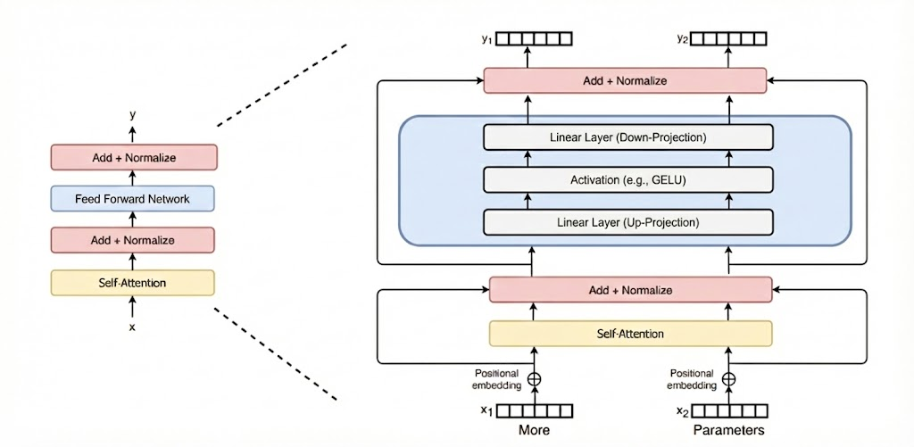

#### MoE 模型

- MoE（混合专家模型）：**参数稀疏激活，对于任意输入，仅激活部分专家子网络**。每个专家都是一个较小的神经网络，每个专家负责处理不同类型的子任务，能处理更多样的任务，也能够根据需求灵活调整模型规模。
- **通过一个路由网络（Router）进行专家的选择**，路由网络会根据输入的token，选择top-k个专家进行计算。如下图在4个专家中激活其中的1个，而Dense模型相当于激活了全部专家。
- 路由网络与其他模块一起训练，为了避免少数几个专家被过度使用，训练时可以引入噪声损失以**平衡负载**。

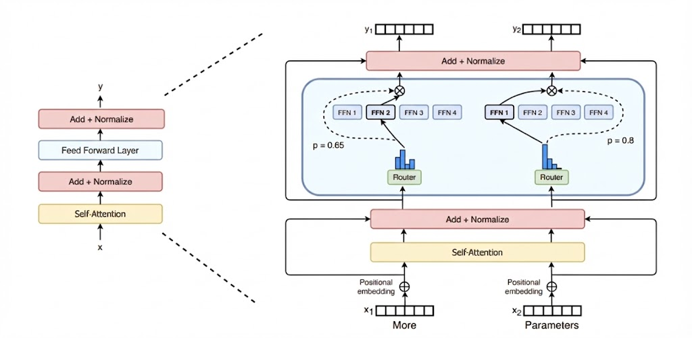

下表对比了MoE和Dense模型的核心差异：

| **对比维度** | **Dense模型（例如Qwen3-30B）** | **MoE模型（例如Qwen3-30B-A3B）** |
|---|---|---|
| **模型特点** | 全才模型，一个模型负责处理不同的任务 | 术业有专攻，不同专家专注于不同的任务 |
| **参数量** | 30B参数 | 30B参数 |
| **计算量** | 全量计算，计算量大 | 每个token只激活3B的参数，计算量更小 |
| **训练稳定性** | 相对稳定 | 训练容易不稳定，面临专家负载不均衡、过拟合、专家间通信等难题 |
| **训练速度** | 慢 | 快 |
| **推理速度** | 慢 | 快 |
| **模型容量** | 容量的增加与计算成本呈正相关 | 在不显著增加计算成本的情况下，可以大幅增加模型容量 |

很多人误以为 30B 的 MoE 就是在 30B 的 Dense 基础上把 MLP 拆开了。但如果你对比过 Qwen3-32B（Dense）与 Qwen3-30B-A3B（MoE）的底层配置，你会发现事实并非如此：

#### MoE对模型主干做了哪些操作?

在总参数量受限（约 30B）的条件下，为了塞进 128 个专家，MoE 必须对模型主干进行瘦身：

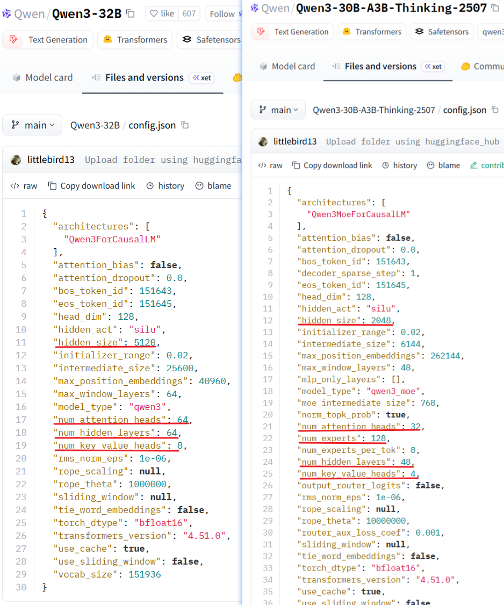

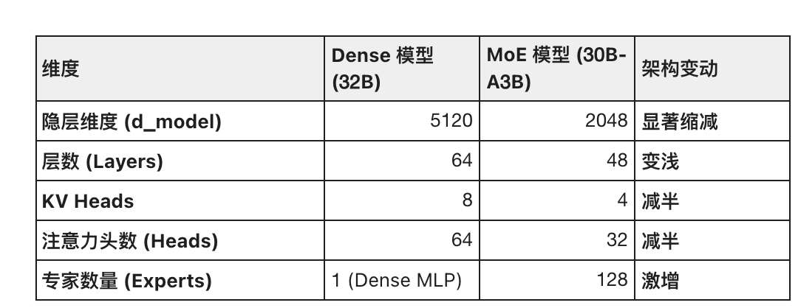

MoE 实际上压缩了**每 token 必算的主干**（Attention 和层数），将节省下来的参数预算转移到了**稀疏激活的专家集合**上。

#### 为什么Qwen3的MoE版Hidden Size直接缩水了一半？

除了主干压缩，MoE的单个专家也做了微缩处理：Dense模型中MLP的中间维度可能高达25600（经典 Dense 模型的 MLP Intermediate Size 通常是 $d_{model}$ 的 4 倍多），而MoE中单个专家的中间维度通常会缩减至6144左右。

虽然单个专家的表达能力弱于Dense的MLP层，但通过 128 个专家的**参数扩容**，模型整体获得了更强的**知识记忆容量**。MoE 稀疏激活（Sparse Activation）的机制也让其能在高并发场景下高效工作——即在总参数巨大的情况下，对每个 Token 仅计算极少量的参数，从而大幅降低了推理延迟。

#### 32B 的 Dense 模型和 30B 的 MoE 模型参数量差不多，如何选择架构？

##### **Case A：你需要处理复杂长文本（如：法律合同、长篇代码仓库）**

- **选 Dense 。**
- **理由：** Qwen3 的 MoE 版为了分配参数给专家模块，隐藏维度$d_{model}$相比Dense 版的 5120 缩减到 2048，单 Token 的语义信息承载容量大幅降低；而复杂任务需要逐 Token 捕捉精细逻辑，Dense 版更大的隐藏维度能更可靠地保留细节。

##### **Case B：你需要支撑极高并发并且任务简单（如：智能客服、SaaS 聊天插件）**

- **选 MoE 。**
- **理由：** 总参数 30B 但仅激活 3B 参数，单请求推理计算量远低于同总参数的 Dense 模型；在支持 MoE 加速的硬件 / 框架下，相同算力能支撑更多并发请求，吞吐量（TPS）显著更高。

##### **Case C：你需要处理超长上下文（如：分析一本 20 万字的书）**

- **选 MoE 。**
- **理由：** 一是它的 KV Heads 仅 4 个（搭配 GQA，GQA（分组查询注意力）通过将多个查询头绑定到少数 KV 头，在降低显存占用的同时保证注意力性能），且隐藏维度更小，KV Cache 显存占用远低于 Dense 版，能支撑更长的窗口；二是 MoE 的稀疏激活特性，长文本推理时计算量增长更平缓，显存 / 算力压力更小。

### 模型参数量计算

1. **Transformer参数量计算**
- **Transformer架构组成**：
    - **多头注意力机制**
    - **前馈神经网络**
    - **层归一化**
    - **残差连接**
- **参数定义**：
    - $L$：Transformer层数（Transformer blocks）
    - $d$：隐藏维度（hidden size）
    - $d_{\mathrm{ff}}$：前馈层中间维度（intermediate/FFN size）
    - $n_q$：查询头数（Q heads）
    - $n_{kv}$：键值头数（KV heads）
    - $d_h$：单头维度（head dimension）
    - $V$：词表大小（vocab size）
    - $d_q = n_q \times d_h$（查询投影维度）
    - $d_{kv} = n_{kv} \times d_h$（键值投影维度）
- **注意力机制参数**：
    - **查询投影矩阵** $W_Q：d \times d_q$
    - **键投影矩阵**$W_K:d \times d_{kv}$
    - **值投影矩阵** $W_V:d \times d_{kv}$
    - **输出投影矩阵** $W_O：d \times d$
- **前馈网络参数（SwiGLU激活函数）**：SwiGLU使用三个矩阵实现门控机制：
    - **门控矩阵** $W_{\text{gate}}:d \times d_{\mathrm{ff}}$
    - **上投影矩阵** :$W_{\text{up}}：d \times d_{\mathrm{ff}}$
    - **下投影矩阵** :$W_{\text{down}}：d_{\mathrm{ff}} \times d$
- **每层总参数量**：$\text{Per-layer} = d \cdot d_q + 2d \cdot d_{kv} + d^2 + 3d \cdot d_{\mathrm{ff}}$
- **总参数量**：$\text{Params} = L \cdot \left(d \cdot d_q + 2d \cdot d_{kv} + d^2 + 3d \cdot d_{\mathrm{ff}}\right) + 2Vd$

其中：
    - 第一项：所有Transformer层的参数
    - 第二项：词表嵌入矩阵 $V \times d$和输出层权重矩阵 $d \times V$

1. **以Qwen3-8B 官方配置举例**

根据官方配置，Qwen3-8B的参数如下：
    > ⚽ **架构参数**：
    >
    > - $L = 36$（36层Transformer）
    > - $d = 4096$（隐藏维度4096）
    > - $d_{\mathrm{ff}} = 12288$（前馈网络维度12288）
    >
    > **注意力机制参数**：
    >
    > - $n_q = 32$（32个查询头）
    > - $n_{kv} = 8$（8个键值头）
    > - $d_h = 128$（每个头128维）
    >
    > **词表参数**：
    >
    > - $V = 151,936$（词表大小151,936）

    1. **计算投影维度，使用GQA**
    - $d_q = n_q \times d_h = 32 \times 128 = 4096 = d$
    - $d_{kv} = n_{kv} \times d_h = 8 \times 128 = 1024$
    1. **每层注意力参数**

    注意力机制包含四个矩阵：

    - $W_Q$：$4096 \times 4096 = 16,777,216$ 参数
    - $W_K$：$4096 \times 1024 = 4,194,304$ 参数  
    - $W_V$：$4096 \times 1024 = 4,194,304$  参数
    - $W_O$：$4096 \times 4096 = 16,777,216$参数
    1. **注意力参数总计**：$d \cdot d_q + 2d \cdot d_{kv} + d^2 = 4096 \times 4096 + 2(4096 \times 1024) + 4096 \times 4096 = 41,943,040$
    2. **每层MLP（SwiGLU）参数**

    SwiGLU前馈网络包含三个矩阵：

    - $W_{\text{gate}}：4096 \times 12288 = 50,331,648$ 参数
    - $W_{\text{up}}：4096 \times 12288 = 50,331,648$ 参数
    - $W_{\text{down}}：12288 \times 4096 = 50,331,648$ 参数
    1. **MLP参数总计**：$3d \cdot d_{\mathrm{ff}} = 3 \times 4096 \times 12288 = 150,994,944$
    2. **每层总参数:**$41,943,040 + 150,994,944 = 192,937,984$
    3. **所有Transformer层参数:**$36 \times 192,937,984 = 6,945,767,424 \approx 6.95\text{ B}$
    4. **词表嵌入与输出层参数**
    - **词表嵌入矩阵**：$151,936 \times 4096 = 622,329,856$ 参数
    - **输出层权重矩阵**：$4096 \times 151,936 = 622,329,856$ 参数
    1. **嵌入与输出层总计**：$2Vd = 2 \times 151,936 \times 4096 = 1,244,659,712 \approx 1.245\text{ B}$
    2. **模型总参数量:**$6.95\text{ B} + 1.245\text{ B} = 8.195\text{ B} \approx 8.2\text{ B}$

### Bert相关

BERT的核心在于双向**编码器**的设计，主要在预训练阶段设计了两种任务：

- **Masked Language Model (MLM)**：随机遮蔽输入句子中的一些单词（15%），然后预测这些单词。
- **Next Sentence Prediction (NSP)**：预测两个句子是否是连续的句子。这有助于模型理解句子之间的关系。

#### Bert的变体

1. **RoBERTa (A Robustly Optimized BERT Pretraining Approach)**：
    - RoBERTa通过更大的数据集、更长的训练时间以及**动态掩码**等策略对BERT的预训练过程进行了优化。
    - 取消了NSP任务
2. **ALBERT (A Lite BERT)**：
    - ALBERT通过共享层间的参数来减少模型大小，同时保持了BERT的性能。
3. **DistilBERT**：
    - DistilBERT是一个更小、更快的BERT模型，通过知识蒸馏的方法从BERT中学习而来。
4. **DeBERTa (Decoding-enhanced BERT with disEntangled attention)**：
    - DeBERTa通过对BERT的注意力机制进行改进，提高了模型的表示能力。
5. **MobileBERT**：
    - MobileBERT是为移动和边缘设备优化的BERT模型，具有较小的模型大小和高效的计算性能。
6. **SqueezeBERT**：
    - SqueezeBERT通过结构化剪枝和知识蒸馏技术减小了模型大小，同时保持了性能。
7. **ERNIE (Enhanced Representation through kNowledge Integration)**：
    - ERNIE是由百度开发的一系列模型，它通过知识图谱的融合来增强语言表示。

#### **RoBERTa为什么要取消NSP任务**

- **NSP 对下游任务的贡献有限**，尤其是在一些主要依赖于单句上下文的任务中。
- **MLM 任务本身已经能够有效捕捉上下文表示**，并且训练时的优化方法（如增加数据量和训练时间）也进一步提升了模型的性能。
- 去除 NSP 后，RoBERTa 通过更高效的预训练策略，获得了更强的语言理解能力，在多个基准上超过了 BERT。

### llama系列

#### llama1（2023）

模型架构

- **基础架构**: 基于标准的 **Transformer** 架构，但进行了优化：
    - 使用 RMSNorm（Root Mean Square Layer Normalization）替代传统 LayerNorm，提升训练稳定性。
    - **SwiGLU** 激活函数取代 ReLU，增强非线性表达能力。
    - **RoPE（Rotary Positional Embedding）** 位置编码，在注意力层中动态生成位置信息。
- **参数规模**: 提供 7B、13B、33B、65B 四个版本，其中 65B 模型参数量最大，推理能力最强。

**训练数据**

- **数据量**: 约 1.4T tokens，主要来自公开数据集（如 CommonCrawl、Wikipedia、书籍、代码库等），但排除了专有数据（如社交媒体内容）。
- **数据多样性**: 包含多语言文本（英语为主），但未专门针对代码优化。

**训练方法**

- **目标函数**: 标准的自回归语言模型目标（预测下一个 token）。
- **优化器**: 使用 AdamW，结合余弦学习率调度和权重衰减。
- **训练效率**: 通过高效的并行策略（数据并行+模型并行）在 GPU 集群上训练。

#### llama2（2023）

**模型架构**

- **改进点**:
    - 上下文长度提升至**4K tokens**（后续扩展至 16K）。
    - 引入了 Grouped Query Attention (GQA)（仅限 34B 和 70B 版本），降低显存占用并加速推理。
    - 使用更高效的预归一化（Pre-LayerNorm）结构。
- **参数规模**: 7B、13B、34B、70B，其中 70B 版本性能接近 GPT-3.5。

**训练数据**

- **数据量**: 约 2T tokens，数据源与 LLaMA 1 类似，但进行了更严格的质量过滤和去重。
- **新增内容**: 包含更多对话数据（用于微调对话模型），支持多轮交互能力。

**训练方法**

- **预训练**: 延续自回归训练，但优化了数据混合比例（代码和学术文本占比更高）。
- **微调**:
    - **监督微调（SFT）**: 使用人工标注的对话数据。
    - **RLHF（基于人类反馈的强化学习）**: 对齐人类偏好，提升安全性和有用性。
- **安全机制**: 引入安全分类器，减少有害输出。

#### llama3（2024）

**模型架构**

- **重大升级**:
    - 支持 **8K 上下文窗口**（可扩展至更长），优化长文本处理能力。
    - 全面采用 Grouped Query Attention (GQA)，不同参数版本分组策略不同（如 8B 用 MHA，70B 用 GQA）。
    - 改进的 Tokenization，词汇表扩展至 128K，支持多语言和代码符号。
- **参数规模**: 开源 8B 和 70B 版本，另有未开源的 400B+ 版本。

**训练数据**

- **数据量**: 约 15T tokens，覆盖 30+ 种语言，代码数据占比显著提升。英文语料95%，其它语言5%
- **数据质量**: 引入更复杂的数据清洗管道（去重、毒性过滤、多模态数据筛选）。（启发式过滤器、NSFW过滤器、语义重复删除技术等）

**训练方法**

- **高效训练**:
    - 使用 3D 并行（数据并行+流水线并行+张量并行）和 ZeRO 优化。
    - 混合精度训练（BF16/FP16）结合梯度检查点。
    - SFT、拒绝采样、PPO、DPO
- **多阶段训练**: 先预训练基础模型，再针对不同任务（对话、代码、数学）分阶段微调。

#### llama3和llama2的区别

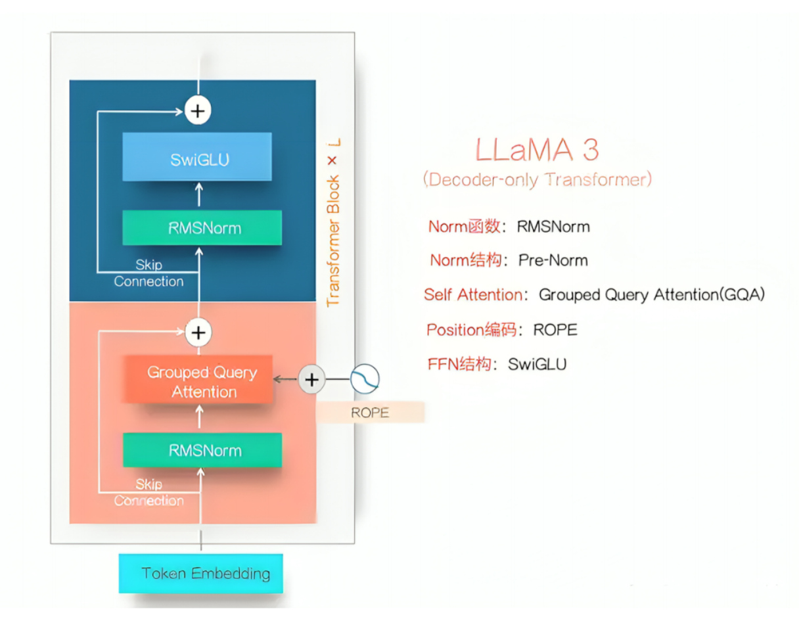

在架构上，Llama 系列模型采用了仅decoder-only结构，用于多种配置下的下一个标记预测，参数规模从 8B到 70B到405B不等。Llama3是MetaAI发布的最新一代开源大语言模型，与Llama2相比，Llama3在多个方面进行了显著的升级和改进：

1. **模型输出**：Llama2的模型输出仅限于文本，而Llama3能够生成文本和代码，增强了模型的多功能性。此外，Llama3.1进一步增加了工具调用功能 。
2. **上下文窗口大小**：Llama3将上下文窗口大小从4k标记增加到了8k标记，而Llama3.1的上下文窗口大小更是扩展到了148K 。
3. **Tokenizer和词汇表**：Llama3采用了新的Tokenizer，将词汇表大小从32K扩展至128K，这不仅提高了编码效率，也为处理更多语言提供了基础。Llama3的Token数量从2T增加到了15T+，而Llama3.1的token数量也达到了15T+ 。
4. **训练数据和时长**：Llama3使用了超过15万亿Token的训练数据，这是Llama2训练数据量的7倍以上。同时，Llama3的训练时长也显著增加，例如Llama3-70B模型的训练时长达到了640万个GPU小时，显示出训练成本的大幅增长 。
5. **模型架构**：Llama3保持了与Llama2相似的基于解码器的Transformer架构，但进行了一些调整，如采用Group Query Attention（分组查询注意力）技术以加速推理。此外，Llama3的8B和70B版本都采用了GQA，上下文长度也扩展到了8k 。
6. **性能提升**：在各项评测基准中，Llama3相比Llama2展现出了显著的性能提升，例如在综合理解评测基准MMLU、数学推理GSM8K以及代码能力HumanEval的评测结果上都有大幅提高 。
7. **指令跟随能力**：Llama3在指令跟随能力上进行了优化，特别是在复杂逻辑推理问题上，能够更准确地选择最合适的答案 。
8. **许可证变更**：Llama3的许可证中新增了明确归属的要求，衍生模型需要在其名称开头包含“Llama 3”，并且在衍生作品或服务中需注明“基于 Meta Llama 3 构建” 。

### qwen系列

#### qwen1

**模型结构**：基于Transformer改进，类似LLaMa结构

- Tiktoken BPE，选择词汇表cl100k base作为起点扩充词汇表，将数字拆分为单个数字，最终词汇表大小约为152k
- Untied Embedding：Input embedding和Output embedding不进行共享，是单独的两个权重矩阵，但是代价是增加了内存消耗，不过可以显著提升模型的性能
- RoPE位置编码、Pre-RMSNorm、SwiGLU激活函数
- 在大多数层移除偏置bias，但在注意力的QKV层中保留，以增强模型的外推能力。通过添加偏差项，可以更好地捕捉输入数据的特征，从而提升模型在处理未知或未见数据时的表现。这种增强外推能力的做法对于处理复杂任务和应对多样化的数据输入非常重要。

**模型训练**

- 采用标准的自回归语言模型训练目标
- 训练时上下文长度为2048，为了构建批次数据，对文本内容进行随机打乱及合并，再将其截断到指定长度
- 注意力模块采用Flash attention，以提高计算效率并减少内存使用
- 使用BF16混合精度加速训练
- 优化器采用AdamW，超参数β1、β2和ε分别为0.9、0.95和1e-8
- 采用余弦学习率计划，学习率会衰减到峰值的10%

上下文长度（外推能力）扩展

通过**动态NTK插值、LogN-Scaling和分层窗口Self-Attention**等技术，有效地扩展了模型的上下文长度，同时保持了性能

- **动态NTK插值**：核心思想 **高频外推，低频内插**
- **LogN -Scaling**：根据熵不变性以及一些合理的假设，可以得到一个新的缩放因子，从而得到一种Scaled Dot-Product Attention，LogN-Scaling可以根据上下文长度与训练长度的比值，对Q和V的点积进行重新缩放，确保注意力值的熵随着上下文长度的增长而保持稳定
- **分层窗口Self-Attention**：使用分层窗口Self-Attention，将注意力限制在一个上下文窗口内，防止模型关注到太远的内容；在不同层采用不同的窗口大小，较低的层使用较短的窗口，而较高的层使用较长的窗口  
   综合上述技术，Qwen预训练长度2048，推理的时候可以处理8192

**Reward Model训练**

- 预训练偏好模型（preference model pretraining）：奖励模型由同等大小Qwen模型+池化层得来，用特殊的句子结束标记经过池化层的映射值作为模型奖励值
- 微调奖励模型：
    - 分类系统：为确保prompt具备一定的多样性和复杂性，创建了一个包含约6600详细标签的分类系统
    - 平衡采样：并采用了一种平衡采样算法，以在选择提示时兼顾多样性和复杂性
    - 多样性采样：为了生成多样的回复，实验过程使用了不同规模和采样策略的Qwen模型，因为多样化的回复有助于降低标注难度并提高奖励模型的性能

#### 介绍下Qwen3

- **三阶段预训练**
    1. **通用基座**：4 096 token 上下文，累积 30 万亿 token，构建语言与常识能力。
    2. **推理强化**：继续在 4 096 token 长度下追加 5 万亿 高质量 STEM/Code 样本，加速学习率衰减。
    3. **长上下文扩容**：采用**ABF+ YARN + DCA**，将窗口扩展至 32 768 token，训练数千亿 token。
- **长 CoT 冷启动**：先用 Qwen2.5‑72B-Instruct进行用户query筛选 提升样本质量与多样性，再用QwQ-32B生成候选响应。
- **推理 RL（GRPO）**：选取多样且困难的问题，使用**GRPO**，**大 batch** + **off-policy**训练，只需170步即可让Qwen3-235B-A22B模型在 AIME’24 分数从 70 提升到 85+。
- **思维链显/隐控制**：在词表注入专用 special token，并在 prompt 中使用 /think 与 /no_think 标签实现显式模式切换；训练结果显示，模型还能自发学会 短 CoT，兼顾低延迟与准确度。还可通过 thinking budget 截断思考 token，动态平衡速度与准确率。
- **奖励模型（RM）设计**：覆盖 20 + 任务域（指令遵循、格式一致、偏好对齐、Agent 工具调用、RAG 等），为每个子任务定制评分规则，结合**基于规则的Reward**、**参考答案评分**、**无参考的偏好模型评分**三种信号，保证 RL 阶段反馈精准且稳定。
- **轻量蒸馏**：
    1. **off-policy蒸馏**（教师多模式输出）。
    2. **on-policy蒸馏**（学生自行 roll‑out，再按 KL 对齐教师），仅 1/10 GPU‑hours 即把双模式推理能力下迁到 14B / 8B / 30B‑A3B 等小模型，效果显著优于纯 SFT。

    #### Qwen系列模型对比

| **版本** | **架构层面的创新点** |
|---|---|
| **Qwen** | - 标准 dense transformer + instruction-tuning／RLHF；<br>- 上下文窗口长度支持一定范围但还未有特别大规模长上下文机制；<br>- 推理中没有区分思考／非思考模式（全靠训练数据决定行为）。 |
| **Qwen2** | - 引入稀疏专家/混合专家（Mixture-of-Experts, MoE）机制的一些变体，以提升大参数模型的效率；<br>- 长上下文支持改进（比如训练 /注意力机制对 RoPE 的调整，以更好处理更长 token 序列）；<br>- 优化 instruction-following、对话任务中的稳定性，可能包括训练目标或 loss 的调整以降低回复偏差或重复等问题。 |
| **Qwen2.5** | - 更大规模 MoE +密集模型混合／多模型并存，让部分任务可以用稀疏激活机制节省计算；<br>- 增强长上下文处理能力（例如 128K token ／对长文档／跨文档任务更友好）；<br>- 在多模态 / 音频 /视觉 + 文本任务中，引入新的位置编码或对齐机制（例如 multimodal RoPE、滑动窗口／Streaming 解码等）；<br>- 架构上为支持流式（streaming）或滑动窗口而优化注意力的计算或缓冲机制。 |
| **Qwen3** | - Thinking Mode / Non-Thinking Mode 混合推理控制：同一个模型内置 “思考” / 深推理 vs 快速响应两种路径，用户／任务可切换。 <br>- Thinking Budget 机制，即根据任务复杂度动态分配计算预算，从而在速度／资源消耗与推理质量之间做平衡。 <br>- 强化稀疏激活／MoE 架构在大模型中的使用（的大模型版本 Qwen3-30B-A3B、Qwen3-235B-A22B）以减轻每次推理的激活参数数目和资源占用。<br>- 显著增强长上下文能力（标准支持 128K token 文本理解／生成，对某些版本可扩展到更高）以及在长序列上的稳定性，比如滑动窗口、RoPE 或类似机制优化。 <br>-  在推理 /答题 /编码任务上，在密集模型中 “以小带大”（即用较小密集模型匹配 /逼近以前更大模型的性能）这一点通过训练策略与架构调优实现。这个使得中小型模型性价比提升。 |

#### Qwen3.5 介绍

Qwen3.5 是一个支持多模态输入的 Causal LM with Vision Encoder 模型。它公开了 **Qwen-3.5 Dense** 和 **Qwen-3.5-MOE** 两类模型：Dense 版本使用 Qwen3-Next 的混合注意力主干，并接入 ViT 和 PatchMerger；MoE 版本则在 Dense 主干基础上，将 LLM 中的 FFN 替换为 MoE 架构，从而在保持较低激活参数量的同时扩大模型容量。

- **文本基座：继承 Qwen3-Next 的混合架构**

Qwen3.5 的文本主干来自 Qwen3-Next。核心设计是 **Hybrid Attention**：在若干层线性注意力中周期性插入标准注意力层。

1. **线性注意力负责效率**：Gated DeltaNet 打破标准注意力的二次复杂度，在长文本场景下显著降低计算和显存压力。
2. **标准注意力负责召回和推理**：Gated Attention 保留完整注意力建模能力，补足线性注意力在精确检索、复杂依赖和深层推理上的短板。
3. **循环块结构清晰**：LLM 模块共 60 层，由 15 个循环块组成，每个循环块包含 **3 个 Gated DeltaNet + 1 个 Gated Attention**。
- **Gated DeltaNet：面向长文本的高效线性注意力**

Gated DeltaNet 是 Qwen3.5 中承担高效上下文处理的核心模块。它包含 **64 个用于 V 的线性注意力头**，以及 **16 个用于 QK 的头**，注意力头维度为 128。

这个设计适合大词表和长上下文场景：一方面能快速抽取局部和长程特征，另一方面能降低长序列推理时的计算成本。文档中还提到，Qwen3.5 的 Embedding 维度达到 **248,320**，因此高效特征提取对整体吞吐非常关键。

- **Gated Attention：保留标准注意力的表达能力**

Qwen3.5 的标准注意力层采用 Gated Attention，并使用 GQA 结构：**2 个 Q 头、2 个 KV 头**，注意力头维度为 256，RoPE 嵌入维度为 64。

Gated Attention 的关键是在标准 Scaled Dot-Product Attention 输出后加入一个依赖输入的门控：

1. **增强非线性表达**：门控机制在注意力输出和后续线性投影之间加入非线性变换，缓解标准注意力低秩表达的问题。
2. **动态抑制噪声**：Sigmoid 门控可以让部分输出趋近于 0，使模型根据当前 Query 抑制无关信息。
3. **缓解 Attention Sink**：传统模型中 BOS 等早期 token 容易吸收大量注意力，Gated Attention 允许模型过滤这些无效注意力。文档中提到，引入门控后，沉没注意力比例可从 46.7% 降至 4.8%。
- **多模态架构：ViT + PatchMerger + LLM**

Qwen3.5 去掉了 Qwen3-VL 中的 DeepStack 架构，回到更传统、更简洁的 **ViT + PatchMerger + LLM** 路线。

1. **ViT 负责图像编码**：将图像切成 patch，并提取视觉特征。
2. **PatchMerger 负责视觉 token 压缩**：减少视觉 token 数量，降低进入 LLM 的上下文压力。
3. **LLM 负责统一理解与生成**：把文本 token 和视觉 token 放到同一个生成式模型中建模，从而支持图文理解、视觉问答、多模态推理等任务。
- **MoE 版本：397B 总参数，17B 激活参数**

Qwen3.5-MOE 在 Dense 主干基础上引入 MoE。文档中给出的配置是：总共 **512 个路由专家**，每次推理激活 **10 个路由专家 + 1 个共享专家**，专家中间维度为 1024。

整体规模上，Qwen3.5-MOE 的总参数量达到 **397B**，但实际激活参数量只有 **17B**。这类设计的优势是模型容量很大，可以存储更多知识和任务模式；单次推理只激活少量专家，计算成本接近中等规模模型。

- **长上下文能力：原生 256K，可扩展到 1M**

Qwen3-Next 原生支持 **256K 上下文窗口**，并可以通过 YARN 进一步扩展到 **1M**。Qwen3.5 继承这一长文本能力后，更适合长文档理解、代码仓库分析、多轮对话记忆、Agent 轨迹分析等场景。

线性注意力负责降低长上下文成本，标准注意力负责保留关键位置的精确建模能力，这也是它采用混合注意力架构的核心原因。

**推理效率：MTP 提升生成速度**

Qwen3.5 还引入了 MTP 机制，即一次推理生成多个 token，用于提升投机采样效率。它的目标是降低自回归生成中“一次只预测一个 token”的延迟瓶颈，让长回答、代码生成、多轮推理任务的吞吐更高。

### deepseek系列

1.24年1.5日，DeepSeek LLM发布，没太多创新类似llama那一套（llama1的RoPE/RMSNorm/SwiGLU+llama270B或llama3的GQA）

2.24年1.11日，DeepSeekMoE，开启创新之路提出细粒度专家分割和共享专家隔离，以及一系列负载均衡

3.24年1.25，发布DeepSeek-Coder24年2月，发布DeepSeekMath提出了Group Relative Policy Optimization(简称GRPO)，以替代PPO--舍弃critic模型

4.24年5.7日，DeepSeek-V2

提出多头潜在注意力MLA且改进MOE

其中的MLA是整个deepseek系列最大的几个创新之一，且由此引发了各大厂商百万token的大幅降价

5.24年12.26日，DeepSeek-V3发布在MOE、GRPO、MLA基础上提出Multi-Token预测，且含FP8训练

大家纷纷把它和Llama3.1405B对比，V3以极低的训练成本造就超强的效果，再度出圈

6.25年1.20日，DeepSeek R1发布

一方面，提出舍弃SFT、纯RL训练大模型的范式，且效果不错

二方面，性能比肩o1甚至略微超越

占三方面，直接公布思维链且免费，不像o1那样藏着掖着，对用户极度友好

#### Deepseek r1

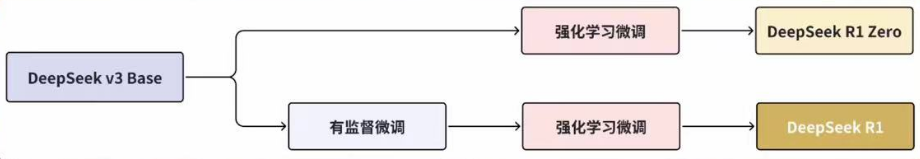

在dpsk r1的这篇报告里，提到了2个模型，分别是 `DeepSeek-R1-Zero` 和 `DeepSeek-R1`，总结来看：

- **强化学习取代SFT**：zero算是一个实验性质的模型，在zero上不通过任何sft的方式，仅使用RL + 规则RM，就能激发模型产出带反思的long cot。这里使用的RL是GRPO：从一个好的模型开始，并根据正确性和风格结果给予奖励，没有PRM，没有MCTS，没有花哨的奖励模型。基本上检查答案是否正确。
- **涌现时刻（Aha Moment）**：在训练过程中，DeepSeek-R1-Zero展现了复杂行为的自发涌现，如反思和探索替代方法，这些行为并非通过明确编程实现，而是模型与强化学习环境交互的自然产物，显著增强了其推理能力。
- r1是受到zero RL相关的实验结果启发，而新训的最终版的模型。zero所采用的RL方法（即什么样的RL能激发模型主动产出long cot，甚至是反思）将被 r1 参考。**r1的训练流程包含四阶段**：
    - **冷启动**：通过few shot prompting、直接生成、收集r1-zero的输出等，来收集少量数据长CoT数据来微调模型。
    - **针对推理型问题的强化学习**：也使用GRPO，同时为了缓解COT中有时会出现语言混合现象，因此在训练时还引入了语言一致性奖励。
    - **拒绝采样和监督微调**：对于推理型数据，从强化学习checkpoint进行拒绝采样生成推理轨迹；对于非推理型数据，使用了来自 DeepSeek-V3 的 SFT 数据集。
    - **针对所有场景的强化学习**：为了使输出更符合人类偏好，引入一个辅助强化学习阶段，结合奖励信号（reward signals）和多样化的提示分布（diverse prompt distributions）来训练模型，以确保其在不同场景下都能表现出色。
- **蒸馏技术的应用**：DeepSeek通过R1模型的输出，蒸馏出多个小模型，适配市面上对模型尺寸的主流需求。其中，32B和70B模型在多项能力上实现了对标OpenAI o1-mini的效果，展现了蒸馏技术在传递大模型推理模式方面的优势。

#### MLA原理

Multi-Head Latent Attention (MLA) 是 DeepSeek-V3 模型中用于高效推理的核心注意力机制。MLA 通过**低秩联合压缩技术，减少了推理时的键值（KV）缓存，从而在保持性能的同时显著降低了内存占用**。具体来说，MLA使用下投影矩阵将键和值压缩成潜在向量，然后通过上投影矩阵将其还原。这种方式显著减少了KV缓存的大小，同时保持了与标准多头注意力（MHA）相当的性能。

#### **MLA中，为什么Query 的 RoPE 作用在压缩后的向量** $c_t^Q$**，而 Key 的 RoPE 却作用在原始输入** $h_t$**上？**

**（1）Key 使用原始输入** $h_t$**：保证位置编码精度与缓存可复用性**

RoPE 的核心作用是为 token 编码相对位置信息，使得注意力分数能够体现序列顺序。  
 若在 Key 的压缩表示$c_t^{KV}$上直接施加 RoPE，由于低秩投影本身可能会**改变向量空间中的几何结构**，就会导致旋转后的位置关系不再准确。  
这会破坏 Key 间的相对距离，使注意力的位置信息失真。

此外，Key 是所有历史 token 的集合，会被持续缓存并复用（KV cache）。  
若 RoPE 作用在压缩空间上，每当新 token 加入序列，所有历史 Key 的相对旋转角度都需要重新计算，**这将完全抵消 KV cache 带来的推理加速优势**。

因此，MLA 在 Key 路径上采用了解耦设计（Decoupled RoPE）：$k_t^R = \text{RoPE}(W^{KR} h_t)$

这样 RoPE 作用于原始向量 $h_t$，既保持了位置信息的准确性，又确保缓存稳定可复用。

虽然计算$h_t$的投影成本略高，但 Key 的数量远少于 Query（在 GQA 中多个 Query 对应一个 Key），因此整体计算开销可以接受。

**（2）Query 使用潜变量** $c_t^Q$ **：降低计算与训练显存成本**

与 Key 不同，Query 向量不会被缓存，每一步生成新 token 时都需重新计算。

因此，MLA 优先考虑 Query 的计算效率： $q_t^R = \text{RoPE}(W^{QR} c_t^Q), \quad c_t^Q = W^{DQ}h_t$

这种设计在保证一定语义表达能力的前提下，通过对 $h_t$的低秩压缩（降维到 $d_c^Q \ll d_h n_h$），显著减少了计算量与梯度更新的内存消耗。

虽然压缩后 RoPE 的旋转空间会略有失真，但其影响仅限于当前 Query 步的计算，不会累积传播，因此在性能与效率之间达到了较好的折中。

#### GRPO

GRPO（Group Relative Policy Optimization）算法是一种强化学习算法，通过组内相对奖励机制来优化策略模型。与传统的PPO算法不同，GRPO通过组内相对奖励机制来优化策略模型，避免了使用额外的价值函数模型（critic model），这种方法不仅简化了训练流程，显著减少了内存和计算资源的消耗。

- **组内相对奖励**：GRPO的核心思想是通过组内相对奖励来估计基线（baseline），从而避免使用额外的价值函数模型。具体来说，对于每个问题 *q*，GRPO从旧策略 $\pi_{\theta_{old}}$ 中采样一组输出 {*o*1,*o*2,…,*oG*}，然后对每个输出 *oi* 进行奖励打分 *ri*。通过计算组内奖励的均值和标准差，将奖励归一化为组内相对奖励。
- 优化目标：GRPO的优化目标是最大化一个带有比例的目标函数，该函数考虑了当前策略和旧策略之间的比例关系，并通过裁剪超参数 ϵ 来限制策略更新的幅度。

#### Deepseek R1 训练流程

- 冷启动：通过few shot prompting、直接生成、收集r1-zero的输出等，来收集少量数据长CoT数据来微调模型。
- 针对推理型问题的强化学习：也使用GRPO，同时为了缓解COT中有时会出现语言混合现象，因此在训练时还引入了语言一致性奖励。
- 拒绝采样和监督微调：对于推理型数据，从强化学习checkpoint进行拒绝采样生成推理轨迹；对于非推理型数据，使用了来自 DeepSeek-V3 的 SFT 数据集。
- 针对所有场景的强化学习：为了使输出更符合人类偏好，引入一个辅助强化学习阶段，结合奖励信号（reward signals）和多样化的提示分布（diverse prompt distributions）来训练模型，以确保其在不同场景下都能表现出色。

#### Deepseek V3训练过程

1. **模型架构设计：**采用MLA（多头潜在注意力）架构以大幅降低推理时的KV Cache显存占用；同时使用DeepSeekMoE（细粒度混合专家）架构，并设计了“无辅助损失的负载均衡策略”，避免了传统MoE中辅助Loss对模型性能的负面干扰。
2. **预训练：**模型在约14.8T个高质量Token上进行训练。核心在于全程使用了FP8混合精度训练框架，极大地提高了计算效率并降低了显存消耗。此外，在预训练阶段还引入了多Token预测（MTP）目标，提升了模型的训练效率和推理生成能力。
3. **长上下文扩展：** 在预训练结束后，分两个阶段对上下文窗口进行扩展。先扩展至32K，再利用YaRN（旋转位置编码扩展方法）将窗口最终扩展至128K，使其具备极长的文本处理能力。
4. **监督微调：** 使用约150万条经过清洗的高质量指令数据进行微调。这些数据涵盖数学、代码、逻辑推理等多个领域，目的是让模型学会遵循人类指令，并为后续的强化学习打好基础（Cold Start）。
5. **强化学习对齐：**采用了GRPO进行强化学习训练，显著提升了数学和代码任务的推理能力。

#### DeepSeekMOE

MoE借鉴集成学习的思想，可以替换transformer模型中的FFN层，包含一个门控网络和多个路由专家网络。将FFN分割成多个专家，这些专家可以根据其特定的功能被设计成处理不同类型的输入或特征，构建门控网络决定对每个输入使用哪些专家。

DeepSeekMoE中采用了**共享专家和路由专家**两种，共享专家也就是所有问题都会参与计算的专家，路由专家则是由门控网络计算觉得是否参与训练。

针对MoE模型面临的负载不均衡问题，采用了无辅助损失的负载均衡策略，在门控网络计算每个专家的亲和力时，加入偏置量，在训练过程中持续监控每个专家的负载，每个训练步骤结束的时候，如果某个专家过载，则按照某一特定比例减少其偏置量；如果某个专家负载不足，则相应的按照同一比例增加其偏置量。

#### Deepseek系列模型对比

| **模型** | **算法 / 架构 层面关键创新点** |
|---|---|
| **DeepSeek-V2** | - 使用 MoE 架构（混合专家），每个 token 激活少量专家，降低资源开销；<br>- 引入 Multi-Head Latent Attention (MLA)，压缩 KV-cache，显存占用大幅削减、推理效率提升；<br>- 上下文窗口扩展至 **128K tokens**，支持超长上下文任务。 |
| **DeepSeek-V3** | -  在 V2 架构基础上扩大模型参数（总参数＋激活参数提升）；<br>-  引入 **auxiliary-loss-free load balancing**，改进 MoE 专家负载均衡机制，不再依赖额外辅助损失；<br>-  使用 Multi-Token Prediction (MTP) 训练目标，使模型不仅预测下一个 token，还能预测未来多个 token，提高生成效率与质量；<br>-  支持混合精度训练（例如 FP8）以节省内存／训练资源。 |
| **DeepSeek-R1** | - 架构继承自 V3-Base + MoE + MLA；核心创新在训练流程而不仅是模型本身；<br>- 引入 **四阶段训练（4-stage pipeline）**：Cold Start → Reasoning RL → Rejection Sampling & SFT → Diverse RL，用于平衡推理能力与可读性 / alignment；<br>- 使用 GRPO用组内多条输出对比来计算优势；<br>- **冷启动（Cold Start）** 阶段用少量高质量、带 chain-of-thought + verification 的数据做监督微调，以解决零 RL 阶段中可读性与语言混杂问题。<br>- **推理强化学习 (Reasoning RL)**：采用 GRPO，在可验证领域（数学、编码、逻辑等）用规则奖励训练模型准确性、格式稳定性、语言一致性（准确性奖励、格式奖励、语言一致性奖励）。<br>- **拒绝采样 + 监督微调 (Rejection Sampling & SFT)**：模型在 RL 收敛后生成大量输出，用 DeepSeek-V3 或规则评判过滤（保留高质量、格式正确的样本），再与通用领域数据合并用于 SFT，拓展模型能力到写作、事实 QA、角色扮演等。<br>- **多样化强化学习 (Diverse RL)**：包括可验证任务的规则奖励 + 主观任务的语言模型反馈或偏好奖励，统一训练，提高 alignment 和多任务适应能力。 |
| **DeepSeek-V3.2** | 在MLA的基础上提出DSA：<br>- 加入 **Lightning Indexer**，实现高效的稀疏预筛选。  <br>它是一个轻量级模块，会为每个 Query 计算与历史 token 的相关性分数 $I_{t,s}$，衡量哪些 token 对当前 Query 最重要。这个过程计算量很低，可以用 FP8 精度完成。<br>- 加入**细粒度的 Token 选择**，实现按需激活。  <br>依据 Lightning Indexer 的分数，只保留最相关的 Top-k 个键值对参与注意力计算，其他全部跳过。  <br>这样，DSA 把 MLA 原本 $O(L^2)$ 的注意力计算复杂度降到了 $O(Lk)$。<br>整体上，DSA 沿用了 MLA 的低秩 latent-KV 结构，但在其上加了“先筛后算”的稀疏机制，使得注意力更高效、更具扩展性。 |

#### DeepSeek V3.2用的DSA在MLA的基础上做了哪些改进？

DSA是在MLA基础上做的两项核心改进：

**第一，加入 Lightning Indexer，实现高效的稀疏预筛选。**  
它是一个轻量级模块，会为每个 Query 计算与历史 token 的相关性分数 $I_{t,s}$，衡量哪些 token 对当前 Query 最重要。这个过程计算量很低，可以用 FP8 精度完成。

**第二，加入细粒度的 Token 选择，实现按需激活。**  
依据 Lightning Indexer 的分数，只保留最相关的 Top-k 个键值对参与注意力计算，其他全部跳过。  
这样，DSA 把 MLA 原本 $O(L^2)$ 的注意力计算复杂度降到了 $O(Lk)$。

整体上，DSA 沿用了 MLA 的低秩 latent-KV 结构，但在其上加了“先筛后算”的稀疏机制，使得注意力更高效、更具扩展性。

##### **追问：Lightning Indexer 是怎么训练的？**

训练分两步：

**第一步 Dense Warm-up：**  
在训练初期，主模型保持 MLA 的稠密注意力不变，只训练 Lightning Indexer，让它先模仿主注意力的分布。

具体是通过一个 KL 散度损失，让 Indexer 输出的分数分布去对齐主注意力的得分。

此时 Indexer 的输入来自主模型隐状态，但会被 detach，不回传梯度，以避免干扰主干网络。

**第二步 Sparse Stage：**  
完成热身后，开始正式引入 Top-k 筛选，解冻全模型参数，联合优化主模型和索引器。  
此时索引器的损失只在被选中的 token 上计算，这样 Lightning Indexer 先在稠密阶段学好“谁重要”，再切换到稀疏阶段和主模型一起收敛，避免性能震荡。

## 手撕

### 多头注意力

```python
import torch.nn as nn
import numpy as np
import torch
import math
        
class MHA(nn.Module):
    def __init__(self, num_head, dimension_k, dimension_v, d_k, d_v, d_o):
        # d_k表示head dimension，d_k * num_head 就是embedding的长度
        super().__init__()
        self.num_head = num_head
        self.d_k = d_k
        self.d_v = d_v
        self.d_o = d_o
        self.fc_q = nn.Linear(dimension_k, num_head * d_k)
        self.fc_k = nn.Linear(dimension_k, num_head * d_k)
        self.fc_v = nn.Linear(dimension_v, num_head * d_v)
        self.fc_o = nn.Linear(num_head * d_v, d_o)
        self.softmax = nn.Softmax(dim=2)
        
    def forward(self, q, k, v, mask):
        batch, n_q, dimension_q = q.size()
        batch, n_k, dimension_k = k.size()
        batch, n_v, dimension_v = v.size()
        q = self.fc_q(q)
        k = self.fc_k(k)
        v = self.fc_v(v)
        q = q.view(batch, n_q, self.num_head, self.d_k).permute(2, 0, 1, 3).contiguous().view(-1, n_q, self.d_k)
        k = k.view(batch, n_k, self.num_head, self.d_k).permute(2, 0, 1, 3).contiguous().view(-1, n_k, self.d_k)
        v = v.view(batch, n_v, self.num_head, self.d_v).permute(2, 0, 1, 3).contiguous().view(-1, n_v, self.d_v)
        attention = torch.matmul(q, k.transpose(-1, -2)) / math.sqrt(self.d_k)
        mask = mask.repeat(self.num_head, 1, 1)
        attention = attention + mask
        attention = self.softmax(attention)
        output = torch.matmul(attention, v)
        output = output.view(self.num_head, batch, n_q, self.d_v).permute(1, 2, 0, 3).contiguous().view(batch, n_q, -1)
        output = self.fc_o(output)
        return attention, output

class MQA(nn.Module):
    def __init__(self, num_head, dimension_k, dimension_v, d_k, d_v, d_o):
        super().__init__()
        self.num_head = num_head
        self.d_k = d_k
        self.d_v = d_v
        self.d_o = d_o
        self.fc_q = nn.Linear(dimension_k, num_head * d_k)
        self.fc_k = nn.Linear(dimension_k, d_k)
        self.fc_v = nn.Linear(dimension_v, d_v)
        self.fc_o = nn.Linear(num_head * d_v, d_o)
        self.softmax = nn.Softmax(dim=2)
        
        
    def forward(self, q, k, v, mask):
        
        batch, n_q, dimension_q = q.size()
        batch, n_k, dimension_k = k.size()
        batch, n_v, dimension_v = v.size()
          
        q = self.fc_q(q)
        k = self.fc_k(k)
        v = self.fc_v(v) 
        q = q.view(batch, n_q, self.num_head, self.d_k).permute(2, 0, 1, 3).contiguous().view(-1, n_q, self.d_k)       
        k = k.repeat(self.num_head, 1, 1)
        v = v.repeat(self.num_head, 1, 1)
        
        attention = torch.matmul(q, k.transpose(-1, -2)) / math.sqrt(self.d_k)
        mask = mask.repeat(self.num_head, 1, 1)
        attention = attention + mask
        attention = self.softmax(attention)
        
        output = torch.matmul(attention, v)
        output = output.view(self.num_head, batch, n_q, self.d_v).permute(1, 2, 0, 3).contiguous().view(batch, n_q, -1)
        output = self.fc_o(output)
        return attention, output

batch = 10
num_head = 8
n_q, n_k, n_v = 2, 4, 4 # sequence 长度
dimension_q, dimension_k, dimension_v = 128, 128, 64 # embedding的长度
d_k, d_v, d_o = 16, 16, 8
q = torch.randn(batch, n_q, dimension_q)
k = torch.randn(batch, n_k, dimension_k)
v = torch.randn(batch, n_v, dimension_v)
mask  = torch.full((batch, n_q, n_k), -np.inf)    
mask = torch.triu(mask,diagonal=1)
mha = MHA(num_head, dimension_k, dimension_v, d_k, d_v, d_o)
attention, output = mha(q, k, v, mask)
print(attention.size(), output.size())

mqa = MQA(num_head, dimension_k, dimension_v, d_k, d_v, d_o)
attention, output = mqa(q, k, v, mask)
print(attention.size(), output.size())
```

### KL散度

```python
import torch

def kl_divergence(p, q):
    epsilon = 1e-10
    p = p + epsilon
    q = q + epsilon
    return (p * (p.log() - q.log())).sum()

p = torch.tensor([0.4, 0.6])
q = torch.tensor([0.5, 0.5])
print(kl_divergence(p, q))
```

### 交叉熵损失计算

```python
import torch

def cross_entropy(p, q):
    epsilon = 1e-10
    q = q + epsilon
    return -(p * q.log()).sum()

p = torch.tensor([1.0, 0.0, 0.0]) # One-hot 标签
q = torch.tensor([0.7, 0.2, 0.1]) # 模型预测
print(cross_entropy(p, q))
```

### 强化学习损失函数

#### PPO

```python
import torch
import torch.nn.functional as F

def ppo_loss(new_log_probs, old_log_probs, advantages, eps=0.2):
    # 计算概率比率 ratio = exp(new_log_prob - old_log_prob)
    ratio = torch.exp(new_log_probs - old_log_probs)
    
    # 原始目标
    surr1 = ratio * advantages
    # 裁剪后的目标
    surr2 = torch.clamp(ratio, 1.0 - eps, 1.0 + eps) * advantages
    
    # 取两者中的最小值，取负号是因为我们要进行梯度上升（最大化奖励）
    loss = -torch.min(surr1, surr2).mean()
    return loss
```

#### DPO

```python
def dpo_loss(policy_chosen_logps, policy_rejected_logps, 
             ref_chosen_logps, ref_rejected_logps, beta=0.1):
    """
    logps: 模型对文本序列生成的对数概率
    """
    # 计算当前模型与参考模型的 log 概率差
    chosen_log_ratio = policy_chosen_logps - ref_chosen_logps
    rejected_log_ratio = policy_rejected_logps - ref_rejected_logps
    
    # 计算 DPO 特有的 logits
    logits = beta * (chosen_log_ratio - rejected_log_ratio)
    
    # 使用 sigmoid 转换为损失，目标是让 logits 越大越好
    loss = -F.logsigmoid(logits).mean()
    return loss
```

#### GRPO

```python
import torch
import torch.nn.functional as F

def grpo_loss(
    logits, 
    old_log_probs, 
    ref_log_probs, 
    rewards, 
    beta=0.1, 
    advantages_eps=1e-8, 
    clip_eps=0.2
):
    """
    logits: 当前模型的输出 (batch_size * group_size, seq_len, vocab_size)
    old_log_probs: 采样时记录的 log_probs (batch_size * group_size, seq_len)
    ref_log_probs: 冻结的参考模型输出的 log_probs (batch_size * group_size, seq_len)
    rewards: 奖励值 (batch_size, group_size)
    beta: KL 惩罚系数
    """
    
    # 1. 计算组内相对优势 (Group Relative Advantage)
    # rewards 形状为 (B, G)，在此维度计算均值和标准差
    mean = rewards.mean(dim=1, keepdim=True)
    std = rewards.std(dim=1, keepdim=True)
    advantages = (rewards - mean) / (std + advantages_eps) # (B, G)
    # 将 advantage 展开到与 log_probs 一致的形状 (B*G, 1) -> 后面会广播到 seq_len
    advantages = advantages.view(-1, 1) 

    # 2. 获取当前策略下被选中 token 的 log_probs
    # 假设你已经通过 gather 拿到了动作对应的 log_probs，形状为 (B*G, seq_len)
    # 这里为了演示，假设 log_probs 是输入进来的或者已提取
    log_probs = F.log_softmax(logits, dim=-1) # 实际需用 gather 提取 action 位置
    
    # 3. 计算 PPO 裁剪损失 (Policy Loss)
    ratio = torch.exp(log_probs - old_log_probs)
    surr1 = ratio * advantages
    surr2 = torch.clamp(ratio, 1.0 - clip_eps, 1.0 + clip_eps) * advantages
    policy_loss = -torch.min(surr1, surr2) # (B*G, seq_len)

    # 4. 计算 KL 散度惩罚项 (KL Divergence)
    # 使用 DeepSeek 论文推荐的近似公式: exp(log_ref - log_p) - (log_ref - log_p) - 1
    # 这种方式比直接用 log_p - log_ref 在数值上更稳定且非负
    kl_div = torch.exp(ref_log_probs - log_probs) - (ref_log_probs - log_probs) - 1
    
    # 5. 总损失计算
    # 在 GRPO 中，loss = - [ 优势损失 - beta * KL ]
    # 注意：这里需要对 sequence 维度和 group 维度求均值，且通常需要 mask 掉 padding 部分
    total_loss = (policy_loss + beta * kl_div).mean()
    
    return total_loss
```

### 线性回归（用MSE作损失函数）

```python
import numpy as np

class LinearRegression:
    def __init__(self, lr=0.01, epochs=1000):
        self.lr = lr
        self.epochs = epochs
        self.weights = None
        self.bias = None

    def fit(self, X, y):
        n_samples, n_features = X.shape
        # 初始化参数为 0
        self.weights = np.zeros(n_features)
        self.bias = 0

        # 梯度下降
        for _ in range(self.epochs):
            y_predicted = np.dot(X, self.weights) + self.bias
            
            # 计算梯度
            dw = (1 / n_samples) * np.dot(X.T, (y_predicted - y))
            db = (1 / n_samples) * np.sum(y_predicted - y)

            # 更新参数
            self.weights -= self.lr * dw
            self.bias -= self.lr * db

    def predict(self, X):
        return np.dot(X, self.weights) + self.bias
```

### K-means聚类

```python
import numpy as np

class KMeans:
    def __init__(self, k=3, max_iters=100):
        self.k = k
        self.max_iters = max_iters
        self.centroids = None

    def fit(self, X):
        # 1. 随机初始化质心
        idx = np.random.choice(len(X), self.k, replace=False)
        self.centroids = X[idx]

        for _ in range(self.max_iters):
            # 2. 分配：找到每个点距离最近的质心
            clusters = self._create_clusters(X)
            
            # 3. 更新：计算每个簇的平均值作为新质心
            prev_centroids = self.centroids
            self.centroids = self._get_centroids(X, clusters)
            
            # 如果质心不再变化，提前停止
            if np.all(prev_centroids == self.centroids):
                break

    def _create_clusters(self, X):
        # 计算每个样本到所有质心的欧氏距离
        distances = np.sqrt(((X[:, np.newaxis] - self.centroids) ** 2).sum(axis=2))
        return np.argmin(distances, axis=1)

    def _get_centroids(self, X, clusters):
        new_centroids = np.zeros((self.k, X.shape[1]))
        for i in range(self.k):
            cluster_points = X[clusters == i]
            if len(cluster_points) > 0:
                new_centroids[i] = cluster_points.mean(axis=0)
        return new_centroids

    def predict(self, X):
        distances = np.sqrt(((X[:, np.newaxis] - self.centroids) ** 2).sum(axis=2))
        return np.argmin(distances, axis=1)
```

### Lora

```python
import torch
import torch.nn as nn

class LoRALinear(nn.Module):
    def __init__(self, in_dim, out_dim, r=8, alpha=16):
        super().__init__()
        self.W = nn.Parameter(torch.randn(out_dim, in_dim), requires_grad=False)
        self.A = nn.Parameter(torch.randn(r, in_dim))
        self.B = nn.Parameter(torch.zeros(out_dim, r))
        self.scaling = alpha / r

    def forward(self, x):
        base_out = torch.nn.functional.linear(x, self.W)
        lora_out = (x @ self.A.t() @ self.B.t()) * self.scaling
        return base_out + lora_out

# 使用示例
x = torch.randn(1, 10)
model = LoRALinear(10, 5, r=4)
output = model(x)
```

### LayerNorm

```python
import torch
import torch.nn as nn

class LayerNorm(nn.Module):
    def __init__(self, dim, eps=1e-5):
        super().__init__()
        self.eps = eps
        self.gamma = nn.Parameter(torch.ones(dim))
        self.beta = nn.Parameter(torch.zeros(dim))

    def forward(self, x):
        mean = x.mean(-1, keepdim=True)
        var = x.var(-1, keepdim=True, unbiased=False)
        x_norm = (x - mean) / torch.sqrt(var + self.eps)
        return self.gamma * x_norm + self.beta
```

### RMSNorm

```python
import torch
import torch.nn as nn

class RMSNorm(nn.Module):
    def __init__(self, dim, eps=1e-5):
        super().__init__()
        self.eps = eps
        self.weight = nn.Parameter(torch.ones(dim))

    def forward(self, x):
        rms = torch.sqrt(torch.mean(x**2, dim=-1, keepdim=True) + self.eps)
        return self.weight * (x / rms)
```

## AI编程

### Skills

#### **Agent Skills 核心概念**

##### **什么是 Agent Skills？有哪些核心特点？**

Agent Skills 是由 Anthropic 提出并主导的**开放能力标准**，是面向 AI 编程工具（如 Claude Code、Cursor 等）的**模块化、可复用能力封装机制**。

它通过**标准化文件结构**，将领域知识、定制化工作流与可执行逻辑注入 LLM，让模型在不修改核心架构的前提下，精准、稳定地完成复杂任务。

它将业务逻辑、SOP、工程最佳实践与可执行脚本统一封装在结构化目录中，通常以 `SKILL.md` 作为核心入口文件。

**有三个特点：**

- **按需加载（渐进式上下文披露）**：Skills 采用**延迟加载、按需激活**的机制，不会一次性全量注入上下文。Agent 仅在任务匹配时才加载对应技能内容，有效降低 Token 开销，减少上下文干扰，提升模型决策效率。
- **即插即用**：它是轻量级的技能插件，可以在不同的 Agent 之间复用，无需修改 Agent 的核心代码,。
- **封装经验**：Skills 不仅是工具调用的封装，更重要的是**将专家经验、执行范式与完整解决方案结构化**。它让 Agent 掌握 “如何系统性完成任务”，实现**工具使用**到**流程执行**的能力升级。

##### **Agent Skills 与 MCP 协议有什么区别？**

MCP和Agent Skills虽然都在增强AI能力，但定位、解决的问题不同：

- **MCP是是AI Agent 与外部系统的标准化交互接口层**，它负责帮AI连接外部世界——解决的是Agent去哪拿数据、能调用哪些系统接口的问题，比如让Agent连数据库、GitHub、Slack这些外部工具。
- **Agent Skills**是**行为规范层**，它负责帮AI固化专业流程——解决的是Agent如何正确执行任务的问题，教Agent按特定步骤、格式、标准完成工作。

实际最佳实践是：Agent加载一个Skill（比如故障排查技能），这个Skill会指挥Agent去调用通过MCP连接的日志系统工具、数据库工具，最终完成工作。

##### **Skills 如何通过渐进式披露节省 Token？**

Agent Skills 通过 **渐进式披露（Progressive Disclosure）** 机制，将原本庞大的 Prompt 和工具定义从内存（Context）转移到了硬盘（File System）中。它不再一次性将所有能力塞入大模型的上下文窗口，而是像人类查阅资料一样，分阶段、按需读取信息。

这种机制通过以下 **三个层级** 来大幅节省 Token：

1. **第一层：元数据层**

Agent 启动时，仅加载 Skill 的 name和 description，Agent 的系统提示词中只包含一份简短的技能目录。

2. **第二层：指令层**

当用户的请求命中了某个 Skill 的描述时，Agent 会主动读取该 Skill 文件夹下的核心说明书 SKILL.md。只有在确定要使用该技能时，具体的SOP、操作步骤和注意事项才会被读取进上下文。

3. **第三层：资源与代码的外部化**

这是 Skills 最节省 Token 的部分，分为两类情况：

- 静态资源reference： 
    - 如果 Skill 包含大量的参考文档、模板或数据库 Schema，这些文件默认完全不进入上下文。
    - 只有当 SKILL.md 中的指令明确要求时，Agent 才会去读取特定文件的内容。
- 代码脚本script： 
    - Skill 文件夹中通常包含 Python 或 Bash 脚本。
    - Agent 可以通过命令行工具直接执行 Skill 中的预置脚本。在不需要理解或修改脚本时，完整源码通常无需进入模型上下文，模型主要接收调用信息和执行结果，因此往往比现场生成或阅读长代码更节省 Token；但在审查、调试或适配脚本时，源码仍可能被读取。

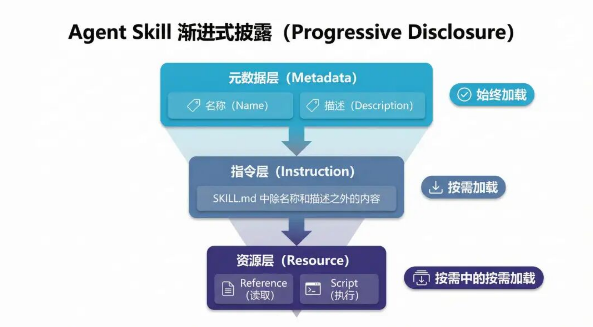

#### **Skills 目录结构与设计**

```
your-skill-name/
├── SKILL.md              # Required - 核心入口文件
├── scripts/              # Optional - 可执行代码
│   ├── process_data.py   # 示例脚本
│   └── validate.sh       # 示例脚本
├── references/           # Optional - 参考文档
│   ├── api-guide.md      # 文档示例
│   └── examples/         # 示例文件
└── assets/               # Optional - 静态资源
    └── report-template.md # 模板示例
```

##### **Skills 的标准目录结构是什么？**

标准目录结构包括 SKILL.md（Required 核心入口）、scripts/（Optional 可执行代码如 process_data.py、validate.sh）、references/（Optional 参考文档如 api-guide.md、examples/）、assets/（Optional 静态资源如 report-template.md）。

主要包含的文件是 SKILL.md（必需，公开包含 Yaml/MDBody，Yaml 在文件开头，配合基础工具集能完成大部分任务，不应该比 YAML 长太多认真设计就能做到）、Scripts（可选，Agent 使用的确定性脚本和辅助脚本放在 SKILL 文件夹任意位置按规约运行）、References（可选，方法和辅助文档库如格式化文本知识规约）、Assets（可选，存放模板 SKILL 脚本需要的静态资源）。

设计原则是 Anthropic 官方建议 SKILL 正式版提交时尽量减少 SKILL MCP 等外部依赖，结构清晰职责分明每个目录用途明确。

##### **如何设计一个好的 SKILL.md？**

设计原则看几个方面。单责单焦,每个 SKILL 聚焦一个领域的操作流程,比如 frontend-design skill 专注前端设计流程,避免一个 SKILL 包罗万象。

功能颗粒度要合适。过粗的话一个 SKILL 包含太多功能难维护,过细的话需要组合多个 SKILL 才能完成简单任务。最佳实践是一个完整工作流程封装为一个 SKILL。

压缩优化导向很重要。用清晰简洁的 Markdown 传递信息,复杂逻辑写成 scripts,不要在 SKILL.md 中用自然语言描述算法。大量参考资料放 references 目录按需引用。

具体要点包括描述清晰,在 YAML frontmatter 中写清楚何时使用该 SKILL,让 Claude Code 能准确判断。功能要聚焦,避免贪多求全,一个 SKILL 只做一类事。流程要清晰,用标题、列表、步骤组织内容,Agent 一眼看出执行顺序。资源要外部化,大文档放 references,脚本放 scripts,SKILL.md 只保留核心流程和关键指令。可测试性也要考虑,设计时想好如何验证 SKILL 执行效果,可以在 scripts 中包含测试脚本。

##### **SKILL 与 MCP 如何配合使用？**

配合关系是 SKILL 编排工作流,MCP 提供外部能力。

工作流编排模式下,SKILL 定义多步骤工作流,每个步骤调用不同 MCP Server。比如客户入驻流程 SKILL 会调用 CRM、支付、邮件这些 MCP。MCP 配合模式,SKILL 协调多个 MCP Server 配合完成任务,处理 MCP 间数据传递和状态管理,像设计导出流程从 Figma MCP 到 Drive MCP 到 Linear MCP 再到 Slack MCP。迭代优化模式,SKILL 定义迭代式工作流,每次迭代调用 MCP 获取数据根据结果决定下一步,比如报告生成流程:获取数据、生成初稿、质量检查、修复问题、重新生成。

实战案例像智能文件存储,根据文件类型和大小选择合适的存储位置。SKILL 定义的决策树:检查文件类型和大小,大文件（>10MB）用 Cloud Storage MCP,协作文档用 Notion/Docs MCP,代码文件用 GitHub MCP,临时文件本地存储。每个分支调用不同 MCP Server,SKILL 负责决策逻辑,MCP 负责具体执行。

关键是 SKILL 不关心 MCP 实现细节,只关心"能做什么"。MCP 不关心业务流程,只提供"标准化能力"。两者解耦各司其职。

#### **Skills 实战应用**

##### **如何判断是否需要创建一个新的 SKILL？**

判断标准看几个方面。重复性工作,某个工作流程需要反复执行,每次步骤基本相同,适合封装成 SKILL。专业领域知识,需要特定领域专业知识和最佳实践,比如合规检查、支付处理、设计规范,这些知识不应该每次都靠 Prompt 传递。

多步骤协调,任务包含多个步骤,需要协调多个工具,步骤间有依赖关系或条件分支,SKILL 可以固化协调逻辑。确定性流程,执行流程相对固定不需要频繁调整,有明确输入输出规范,可以标准化为 SKILL。跨项目复用,流程不只适用当前项目,可以在多个项目或团队中复用,值得投入精力封装成标准 SKILL。

典型应用场景像代码审查（Sevey-code-review）,重复性高每个 PR 都需要审查,有明确审查标准和流程,可以调用 GitHub MCP 获取代码。前端设计（Frontend-design）涉及 Figma、代码生成、样式管理等多个环节,需要遵循设计规范和最佳实践,可以封装设计到代码的完整流程。客户入驻（Onboard New Customer）包含创建账户、设置支付、发送欢迎邮件等步骤,每个步骤调用不同 MCP Server,固定流程适合 SKILL 封装。

不适合创建 SKILL 的场景:一次性任务不会重复执行、流程极简单只需要一两步、高度定制化每次执行都不同、已有现成 SKILL 可以满足需求。

##### **SKILL 与 Prompts 有什么区别？什么时候用 SKILL 什么时候用 Prompt？**

Prompts 是一次性指令对话结束后消失,Skills 是持久化封装可以长期复用。复杂度上 Prompts 适合简单直接的指令,Skills 适合复杂多步骤的工作流。Token 消耗上 Prompts 每次对话都要完整输入重复消耗,Skills 按需加载渐进式披露能节省不少。标准化程度,Prompts 每次表述可能不同结果不稳定,Skills 标准化流程执行结果更一致。

用 Prompts 的场景:一次性任务不会重复、简单直接的指令（如"修复这个 bug"）、探索性任务流程不确定、快速验证想法。

用 Skills 的场景:重复性工作流程、需要固化的专业知识、多步骤协调任务、跨项目复用的标准流程、对 Token 消耗敏感的场景。

##### **Skills 的运行机制是怎样的？**

触发方式有几种。用户直接调用,输入 `/skillname` 或选择技能菜单,Claude Code 直接加载对应 SKILL.md。AI 自动匹配,用户描述任务后 Claude 根据 description 判断是否需要某个 SKILL,自动加载最匹配的。按需展示 Skill 列表,Claude Code 分析用户需求展示推荐的 Available Skills 供用户选择。

执行流程分几个阶段。请求理解与技能匹配,用户输入任务描述,Claude Code 遍历所有 SKILL 的 name 加 description 判断哪些相关。加载 SKILL.md,读取匹配的 SKILL.md 文件将内容注入当前对话上下文,Agent 获得执行该任务的"操作手册"。执行工作流,Agent 按 SKILL.md 中定义的步骤执行,调用必要的 MCP Server,运行 scripts 目录中的脚本,读取 references 中的参考资料。状态管理,记录执行进度处理异常和回滚保存中间结果。结果输出与反馈,返回执行结果给用户记录执行日志更新 SKILL 使用统计。

关键机制包括按需读取 references,SKILL.md 中可以指明"需要时读取 references/api-guide.md",Agent 只在需要时才读取不会一次性全部加载。脚本外部化执行,scripts 中的代码通过 shell 命令运行,Agent 只看脚本输出结果不需要阅读源代码。上下文压缩,执行完一个阶段后可以压缩历史上下文只保留关键信息丢弃细节,保持 Token 消耗在可控范围。

实践经验是设计良好的 SKILL 应该能在 Claude Code 中"无感"运行,用户只需要描述需求,SKILL 在后台自动完成复杂流程,就像用一个专业助手。

#### 你了解 Skills 自进化吗？

我理解的 Skills 自进化，是把 Agent 执行中的可复用程序性经验，沉淀为可加载、可验证、可回滚的外部 Skill，并通过后续任务反馈持续更新 SkillRepo，不是简单把历史对话存起来。

工程上至少包括六个环节：trace capture、skill candidate generation、verification gate、controlled edit、skill retrieval/loading、post-deployment evaluation。

现在主流路线大概有八类：Hermes 做在线使用中创建和 patch；Trace2Skill 从批量轨迹里离线蒸馏 SOP；CoEvoSkills 引入生成器和 surrogate verifier 共进化；SkillX 把 Skill 分成规划、功能、原子三层做知识库；SkillClaw 做多用户集体演化；SkillOpt 把 Skill 文档当成外部参数做受控文本优化；SkillOS 学一个 curator 来管理 SkillRepo；SKILL0/Skill1 更偏 RL，分别做 skill internalization 和选择/使用/蒸馏的统一训练。

如果我在项目里落地，我会先做外部 Skill 闭环，不会一上来做在线权重更新。先保存 trace 和验证结果，让 Agent 生成候选 Skill，再用测试、规则、安全扫描和人工审核做门控。只有经过多轮验证的高频稳定 Skill，才考虑共享到 SkillHub 或进一步训练内化。

##### **追问一："为什么不能让 Agent 每次成功后都自动写 Skill？"**

单次成功轨迹里有大量偶然因素，直接固化会把局部经验写成全局规则。更稳的做法是先进入候选池，结合多条成功/失败 trace 做归纳，再用 verifier 或回归集验证。对于高风险 Skill，还要有人审、灰度发布和回滚机制。

##### **追问二："Skill 和 Memory 有什么区别？"**

Memory 更偏事实和状态，回答"是什么"；Skill 更偏流程和操作，回答"怎么做"。Memory 可以记录用户偏好、环境细节、工具 quirks；Skill 应该记录任务触发条件、执行步骤、坑点和验证方式。二者都能自进化，但 Skill 的风险更高，因为它会直接指导 Agent 行动。

##### **追问三："你怎么评估一个 Skill 是否真的有用？"**

不能只看最终成功率，要看 skill-aware 指标：检索命中是否准确、加载后成功率是否提升、平均工具调用和 token 是否下降、失败类型是否减少、是否引入安全风险。最好做 no-skill、human-skill、self-evolved-skill 三组对照，并保留 trace 方便失败归因。

### **Harness Engineering**

#### **Harness Engineering 核心概念**

##### **什么是 Harness Engineering？**

Harness Engineering 是通过设计和优化 AI 模型运行的外部环境来提升 Agent 系统可靠性的工程方法。这里的"外部环境"指模型权重之外的组件：工具体系、权限管控、Hooks 机制、上下文管理、多 Agent 协调等。

解决的问题很明确：纯靠模型和 Prompt 保证不了 Agent 行为稳定性，需要确定性约束机制而不是概率性语言指令，要让 Agent 从机制上"不可能犯错"而不是"尽量不犯错"。

当 Agent 出问题时，不是反复调 Prompt 让它"记住"正确做法，而是改 Harness 环境让它机制上不可能犯同样的错。这是从"软约束"到"硬约束"的转变。

##### **Harness Engineering 与 Prompt Engineering、Context Engineering 有什么演进关系？**

这是 AI Agent 工程方法论的三个演进阶段。

Prompt Engineering（2023-2024）通过精心设计的文本指令引导模型行为，核心是"对齐意图"。但依赖模型理解能力，行为不确定，同样的 Prompt 可能产生不同结果。

Context Engineering（2025）通过动态注入相关信息（如 RAG）提升输出质量，核心是"上下文增强"。但仍然在"输入层"做文章，提供不了确定性保障。

Harness Engineering（2026）从系统层面设计运行环境，核心是"环境即约束"。用工具、权限、Hooks 等机制提供确定性约束，不依赖模型的"记忆"。

演进逻辑是从"教会 AI"到"喂给 AI"再到"管住 AI"。最佳实践是三者结合：用 Harness 保障底线，用 Context 提供信息，用 Prompt 发挥智能。

##### **Harness Engineering 的设计边界在哪里？**

Harness 不是越多越好，过度约束会适得其反。

**边界一**：不要约束 AI 能自己发现的东西。错误做法是在 Harness 里详细规定命名规范，正确做法是提供 linter 自动格式化。

**边界二**：不要把所有可能情况都预设。错误做法是为每种错误都写专门的 Hook，正确做法是设计通用错误处理流程。

**边界三**：不要限制 AI 的探索空间。错误做法是强制 AI 按 A→B→C 顺序执行，正确做法是只要求达到目标，路径让 AI 规划。

设计原则是少而精，默认信任，渐进增加，定期审查。Harness 的目标是"防止灾难"，不是"指导每一步"。

#### **Anthropic 的 Harness 架构**

##### **Anthropic Harness 架构包含哪些核心组件？**

Anthropic 的 Harness 架构体现"可拆解性"和"外部可检查性"的设计哲学，是一个多层防御体系。

六大组件：

- App Spec / PRD 明确 Agent 要做什么、边界在哪里，形成结构化需求文档；
- Initiator Agent 专门负责项目初始化，设置基础结构，不做具体实现；
- Coding Loop Agent 负责核心开发工作，持续迭代，每次只改一小部分；
- External Memory 跨会话存储 Agent 工作状态和历史，支持长期任务；
- Deterministic Validation 用自动化测试替代 AI 主观判断，保证质量标准一致性；
- Sandbox / Isolation 让 Agent 在隔离环境中试错，失败不影响真实系统。

这个架构让每个组件都可独立测试、可观测、可替换。

##### **Anthropic 的 Human-in-the-loop 有什么特别之处？**

Anthropic 对 Human-in-the-loop 的定位不是"人工审核"，而是"共享控制权"（Shared Agency）：AI 和人类是协作关系。

实现方式分别是

- 决策点暴露：明确标记哪些决策点需要人工确认，不是"全部给人看"，而是"关键点给人看"
- 渐进授权：初期高频确认建立信任，中期常见操作自动执行，后期 AI 自主完成人类抽查
- 可解释的决策：AI 不仅报告"做了什么"，还要解释"为什么这么做"和"还有什么其他选项"
- 事后审计：即使操作已自动执行，也留下完整日志，人类可事后审查
- 设计原则：默认信任关键确认，提供上下文而不是简单选择题，可撤销优于可阻止，学习人类偏好减少重复确认。

##### **Anthropic Harness 工程实践有哪些关键要点？**

工程实践要点包括：

- 外部调试工具：不让 AI 自己生成调试代码，提供专门工具
- 预设示范工程：给 Agent 看完整的示例项目结构
- 提示示范工程：任务开始后根据具体情况再次展示相关示例
- 开 Agent 循环即 Swarm 模式：多个专门化 Agent 协作，每个聚焦一个领域
- 建模关系：Context Bot 模拟低权限代码模块，Hallucinated Completion 用"生成填空"替代"生成整体"
- 深度辅助：提供多层次帮助系统
- Guard Rails + Checkpoints：在关键节点设置检查点，用 Agent 验证 Agent
- Handoffs：处理跨会话状态传递
- Human-in-the-loop：在关键决策点引入人工确认

这些要点共同特征是强化确定性、可控性和可观测性。

#### **Harness 实战应用**

##### **如何设计有效的 Guard Rails + Checkpoints 机制？**

目的是在 Agent 执行长流程任务时设置关键检查点，防止"走太远才发现走错路"。

设计要点：

- 检查点位置选择要设在"自然断点"（一个子任务完成准备开始下一个）或"高风险点"（即将执行不可逆操作前）；
- 检查内容设计包括自动化检查（语法错误、类型错误）、业务逻辑检查（是否符合需求规范）、一致性检查（新代码与已有代码是否冲突）；
- 检查失败处理策略分三级，轻微问题警告但继续记录日志，严重问题阻止继续回退到上一个 Checkpoint，致命问题终止流程通知人类介入；
- 用 Agent 检查 Agent，设置独立的 Validator Agent 专门负责质量检查，Validator 的 Prompt 应该"挑刺"而不是"认可"。

关键点是 Checkpoint 要有明确的"通过标准"，不是模糊的"看起来还行"。每个 Checkpoint 开销要可控，形成"实现-检查-修复"的快速迭代循环。

##### **什么是 Hallucinated Completion 和 Model Drift？如何应对？**

Hallucinated Completion（幻觉补全）是 AI 生成代码时不基于实际代码库状态，而是"想象"出不存在的函数、变量、API。典型表现是调用项目中不存在的工具函数，使用库实际没有的 API。

Model Drift（模型漂移）是在长对话中，AI 逐渐偏离原始需求或代码风格，生成内容前后不一致。典型表现是开始用 TypeScript 后来变成 JavaScript，或者忘记之前的设计决策做出冲突改动。

针对 Hallucinated Completion 的应对策略：用 Context Bot 提供准确的代码库索引，明确告诉 AI 当前项目有哪些可用函数；用 Deterministic Validation 生成后立即运行静态分析；渐进式生成，先生成大纲再逐步填充，每步基于已确认内容。

针对 Model Drift 的应对策略：定期重新注入关键信息，每隔几轮对话重新强调需求规范；用 Incremental Update 替代 Full Rewrite，只修改变化部分；运行 linter、formatter 强制统一风格；设置"锚点"（Anchor），在关键文件开头添加设计原则注释。

两者共同点：不能完全依赖 AI 的"记忆"，要用 Harness 提供可靠的外部支撑。

##### **如何实现有效的 Handoffs（会话间交接）机制？**

AI 单次对话有 Token 限制，长期任务无法一口气完成。如果没有 Handoffs 机制，每次重新开始就像"失忆"，之前的工作成果和上下文都丢失了。

三个层次的实现方式：

- 基础状态保存（Session 级别）要保存当前任务进度、关键决策、错误历史，写入 External Memory（数据库、文件系统），新会话开始时读取状态文件提示用户从断点继续；
- 上下文压缩（Context 级别）用 AI 对之前对话进行摘要只保留关键信息，每 10 轮对话触发一次摘要，摘要结果存入 External Memory 原始对话归档；
- 工作成果复现（Artifact 级别）与其传递"过程"不如传递"结果"，上一个 Session 生成的代码文件直接留在项目里，新 Session 的 Agent 通过"读文件"来"恢复记忆"。

注意事项：

- 不要过度保存，只保存"对未来有用的"；
- 版本冲突处理需要 Conflict Detection 机制；
- 多用户协作要记录"谁做了什么"；
- 隐私和安全，状态文件需要加密存储。

#### **Harness 设计原则**

##### **在实际项目中如何判断哪些地方需要加强 Harness？**

三个判断维度：

- 影响范围：影响用户数据、线上服务、资金流动必须加 Harness，只影响开发环境、临时数据可选）；
- 错误成本：出错后难以恢复、造成永久损失必须加 Harness，出错后可以重试、回滚可选）；
- 出错概率：Agent 在这类任务上历史错误率高必须加 Harness，Agent 表现稳定可选）。

典型场景：

- 数据库写操作：影响范围大错误成本高，措施是写入前 Schema 校验、限制单次操作记录数、记录审计日志；
- API 调用：可能产生费用影响外部系统，措施是设置调用频率限制、记录所有调用、敏感 API 需人工确认；
- 权限变更：安全风险高影响范围大，措施是所有权限变更需人工审批、记录变更前后状态；
- 代码生成：可以回滚出错概率中等，措施是生成后自动跑测试、测试不通过不提交；
- 文档生成：影响范围小易于修正，措施是人工最终审阅即可不需要复杂 Harness。

Harness 不是越多越好，关键是在高风险点精准设防。

##### **如何衡量 Harness 系统的设计质量？**

- 可靠性（Reliability）： Harness 能否有效防止错误，看线上事故率（加 Harness 前后对比）、高风险操作拦截成功率；
- 可用性（Usability）： Harness 会不会成为效率瓶颈，看 Agent 平均任务完成时间、误拦截比例、人工介入频率；
- 可观测性（Observability）：出问题时能否快速定位，看日志覆盖率、问题定位时间、审计完整性；
- 可扩展性（Extensibility）：新增功能时 Harness 容易调整吗，看新增一条规则的时间成本、规则冲突率、配置复杂度；
- 可维护性（Maintainability）：Harness 自己会不会成为技术债，看过时规则占比、规则重复度、文档完整性。

### Loop Engineering

#### 谈谈Loop Engineering

我理解的 Loop Engineering，是把人反复给 Agent 下指令、检查结果、继续追问的过程，设计成一套可以自动运行的反馈闭环。

它主要解决四个问题：

1. Agent 下一步做什么；
2. 当前结果是否合格；
3. 失败以后重试、换方案还是转人工；
4. 什么情况下停止运行。

从架构上看，Loop Engineering 位于 Agent Harness 之上。

Harness 负责 Agent 单次运行所需的环境，例如上下文、工具、Skills、沙箱、权限、日志和状态持久化。Loop 负责反复调用 Harness，根据每一轮的执行结果，生成下一轮任务，让系统持续向长期目标推进。

一个比较完整的 Loop 通常包含几个部分：

- Trigger 和任务发现，例如定时扫描 GitHub Issue 或 CI 失败；
- 任务拆分与调度，决定优先级以及交给哪个 Agent；
- Agent 执行，通过 Harness 调用工具、修改代码；
- Verifier，通过测试、规则、Rubric 或独立 Agent 验证结果；
- State 和 Memory，记录已经完成的任务、失败原因和中间产物；
- 迭代策略与停止条件，包括最大重试次数、Token 预算、超时和人工升级。

例如，在 CI 修复场景中，Loop 可以每天扫描过去 24 小时的失败任务，读取日志并分类；对能够复现的低风险问题创建 worktree，让 Coding Agent 尝试修复；修改完成后运行测试，再交给 Verifier Agent 审查 diff；验证通过就创建 Draft PR，连续两轮失败或者涉及高风险模块则转交人工。

**个人观点：**

Loop Engineering 这个名称比较新，但它使用的很多组件已经存在于工作流引擎、状态机、CI/CD、任务调度和控制系统中。现在的变化是 Agent 可以理解非结构化信息、动态选择工具并调整下一步策略，所以 Loop 从固定流程逐渐变成了带语义判断能力的自适应流程。

#### 追问：Agent 本身不就有循环吗？

Agent 内部通常也有 Plan、Act、Observe 循环，它解决的是一次任务执行过程中的推理和工具调用。Loop Engineering 讨论的是外层循环，例如什么时候启动一个 Agent、给它什么任务、怎样验证结果、怎样保存进度、失败后是否重新启动，以及什么时候结束整个长期任务。

#### 追问：Verifier Agent 会不会也判断错？

会，所以不能只依赖另一个模型的主观评价。验证信号应该分层设计：优先使用可执行测试、编译结果、类型检查、数据库约束等确定性信号；再使用规则和 Rubric；最后才使用 LLM Judge。涉及生产发布、数据删除、资金或权限变更时，还要加入人工审批。

#### 你认为实现Loop Engineering的难点在哪里？

我认为 Loop Engineering 最难的地方有三个。

第一是可验证性。Agent 生成了结果，不代表任务真的完成，需要测试、静态检查、业务规则或者独立评审提供外部信号。

第二是状态连续性。长期任务很容易跨越多个上下文窗口，所以进度、决策和失败记录需要保存在模型上下文之外。

第三是边界控制。Loop 必须具备预算限制、权限隔离、回滚机制、无进展检测和人工审批节点。

因此，一个成熟的 Loop 应该实现有边界的自治：任务可拆分、结果可验证、失败可恢复、高风险操作可升级。

### Claude Code

#### **Claude Code 基础概念**

##### **Claude Code 是什么？有什么特点？**

Claude Code 是 Anthropic 推出的 AI 编程助手，通过命令行或桌面应用运行。它把 Claude 模型能力封装在结构化的工具体系和权限管控机制里，让 AI 能在本地环境执行开发任务。

**核心特点**：

全能编程助手

支持 API Key、Arkose 验证、Markdown/Cursor/Bash 等多种输入方式，集成 GitHub、Slack 等外部工具（通过 MCP 协议），可以编写代码、运行测试、创建 PR、部署应用。

权限管控体系

五道权限链层层把关：参数校验 → PreToolUse Hooks → 三类规则匹配 → 工具自检 → AI classifier。被拒绝的工具连 schema 都不会发给模型，从根源消除风险。用户可以通过 Hooks 注入自定义逻辑，不用改源代码。

工作流自动化

Checkpoints 机制定期保存工作状态，Plan Mode 让 AI 先规划再执行，支持 Subagent 并行处理多个任务。

##### **Claude Code 与 CLAUDE.md 是什么关系？**

CLAUDE.md 是 Markdown 格式的项目配置文件，Claude Code 启动时自动读取它来理解项目规范和约束。

**工作原理**：

项目知识注入

Claude Code 启动时自动查找项目根目录的 CLAUDE.md，将其内容注入 System Prompt，成为 AI 的"项目宪法"，相当于给 AI 提供了一份项目专属的行为准则。

分级规则系统

Rules 文件分三级定义规则：项目根目录、全局配置、用户配置，优先级是项目 > 全局 > 用户。Claude Code 启动时自动加载并合并所有规则。

**典型内容**：

包括项目描述和技术栈、编码规范（如 React + TypeScript + Vite）、文件结构说明、测试要求、最佳实践和注意事项。

**注意**：ETH Zurich 研究发现，自动生成的 CLAUDE.md 可能让 Agent 表现下降，因为过于详细的规则会增加认知负担。最佳实践是保持简洁，只放模型自己无法发现的关键约束。

##### **Claude Code 的三种交互模式是什么？**

**键入模式（默认）**

在终端输入命令后 Claude 直接执行，适合快速执行单条指令、调试代码、查看结果。示例：`claude "fix the bug in login.ts"`。

**accept edits.on 自动接受模式**

AI 生成的代码修改自动应用，不需要人工确认。适合信任度高的场景、批量修改、自动化流程，但可能引入意外修改，建议配合 git 版本控制。

**Plan Mode（规划模式）**

AI 先制定计划，用户审核后再执行。适合复杂任务、多步骤操作、高风险变更。流程是：用户提需求 → AI 生成计划 → 用户确认 → AI 执行。

**选择建议**：

简单任务用键入模式（快速高效），复杂任务用 Plan Mode（先规划后执行），自动化场景用 accept edits.on（减少交互）。Plan Mode 下 AI 会更谨慎，适合首次接触项目或重要功能开发。

#### **Claude Code 核心机制**

##### **Checkpoints 机制是如何工作的？**

Checkpoints 是定期保存机制，防止长任务中途失败导致工作丢失。

**工作方式**：

自动保存时间点

输入 /rewind 触发手动保存，执行重要操作前自动创建快照（如运行测试、提交代码），在 /checkpoints 查看所有保存点。

状态快照内容

包括当前对话上下文、文件修改记录、已执行的命令历史、AI 的推理过程。

回滚和恢复

使用 /checkpoints 查看所有保存点，选择特定保存点恢复，可以"时光倒流"到之前状态。运行 `npm install` 等命令时，建议先创建 Checkpoint。

**实践建议**：

重要操作前手动 `/rewind`，定期检查 `/checkpoints` 确保关键节点已保存，遇到问题时优先回滚到最近的稳定状态，而不是继续往前试错。

类比：Checkpoints 就像游戏的存档点，可以在关键节点保存进度，出问题时读档重来。

##### **Hooks 机制的作用是什么？有哪些类型？**

Hooks 是 Claude Code 在执行特定操作前后自动运行的 shell 脚本，让用户在不修改源代码的前提下注入自定义逻辑。

**六种 Hooks 类型**：

1. **PreToolUse**：工具调用前执行（拦截、修改）

2. **PostToolUse**：工具调用后执行（日志、反馈）

3. **UserPromptSubmit**：用户提交 Prompt 时执行

4. **Stop**：Claude 试图停止时执行（强制补充动作）

5. **PreCompact**：上下文压缩前执行（保存关键信息）

6. **Notification**：收到通知时执行

**典型使用场景**：

自动化测试（PostToolUse Hook）：每次代码修改后自动运行测试，示例：`if write 或 edit → run test`。

权限审计（PreToolUse Hook）：记录所有敏感操作（如文件删除），在执行前发送通知或请求人工确认。

强制流程（Stop Hook）：Claude 试图停止前强制运行测试，防止"改了代码没测试就说完成了"。

**配置方式**：在 settings.json 中配置 Hooks，无需修改 Claude Code 源码。这是 Harness Engineering 的典型实践——用确定性机制替代概率性 Prompt。

##### **MCP是什么？与 Hooks 有什么区别？**

MCP 是 Anthropic 提出的标准化协议，让 AI Agent 可以连接外部系统（如数据库、GitHub、Slack）并调用它们的能力。

**MCP 与 Hooks 的区别**：

定位：MCP 连接外部世界（获取数据、调用外部 API），Hooks 控制内部行为（拦截、日志、审计）。

触发方式：MCP 是 AI 主动调用外部工具获取能力，Hooks 是 Claude Code 在特定时机自动执行脚本。

实现层次：MCP 是标准化协议，跨工具通用（Claude Code、Cursor 等都支持），Hooks 是 Claude Code 特有机制，用户自定义 shell 命令。

**协同关系**：

常见组合是 PreToolUse Hook + MCP Server。示例：调用 GitHub MCP 前，先用 Hook 检查权限、记录操作日志。相当于 Hooks 是"守门员"，MCP 是"工具箱"。

**常见 MCP Server**：

Figma MCP（读取设计稿）、GitHub MCP（管理仓库、创建 PR）、Supabase/Rails MCP（数据库操作）、Gmail/Calendar MCP（邮件和日历）。

MCP 解决"Agent 去哪拿数据"，Hooks 解决"Agent 如何被管控"。

#### **Claude Code 高级功能**

##### **Subagent 是什么？什么时候使用？**

Subagent 是 Claude Code 启动的子 Agent，用于并行执行独立任务或处理特定职责。主 Agent 将任务委派给多个 Subagent，它们各自独立工作，完成后汇报结果。

**典型使用场景**：

并行执行独立任务：同时运行前端测试和后端测试，节省时间，两个 Subagent 同时工作。

专业化分工：一个 Subagent 负责代码生成，另一个负责测试编写，每个 Agent 专注自己擅长的领域。

隔离上下文：主 Agent 上下文接近上限时，启动 Subagent 处理新任务，避免主 Agent 上下文被污染。

**调用方式**：

主 Agent 说"启动 Subagent 执行 X 任务"，Subagent 在后台工作，完成后返回结果。输入 `/agent + Create new agent` 创建新 Subagent。

**注意事项**：

Agent Skill 可以互相调用（主 Agent 调 Subagent，Subagent 间也能互调）。Subagent 有独立上下文，不会看到主 Agent 的对话历史。需要明确告诉 Subagent 任务目标和所需信息。

##### **Token 优化机制有哪些？**

Claude Code 需要处理长对话和大型项目，Token 管理很关键。通过多种机制节省 Token 消耗。

**六种优化机制**：

渐进式披露（Progressive Disclosure）：Skill 三层加载（元数据 → 指令层 → 资源/代码），只在需要时才读取详细内容。

上下文压缩：定期压缩历史对话，保留关键信息，丢弃冗余细节。

外部化存储：代码脚本存在文件系统，运行时只看输出结果。参考文档按需读取，不全部加载到上下文。

Checkpoint 精简：保存状态时只保留必要信息，不保存完整对话，只保存决策和结果。

Subagent 隔离：不同 Subagent 独立上下文，避免共享污染。只传递必要结果，不传递完整上下文。

选择性 API 调用：只在必要时调用 MCP Server，缓存 API 结果，避免重复请求。

**实践建议**：90% 的用户用 Sonnet 模型就够了，速度快、成本低。只有极高并发或复杂推理才需要 Opus。

##### **Session、Plan Mode、Stop Hook 的关系和使用场景？**

**三者定位**：

Session 文件：工作状态的持久化存储，在 `~/.claude/sessions/` 目录下，记录当前对话、修改历史、上下文状态，可以随时暂停工作，下次继续。

Plan Mode：规划优先的执行模式，AI 先制定详细计划、用户审核，适合复杂任务、多步骤操作，防止 AI"边做边想"导致方向错误。

Stop Hook：强制补充动作的拦截器，Claude 试图停止前自动触发，可以强制运行测试、提交代码，防止 AI"干了一半就说完成"。

**协同关系**：

复杂项目开发：开启 Plan Mode → AI 生成计划 → 用户确认 → 开始执行 → 执行过程中 Session 持续保存 → AI 认为完成时 Stop Hook 触发强制测试 → 测试通过后真正完成，Session 保存最终状态。

中断与恢复：工作到一半需要离开 → Session 自动保存 → 第二天加载 Session 继续 → 不需要重新解释背景，AI 直接从断点继续。

**实践建议**：

复杂任务开启 Plan Mode（`Shift + Tab`），关键操作配置 Stop Hook 强制检查，长期任务依赖 Session 机制，随时可中断。

这三者结合，让 Claude Code 从"一次性对话工具"变成"长期协作伙伴"。

### Vibe coding

##### **Vibe Coding 的核心理念是什么？**

五大核心理念分别是感觉（Vibe）、实验（Experiment）、节奏（Rhythm）、迭代（Iteration）、协作（Collaboration）。

感觉（Vibe）强调开发体验应该流畅自然，当开发过程"感觉对了"代码质量通常也是好的，避免过度设计和过早优化。

实验（Experiment）鼓励快速尝试不同方案看哪个效果好，不用担心"试错成本"因为 AI 可以快速生成多个版本，鼓励探索性开发。

节奏（Rhythm）强调保持开发的节奏感和连贯性，避免被技术细节打断思路，让 AI 处理重复性工作开发者专注创造性思考。

迭代（Iteration）主张从最简版本开始逐步完善，每次迭代都可以运行和验证，形成快速反馈循环。

协作（Collaboration）认为人与 AI 是协作关系不是上下级，AI 理解意图人类做决策，互相补充共同完成目标。

实践意义包括降低编程门槛让非专业开发者也能构建应用，提升开发效率让专业开发者更快实现想法，改变软件开发的经济模型从"人力密集"到"创意密集"。

Vibe Coding 不是让 AI 替代开发者，而是让开发者从"编码工人"升级为"产品设计师"。

##### **Vibe Coding 的典型工作流程是什么？**

五个开发阶段分别是感觉描述（Vibe Description）、初始架构（Initial Structure）、迭代开发（Iterative Development）、修正（Refinement）、提炼上下文（Context Distillation）。

感觉描述阶段用自然语言描述想要的产品或功能，不需要技术术语就像跟朋友聊天一样，比如"我想做一个任务管理器干净简洁像 Notion 一样好看"。

初始架构阶段 AI 根据描述生成项目骨架包括目录结构基础文件依赖配置，开发者快速验证方向是否正确。

迭代开发阶段逐步添加功能每次迭代都可运行，用自然语言反馈如"这个按钮太大了""加个搜索功能"，AI 理解反馈并修改代码。

修正阶段调整细节优化体验，可以指定具体修改如"用蓝色主题""表格加排序功能"，AI 精准修改相关代码。

提炼上下文阶段总结开发过程中的关键决策形成项目的"记忆"方便后续维护，AI 可以理解项目历史做出更好的修改。

具体示例是开发待办事项应用：第一步描述需求"做一个极简待办应用支持添加完成删除任务"；第二步 AI 生成初始版本创建 HTML/CSS/JS 文件实现基本的任务增删改查可以运行看效果；第三步迭代优化"任务完成后应该有划线效果""加个优先级标签高优先级用红色""支持拖拽排序"；第四步细节调整"字体太小了调大一点""加个暗色模式切换"。每一步都能看到效果，整个过程像"雕刻作品"而不是"搭建框架"。

## 大模型评测

#### **评测流程设计**

##### **如何设计一个 LLM 评测流程？**

设计从数据搜集到榜单分数的完整评测流程，不涉及训练，只做推理评测。

1. 数据搜集接入与样本规范化：确定评测数据来源如 MMLU、GSM8K 等公开数据集、自建数据、行业数据，统一数据格式定义输入输出 schema 支持分类生成选择题等任务类型，数据质量检查去重清洗标注一致性验证；
2. Prompt 模板设计与版本管理：为不同任务类型设计 prompt 模板包括 zero-shot、few-shot、CoT，支持多版本 prompt 管理每次修改记录版本号变更原因，模板参数化支持动态插入示例调整指令风格；
3. 推理参数管理与复现性保证：固定推理参数 temperature、top_p、max_tokens、随机种子，记录所有超参数配置确保实验可复现，支持批量推理 API 调用管理重试机制速率控制；
4. 输出后处理：解析模型输出提取答案处理格式错误，答案标准化统一大小写去除多余空格处理特殊字符，异常处理模型拒答超长输出解析失败的兜底策略；
5. Metric 计算：定义评测指标准确率 F1 BLEU ROUGE 通过率等，实现自动化计算 exact match 模糊匹配基于规则的判断，对于主观题设计 judge model 评分或人工标注流程；
6. 避免"测出来的提升只是偶然波动"：统计显著性检验使用 bootstrap 或 t-test 验证提升是否显著，多轮测试取均值同一配置跑多次计算置信区间，分层分析按难度类型领域拆分避免整体指标掩盖局部问题；
7. 验证模型本质变化而非 prompt 技巧：对比多个 prompt 版本如果换个 prompt 分数大变说明模型不稳定，跨任务迁移测试在相关任务上验证看能力是否泛化，失败案例分析人工查看错误样本判断是理解问题还是 prompt 问题。

##### **说两个你熟悉的 benchmark 类型，说明它们容易被"假提升"污染的地方**

"假提升"是榜单分数提高了但模型真实能力没变，通常是过拟合测试集或利用 prompt 技巧导致的。

选择题型（如 MMLU、C-Eval）容易被污染的地方包括：测试集泄露（模型训练时见过测试题或相似题目直接记住答案）、选项顺序敏感（模型可能倾向选择特定位置的选项如总是选 A，通过调整选项顺序可以刷分）、Prompt 工程过拟合（针对特定数据集设计 prompt 比如"请一步步思考"在 MMLU 上有效但换个数据集就失效）、答案格式利用（有些选择题答案分布不均匀比如正确答案更可能是较长的选项，模型学会了这些统计规律而非真正理解）。

代码生成型（如 HumanEval、MBPP）容易被污染的地方包括：测试用例记忆（模型在训练时见过 GitHub 上类似题目的解答直接复现而非真正理解）、测试用例覆盖不足（只通过几个简单测试用例不代表代码真正正确可能有边界情况未覆盖）、Prompt 模板过拟合（加上"# write a function to..."这种特定格式能显著提升分数但换个表述方式就不行了）、Pass@k 指标操纵（生成多个候选答案只要有一个通过测试就算成功但实际应用中用户只会看第一个答案）。

识别假提升的方法：在保留测试集上验证（真正不可见的数据）、人工审查生成内容质量而不只看自动化指标、测试 prompt 鲁棒性（稍微改变措辞分数不应该大幅波动）、跨数据集验证（在相似任务的其他数据集上测试看提升是否一致）。

##### **LLM 评测中如何设计 prompt 模板？如何管理多版本 prompt？**

Prompt 模板设计原则分三点：任务类型适配（分类任务明确说明类别列表要求输出类别名，生成任务提供格式示例说明输出长度要求，选择题清晰展示选项统一答案格式如"答案：A"）；Few-shot 示例选择（覆盖不同难度和题型包括简单例子和易错例子，保持示例质量人工验证答案正确性，控制示例数量通常 3-5 个避免超出上下文长度）；指令清晰性（避免歧义明确说明答题要求格式约束，引导思维链对于推理任务加入"让我们一步步思考"，输出格式约束用正则或结构化要求如 JSON 便于解析）。

多版本 Prompt 管理包括版本管理策略（每个 prompt 版本对应一个配置文件 YAML 或 JSON，记录版本号创建时间修改原因适用任务范围，使用 Git 管理 prompt 变更历史）、版本对比测试（新旧版本在同一测试集上运行对比指标差异，记录每个版本的榜单分数失败案例，统计显著性检验确保提升不是随机波动）、最佳实践（不要频繁修改 prompt 保持评测基准稳定，重大 prompt 变更后需要重新跑所有历史模型建立新基线，记录 prompt 失效案例哪些题目对 prompt 敏感哪些题目稳定）。

##### **如何处理 LLM 输出格式不规范的问题？**

输出后处理分三层策略。

第一层格式化解析：正则表达式提取匹配"答案：A"、"Answer: XXX"等模式，JSON 解析如果要求输出 JSON 先验证格式再提取字段，关键词定位搜索"答案是"、"选择"等关键词后的内容。

第二层答案标准化：大小写统一全部转小写或大写，去除冗余字符空格标点换行符，同义词映射如"positive"到"正面"、"yes"到"是"。

第三层异常兜底：模型拒答输出"我不知道"、"无法回答"标记为拒答样本，格式完全错误无法解析时尝试模糊匹配或人工介入，超长输出截断到最大长度或只取前 N 个 token。

实践建议包括记录解析失败率（如果失败率高说明 prompt 需要优化）、人工抽查（定期检查解析结果是否符合预期）、提供多种解析策略（优先严格匹配失败后降级到模糊匹配）。

##### **如何评估一个评测系统的质量？**

评估评测系统本身需要关注五个维度。

可复现性：固定随机种子多次运行结果是否一致，不同机器不同环境下结果是否相同，记录所有配置参数确保他人能复现。

鲁棒性：Prompt 微调敏感度稍微改变措辞分数不应剧烈波动，数据分布变化在相似但不同的数据集上测试，模型版本兼容性新旧模型都能正常评测。

覆盖度：任务类型覆盖分类生成推理代码等，难度分层简单中等困难题目都有覆盖，领域多样性不同行业语言场景。

效率：运行时间全量测试耗时是否可接受，并发能力能否批量处理支持多线程，成本控制 API 调用费用计算资源消耗。

可解释性：失败案例分析能否快速定位哪些样本失败为什么失败，分层指标按类别难度拆分而不只看整体准确率，可视化报告提供图表趋势分析。

#### **刷榜设计**

##### **假设你已有一个能稳定评分的 base model，如何系统性地刷榜？**

刷榜的本质是在不改变模型核心能力的前提下，找到能让评测指标提升的所有合法优化空间。

五个维度：Prompt 优化（尝试不同 prompt 模板 zero-shot、few-shot、CoT 思维链，调整指令风格更明确更简洁加引导语，Few-shot 示例优化选择与测试样本最相似的示例但不能直接抄测试集）；推理参数调优（Temperature 分类任务用低温度 0.1 生成任务适当提高 0.7，Top-p/Top-k 控制生成多样性影响创意类任务表现，Max tokens 确保不截断答案但也不要太长导致废话多，Beam search vs sampling 选择题用 greedy 开放生成用 sampling）；后处理优化（答案提取策略多种解析规则提高格式容错性，投票机制同一题目生成多个答案取多数投票结果，答案校准对于选择题分析模型对不同选项的置信度分布调整判断阈值）；针对性微调如果允许（在类似任务上做少量有监督微调，使用 LoRA 等轻量化方法避免过拟合，注意如果规则禁止微调这一步跳过）；集成与融合如果允许多模型（多个模型预测结果融合投票或加权平均，专家模型不同子任务用不同模型，Cascade 策略简单题目用小模型困难题目用大模型）。

刷榜的风险控制包括避免测试集泄露（不能直接在测试集上调参）、保持泛化能力（在多个相关数据集上验证不要只针对一个榜单优化）、记录所有改动（每次优化记录前后指标变化避免误判）。

##### **如果某个 benchmark 上 A 指标提升而 B 指标下降，如何判断要不要保留这个改动？**

判断框架分五步。

第一步明确指标优先级：核心指标 vs 辅助指标（如果 A 是核心指标如准确率，B 是辅助指标如推理速度优先保留），业务影响（哪个指标更接近真实使用场景的评判标准），用户感知（用户更在意哪个维度的表现）。

第二步分析指标间的权衡关系：是否是固有 trade-off（如准确率 vs 速度、精确率 vs 召回率），变化幅度（A 提升 5% 但 B 下降 1% 可能可以接受反之则不行），绝对值水平（如果 A 本来就很高 95%→96%，B 本来就很低 60%→58%，可能不值得）。

第三步失败案例分析：人工查看 B 指标下降的样本是哪些类型的题目变差了，判断是系统性问题还是个别 case（如果只是少数边缘样本影响较小），评估改动的副作用是否引入了新的 bug 或不稳定性。

第四步 Judge 标准对齐：如果 A 是 judge-based 指标（如 GPT-4 打分），B 是 exact-match，人工检查判断是否合理（judge 可能过于宽松或严格），多个 judge 交叉验证避免单一 judge 的偏见。

第五步记录实验并保留多版本：不要立即丢弃改动保留实验记录标注适用场景，A/B 测试在真实场景中测试用户偏好，条件保留针对特定任务类型应用不同策略。

核心原则是榜单分数不是唯一目标真实能力提升才是，谨慎对待单一指标综合多个指标多个数据集一起看，避免过度刷榜如果改动让模型在其他任务上表现变差要重新考虑。

##### **如何避免重复测试中的随机波动影响结论？**

统计方法包括四种。

多次运行取均值：同一配置运行 3-5 次计算均值和标准差，报告置信区间如"准确率 85.2% ± 0.8%"，如果标准差大说明结果不稳定需要增加测试轮数。

Bootstrap 重采样：从测试集中有放回抽样生成多个子集，在每个子集上计算指标统计分布，判断提升是否显著如果 95% 的子集都显示提升则认为显著。

统计显著性检验：使用 t-test 或 Wilcoxon 检验，设定显著性水平如 p < 0.05，避免多重检验问题如果测了 10 个改动用 Bonferroni 校正。

固定随机种子：对于确定性任务（如选择题）使用 temperature=0 和固定种子，对于生成任务固定种子并测试多个不同种子的结果。

实践建议包括小提升（<1%）需要更严格的验证大提升（>3%）相对可信，人工查看提升的样本确保是真正理解而非侥幸答对，交叉验证在相似数据集上测试看提升是否一致。

## 反问

1、团队的业务

2、团队的目标是什么，个人的目标是什么，如何平衡个人的目标与团队的目标之间的一致性或者不一致性

4、（小厂）有多少GPU资源

5、用什么指标去评价工作完成的好坏

6、北京去山东自驾游，安排一周左右时间，往返不走回头路，希望包含泰山、曲阜这两个景点，预算多少钱以内

我猜测你们可能会去检索行程库里已有的案例，但是如果基于已有的案例加工得出的回答，往往不能同时满足用户给出的这些条件。

还有如果没有检索到的话，可能会让LLM自行生成，但是对于这种路径规划类的问题，又常常会产生比较严重的幻觉问题，我用GPT4也试过，他可能会说，从北京出发去德州参观古城墙和古楼，这就有问题，因为德州没有古城墙和鼓楼。

还有比如说，他说让你第二天去太原游览，但其实他也不知道太原其实不是山东的

还有规划不合理问题，比如上午让你去泰山，下午去济南参观趵突泉，这种一天内根本无法完成

我能想到可能可以用一些tools，但是还有另外一个问题就是用的tools过多的话可能会对性能有一定的影响，怎么平衡tools的数量和性能的需求呢

7、跷跷板现象如何解决？

8、数据污染问题？

9、大模型相关技术当前的难点是什么？
