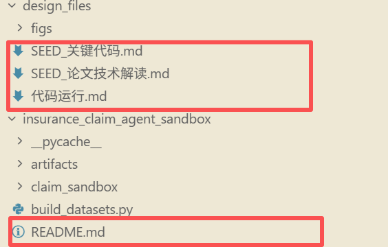

# 项目更新|保险理赔助手

> 来源（Source）：https://articles.zsxq.com/id_79e6aeigjw61.html  
> 日期：2026年09月15日 23:58

本项目主要面向算法岗，是一个**Skill进化的RL+OPD算法**的项目。

**面试准备文档：**

飞书链接：https://my.feishu.cn/wiki/Czbvw3ZFgilsOnkI5jocBiprnOc

密码：#B827769

还是老样子，去面试的时候如果问到了超出这个文档范围的问题，就：

1、在文档边上写评论、或者在这个帖子下面写评论，我看到就会补充

2、去原代码里找答案

3、看看《八股文速记》里面有没有

**代码：**

链接: https://pan.baidu.com/s/1gzofaCAViW0q1xCcgJlYgw?pwd=gj3k

提取码: gj3k

有同学说没有百度网盘的会员，所以夸克网盘也上传了一份：

我用夸克网盘给你分享了「居丽叶简历项目10：保险理赔助手」，点击链接或复制整段内容，打开「夸克APP」即可获取。

/~15fa3au7YI~:/

链接：https://pan.quark.cn/s/ae377fa15f19

**代码解读文档也在网盘里面：**

本项目工程的部分实现比较简单，主要实现了数据构造，奖励系统，harness几部分，更多工程细节参考[项目9行政助手Agent](https://t.zsxq.com/ZdX8S)。

代码与面试准备文档不一致的点：

1. 没有实际落地评测集和训练数据

2. 线上真实日志清洗链路没有落地（字段脱敏、会话切分、轨迹对齐、协议校验、冲突检测、质量分层、去重采样等）

3. 线上指标评测、压测、扩容、灰度发布和回滚没有实现

4. skill和action实现比较简单

5. 代码里只有基础回放和回归产物输出，没有完整的日志回放、bad case 分析、回归测试闭环，

技术栈：SFT、agentic RL、GRPO、OPD、verl、rubric、React、Agent、skills、harness。
