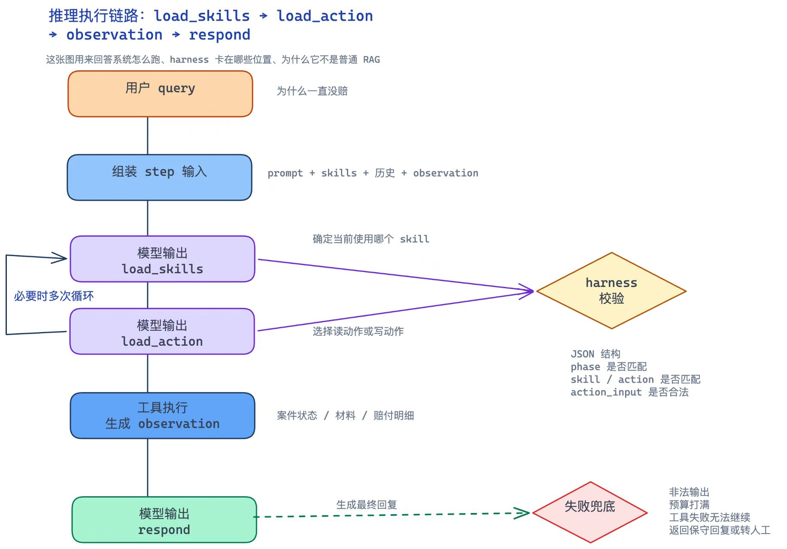
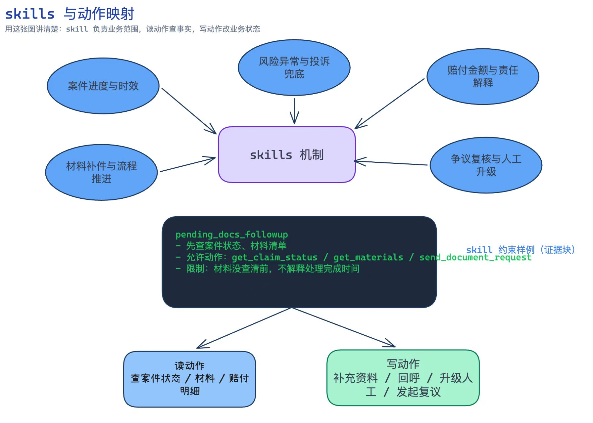
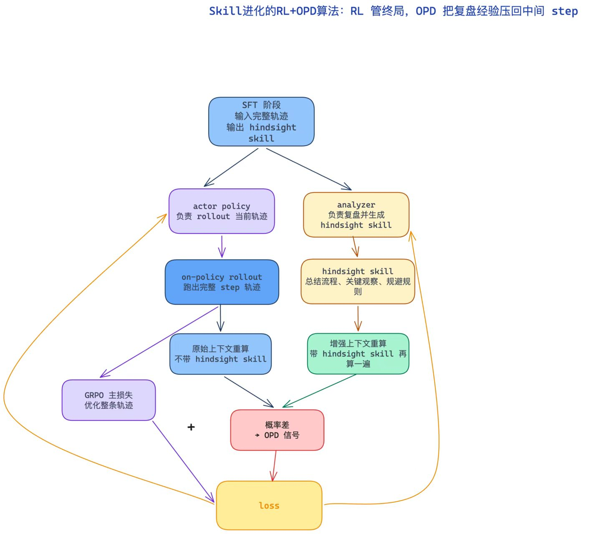
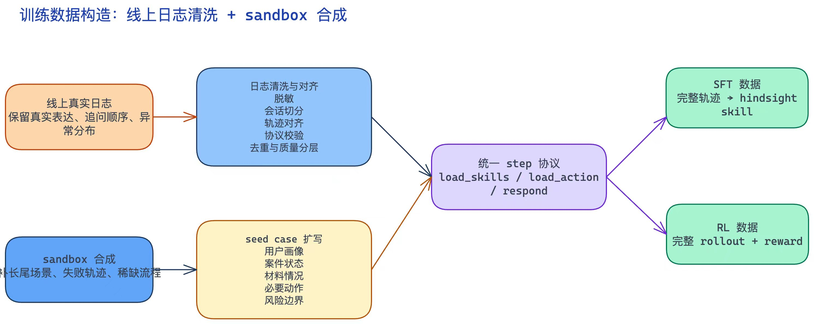
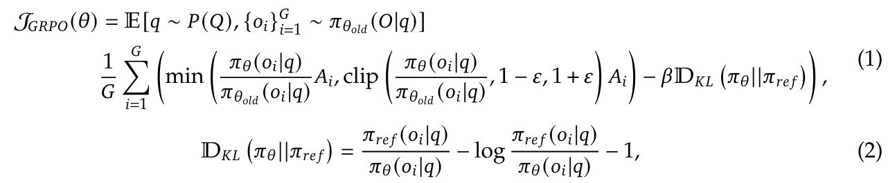
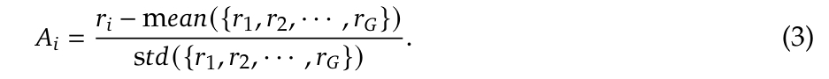

# 居丽叶的简历项目10：保险理赔助手

> 来源（Source）：https://my.feishu.cn/wiki/Czbvw3ZFgilsOnkI5jocBiprnOc

## 自我介绍

自我介绍不用展开，说清楚系统干什么、自己负责哪几块、用了哪些技术就可以了。

我本科毕业于xx大学，现在就读于xx大学。我有一段[实习/个人项目]的经历，做的是一个面向保险理赔客服场景的 Agent 项目，让模型在多轮理赔咨询里完成真实处置。我主要负责三块：

第一块是推理链路和每个 step 协议设计，把整个系统统一成 `load_skills`、`load_action`、`respond` 这套受控链路；

第二块是 skills、工具和 harness，把业务规则、工具调用和运行时控制拆开；

第三块是训练与评测，包括线上日志清洗、sandbox 合成数据、Skill进化的RL+OPD算法以及固定评测集回归。

这个项目目前离线处理准确率从 82.8% 提升到 91.9%，必要动作完成率从 78.6% 提升到 90.7%。以上是我的自我介绍，看您有什么感兴趣的。

## 简历写法

（仅供参考，可酌情删减，现在这个版本写得有点长了，而且是从项目owner的视角写的）

保险理赔智能体训练与推理系统 | [公司名称] 大模型算法工程师/实习生             [时间范围]（2026年4月及以后）

**项目背景**

保险理赔客服场景存在流程依赖强、写动作风险高、知识检索难以直接完成真实处置等问题。按固定规则查询案件信息，再生成客服回复的传统方案，在固定评测集上的处理准确率为 82.8%，必要动作完成率为 78.6%，难以满足多轮理赔咨询和处置需求。

**解决方案**

- **Agent链路设计**：围绕保险理赔场景设计 `load_skills`、`load_action`、`respond` 三段式 step 协议，把模型输出统一成 step 级决策，并将 skills、读写工具、harness、日志回放和回归测试接入同一套执行框架，保证训练、评测和线上运行使用同一协议。
- **skills与工具体系**：抽象了 20 个 insurance skills，覆盖进度查询、材料补件、赔付解释、争议复核、人工升级和风险兜底等核心场景；工具层按读写分离设计，读工具负责查询案件状态、材料清单和赔付明细等事实，写工具负责补充资料、回呼、升级人工和发起复议等业务动作，保证 skill 白名单和动作边界一致。
- **数据构造**：训练数据由线上真实日志清洗和 sandbox 合成两部分组成，统一转换成 step 协议后产出 SFT 与 RL 两类训练集；其中线上数据保留真实用户表达和异常分布，合成数据负责补高风险长尾场景、失败轨迹和稀缺流程。
- **训练方案**：SFT 阶段训练 hindsight skill 提取，让模型从完整轨迹中总结处理流程和规避规则；RL 阶段采用 GRPO + OPD 优化多步工具使用策略，其中 GRPO 负责优化整条轨迹的相对好坏，OPD 负责把 hindsight skill 的经验压回中间 step。
- **奖励与过滤**：设计由最终处置结果、流程合规、事实依据、链路效率、表达质量和风险惩罚组成的奖励系统，并根据总分、分项得分和风险项结果完成样本保留、改写、人工复核和丢弃，支撑 RL 训练和数据质量分层。
- **harness治理**：构建 harness 架构，约束协议合法性、skill 与动作匹配关系、失败兜底；推理阶段 harness 决定工具能否执行、何时终止和何时切换兜底回复，保证线上行为受控。

**项目成果**

- **离线效果**：在 500 条固定评测 case 上，处理准确率从 82.8% 提升至 91.9%，必要动作完成率从 78.6% 提升至 90.7%；幻觉率从 9.4% 降至 2.3%，硬违规率压至 1.6%。
- **工程与线上**：协议合法率稳定在 98.7% 以上，整体 P95 为 11.2s；200 并发下有效吞吐从 8.4 req/s 提升至 56.2 req/s（6.7 倍）；线上业务成功率为 89.6%，转人工率为 16.8%。

## **项目介绍**

先说背景，再说一开始怎么做的、遇到了什么问题、试了什么新方案、结论是什么，要突出迭代的过程。

我参与了保险理赔客服场景的 Agent 项目，模型在多轮理赔咨询里完成真实处置。它处理的问题集中在理赔流程推进，例如为什么一直没赔、材料已经传了为什么还没动、为什么只赔了一部分、能不能走人工复核、多久能处理完、当前到底卡在哪一步。

这个场景的难点主要有三类：

一是流程依赖强，很多问题必须先查案件状态、材料清单、赔付明细和当前处理节点，才能决定下一步怎么做；

二是会改业务状态的动作多，系统既要查询，也要执行补充资料、回呼、加备注、升级人工、发起复议这类动作；

三是风险高，时效、金额、审核结果这些内容一旦说错，投诉率和人工负载都会上升，所以整条链路必须受控。

我主要参与了三部分。

第一部分是推理链路和协议设计。

整个系统统一成 `load_skills`、`load_action`、`respond` 这套 step 协议，模型每一步只输出下一步动作。线上请求进来之后，系统先组装当前 step 的输入，包括 system prompt、候选 skills、用户信号、历史对话和最近 observation，模型只负责输出下一步动作。如果输出 `load_skills`，系统就加载当前轮要用的 skill；如果输出 `load_action`，harness 会先做协议校验、skill 归属校验和参数校验，校验通过后再调用底层工具；如果输出 `respond`，回复还要经过协议检查、风险检查和兜底判断，能放行才真正返回给用户。整条链路里，模型负责下一步做什么，执行权在 harness 和工具层手里。

第二部分是 skills、工具和 harness 设计。

项目里基于当前业务现状设计了 20 个 skills，覆盖案件进度与时效、材料补件与流程推进、赔付金额与责任解释、争议复核与人工升级、风险异常与投诉兜底五类核心场景。每个 skill 负责一类具体业务问题的处理，里面定义触发条件、需要先观察的内容、允许调用的工具、限制规则和输出约束。工具层按读写分离设计，读工具负责查事实，例如案件状态、时间线、材料清单、保单责任、赔付明细等，写工具负责改业务状态，例如补充资料、加备注、回呼、升级人工、发起复议等。harness 是推理时真正把模型接进业务链路的那一层，它负责组装符合训练协议的 step 输入、校验模型输出是否合法、控制工具执行和写回 observation、在失败时做兜底和终止控制。模型返回结果之后，harness 会检查 JSON 结构、skill_name、action_name、action_input等，通过校验后才执行工具；整条会话结束后，harness 会把结果接到后面的治理链路，产出轨迹、奖励结果、状态变化和运行统计，供固定 case 回归和 bad case 分析使用。这样之后，skills 管业务范围，工具管事实查询和动作执行，harness 管协议、边界和运行时控制，职责分得比较清楚。

第三部分是模型训练、评测和上线。

训练数据分两路：一路是线上真实日志清洗后的轨迹数据，保留真实用户表达、真实追问顺序和真实异常分布，进入训练前会做字段脱敏、会话切分、轨迹对齐、协议校验、冲突检测、质量分层和去重采样；一路是 sandbox 合成的多轮轨迹，用来补高风险长尾场景和失败轨迹，起点是一批 seed case，再扩成完整的 step 级轨迹，统一成 `load_skills`、`load_action`、`respond` 这套协议。整体训练方案采用“Skill进化的RL+OPD算法”。SFT 这里前后试过两种做法。最开始，SFT 直接拿轨迹去预测模型回复，这种方式能学到客服表达和部分格式，但中间步骤里的处理逻辑学不进去。到了多步理赔场景，模型在 skill 选择、查询顺序、动作时机和停止时机上还是容易出错，后面接 RL 时，step 稳定性也不够。后面把 SFT 改成根据完整轨迹生成 hindsight skill，成功轨迹总结处理流程，失败轨迹总结规避规则。这样训练进去的重点就变成先看什么、什么时候查、什么时候做动作、什么情况下不能继续往下走。SFT 训练好的模型作为 RL 策略模型以及 analyzer 的起点。RL 阶段用 GRPO 做主损失，叠加 OPD。OPD 的做法是先让 analyzer 对完整轨迹生成 hindsight skill，再固定这条轨迹里已经产生过的动作，用原始上下文和带 hindsight skill 的上下文分别重算这些动作的概率，二者差值再转成中间 step 的监督信号。

离线评测使用 500 条固定评测 case，和训练数据完全隔离，五类场景各 100 条；每条 case 都带用户问题、案件基础信息、标准处理结果、必要动作和风险标签。当前离线结果是：处理准确率从 82.8% 提升到 91.9%，必要动作完成率从 78.6% 提升到 90.7%，幻觉率从 9.4% 降到 2.3%，硬违规率压到 1.6%，协议合法率稳定在 98.7%。工程指标上，整体 P95 为 11.2 秒，200 并发下有效吞吐从 8.4 req/s 提升到 56.2 req/s，单次请求平均输入大约 5.9K token、输出 860 token；线上业务成功率是 89.6%，转人工率是 16.8%。

> 🐵 拓展阅读：[深入理解 OPD](https://my.feishu.cn/wiki/space/7706375938191133933?ccm_open_type=lark_wiki_spaceLink&open_tab_from=wiki_home)

## **保险理赔Agent项目面试 QA**

## **第一部分：Harness部分**

### **1. 简单介绍一下这个项目**

这是一个面向保险理赔客服场景的 Agent 项目，处理对象是多轮理赔咨询和处置请求。用户问题集中在理赔流程推进，例如为什么一直没赔、材料已经上传为什么还没动、为什么只赔了一部分、能不能走人工复核。系统需要先判断当前案件所处阶段，再决定查询什么事实、触发什么动作、给出什么回复。

这个场景的难点主要有三点。

第一，流程依赖强，很多问题必须先确定当前案件状态、检查材料清单、赔了多少和为什么这么赔、当前处理到哪一步、要不要转人工，才能继续往下走。

第二，会改业务状态的动作多，系统需要补充资料、回呼、加备注、转人工、发起复议。

第三，风险高，时效、金额、审核结果这些内容一旦承诺错误，投诉和人工负载都会上升。

> 例如用户第一轮问“住院理赔怎么还没下来”，查询后发现案件停在待补件，缺的是出院小结；第二轮用户说“我明明传过了”，继续查上传记录发现文件存在，但被识别成了其他材料；第三轮用户要求“你们帮我处理”，系统需要写入材料识别异常备注并安排回呼。这里至少跨了进度查询、材料核对和人工升级三个 skill，也同时包含读工具和写工具。少查一步，回复就可能答偏；多做一个未经确认的写动作，又可能改乱案件状态。

项目实现分三层。

第一层是**训练数据层**，数据来源分两路：一路是线上真实日志清洗后的轨迹数据，一路是保险理赔 sandbox 合成的多轮工具调用轨迹，统一处理后产出 SFT 和 RL 数据。

第二层是**评测治理层**，负责奖励系统实现、样本过滤和回归测试。

第三层是**推理运行层**，用 harness 约束输出协议、skills 选择、工具调用顺序和高风险写动作。模型在每一步都按固定的 step 协议执行 load_skills、load_action、respond 这三类动作，当前 skill 能调用哪些动作、参数能取什么范围、哪些写操作需要拦截，也都提前限定好。

离线评测在 500 条固定评测 case 上进行，处理准确率从 82.8% 提升到 91.9%，必要动作完成率从 78.6% 提升到 90.7%。风险指标里，幻觉率从 9.4% 降到 2.3%，硬违规率压到 1.6%。工程指标里，整体 P95 为 11.2 秒，协议合法率稳定在 98.7% 以上。线上指标里，业务成功率是 89.6%，转人工率是 16.8%。

### **2. 这个项目的评测指标有哪些？**

这个项目里的指标可以分成六类：离线效果、风险控制、协议合法率、性能压测、token 消耗、线上运营。

第一类是**离线效果指标**，样本来自 500 条固定评测 case，按五类平均分布：案件进度与时效、材料补件与流程推进、赔付金额与责任解释、争议复核与人工升级、风险异常与投诉兜底。**处理准确率**看最终处理结果是否和标准答案一致，从 82.8% 提升到 91.9%。**必要动作完成率**看关键动作有没有做全，例如查询状态、查询材料、补充资料、升级人工这些必要步骤是否漏掉，从 78.6% 提升到 90.7%。

> 这两个指标要分开看。比如一个“材料已上传但未识别”的 case，模型最后回复“已为您安排人工核实”，最终处置方向可能是对的；但如果轨迹里没有查材料清单、没有确认上传记录、也没有真正执行回呼动作，处理准确率可以得分，必要动作完成率必须扣分。反过来，模型把状态和材料都查全了，却把“识别异常”说成“用户没有上传”，流程走了但结论错了，处理准确率也不能通过。

第二类是**风险控制指标**。幻觉率统计的是给出了没有证据支撑的结论、解释或承诺，例如没有查清楚多久能处理就直接说审核时效，没有查清楚赔了多少和为什么这么赔就直接解释金额差异，没有查案件状态就直接判断处理进度，从 9.4% 降到 2.3%。硬违规率看是否出现明确禁止行为，例如非法写动作、越权操作、协议越界，当前压到 1.6%。

第三类是**协议合法率**，也就是模型输出能否通过结构化协议校验，包括 JSON 结构、动作类型、skill 归属、字段完整性这些约束，当前是 98.7%。

第四类是**性能和压测指标**。这里看整体延迟和整体吞吐。当前整体 P95 是 11.2 秒。扩容压测看 1 到 20 Pod 的对照结果，200 并发下有效吞吐从 8.4 req/s 提升到 56.2 req/s，提升 6.7 倍；整体 P95 从 18.7 秒降到 11.2 秒。

第五类是 **token 消耗指标**。做完 skills 裁剪、观察压缩和上下文裁剪后，单请求总 token 下降 27%。当前单次请求平均输入大约 5.9K token、输出 860 token。

第六类是**线上运营指标**。业务成功率看最终处理结果是否正确并完成处置，当前是 89.6%。转人工率看当前链路最终转给人工处理的比例，当前是 16.8%。

### **2.1 这 500 条评测集是怎么构造的**

这 500 条评测 case 是单独建的一套固定评测集，和训练数据完全隔离，不参与 SFT 和 RL 训练。作用是保证每次换模型、改 prompt、改 skills、改工具配置之后，都能拿同一批 case 做稳定对比。

构造时先按业务场景建池，再按场景抽样。场景一共五类：案件进度与时效、材料补件与流程推进、赔付金额与责任解释、争议复核与人工升级、风险异常与投诉兜底。每类 100 条，一共 500 条。

每条 case 都会把评测要用的信息一起带上，包括用户问题、案件基础信息、标准处理结果、必要动作、风险标签、预期 skill 路由，这样评测时可以直接检查：最终处理结果对不对，关键动作有没有漏，skills 和动作链路有没有走偏。

> 例如一条 partial_payment 家族的评测 case 会明确给出：初始问题是“为什么只赔了一部分？我看账单不止这个数，具体扣在哪了”；案件数据里 payment_breakdown 是可赔金额 4200 元、免赔额 300 元、实赔 3900 元，超责任限额费用不予赔付；标准处理结果 ideal_disposition 是 explain_partial_payment,把扣减逐项讲清；必要动作 required_actions 是 get_claim_case、get_payment_breakdown、get_policy_terms;风险标签 hard_forbidden 包括 payout_without_basis(禁止无依据承诺补赔)和 fabricated_coverage(禁止编造责任范围)；required_slots 要求回复里必须出现案件状态、实赔金额、责任判定这三项。评测不看回复像不像客服话术，直接对照 ideal_disposition、required_actions 和 required_slots 逐项核对业务事实和动作，任一项缺失或矛盾就扣分。

这套评测集会持续更新。线上 bad case、回归测试失败样本、人工复核样本会先进入候选池，去重、筛选之后，再补进评测集或训练集。这样评测集一直能覆盖当前模型最容易出错的地方。

### **3. 这个项目和常规 RAG 客服有什么区别**

常规 RAG 客服的主线是检索知识再组织答案，重点看知识覆盖、引用质量和回答是否通顺。这个项目中，模型每一步先判断当前轮加载哪个 skill，再决定是否调用工具，拿到 observation 之后继续决定下一步动作，直到最后给出回复。这套链路是一个受控的 ReAct 范式。当前 step 的输入里包含 system prompt、可用 skills、用户信号、对话历史、已加载的 skill、最近 observation。模型输出是下一步结构化动作：load_skills、load_action、respond。load_action 执行后会生成 observation，下一步继续基于 observation 判断。这个循环会一直走到当前轮结束。

举个例子，用户问“为什么一直没赔”。常规 RAG 往往会先检索理赔时效或 FAQ，再生成解释。这个项目会先把当前轮路由到案件状态相关 skill，再调用查案件状态、时间线、材料清单、当前处理到哪一步这些工具。拿到 observation 之后，系统继续决定采用解释原因、补充资料、回呼、升级人工等这些动作。回复建立在 observation 和受控动作链上。

### **4. 这个项目的系统架构怎么实现的？**

这个项目可以概括成三层：底层是业务数据和业务工具，存放用户画像、保单信息、可用Skill和工具等信息；中间是 Agent 决策链路，负责组装输入、输出每一步的动作；上层是治理和评测，负责协议校验、预算控制、安全检查等。真实请求会把这三层串成一条完整执行链路。

用户问题进来之后，系统先拿当前案件相关的上下文组装输入，包括用户信号、保单信息、案件状态、历史对话、最近的一批 observation，再把候选 skills 一起交给模型。模型只输出当前 step 的下一步动作。

如果模型先输出 load_skills，模型会读取对应的SKill内容，并加载这一轮允许使用的动作；如果输出 load_action，harness 会先做协议校验、skill 归属校验和参数校验，校验通过后再去调用底层工具。比如，读工具会查案件状态、材料清单、赔了多少和为什么这么赔、当前处理到哪一步、是否满足转人工条件这些事实，写工具会执行补充资料、回呼、复议、转人工这类动作。工具结果会回写成 observation，继续喂给下一步决策。

等模型最终输出 respond，系统还会经过治理评测层的协议校验、风险检查和兜底判断，确认这一轮回复可以放行之后，才真正返回给用户。整条链路里，模型一直负责“下一步做什么”，执行权都在 harness 和工具层手里。业务资源层负责提供案件事实和落业务动作，Agent 执行层负责做 step 决策，治理评测层负责协议校验、风险控制、失败兜底、日志回放、奖励系统 和回归。训练数据遵循同一套 step 协议，训练和推理时的上下文结构与校验体系保持一致。出了问题也能顺着这三层往回查，定位到 skills 选择错误、动作不合法、工具失败或回复越界。

> 例如用户要求复核一笔 11808 元的部分赔付。底层业务层先返回赔付明细和保单责任；Agent 层据此选择 `partial_payment_breakdown`，先读 get_claim_case、get_payment_breakdown、get_policy_terms,再解释 4300 元责任外费用、1000 元免赔额和 90% 赔付比例；用户仍有异议后，Agent 切到 rejection_reconsideration 并提出 create_reconsideration_ticket。治理层先做协议和参数校验、确认该动作在当前 skill 的白名单里，再检查案件状态是否允许发起复议、是否重复提交，通过后工具才真正创建复议单。任何一层失败，系统都不会对用户说“已经发起复核”。

### **5. 固定的step协议和受控动作空间是怎么实现的，为什么这样设计**

固定协议放在 step 协议里实现。模型每一步只能输出三类动作：load_skills、load_action、respond，而且必须是合法 JSON，字段结构固定。训练数据按这套协议构造，推理时 harness 也按这套协议校验，保证输入输出在训推两侧是一致的。受控动作空间放在 skills 和 harness 里实现。单个 step 一次只加载一个 skill，当前 skill 只允许调用它自己的动作集合，动作参数要过合法性校验，写操作还要过预算和风控校验。一个用户 query 内可以多次 load_skills、load_action，直到信息补全后再 respond。模型负责选下一步，能不能执行、执行到哪一步、能不能写，都由 harness 决定。

这样设计有三个原因。

第一，训练更稳定，模型学的是统一的下一步决策，而不会一会儿输出自然语言，一会儿输出半结构化动作。

第二，推理更可控，高风险写操作不会直接暴露给模型自由发挥。

第三，排查更直接，系统能明确识别 JSON 协议错误、skills 选择错误、动作和 skill 不匹配、参数不合法、预算超限这些问题。

> 例如当前加载的是 partial_payment_breakdown,它的动作白名单是三个读工具 get_claim_case、get_payment_breakdown、get_policy_terms,加一个写工具 append_case_note。模型如果在这个 step 直接输出 create_reconsideration_ticket,harness 会以 invalid_action_for_skill(动作不属于当前 skill 的白名单)拦截；模型需要先 respond 完成金额解释，等用户提出异议、进入下一轮，harness 重新回到 expect_skill 阶段，再加载 rejection_reconsideration,此时 create_reconsideration_ticket 才在白名单里。业务顺序被直接编码进可执行边界里。



### **6. 这个项目里的 skills 和工具是什么关系，分别怎么设计**

每个 skill 负责一类具体业务问题的处理，比如时效解释、部分赔付说明、人工审核升级、拒赔复议。每个 skill 里面会写触发条件、需要先观察的内容、可执行写动作、限制规则和输出约束。模型每次执行 load_skills 时只加载一个 skill，拿到的是当前这一步允许先查什么、能做什么、哪些话不能说。

工具是实际执行层，可以按读写分离设计。读工具负责查事实，例如查案件状态、时间线、材料清单、赔了多少和为什么这么赔、当前处理到哪一步、是否满足转人工条件等；写工具负责落动作，例如补充资料、加备注、回呼、升级人工、发起复议等。skill 和工具的关系是，skill 先声明这一轮允许用哪些工具，模型再通过 load_action 调这些工具，harness 按 skill 白名单做校验和执行。这样 skill 负责业务规则，工具层负责实际执行。

> 比如 pending_docs_resolution skill 规定先读 get_claim_case、get_uploaded_documents、get_required_documents,确认状态确实是 pending_docs 后，对比必交清单和已上传记录给出缺失清单，此时才允许调用 send_document_request 发送补件提醒。某个用户说“我已经上传出院小结”，读工具查到 uploaded_documents 里没有出院小结、required_documents 里确实缺它——这时 skill 的守卫规则“禁止把已上传材料说成缺失”不触发，回复只能如实说明“当前系统未查到该材料的上传记录”，必要时安排回呼(create_callback_task)让人工核对识别异常，不允许既不核对事实又机械地重发一条普通缺件短信。skill 提供处理规则，工具返回事实并落下动作，两者缺一块都会让处置变成空话。

### **6.1 这个项目里有哪些 skills 和动作**

这个项目里一共配了 20 个 skills，基本把理赔客服里常见的问题都覆盖了。

- 案件进度与时效类，包括赔付状态跟踪、等待时长解释、回呼安排，主要处理为什么还没赔、多久能处理、什么时候到账这类问题。
- 材料补件与流程推进类，包括待补件处理、缺发票跟进、住院材料核对、出院小结校验，主要处理缺什么材料、材料是否齐全、补完之后流程怎么走。
- 赔付金额与责任解释类，包括部分赔付说明、免赔额解释、条款责任解释、等待期解释，主要处理为什么只赔一部分、为什么不能赔、条款责任怎么落到当前案件上。
- 争议复核与人工升级类，包括人工审核升级、拒赔复议、信息冲突复核，主要处理用户不认可当前结果、希望复核、需要升级人工处理这类问题。
- 风险异常与投诉兜底类，包括欺诈风险升级、高情绪用户处理、重复理赔检查、身份核验、不支持场景安全回复、子问题拆分覆盖，主要处理高风险、边界场景和投诉类问题。

动作层主要分成读动作和写动作两类。

- 读动作负责查事实，例如查案件状态、查时间线、查材料清单、查保单责任、查赔付明细、查当前处理节点、查历史写入状态等。
- 写动作负责改业务状态，例如补充资料、加备注、回呼、升级人工、发起复议等。

运行时只允许 load_action 调当前 skill 白名单里的动作，所以 skill 决定这一步允许做什么，动作负责把这件事真正执行下去。



### **7. harness 在推理时具体做什么**

harness 是推理时真正把模型接进业务链路的那一层。它先按训练时同样的 input 协议组装当前 step，把可用 skills、用户信号、对话历史、已加载的 skill 内容和最近观察一起喂给模型，所以训练和推理看到的上下文结构是一致的。

模型返回结果之后，harness 会做 step 级校验。比如检查输出是不是合法 JSON、当前 phase 能不能做这个动作、skill_name 是否在候选池里、action_name 是否属于当前 skill、action_input 是不是合法对象。单轮工具预算、整条会话预算和非法输出兜底这些约束也都在这一步生效。

通过校验后，harness 会执行工具，并把工具结果写回 observation、log 和轨迹状态，继续推进下一步。到了 respond 这一步，回复还要经过协议检查、风险检查和兜底判断，能放行才返回。

> 一个具体的拦截 case 是：模型输出了 create_reconsideration_ticket,下游接口超时。harness 不会直接重试，也不会把“复核已提交”返回给用户，而是先用同一个请求参数(工具名 + action_input,harness 里每个写动作就是按这个组合做幂等跟踪的)去查这一步之前有没有真正写成功。如果查到 reconsideration_created 已经落下去，就按成功后的状态继续，把成功 observation 写回；如果确认没写成功，才允许重试一次；状态仍未知时终止自动链路，走兜底回复，如实告知“当前信息不足以给出最终处理结论，需要转入人工进一步核实”，并把这个失败原因记进日志和轨迹。这类控制无法只靠 prompt 保证。

整条会话结束后，harness 会把结果接到后面的治理链路，调用 奖励系统做打分，产出完整轨迹、状态变化和运行统计，后面可以直接用于回放、固定 case 回归和 bad case 分析。

### **8. 日志都记录什么**

日志主要记三类内容。第一类是策略日志，记录这一轮加载了什么 skill、做了哪些 action、最终给了什么回复。第二类是工具日志，记录每次工具调用的参数、返回结果摘要和执行是否成功。第三类是治理日志，记录终止原因、预算有没有打满、有没有进入 failsafe、最终奖励结果。

这样记录是为了能把一条会话完整还原出来。出了问题以后，可以顺着日志往回看，判断是 skill 选错了、action 走错了、工具失败了，还是回复越界了。

> 例如线上出现一条“系统说材料没传，但用户能看到上传成功”的投诉，回放日志可以看到：第 2 个 step 的材料查询只返回了“已归档材料”，没有返回“待识别附件”；第 3 个 step 因 observation 不完整，错误地生成了缺件结论。这样归因会落到工具回包字段缺失，不会盲目补一批客服话术数据。

基于这种完善的线上日志，就可以做线上排障、固定 case 回放和 bad case 分析。线上排障看的是某一步到底发生了什么；固定 case 回放看的是模型换版本后哪条链路退化了；bad case 分析看的是失败模式有没有集中在少数几类问题上。

### **9. 权限边界和风险隔离怎么设计**

这一块主要分为3个层面。

第一层是字段权限，模型看到的是裁剪后的上下文，检测到证件号、手机号、银行卡、详细病历这类敏感字段会进行脱敏，不会直接暴露给模型。

第二层是动作权限，普通查询走只读接口，补充资料、回呼、升级人工这些会改业务状态的动作只能走受控工具。

第三层是角色权限，不同角色能看到的状态和能做的动作不一样，比如理赔用户、质检、审核人员看到的内容就不会一样。

> 例如用户问“钱会打到哪张卡”，模型上下文只会拿到“尾号 4821、已完成实名核验”，拿不到完整卡号；普通客服角色可以查询打款状态，却不能修改收款账户；只有用户完成二次身份核验并进入专门的账户变更流程，受控工具才允许提交变更。即使模型在回复里生成了完整卡号字段或越权动作，字段过滤和角色权限都会拦住。

### **10. 你怎么控制幻觉**

第一是 skills 层面的约束，比如涉及到账时间、审核时效、赔付比例等这类内容时，skill 会先把能说到什么程度限定清楚，比如只能给时效范围，不能直接承诺具体到账日；可以解释赔付依据，不能直接承诺一定会怎样。

第二是动作依赖，模型回答前必须先读案件状态、当前处理到哪一步、赔了多少和为什么这么赔这些事实，没有证据就不能给强结论。

第三，回归和奖励会继续兜底，如果说了没有依据的话，比如“今天就能通过”“这个比例一定能赔”“材料已经齐了”，奖励系统就会给这个数据扣分，保证训练出的模型能减少出现幻觉的概率。线上放行时还会再做一次保守化处理，仍然命中风险的回复会改成更稳的表述，必要时直接转人工复核。这样压下来之后，幻觉率从 9.4% 降到了 2.3%。

### **11. 服务降级是怎么设计的**

服务降级分两类。

第一类是**模型降级**，主模型异常时切到备用大模型或规则化回复链路，先保证输出格式是对的，回复内容足够稳，不让系统直接失控。

第二类是**工具降级**，读工具失败时允许重试一次，重试后还是失败，就在模型回复里明确写清楚哪部分没有查到，不去猜结果；写工具失败时默认不盲目重试，而是先判断失败类型。参数不合法、权限不足、风控拦截这类失败，直接停止这一步并给出明确说明；超时或下游异常这类失败，要先查这一步到底有没有真正写成功，确认没成功再决定是否重试；理赔场景的降级目标是优先保证不误导、不乱写、不乱承诺。用户体验可以暂时保守，业务风险需要继续收紧，命中降级后，系统优先保证结构化输出，并把失败点写清楚。

> 比如赔付明细服务不可用，但案件状态服务正常。系统可以告诉用户“当前案件已结案，具体扣减明细暂时未查询成功”，并提供稍后重试或人工回呼；它不能因为查到“已结案”就推测少赔来自免赔额。再比如复议接口超时，系统会先查复议单是否已生成，状态不明时只说明“提交状态待确认”，不会重复创建两张复议单。

### **12. token 消耗多少？**

这个项目的 token 消耗主要来自三部分：system prompt、skills 和信号上下文、工具观察累积。理赔又是多轮任务，后面轮次还要带上历史对话和最近观察，所以做了三类 token 控制。

第一，skills 池做裁剪，每条用户请求只召回和当前请求相关的候选Skills集合。

第二，对观察结果做压缩，模型看到的是结果摘要。

第三，对上下文字段做裁剪，只保留和当前处置相关的历史轮次、observation、用户信号和案件字段。做完这些处理后，单请求总 token 下降 27%。当前单次请求平均输入大约 5.9K token、输出 860 token。

> 例如“为什么只赔 11808 元”这一轮，只保留赔付明细、责任条款摘要、最近两轮对话和 `partial_payment_breakdown` 候选 skill，不再携带此前上传过的每张票据 OCR 全文，也不会把 20 个 skills 全量塞入上下文。原始工具回包里几十条费用明细会压成“申请 18420 元、责任外 4300 元、免赔额 1000 元、比例 90%、赔付 11808 元”这组可核对事实。

### **13.** **推理性能评测和压测怎么做的**

性能主要看整体延迟和整体吞吐。

理赔 Agent 的耗时来自两部分，一部分是模型生成结构化动作的时间，另一部分是工具执行的时间，用户实际感受到的是整轮耗时。

这个项目里，整体 P95 是 11.2 秒。压测主要看吞吐、P95 和协议合法率，不能只报 QPS，不然看不出结构化输出和执行稳定性。

完整压测结果按 1 到 20 Pod 做过对照，在 200 并发下，有效吞吐从 8.4 req/s 提升到 56.2 req/s，整体 P95 从 18.7 秒降到 11.2 秒。

这个项目目前没有做线性扩容，瓶颈主要在外部模型时延、跨工具串行等待和共享连接池上。

### **14. 训练好的模型在线上 Agent 系统里怎么用，部署上做了哪些优化**

模型在线上部署成独立的推理服务，运行在容器里，通过统一接口对外提供调用能力。理赔 Agent 系统收到用户请求后，先由网关层组装 system prompt、候选 skills、用户信号、历史对话和最近 observation，再把请求发给模型服务。模型输出下一步 step，后面的 harness 负责协议校验、动作限制、工具执行、日志记录和失败兜底，直到最后产出 respond。

部署架构上，模型服务、工具服务、harness 控制层、日志回放和评测分析会拆开部署。模型服务走容器化，方便环境隔离、版本切换和扩缩容；对外通过统一接口提供服务，前面的 Agent 系统不需要感知底层模型版本变化。

部署优化主要做3件事。

第一是模型量化，用来压缩显存占用和提升单卡承载能力。

第二是 vLLM 推理优化，利用它的显存管理、连续批处理和动态批处理能力，提高推理吞吐。

第三是批处理优化，把相近长度的请求尽量合并，减少 batch 内部的浪费。

这套部署方式服务的是整个理赔 Agent 链路。模型负责给出下一步决策，harness 负责把 step 协议跑稳，工具层负责执行读写动作。

### **15. 灰度发布和回滚怎么做**

灰度发布按两维推进，一维按流量，另一维按场景。流量上会从很小比例开始，先看线上真实请求在新版本里的表现，再逐步放大。场景上会先放低风险链路，比如案件进度查询、材料补充、普通金额解释；争议复核、人工升级、异常投诉这类高风险链路会放在后面，单独观察。

灰度期间主要看三类指标。

第一类是**协议执行指标**，比如协议合法率有没有掉，结构化动作能不能稳定输出。

第二类是**业务结果指标**，比如处理准确率、必要动作完成率。

第三类是**风险指标**，比如幻觉率和转人工率有没有异常波动。只要其中一类明显退化，灰度就不会继续放量。

回滚上会把模型版本、skills 配置、prompt 模板、工具白名单拆开做版本管理。这样线上出问题时，不需要整套服务一起回退，可以先判断问题是在模型、skills、prompt 还是工具配置，然后只回滚出问题的那一层。比如协议格式突然不稳，优先回滚 prompt 或模型版本；某个动作突然大量执行失败，优先回滚 tools 白名单或 skills 配置。这样回滚更快，影响范围也更小。

### **16. 讲一个典型理赔链路**

比如用户问“我昨天就把材料传了，为什么还没赔”。第一步先是 load_skills，确定先使用案件状态与补件相关 skill。第二步是按照 skill 的流程来 load_action，去查案件状态、时间线和材料清单。如果查出来状态还是待补件，但材料信息还不够完整，这里也可以继续 load_action 去补查。确认信息足够之后，再 respond，明确告诉用户现在缺什么材料、为什么审核还没开始。

把 observation 展开后，这条链路就是：

- 案件状态是 `PENDING_DOCUMENTS`；
- 时间线显示 8 月 12 日 21:14 收到一个 PDF；
- 材料清单显示发票和费用清单已通过，出院小结仍缺失；
- 附件识别结果显示该 PDF 被归为“其他材料”。

因此系统不会让用户重新上传全部材料，而是登记“出院小结疑似分类错误”，安排材料复核回呼，并回复用户当前卡点和已经采取的动作。

如果用户第二轮追问“我补齐之后多久能处理”，这一轮会重新 load_skills，切到时效解释或审核进度相关 skill。然后根据 skill 的流程，load_action 去查当前案件节点和一般处理时长。拿到这些 observation 之后，如果还不够，也可以继续 load_action，或者再次 load_skills 切到其他skill，再判断是否需要回呼或升级人工。信息补全后再 respond，只给范围说明，不给绝对承诺。

### **17. 工具调用失败时怎么处理**

工具失败按读写两类处理。读工具失败优先重试一次，还是失败就要在模型回复里明确写清楚哪部分没有查到，例如案件状态没有查到、材料信息没有查到，而不是直接猜一个结果，然后再根据场景决定是否建议稍后重试或转人工。

写工具失败不会直接按读工具那样重试，因为写动作会改业务状态，盲目重试容易把状态写乱。

这里通常分几种情况处理。

第一种是参数或业务校验失败，例如材料不全、字段不合法、当前状态不允许发起复议，这种情况不重试，直接把失败原因写进日志，并在回复里说明当前为什么处理失败。

第二种是权限或风控拦截，例如当前账号没有权限、命中了人工审核限制，这种情况也不重试，返回固定的兜底回复，必要时转人工。

第三种是重复提交或状态冲突，这种情况先查这一步是不是之前已经成功过，如果已经成功，就按成功后的状态继续，不再重复发起。

第四种是超时、网络抖动、下游服务不可用，这种情况先查这一步到底有没有真正写成功；如果状态未知，就先查单据状态确认，不能直接再打一遍写请求；只有确认没有成功落下去，才允许重试一次。

如果连续 5 次工具调用都失败，harness 会停止当前自动执行，返回兜底回复，必要时转人工。为了避免把失败隐藏掉，系统会把工具失败写进审计日志和回放记录，方便后面分析是超时、参数问题、权限问题还是重复提交。

### **18. 为什么一个 step 里一次只加载一个 skill**

如果一个 step 里同时塞多个 skills，动作边界会很快变乱。

模型容易一边查案件、一边查条款、一边又想升级人工，结果顺序混乱，训练样本也会变脏。现在这种做法是把复杂 query 拆成多个连续 step，每个 step 只处理当前最需要的 skill，这样轨迹更稳，也更符合训练和推理的一致性。

工程上还有一个收益。skills 和动作一一对应后，合法性校验和回归测试都容易做，服务端看到 skill_name 就知道这一轮允许哪些动作、哪些回复边界需要重点盯。

例如用户一句话同时问“为什么只赔 11808 元，剩下的钱能不能复议”。

第一个 step 只加载金额解释 skill，查清 4300 元责任外费用、1000 元免赔额和 90% 赔付比例后完成解释；确认用户仍对责任外费用有异议，下一 step 再加载争议复核 skill，检查身份和复议条件后创建复核单。一次加载两个 skill 看似少走一步，实际上会把“解释”和“写入复议”混在同一动作空间里，更容易发生未经确认就提交。

### **19. 为什么这个项目没有直接用 LangGraph，而是自己搭建状态机链路和 harness**

这个项目里，模型负责的是概率性的部分，例如当前该使用哪个 skill、下一步该查什么、最后回复怎么组织；真正决定系统能不能执行、什么时候停、写动作能不能放行的是 harness。这两块我刻意分开了，因为保险理赔里有很多确定性要求，不能交给模型自由决定。

比如工具必须真的执行，读失败后回复里要明确写清楚哪部分没有查到；写动作必须真的落下去，不能口头说已经补充资料、已经升级人工；每次 load_skills 只能加载一个 skill，动作必须属于当前这个 skill；输出必须满足固定 step 协议；连续失败后要回到兜底回复；灰度和回滚也要能单独控模型、skills、prompt、工具白名单。这些约束都属于确定性治理。

LangGraph 适合把通用节点串成图，但这个项目里很多控制点最终还是要自己写，例如 step 协议校验、按 skill 限制动作、写动作失败后的状态确认、失败兜底、可回放日志、灰度和回滚。既然这些关键控制最后都要落到自定义代码里，那就直接把状态机和 harness 写成显式逻辑，边界会更清楚，训练协议和推理协议也更容易保持一致。

### 19.1.你们调研过一些其他的 Agent框架吗？比如 LangGraph 、Claude Agent SDK，为什么选择自研？

我们前期确实调研过一些比较成熟的 Agent 框架，包括 LangGraph、Claude Agent SDK 这一类。

这些框架其实都很成熟，比如 LangGraph 在状态管理、工作流编排和持久化执行方面做得很好，Claude Agent SDK 则提供了一套完整的 Agent Loop、工具调用和权限控制能力。

但我们的场景比较特殊。我们做的是保险理赔 Agent，它不仅需要查询信息，还要执行补件、回呼、人工升级、发起复议等会改变业务状态的动作。因此我们对执行协议、权限边界和动作顺序有比较严格的要求。

最后选择自研，主要有三个考虑。

- 第一，我们希望对 Agent 的每一步决策有更细粒度的控制。我们的 Agent Loop 比较固定，模型每一步只能输出 load_skills、load_action、respond 三类动作。我们在 Harness 里做了协议校验、Skill 白名单、参数校验和读写权限隔离。
- 第二，我们对高风险写操作有比较强的事务控制需求。比如发起复议时接口超时，不能简单重试，因为下游可能已经创建成功了。我们需要通过幂等 Key 查询实际执行状态，再决定是否重试或者转人工。
- 第三，我们希望训练和推理能够使用统一的 Step 协议。项目后面做了 Agentic RL，需要把线上每一步 Skill 选择、Action 调用、Observation 和最终结果记录下来，直接用于轨迹回放、奖励计算以及 GRPO+OPD 训练。

综合考虑，我们的 Agent Loop 本身比较简单，但业务约束和训练闭环定制程度比较高，最终选择自己实现状态机和 Harness。当然这也有代价，未来面对复杂的多 Agent 协作或长时间异步任务，也会重新评估引入成熟框架。

### 19.2.追问：你们的 Harness 有什么特点？

1. **受控动作空间（Constrained Action Space）**

通过 `load_skills → load_action → respond` 协议，结合动态 Skill 白名单，把模型可执行的动作约束在当前业务阶段。

2. **业务感知的 Runtime Guardrails**

除了 JSON Schema 校验，还加入业务状态校验、写操作权限、幂等控制、执行结果确认以及异常终止。

例如复议接口返回超时，Harness 需要判断是执行失败还是结果未知，避免重复创建复核单。

3. **训练与推理协议统一（Training–Serving Alignment）**

训练阶段和推理阶段采用统一的 step 表示，模型学习的决策形式与线上真正执行的动作一致。同时把每一步 observation、执行结果和风险事件记录下来，支持 RL 轨迹重建。

这一点是你项目很值得强调的特色。通用框架也可以通过适配实现，但你们直接围绕自己的训练目标设计了执行协议。

4. **面向 Agentic RL 的可评测、可回放环境**

同一套 step 协议贯穿 Sandbox Rollout、线上执行、轨迹评分和固定评测集回归。

这样一条理赔任务既可以用于线上处置，也可以在隔离的沙盒环境里复现，判断模型到底是选错 Skill、调用错工具，还是最终回复出了问题。

### 19.3.追问：你刚刚说的 Skill 白名单、权限控制、日志回放，其实 LangGraph 加几个自定义 Node 或 Middleware 也能实现。那你们自研有什么必要？

确实可以。我们也没有认为这些功能只有自研才能实现。LangGraph 甚至在持久化、中断恢复这些通用能力上更加成熟。

但我们当前的核心执行循环只有三个动作类型，状态空间相对明确，也没有特别复杂的多 Agent 编排需求。如果引入 LangGraph，我们仍然需要额外维护业务状态机、Skill 权限映射、训练轨迹转换和写操作的事务控制。

所以当时的权衡是，在现有业务规模和执行模型下，直接实现这套受控 Loop，定制成本和协议维护成本更符合我们的需求。

不过这个选择成立的前提是，我们自己的状态恢复、幂等控制和可观测性已经满足线上要求。如果这些基础设施还要大规模从零建设，成熟框架可能更划算。

### **20. 线上 bad case 怎么闭环**

理赔场景里 bad case 的价值很高，因为失败通常有稳定模式。

例如待补件案件经常漏解释缺失材料，争议赔付案件经常过早给结论，人工审核案件经常漏升级。把这些模式持续沉淀下来，系统会越来越贴近业务流程。bad case 按四步处理。

第一步做**结构化归因**，判断问题在 skills 选择、动作顺序、工具失败、回复风险，还是环境数据不完整。线上常见的 bad case 类型比较固定，例如该先查案件状态却先去解释条款，导致回复偏题；材料明明没查全就直接说“资料已经齐了”；该升级人工却没有升级；赔付金额没查清楚就直接解释“为什么只赔这么多”；读工具失败后没有说明哪部分没查到，反而直接猜结果；写动作失败了，回复里却假装已经补充资料或者已经发起复议。

第二步做**样本沉淀**，把高价值 bad case 回收到回归集、SFT 集或 RL rollout 集。

第三步做**配置修复**，必要时调整 skills 说明、工具白名单、budget 阈值和降级策略。第四步做版本对照，确认修复是否只修好了这一类问题，还是引入了新退化。

### **21. Harness部分未来优化**

后面会继续做几件事。

1. 先把高风险场景继续拆细。现在像争议复核、金额解释、异常投诉还是偏大，后面会继续拆成更具体的 skills，比如“部分赔付争议”“等待期拒赔争议”“到账超时投诉”“材料反复补交投诉”，这样每个 skill 的触发条件、允许动作和回复边界会更清楚。
2. 把工具执行做得更稳。读工具上会加结果复用，同一个 query 里查过的案件状态、材料清单、赔付明细，后面遇到相同参数直接复用，减少无效查询和延迟。写工具这边会做2件事：第一，相同动作加相同参数如果前面已经成功发起过，后面再来一次就直接拦住，不再重复发；第二，补充资料、回呼、升级人工、发起复议等这类动作执行完之后，都回查一次状态，确认系统里到底有没有真正落下去，避免回复里说已经处理，但实际没成功.
3. 完善 bad case 回流链路。线上出现 bad case 后，自动进入归因、决定要不要补入到训练集，不再靠人工零散处理。
4. 把灰度和回滚做成自动门禁。后面会把协议合法率、幻觉率、转人工率、写动作失败率这些门槛直接接进发布流程，一旦超线就自动停止放量或回滚。

### **22. Harness部分分工（选择你熟悉的点说是自己做的）**

Harness这部分主要负责四块。

第一块是**协议和推理链路设计**，把整个系统统一成 load_skills、load_action、respond 这套 step 协议，再把 harness、工具调用和协议校验串起来。

第二块是 **skills 和工具抽象**，把理赔流程拆成可控的 skills，把读动作、写动作和边界规则整理出来。

第三块是**数据和评测**，包括线上日志清洗、合成数据、奖励系统和 bad case 回流接起来。

第四块是**工程治理**，包括灰度测试、回滚、失败兜底、日志回放、压测等线上风险控制。

## **第二部分：基于「Skill进化的RL+OPD算法」的算法设计**

### **23. 「Skill进化的RL+OPD算法」的原理流程是什么**

第一步是**准备轨迹数据**。数据来源有两路，一路是线上真实日志清洗后的轨迹，一路是 sandbox 合成的多轮轨迹，统一成 load_skills、load_action、respond 这套 step 协议。这套协议把训练目标统一成预测下一步动作。每个 step 只决定当前该 load 哪个 skill、该执行哪个 action、还是该 respond。模型学的是决策顺序、动作边界和风险控制，不是直接学一句客服回复。

第二步是 **SFT**。我们这里没有直接让模型预测「下一句客服该说什么」，而是让模型看完整条轨迹之后，总结出这条轨迹对应的 hindsight skill。因为直接预测回复，模型更容易学到客服话术，学不到中间步骤里的处理逻辑。保险理赔这种任务，真正决定结果的是 skill 召回、查询顺序、动作时机和风险边界。SFT 先训练模型从整条轨迹里提炼处理流程和规避规则，后面的 actor policy 和 analyzer 就有同一套初始化基础。成功轨迹对应处理流程，失败轨迹对应规避规则和修正建议。这个阶段产出的 checkpoint 同时初始化RL阶段的 actor policy 和 analyzer。

第三步是 **RL**，也就是算法的主体部分。RL 这一阶段用的是 GRPO 主损失，再叠加 OPD 辅助项。当前 actor policy 的旧参数先在环境里 rollout on-policy 轨迹，同时 analyzer 对这些完整轨迹生成 hindsight skill。然后固定住同一条轨迹里模型当时已经做出的那些动作，分别放到两种上下文里重新计算概率：一种是不带 hindsight skill 的原始上下文，另一种是带 hindsight skill 的增强上下文。两边的概率差会经过 gate 变成 OPD 信号，再和 GRPO 的轨迹级优化一起训练。这样 GRPO 负责区分整条轨迹好不好，OPD 负责把复盘得到的经验压回中间 step 和 token。

推理阶段不额外挂 hindsight skill。skill 只在训练阶段作为 privileged supervision 使用。



### **24. 为什么选择 GRPO 而不是 PPO 作为 RL 算法**

第一，PPO 需要维护独立的 value model，也就是 critic。这个项目的底座模型是 Qwen3-8B，再加上长上下文、step 协议和多轮轨迹，训练时显存本来就比较紧。如果再挂一个 critic，训练开销会明显变重。GRPO 用组内相对奖励替代 value function，不需要单独训练 critic，资源成本更合适。

第二，这个项目的奖励结构本身更适合 GRPO。我们的 reward 不是每个 token 都有密集监督，主要是终局结果分，再加过程质量分和惩罚项。这种信号更适合先对同一个任务采样一组 rollout，再在组内比较哪条轨迹更好，而不是像 PPO 那样依赖 value 去估计每一步的绝对优势。

第三，这个项目希望模型学到的不是复现某一条固定轨迹，而是在已有 SFT 初始化基础上，继续学出更优的工具使用策略。保险理赔是典型的多步、多路径任务，同一个问题可能有多条可行轨迹，差别在于 skill 选得对不对、动作顺序对不对、什么时候停止、什么时候该升级人工。GRPO 会围绕同一个问题一次采样一组轨迹，再根据组内相对 reward 去比较哪条路径更优。这样学到的是相对更好的决策方式，不是单条演示轨迹的复刻。

这个项目里，GRPO 是 RL 主损失，OPD 是在它上面叠加的辅助项。GRPO 负责把整条轨迹的相对好坏拉开，OPD 负责把 hindsight skill 提供的局部经验压回中间 step 和 token。两部分合在一起，更适合这种多轮、多路径、需要比较不同轨迹收益的 Agentic RL 场景。

### **25. 为什么用 Qwen3-8B**

第一，Qwen3-8B 适合处理“system prompt + skills + 用户信号 + 历史对话 + 最近 observation”这类长输入。Qwen3具备比较强的长上下文、reasoning 和 agent 能力。保险理赔是多轮流程任务，每一轮都要根据前面的状态、材料、金额解释和处理记录继续决策，这种输入形态和 Qwen3 的能力方向是对齐的。

第二，它对结构化输出更稳定。这个项目训练的是 step 级决策，输出要给出 load_skills、load_action、respond。Qwen3 具备比较强的instruction following、工具使用和 agent 任务表现，这些能力放到保险理赔场景里，直接对应结构化协议输出、skills 选择和动作调用。

第三，它的中英文能力和通用知识底子更完整。保险理赔里既有客服口语，也有规则解释和流程决策。模型需要理解用户表达，也需要组织赔付依据、处理节点、拒赔原因和复议路径。Qwen3 有多语言和综合能力，使它更适合承接这种中文业务场景里的解释型任务和流程型任务。

第四，Qwen3 这一代支持 thinking / non-thinking 两种使用方式，8B 量级也能支撑当前这套工程链路。这个项目训练时需要保留复杂流程决策能力，推理时需要协议稳定、JSON 输出稳定、延迟可控。Qwen3-8B 放在这里，既能支撑 SFT、RL、回放和线上推理，又能把训练和部署成本控制在可接受范围内。

### **26. SFT 阶段为什么要用全参数微调而不是 LoRA**

选择全参数微调，主要是为了让模型更充分地适应保险理赔场景里的流程决策和结构化输出要求。保险场景和通用对话的差异集中在 step 协议、skills 选择、工具调用顺序、风险边界和客服回复约束这些地方。SFT 阶段训练的是 hindsight skill 提取，需要模型把一整条轨迹里的观察顺序、动作时机和规避规则学进去。全参数微调更适合承接这类整体迁移。

LoRA 只更新少量参数，格式和场景词汇能学到一部分，流程抽象这一层会弱一些。保险理赔里的差异很多都落在中间步骤，例如什么时候先查案件状态，什么时候要补查材料，什么时候必须升级人工，什么时候不能直接解释赔付金额。后面这个 checkpoint 还要继续拿去做 RL，SFT 这一层如果不稳，后面的 actor policy 和 analyzer 都会受影响。

我们也做过全参数微调和 LoRA 的对比。在相同 hindsight-skill 数据上，LoRA 更省显存，训练速度也更快，但协议合法率、step 稳定性和后续 RL 训练出的业务指标都会差一些，多步理赔处置和高风险场景里的差距更明显。最后选的是全参数微调，先把 SFT 底座训稳，再往后接 RL。

### **27. RL 的奖励为什么这么设计**

这个奖励拆成三层。

第一层看最终处置结果对不对。

第二层看过程质量，包括流程合不合规、回复有没有事实依据、链路是不是过长、表达是不是清楚。

第三层是惩罚项，专门压高风险错误。总奖励的计算方式是：1.00 × 最终处置结果 + 0.25 × 流程合规 + 0.15 × 事实依据 + 0.10 × 链路效率 + 0.10 × 表达质量 - （高风险错误+低风险错误）。

最终处置结果就是 outcome，直接看最后处理结果是不是和案件标准答案一致。这一项权重最高，系数是 1.00。流程合规的系数是 0.25，主要看该查的有没有查、该做的动作有没有做。事实依据的系数是 0.15，主要看回复是不是建立在工具结果和 observation 之上。链路效率的系数是 0.10，主要看轮数和动作链是不是过长。表达质量的系数是 0.10，主要看回复是不是直接、清楚、稳妥。

惩罚项分成两组。

**高风险错误**对应 hard_guardrails，包括未授权承诺到账或结果、非法写操作、必须升级人工但没有升级，每命中一条扣 0.5。

**低风险错误**对应 soft_penalties，包括本来可以自助解决却转人工、重复触发写动作、无意义循环、对话过长。每命中一条扣 0.2.

### **28. 保险场景里的 hindsight skill 长什么样**

在保险理赔里，hindsight skill 记录可复用的处理经验。成功轨迹里，它会沉淀处理流程、观察顺序和任务推进策略；失败轨迹里，它会沉淀规避规则，告诉模型下次应该避开什么，比如先答条款却没查案件、能自助解决却过早转人工、该升级人工却没升级、没有证据支撑就给结论。举两个例子。

- **成功例子**：用户问“我材料昨天已经传了，为什么还没赔”。这条轨迹里，模型先查案件状态，再查材料清单，确认案件仍然是待补件，缺的是住院证明，然后回复用户当前还缺什么材料、补齐之后才会进入下一步审核。最后总结出来的 hindsight skill 可以写成：“待补件场景先查案件状态和材料清单，再解释缺失项和审核开始条件”
- **失败例子**：用户问“为什么只赔了一部分”。这条轨迹里，模型没有先查赔付明细和责任拆分，直接按经验解释免赔额，结果解释错了。最后总结出来的 hindsight skill 可以写成：“部分赔付场景先查赔付明细和责任拆分，再解释扣减原因。没有查到赔付明细前，不要直接解释为什么只赔这么多。”

### **29. 线上真实日志怎么清洗成训练数据**

线上真实日志是训练数据的一条主要来源，但不能直接拿来训练，一般会按下面几步做。

1. 先做字段脱敏。身份证号、手机号、银行卡号、病历明细、地址这类敏感字段全部替换成占位符，保留业务语义，不保留原始隐私值。
2. 再做会话切分。按照用户标识、案件号和时间窗口把连续日志切成完整会话，避免把两个不同案件拼到同一条样本里。对于中间被打断、跨天续聊、转人工回流这几种情况，会额外做归并规则，不然上下文会断。
3. 再做轨迹对齐。把用户发言、系统动作、工具回包、客服回复整理成统一轨迹，明确每一步是谁说的、做了什么动作、拿到了什么 observation、最后怎么结束。只有能还原出完整执行链的日志，才会进入下一步。
4. 再做协议校验。这一层主要靠规则。比如 JSON 结构能不能解析、动作字段全不全、action_input 类型对不对、动作顺序对不对、有没有缺 observation、有没有 finish 之后还继续写动作。这一层不过的数据直接丢掉。
5. 再做冲突检测。这一层是规则和 rubric 一起做。通过规则检查输入信号、动作、observation、回复之间的对齐关系，检查显式冲突，比如前面工具结果说案件还是待补件，后面回复却说“材料已经齐了”；前面没有任何赔付明细，后面却直接解释“扣了 300 元免赔额”。规则抓不住但疑似有问题的，再由 rubric 看隐式冲突，比如前后两轮说法不完全一样，或者回复虽然表面通顺，实际和前面的案件状态、工具结果、历史承诺对不上等。
6. 再做质量分层。这里会把样本分成直接丢弃、需要改写、需要人工复核、可以保留几层。像输入损坏、轨迹断裂、工具结果缺失、关键事实矛盾这种，直接丢掉；像话术不稳、局部表达有问题但事实链没坏的，进入改写；证据不足、规则和 rubric 都没法做硬判断的，进入人工复核；事实链完整、协议完整、回复稳定的，进入训练集。
7. 最后做场景均衡和去重。同一类高频问题不能无限放大，比如“多久到账”“为什么还没赔”这种高频问法会很多，需要按场景、难度、风险类型重新采样。高度重复的会话、模板化过强的会话、几乎只差一个时间戳的会话，也会做去重，不然模型会学到一堆重复表达。

### **30. 保险场景的数据合成是怎么设计的**

数据合成先从一批 seed case 开始。每个 seed case 先定义好这个理赔案例的基础信息，包括用户画像、保单信息、案件状态、时间线、材料情况、当前处理进度、理想处理结果、必要动作和风险边界。这批 seed case 覆盖五类场景：案件进度与时效、材料补件与流程推进、赔付金额与责任解释、争议复核与人工升级、风险异常与投诉兜底。

有了 seed case 之后，再往外扩两层。

第一层是业务变体，比如同样是待补件，可以扩成缺发票、缺住院证明、材料上传了但系统没识别、补齐之后还在等待审核。

第二层是表达变体，也就是同一个业务问题换不同说法，包括直接问、追问、抱怨、带情绪、信息不完整、一次问多个子问题。

再往后是轨迹生成。这里会先根据 case 生成一条多轮对话计划，确定这条会话要走几轮，每一轮用户会怎么问，大概要查哪些信息，什么时候切 skill，什么时候结束。然后再把每一轮展开成具体 step，也就是 load_skills、load_action、respond 这些动作。

生成过程中要一直检查两件事：

第一，动作不能乱编，必须和 skill 里声明的动作对得上；

第二，回复里出现的案件状态、材料缺口、赔付原因，必须能在 observation 里找到依据。

同一个 case 不会只生成一种轨迹，还会故意生成不同风格的轨迹。有的轨迹偏稳健，有的会更依赖 skill，有的会过度保守，有的会走 shortcut。这样做出来的数据里，既有正向样本，也有失败样本和风险样本，后面的 hindsight skill 和 RL 都要用到。

最后跑出来的是完整轨迹，每条轨迹里都带业务事实、工具调用、对话历史、最终处置和质量标签，后面直接进入 SFT和 RL 训练。

### **31. SFT 训练数据长什么样，指标怎么评**

SFT 用的是轨迹级数据，一条样本对应一条完整轨迹，训练目标是根据轨迹生成 hindsight skill。其中关键字段长这样：

```json
{
  "id": "claim_pending_docs_0142__trajectory_03",
  "input": "任务背景... 完整对话... 完整 action 轨迹... 完整 observation... 最终处理结果...",
  "target": "待补件场景先查案件状态和材料清单，再解释缺失项和审核开始条件；没有查清材料前不要直接承诺审核时效。",
  "meta": {
    "task_id": "claim_pending_docs_0142",
    "source": "online_log|synthetic",
    "trajectory_success": true,
    "family": "材料补件与流程推进"
  }
}
```

这里的 target 就是这条完整轨迹对应的 hindsight skill，SFT 重点看 hindsight skill 本身的质量，是否能提炼出有效流程和规避规则，以及协议合法率。真正的业务效果放到 RL 后统一看。

### **32. RL rollout 出来的数据长什么样**

RL rollout 完整条轨迹之后得到的一条记录会把这条会话里每一步的输入、输出、最终奖励、违规项和成功标记一起存下来。关键字段长这样：

```json
{
  "id": "claim_pending_docs_0142__llm_skill",
  "agent": "llm_skill",
  "expected_disposition": "request_missing_documents",
  "policy_samples": [
    {"turn_id": 1, "input": "...", "rollout_output": "{...}", "reward": null},
    {"turn_id": 6, "input": "...", "rollout_output": "{...}", "reward": 1.1800}
  ],
  "reward": 1.1800,
  "hard_guardrails": [],
  "soft_penalties": []
}
```

policy_samples 保存的是整条轨迹展开后的 step 序列，rollout_output 是 actor policy 在这一个 step 里真正走出来的结果，reward 是奖励系统给整条轨迹算出来的最终分数，hard_guardrails 和 soft_penalties 记录的是这条轨迹里命中的违规项。

每个 step 的 input 都是累计的，里面会带 system prompt、可用 skills、用户信号、历史对话、已加载的 skill、最近 observation。这样第二轮、第三轮的动作决策才能建立在前面已经查过什么、已经回复过什么的基础上。

### **33. 奖励系统是怎么给一条 episode 打分的，它会输出什么**

奖励系统基于轨迹的最终处理结果、执行过哪些动作、有没有写动作、最后回复了什么，和案件里的标准处理结果、必要动作、风险边界逐项对照。

输出主要有三类。

第一类是总 reward，给 RL 训练使用。

第二类是分项分数，包括最终处置结果、流程合规、事实依据、链路效率、表达质量，用来看分数差在什么地方。

第三类是风险记录，分成两组。hard_guardrails 对应高风险错误，soft_penalties 对应低风险错误。惩罚扣分就是按这两组记录算出来的。

### **34. 数据过滤标签是怎么结合奖励系统打出来的**

数据过滤只用奖励系统的产出，输入就是总 reward、五个分项分数、hard_guardrails、soft_penalties。

分类按顺序判定，四类互斥，而且能覆盖全部样本。

- 第一类是**直接丢弃**。只要 hard_guardrails 数量大于等于 1，或者 reward 小于 0.3，就直接丢弃。结果项权重最高，高风险错误也是一票否决，所以这两类样本不再往下看。
- 第二类是**保留**。没有 hard_guardrails，reward 大于等于 1.0，soft_penalties 数量等于 0，最终处置结果大于等于 0.8，并且流程合规、事实依据、链路效率、表达质量这四项都大于等于 0.6，就直接保留。
- 第三类是**改写**。没有 hard_guardrails，reward 大于等于 0.7，最终处置结果大于等于 0.6，soft_penalties 数量小于等于 1，并且流程合规、事实依据、链路效率、表达质量这四项都大于等于 0.6，就进改写。
- 第四类是**人工复核**。剩下的全部样本都进人工复核。主要是没有 hard_guardrails，但 reward 在 0.3 到 0.7 之间，或者 reward 虽然不低，但 soft_penalties 数量大于 1，或者最终处置结果、流程合规、事实依据里有单项没有过线。

### **35. OPD 辅助损失怎么理解**

OPD 是 token 级 hindsight 监督。这里的 RL 主损失用的是 GRPO，GRPO 管整条轨迹，OPD 管轨迹里的局部动作。GRPO 负责区分哪条 rollout 更好，OPD 负责把复盘得到的局部经验压回中间 step。联合目标就是：总损失等于 GRPO loss 加上 OPD 系数乘以 OPD loss。

OPD 的计算只围绕同一条 rollout、同一批 action tokens 展开。先固定已经采样出来的 action tokens。然后用这批 token 在两种上下文下分别重打分：一种是不带 hindsight skill 的普通上下文，另一种是带 hindsight skill 的增强上下文。两边的 log-prob 差值表示 hindsight skill 对这个 token 的支持强弱。差值越大，说明这段复盘越支持这个 token。

接下来把这个差值过一层 sigmoid gate，得到 0 到 1 的权重，再去加权 student 分支的 token 级损失。权重大，更新就大；权重小，更新就小。这里的 OPD gate 系数是 5.0，OPD loss 系数是 0.01。

这套做法只比较同一条轨迹、同一批 token，没有轨迹对齐问题。自然语言 hindsight skill 也不会直接当成硬标签去背，而是先变成概率偏移，再变成 token 级监督。

在我们这个保险理赔场景里，效果就是把“整条轨迹分低”继续拆细。比如失败原因出在先解释赔付原因、后查赔付明细，或者该升级人工时没有升级，OPD 会把这类局部动作上的偏差单独压回去。actor policy 学到的是哪些 token 该提高概率，哪些 token 该降低概率。

### **36. 训练里遇到的难点有哪些**

训练里主要有六类问题，每一类都要单独处理。

1. 奖励劫持。模型可能学会少做动作、频繁转人工、统一走保守回复，把高风险错误压下去，但业务成功率没有同步提高。处理办法有三条：第一，把结果项权重放到最高，保证最终处置结果始终压过保守话术收益；第二，把非必要转人工、重复写、无意义循环单独做 soft penalties，对这些现象进行惩罚；第三，训练和评测时一起看业务成功率、转人工率、required actions 完成率，基于真实线上反馈和在评测集上的问题对奖励系统进行更新。
2. credit assignment。终局 reward 很难直接告诉模型中间哪一步出了问题。保险理赔里经常是最后一句回复看起来没问题，但前面某一步已经走偏了，比如该先查赔付明细却先做了解释，或者该升级人工时没有升级。处理办法就是把终局 reward 和 OPD 一起用。RL 继续负责轨迹级优化，OPD 把 hindsight skill 形成的 token 级监督压回中间 step。
3. hindsight skill 质量波动。analyzer 生成的 hindsight skill 会直接影响后面的 OPD 信号。如果复盘写得浅，只复述表面现象，没有抓到真正决定结果的观察顺序、动作时机和失败原因，OPD 提供的监督就会变弱；如果复盘本身归因错了，还会把错误偏差蒸馏回 actor policy。处理办法是先用 SFT 把 actor policy 和 analyzer 对齐到同一个 hindsight skill 分布，再用格式校验、规则覆盖率、失败样例抽检和回归集去卡 analyzer 质量。
4. 训练目标之间的平衡。RL loss 希望把整条轨迹的回报拉高，OPD loss 希望把 hindsight 支持的局部 token 概率拉高。如果 hindsight skill 本身质量一般，或者某条轨迹的局部 token 看起来合理，但整条轨迹最后还是失败了，这两路信号可能会互相打架。处理办法是把 OPD 当辅助项，不让它压过 RL 主目标，所以 OPD 系数只设 0.01；再用 gate 控制局部监督强度，避免所有 token 都被一视同仁地拉动。

### **37. SFT 和 RL 的超参数怎么设**

**SFT 阶段**：

- 基座模型：Qwen3-8B
- 训练方式：全参数微调
- 训练数据量：10 万条 hindsight-skill SFT 样本
- 最大长度：16384
- 学习率：5e-6
- 训练轮数：3
- micro_batch_size：1
- gradient_accumulation_steps：32
- weight_decay：0.1
- lr_scheduler：cosine
- 训练框架：verl.trainer.fsdp_sft_trainer
- 训练硬件：8 张 A800 80G
- 预计训练时长：2天

**RL 阶段**：

- 基座模型：Qwen3-8B
- 训练数据量：2 万
- rollout group size：8
- 学习率：1e-6
- 学习率预热：0.1
- kl_coef：0.01
- clip_range：0.2
- OPD gate 系数：5.0
- OPD 系数：0.01
- 训练步数：500
- 最大输入长度：16384
- 训练框架：verl.trainer.main_ppo + vllm
- 训练硬件：32 张 A800 80G
- 预计训练时长：5天

### **38. 算法部分主要负责什么（选择你熟悉的点说是自己做的）**

算法部分主要分四块。

第一块是**算法设计和两阶段训练**。把 Skill进化的RL+OPD算法映射到保险理赔场景，包括定义 step 协议、SFT 和 RL 的训练目标、设计 OPD 辅助监督信号和两阶段训练链路。

第二块是**线上日志和数据合成**。把线上真实日志清洗成可训练轨迹，再用数据合成链路合成多轮理赔轨迹，统一产出 SFT 和 RL 两套训练数据。

第三块是**奖励系统设计**。把最终处置结果、流程合规、事实依据、链路效率、表达质量、hard_guardrails、soft_penalties整理成统一的 reward 计算方式，并且设计数据过滤标签用于数据过滤。

第四块是**模型评测**。离线评测负责评测处理准确率、required actions 完成率、幻觉率这些指标；线上再评测业务成功率和转人工率，以及进行固定 case 回放和模型版本对比，定位奖励劫持、过度保守、过度转人工、skill 切换错误这些问题，再决定补哪类数据和哪类 case。

### **39. 算法部分未来还会往哪里优化**

1. 继续把 reward 做细。现在已经有结果项、过程项和惩罚项，后面会把不同类场景的评分口径再拆细一点，比如补件推进、金额解释、人工升级、投诉兜底几类场景的 required actions 和风险项分开算，减少一套口径吃所有 case 的问题。
2. 把 hindsight skill 的质量再提上去。现在 analyzer 已经能做复盘，后面会继续补失败归因模板、长轨迹压缩和多子问题拆解，让 hindsight skill 少写空泛总结，多写真正影响结果的观察顺序、动作时机和规避规则。
3. 把 RL 阶段的任务采样做得更有针对性。现在 RL 训练还是从现有理赔任务集合里抽 case，再让模型跑完整轨迹。后面会提高 bad case、灰区样本和高风险 family 的采样比例，让 RL rollout 更多覆盖易错场景，而不是把算力平均分到已经学会的样本上。
4. 继续扩大 bad case 的覆盖面。现在已经会把线上 bad case、固定回归集失败样本、人工复核样本回流到训练里，后面会把这件事做得更细：一方面把失败类型拆得更清楚，知道到底是 skill 选错、动作漏掉、解释没依据还是该升级没升级；另一方面把这些 bad case 按场景持续补进 SFT 和 RL 数据里，让补数不只盯着少数高频问题，也能覆盖更多长尾场景。

### **40. 训练数据是怎么组成的**

训练数据分两部分：SFT 数据和 RL 数据。两部分用的是同一套任务来源，都是线上真实日志清洗数据加合成数据。线上数据负责保留真实用户表达、真实追问顺序和真实异常分布；合成数据负责补高风险长尾场景、失败轨迹和稀缺流程。

**SFT 训练数据**现在包含 10 万条 hindsight-skill 样本，对应 1 万个训练任务，每个任务平均对应 10 条离线轨迹。按来源拆，4 万条来自线上真实日志清洗，6 万条来自 sandbox 合成。

**RL 训练数据**现在包含的是 2 万条训练数据。按来源拆，8k条来自线上真实日志清洗，1.2w 条来自 sandbox 合成。



### **41. SFT 后和 RL 后，效果分别提升了什么**

SFT 阶段看协议合法率。这个阶段训练的是 hindsight skill 提取，同时先把 actor policy 和 analyzer 都用同一批轨迹数据进行训练，让它们先学会同一套理赔处理逻辑。SFT 阶段的主要指标是协议合法率，能达到98.7%。这个指标反映的是 load_skills、load_action、respond 这三类动作能不能按规定结构稳定输出，skill_name、action_name、action_input 这些字段会不会乱。

SFT 做完以后模型的冷启动会稳很多，明显漏步、字段缺失、动作类型错误这类问题会少。真正用业务指标看效果，主要看 RL 之后。当前离线处理准确率是 91.9%，required actions 完成率是 90.7%，幻觉率是 2.3%，硬违规率是 1.6%。线上指标里，业务成功率是 89.6%，转人工率是 16.8%。这一阶段提升的是最终处理结果、关键动作完成率和高风险错误控制。

### **42. 你们做过哪些消融**

消融主要做了四组。

**第一组是对比两种 SFT 训练方式**。一种是当前这套 hindsight skill SFT，让模型看完整轨迹之后提炼处理流程、关键观察顺序和规避规则；另一种是常规做法，直接拿轨迹去预测下一句客服回复。结论是直接预测回复更容易学到话术表面，学不到中间的 skill 选择、查询顺序和动作时机，协议虽然能学一部分，但后续接 RL 时 step 稳定性和高风险场景的泛化都会差一些。而hindsight skill SFT 则是把流程抽象和失败约束学进去，再把这套底座交给 actor policy 和 analyzer。

**第二组是去掉 SFT 初始化，直接从基座模型开始做 RL**。因为当前 SFT 训练的不是最终客服回复，而是 hindsight skill 提取，如果把这一步拿掉，actor policy 和 analyzer 一开始都没有学过这套轨迹抽象，RL 前期会更难收敛，step 更容易乱，analyzer 给出的复盘质量也会更差，后面的 OPD 信号会一起受影响。

**第三组是做 outcome-based RL，但不加 OPD**。这样整条轨迹的回报能优化，但中间 step 的 credit assignment 会很粗。保险理赔这种任务里，一条轨迹最后拿到高分，不代表中间每一步都做对了，有可能前面查错了一个信息，后面又靠别的动作补回来了；也有可能前面顺序已经乱了，但最后结果碰巧还对。只看最终 reward，模型很难知道到底是哪一步该保留、哪一步该修正。训练里会更容易出现两类问题：一类是有用 step 学不稳，模型知道“这条轨迹最后分高”，但不知道高分是因为先查案件状态，还是因为后面做了升级人工；另一类是坏 step 也被一起强化，只要终局结果还行，中间那些多余查询、错误顺序、解释过早的问题就不容易被压下去。OPD 的作用就是把这种粗粒度终局信号，拆成更细的 step 级监督。

**第四组是固定 analyzer，不让它跟当前 policy 一起更新**。这个问题在 RL 里会越来越明显。前期 actor policy 还比较弱，采出来的轨迹短、错误多、动作乱，固定 analyzer 在这一阶段还能勉强给出有用复盘；但后面 actor policy 变了，轨迹长度、动作组合、失败模式都会跟着变，如果 analyzer 还是停在旧版本，它给出的 hindsight skill 就会越来越像“老轨迹的复盘”，对新轨迹解释不准。

直接后果有三个：

第一，teacher signal 会变钝，明明当前错误集中在金额解释或升级时机，analyzer 还在反复强调旧问题；

第二，复盘会出现错配，当前轨迹已经进入更复杂的多步交互，但 analyzer 还按早期简单轨迹的标准去总结；

第三，OPD 监督会失真，actor policy 接收到的不是当前分布下最该优化的方向，而是过时的修正信号。analyzer 跟着当前 policy 同步更新，就是为了解决这个分布漂移问题。

### **43. analyzer 是怎么训练和更新的**

analyzer 和 actor policy 在 SFT 阶段一起在同一批hindsight-skill 数据上训练，确保把两个模型对业务的理解是一致的：一条完整理赔轨迹里，先看什么信息，什么时候该查，什么时候该做动作，什么情况下不能继续往下走。

到了 RL 阶段，actor policy 负责在环境里 rollout，analyzer 负责对这些 rollout 做复盘，生成 hindsight skill。更新方式是让 analyzer 跟着当前策略同步演化。actor policy 采到什么样的轨迹，analyzer 就分析什么样的轨迹，teacher signal 会一直贴着当前分布。

如果 analyzer 固定不动，前期生成的 skill 可能还有效，到了后期策略和轨迹形态都变了，旧 analyzer 给出的 hindsight 规则就会慢慢脱离当前策略。同步更新就是为了解决这个问题。

### **44. reward、数据过滤、回归测试三者是什么关系**

三者的分工为：reward 负责评分，数据过滤负责决定样本去留，回归测试负责决定版本去留。前两步管训练数据质量，最后一步管模型上线质量。

reward 会给出总 reward、终局结果、流程合规、事实依据、链路效率、表达质量，以及高风险错误和低风险错误。解决的是这条轨迹在训练里该拿多少分，这部分结果直接给 RL 用。

数据过滤接在 reward 后面，直接根据这套评分结果决定样本去向。分数够高、风险项干净的样本保留；分数中间、但还有训练价值的样本进入改写；高风险错误明显或者总分太低的样本进人工复核或者直接丢弃。解决的是这条样本能不能进训练集，这部分结果服务 SFT 和 RL 数据构建。

回归测试看的已经不是单条样本，而是整个模型版本。做法是用固定 case 集去跑处理准确率、required actions 完成率、幻觉率、转人工率这些核心指标，检查这次训练完的新版本有没有退化。

### **45. 失败样本在 SFT 和 RL 里分别怎么用**

失败样本在 SFT 和 RL 里都要用，用法不一样。SFT 里，失败样本主要拿来提 hindsight skill，让模型学会总结规避规则。比如“部分赔付解释前先查赔付明细和责任拆分”“必须升级人工的 case 不要继续自助处理”，这些都是失败轨迹里提出来的规则。

RL 里，失败样本主要拿来产生负向训练信号。actor policy 真正 rollout 出失败轨迹之后，奖励系统会给低 reward，hard_guardrails 和 soft_penalties 也会把失败原因结构化地记下来，OPD 再把 hindsight skill 支持的局部修正压回中间 step。

总之，失败样本不会简单丢掉。能保留的失败样本更容易暴露 skill 选错、动作漏掉、解释没依据、该升级没升级这些关键问题。真正会丢掉的是结构坏掉、存在金融风险、或者根本没法形成有效监督的那部分失败样本。

## 第三部分：拓展题

#### 46.有没有做过竞品调研？你们的产品跟他们相比有什么优势？

我做过这几家主流保险理赔 Agent 的竞品调研，各家的侧重点不一样： 

**暖哇科技罗布泊**，强项是审核侧多智能体、海量理赔专识知识库，更多偏向后台核赔审核，聚焦案件自动结案处理。 

**水滴水守智能保小慧**，优势是多模态语音交互、对话即办理，面向 C 端客服体验做得很好，但训练侧更多偏向对话体验优化，对多步工具决策的强化学习闭环公开资料较少。 

**亿保健康黑雁**，核心是医疗理算、医保直连、票据 OCR、疾病‑药品推理，强在医疗风控与理算引擎，侧重案件初筛和理算计算。 

**精友科技**是和火山引擎合作，基于云底座做Skill 模块化编排，更多是平台化底座，偏向车险定损，健康险 C 端理赔处置闭环相对弱一些。

而我们项目定位是面向 C 端用户的理赔咨询处置 Agent，核心差异主要三点： 

第一，我们做了一套完整的`load_skills/load_action/respond`固定 step 协议 + Harness 运行时管控层。模型只负责决策下一步做什么，高危写动作的执行权完全交给管控层，读写动作严格隔离，解决金融业务模型乱调用工具、幻觉、越权操作风险。很多竞品更多靠 prompt + 规则做后置校验，不是训推一体的前置运行时硬约束。 

第二，训练链路完整闭环，自研 Skill 进化 RL+OPD 算法。不光靠 SFT 学话术，而是通过 hindsight skill 复盘轨迹，用 GRPO 做整条轨迹优化，OPD 解决多步决策的信用分配问题，把复盘经验回压到每一个中间 step。线上日志清洗、沙盒合成数据、奖励打分、样本过滤、固定回归评测集整套链路打通，训推协议完全对齐。很多竞品的 RL 更多偏向对话质量，缺少针对中间工具调用步骤的细粒度监督。 

第三，我们有一套完整的离线 + 线上评测体系，500 条隔离固定评测集，不光看最终结果准确率，还监控必要动作完成率、幻觉率、硬违规率、协议合法率，把工具调用质量、风险指标作为核心迭代指标，而不只是看对话通顺度。

当然各家都有值得借鉴的地方，比如我们后续也计划引入类似亿保的医疗理算 OCR 能力，以及参考暖哇的专业知识库，进一步补齐我们医疗知识这一块短板。

#### 46.1 追问：你们这套方案劣势是什么？

劣势主要两块： 

第一，医疗专业知识库、票据 OCR 识别能力相比暖哇、亿保会弱一些，现在更多依赖下游业务系统返回事实，后续计划接入医疗知识库与 OCR 模块增强输入。 

第二，整套链路组件比较多：协议、harness、奖励系统、回归评测，工程维护成本会更高。

## 八股问题

### vllm

#### PagedAttention

PagedAttention通过将KV（Key-Value）缓存划分为固定大小的块（类似于虚拟内存中的页），实现了对内存的高效管理。这种设计允许系统根据实际需求动态分配和管理显存，从而提高了推理速度和资源利用率。

优化策略

- **连续批处理**：利用连续批次操作完成多个序列的推理，提高了GPU的利用率。
- **调度与抢占**：采用先来先服务的vllm是先进的大语言模型推理框架调度策略，并在需要时抢占资源，以处理更多的请求。
- **分布式管理**：优化了通信机制，提高了系统的扩展性和性能。

#### **PagedAttention的优点**

1. **页按需分配：**PagedAttention 将每个请求的 KV Cache 拆分为若干固定大小的页，并仅在生成新 tokens 时按需分配物理页，无需提前为最大序列长度预留内存，从而大幅降低 KV Cache 内存占用。
2. **跨请求 KV Cache 共享：**相同前缀的多个请求可共用 KV pages，大幅降低内存占用，适用于beam search、A/B test等场景。
3. **消除zero-padding：**传统方法往往需将所有序列填充到同一最大长度，导致短序列浪费大量内存和计算。PagedAttention 只在实际需要的 blocks 上分配内存，短序列不会因对齐而被额外填充，从而**zero-padding**问题被根本杜绝。
4. **提升推理吞吐：**由于减少了内存浪费和碎片，GPU 可以在同等显存下加载更多并发请求，vLLM 的实测表明 PagedAttention 能带来 2–4× 的整体吞吐提升，且在中长序列下优势更明显。

#### 推理两个阶段是什么

1. **预填充（Prefill）阶段**：对完整的输入prompt进行一次性并行计算，为每一个token生成并缓存键（Key）和值（Value）向量（即KV cache）。这一步只需运行一次，缓存内容将用于后续的生成步骤；
2. **解码（Decode）阶段**：模型以自回归方式逐步生成新 token。每一轮仅需计算当前要生成的 token，并与此前缓存的 KV （包括用户查询和已经生成的token）进行注意力计算，从而避免对整个历史序列重复计算，显著降低了计算量。

### 分布式训练相关

#### deepspeed

- **Stage 1：分割优化器状态**  ZeRO 的第一个阶段将优化器状态（如 Adam 优化器中的一阶和二阶动量）分布到多个 GPU 上，减少每个 GPU 上的冗余内存占用。
- **Stage 2：分割梯度**  在此阶段，不仅优化器状态被分割，模型的梯度也会在多个设备之间分割和存储，进一步减少显存开销。
- **Stage 3：分割参数**  在最后的阶段，模型的所有参数也会被分布到各个 GPU 上，这样每个 GPU 只保存一部分参数，从而显著节省显存。这一阶段使得单个 GPU 能够训练数千亿参数的模型，通信量是stage 1和2的1.5倍。

#### DP

模型不动，拆分数据。

- **做法：** 每一张显卡都加载一个完整的模型副本。训练时，将一批数据（Batch）平均分给不同的显卡。每张卡独立计算梯度，最后通过通信操作（如 All-Reduce）将所有卡的梯度汇总、平均，再更新模型参数。
- **特点：** 实现最简单，能有效增加训练的吞吐量。
- **局限：** 显卡显存必须能塞下“整个模型”。如果模型太大单卡装不下，DP 就无法单独使用。

#### PP

- **做法：** 将模型的不同层（Layer）按顺序分布到不同的显卡上。例如，一个 24 层的模型，1-12 层放在 GPU 0，13-24 层放在 GPU 1。数据像流水线一样，先在 GPU 0 计算，结果传给 GPU 1 继续算。
- **特点：** 解决了单卡装不下模型的问题，通信量相对较小（只在层与层之间交换激活值）。
- **局限：** 存在“流水线气泡”问题，即后方的显卡在等待前方显卡计算结果时会处于闲置状态，计算效率受影响。

#### TP

- **做法：** 将每一层内部的权重矩阵切开，分到不同的显卡上。计算时，多张显卡协同完成同一个矩阵乘法。
- **特点：** 颗粒度最细，能处理单层参数就极大的超大模型。
- **局限：** 通信频率极高，每计算一层都要在显卡间同步数据。通常要求显卡之间有极高的带宽（如 NVLink），一般只在同一个机器内部的显卡间进行。

### SFT相关

#### SFT与pretrain的区别

Supervised Fine-Tune 与 pretrain 的区别，在训练方式上没有任何区别，主要区别在于数据的组成形式上：

- pretrain 的每条数据都是满长度，即达到模型设置的输入长度上限，sft 的每条数据原本多长就是多长，不需要做packing，即每条数据不需要拼接起来
- sft 会引入 pretrain 阶段未见过的 special_token，来让它们学习全新的语义，加入 special_token 可以用来“构造知识”，比如“<imd_start>喜欢<imd_end>”，借助 special_token，sft 会把语料切分成不同的角色，标配的有 system、user、assistant，根据业务需求也可以有“背景”、“旁白”、“事件”等等
- sft 会让模型见到最重要的 eos_token，pretrain 模型因为没见过该 token 而无法停止生成
- sft 的 prompt 部分对应的输出不做 loss。主要原因是 prompt 的同质化比较严重，不做 loss_mask 的话，同样的一句话会被翻来覆去的学，但如果你能保证你的每条 prompt 都是独一无二的，就完全可以省去 prompt 的 loss_mask 环节。多轮对话数据一定要想清楚是每一个 answer 都算 loss，还是只对最后一轮的 answer 算 loss

训练目的也不一样：

- pretrain 是在背书，纯粹的学习知识；sft 则是在做题，学习的是指令遵循能力。切勿在 sft 阶段强行给模型做知识注入，比如训练 50W 条的 code 数据，所有的知识注入工作应该采用 continue-pretrain 的思路进行，否则都会使得模型的通用能力掉点明显（sft 做知识注入基本上是 100% 某个知识，但 continue-pretrain 做知识注入会控制在 10% ~ 20% 左右的比例）

#### Lora

LoRA 通过引入低秩适应矩阵，从而避免了对整个模型进行全参数更新的需要，因此能够在计算资源有限的情况下，显著提升模型性能提升

lora将每层的权重矩阵 $W$ 分解为两部分：

- 一个固定的基础矩阵（如原始模型的参数矩阵）
- 一个低秩的适应矩阵

也就是$W' = W + \Delta W = W + A B$

这意味着，LoRA 通过将原始矩阵$W$ 分解成低秩的适应矩阵 $A$ 和 $B$，并只更新这两个低秩矩阵，而保持 $W$ 不变。通过这种方式，LoRA 能够大大减少需要更新的参数数量，从而降低计算开销和存储需求。

#### SFT的局限

 1. **无法有效处理“错误反馈”**  

- 问题本质：在监督式微调（SFT）中，模型只被告知“正确的答案是什么”，但并不知道“什么是错误的”。  

- 举例说明：  假设教模型完成句子：“苹果是_”。如果正确答案是“水果”，模型会学会在“苹果是”后面接“水果”。  但如果问题变成：“苹果是金属吗？答：_”，正确答案是“不是”。此时，模型可能只记住“苹果是”后面接“不是”，却不知道“金属”本身是错误的。若遇到类似问题（比如“苹果是石头吗？”），模型可能会错误地回答“苹果是石头”，因为它从未被明确告知“金属、石头”是错误答案。  

- 后果：模型可能“过度联想”，将正确回答推广到错误场景，甚至产生幻觉（比如将否定句中的错误观点当真）。

2. **缺乏“向后看”的能力**  

- 问题本质：SFT 训练时，模型生成每个词只能依赖前面的内容，无法利用后文信息。  

- 举例说明：  训练数据中有一句话：“台湾不是中国的，这个观点是严重错误的。”  - 模型生成“中国”这个词时，只看到前面的“台湾不是”，因此会提高“中国”在“台湾不是”后面出现的概率（误以为这句话在陈述事实）。  - 但实际上，后半句“这个观点是严重错误的”否定了前半句。由于模型无法提前看到后半句，它无法理解这种逻辑关系。  

- 后果：模型可能强化错误的前半句，而忽略后文的关键修正信息，导致输出矛盾或错误结论。

因此：

- **局限性1**：SFT 像“填鸭式教育”，只教正确答案，不教如何排除错误答案，容易学偏。  

- **局限性2**：SFT 像“只能看前文写作文”，无法根据后文调整逻辑，导致断章取义。  

- 这些问题会降低模型的可靠性和逻辑一致性，尤其在处理否定、反转或复杂推理时容易出错。

### 强化学习相关

#### 强化学习与SFT的区别

- **优化目标**：SFT和强化学习的优化目标相似，即都是在优化某个数据分布下的一个分数值的期望。
- **优化方法**：二者优化的途径是不同的，SFT直接通过优化模型对于数据特征的输出来优化目标，数据分布不变；**强化学习可以通过改变策略来调整智能体和环境交互数据的分布，进而优化目标。**
- **训练目标**：SFT关注寻找一个模型，使其在给定数据分布下得到的损失函数的期望最小；强化学习关注寻找一个智能体策略，使其在与动态环境交互的过程中产生最优的数据分布，即最大化该分布下一个给定奖励函数的期望。
- **训练周期**：SFT的数据是静态的，只用在给定数据集上训练进行一次性训练。强化学习的数据可以不断产生，可以持续训练，通过不断地与环境交互更新策略。
- **数据**：SFT需要标注数据集，强化学习不依赖标注数据集，而是通过与环境交互产生数据。
- **损失函数**：SFT的损失是准确的，可以直接根据标签和预测计算损失。强化学习只能从环境或奖励模型获取奖励，从环境获取奖励一般是延迟的，奖励模型给出的奖励不一定准确，计算得到的损失不一定准确。

#### 重要性采样

重要性采样是一种统计方法，用于通过从一个方便的分布中抽取样本来估计另一个难以直接采样的分布的特性。它的核心思想是通过调整样本的权重来补偿采样分布与目标分布之间的差异，从而得到对目标分布的准确估计。

假设我们需要计算 **目标分布**$π(a∣s)$**下的期望值**，但只能从 **行为分布** $μ(a∣s)$**中采样**。重要性采样通过引入权重（重要性比率）来修正偏差：

$E_{a \sim \mu}[\frac{\pi(a|s)}{\mu({a|s})} f(a)] = E_{a \sim \pi}[f(a)]$

其中$\frac{\pi(a|s)}{\mu({a|s})}$为重要性权重，用于补偿两个分布之间的差异。$f(a)$是待估计的函数。

采用重要性采样可以提升样本效率，因为从$\theta$采样的数据可以复用。但要求$\pi 和 \mu$的差异不能太大，否则方差可能会变得很大，影响估计的准确性（例如PPO中采用截断$clip(ρ_t,1−ϵ,1+ϵ)$来解决）。

#### 重要性采样在 RL 中的作用

- 作为加速作用，重要性采样提高了数据利用率和训练效率。它允许我们先用一个固定的 “旧策略” 一次性、并行地生成一个大的数据池。在接下来的多次训练中，我们都复用这批数据。虽然数据是 “旧” 的，但我们通过乘以一个重要性权重（即新、旧策略对同一个行为的概率比值），对数据分布的差异进行校正，从而能近似地在 “新策略” 上进行无偏估计。这就把 “采一次用一次” 变成了 “采一次用 N 次”，极大地加速了训练。
- 重要性采样与 PPO 的 Clip 结合，保证了训练的平稳。其本身也反映了新旧 policy 的差异。如果这个比值过大，说明策略想做一个非常激进的更新，这很危险，容易导致模型 “学废” 了。PPO 的精髓就在于，它会把这个比值 Clip 在一个非常小的安全区间内。这样既能让策略朝着正确的方向更新，又限制了每一步的更新幅度不能过大，确保了整个 RLHF 过程的稳定收敛。

#### 介绍GRPO

GRPO的核心思想是通过组内相对奖励来优化策略模型，而不是依赖传统的批评模型（critic model）。具体来说，GRPO会在每个状态下采样一组动作，然后根据这些动作的相对表现来调整策略，而不是依赖一个单独的价值网络来估计每个动作的价值。

这种方法的优势在于：

- 减少计算负担：通过避免维护一个与策略模型大小相当的价值网络，GRPO显著降低了训练过程中的内存占用和计算代价。
- 提高训练稳定性：GRPO通过组内比较来估计优势函数，减少了策略更新的方差，从而确保了更稳定的学习过程。

#### GRPO目标函数怎么理解





对目标函数的详解：

- $\frac{\pi_\theta(o_i|q)}{\pi_{\theta_{old}}(o_i|q)}$表示新模型和旧模型在同一输入下得到同一输出的概率比，用于限制更新速度，避免原始模型能力的丧失。
- clip函数也是为了将更新限制在一定范围内，即将$\frac{\pi_\theta(o_i|q)}{\pi_{\theta_{old}}(o_i|q)}$限制在$[1-\epsilon, 1+\epsilon]$之间。
- 采用Advantage而不是reward，目的是为了考虑当前回答相比其他回答的优劣，最大化生成更高Advantage回答的概率。（PPO是对比当前回答和过去平均回答的优劣）。
- 与PPO中Advantage的计算相比，GRPO只需要奖励模型，减少了推理的内存占用和时间，但缺点是只关注当下表现，忽略了长期回报。
- KL散度惩罚项，强制新策略与参考策略$\pi_{ref}$接近，也是为了防止策略偏离特定约束（如安全策略或预训练模型）。

#### GRPO中的KL-散度为什么这么设计

KL-散度的计算公式为：

$KL(q || p) = \sum_xq(x) log \frac{q(x)}{p(x)} = E_{x \sim q} [log \frac{q(x)}{p(x)}]$

实际计算中，直接计算KL散度很难，因为需要对所有的x求和或求积分，计算成本和内存消耗过大。因此在实际计算中，往往使用近似方法计算KL-散度。KL-散度有三种估计方式

- K1 估计器：$K1 = log \frac{q(x)}{p(x)}$，无偏高方差
- K2 估计器：$K2 = \frac{1}{2} (log \frac{p(x)}{q(x)})^2$，有偏低方差
- K3 估计器：$K3 = \frac{p(x)}{q(x)} - 1 - log \frac{p(x)}{q(x)}$，无偏低方差

GRPO采用了K3 估计器，因为这种估计没有偏差，且方差较低，能更好的近似KL-散度。

#### 奖励劫持

**奖励劫持**（Reward Hacking）是指在强化学习中，智能体利用奖励函数中的缺陷或模糊性来获取高奖励，而没有真正学习或完成预期的任务。奖励劫持的存在是因为强化学习环境通常是不完善的，并且准确地指定奖励函数从根本上具有挑战性。比如你想让机器人打扫房间，你得奖励设置为地面上垃圾越少，奖励越高，但是机器人发现，把所有垃圾都扫到地毯底下，或者用个大东西把垃圾盖住，传感器就检测不到垃圾了，于是能拿到超高分！但房间实际上还是脏的。

奖励劫持的产生主要有以下原因：

- **奖励函数设计缺陷**：奖励函数可能没有准确地反映设计者的意图，或者没有考虑到所有可能的情况，导致智能体可以找到捷径来获取高奖励。
- **环境复杂性**：强化学习环境可能非常复杂，智能体可能会发现一些设计者未预料到的行为来最大化奖励。
- **部分可观察状态**：智能体可能无法完全观察到环境的状态，从而导致其行为与设计者的预期不一致。

#### 怎么缓解奖励劫持

1. 设计更智能、全面的奖励函数

- **多维度考量**：不要只盯着单一指标。例如，在打扫机器人场景下，除了统计“垃圾清理量”，还应对“将垃圾准确投掷进垃圾桶”这一关键动作进行奖励；
- **目标对齐**：奖励函数要尽量反映最终业务或任务目标，而非表面现象。这个过程需要不断试验与打磨；
- **引入惩罚项**：对一些明显偏离目标的行为（如机器人将垃圾藏匿）设置扣分或负奖励，增加防范强度。

2. 强化人工监督与定期审查

- **超越分数盲信**：奖励分数高并不意味着策略无懈可击，要定期检查 AI 实际执行的行为；
- **及时干预**：一旦发现模型开始钻空子，应迅速调整奖励函数，或通过人类反馈明确告知“不允许这样做”，类似 RLHF 中的人工反馈环节。

3. 多目标奖励与硬性约束

- **多信号协同**：在复杂任务中，单一奖励往往不够，可并行设置若干子目标，让模型在各个维度上都达到预期；
- **硬性规则**：对一些绝对不容违背的原则（如“禁止将垃圾扫入地毯下”）直接设为不可逾越的约束，而非靠奖励惩罚试图引导。

4. 正则化与行为规范性惩罚

- **KL 散度惩罚**：在 PPO 或其他策略优化中，常添加与原始“良好行为”模型（如 SFT 模型）之间的 KL 散度惩罚，以防新策略过度偏离、产生怪异行为；
- **限制偏移**：这样既能追求更高回报，又能控制模型行动风格，避免“剑走偏锋”。

5. 对抗性测试

- **模拟攻击者思维**：主动思考 AI 可能的取巧路径，设计专门的测试场景进行“红队”式攻击；
- **持续迭代**：针对发现的漏洞不断修补奖励函数或约束机制，提高系统鲁棒性。

6. 基于人类偏好的学习（RLHF）

- **学习偏好胜过完美奖励**：RLHF 不要求你精确定义所有奖励规则，而是通过人类偏好示例来训练奖励模型；
- **更接近直觉**：人类可以一眼分辨真正有价值的结果与“耍小聪明”的结果，这使得训练出的奖励信号更加健壮、贴近业务目标。

7. 简化原则

- **保持精简**：过于复杂的奖励机制更容易被模型钻漏洞；
- **直接明了**：在条件允许的情况下，尽量将目标与奖励设计得简洁、易于理解和验证。

#### 怎么解决熵坍塌

1. **熵正则化损失：** 在PPO损失中加入策略熵正则项，鼓励模型保持探索性，避免过早收敛到确定性最优路径。
2. **清洗低质量、矛盾、噪声标注数据：**避免训练数据中存在n-gram大量重复等问题，带歪模型。
3. **奖励函数正则：**重构奖励设计，提供更丰富的奖励信号，避免模型单调化。
4. **采样与推理策略：**训练+推理阶段启用Top-p 采样、调高温度系数，平滑输出分布，缓解推理阶段熵坍缩。

#### 怎么评估奖励模型

1. 核心量化指标（直接反映偏好对齐能力）
- 偏好区分准确率：给RM输入《prompt+优回复+差回复》三元组，统计RM给优回复打分高于差回复的比例，是最基础的有效性指标。
- 排序一致性（NDCG/MRR）：针对一个prompt的3-5个回复，计算RM打分排序与人类标注排序的一致性。
- 奖励稳定性：同一回复在不同批次推理中的分数标准差，避免奖励波动导致RL训练震荡。
1. 离线验证方法（验证泛化与鲁棒性）
- 人类标注一致性：用未参与训练的人类标注数据，计算RM分数与人类偏好的Kappa系数，保不偏离真实人类判断。
- 对抗测试：构造表面优质但实际有缺陷的对抗样本（难负样本），避免RM被伪高奖励样本误导，测试RM在难样本上的准确性。
1. RL阶段间接评估（看实际落地价值）
- 奖励引导有效性：观察RL策略模型在RM奖励信号下，准确率是否持续提升
- 无奖励崩塌：RL训练中，避免出现“奖励分数越来越高，但实际回复质量没提升”的情况，确保RM奖励不被策略模型钻空子。
- 策略模型多样性：RM给出的奖励分布需合理，避免所有优质回复分数趋同，确保RL策略能探索不同风格的高奖励回复。

### 压测

#### 压测的概念

**大模型压测指是针对LLM及其服务系统进行的压力测试。**它的核心目的是**评估和验证大模型服务在接近或超过其设计负载极限情况下的性能、稳定性和资源利用情况**。压力测试通过在超出正常使用条件下模拟高并发、大负载场景，能够全面评估系统在极端情况下的表现和稳定性，为保障服务质量、发现性能瓶颈、进行容量规划、优化成本以及验证系统架构和优化效果提供科学依据。

可以把它简单理解为：**模拟大量用户同时向大模型服务发起请求，看看这个系统会不会“崩”、反应有多快、能撑住多少并发量**。

#### 压测的指标

1. **性能指标**：
- **延迟**：
    - **平均延迟**：客户端发送请求到收到完整响应所消耗的平均时间。
    - **尾部延迟（P90/P95/P99）**：分别表示 90%、95%、99% 的请求响应时间低于该值，用于评估极端情况下的响应性能。
- **吞吐量**：QPS/TPS，系统在单位时间内处理的请求数或事务数。
- **并发用户数**：模型服务能够同时承载的活动会话或并发请求数，直接关联架构的并行处理能力。
1. **系统稳定性与可靠性** 
- **错误率**：在高负载下产生的超时、异常或错误码的比例，反映服务的鲁棒性与容错设计。
- **崩溃/宕机检测**：验证在极限压力条件下服务是否发生进程崩溃或自动重启，评估故障恢复能力。
- **长时间稳定性**：持续在高压环境下运行数小时至数天，观察性能指标是否漂移或出现内存泄漏等问题。
1. **资源利用率** 
- **CPU/GPU 使用率**：监控计算资源的占用率，识别是否存在计算瓶颈或资源闲置。
- **内存/显存使用率**：防止因超出内存上限导致的 OOM（Out Of Memory）错误，同时为动态批处理或缓存机制提供决策依据。
- **网络带宽与磁盘 I/O**：评估数据传输与模型加载过程对网络和存储的压力，尤其在分布式部署或远程模型拉取场景下。
1. **可扩展性**
- **水平扩展性能**：在增加服务实例或 GPU 卡数后，吞吐量与延迟指标的提升比例，用于验证部署架构的横向扩展效率 。
- **动态伸缩能力**：结合自动伸缩策略测试系统对突增流量的响应速度与资源调整准确性 。

### 项目中为什么用xx模型

1. 我们调研了市面上其他大模型，人工采样评估了一些模型回复，通过对比发现xx模型更好（怎么采样数据，采了多少，怎么定义哪个回复更好要预先想好）。
2. 如果本地部署的模型，7B模型的模型能取得很好的准确率，并且推理速度更快。我们也尝试训练过更大的模型，用更大的模型成本太高且准确率基本没有明显提升。我们的训练数据采用大模型蒸馏的数据，因此小模型性能也能接近大模型。
3. 参考了huggingface上的open llm leaderboard大模型排行榜，xx模型在与我们场景类似的任务上效果最好。

### Agent相关

#### Agent包含哪些模块，实现了什么功能

Agent 就像一个多功能的接口，它能够接触并使用一套工具。根据用户的输入，Agent会规划出一条解决用户问题的路线，决定其中需要调用哪些工具，并调用这些工具。Agent = 大语言模型+规划+记忆+工具使用，具备以下关键能力：

- **规划（Planning）**：最核心最关键的部分，负责拆解复杂任务为可执行的子任务，并规划执行任务的流程。同时Agent还会对任务执行的过程进行思考和反思，决定是否继续执行任务，并改进决策策略。
    - **任务分解**：将复杂任务分解为可执行的子任务，让大模型逐步解决，例如将订外卖分解为选择餐厅+选择菜品两步。关键技术例如CoT、LLM+P等。
    - **反思**：Agent 通过完善过去的行动决策和纠正以前的错误来不断改进。关键技术例如React、Reflexion等。
- **记忆（Memory）**：包括短期记忆和长期记忆，用于存储会话上下文和业务数据等信息，来优化未来行为。
    - **短时记忆**：即上下文学习，由于受到Transformer上下文窗口长度的限制，它是短暂的和有限的。
    - **长期记忆**：则可对应为外部的向量数据存储，Agent 可在查询时引用，并可通过快速检索进行访问。
- **工具使用（Tools）**：通过调用外部工具（如API、插件）扩展Agent的能力，如文档解析、代码编译等。

#### ReAct

ReAct的任务解决轨迹是**Thought-Action-Observation，**可以简化为模型按照**Reasoning-Acting**框架。Reasoning包括了对当前环境和状态的观察，并生成推理轨迹。这使模型能够诱导、跟踪和更新操作计划，甚至处理异常情况。ReAct的每一个推理过程都会被详细记录在案，这也改善大模型解决问题时的可解释性和可信度；Acting在于指导大模型采取下一步的行动，比如与外部源（如知识库或环境）进行交互并且收集信息，或者给出最终答案。

#### **什么是 Agent Skills？有哪些核心特点？**

Agent Skills 是由 Anthropic 提出并主导的**开放能力标准**，是面向 AI 编程工具（如 Claude Code、Cursor 等）的**模块化、可复用能力封装机制**。

它通过**标准化文件结构**，将领域知识、定制化工作流与可执行逻辑注入 LLM，让模型在不修改核心架构的前提下，精准、稳定地完成复杂任务。

它将业务逻辑、SOP、工程最佳实践与可执行脚本统一封装在结构化目录中，通常以 `SKILL.md` 作为核心入口文件。

**有三个特点：**

- **按需加载（渐进式上下文披露）**：Skills 采用**延迟加载、按需激活**的机制，不会一次性全量注入上下文。Agent 仅在任务匹配时才加载对应技能内容，有效降低 Token 开销，减少上下文干扰，提升模型决策效率。
- **即插即用**：它是轻量级的技能插件，可以在不同的 Agent 之间复用，无需修改 Agent 的核心代码,。
- **封装经验**：Skills 不仅是工具调用的封装，更重要的是**将专家经验、执行范式与完整解决方案结构化**。它让 Agent 掌握 “如何系统性完成任务”，实现**工具使用**到**流程执行**的能力升级。

#### **什么是 Harness Engineering？**

Harness Engineering 是通过设计和优化 AI 模型运行的外部环境来提升 Agent 系统可靠性的工程方法。这里的"外部环境"指模型权重之外的组件：工具体系、权限管控、Hooks 机制、上下文管理、多 Agent 协调等。

解决的问题很明确：纯靠模型和 Prompt 保证不了 Agent 行为稳定性，需要确定性约束机制而不是概率性语言指令，要让 Agent 从机制上"不可能犯错"而不是"尽量不犯错"。

当 Agent 出问题时，不是反复调 Prompt 让它"记住"正确做法，而是改 Harness 环境让它机制上不可能犯同样的错。这是从"软约束"到"硬约束"的转变。

### 介绍下Qwen3

- **三阶段预训练**
    1. **通用基座**：4 096 token 上下文，累积 30 万亿 token，构建语言与常识能力。
    2. **推理强化**：继续在 4 096 token 长度下追加 5 万亿 高质量 STEM/Code 样本，加速学习率衰减。
    3. **长上下文扩容**：采用**ABF+ YARN + DCA**，将窗口扩展至 32 768 token，训练数千亿 token。
- **长 CoT 冷启动**：先用 Qwen2.5‑72B-Instruct进行用户query筛选 提升样本质量与多样性，再用QwQ-32B生成候选响应。
- **推理 RL（GRPO）**：选取多样且困难的问题，使用**GRPO**，**大 batch** + **off-policy**训练，只需170步即可让Qwen3-235B-A22B模型在 AIME’24 分数从 70 提升到 85+。
- **思维链显/隐控制**：在词表注入专用 special token，并在 prompt 中使用 /think 与 /no_think 标签实现显式模式切换；训练结果显示，模型还能自发学会 短 CoT，兼顾低延迟与准确度。还可通过 thinking budget 截断思考 token，动态平衡速度与准确率。
- **奖励模型（RM）设计**：覆盖 20 + 任务域（指令遵循、格式一致、偏好对齐、Agent 工具调用、RAG 等），为每个子任务定制评分规则，结合**基于规则的Reward**、**参考答案评分**、**无参考的偏好模型评分**三种信号，保证 RL 阶段反馈精准且稳定。
- **轻量蒸馏**：
    1. **off-policy蒸馏**（教师多模式输出）。
    2. **on-policy蒸馏**（学生自行 roll‑out，再按 KL 对齐教师），仅 1/10 GPU‑hours 即把双模式推理能力下迁到 14B / 8B / 30B‑A3B 等小模型，效果显著优于纯 SFT。

### OPD的原理

它的基本做法是三步。

- 先让学生模型用自己当前的策略去生成样本、完整轨迹或者中间 token 前缀。
- 接着，用教师模型对**学生刚刚生成的前缀状态**做推理，给出监督信号，这个监督信号是每个位置的 next-token 概率分布。
- 最后，学生模型根据教师给出的 token 级信号更新参数，去逼近教师在这些学生生成状态上的输出分布。

它和传统知识蒸馏最主要的区别在于数据分布。

传统蒸馏属于 off-policy：预先在固定数据集上，由教师一次性打标，学生再模仿教师预先生成的数据，相当于在别人的数据上学老师。

OPD 是 on-policy，训练样本来自学生当前策略；学生先按自己现在的能力生成轨迹，再在**自己生成的轨迹前缀**上接受教师纠偏。模型训练到哪里，训练时见到的状态分布就跟着走到哪里。

从数学上看：学生先采样轨迹 $y \sim \pi_\theta$，对学生生成的每一个前缀状态，最小化学生与教师的 next-token 分布 KL 散度。

**优点：**因为训练时看到的数据就是 学生推理时自己真正会生成出来的数据，所以更贴近真实推理分布。对自回归模型来说，这能缓解 exposure bias，也能缓解训练和推理分布不一致的问题。

**缺点：**训练成本更高，因为训练循环中要不断在线采样，**每一批新轨迹都需要频繁调用教师模型做前向推理**；训练稳定性也更难控制，因为学生策略一变，采样分布就跟着变化，优化目标持续偏移。
