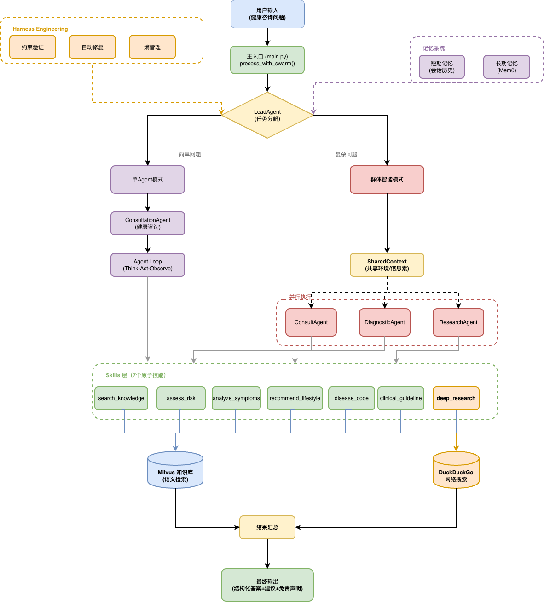
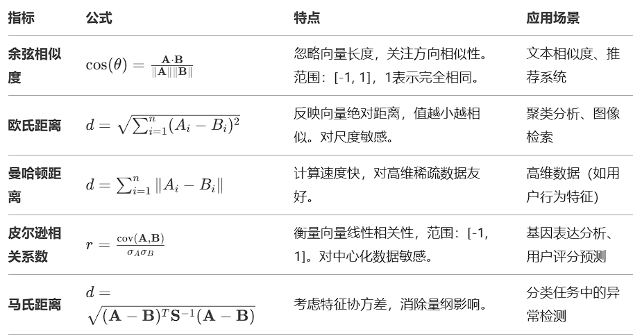

# 居丽叶的简历项目7：医疗助手Agent

> 来源（Source）：https://my.feishu.cn/wiki/VtpmwnWNpi7ljVk7yIjcty7Vnuf

> 👍
>
> 本项目原生场景为医疗，可直接包装为蚂蚁阿福、阿里健康、京东健康、百度健康、科大讯飞医疗、平安健康、医渡科技、数坤科技、推想医疗、联影智能、深睿医疗、卫宁健康、创业慧康等互联网医疗 / AI 医疗头部企业，以及智诊科技、健康有益、睿心医疗、科亚医疗等垂直医疗 AI 初创公司的AI 应用 / 多模态基座 / 智能体研发方向实习项目（大公司你得真的在那里实习过才能写，不然就写成个人项目）；也可完全剥离医疗属性，将核心Skills-Agent 双层架构、多 Agent 协作、双层记忆、约束系统、RAG+VLM 推理等技术方案，平滑迁移适配金融、法律、教育、企业服务、电商、政务等全行业场景，按需替换领域知识库与专业能力，快速包装为对应赛道的标杆项目。
>
> 投递开发的同学，就不要提到训练的VLM模型，或者说是同事训练的，自己只负责应用，写成个人项目就说是调用的api；投递算法的同学可以突出一下VLM模型训练的部分。

代码解读和代码运行文档：[居丽叶的简历项目7：医疗助手](https://my.feishu.cn/wiki/GAMLw3PCZiSLjUkhzSpczIZknad)

## 自我介绍

自我介绍简短一点，只提及使用到的技术和自己负责的模块即可，不用展开说

我参与了一个多智能体医疗助手的开发，这个项目的目标是构建一个能像医疗团队一样协作的智能问答系统。我设计了Skills-Agent两层结构，底层是7个原子能力（像知识检索、症状分析这些），上层是3个专业Agent可以根据任务自主调用这些能力。针对不同复杂度的问题，系统会进行智能路由，另外我还实现了双层记忆机制来支持多轮对话。为了保证输出质量和安全性，我还做了一套约束系统，运行时自动验证Agent的调用行为和输出内容。

以上是我的自我介绍，需要我给您详细介绍一下这个Agent项目吗？

## 简历写法

医疗助手Agent系统 |                                                                                                                     2026.XX – 2026.XX

**项目背景**

传统单 Agent 医疗问答系统存在**响应效率低、复杂问题分析不全面、多轮对话上下文理解能力弱**等问题。面对多症状、多维度的医疗咨询时，回答准确性与稳定性不足；同时缺乏长效记忆机制，无法连贯理解用户意图，难以满足实际医疗场景下高效、可靠、安全的智能问答需求。

**解决方案**

- **Skills-Agent两层架构**：底层构建7个Skills（知识检索、风险评估、症状分析、生活方式建议、ICD-10编码、临床指南、深度研究）供Agent使用，上层3个专业Agent（健康咨询、症状诊断、医学研究）根据任务需求自主选择调用，Skills和Agent完全解耦；
- **Agent Loop执行机制**：基于ReAct框架实现Think-Act-Observe循环，LLM自主决策工具调用并观察结果，设置硬性限制最多调用3次工具防止过度调用，单Agent平均响应时间控制在15秒以内；
- **Agent Swarm协作系统**：智能路由判断问题复杂度（70%单Agent快速通道/30%Swarm协作模式），复杂问题自动分解任务并分配给多个Agent并行执行，Agent间通过共享上下文间接共享任务状态和执行结果；
- **双层记忆机制**：短期记忆管理会话级对话历史（单例模式确保所有Agent共享会话上下文，集成熵管理器自动去重压缩消息35%，加载最近5轮对话），长期记忆通过Mem0云服务向量化存储会话总结支持跨会话相似案例检索；
- **Harness Engineering约束系统**：通过YAML文件显式定义Agent能力边界并运行时自动验证，实现输出自动修复机制（缺少免责声明自动添加、检测到高危症状自动添加就医警告）；
- **底层VLM模型训练**：基于 Qwen3.5‑9B 训练医疗问答 VLM 作为 3 个 Agent 的推理引擎，采用 SFT+GSPO 两阶段训练，分别使用 40 万 / 10 万条医疗 VQA 数据，并通过多维度复合奖励机制提升模型推理质量。（开发岗删去这条即可）

**项目成果**

- **系统性能**：智能路由准确率从88%提升至95%，知识库检索准确率87%，单Agent响应时间5-15秒，Swarm响应时间20-30秒，多轮对话上下文理解准确率从60%提升至92%；
- **回答质量**：医学专业人员三维度盲评打分，系统回答质量4.5分 vs doubao-seed-2.0-pro 3.9分；
- **模型能力**：VLM模型平均得分从基座0.58提升至0.78，AB test得分0.78 vs GPT 0.72 / Doubao 0.75，部署后LLM单次推理2-5秒、服务可用性99.8%；（开发岗这条也要删）

## **项目描述**

先介绍项目背景，再说一开始是怎么做的，但是遇到了什么困难、挑战，尝试了什么新的方法，结论是什么（数值型评估指标），一定要突出项目“迭代”的过程。

我参与了一个基于多智能体协作的医疗问答系统的开发，目标是构建一个能回答用户医疗相关问题的智能助手。项目最初我们采用了简单的单Agent+RAG方案，通过向量数据库检索医学知识，然后用LLM生成回答。但在实际使用中很快发现了几个明显问题：

首先，复杂问题响应慢；

其次，复杂问题单个Agent能力有限，容易遗漏关键信息，比如当用户问比较复杂的问题时，单Agent难以系统性分析，回答质量不稳定；

最后，缺乏记忆能力，用户追问"那我应该怎么办"时系统理解不了上下文。

针对这些问题，我首先设计了Skills-Agent两层架构，这是项目的核心创新。底层构建了7个原子Skills（搜索知识库、风险评估、症状分析、生活方式建议、ICD-10编码、临床指南、深度研究）供Agent使用。上层是3个专业Agent（ConsultationAgent健康咨询、DiagnosticAgent症状诊断、ResearchAgent医学研究），在实际执行时由LLM根据任务需求自主选择合适的Skills进行调用。这样Skills和Agent完全解耦，添加新Skill时无需修改Agent代码。在单Agent执行上，采用了Agent Loop的ReAct框架，遵循Think-Act-Observe循环：LLM思考需要调用哪些Skills，执行Skill获取结果，观察结果后决定是继续调用还是生成最终回答。但实际运行中发现LLM经常反复调用Skills，比如连续调用5-6次search_knowledge尝试不同查询词，导致单个Agent响应时间超过1分钟。针对这个问题，设置了硬性限制最多调用2次工具，达到上限后强制LLM基于已有信息生成回答，将单Agent平均响应时间控制在15秒以内。

但这样又带来新问题：对于同时涉及健康咨询、症状诊断、医学研究等多个维度的复杂问题，单个Agent难以全面覆盖，容易遗漏关键信息。于是实现了智能路由，通过Prompt工程让LLM自动判断问题复杂度并分解任务，单任务直接路由到对应Agent(约70%问题)，多任务启动agent swarm模式让多个Worker Agents并行执行(约30%问题)。LeadAgent作为中心协调者负责任务分解和明确分配，各Worker Agent从SharedContext中读取分配给自己的任务并行执行，完成后将结果写回，LeadAgent最后汇总生成综合答案。

后来为了支持多轮对话，用户追问时系统能理解上下文。最初尝试把所有对话历史直接传给LLM，但效果不理想——当对话超过10轮时，上下文变得冗长重复，LLM推理变慢，有时还会偏离主题，多轮对话理解准确率只有60%。针对这个问题，设计并实现了双层记忆机制。短期记忆采用单例模式管理会话级对话历史，确保所有Agent共享同一个会话上下文，加载最近5轮对话作为上下文。但这样又带来新问题：长时间对话后消息积累过多，上下文过长影响响应速度。于是在短期记忆中集成了熵管理器，自动对消息去重（基于MD5哈希检测重复）和压缩（早期消息压缩为摘要，保留最近消息完整内容），使消息量减少35%，token消耗降低30%。长期记忆则通过Mem0云服务向量化存储会话总结，支持跨会话相似案例检索。经过这两轮优化，多轮对话上下文理解准确率从60%提升到92%+。

此外，为了保证系统安全性和输出质量，实现了Harness Engineering约束系统。通过YAML文件显式定义Agent能力边界，运行时自动验证Skill调用和输出内容。此外还实现了输出自动修复机制，比如如果输出缺少免责声明，自动添加“⚠️ 以上信息仅供参考，不能替代专业医生诊断”；如果检测到高危症状（胸痛、呼吸困难、晕厥等），自动添加“⚠️ 检测到高危症状，建议立即就医警告”。

我们还训练了医疗问答的VLM模型，这个模型基于Qwen3.5-9B，采用两阶段训练。第一阶段监督微调，用40万条医疗VQA数据进行全参数微调，推理过程通过doubao-seed-2.0-pro数据蒸馏构造，将模型的平均得分从基座的0.58提升到0.72。第二阶段强化学习，采用GSPO算法并设计了多维度复合奖励机制来解决这些问题。格式奖励占10%确保输出规范，准确率奖励占90%（LLM判别器60%判断语义一致性+MedEmbed嵌入相似度30%快速过滤错误答案）。使用10万条数据训练后，平均得分进一步提升到0.78， AB test显示优于GPT的0.72和Doubao的0.75。

在性能和质量方面，基于500条医疗咨询测试集做了全面评测。最终系统达到知识库检索准确率87%、单Agent响应时间5-15秒、Swarm响应时间20-30秒、多轮对话上下文理解准确率92%+、系统整体回答质量4.5分（AB Test对比豆包baseline 3.9分，由医学专业人员三维度盲评打分）。在灰度测试中，用户对系统的满意度较高，整体来看，这套系统让用户可以像咨询医疗团队一样获得系统性的健康建议，降低了问诊门槛，提升了问答的专业性和可靠性。

## 面试问题

### **医疗助手部分（开发岗和算法岗都要看）**

#### **1. 这个项目的核心指标有哪些**

这个项目在系统回答质量、智能路由准确性、知识检索能力和系统响应性能四个维度都有明确的量化指标，以下是核心指标及其说明（基于500条医疗咨询测试集）：

- **智能路由准确率95%**：统计系统路由决策（包括判断单Agent/Swarm模式、Swarm中分配Agent组合）与人工标注的一致性，通过LeadAgent的任务分解和Agent能力匹配实现，从初期的88%优化到95%
- **知识库检索准确率87%**：统计检索返回的内容与标准答案的相关性，通过混合检索（向量+BM25）和相似度阈值过滤实现
- **单Agent响应时间5-15秒，Swarm响应时间20-30秒**：从用户提问到返回完整答案的端到端耗时，通过限制Skill调用次数（max 2次）和并行执行Worker Agents实现，70%的简单问题走单Agent快速通道
- **多轮对话上下文理解准确率92%+**：统计Agent正确理解追问指代（如"那饮食方面呢"能关联上一轮的"高血压"）和利用历史经验（检索到相似历史案例）的成功率，通过双层记忆系统（短期记忆加载最近5轮对话+长期记忆检索3个相似会话）实现，从未引入记忆前的60%提升到92%+
- **系统整体回答质量优于baseline**：进行AB Test对比本系统与直接调用豆包大模型的回答质量，由医学专业人员对准确性、完整性、安全性进行三维度盲评打分（满分5分），统计本系统综合得分4.5分vs豆包baseline 3.9分。

##### **1.1 测试集是怎么构成的**

测试集来源：从在线医疗咨询平台和问答社区收集真实用户问题，经过脱敏处理和质量筛选后构建了500条测试集。

测试集内容：覆盖4大类医疗场景，每类约125条。包括日常健康咨询（"感冒了怎么办""高血压饮食注意什么"）、症状诊断分析（"头晕+胸闷+出汗是什么病""持续咳嗽两周严重吗"）、疾病知识查询（"糖尿病并发症有哪些""ICD-10高血压编码是什么"）、权威指南检索（"冠心病最新诊疗指南""SGLT-2抑制剂临床效果"）。

测试集格式：每条数据包含问题文本/图像、标准答案、问题类型等字段，方便不同维度的评测。

如何判断是否正确：

- **知识库检索准确率**：对于知识检索类问题（如"高血压的症状有哪些"），标注标准答案，用大模型判断系统检索返回的内容与标准答案是否语义一致
- **智能路由准确率**：人工标注每个问题的预期路由决策（单Agent/Swarm模式、具体Agent分配），系统输出与标注完全匹配算对
- **多轮对话上下文理解准确率**：额外构建了100条多轮对话序列（如第1轮"我有高血压"→第2轮"那饮食方面呢"），人工标注第2轮的上下文依赖项（"那"指代"高血压"），大模型检查系统生成的答案是否正确关联上一轮信息
- **系统整体回答质量**：采用AB Test，由医学专业人员对本系统和豆包baseline的回答进行三维度盲评打分（5分制）

#### **2. 为什么要设计成Skills-Agent两层架构**

传统的Agent架构通常是为每个Agent单独开发专属工具，这导致工具重复开发、维护成本高、灵活性差的问题。在实际设计时发现，不同的医疗Agent（咨询、诊断、研究）经常需要调用相同的底层能力，比如知识库检索、风险评估、症状分析等。

采用Skills-Agent两层架构后，将底层能力抽象为多个原子Skills，每个Skill是自包含的、可直接调用的函数单元。所有Agent共享这7个Skills，在实际执行时由LLM根据任务需求自主选择合适的Skills进行调用。这种设计的核心优势是解耦了能力层和决策层，新增Agent或扩展能力时无需修改现有代码，只需注册Skills即可。

举个例子，咨询Agent在处理"我最近头晕是怎么回事"这个问题时，会先调用search_knowledge检索相关疾病信息，最后调用recommend_lifestyle给出建议。整个过程中Agent自主决策，Skills直接执行，整体架构清晰、灵活、易扩展。

#### **3. 你提到的7个原子Skills分别是什么**

这7个Skills覆盖了医疗助手的核心能力需求，每个Skill的功能定位和处理逻辑都有明显区别：

- **search_knowledge**：通用医学知识检索，解决"我想了解XX疾病/症状"这类知识查询需求。无论用户问什么疾病、症状、治疗方法，都会从知识库中召回最相关的文档片段，返回原始的医学知识内容。特点是查询范围广、返回信息全面，适合获取疾病的基础知识。
- **assess_risk**：症状紧急程度判断，核心功能是回答"我现在的情况严不严重"。基于高风险症状列表（如胸痛、呼吸困难、意识模糊等）进行匹配，输出低危、中危、高危、紧急四个风险等级，并给出明确的就医建议。这个Skill的特殊性在于结合了规则引擎和知识库：先用规则快速识别高危症状，再从知识库补充医学依据，确保风险评估的准确性和权威性。
- **analyze_symptoms**：症状关联分析，解决"我这几个症状加在一起可能是什么病"的问题。通过症状分类识别症状涉及的身体系统（呼吸系统、消化系统、心血管系统等），判断是单系统还是多系统问题，并根据症状模式推测可能关联的疾病。与search_knowledge的区别是，它不是简单检索，而是进行症状模式识别和疾病关联推理，最后再从知识库获取推测疾病的详细信息进行验证。
- **recommend_lifestyle**：个性化生活方式指导，专门针对已确诊或疑似疾病，提供饮食、运动、睡眠、用药等四个维度的具体建议。与通用知识检索不同，这个Skill返回的是可操作的生活建议，比如"高血压患者应该低盐饮食、每天运动30分钟、避免熬夜"这种明确的行动指南。
- **disease_code**：标准化疾病编码查询，功能非常专一，就是根据疾病名称返回对应的ICD-10国际标准编码和所属疾病分类。这个Skill主要用于医学标准化场景，比如填写病历、保险理赔、医学研究等需要规范疾病编码的情况。
- **clinical_guideline**：权威诊疗指南检索，与通用知识检索的核心区别是返回的是"官方标准"而不是普通医学知识。专门检索中华医学会等权威机构发布的临床指南和专家共识，为医疗决策提供循证医学依据。适合处理"XX疾病的标准治疗方案是什么"这类需要权威性的问题。
- **deep_research**：复杂问题深度研究，涉及外部网络搜索的Skill。当知识库内容无法满足需求时（如最新研究进展、前沿治疗方法、罕见病信息），会通过网络搜索获取多个来源的信息，再结合知识库内容，最后用证据综合器生成结构化的研究报告，包括关键发现、证据等级、信息冲突等。这个Skill的处理流程最复杂，耗时也最长。

以上7个Skill在底层实现上，大多都会调用Milvus向量数据库和规则引擎，但关键区别在于各自的功能定位、处理逻辑和输出格式完全不同，互相无法替代。

各Skill调用频率（基于线上问题类型分布统计与Agent职责估算）：

| Skill | 调用频率 | 依据 |
|---|---|---|
| recommend_lifestyle | 约50% | 健康咨询/指导类需求占比最大（线上真实统计） |
| search_knowledge | 约35% | 通用知识检索，各类问题兜底常用 |
| analyze_symptoms | 约20% | 症状关联分析类问题触发 |
| assess_risk | 约15% | 症状类问题常伴随风险判断 |
| clinical_guideline | 约10% | 权威指南检索，专科场景 |
| disease_code | 约7% | ICD-10编码场景较窄（线上真实统计） |
| deep_research | 约3% | 仅知识库覆盖不了才用，最贵最少用 |

#### **4. 你们有几个Agent，分别负责什么**

系统设计了3个专业Worker Agent和1个协调Agent，重点说下3个Worker Agent的关系：

- **ConsultationAgent**（健康咨询Agent）：定位是"全科医生"，能力最广泛但不够深入。主要处理日常健康咨询、疾病科普、生活建议这类通用场景。高频使用search_knowledge和recommend_lifestyle这种偏科普、偏指导的Skills。可以理解为医院的门诊大夫，什么病都能聊，但不做深度诊断。
- **DiagnosticAgent**（症状诊断Agent）：定位是"专科诊断医生"，核心能力是症状分析和风险判断。当用户描述症状、需要判断严重程度或鉴别疾病时，这个Agent会优先出场。高频使用的是assess_risk、analyze_symptoms、disease_code这些偏诊断的Skills。与ConsultationAgent的区别是，它不是简单回答"高血压是什么"，而是分析"你的头晕+胸闷可能是什么病，严不严重"。
- **ResearchAgent**（医学研究Agent）：定位是"学术专家"，专门处理需要权威证据支撑的复杂问题。当用户问"最新的治疗方案是什么""某个药物的临床效果如何"这类需要查阅指南或文献的问题时，这个Agent出场。高频使用clinical_guideline和deep_research，强调循证医学和权威性，而不是经验性建议。

三个Agent的协作关系是**互补而非替代**：ConsultationAgent像门诊大夫做初步咨询，DiagnosticAgent像专科医生做症状分析，ResearchAgent像学术专家提供文献支撑。在Swarm模式下，复杂问题会同时触发三个Agent并行工作：比如用户问"糖尿病患者突然胸闷是什么原因"，ConsultationAgent负责提供糖尿病并发症知识，DiagnosticAgent负责分析胸闷症状的风险等级，ResearchAgent负责检索糖尿病心血管并发症的最新指南，最后LeadAgent汇总三方信息给出综合答案。

另外协调Agent的作用是：

**LeadAgent**（任务分解和汇总Agent）：负责将问题分解为子任务，分配给上述3个Worker Agents执行，在swarm模式下还需要最后汇总结果生成综合答案。不处理具体医疗问题，纯粹是协调者。

此外还有一个协调器：

**SwarmCoordinator**（智能路由协调器）：系统入口，负责调用lead agent判断问题复杂度，简单问题直接路由到单个Worker Agent，复杂问题触发多Agent协作。

#### **5. Agent Loop是什么，是怎么实现的**

Agent Loop是基于ReAct框架实现的LLM驱动工具调用循环机制，让Agent能够像人类一样"边思考边行动"地完成复杂任务。ReAct的全称是Reasoning（推理）+ Acting（行动），核心思想是通过"Think-Act-Observe"循环，让LLM在推理和行动之间反复迭代，直到任务完成。

在实现上，我们的Agent Loop完整遵循了ReAct的三个核心步骤：

- **Think（思考）**：LLM接收到用户问题和历史上下文后，先进行推理分析，判断是否需要调用Skills获取更多信息，还是已经可以给出最终答案。这一步是纯粹的推理过程，不涉及外部工具。
- **Act（行动）**：如果LLM判断需要更多信息，会选择合适的Skills进行调用。LLM根据Skill的描述信息自主决定调用哪个Skill、传递什么参数。
- **Observe（观察）**：Skills执行完成后，系统将返回结果作为新的观察信息添加到对话历史，LLM基于这个新信息进行下一轮思考。

这个Think-Act-Observe循环会持续进行，直到LLM认为信息充足、可以给出最终答案为止。为了防止无限循环，设置了最大迭代次数限制和硬性的Skill调用次数限制。如果达到上限，系统会强制要求LLM基于已获取的信息给出答案。本项目里，应用在ConsultationAgent、DiagnosticAgent、ResearchAgent 3个agent中。

举个例子，用户问"我有高血压，应该怎么办"，Agent Loop的执行过程是：第1轮Think（LLM判断需要检索知识）→ Act（调用search_knowledge）→ Observe（获取高血压信息）；第2轮Think（判断需要提供建议）→ Act（调用recommend_lifestyle）→ Observe（获取生活方式指导）；第3轮Think（LLM认为信息充足）→ 直接生成最终答案并返回。

相比传统的单次LLM调用，ReAct框架的优势是让Agent具备了"工具使用能力"，能够通过多轮交互主动获取外部信息，而不是依赖预训练知识进行猜测，大幅提升了答案的准确性和可靠性。

#### **6. Agent Swarm是什么，为什么说是要用到agent swarm**

Agent Swarm是一种让多个AI Agent协作完成复杂任务的多智能体系统架构。其核心思想是通过中心化任务分解和分布式并行执行相结合，让多个专业Agent各司其职、协同工作，整体表现出超越单个Agent的能力。

在本项目中，Agent Swarm的工作流程是这样的：当遇到复杂医疗问题时，LeadAgent作为中心协调者，通过LLM分析问题的维度和复杂度，将其分解为多个独立子任务（如症状分析、风险评估、文献检索），并明确分配给对应的Worker Agents（ConsultationAgent、DiagnosticAgent、ResearchAgent）。各个Worker Agent从SharedContext中读取分配给自己的任务，并行执行，完成后将结果写回SharedContext。LeadAgent最后汇总所有Worker的结果，生成综合答案。这种架构的核心特性是：**中心化任务分解**（LeadAgent统一规划）、**明确任务分配**（每个子任务指定负责的Agent）和**并行执行**（多个Agent同时工作互不阻塞）。

为什么要采用Agent Swarm而不是简单的单Agent处理？主要基于三个考虑：**复杂问题的维度覆盖**、**专业化分工的优势**和**系统的扩展性**。医疗领域的复杂问题往往涉及多个维度，比如用户问"糖尿病患者突然胸闷是什么原因"，这需要同时考虑糖尿病并发症知识（ConsultationAgent）、症状的风险等级和紧急程度（DiagnosticAgent）、最新的诊疗指南和循证医学证据（ResearchAgent）。单个Agent即使能力再强，也难以在一次推理中兼顾所有角度，容易遗漏关键信息。而多Agent协作时，每个Agent专注于自己擅长的领域，最后汇总的答案覆盖更全面、专业性更强。同时，这种架构让系统扩展变得容易：如果未来要增加新的专业Agent（比如药物相互作用分析Agent），只需要在LeadAgent的分配策略中添加新的Agent选项，并让新Agent能读写SharedContext即可，无需大规模重构现有代码。

#### **7. SwarmCoordinator是怎么工作的**

SwarmCoordinator和LeadAgent共同构成了Swarm模式的协调机制。SwarmCoordinator负责智能路由决策，LeadAgent负责任务分解和结果汇总。整个工作流程分为三个阶段：

- **任务分解阶段** - 接收用户的复杂问题后，SwarmCoordinator调用LeadAgent通过LLM分析问题的维度和复杂度，将其分解为多个独立的子任务，并为每个子任务明确分配合适的Worker Agent。分解策略遵循两个原则：一是子任务之间尽量独立无依赖，便于并行执行；二是每个子任务都有明确的负责Agent和预期输出。
- **路由决策阶段** - SwarmCoordinator根据LeadAgent返回的子任务数量做路由决策：如果只有1个子任务，说明问题简单，直接路由到对应的单个Worker Agent执行，这是快速通道；如果有2个或以上子任务，说明问题复杂，启动Swarm模式，让多个Worker Agent并行协作。
- **执行和汇总阶段** - 单Agent模式下，由选中的Worker Agent独立完成任务并返回结果；Swarm模式下，各Worker Agent从SharedContext中读取分配给自己的任务、并行执行，完成后将结果写回SharedContext，LeadAgent最后汇总所有结果生成综合答案。

这种设计的优势是兼顾了效率和质量：简单问题走单Agent快速通道，响应时间短；复杂问题走Swarm协作通道，答案质量高。同时路由决策完全自动化，用户无感知，使用体验流畅。在实际测试中，大约70%的问题会走单Agent通道，30%走Swarm通道。单Agent模式的平均响应时间在5-15秒，Swarm模式在20-30秒

#### **8. SwarmCoordinator是怎么判断走单Agent还是Swarm**

智能路由的核心是通过Prompt工程让LLM自动判断问题复杂度并分解任务，整个过程分为三步：

1. **Prompt工程设计** - 系统为LeadAgent设计了结构化的提示词，明确"尽量少分配任务"的设计哲学、描述了3个Worker Agent的能力矩阵（咨询Agent擅长常见病症、诊断Agent擅长复杂症状、研究Agent擅长临床指南）、具体的分配策略示例（如"单一症状→1个Agent""多症状→2个Agents"），以及JSON格式的输出要求。这个提示词相当于给LLM提供了一套决策规则。
2. **LLM任务分解** - 用户提问后，系统将问题拼接到提示词中调用LLM。LLM分析问题的维度（单一症状还是多症状？常见咨询还是需要指南？），然后返回JSON格式的子任务列表和每个子任务负责的Agent。如果LLM调用失败，系统会回退到默认策略：分配给咨询Agent作为兜底。
3. **路由决策** - 协调器根据子任务数量做最终决策：子任务数=1走单Agent快速通道（5-15秒，约70%问题），子任务数≥2启动Swarm协作模式（20-30秒，约30%问题）。

这种设计的核心优势是将复杂的路由逻辑转化为Prompt工程问题，不需要编写大量规则代码，而是通过清晰的提示词引导LLM理解Agent能力边界并自主决策最优组合。"尽量少分配"的原则避免了过度协作，实现了效率和质量的平衡。

#### **9. 你提到的SharedContext是什么，起什么作用**

SharedContext是Agent Swarm中的共享信息环境，用于管理任务状态和共享执行结果。在多Agent协作中，它作为中央数据存储，让LeadAgent和各个Worker Agent能够协同工作。

在实现上，SharedContext维护了三类核心数据：**任务列表**（包含所有待执行、执行中、已完成的子任务，以及每个任务分配给哪个Agent）、**Agent贡献记录**（记录每个Agent完成了哪些任务、产出了什么结果）、**事件流**（记录系统运行过程中的关键事件，如任务开始、任务完成等）。

Worker Agent的工作流程是：从SharedContext中查询分配给自己的任务 → 标记任务为"执行中" → 执行任务并调用Skills → 将结果写入SharedContext → 标记任务为"已完成"。LeadAgent在汇总阶段读取所有已完成任务的结果，生成最终答案。

这种设计的核心价值是实现了Agent间的松耦合协作。每个Worker Agent只需要关注SharedContext中分配给自己的任务，不需要直接与其他Agent交互。新增Agent时，只需让它能读写SharedContext并在LeadAgent的分配策略中注册即可，现有Agent的代码无需修改。

#### **10. 你们的记忆系统是怎么设计的**

记忆系统采用双层架构：**短期记忆**和**长期记忆**，分别解决会话级上下文和跨会话经验积累的问题。

- **短期记忆（ShortTermMemory）**：管理当前会话的对话历史，存储最近的user、assistant、tool消息，支持多轮对话的上下文理解。使用Redis作为存储后端，支持持久化和快速读写。短期记忆采用**单例模式**设计，确保整个系统中只有一个ShortTermMemory实例，所有Worker Agent共享同一个会话历史。短期记忆应用在Agent Loop中，在系统初始化时，会将短期记忆实例注入到所有Worker Agent的Loop中。每次Agent Loop调用LLM前，会从短期记忆中加载历史对话作为上下文一起发送给LLM，这样用户追问时LLM能正确理解上下文。Agent Loop还会将每轮的用户消息、助手回复、工具调用结果都记录到短期记忆中。短期记忆的生命周期是单次会话，会话结束后自动清空。
- **长期记忆（**[**Mem0**](https://github.com/mem0ai/mem0)**）**：跨会话的持久化记忆，基于Mem0云服务实现，采用向量相似度检索技术。会话开始时，系统通过问题文本检索Mem0中最相似的3个历史会话，将历史案例通过上下文参数传递给Agent使用。会话结束时，系统会将问题、答案等信息总结为结构化的会话摘要存入Mem0，供未来的相似案例检索使用。这让Agent能够"记住"之前处理过的类似问题和解决方案。

两层记忆的协作流程是：会话开始 → 从Mem0检索相似历史案例 → 从Redis找到当前会话历史 → 两种记忆都通过上下文参数传递给Agent → Worker Agent通过Agent Loop回复问题 → 会话结束 → 总结会话内容并存入Mem0 → 清空Redis中的短期记忆。这种设计兼顾了实时性和持久性，短期记忆保证当前会话的连贯性，长期记忆保证跨会话的经验积累。

#### **11. 为什么短期记忆要设计成单例模式**

短期记忆采用单例模式是为了确保整个系统中所有Agent共享同一个会话历史。在多Agent协作场景下，如果每个Agent都独立创建自己的ShortTermMemory实例，会导致会话历史分散、上下文割裂的问题。

举个例子，用户在第1轮对话中告诉ConsultationAgent"我有高血压"，如果短期记忆不是单例，当第2轮切换到DiagnosticAgent时，DiagnosticAgent无法获取第1轮的上下文信息，就无法理解用户的追问。

采用单例模式后，在初始化时创建唯一的实例，并将其注入到所有Worker Agent的Loop中。这样所有Agent在执行过程中读写的都是同一个会话历史，确保了上下文的连续性。

#### **12. 长期记忆为什么选择Mem0，不用自己搭建向量数据库**

选择Mem0主要是看中了它作为专业记忆层的核心优势。Mem0是专门为AI Agent设计的智能记忆层，它的核心特点是"自适应学习"和"持续演进"。

Mem0有几个显著优势：

- **多层次记忆管理**（支持User级、Session级、Agent级三层记忆，可以灵活地记录用户偏好、会话上下文、Agent状态）
- **智能记忆提取**（采用单遍ADD-only算法，能够自动从对话中提取关键信息形成记忆，不需要手动设计记忆结构）
- **信号检索**（不只是语义相似度，还结合关键词匹配、实体链接等多种检索方式，召回更准确）、
- **实体链接能力**（能够识别并关联不同记忆中的相同实体，比如"高血压"在多次对话中的不同提及会被自动关联）。

此外，Mem0提供了非常简洁的API，只需要调用add()存储记忆、search()检索记忆两个核心方法，在长期记忆的准确性和可靠性上有显著优势。

在本项目中，我采用了**User级别的记忆管理**和**向量相似度检索 + 关键词匹配**方式。会话开始时，用当前问题作为查询，检索最相似的3个历史会话作为参考；会话结束时，将问题、答案、执行模式等信息存入Mem0。这种"读-处理-写"的循环让系统能够不断积累经验，实现跨会话学习。

#### **13. 向量数据库为什么用Milvus**

选择Milvus的原因：

1. 分布式设计：原生分布式设计，支持水平扩展（分片、副本），可从单节点平滑扩展到大规模集群，处理 PB 级向量数据；支持动态扩缩容（无需停机），可根据数据量 / 检索量灵活调整节点数量，适配业务流量波动；分片策略灵活（按向量维度、数据量、时间范围分片），满足数据持续增长的需求。
2. 性能优秀：Milvus是专为高维向量搜索设计的数据库，支持多种索引算法（FLAT、IVF、HNSW等）以及多种距离度量方式（余弦相似度 Cosine、欧氏距离 L2、内积 IP、汉明距离等），检索性能优于传统数据库的向量插件，亿级高维向量毫秒级召回。
3. 向量 + 标量混合检索：支持过滤条件 + 相似度联合查询，更贴合业务。可先通过标量过滤缩小检索范围，再做向量相似性检索，避免全量向量检索的性能损耗，大幅提升精准度和检索速度，适配实际业务中 “多条件筛选 + 相似性匹配” 的核心需求。
4. 检索方式多源：支持渐进式检索（先返回近似结果，再优化精度），适配低延迟高吞吐的业务需求（如实时推荐、语义搜索）。

#### **14. 为什么选择 MedEmbed 作为嵌入模型，而不是用通用的嵌入模型？**

选择 MedEmbed 是因为它在医疗领域文本上做过专门训练，对医学术语和概念的理解更准确。

通用嵌入模型比如 OpenAI 的 text-embedding 或者 BERT，虽然在一般文本上效果不错，但是医学术语有很强的专业性，词义和日常语言差异很大。比如"阳性"在医学中是一个明确的诊断结论，但在通用语境中可能只是"积极的"意思。再比如"浸润性"和"侵袭性"在医学中是近义词，但是通用嵌入模型可能不会把它们映射到相近的向量空间。

MedEmbed 是在医学文献、病历、诊断报告等专业语料上训练的，它的向量空间更符合医学语义关系。我们在实验中对比过几个嵌入模型，用 200 个医疗问答对作为测试集，计算正确答案和错误答案的相似度分布。MedEmbed 能更好地区分正确和错误答案，在相似度阈值 0.8 时准确率比通用模型高出约 12 个百分点。

另外，MedEmbed 是开源的，可以本地部署，不需要调用外部 API，这在处理敏感医疗数据时更安全，也避免了网络延迟对训练速度的影响。

#### **15. 医学知识库是怎么实现的**

医学知识库是系统的核心功能，基于Milvus向量数据库实现检索增强生成（RAG）。

知识库中存储的文档包括生活方式建议（如高血压、糖尿病患者的饮食、运动、用药指导）、疾病分类信息（ICD-10编码、疾病分类体系）、临床诊疗指南（中华医学会等权威机构发布的诊疗规范）等医学知识，总计上百条文档。采用**MedEmbed**作为Embedding模型，采用混合检索（向量检索+BM25关键词匹配）召回相关文档，将检索到的内容填入prompt交给大模型生成回复。

针对长文档采用滑动窗口切分，每个chunk 1024字符，overlap 100字符，为每个chunk添加metadata（文档类型、来源、分类等），保证检索精度和上下文完整性。向量检索支持类型过滤，比如查询生活方式建议时只检索lifestyle类型文档，查询ICD-10编码时只检索disease_classification类型文档，避免无关内容干扰。

知识库检索准确率达到87%，能够准确回答疾病科普、诊疗规范、生活指导等医疗健康问题，检索响应时间在50-200ms之间，满足实时交互需求。

#### **16. Agent Loop中的Skill调用次数限制是怎么做的，为什么要限制**

Skill调用次数限制是为了防止Agent陷入无限循环或过度调用工具。在实际运行中发现，有时候LLM会反复调用Skills而不给出最终答案，或者不断尝试不同的检索方式，导致响应时间过长、成本浪费。

在实现上设置了两层限制：一是限制Agent Loop的循环轮数（max_iterations，设置为3），防止循环过多；二是限制Skill调用的总次数（max_tool_calls，设置为2），防止过度调用工具。

选择2次作为限制值是基于实际场景分析：大部分医疗咨询问题，2次Skill调用就足够获取必要信息。比如第1次调用search_knowledge检索疾病信息，第2次调用recommend_lifestyle获取建议，就能给出完整答案。设置过高会导致响应慢，设置过低会导致信息不足。

在达到限制后，系统还会尝试强制生成答案：如果迭代次数达到上限但没有最终答案，会额外调用一次LLM（禁用function calling），强制要求其基于已有信息给出总结，这个兜底机制确保用户始终能得到回复。

#### **17. 你们的Harness Engineering是什么，实现了哪些功能**

Harness Engineering是一种工程理念，核心思想是"人类设计约束，AI代理执行"，让AI在明确的约束下自主工作、自我修正，确保系统的安全性、简洁性和高质量。在本项目中实现了三个核心功能：

- **约束驱动（Constraint-Driven）**：通过YAML文件定义Agent的能力边界、允许调用的Skills、输出格式要求等约束规则。运行时，约束验证器会自动检查Agent的行为是否符合规则，比如ConsultationAgent是否调用了不应该调用的Skills、输出中是否包含必需的免责声明等。如果发现违规，系统会记录警告日志，但不会中断执行，这是一种「软约束」机制。
- **自动修复（Auto-Fix）**：当检测到输出不符合约束时，自动修复器会尝试修复。比如LLM生成的答案中缺少免责声明，系统会自动添加标准的免责声明文本；如果用户描述了高危症状（如胸痛、呼吸困难）但答案中没有就医提醒，系统会自动添加"请立即就医"的警告。
- **熵管理（Entropy Management）**：在短期记忆系统中引入熵管理机制，自动去重重复的消息、压缩冗长的历史对话，防止系统随着运行时间增长而膨胀。通过MD5哈希检测重复消息，通过滑动窗口保留最近消息、压缩早期消息为摘要，控制存储空间占用。同时提供熵估算功能，监控系统健康状态，当熵等级过高时发出警告。

#### **18. Skills是怎么管理的**

Skills管理采用统一注册机制，通过SkillRegistry集中管理所有Skill的生命周期。整个流程可以分为三个关键环节：

- **Skill注册**：系统采用自动发现机制，在Agent初始化时会扫描指定目录，自动发现所有可用的Skill并注册到SkillRegistry。注册时会提取Skill的名称、功能描述、参数列表等元信息。
- **LLM发现Skills**：当Agent Loop启动时，会调用SkillRegistry中获取所有已注册Skills的描述信息发送给LLM。LLM在收到用户问题后，根据问题内容和Skills的功能描述，自主判断是否需要调用Skill、调用哪个Skill、传入什么参数
- **Skill执行**：当LLM决定调用某个Skill时，会返回Skill名称和参数。Agent Loop接收到调用请求后，通过SkillRegistry找到对应的Skill函数并执行，执行结果会返回给LLM，LLM基于结果继续推理或生成最终答案。如果执行失败，SkillRegistry会返回错误信息。

这种设计的核心优势是**高度解耦**和**自动化**。Skills的实现逻辑和Agent的业务逻辑完全分离，Agent不需要知道Skill如何实现，只需要调用SkillRegistry的接口。新增Skill时，只需要在指定目录实现Skill函数，系统会自动发现并注册，无需修改Agent代码。同时，所有Worker Agent共享相同的Skills池，避免了重复注册和维护成本。

#### **19. 在设计过程中遇到过什么技术难点，怎么解决的**

**第一个难点：多Agent协作时的上下文共享** - 最初设计时，每个Agent维护独立的对话历史，导致多Agent协作时上下文割裂。比如用户第1轮告诉ConsultationAgent"我有糖尿病"，第2轮DiagnosticAgent接手时无法获取这个信息。解决方案是引入单例模式的ShortTermMemory，所有Agent共享同一个会话历史，并在Agent Loop中自动加载历史对话作为上下文。

**第二个难点：LLM过度调用Skills导致响应慢** - Agent Loop运行初期，LLM经常反复调用Skills，比如连续调用5-6次search_knowledge尝试不同的查询词，导致响应时间超过1分钟。通过引入硬性的Skill调用次数限制（max_tool_calls=2）解决，达到限制后强制要求LLM给出答案，将平均响应时间控制在15秒以内。

**第三个难点：记忆系统的膨胀问题** - 长时间对话后，短期记忆会积累大量消息，导致发送给LLM的上下文过长，既影响响应速度又增加成本。引入熵管理机制后，自动去重重复消息、压缩早期对话，同时限制加载的历史消息数量（最近5轮），将上下文长度控制在合理范围内.

**第四个难点：Swarm协作的一致性保证** - 多Agent并行执行时，可能出现结果冲突的情况。比如ConsultationAgent认为"症状较轻不用担心"，DiagnosticAgent却认为"风险较高建议就医"，两个Agent给出矛盾的建议。最初的方案是让LeadAgent使用LLM判断哪个建议更合理，但这引入了额外的不确定性。后来改为基于Agent优先级的策略：定义Agent的专业领域和权威级别，风险评估相关问题优先采纳DiagnosticAgent的意见，知识科普相关问题优先采纳ConsultationAgent的意见。在prompt中明确告诉LeadAgent"当出现冲突时，风险评估以DiagnosticAgent为准"，显著降低了矛盾建议的出现频率。

#### **20. 系统的平均响应时间是多少，有什么优化策略**

系统的平均响应时间取决于处理模式：**单Agent模式**平均5-15秒，**Swarm模式**平均20-30秒。响应时间的主要消耗在三个环节：LLM推理（每次调用2-5秒）、向量检索（50-200ms）、Skills执行（如网络搜索可能需要5-8秒）。

优化策略包括四个方面：

- **限制Skill调用次数**：通过max_tool_calls=2的硬性限制，避免Agent过度调用工具，单Agent模式下最多2次LLM调用+2次Skill调用，时间可控。
- **并行执行**：Swarm模式下，多个Worker Agent并行执行子任务，而不是串行。比如3个Agent各需要10秒，并行执行总时间仍是10秒，而不是30秒。
- **向量检索优化**：Milvus的向量检索本身很快（50-200ms），但可以通过多种方式进一步优化。一是知识库路由，根据问题类型先路由到对应的专业知识库（如疾病知识库、诊疗指南库、生活建议库），避免在全量数据中检索，大幅缩小搜索范围；二是选择合适的索引类型，HNSW索引适合高精度场景，IVF_FLAT适合平衡性能和精度；三是结果缓存，对高频查询问题的向量检索结果进行缓存，相同或相似问题可以直接返回缓存结果，避免重复检索。
- **超时保护**：Swarm模式设置90秒超时，避免某个Agent卡住导致整体响应过慢。超时后基于已完成的结果给出答案，确保用户始终能得到响应。

在实际使用中，90%的问题能在20秒内得到回复，用户体验良好。对于极少数复杂问题（如deep_research需要网络搜索），可能需要30-60秒，系统会通过进度提示告知用户正在处理。

#### **21. 系统未来有哪些优化方向**

基于目前的实践经验，未来可以从以下几个方面进行优化：

- **增加用户画像**：目前系统没有记录用户的基本信息（如年龄、性别、既往病史等），每次对话都需要重新询问。改进方案是引入用户画像模块，持久化存储用户基础信息，在对话时自动作为上下文注入，减少重复提问。
- **引入流式输出**：目前用户需要等待整个任务完成才能看到答案，响应时间较长。改进方案是支持流式输出，LLM生成答案时逐token返回，用户能实时看到文字逐渐显示，体验更流畅。
- **优化任务分解逻辑**：目前LeadAgent的任务分解主要依赖LLM的单次判断，有时候分解粒度不够合理。改进方案是引入启发式规则，比如识别到多个症状时自动拆分为症状分析+风险评估+建议生成等子任务，提高分解的稳定性。

#### **22. 项目中的LeadAgent和Worker Agent有什么区别**

LeadAgent和Worker Agent在系统中扮演不同的角色，核心区别在于职责和执行方式：

- **LeadAgent（任务分解和汇总Agent）**：负责宏观层面的任务管理，不处理具体的医疗问题。它的工作流程是：接收用户问题 → 分解为若干子任务 → 为每个子任务分配合适的Worker Agent → 等待Worker完成 → 汇总所有结果 → 生成综合答案。LeadAgent没有Agent Loop，不调用Skills，是一个纯粹的协调者。
- **Worker Agent（专业执行Agent）**：负责具体的医疗任务执行，包括ConsultationAgent、DiagnosticAgent、ResearchAgent三个。它们拥有Agent Loop和Skills，能够自主调用工具完成LeadAgent分配的子任务。Worker Agent之间通过SharedContext共享任务状态和执行结果，并行执行，互不干扰。

类比一下，LeadAgent像项目经理，负责拆解需求、分配任务、协调进度、汇总成果，但不写代码；Worker Agent像工程师，负责实现具体功能，使用各种工具（Skills）完成分配的任务。两者协作完成复杂项目。

#### **23. 你提到的约束验证是怎么工作的**

约束验证是Harness Engineering的核心功能，通过YAML文件定义规则，运行时自动检查Agent行为是否合规。约束分为两类：**Skill调用约束**和**输出格式约束**。

- **Skill调用约束**定义每个Agent允许调用哪些Skills，为每个Agent配置了allowed_tools列表。约束验证器在Agent Loop执行Skill前，会检查当前调用的Skill是否在允许列表中。如果违规（比如ConsultationAgent尝试调用一个未注册的Skill），记录警告日志但不中断执行，这是"软约束"机制。
- **输出格式约束**定义Agent输出必须包含哪些元素。比如医疗场景下，所有Agent的输出都必须包含免责声明，避免用户误将建议当作诊断结果。约束验证器在Agent Loop生成最终答案后，会检查答案中是否包含"免责声明"、"仅供参考"等关键词。如果缺失，标记为违规，并触发自动修复。

在实际运行中，约束违规的情况较少（约5%），主要集中在免责声明缺失或高危症状未提示就医。通过自动修复器，这些问题都能被自动纠正，确保输出符合医疗安全规范。

#### **24. 简历里提到熵管理是怎么做的，为什么要做**

熵管理是为了防止系统随时间膨胀、性能下降。在长时间对话场景下，短期记忆会不断积累消息，如果不加控制，会导致：**发送给LLM的上下文过长**，超出模型限制或影响响应速度；**重复消息占用空间**，比如Agent Loop中tool消息可能重复记录；**早期对话占用空间**，对当前任务已无价值但仍占用Redis存储空间。

熵管理通过三个机制解决这些问题：

- **去重（Deduplication）**：通过MD5哈希检测重复消息。如果两条消息的内容完全相同（哈希值相同），只保留一条，删除重复项。这在tool消息场景下特别有效，因为相同的Skill调用可能返回相同的结果。
- **压缩（Compression）**：使用滑动窗口策略，保留最近的10条消息（最新的对话），早期的消息进行压缩。压缩方式是提取关键信息（如用户主要问题、重要症状、关键建议），生成简短的摘要，替代原始的冗长消息。
- **熵估算（Entropy Estimation）**：定期计算消息列表的熵水平，指标包括总消息数、重复消息数、重复率等。当熵等级达到"high"时，发出警告日志，提醒系统状态不健康，可能需要清理或优化。

熵管理是自动、透明的，Agent无需感知。经过熵管理后，短期记忆的空间占用稳定在合理范围内，即使长时间对话也不会膨胀。在实际测试中，10轮对话后，未优化的消息数约50条，优化后降低到30条左右，同时保留了关键上下文信息。

#### **25. 这个项目的分工情况是怎样的**

这个项目是我们业务组内部的一个项目，当时是2个人一起完成的，我主要负责核心架构设计和Agent Swarm系统的实现。

- 我的工作主要集中在三个方面。第一是整体架构设计，包括Skills-Agent两层架构的设计、Agent Swarm多智能体协作机制、智能路由的Prompt工程、双层记忆系统（短期+长期）的设计等。第二是核心Agent的开发，我负责实现了LeadAgent任务分解和汇总、SwarmCoordinator智能路由、以及ConsultationAgent、DiagnosticAgent、ResearchAgent三个Worker Agent，还有Agent Loop的ReAct框架、Skill注册和调用机制。第三是Harness Engineering，实现了约束验证、自动修复、熵管理等工程化功能，确保系统的安全性和稳定性。
- 另一位同学主要负责知识库和技能模块。他负责Milvus向量数据库的搭建和配置、embedding模型的集成、7个原子Skills的具体实现（包括search_knowledge、assess_risk、analyze_symptoms等），以及医学知识文档的收集、预处理和向量化。
- 整个项目开发周期大约3个月，在协作过程中我们通过代码review和结对编程保证了代码质量，通过黄金数据集测试确保系统效果。最终实现的系统在智能路由准确率、知识检索能力、多轮对话理解等方面都达到了预期目标。

#### **26. 系统的平均token消耗是多少，有做过哪些优化**

一次完整的医疗咨询查询，token消耗因执行模式不同而有显著差异。单Agent模式和Swarm模式都会先调用LeadAgent分解任务，区别在于调用的Worker数量不同。单Agent模式大约消耗2500到3500个Token，其中输入约1200到2000，输出约800到1500。具体拆分来看，LeadAgent任务分解占输入600到800、输出150到250，然后1个Worker Agent执行占输入600到1200、输出650到1250。

Swarm模式的token消耗会更高，大约在5000到7000之间，输入2500到4000，输出2500到4000。Swarm比单Agent多消耗token主要在两个地方：第一是可能调用更多的Agent，多个Worker各自执行合计占输入1800到3600、输出1500到3000（每个Worker输入600到1200、输出500到1000）；第二是多了一次LeadAgent汇总调用，汇总时输入占700到1000（包含3个Worker的输出结果）、输出占850到1000。LeadAgent任务分解这一步两种模式消耗是一样的。

在token优化方面，我们主要做了六个方面的工作。第一是限制Skill调用次数为2，避免Agent过度调用工具，减少重复的工具调用和结果处理消耗。第二是短期记忆采用滑动窗口，只保留最近5轮对话共10条消息，避免完整历史对话消耗大量token。第三是长期记忆精准召回，只检索top3最相似的历史会话而不是加载所有历史记忆。第四是向量检索top_k限制，知识库检索只返回top5最相关的文档片段，避免注入过多无关内容。第五是熵管理机制，自动去重重复消息、压缩早期对话，控制上下文长度膨胀。

通过这些优化，系统在保证回答质量的前提下，将单Agent模式的token消耗控制在3500以内，Swarm模式控制在7000以内，成本和性能达到了较好的平衡。

#### **27. 如果某个Agent执行失败或返回错误结果，系统会怎么处理**

系统设计了多层容错机制，针对单Agent模式和Swarm模式采用不同的失败处理策略。

在单Agent模式下，每个Worker Agent的Agent Loop执行时都有异常捕获，如果Skill调用失败或LLM返回异常，会捕获异常并记录错误日志。如果Agent执行过程中发生异常，系统会尝试基于已获取的部分信息生成答案而不是直接返回错误。如果Worker Agent完全失败，SwarmCoordinator会返回一个友好的错误提示，告知用户"系统暂时无法处理该问题，请稍后重试或简化问题"，同时记录详细的错误日志供后续排查。

在Swarm模式下，容错机制更加复杂。首先是超时保护，Swarm模式设置了90秒的总体超时时间，如果某个Worker Agent执行超时不会无限等待，超时后系统会标记timeout_occurred=True并基于已完成的Agent结果进行汇总。其次是部分失败容忍，多个Worker Agent并行执行时如果其中1到2个Agent失败或超时，其他Agent的结果仍然有效。第三是Agent优先级策略，当多个Agent的结果出现冲突时系统按照预定义的优先级处理，比如风险评估相关问题优先采纳DiagnosticAgent的意见，知识科普问题优先采纳ConsultationAgent的意见，这在LeadAgent的汇总prompt中明确指定。如果所有Worker Agent都失败或超时这种极端情况，LeadAgent会返回明确的提示："由于系统响应超时，所有Agent均未能完成分析。建议简化问题后重试，或在紧急情况下立即就医"。

所有异常都会记录详细的日志，包括失败的Agent名称和任务类型、错误堆栈信息和异常类型、当时的输入上下文和已获取的部分结果、用户ID和会话ID便于追溯和复现。这种设计确保系统不会因为单个Agent的问题就完全崩溃，而是优雅降级尽可能提供部分功能，同时保证医疗场景下的安全性，宁可明确说"无法回答"也不生成不可靠的医疗建议。

#### **28. 知识库召回用的是什么检索算法**

项目中采用的是混合检索（Hybrid Search），结合了向量检索和关键词匹配两种方式，互补优势，提升召回准确率。

1. 向量检索（语义匹配）： 使用余弦相似度作为相似度算法。用户问题通过Embedding模型转化为向量后，计算与知识库中文档片段向量的余弦相似度。余弦相似度只关注向量的方向，不考虑长度，非常适合文本语义匹配。优势是能够理解语义，即使用户换一种说法，只要意思相近就能召回。比如用户问"血压高怎么办"和"高血压如何处理"，虽然表述不同，但向量相似度很高，都能召回高血压相关的文档
2. 关键词匹配（精确匹配）： 使用BM25算法进行关键词匹配。BM25是一种基于词频和文档频率的排序算法，是搜索引擎常用的经典算法。它会考虑关键词在文档中出现的频率，以及关键词的稀有程度（IDF）。优势是对关键词精确匹配很敏感，比如用户问"ICD-10高血压编码"，包含"ICD-10"和"高血压编码"这些专业术语的文档会被优先召回
3. 混合检索流程：
    1. 对用户问题同时进行向量检索和BM25关键词检索
    2. 向量检索召回top_k=10个语义相关的文档片段
    3. BM25检索召回top_k=10个关键词匹配的文档片段
    4. 对两路召回结果进行融合排序（Reciprocal Rank Fusion），最终取top_3返回

#### 29.竞品调研：有没有对比过同类医疗助手Agent，你们的优势在哪里？

我做过 2026 年主流医疗 AI 助手与医疗 Agent 的真实竞品调研，目前市场主要分为四类：

第一类是**通用大模型医疗版**，比如 Google Med-PaLM 3、Anthropic Claude Healthcare，推理强、合规性好，但缺少临床工作流和硬约束，直接用在问诊场景容易出现幻觉与不可控输出。

第二类是**互联网医疗平台 AI**，像小荷 AI、蚂蚁阿福、平安健康 AI，生态完善、体验流畅，比如蚂蚁阿福就采用主从式多 Agent 架构（主对话 Agent + 场景微 Agent），以单路径任务执行为主，不做复杂问题自动拆解与多 Agent 并行会诊，因此复杂问题分析全面性、多轮深度推理与跨维度协同仍有提升空间。

第三类是**垂直医疗 AI 与专科 Agent**，比如数坤、推想、智愈 MedSeek，在影像、专科诊断上精度很高，但功能相对单一，缺少多Agent协同，无法覆盖全科问诊的全流程。

第四类是**企业级医疗 Agent 平台**，比如 Salesforce Agentforce、Kore.ai、Suki AI，擅长流程自动化与 EHR 集成，但部署重、成本高，面向患者的复杂问诊能力不足。

我们这套医疗 Agent 的核心优势，在于**多智能体协同架构 + 医疗级约束系统 + 专业知识库 + 工程化性能**的完整闭环：

一是用Skills-Agent 双层架构 + Swarm 协作，复杂问题自动拆解、多 Agent 并行分析，比单 Agent 更全面、比专科方案更通用；

二是Harness Engineering 硬约束，从机制上保证输出安全合规，解决医疗场景最关键的可靠性问题；

三是双层记忆 + 熵管理，多轮对话理解准确率大幅提升，更贴近真实连续问诊；

四是医疗专属 RAG，检索准确率与专业度显著优于通用知识库方案；

五是智能路由 + 性能优化，在速度和深度之间取得平衡，可直接落地商用。

总体来看，通用模型强在推理、平台 AI 强在生态、垂直 AI 强在单点精度、企业平台强在流程自动化；而我们的医疗 Agent，在**面向患者的全科深度问诊、多智能体协同、安全可控、多轮对话、工程化落地**这几个维度，在综合表现上有一定优势。

#### LLM经常反复调用Skills，有没有想过这个具体底层原因是什么

1. 核心原因是LLM对于这些skills的理解不够深入，为了实现更好的效果，应该专门构造调用skills的轨迹，让llm进行训练，让llm真正理解什么场景应该调用哪个skills，以及怎么调用这些skills
2. skill的定义可能不够清楚，比如工具入参、能力边界描述模糊，LLM 难以精准命中检索条件，多次换参重试。
3. 这个skill实现的问题，比如RAG召回质量片段残缺、相关性参差，模型拿到无效结果后触发多次检索

### **医疗大模型训练部分（算法岗专属）**

#### **1. 简单介绍一下这个医疗 VLM 项目**

这是一个医疗领域的视觉语言模型项目，专注于提升小参数模型在医疗视觉问答任务上的推理能力。这个模型是我们公司内部业务组开发的，训练出来是为了在我们的医疗 Agent 系统中使用，作为 ConsultationAgent（健康咨询）、DiagnosticAgent（症状诊断）、ResearchAgent（医学研究）这三个核心 Agent 的底层推理引擎。

项目的核心目标是通过两阶段后训练的方法，让 Qwen3.5-9B 在医疗图像理解和诊断建议等场景中提供更可靠的答案。

我们在实现上采用了两阶段训练策略：

监督微调阶段让模型学会结构化推理，强化学习阶段通过多维度奖励信号优化输出质量。

最终训练出的模型在医疗问答基准测试上取得了不错的效果，能够处理带医学影像和病历的复杂问答场景。

#### **2. 你们为什么选择基于 Qwen3.5-9B 来做医疗模型，而不是用其他的多模态基座？**

选择 Qwen3.5-9B 主要基于三个考虑：

第一，它在视觉理解能力上表现优异，特别是对医学影像以及病例这种专业图像的理解能力。我们在预研时对比了多个多模态基座模型，发现 Qwen3.5-9B 在处理 X 光片、CT 扫描等医学影像和病例时的细节捕捉能力更强。

第二，它的架构设计支持动态分辨率输入，这对医学影像非常重要，因为不同的影像设备和扫描方式会产生不同分辨率的图片。

第三，9B 这个参数规模在推理质量和响应速度之间取得了比较好的平衡，既能保证医疗诊断的准确性，又能满足实时交互的需求。另外，Qwen 系列模型在中英文双语上都表现不错，这对于处理中文医疗文档和国际医学文献都很有帮助。

#### **3. 训练数据是从哪里来的？数据质量怎么保证？**

训练数据包含两个来源：一部分是业界公开的医疗视觉问答数据集，另一部分是我们公司内部标注的 QA 数据，来自实际的医疗咨询场景。在数据规模上，SFT 阶段使用了 40 万条数据，RL 阶段使用了 10 万条数据，总共 50 万条训练数据。

公开数据集我们选择的都是医疗领域公认的高质量数据集，比如 PMC-VQA，这些数据集都经过医学专业人员的严格审核和标注。在数据质量保证上，我们采用了多层过滤机制。首先是格式验证，确保每条数据都有完整的图像、问题和答案。对于公开数据，虽然本身质量已经很高，但我们仍然做了去重和清洗，过滤掉图像质量差、答案过短或描述不清的样本。

对于内部 QA 数据，同样是由医学专业人员审核过的，确保答案的医学准确性和专业性。最终通过质量检查的数据才会进入训练集。

##### 3.1 训练数据构造流程

1. 数据源分两类：公开医疗VQA数据集（PMC-VQA、SLAKE）+ 业务脱敏真实问诊数据（图文问诊、症状咨询），全部去除患者隐私信息。
2. 原始数据仅含问题、图像、标准答案，缺少推理链；使用doubao-seed-2.0-pro教师模型蒸馏生成推理过程，设置temperature=0.6保证推理多样性。
3. 蒸馏后用doubao-seed-2.0-lite裁判模型过滤：仅保留模型输出和答案语义匹配标准样本，剔除逻辑错误、医学术语错误、图文不匹配等样本。
4. 统一格式化：图像+问题+结构化推理+标准答案，固定标签分隔，清洗重复样本、低质量影像等。

##### 3.2 训练数据分布（以SFT为例，RL按比例减少）

1. 纯文本健康咨询：16w（40%），包括日常疾病、饮食用药、疾病科普等；
2. 单症状/多症状问诊：12w（30%），头晕、胸闷、咳嗽等复合症状鉴别等；
3. 医学影像VQA：8w（20%），比如胸片、CT、检验报告图文解读；
4. 临床指南专业查询：4w（10%），诊疗规范、疾病检索等。
5. 样本均衡策略：对于小众的影像、指南类数据做了重复采样扩充，避免长尾样本占比过低导致模型偏科。

#### **4. 你提到用了两阶段训练，具体怎么设计的？为什么要分两个阶段？**

两阶段训练的设计思路是这样的：第一阶段是监督微调，让模型学会基础的推理结构并掌握医疗领域知识；第二阶段是强化学习，通过奖励信号优化输出质量。

在监督微调阶段，我们基于 Qwen3.5-9B-Instruct 这个通用多模态基座模型，用 40 万条医疗 QA 数据（公开数据 + 内部数据）进行全参数微调。训练数据的格式包含三个部分：问题、推理过程和答案。推理过程用 `<thinking>...</thinking>` 标签包裹，答案用 `<answer>...</answer>` 标签包裹。推理过程是通过数据蒸馏构造的，我们用更强的大模型为每个问答对生成思考步骤。这个阶段使用标准的交叉熵损失，让模型学会医疗领域的知识和"先思考再回答"的输出模式。在 8 张 A100 上训练 3 个 epoch 后得到一个医疗领域的 SFT 模型。

第二阶段是强化学习，采用 GSPO 算法，基于 SFT 模型继续训练。这个阶段使用 10 万条训练数据，和 SFT 同分布，也是公开 + 内部的医疗 QA 数据，但不再给模型看推理过程，只提供问题和图像，让模型自己生成完整的 thinking 和 answer。我们设计了多维度的奖励函数来评估输出质量，包括格式奖励和准确率奖励。通过强化学习，模型学会权衡这些奖励信号，生成更高质量的输出。训练 1 个 epoch 完成。

之所以要分两阶段，是因为直接在通用模型上做强化学习很难收敛，模型缺乏医疗领域的基础知识。监督微调阶段先让模型适应医疗领域，学会推理结构；强化学习阶段再通过奖励信号精细化优化输出质量和格式规范性。这种渐进式训练策略在垂直领域的推理任务上被证明是有效的。

#### **5. 强化学习阶段的奖励函数是怎么设计的？为什么这么设计？**

我们采用了多维度复合奖励机制，包含两个主要组成部分。

第一个是格式奖励，权重占 10%。它检查模型输出是否严格遵循 `<thinking>...</thinking><answer>...</answer>` 的格式。这个奖励用正则表达式来判断，确保输出结构化且可解析。

第二个是准确率奖励，这是最重要的部分，权重占 90%。准确率奖励又进一步分为两个子维度：LLM 判别器奖励占 60%，嵌入相似度奖励占 30%。LLM 判别器使用 doubao-seed-2.0-mini 作为裁判模型，通过构造 prompt 让它判断模型的答案和标准答案是否语义一致。嵌入相似度使用医疗领域专用的 MedEmbed 模型计算答案向量的余弦相似度，阈值设为 0.8。

这样设计的原因有三点：

第一，单一奖励信号容易被模型利用产生捷径行为，多维度奖励能让模型学到更全面的能力。

第二，LLM 判别器和嵌入相似度结合可以互补，LLM 擅长判断语义等价性，嵌入模型擅长快速过滤明显错误的答案。

第三，格式奖励确保输出可用，内容奖励保证答案质量，两者共同构成完整的评价体系。

##### **5.1. RL 阶段的训练参数是怎么设置的？**

在 SFT 模型基础上用 GSPO 算法训练，关键参数为：

- 学习率：1e-6
- 组大小 G：8
- Batch size：64
- 梯度累积：4
- 梯度裁剪：1.0
- 训练轮数：1
- 优化器：AdamW（weight_decay=0.01）
- 学习率调度：cosine annealing
- 混合精度：FP16
- 计算资源：32×A100 80GB，TP4，PP4，DP2
- 格式奖励权重：10%
- 准确率奖励权重：90%（LLM 判别器 60%，嵌入相似度 30%）
- 裁剪参数ε：0.0003
- 训练时间：5天
- 训练框架：verl

#### **6. 你提到 LLM 判别器和嵌入相似度，为什么要用两种方式？不能只用一种吗？**

用两种方式是为了准确性和效率的平衡。

LLM 判别器的优势在于它能理解语义等价性。比如标准答案是"患者可能患有肺炎"，模型回答"影像显示肺部感染的迹象"，这两个答案语义上是一致的，但字面上差异很大。LLM 判别器能够正确识别这种语义匹配。但是 LLM 判别器的问题是可能出现网络波动，以及对某些内容判别不稳定（相同的标准答案和模型回复让llm判别16次，可能15次判对1次判错）。

嵌入相似度的优势是计算速度更快，而且 MedEmbed 是在医疗文本上训练的，对医学术语的理解比较准确。它能快速识别明显错误的答案，比如标准答案是"肺炎"，模型回答"骨折"，余弦相似度会很低。但是嵌入相似度的局限是对语义的理解不如 LLM 深入，有时候会把表述方式不同但意思相同的答案判断为不匹配。

所以我们结合两者的优势，采用两级评估机制。在计算奖励时，两个分数都会计算并按权重合并：嵌入相似度占 30%、LLM 判别器占 60%。这样设计的好处是，即使 LLM 判别器偶尔出现判断不稳定的情况，嵌入相似度也能提供一个相对稳定的基准分数，让奖励信号更加平滑。两者的权重分配是经过实验对比的，60% 和 30% 这个比例在我们的测试中效果最好，既保证了语义判断的准确性，又通过嵌入相似度提供了稳定的辅助信号。

#### **7. 训练过程中遇到过什么困难或者翻车的情况？怎么解决的？**

遇到过几个比较棘手的问题。

第一个是奖励信号噪声大。最初我们只用 LLM 判别器来评估答案正确性，但是发现判别器本身有时候会出错，特别是对于一些表述细微差别的答案，它的判断不稳定。同一个答案多次调用判别器，有时候返回 YES 有时候返回 NO。这导致训练初期 loss 震荡严重。后来我们加入了嵌入相似度作为辅助信号，并且对 LLM 判别器的 temperature 设置为 0，强制确定性输出，问题才得到缓解。

第二个是熵坍塌问题。训练到中后期，模型开始输出模式单一，很多不同的问题都生成类似的推理过程和答案。这是因为模型学会了"套路"，找到了能稳定获得奖励的输出模式。我们通过调整熵权重和加入多样性正则化来解决，同时在奖励函数中加入了对推理步骤多样性的评估，鼓励模型探索不同的推理路径。

第三个是显存溢出。在训练 9B 模型时，因为每个问题要生成多个答案，而且输入包含高分辨率医学图像，显存压力非常大。最初设置 batch size 32 直接 OOM。后来通过梯度累积、降低 rollout batch size、优化图像预处理流程，最终在 32 张 A100 上稳定训练。

#### **8. 你们怎么评估模型的效果？用了什么指标？**

评估分为两个维度：基准测试和 AB test。

在基准测试上，我们在内部构建的医疗评测集上进行测试，采用平均奖励得分作为主要指标。评测集覆盖了常见的医疗咨询场景，包括影像分析、病历解读、诊断建议等多种任务类型。评估时让模型生成答案，然后用和训练时相同的奖励函数来计算得分，包括格式奖励（10%）和准确率奖励（90%，其中 LLM 判别器 60% + 嵌入相似度 30%）。具体指标上，基座模型 Qwen3.5-9B-Instruct 的平均得分是 0.58，经过两阶段训练后达到 0.78。

在 AB test 上，我们会让医学专业人员对比我们模型的输出和外部大模型（比如 GPT、Doubao）的输出。具体流程是：从内部评测集中抽取 100-200 个样本，同时用我们的模型和对比模型生成答案，然后盲测评估，由医学专业人员在不知道哪个是哪个模型的情况下对每个回答打分。评估时会综合考虑推理步骤的逻辑连贯性、术语使用的专业性、答案的可解释性等多个维度，最终给出一个 0-1 之间的综合得分。通过这种 AB test，我们的模型平均得分是 0.78，GPT 是 0.72，Doubao 是 0.75，说明我们的模型在推理质量上已经接近业界主流大模型的水平。

##### 8.1 评测集构造流程

1. 独立划分500条线下标准测试集，与训练集完全无重叠，不参与训练。
2. 包含多个场景，比如影像分析，病理解读，诊断建议，健康咨询等，每条包含：问题、影像（可选）、人工标准回答、标注路由标签、预期Agent调用路径。
3. 标注标准由执业医师完成，统一医学术语、风险判定标准，区分高危/普通症状案例。

##### 8.2 评估后怎么迭代优化数据

1. 分析bad case，包括影像识别错误、术语错误、风险判断失误、上下文丢失、格式缺失、幻觉等。
2. bad case回流扩充数据集：给予评估中的错误样本的类别，进行针对性采样和合成，补充至训练集，下一轮训练加入。
3. 清洗噪声样本：完善训练数据，剔除训练集中推理逻辑混乱、答案矛盾、图像过于模糊的低质量蒸馏数据，降低训练噪声。

#### **9. 为什么选择 MedEmbed 作为嵌入模型，而不是用通用的嵌入模型？**

选择 MedEmbed 是因为它在医疗领域文本上做过专门训练，对医学术语和概念的理解更准确。

通用嵌入模型比如 OpenAI 的 text-embedding 或者 BERT，虽然在一般文本上效果不错，但是医学术语有很强的专业性，词义和日常语言差异很大。比如"阳性"在医学中是一个明确的诊断结论，但在通用语境中可能只是"积极的"意思。再比如"浸润性"和"侵袭性"在医学中是近义词，但是通用嵌入模型可能不会把它们映射到相近的向量空间。

MedEmbed 是在医学文献、病历、诊断报告等专业语料上训练的，它的向量空间更符合医学语义关系。我们在实验中对比过几个嵌入模型，用 200 个医疗问答对作为测试集，计算正确答案和错误答案的相似度分布。MedEmbed 能更好地区分正确和错误答案，在相似度阈值 0.8 时准确率比通用模型高出约 12 个百分点。

另外，MedEmbed 是开源的，可以本地部署，不需要调用外部 API，这在处理敏感医疗数据时更安全，也避免了网络延迟对训练速度的影响。

#### **10. 模型的推理过程是怎么生成的？是训练数据里本来就有，还是你们构造的？**

推理过程是通过数据蒸馏的方式构造的。原始的医疗 QA 数据集只有问题和答案，没有推理过程。我们需要为每个问答对补充推理步骤，让模型学会"边思考边回答"。

构造推理过程的方法是用更强的大模型来生成。我们使用了 doubao-seed-2.0-pro 作为教师模型，对于每个问题，教师模型生成详细的推理过程和最终答案。生成时设置 temperature 0.6 来保持一定的多样性，并且在 prompt 中明确要求使用 `<thinking>...</thinking><answer>...</answer>` 的格式输出。

生成完推理过程后，还要做质量筛选。我们用 doubao-seed-2.0-mini 作为裁判模型，检查教师模型生成的答案是否和标准答案一致。只有答案正确的推理轨迹才会被保留下来加入训练集。

#### **11. SFT 阶段的训练数据格式是什么样的？怎么构造推理过程？**

SFT 阶段的训练数据格式包含四个部分：医学图像或病历（可选）、问题、推理过程和答案。

医学图像或病历是可选的，包括原始的 X 光片、CT 扫描等影像，以及病历文本或截图，以图像文件形式存储。用户可以只提问而不上传图像或病历，比如"什么是高血压？"；也可以带图像提问，比如"这张胸片显示了什么异常？"；或者带病历提问，比如"根据这份病历，患者可能是什么情况？"。答案是标准的医学回复，比如"影像显示右肺下叶有片状阴影，考虑肺炎可能"。推理过程是我们需要额外构造的。

在训练时，输入是问题以及可选的医学图像或病历，输出是 thinking + answer 的完整序列，用交叉熵损失让模型学会生成结构化的推理和答案。损失计算只在输出部分，输入部分不参与梯度更新。这样构造的训练数据让模型在 SFT 阶段就学会了不同的推理模式：对于带图像或病历的问题，先观察再推理分析；对于纯文本问题，则基于医学知识直接推理，最后给出答案。这为后续的强化学习打下基础。

#### **12. SFT 阶段为什么要用全参数微调而不是 LoRA？**

选择全参数微调而不是 LoRA 主要是为了让模型充分适应医疗领域的知识和推理模式。

医疗领域和通用场景的差异比较大，不仅是知识层面的差异，还包括推理方式、术语表达、图像理解等多方面。全参数微调能让模型从预训练的通用能力转变为医疗专用能力，这种转变需要更新大量的参数。如果只用 LoRA 微调少量参数，模型可能学不到足够深入的医疗知识，特别是在视觉编码器部分，对医学影像的理解能力提升有限。

我们在实验中对比过全参数微调和 LoRA 微调。用 LoRA（rank=64）在相同数据上训练，虽然显存占用减少了 70%，训练速度提升了 50%，但最终模型在医疗问答测试集上的准确率比全参数微调低了约 8 个百分点。特别是在需要细致观察医学影像的任务上，LoRA 版本的表现明显不足。因此我们最终选择了全参数微调，确保模型在医疗领域的专业能力。

##### **12.1. SFT 阶段的训练参数是怎么设置的？**

SFT 基于 Qwen3.5-9B-Instruct 进行全参数微调，用的医疗 VQA 数据集约 40 万条数据，关键参数为：

- 学习率：2e-5
- Batch size：64
- 梯度累积：4
- 梯度裁剪：1.0
- 序列长度：2048
- 训练轮数：3
- 优化器：AdamW（weight_decay=0.01）
- 学习率调度：cosine annealing
- 混合精度：FP16
- 计算资源：32×A100 80GB，TP4，PP4，DP2
- 训练时间：3天

#### **13. SFT 和 RL 阶段用的是同一批训练数据吗？如果是，为什么不会过拟合？**

不是完全相同的数据。我们总共准备了 50 万条医疗 QA 数据，都来自公开医疗数据集和内部 QA 数据。SFT 阶段使用了其中的 40 万条数据，RL 阶段使用了剩下的 10 万条数据。虽然数据源相同且同分布，但两个阶段用的是不同的数据子集，并且使用方式完全不同。

在 SFT 阶段，训练数据包含完整的 thinking 和 answer，模型是在学习"给定这个问题，正确的推理过程和答案应该是什么"。这是监督学习，模型看到的是标准答案，通过交叉熵损失来拟合这些标准答案。

在 RL 阶段，训练数据只包含问题和图像，不给模型看推理过程和答案。模型需要自己生成完整的输出，然后通过奖励函数来评估输出的质量。这是强化学习，模型看到的是奖励信号，通过策略梯度来优化生成策略。相当于 SFT 阶段是"照着答案学"，RL 阶段是"根据反馈练"。

不会过拟合的原因有几点：

第一，RL 阶段的训练目标不同，不是简单地记忆答案，而是优化奖励函数定义的多维度目标（格式、准确率）。

第二，RL 阶段的数据使用方式是 on-policy 采样，每个问题会生成多个不同的答案，模型看到的输出空间比 SFT 阶段大得多。

第三，RL 阶段只训练 1 个 epoch，时间相对较短，模型没有机会完全记住所有训练样本。

第四，SFT 和 RL 使用的是不同的数据子集，RL 阶段看到的 10 万条数据在 SFT 阶段并没有见过。

在实验中我们监控了训练集和验证集的奖励曲线，两条曲线基本同步上升，没有出现训练集奖励上升而验证集奖励下降的过拟合现象。最终模型在未见过的测试集上的表现也优于 SFT 模型，说明 RL 阶段确实学到了泛化能力而不是记忆训练集。

#### **14. 内部的 QA 数据是怎么收集和标注的？和公开数据有什么区别？**

内部 QA 数据来自我们公司实际的医疗咨询业务场景，收集流程是这样的：

第一步，从我们的线上医疗咨询平台收集用户提交的真实问题和医学影像或病历，这些数据经过脱敏处理，去除患者的个人信息。

第二步，由合作的医学专业人员对这些问题进行回答，包括影像分析、诊断建议、治疗方案等。

第三步，对医生的回答进行格式化和标准化，统一术语表达和答案结构。

内部数据和公开数据的主要区别有三点：

第一，场景真实性。内部数据来自真实用户的咨询，问题的表述更口语化、更贴近实际使用场景，而公开数据多是学术论文或教科书中的标准问题。

第二，答案的详细程度。内部数据的答案由专业医生撰写，包含更多的临床细节和注意事项，而公开数据的答案相对简洁。

第三，数据分布。内部数据反映了我们目标用户群体的真实需求分布，某些常见问题（如常见病症的诊断、用药咨询）占比更高，而公开数据的分布相对均匀。

在训练时，我们把公开数据和内部数据混合使用。公开数据规模更大，提供了广泛的医学知识覆盖；内部数据虽然规模相对较小，但来自真实业务场景，对于提升模型在实际应用中的表现非常关键。两者结合既保证了知识的广度，又确保了对目标场景的适配。

#### **15. SFT 和 RL 两个阶段训练完成后，模型的平均得分分别提升了多少？**

我们在多个医疗视觉问答数据集上进行了评测，追踪了基座模型、SFT 模型、RL 模型的性能变化。

基座模型 Qwen3.5-9B-Instruct 在医疗测试集上的平均得分是 0.58。这个模型虽然是通用的多模态模型，在一般的视觉问答任务上表现不错，但是在医疗领域由于缺乏专业知识，得分偏低。特别是在需要医学术语理解和推理的任务上，经常给出不准确或者过于笼统的答案。

经过 SFT 训练后，模型的平均得分提升到 0.72，提升了 0.14。这说明监督微调阶段让模型学到了医疗领域的基础知识和推理结构。我们观察到，SFT 模型能够正确识别医学影像和病历中的异常特征，使用规范的医学术语，并且输出格式符合要求。但是推理过程的深度和答案的细致程度还有提升空间。

经过 RL 训练后，模型的平均得分进一步提升到 0.78，相比 SFT 模型提升了 0.06。强化学习阶段的提升主要体现在两个方面：

第一，答案的准确性提高了，特别是在边界情况和困难问题上，RL 模型更容易给出正确答案。

第二，输出格式更加规范，几乎不再出现格式错误。

第三，推理过程的质量提升，RL 模型生成的 thinking 部分逻辑更连贯、术语使用更准确。

#### **16. 训练出来的模型在医疗 Agent 系统中具体怎么使用？模型部署做了哪些优化？**

模型部署是整个项目落地的关键环节，我们在多个层面做了针对性优化。

首先是部署架构设计。我们把训练好的医疗 VLM 模型部署为独立的推理服务，运行在 Docker 容器中，通过 RESTful API 接口对外提供服务。这个推理服务会被我们的医疗 Agent 系统调用，作为 ConsultationAgent（健康咨询）、DiagnosticAgent（症状诊断）、ResearchAgent（医学研究）这三个核心 Agent 的底层推理引擎。容器化部署的好处是环境隔离和快速扩缩容，可以根据请求量动态调整服务实例数量。

其次是模型量化优化。为了提升推理速度和降低显存占用，我们对 9B 参数的模型进行了 FP8 量化，将模型大小减少约 50%。量化后的模型在单张 A100 GPU 上推理速度提升 2.5 倍。同时我们严格控制了量化后的精度损失，在内部测试集上模型的平均得分仅下降 0.02（从 0.78 降到 0.76），这个精度损失在可接受范围内。

第三是 vLLM 推理优化。我们引入了 vLLM 推理框架，专门针对大语言模型的推理进行优化。vLLM 通过 PagedAttention 技术实现了高效的显存管理，支持动态批处理和连续批处理，能够自动处理不同长度的输入序列。通过 vLLM 优化，我们的推理吞吐量再提升 1.5 倍，从 40 QPS 提升到 60 QPS，同时显存使用效率提升了 40%。

第四是批处理优化。我们实现了智能批处理机制，将多个用户的请求进行动态批处理。由于医疗问答的输入长度差异较大（有的只有简单问题，有的包含高分辨率医学影像或病历），我们设计了按输入复杂度分组的批处理策略，将相似长度和相似图像分辨率的请求合并处理，充分利用 GPU 的并行计算能力。同时实现了请求队列管理，当请求量超过处理能力时，会自动进行排队和优先级调度，确保服务稳定性。

通过以上优化，我们的医疗 VLM 模型在生产环境中表现稳定，单次推理平均响应时间 2-5 秒，峰值吞吐量达到 60 QPS，服务可用性达到 99.8%。模型推理的稳定性和效率为我们的医疗 Agent 系统提供了强有力的技术支撑。

#### **17. 这个VLM模型训练项目的分工情况是怎样的**

这个医疗VLM模型训练项目是我们业务组内部的一个项目，当时是3个人一起完成的，我和一个同事主要负责模型训练和评估优化，另一个同事负责数据构建。

我和另一个同事的工作主要集中在三个方面。第一是两阶段模型训练，SFT阶段基于Qwen3.5-9B-Instruct进行全参数微调，RL阶段采用GSPO算法设计多维度奖励函数进行训练。第二是模型评估和优化，在内部医疗评测集上追踪基座、SFT、RL模型的性能变化（0.58→0.72→0.78），组织医学专业人员进行AB test对比我们的模型和GPT、Doubao，根据评测结果迭代优化训练策略和奖励函数权重。第三是模型部署和推理优化，将训练好的模型进行FP8量化，使用vLLM框架进行推理加速，设计智能批处理策略，最终部署为Docker容器化的推理服务，实现单次推理2-5秒、峰值吞吐量60 QPS的性能指标。

另一位同事主要负责数据准备和蒸馏工作。他负责从公开数据集（PMC-VQA、SLAKE等）和内部医疗咨询平台收集50万条原始QA数据，使用doubao-seed-2.0-pro作为教师模型对40万条SFT数据进行数据蒸馏，为每个问答对生成结构化的推理过程，并使用doubao-seed-2.0-mini作为裁判模型对蒸馏结果进行质量筛选，确保推理过程的正确性。

## 八股问题

### Skills

#### 简述什么是 Agent Skills

Agent Skills 是由 Anthropic 提出并主导的**开放能力标准**，是面向 AI 编程工具（如 Claude Code、Cursor 等）的**模块化、可复用能力封装机制**。

它通过**标准化文件结构**，将领域知识、定制化工作流与可执行逻辑注入 LLM，让模型在不修改核心架构的前提下，精准、稳定地完成复杂任务。

它将业务逻辑、SOP、工程最佳实践与可执行脚本统一封装在结构化目录中，通常以 `SKILL.md` 作为核心入口文件。

**有三个特点：**

- **按需加载（渐进式上下文披露）**：Skills 采用**延迟加载、按需激活**的机制，不会一次性全量注入上下文。Agent 仅在任务匹配时才加载对应技能内容，有效降低 Token 开销，减少上下文干扰，提升模型决策效率。
- **即插即用**：它是轻量级的技能插件，可以在不同的 Agent 之间复用，无需修改 Agent 的核心代码。
- **封装经验**：Skills 不仅是工具调用的封装，更重要的是**将专家经验、执行范式与完整解决方案结构化**。它让 Agent 掌握 “如何系统性完成任务”，实现**工具使用**到**流程执行**的能力升级。

#### Agent Skills 与 MCP 协议的区别

MCP和Agent Skills虽然都在增强AI能力，但定位、解决的问题不同：

- **MCP是是AI Agent 与外部系统的标准化交互接口层**，它负责帮AI连接外部世界——解决的是Agent去哪拿数据、能调用哪些系统接口的问题，比如让Agent连数据库、GitHub、Slack这些外部工具。
- **Agent Skills**是**行为规范层**，它负责帮AI固化专业流程——解决的是Agent如何正确执行任务的问题，教Agent按特定步骤、格式、标准完成工作。

实际最佳实践是：Agent加载一个Skill（比如故障排查技能），这个Skill会指挥Agent去调用通过MCP连接的日志系统工具、数据库工具，最终完成工作。

#### Skills 是如何通过渐进式披露节省 Token 的？

参考了 Claude Code 的 Agent Skills 设计，实现了渐进式披露（**Progressive Disclosure**）机制，核心思想是把信息从上下文转移到文件系统中，不一次性把所有能力塞入大模型的上下文窗口，而是分阶段、按需加载。 具体通过三个层级实现：

这种机制通过以下 **三个层级** 来大幅节省 Token：

1. **第一层：元数据层（意图识别阶段）**

系统启动时，只解析每个 Skill 配置文件的头部元数据，提取名称和一句话描述，生成一份简短的技能目录注入到意图识别 Agent 的 Prompt 中。此时 LLM 只看到几条一句话的技能摘要 ，就足够判断该调用哪些 Agent，而不需要知道每个 Agent 的详细操作步骤。

1. **第二层：指令层**

当用户的请求命中了某个 Skill 的描述时，Agent 会主动读取该 Skill 文件夹下的核心说明书 SKILL.md，包括详细的 SOP、输出格式要求、约束规则等，注入到自己的 Prompt 中。每个 Agent 只看到自己需要的指令，不会被其他 Agent 的指令干扰。

3. **第三层：资源与代码的外部化**

核心原则是**让代码替 LLM 干活，LLM 只收结果**：

- **执行代码**：每个 Skill 文件夹下包含实际的 Python 实现脚本，调用skills时就会执行这些代码。LLM 永远看不到这些代码的源码，只看到代码执行后产出的结构化结果。
- **数据资源**：如知识库的原始文档和向量索引，Agent 通过代码逻辑去访问，只有检索到的少量相关片段进入 Prompt，原始文档本身从不进入上下文。

**总结**：第一层告诉 LLM"有什么能力"→ 第二层告诉 LLM"怎么做"→ 第三层让代码去做、LLM 只收结果。信息量逐层递增，但进入上下文的 Token 逐层递减

### **Harness Engineering**

#### **什么是 Harness Engineering？**

Harness Engineering 是通过设计和优化 AI 模型运行的外部环境来提升 Agent 系统可靠性的工程方法。这里的"外部环境"指模型权重之外的组件：工具体系、权限管控、Hooks 机制、上下文管理、多 Agent 协调等。

解决的问题很明确：纯靠模型和 Prompt 保证不了 Agent 行为稳定性，需要确定性约束机制而不是概率性语言指令，要让 Agent 从机制上"不可能犯错"而不是"尽量不犯错"。

当 Agent 出问题时，不是反复调 Prompt 让它"记住"正确做法，而是改 Harness 环境让它机制上不可能犯同样的错。这是从"软约束"到"硬约束"的转变。

#### **Harness Engineering 与 Prompt Engineering、Context Engineering 有什么演进关系？**

这是 AI Agent 工程方法论的三个演进阶段。

Prompt Engineering（2023-2024）通过精心设计的文本指令引导模型行为，核心是"对齐意图"。但依赖模型理解能力，行为不确定，同样的 Prompt 可能产生不同结果。

Context Engineering（2025）通过动态注入相关信息（如 RAG）提升输出质量，核心是"上下文增强"。但仍然在"输入层"做文章，提供不了确定性保障。

Harness Engineering（2026）从系统层面设计运行环境，核心是"环境即约束"。用工具、权限、Hooks 等机制提供确定性约束，不依赖模型的"记忆"。

演进逻辑是从"教会 AI"到"喂给 AI"再到"管住 AI"。最佳实践是三者结合：用 Harness 保障底线，用 Context 提供信息，用 Prompt 发挥智能。

#### **Harness Engineering 的设计边界在哪里？**

Harness 不是越多越好，过度约束会适得其反。

**边界一**：不要约束 AI 能自己发现的东西。错误做法是在 Harness 里详细规定命名规范，正确做法是提供 linter 自动格式化。

**边界二**：不要把所有可能情况都预设。错误做法是为每种错误都写专门的 Hook，正确做法是设计通用错误处理流程。

**边界三**：不要限制 AI 的探索空间。错误做法是强制 AI 按 A→B→C 顺序执行，正确做法是只要求达到目标，路径让 AI 规划。

设计原则是少而精，默认信任，渐进增加，定期审查。Harness 的目标是"防止灾难"，不是"指导每一步"。

### ReAct

ReAct的任务解决轨迹是**Thought-Action-Observation，**可以简化为模型按照**Reasoning-Acting**框架。Reasoning包括了对当前环境和状态的观察，并生成推理轨迹。这使模型能够诱导、跟踪和更新操作计划，甚至处理异常情况。ReAct的每一个推理过程都会被详细记录在案，这也改善大模型解决问题时的可解释性和可信度；Acting在于指导大模型采取下一步的行动，比如与外部源（如知识库或环境）进行交互并且收集信息，或者给出最终答案。

### Agent包含哪些模块，实现了什么功能

Agent 就像一个多功能的接口，它能够接触并使用一套工具。根据用户的输入，Agent会规划出一条解决用户问题的路线，决定其中需要调用哪些工具，并调用这些工具。Agent = 大语言模型+规划+记忆+工具使用，具备以下关键能力：

- **规划（Planning）**：最核心最关键的部分，负责拆解复杂任务为可执行的子任务，并规划执行任务的流程。同时Agent还会对任务执行的过程进行思考和反思，决定是否继续执行任务，并改进决策策略。
    - **任务分解**：将复杂任务分解为可执行的子任务，让大模型逐步解决，例如将订外卖分解为选择餐厅+选择菜品两步。关键技术例如CoT、LLM+P等。
    - **反思**：Agent 通过完善过去的行动决策和纠正以前的错误来不断改进。关键技术例如React、Reflexion等。
- **记忆（Memory）**：包括短期记忆和长期记忆，用于存储会话上下文和业务数据等信息，来优化未来行为。
    - **短时记忆**：即上下文学习，由于受到Transformer上下文窗口长度的限制，它是短暂的和有限的。
    - **长期记忆**：则可对应为外部的向量数据存储，Agent 可在查询时引用，并可通过快速检索进行访问。
- **工具使用（Tools）**：通过调用外部工具（如API、插件）扩展Agent的能力，如文档解析、代码编译等。

### RAG的流程

- **简略版**

RAG一般分为三步：首先将文本分割成块；然后使用embedding编码模型将这些块嵌入到向量中，将所有这些向量放入索引中；最后为LLM创建一个提示，告诉模型根据我们在搜索步骤中找到的上下文来回答用户的查询。

在运行时，使用相同的embedding编码器模型将用户查询向量化，然后针对索引执行该查询向量的搜索，找到前k个结果，从向量数据库中检索相应的文本块，并将他们作为上下文输入到LLM提示中，最后总结输出答案。

- **复杂版**
    **Indexing：建库**

    - **数据收集与处理**：系统从各种数据源（如文本文件、PDF、网站、数据库或API）中收集数据，并转换成统一的纯文本格式。
    - **数据分割**：将处理后的文本分割成适当大小的块，以便于后续的检索和管理，常用分割方法有固定长度分块、重叠分块等
    - **向量化表示**：使用预训练的模型将文本块转换为向量表示，这些向量捕获了文本的语义信息。
    - **索引构建**：将这些向量存储在专门的数据库中，构建索引结构（如倒排索引或向量索引），以便快速检索。

    **Retrieval：检索**

    - **查询编码**：当用户提交查询时，使用相同的编码器将查询转换为向量表示。
    - **相似性计算**：计算查询向量与索引中的文档向量之间的相似度，常用的相似性度量方法包括余弦相似度和欧氏距离。
    - **排序与选择**：根据相似度得分对文档进行排序，并选取排名最高的前K个文档或文档片段作为与查询最相关的文档。
    - **查询优化（可选）**：进行重新排序或过滤，以提高检索结果的质量。

    **Generation**

    - **上下文整合**：将检索到的文档片段与用户的原始查询结合，形成一个连贯的提示（prompt），为生成模型提供丰富的上下文信息。
    - **生成响应**：生成llm模型基于这些上下文信息和原始查询生成最终的回答。生成的文本不仅利用了检索到的信息，还结合了模型的语言生成能力，以确保回答的准确性和流畅性。
    - **输出优化**：在生成阶段，可能会加入后处理步骤，如答案的置信度评估、多候选答案筛选、格式解析等，以确保生成的答案是相关且准确的。

#### 追问：实际项目中可以有哪些优化

召回源可以考虑多路召回，例如稀疏召回，语义召回，字面召回等。对于多路召回阶段和召回分数对齐的问题，还会采用在召回后面加一个重排序的阶段，精简召回数并提升召回的质量。另外，其中的embedding模型、rerank模型、以及生成模型，都可以根据系统回答的指标情况，进行针对性的微调。

#### 追问：RAG一般怎么做效果评估

RAG做效果评估主要针对检索和生成两个环节。

对于检索环节，可以采用MRR即平均倒排率，前k项的Hits Rate命中率，NDCG排序指标等。

对于生成环节，首先是量化指标，例如Rouge-L，文本相似度，关键词重合度等指标；第二个是多样性，除了准确度，还可以评估生成答案的多样性，看看模型是否能够生成多种合理且相关的答案；除此之外，还需要引入人类评估，进行人工评估，一般是负责该项目的产品经理和测试人员，以及内测的普通用户对模型的回答进行质量、准确性、连贯性的评分；另外，还应该考虑资源效率，尤其是在资源受限的环境中，看看RAG是否能够以合理硬件资源效果提供更好的性能。

#### 准问：使用RAG能解决哪些问题

- **提升生成内容的准确性**：通过引入外部知识库的信息，能够在生成文本时补充模型自身的知识缺陷，提高生成内容的准确性和可靠性。尤其是在特定领域中，RAG可能检索到相比模型训练时更丰富的知识。
- **即时更新知识**：RAG模型具备检索库的更新机制，可以实现知识的即时更新，无需重新训练模型，从而提供与最新信息相关的回答。
- **增强可解释性**：由于RAG模型的答案直接来自检索库，其回复具有很强的可解释性，用户可以核实答案的准确性，从信息来源中获取支持。
- **缓解幻觉问题：**让大模型避免对不了解的内容进行胡说八道。

### Chunking

#### 为什么要做Chunking

- RAG需要先将长文档拆分成可检索的文本块（chunks）供向量检索或索引，以保证检索效率和模型处理的上下文长度限制。
- 不经过合理切分，会导致检索和生成时出现重要信息丢失或上下文拼接不完整等问题。
- 适当切分可以减轻检索负担，提高检索准确度和后续模型生成效果。

#### 怎么保证跨页图片和表格不被拆分到不同的chunk中？

- 在解析阶段标记表格/图片的起始和结束位置，将它们视为不可拆分单元；
- 引入版面检测或分页信息（如PDF解析时的page number、坐标等）来判定表格或图片是否被跨页切断，然后在合并逻辑中优先“整块”保留。
- 当其Token大小超过预设阈值时，需将其单独放进一个Chunk，而不是与其他文本混合。

#### 如何避免将一个完整段落或语义单元拆分到多个Chunk中？

- 通过句子边界检测、段落级ID或layout信息（如行距、换行检测）标识完整段落，确保同一段落内的语义单元尽可能保留在同一个Chunk。
- 引入Token计数逻辑时，先检查合并后的长度是否超过阈值。若不会超，则整段放在一个Chunk，否则在自然的语义边界（如句号、分号等）进行拆分。

#### 如何根据chunk定位到原文位置？

- 在每个Chunk中记录其对应的页码、段落ID、或者其他排版信息（如“（p1）”、“paragraph_id=xxx”）；
- 通过结构化的元数据（JSON或数据库字段）与检索系统集成，能让RAG在检索结果中快速定位到原文位置；
- 这样不仅能在检索环节准确找到对应Chunk，也方便前端应用在输出时展示文档来源。

#### 如何评价Chunk切分效果？

- **信息完整度**：表格/图片/标题等是否完整保留，量化为“完整保留率”或“信息缺失率”；
- **语义连贯度**：检查原文被过度割裂的比例，如“句子被打断”的次数占比；
- **段落/标题结构准确率**：切分后标题与对应正文保持正确层级的比例；
- **搜索检准率**：在RAG场景下，经切分后的文档块能否有效提升检索与回答准确率；

### RAG检索

#### RAG怎么做检索

主要的检索算法有稀疏检索和密集检索两种：

- **稀疏检索**代表算法BM25，是一种基于关键词的检索算法，通过计算查询词与文档中的关键词匹配程度来评估文档的相关性。它使用TF-IDF（词频-逆文档频率）权重来衡量关键词的重要性。
    - 词频（TF）：一个词在文档中出现的频率。一个词在文档中出现的次数越多，它就越重要：

    $$
    TF(t, d) = \frac{词汇t再文档d中出现的次数}{文档d中的总词数}
    $$

    - 逆文档频率（IDF）：反映了一个词在整个文档集合中有多罕见。如果一个词在很多文档中都出现，那么它的重要性就低；反之，如果它在少数文档中出现，则它的重要性就高。

    $$
    IDF(t) = log(\frac{文档总数}{包含词汇t的文档数量})
    $$

    - TF-IDF：$TF-IDF(t,d)=TF(t,d)×IDF(t)$

    BM25的核心思想是计算查询词项和文档词项之间的相关性得分，然后综合这些得分来评估整个文档的相关性。BM25的优点在于其简单性和有效性，它能够快速计算文档与查询的相关性得分，并且通常在实际应用中表现良好。然而，BM25也有局限性，例如它不考虑词语的顺序和语义，也不考虑文档的长度对相关性的影响。
- **密集检索：**直接计算用户查询向量与文档之间的相似性，代表性指标有：

#### 混合检索方案

1. **意图识别与路由**：通过简单的规则或训练分类模型对查询进行分类。如果检测到查询是流程/制度类问题（通常包含“制度”、“流程”等关键词），则可以对BM25检索给予更高权重；如果是开放性思考类问题（包含“如何”、“怎么办”等），则侧重向量检索结果。此前置步骤保证不同查询走最合适的检索路径。
2. **BM25检索**：构建文档的关键词倒排索引（可使用Elasticsearch或其他搜索库），检索出Top N候选文档片段。BM25根据查询词在文档中的频率、文档长度等打分。对于短查询，可直接采用BM25结果；对于长查询，BM25结果可作为补充。
3. **向量检索**：利用Embedding模型将查询编码成向量，在Milvus向量数据库中进行近邻搜索，获取Top N候选片段。向量检索能找出语义相关的内容，即使字面不匹配。
4. **结果合并与去重**：将两种检索的候选列表合并。由于BM25分数和向量相似度分值不在同一量纲，需进行归一化处理。例如，可将BM25分数归一到0-1区间，向量相似度天然在0-1（如余弦相似度）。然后按一定策略融合，如线性加权组合或者直接取两者结果集的并集。在组合过程中处理重复文档（相同chunk多次出现）以避免干扰。
5. **提高召回率**：混合检索确保潜在相关结果进入候选集。尤其在只用向量或只用BM25无法检索到某些答案时，另一种方式可以补充，使真正相关的片段不被漏掉。

### vllm

#### PagedAttention

PagedAttention通过将KV（Key-Value）缓存划分为固定大小的块（类似于虚拟内存中的页），实现了对内存的高效管理。这种设计允许系统根据实际需求动态分配和管理显存，从而提高了推理速度和资源利用率。

优化策略

- **连续批处理**：利用连续批次操作完成多个序列的推理，提高了GPU的利用率。
- **调度与抢占**：采用先来先服务的vllm是先进的大语言模型推理框架调度策略，并在需要时抢占资源，以处理更多的请求。
- **分布式管理**：优化了通信机制，提高了系统的扩展性和性能。

#### **PagedAttention的优点**

1. **页按需分配：**PagedAttention 将每个请求的 KV Cache 拆分为若干固定大小的页，并仅在生成新 tokens 时按需分配物理页，无需提前为最大序列长度预留内存，从而大幅降低 KV Cache 内存占用。
2. **跨请求 KV Cache 共享：**相同前缀的多个请求可共用 KV pages，大幅降低内存占用，适用于beam search、A/B test等场景。
3. **消除zero-padding：**传统方法往往需将所有序列填充到同一最大长度，导致短序列浪费大量内存和计算。PagedAttention 只在实际需要的 blocks 上分配内存，短序列不会因对齐而被额外填充，从而**zero-padding**问题被根本杜绝。
4. **提升推理吞吐：**由于减少了内存浪费和碎片，GPU 可以在同等显存下加载更多并发请求，vLLM 的实测表明 PagedAttention 能带来 2–4× 的整体吞吐提升，且在中长序列下优势更明显。

### 分布式训练

#### DP

模型不动，拆分数据。

- **做法：** 每一张显卡都加载一个完整的模型副本。训练时，将一批数据（Batch）平均分给不同的显卡。每张卡独立计算梯度，最后通过通信操作（如 All-Reduce）将所有卡的梯度汇总、平均，再更新模型参数。
- **特点：** 实现最简单，能有效增加训练的吞吐量。
- **局限：** 显卡显存必须能塞下“整个模型”。如果模型太大单卡装不下，DP 就无法单独使用。

#### PP

- **做法：** 将模型的不同层（Layer）按顺序分布到不同的显卡上。例如，一个 24 层的模型，1-12 层放在 GPU 0，13-24 层放在 GPU 1。数据像流水线一样，先在 GPU 0 计算，结果传给 GPU 1 继续算。
- **特点：** 解决了单卡装不下模型的问题，通信量相对较小（只在层与层之间交换激活值）。
- **局限：** 存在“流水线气泡”问题，即后方的显卡在等待前方显卡计算结果时会处于闲置状态，计算效率受影响。

#### TP

- **做法：** 将每一层内部的权重矩阵切开，分到不同的显卡上。计算时，多张显卡协同完成同一个矩阵乘法。
- **特点：** 颗粒度最细，能处理单层参数就极大的超大模型。
- **局限：** 通信频率极高，每计算一层都要在显卡间同步数据。通常要求显卡之间有极高的带宽（如 NVLink），一般只在同一个机器内部的显卡间进行。

### 强化学习相关

#### 强化学习与SFT的区别

- **优化目标**：SFT和强化学习的优化目标相似，即都是在优化某个数据分布下的一个分数值的期望。
- **优化方法**：二者优化的途径是不同的，SFT直接通过优化模型对于数据特征的输出来优化目标，数据分布不变；**强化学习可以通过改变策略来调整智能体和环境交互数据的分布，进而优化目标。**
- **训练目标**：SFT关注寻找一个模型，使其在给定数据分布下得到的损失函数的期望最小；强化学习关注寻找一个智能体策略，使其在与动态环境交互的过程中产生最优的数据分布，即最大化该分布下一个给定奖励函数的期望。
- **训练周期**：SFT的数据是静态的，只用在给定数据集上训练进行一次性训练。强化学习的数据可以不断产生，可以持续训练，通过不断地与环境交互更新策略。
- **数据**：SFT需要标注数据集，强化学习不依赖标注数据集，而是通过与环境交互产生数据。
- **损失函数**：SFT的损失是准确的，可以直接根据标签和预测计算损失。强化学习只能从环境或奖励模型获取奖励，从环境获取奖励一般是延迟的，奖励模型给出的奖励不一定准确，计算得到的损失不一定准确。

#### GSPO对GRPO做了什么改进

- GRPO在token级别计算重要性权重，以修正新策略和旧策略之间的偏移，但这单个token对重要性可能波动很大，带来了高方差的训练噪声。这种噪声随着响应长度的增加而逐步累积，即随着链式乘积在序列层面不断增大。
- 并且被clip机制进一步放大，clip可能对有效梯度强行截断，破坏梯度方向一致性，等于在已高方差的权重上再做非线性“压扁/截断”。
- 这很容易导致模型崩溃，特别是MoE模型，因为在经过一轮或多轮梯度更新后，相同查询激活的专家可能会变化，导致$w_{i,t}(θ)$产生剧烈震荡。

GSPO的提出是为了解决 GRPO 在长序列和 MoE 模型训练中容易失稳的问题。GSPO 将优化粒度从 **token 级** 提升到 **序列级**，基于序列似然来定义重要性比率，并在序列层面执行奖励与优化。这样一来，训练信号更加一致，显著提升了训练的稳定性与效率，尤其在大规模 MoE 架构中优势突出。

#### 用通俗的语言解释GSPO的原理

想象你在教一个学生写作文：

- **GRPO的做法**：我会逐字逐句地给每个词打分，这个词好给高分，那个词差给低分
- **问题**：不同词的分数差别很大，有些词被大幅鼓励，有些词几乎没反馈，训练过程就像坐过山车一样不稳定
- **更严重的是**：在MoE模型中，同一个问题在不同训练阶段可能激活不同的"专家模块"，就像你今天用左手写字，明天突然换右手，这种不一致性会让模型彻底崩溃

**GSPO核心理念**：既然奖励是针对整篇文章的，那训练也应该针对整篇文章进行

**GSPO的做法**：

1. **整体评分**：不再逐词打分，而是给整个回答一个总体评价
2. **统一对待**：如果这个回答好，那么其中每个词都同等程度地被鼓励；如果回答差，每个词都同等程度地被惩罚
3. **长度归一化**：无论回答是10个字还是100个字，都用统一的标准来评判

#### 奖励劫持

**奖励劫持**（Reward Hacking）是指在强化学习中，智能体利用奖励函数中的缺陷或模糊性来获取高奖励，而没有真正学习或完成预期的任务。奖励劫持的存在是因为强化学习环境通常是不完善的，并且准确地指定奖励函数从根本上具有挑战性。比如你想让机器人打扫房间，你得奖励设置为地面上垃圾越少，奖励越高，但是机器人发现，把所有垃圾都扫到地毯底下，或者用个大东西把垃圾盖住，传感器就检测不到垃圾了，于是能拿到超高分！但房间实际上还是脏的。

奖励劫持的产生主要有以下原因：

- **奖励函数设计缺陷**：奖励函数可能没有准确地反映设计者的意图，或者没有考虑到所有可能的情况，导致智能体可以找到捷径来获取高奖励。
- **环境复杂性**：强化学习环境可能非常复杂，智能体可能会发现一些设计者未预料到的行为来最大化奖励。
- **部分可观察状态**：智能体可能无法完全观察到环境的状态，从而导致其行为与设计者的预期不一致。

#### 怎么缓解奖励劫持

1. 设计更智能、全面的奖励函数

- **多维度考量**：不要只盯着单一指标。例如，在打扫机器人场景下，除了统计“垃圾清理量”，还应对“将垃圾准确投掷进垃圾桶”这一关键动作进行奖励；
- **目标对齐**：奖励函数要尽量反映最终业务或任务目标，而非表面现象。这个过程需要不断试验与打磨；
- **引入惩罚项**：对一些明显偏离目标的行为（如机器人将垃圾藏匿）设置扣分或负奖励，增加防范强度。

2. 强化人工监督与定期审查

- **超越分数盲信**：奖励分数高并不意味着策略无懈可击，要定期检查 AI 实际执行的行为；
- **及时干预**：一旦发现模型开始钻空子，应迅速调整奖励函数，或通过人类反馈明确告知“不允许这样做”，类似 RLHF 中的人工反馈环节。

3. 多目标奖励与硬性约束

- **多信号协同**：在复杂任务中，单一奖励往往不够，可并行设置若干子目标，让模型在各个维度上都达到预期；
- **硬性规则**：对一些绝对不容违背的原则（如“禁止将垃圾扫入地毯下”）直接设为不可逾越的约束，而非靠奖励惩罚试图引导。

4. 正则化与行为规范性惩罚

- **KL 散度惩罚**：在 PPO 或其他策略优化中，常添加与原始“良好行为”模型（如 SFT 模型）之间的 KL 散度惩罚，以防新策略过度偏离、产生怪异行为；
- **限制偏移**：这样既能追求更高回报，又能控制模型行动风格，避免“剑走偏锋”。

5. 对抗性测试

- **模拟攻击者思维**：主动思考 AI 可能的取巧路径，设计专门的测试场景进行“红队”式攻击；
- **持续迭代**：针对发现的漏洞不断修补奖励函数或约束机制，提高系统鲁棒性。

6. 基于人类偏好的学习（RLHF）

- **学习偏好胜过完美奖励**：RLHF 不要求你精确定义所有奖励规则，而是通过人类偏好示例来训练奖励模型；
- **更接近直觉**：人类可以一眼分辨真正有价值的结果与“耍小聪明”的结果，这使得训练出的奖励信号更加健壮、贴近业务目标。

7. 简化原则

- **保持精简**：过于复杂的奖励机制更容易被模型钻漏洞；
- **直接明了**：在条件允许的情况下，尽量将目标与奖励设计得简洁、易于理解和验证。

#### 怎么解决熵坍塌

1. **熵正则化损失：** 在PPO损失中加入策略熵正则项，鼓励模型保持探索性，避免过早收敛到确定性最优路径。
2. **清洗低质量、矛盾、噪声标注数据：**避免训练数据中存在n-gram大量重复等问题，带歪模型。
3. **奖励函数正则：**重构奖励设计，提供更丰富的奖励信号，避免模型单调化。
4. **采样与推理策略：**训练+推理阶段启用Top-p 采样、调高温度系数，平滑输出分布，缓解推理阶段熵坍缩。

### 其他多智能体协作框架介绍

- LangGraph 属于 LangChain 生态下的通用编排框架，将智能体、工具、逻辑判断等单元全部抽象为图节点，通过节点间连线定义任务流转规则，依靠全局状态完成所有节点的数据共享，原生支持串行、并行、条件分支、循环及异常回退等复杂执行逻辑。其核心组件为 State、Nodes和 Edges，允许构建有状态、多参与者的 LLM 应用，扩展 LangChain 表达式语言以支持多步骤计算的循环协调能力。
- Agent Team（Anthropic Claude Code 官方实现）是面向大模型的团队式多智能体协作框架，采用混合层级架构，由 Lead和多个 Teammates组成，支持各自独立上下文窗口与共享任务列表，通过自动消息传递与空闲通知机制实现信息同步，Lead 可启用 Delegate 模式专注协调而非执行。其核心组件包括 Spawn Prompt、Shared Task List和自动消息传递系统，队友完成任务后自动通知 Lead，无需轮询更新。此外，阿里 AgentScope 也提供了 Agent Team 的分布式实现指南，支持层级角色设计与任务调度，适配大规模部署场景。
- AutoGen 是微软推出的经典多智能体框架，以消息队列和自然语言对话为核心协作方式，框架无强制层级，所有智能体地位对等，各自拥有独立记忆与行为规则，底层负责消息路由与会话生命周期管理。
- CrewAI 依托团队、角色、任务三层结构实现协作，属于纯任务驱动框架，要求将整体目标拆解为具备先后依赖的子任务，每个子任务绑定对应职能智能体，前序任务输出直接流转给后序任务作为输入，智能体间极少主动交流，全程按预设流水线串行执行。其核心概念包括 Crews、Agents、Tasks和 Processes，支持定义顺序、层次或混合流程，带有护栏、回调和人类介入触发机制，同时提供 Crew Control Plane 用于部署、管理和监控工作流。
- AgentScope 是阿里打造的分布式多智能体框架，主打大规模集群部署能力，采用分层分布式架构，分为中心调度层、分布式执行层和统一通信层，支持跨进程、跨机器部署智能体，内置负载均衡、故障隔离和模型资源管理模块，深度适配多模态能力。其核心设计理念为 智能体导向编程，通过模块化设计实现 LLM 应用的透明可控、实时引导和高度可定制化，提供多 Agent 协同、工具集成、对话状态管理、观测与调试等能力，支持在云原生环境中以容器化方式运行。
