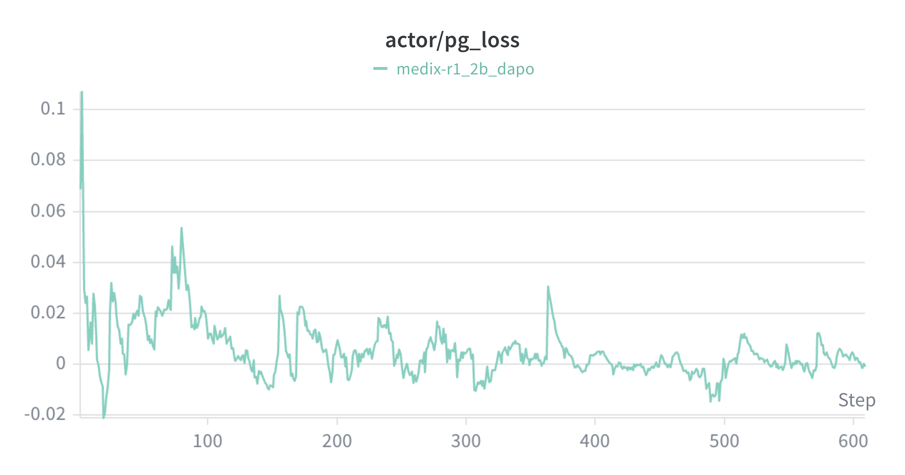
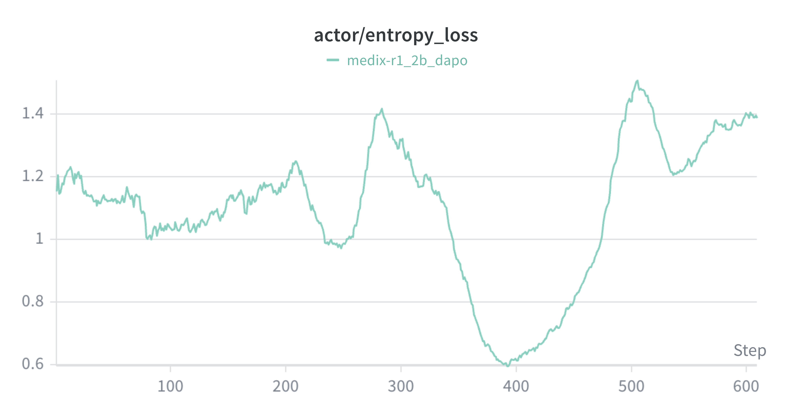
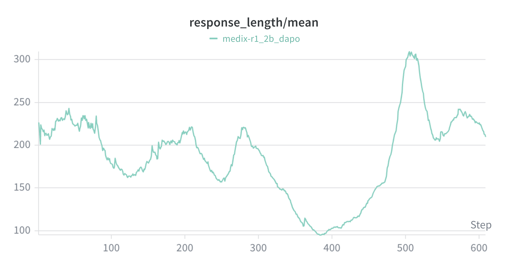
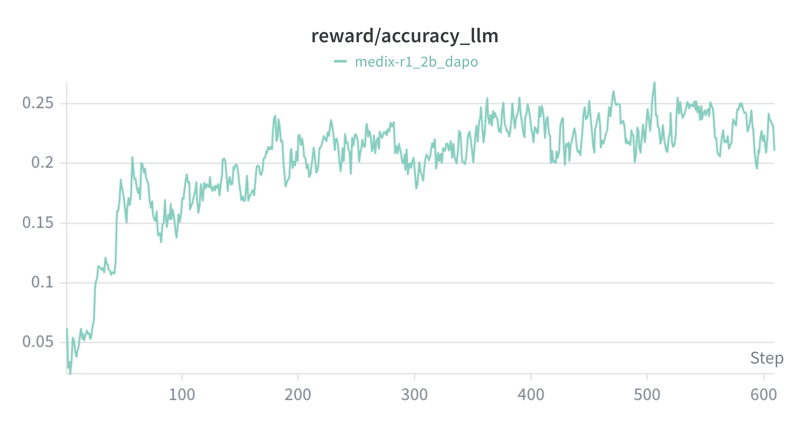
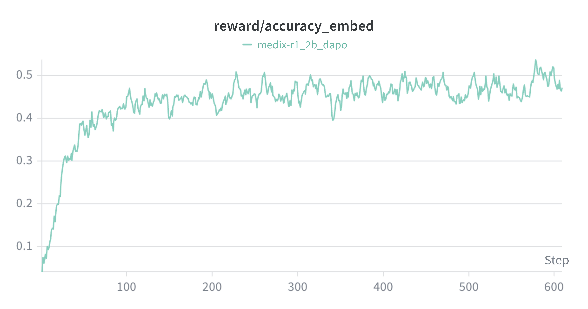
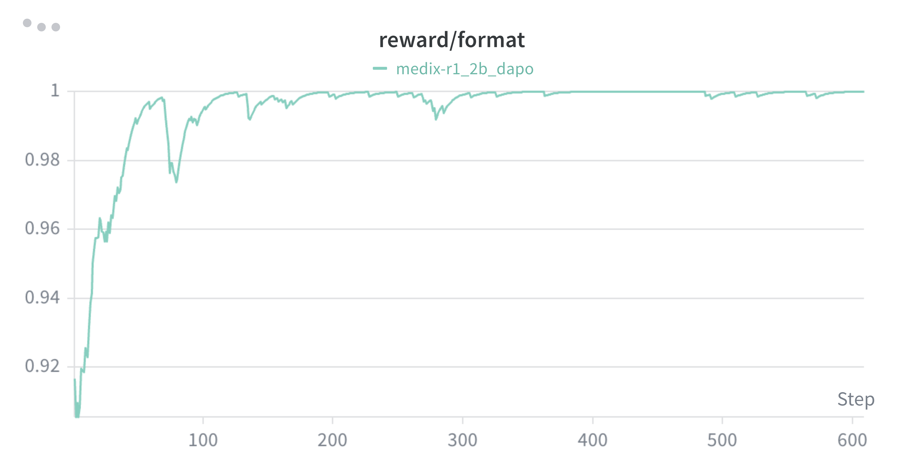
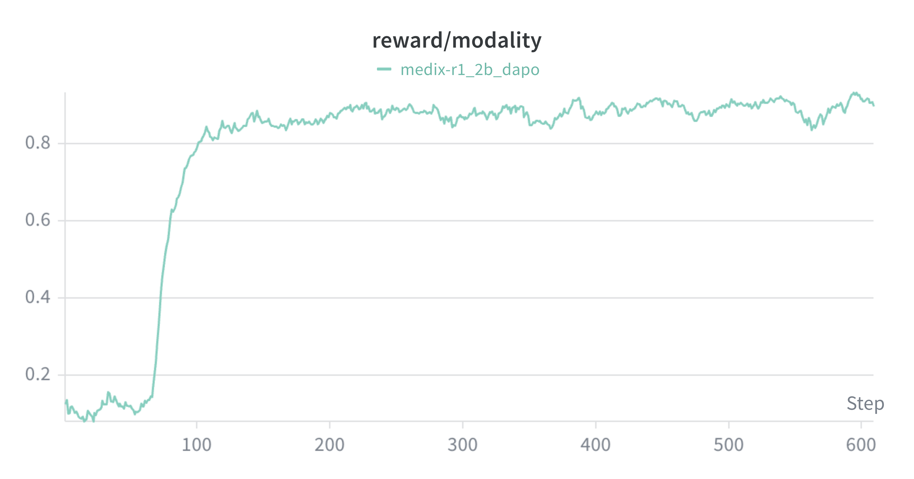
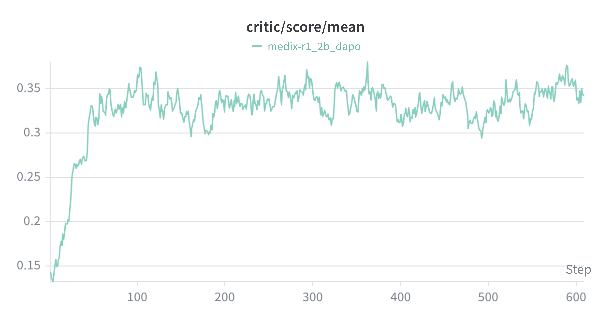
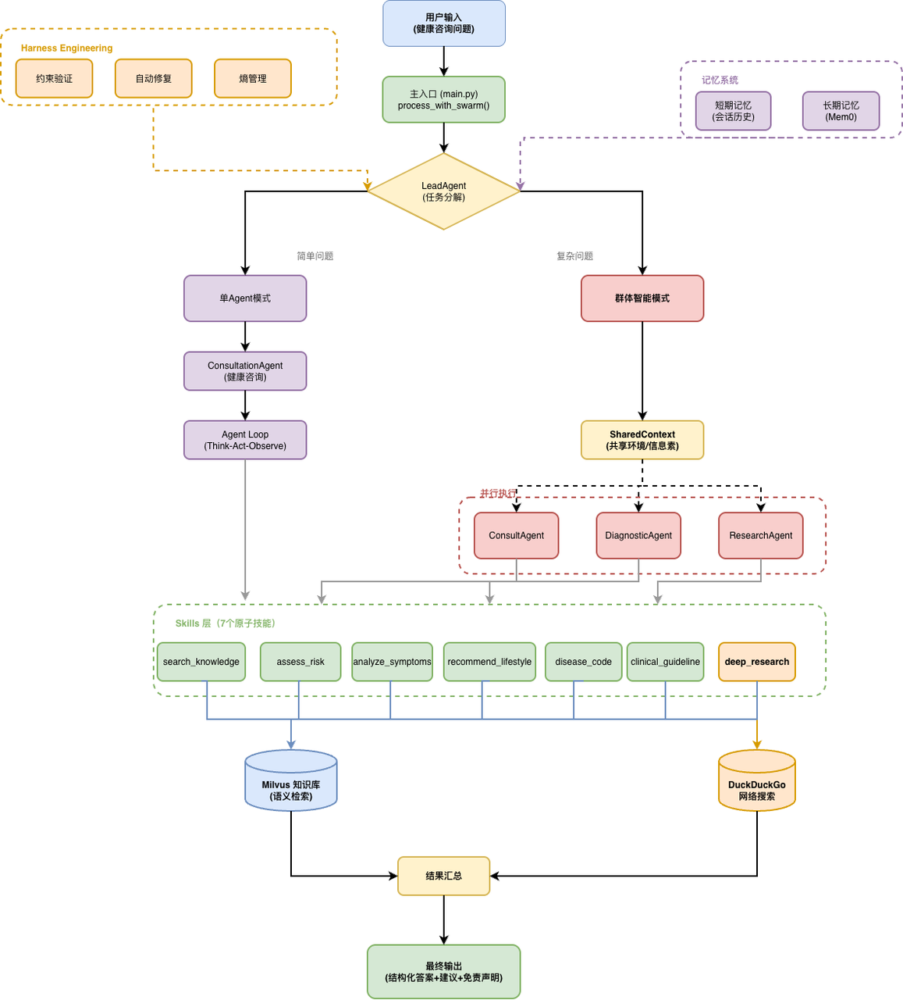

# 居丽叶的简历项目7：医疗助手代码解读

> 来源（Source）：https://my.feishu.cn/wiki/GAMLw3PCZiSLjUkhzSpczIZknad

面试准备文档：[居丽叶的简历项目7：医疗助手](https://my.feishu.cn/wiki/VtpmwnWNpi7ljVk7yIjcty7Vnuf)

## 算法部分

### 代码运行

计算资源：默认参数配置需要2张 80G的显卡，没有充足计算资源的同学可以降低batch-size、换更小的模型、将显卡数设置为1。

1. 创建虚拟环境，同时用于训练和评测。

```bash
conda create -n medix python=3.12 -y
conda activate medix
```

1. 安装训练依赖

```bash
cd MediX-R1/training
# flash-attn 必须先单独装 (构建时依赖 torch)
pip install flash-attn --no-build-isolation
pip install -e .
```

1. 配置 API 模型

训练时的 reward 打分和评测时的 judge 打分都调用同一个 API 模型，编辑 `config.py`:

```python
LLM_CONFIG = {
    "api_key": "<your-api-key>",
    "model_name": "<model-name>",
    "base_url": "<api-base-url>",
    "temperature": 0.7,
    "max_tokens": 8192,
}
```

1. 下载训练数据

```bash
cd ../
python -c "
from huggingface_hub import snapshot_download
snapshot_download(repo_id='MBZUAI/medix-rl-data', repo_type='dataset', local_dir='data/medix-rl-data')
"
```

下载评测数据：

```bash
cd eval2/
python -c "
from huggingface_hub import snapshot_download
snapshot_download('flaviagiammarino/vqa-rad', repo_type='dataset', local_dir='datasets_local/vqa-rad')
"
```

1. 训练，以用 DAPO 训练 2B 模型为例

```bash
cd ../training
bash examples/medix-r1_2b_dapo.sh
```

训练完成后 checkpoint 保存在:

```
training/checkpoints/medix-r1_2b_dapo/global_step_XXX/actor/
```

1. 合并模型权重

训练产出的是 FSDP 分片格式，需要合并为 HuggingFace 格式后才能用 vLLM 推理。这会将 `training/checkpoints/medix-r1_2b_dapo/global_step_600/actor/` 下的分片权重合并，输出 `.safetensors` 文件到 `actor/huggingface/` 目录。

```bash
cd ../eval2
bash merge.sh
```

1. 评测

评测 checkpoint 在 `rad_vqa` 任务上的表现。

```bash
cd ../eval2
bash eval.sh
```

`eval.sh` 会依次执行三个阶段：

1. **生成回答** — 启动 vLLM server 加载合并后的 checkpoint，对 rad_vqa 测试集 (451 条) 生成回答
2. **API 评分** — 调用 `config.py` 中的 API 模型，逐条判断回答是否正确 (0/1)
3. **汇总分数** — 统计正确率，打印结果表格

**输出文件**：

```
eval2/results/huggingface/
├── huggingface.jsonl           # 模型生成的回答
├── huggingface_eval.jsonl      # 每条的评分结果
└── huggingface_score.txt       # 最终正确率
```

### 训练指标分析

考虑到有些同学没有跑整个项目的代码，为了面试中显得自己有RL的经验，这里对关键训练指标进行罗列，需要能说清楚训练过程中指标的变化情况。

#### 策略梯度损失 (actor/pg_loss)



Policy Gradient Loss 是 DAPO 算法的主损失函数，驱动策略优化的方向。

- **初始阶段 (step 0~50)**：损失从 ~0.10 快速下降，策略在剧烈调整
- **中期 (step 50~300)**：损失在 0~0.03 之间波动，偶有小幅跳升
- **后期 (step 300~600)**：损失趋近于 0 附近，振幅进一步减小

**解读**：pg_loss 从高位收敛到 0 附近是正常且健康的表现 —— 意味着策略更新幅度在缩小，模型逐渐稳定。损失没有出现发散（大幅负值或正值），说明训练过程稳定。

#### 策略熵 (actor/entropy_loss)



熵反映模型输出的**多样性**，是判断策略是否坍缩的关键信号。

- **初始阶段 (step 0~200)**：熵从 ~1.15 缓慢下降至 ~1.0，属于正常的策略聚焦过程
- **下降阶段 (step 200~400)**：熵出现明显下降，从 ~1.4 急剧跌至 ~0.6，同时伴随响应长度的缩短
- **恢复阶段 (step 400~600)**：熵从 ~0.6 反弹回 ~1.4，恢复到较高水平

**解读**：step 200~400 期间出现了一次**策略坍缩的趋势** —— 模型开始生成更短、更单一的回答（熵下降 + 响应长度缩短）。这次"V 形"波动值得关注：如果训练继续，需要监控是否会再次出现类似坍缩。

#### 响应长度 (response_length/mean)



平均响应长度反映模型的输出行为模式变化。

- **初始阶段 (step 0~100)**：长度从 ~220 逐渐下降至 ~165
- **中期下降 (step 200~400)**：长度持续下降至最低 ~95 token
- **后期恢复 (step 400~550)**：长度急剧反弹至 ~305，随后回落稳定在 ~220

**解读**：响应长度的变化趋势与熵曲线高度一致。step 200~400 期间模型倾向于生成更简短的回答（可能是找到了一种"偷懒"策略来获取格式分数），随后通过 DAPO 的自我纠正机制恢复了正常长度。最终稳定在 ~220 token 是合理的。

#### 奖励分项分析

##### 4.1 LLM 准确性奖励 (reward/accuracy_llm)



由大模型评判回答准确性的分数。

- 从初始的 ~0.03 上升至 ~0.22 (step 150)，之后稳定在 0.20~0.25 区间
- 整体呈缓慢上升趋势，后半段略高于前半段

**解读**：LLM 评判的准确性有明显提升，但绝对值仍较低 (~0.22)，说明 2B 模型在医学问答准确性上还有很大提升空间。

##### 4.2 嵌入相似度奖励 (reward/accuracy_embed)



模型回答与标准答案在 MedEmbed 嵌入空间中的语义相似度。

- 从 ~0.03 快速上升至 ~0.45 (step 150)，之后稳定在 0.43~0.50 区间
- 上升速度和最终值都高于 LLM 准确性奖励

**解读**：模型更快地学会了生成语义上接近标准答案的回答。这说明模型已具备基本的医学语义理解能力。

##### 4.3 格式奖励 (reward/format)



检查回答是否符合 `<think>...</think>` 格式要求。

- 从 ~0.90 迅速上升至 ~1.0 (step 100)，之后几乎保持满分
- 仅在 step ~300 附近有一次微小波动

**解读**：格式遵循是最容易学习的任务，模型在很早期就掌握了正确的输出格式。这个奖励信号已经饱和，不再对策略优化提供有效梯度。

##### 4.4 模态匹配奖励 (reward/modality)



检查模型是否正确识别了输入图像的医学模态（如 X-ray、CT、MRI 等）。

- **突变阶段 (step 70~130)**：从 ~0.10 跃升至 ~0.85，出现了一个明显的阶跃
- **稳定阶段 (step 130~600)**：维持在 0.85~0.92 区间

**解读**：模态识别能力出现了"顿悟"式的学习 —— 模型在 step 70~130 突然学会了正确描述图像模态。这种阶跃式学习在 RL 训练中是典型现象，说明模型发现了某种有效的模态识别策略。

##### 4.5 综合奖励 (critic/score/mean)



`critic/score/mean` 是每个 rollout batch 中所有样本 `reward/overall` 的**算术平均值**。具体来说，reward function 为每条样本计算一个 `overall` 分数（即上述 4 个分项的加权和），写入 `token_level_scores`；训练框架随后对整个 batch 的 `token_level_scores` 求和再取均值，得到 `critic/score/mean`。因此该指标反映的是模型在**一批数据上的平均综合表现**，而非单条样本的得分。

各分项在 `overall` 中的权重如下（`format_weight=0.1`, `content_weight=0.9`）：


- **起始阶段 (step 0~100)**：奖励从 ~0.13 快速上升至 ~0.35，模型在训练初期迅速学到基本的回答策略
- **平稳阶段 (step 100~600)**：奖励在 0.30~0.38 区间波动，均值稳定在 ~0.34 附近

**解读**：模型在前 100 步完成了大部分学习，之后进入平台期。奖励没有继续显著上升，说明当前奖励函数的信号可能已被 2B 模型充分利用，或需要更多训练步数/更大模型才能进一步提升。

### 代码解读（easyR1：简化版 verl）

参考代码：https://github.com/hiyouga/easyr1

整个训练流程为：

1. 启动入口：解析命令行配置，初始化 Ray 集群，启动 Runner
2. `Runner.run()`：初始化 tokenizer/processor，定义 Worker 角色映射和 GPU 资源池，创建 reward 函数、数据加载器、Trainer
3. `Trainer.init_workers()`：创建 Ray 资源池，通过 FSDP Worker 初始化 Actor/Rollout/Ref/Critic 模型
4. `Trainer.fit()` 训练循环，每一步：
    1. Rollout 生成：用 vLLM 对 prompt 采样多个 response
    2. 计算 old_log_probs（当前策略）、ref_log_probs（参考策略）、values（Critic，如果有的话）
    3. 计算 reward：通过自定义 reward 函数（支持 LLM-as-judge）给每个 response 打分
    4. 计算 advantage：支持 GRPO、GAE、RLOO、REINFORCE++、ReMax 等多种估计器
    5. 更新 Critic（如果使用 GAE）
    6. 更新 Actor：用 PPO clipped objective 更新策略
    7. 定期验证和保存 checkpoint

#### 训练入口

- `training/verl/trainer/main.py`：

`main()` 通过 OmegaConf 解析配置后，初始化 Ray 集群并创建 Runner。Runner.run() 是实际的启动逻辑，做了四件事：

1. 实例化 tokenizer 和 processor（对于 VLM 模型，processor 负责处理图像/视频输入）
2. 定义角色到 Worker 类的映射和 GPU 资源池
3. 创建 reward 函数
4. 创建数据加载器并启动 Trainer

```python
@ray.remote(num_cpus=1)
class Runner:
    """A runner for RL training."""

    def run(self, config: PPOConfig):
        # print config
        print(json.dumps(config.to_dict(), indent=2))

        # instantiate tokenizer
        tokenizer = get_tokenizer(
            config.worker.actor.model.model_path,
            override_chat_template=config.data.override_chat_template,
            trust_remote_code=config.worker.actor.model.trust_remote_code,
            use_fast=True,
        )
        processor = get_processor(
            config.worker.actor.model.model_path,
            override_chat_template=config.data.override_chat_template,
            trust_remote_code=config.worker.actor.model.trust_remote_code,
            use_fast=True,
        )

        # define worker classes
        # ActorRolloutRef表示 Actor、Rollout、Ref 三个角色共享同一个 Worker 进程（即 hybrid engine 模式）。同一个 FSDP 模型在训练时做 Actor，推理时做 Rollout（通过 vLLM），计算参考 log_probs 时做 Ref。所有角色放在同一个 GPU 资源池中
        ray_worker_group_cls = RayWorkerGroup
        role_worker_mapping = {
            Role.ActorRolloutRef: ray.remote(FSDPWorker),
            Role.Critic: ray.remote(FSDPWorker),
        }
        global_pool_id = "global_pool"
        resource_pool_spec = {
            global_pool_id: [config.trainer.n_gpus_per_node] * config.trainer.nnodes,
        }
        mapping = {
            Role.ActorRolloutRef: global_pool_id,
            Role.Critic: global_pool_id,
        }
        resource_pool_manager = ResourcePoolManager(resource_pool_spec=resource_pool_spec, mapping=mapping)
        # reward 函数被包装成 Ray remote actor，训练和验证各一个实例。这样 reward 计算可以和模型计算异步并行。
        RemoteRewardManager = ray.remote(AutoRewardManager).options(num_cpus=config.worker.reward.num_cpus)
        reward_fn = RemoteRewardManager.remote(config.worker.reward, tokenizer)
        val_reward_fn = RemoteRewardManager.remote(config.worker.reward, tokenizer)

        train_dataloader, val_dataloader = create_dataloader(config.data, tokenizer, processor)

        trainer = RayPPOTrainer(
            config=config,
            tokenizer=tokenizer,
            processor=processor,
            train_dataloader=train_dataloader,
            val_dataloader=val_dataloader,
            role_worker_mapping=role_worker_mapping,
            resource_pool_manager=resource_pool_manager,
            ray_worker_group_cls=ray_worker_group_cls,
            reward_fn=reward_fn,
            val_reward_fn=val_reward_fn,
        )
        trainer.init_workers()
        trainer.fit()
```

#### 数据准备

- `verl/trainer/data_loader.py & verl/utils/dataset.py`：

`create_dataloader()` 创建 RLHFDataset 实例，然后包装成 StatefulDataLoader（支持 checkpoint 恢复时恢复迭代器状态）：

```python
def create_dataloader(config: DataConfig, tokenizer, processor):
    train_dataset = RLHFDataset(
        data_path=config.train_files,
        tokenizer=tokenizer,
        processor=processor,
        prompt_key=config.prompt_key,
        answer_key=config.answer_key,
        image_key=config.image_key,
        max_prompt_length=config.max_prompt_length,
        ...
    )
    if config.shuffle:
        # 使用带 seed 的 RandomSampler 而不是 DataLoader 的 shuffle=True，是为了 checkpoint 恢复时能精确还原数据顺序
        sampler = RandomSampler(data_source=train_dataset, generator=train_dataloader_generator)
    else:
        sampler = SequentialSampler(data_source=train_dataset)

    train_dataloader = StatefulDataLoader(
        dataset=train_dataset,
        batch_size=train_batch_size,
        sampler=sampler,
        num_workers=8,
        collate_fn=collate_fn,
        drop_last=True,
    )
```

重点关注`getitem()`函数：首先调用`_build_messages`构建多模态 messages，将 prompt 文本和 `<image>` 占位符组合成训练格式.

```python
def _build_messages(self, example):
    prompt_str = example[self.prompt_key]
    if self.format_prompt:
        format_prompt = Template(self.format_prompt.strip())
        prompt_str = format_prompt.render(content=prompt_str)

    if self.image_key in example:
        content_list = []
        for i, content in enumerate(prompt_str.split("<image>")):
            if i != 0:
                content_list.append({"type": "image"})
            if content:
                content_list.append({"type": "text", "text": content})
        return [{"role": "user", "content": content_list}]
```

接下来用 processor 处理图像，进行图片resize并 tokenize：

```python
if self.image_key in example:
    prompt = self.processor.apply_chat_template(messages, add_generation_prompt=True, tokenize=False)
    images = example.pop(self.image_key)
    if self.image_dir is not None and len(images) != 0 and isinstance(images[0], str):  # image paths
        images = [os.path.join(self.image_dir, image) for image in images]

    processed_images = [] if len(images) != 0 else None  # text-only data
    for image in images:
        processed_images.append(process_image(image, self.min_pixels, self.max_pixels))

    model_inputs = self.processor(processed_images, [prompt], add_special_tokens=False, return_tensors="pt")
    input_ids = model_inputs.pop("input_ids")[0]
    attention_mask = model_inputs.pop("attention_mask")[0]
    example["multi_modal_data"] = {"images": images}
```

应用MRoPE，原理详见[多模态体系知识搭建](https://my.feishu.cn/wiki/HxWSwlEFtiOzqWkYG9VcpsbHned)，交错MRoPE 和 DeepStack代码详见[多模态体系知识搭建](https://my.feishu.cn/wiki/HxWSwlEFtiOzqWkYG9VcpsbHned)

```python
if self.processor is not None and "Qwen2VLImageProcessor" in self.processor.image_processor.__class__.__name__:
            # qwen-vl mrope
    if "Qwen3VLProcessor" in self.processor.__class__.__name__:
        from ..models.transformers.qwen3_vl import get_rope_index
    else:
        from ..models.transformers.qwen2_vl import get_rope_index

    vision_position_ids = get_rope_index(
        self.processor,
        input_ids=input_ids,
        image_grid_thw=model_inputs.get("image_grid_thw", None),
        video_grid_thw=model_inputs.get("video_grid_thw", None),
        second_per_grid_ts=model_inputs.get("second_per_grid_ts", None),
        attention_mask=attention_mask,
    )  # (3, seq_length)
    text_position_ids = torch.arange(len(input_ids)).unsqueeze(0)  # (1, seq_length)
    position_ids = torch.cat((text_position_ids, vision_position_ids), dim=0)  # (4, seq_length)
```

左填充和截断：

```python
input_ids, attention_mask, position_ids = VF.postprocess_data(
    input_ids=input_ids, attention_mask=attention_mask, position_ids=position_ids,
    max_length=self.max_prompt_length, pad_token_id=self.tokenizer.pad_token_id,
    left_pad=True, truncation="right",
)
```

使用左填充是为了和自回归生成对齐——生成时 prompt 在左侧，response 在右侧依次生成，避免prompt和response之间有PAD。右截断表示当序列超过 max_prompt_length 时从右侧截掉，保留 prompt 的开头部分。举个例子，假设 max_length=6，原始 token 为 `[A, B, C, D, E, F, G, H]`：

- 右截断：先截掉右侧超出部分 → `[A, B, C, D, E, F]`
- 左填充：如果序列不足 max_length，在左侧补 pad → `[PAD, PAD, A, B, C, D]`

#### 训练器

- `verl/trainer/ray_trainer.py`：trainer初始化。
    - 如果 `disable_kl=True`（比如 DAPO算法），就不需要参考策略和 KL 惩罚
    - 只有使用 GAE 作为 advantage estimator 时才需要 Critic 网络。GRPO、RLOO 等算法不需要 Critic

```python
class RayPPOTrainer:
    def __init__(self, config, tokenizer, processor, train_dataloader, val_dataloader, ...):
        # 根据算法配置决定是否使用 KL 控制和 Criticif config.algorithm.disable_kl:
            self.use_reference_policy = False
            self.kl_ctrl = FixedKLController(init_kl_coef=0.0)
        else:
            self.use_reference_policy = True
            self.kl_ctrl = get_kl_controller(config.algorithm)

        if config.algorithm.adv_estimator == AdvantageEstimator.GAE:
            self.use_critic = Trueelse:
            self.use_critic = False
```

##### `init_workers`函数

负责创建分布式 Worker。`resource_pool_spec` 描述了集群的 GPU 拓扑：key 是资源池名称，value 是一个列表，每个元素表示一个节点上分配多少 GPU。`mapping` 把训练角色（ActorRolloutRef、Critic）映射到具体的资源池。本项目所有的角色模型共享一组 GPU。

```python
def create_resource_pool(self):
    for resource_pool_name, process_on_nodes in self.resource_pool_spec.items():
        resource_pool = RayResourcePool(
            process_on_nodes=process_on_nodes, use_gpu=True, max_colocate_count=1, name_prefix=resource_pool_name
        )
        self.resource_pool_dict[resource_pool_name] = resource_pool
```

RayResourcePool 底层通过 Ray Placement Group 来实现 GPU 资源的预留和绑定。可以理解为向 Ray 集群"预订座位"——告诉 Ray：我需要在第一个节点上预留 8 个 GPU，在第二个节点上预留 8 个 GPU... Ray 会保证这些资源在训练过程中不被其他任务抢占。

代码：`verl/single_controller/ray/base.py`

```python
def get_placement_groups(self, strategy: str = "STRICT_PACK", name: Optional[str] = None) -> list[PlacementGroup]:
    if self.pgs is not None:
        return self.pgs

    pg_name_prefix = (
        name if name else f"{self.name_prefix}verl_group_{'_'.join([str(count) for count in self._store])}:"
    )
    # print(f"pg_name_prefix = {pg_name_prefix}")
    pg_scheme = [
        [
            # {"CPU": 1, "GPU": 1} 代表一个"资源槽位"，表示要预留 1 个 CPU 核心和 1 个 GPU
            # max_colocate_count=1 表示每个槽位只运行一个 Worker 进程，这样每个 GPU 对应一个独立的 FSDP 进程，符合分布式训练的标准配置。
            {"CPU": self.max_colocate_count, "GPU": 1} if self.use_gpu else {"CPU": self.max_colocate_count}
            for _ in range(process_count)
        ]
        for process_count in self._store
    ]

    lifetime = "detached" if self.detached else None

    pgs = [
        # strategy="STRICT_PACK" 要求同一个 Placement Group（比如节点 1 的 8 个槽位）必须在同一台物理机器上，不能跨节点
        placement_group(bundles=bundles, strategy=strategy, name=pg_name_prefix + str(idx), lifetime=lifetime)
        for idx, bundles in enumerate(pg_scheme)
    ]

    ray.get([pg.ready() for pg in pgs])

    self.pgs = pgs
    return pgs
```

有了资源池之后，`init_workers()` 将 Worker 类绑定到对应的资源池：

```python
def init_workers(self):
    self.resource_pool_manager.create_resource_pool()
    # 为每个资源池创建一个空字典，用于存放该池需要运行的 worker 类
    self.resource_pool_to_cls = {pool: {} for pool in self.resource_pool_manager.resource_pool_dict.values()}
    # 接下来将不同角色的 worker 类注册到对应的资源池字典中
    # 这样设计支持：1) 多个角色共享同一资源池（co-location）2) 不同角色使用独立资源池
    if self.hybrid_engine:
        resource_pool = self.resource_pool_manager.get_resource_pool(Role.ActorRolloutRef)
        actor_rollout_ref_cls = RayClassWithInitArgs(
            cls=self.role_worker_mapping[Role.ActorRolloutRef], config=self.config.worker, role="actor_rollout_ref"
        )
        self.resource_pool_to_cls[resource_pool]["actor_rollout_ref"] = actor_rollout_ref_cls
    # 后续对 Critic 和 Reward Model 也做同样的注册操作
```

最后通过 `create_colocated_worker_cls()` 将同一资源池内的多个 Worker 类合并到单个 Ray Actor 中（让它们运行在同一进程内共享 GPU），然后创建 WorkerGroup 并部署到对应的资源池上。这样既支持多角色共享 GPU（节省资源），也支持不同角色部署到独立资源池（提高并行度）。

> 🎹 资源分配这里有点抽象，举一个例子你就懂了，想象你在管理一个工厂：
>
> - **节点（Node）**：一台物理机器，比如你有 2 台服务器
> - **GPU**：每台机器上的工人，比如每台服务器有 8 张 GPU 卡
> - **进程（Process）**：一个工作组，一个工作组可以使用一个 GPU
> - **集群（Cluster）**：所有机器联合起来就是一个集群
>
> 以下以（ **2 节点 × 8 GPU** 的集群 = 2 台服务器，每台服务器有 8 个 GPU，总共 16 个 GPU ）举例。
>
> 1. 首先是划分资源池（哪些 GPU 给谁用）：
>     `resource_pool_spec = {`  
>         `"global_pool": [8, 8]`  `# 第一台机器 8 个 GPU，第二台机器 8 个 GPU`  
>     `}`
>
>     这相当于说：**我有一个资源池叫 "global_pool"，它包含 2 台机器，每台 8 个 GPU**。
>
>     然后通过 `ResourcePoolManager` 向 Ray 集群"预订座位"：
> 2. 决定角色分工（谁负责干啥）
> - **Actor**：负责训练策略模型（学习怎么回答问题）
> - **Rollout**：负责生成答案（用 vLLM 快速推理）
> - **Ref**：负责当"参照物"（记住初始模型，防止训练跑偏）
> - **Critic**：负责评估答案好坏（DAPO、GSPO算法不需要）
> - **RewardModel**：负责打分（判断答案质量）
> 1. 把角色分配到资源池（谁去哪台机器工作）
>
> `mapping = {`  
>     `Role.ActorRolloutRef: "global_pool",`  
>     `Role.Critic: "global_pool",`  
> `}`
>
> 这里是把`ActorRolloutRef`和`Critic`都放在一个资源池工作，共享16个GPU。之后在`resource_pool_to_cls`中注册所有的模型。
>
> 1. `create_colocated_worker_cls`
>
> 把 `ActorRolloutRef` 和`Critic` **打包成一个 Ray Actor，**共享同一个进程，最后 `WorkerGroup` 会在每个 GPU 上启动这个合并后的进程。

##### fit函数

**代码**：`verl/trainer/ray_trainer.py`

```python
with timer("gen", timing_raw):
    self.actor_rollout_ref_wg.prepare_rollout_engine()
    batch = self._make_batch_data(metrics=metrics)
    self.actor_rollout_ref_wg.release_rollout_engine()
```

`prepare_rollout_engine()` 将 FSDP 模型的权重同步到 vLLM 引擎。`_make_batch_data()` 从数据集取一批 prompt，用 vLLM 生成 response。生成完成后 `release_rollout_engine()` 释放 vLLM 占用的显存，为后续训练腾出空间。

```python
# make a batch of data
with timer("gen", timing_raw):
    self.actor_rollout_ref_wg.prepare_rollout_engine()
    batch = self._make_batch_data(metrics=metrics)
    self.actor_rollout_ref_wg.release_rollout_engine()
```

`_make_batch_data()` 中实现了DAPO中的**Online Filtering**思想，也就是过滤掉模型全队或者全错的样本，提高训练效率，避免在无意义的样本上浪费计算资源。

```python
def _make_batch_data(self, metrics):
    batch = None
    num_try_make_batch = 0

    while True:
        num_try_make_batch += 1

        # 1. 从数据加载器取一个 mini-batch 的 prompt（例如 32 个 prompt）
        batch_dict = next(self.data_iterator)
        new_batch = DataProto.from_single_dict(batch_dict, meta_info=meta_info)

        # 2. 为每个 prompt 生成一个唯一的 uid（用于 online filtering 时追踪同一 prompt 的多个 response）
        new_batch.non_tensor_batch["uid"] = np.array([str(uuid.uuid4()) for _ in range(len(new_batch.batch))])

        # 3. 提取生成所需的数据
        gen_batch = new_batch.pop(
            batch_keys=["input_ids", "attention_mask", "position_ids"],
            non_tensor_batch_keys=["raw_prompt_ids", "multi_modal_data"],
        )

        # 4. 调用 vLLM 生成 response（如果 rollout.n=4，每个 prompt 会生成 4 个不同的 response）
        gen_batch_output = self.actor_rollout_ref_wg.generate_sequences(gen_batch)

        # 5. 把 prompt 侧的数据（ground_truth 等）重复 n 次，对齐生成的 n 个 response
        #    例如：原本 32 个 prompt，rollout.n=4，重复后变成 128 条数据（32 prompt × 4 response）
        new_batch = new_batch.repeat(repeat_times=self.config.worker.rollout.n, interleave=True)
        new_batch = new_batch.union(gen_batch_output)

        # 6. Online Filtering（DAPO 的关键特性）
        if self.config.algorithm.online_filtering:
            # 6.1 立即调用 reward 函数对所有 response 打分
            reward_tensor, reward_metrics = ray.get(self.reward_fn.compute_reward.remote(new_batch))
            new_batch.batch["token_level_scores"] = reward_tensor

            # 6.2 根据指定的 filter_key（例如 "overall" 或 "accuracy"）提取分数
            filter_scores = reward_metrics[self.config.algorithm.filter_key]  # 长度 128（32×4）
            uids = new_batch.non_tensor_batch["uid"]  # 长度 128，但每 4 个有相同的 uid

            # 6.3 按 uid 分组，计算每个 prompt 的平均分数
            #     例如：prompt_A 的 4 个 response 得分 [0.2, 0.3, 0.25, 0.28]，平均分 0.2575
            uid2scores = defaultdict(list)
            for uid, score in zip(uids, filter_scores):
                uid2scores[uid].append(score)
            uid2mean = {uid: np.mean(scores) for uid, scores in uid2scores.items()}

            # 6.4 过滤掉"太简单"或"太难"的样本
            #     - filter_low: 例如 0.8，过滤掉平均分 > 0.8 的（太简单，模型已经学会了）
            #     - filter_high: 例如 0.2，过滤掉平均分 < 0.2 的（太难，噪音样本）
            #     保留 0.2 < avg_score < 0.8 的样本（难度适中，对训练有价值）
            kept_uids = [
                uid for uid, avg_score in uid2mean.items()
                if avg_score > self.config.algorithm.filter_low
                and avg_score < self.config.algorithm.filter_high
            ]

            # 6.5 根据 kept_uids 筛选出保留的样本索引
            #     如果 32 个 prompt 中只有 20 个被保留，则 kept_sample_idxs 长度为 80（20×4）
            kept_sample_idxs = [idx for idx, uid in enumerate(uids) if uid in kept_uids]
            new_batch = new_batch[kept_sample_idxs]

        # 7. 累积到总 batch 中
        batch = DataProto.concat([batch, new_batch]) if batch is not None else new_batch
        current_batch_size = len(batch) // self.config.worker.rollout.n

        # 8. 检查是否凑够了目标数量（例如目标 rollout_batch_size=256）
        #    - 如果 online filtering 过滤掉很多样本，current_batch_size 可能不足
        #    - 此时继续循环，再取下一批 prompt 生成，直到凑够 256 个 prompt
        rollout_batch_size = self.config.data.rollout_batch_size
        if current_batch_size >= rollout_batch_size:
            # 凑够了，返回前 rollout_batch_size * n 条数据（例如 256×4=1024）
            return batch[:rollout_batch_size * self.config.worker.rollout.n]
        else:
            # 不够，继续生成（但设置最大尝试次数 max_try_make_batch 防止死循环）
            if num_try_make_batch >= self.config.trainer.max_try_make_batch:
                raise RuntimeError(f"尝试了 {num_try_make_batch} 次仍未凑够数据，请检查过滤阈值")
```

在分布式训练中，如果不同 GPU 上分到的序列长度差异很大，短序列的 GPU 会等长序列的 GPU，造成浪费。`_balance_batch()` 在 driver 端重新排列数据，让每个 GPU 分到的总 token 数尽量接近。

```python
def _balance_batch(self, batch: DataProto, metrics: dict[str, Any], logging_prefix: str = "global_seqlen") -> None:
    """Reorder the data on single controller such that each dp rank gets similar total tokens"""
    attention_mask = batch.batch["attention_mask"]
    batch_size = attention_mask.shape[0]
    global_seqlen_lst = batch.batch["attention_mask"].view(batch_size, -1).sum(-1).tolist()  # (train_batch_size,)
    world_size = self.actor_rollout_ref_wg.world_size
    global_partition_lst = get_seqlen_balanced_partitions(
        global_seqlen_lst, k_partitions=world_size, equal_size=True
    )
    # reorder based on index. The data will be automatically equally partitioned by dispatch function
    global_idx = torch.tensor([j for partition in global_partition_lst for j in partition])
    batch.reorder(global_idx)
    global_balance_stats = log_seqlen_unbalance(
        seqlen_list=global_seqlen_lst, partitions=global_partition_lst, prefix=logging_prefix
    )
    metrics.update(global_balance_stats)
```

同时计算 log_probs 和 reward ，后面 `ray.get()` 取回结果

```python
# 异步计算奖励
reward_ref = self.reward_fn.compute_reward.remote(batch)
# 计算当前策略的 log_probs
old_log_probs = self.actor_rollout_ref_wg.compute_log_probs(batch)
batch = batch.union(old_log_probs)

# 计算参考策略的 log_probs（用于 KL 惩罚）
if self.use_reference_policy:
    ref_log_probs = self.actor_rollout_ref_wg.compute_ref_log_probs(batch)
    batch = batch.union(ref_log_probs)

# 计算 Critic 的 value 估计
if self.use_critic:
    values = self.critic_wg.compute_values(batch)
    batch = batch.union(values)
```

计算 advantage 和更新模型

```python
with timer("adv", timing_raw):
    if "token_level_scores" not in batch.batch:
        reward_tensor, reward_metrics = ray.get(reward_ref)
        batch.batch["token_level_scores"] = reward_tensor

    if not self.config.algorithm.use_kl_loss and self.use_reference_policy:
        # 先把 KL 惩罚加到 token 级 reward 上，然后用选定的 advantage estimator 计算 advantage。
        batch, kl_metrics = apply_kl_penalty(batch, self.kl_ctrl, self.config.algorithm.kl_penalty)
    else:
        batch.batch["token_level_rewards"] = batch.batch["token_level_scores"]

    batch = compute_advantage(batch, adv_estimator=self.config.algorithm.adv_estimator, ...)
    
if self.use_critic:
    critic_output = self.critic_wg.update_critic(batch)
# critic_warmup 允许先只训练 Critic 若干步，等 value 估计稳定后再开始更新 Actor。
if self.config.trainer.critic_warmup <= self.global_step:
    actor_output = self.actor_rollout_ref_wg.update_actor(batch)
```

##### 详解损失函数计算代码

这一步是 强化学习 训练的核心准备阶段，需要计算三个关键量：

1. **old_log_probs**（当前策略的 log 概率）
2. **ref_log_probs**（参考策略的 log 概率，用于 KL 惩罚）
3. **values**（Critic 网络的价值估计，仅 GAE 算法需要）

###### **计算 old_log_probs**

**代码位置**：`verl/workers/fsdp_workers.py`

```python
@register(dispatch_mode=Dispatch.DP_COMPUTE_PROTO)
def compute_log_probs(self, data: DataProto):
    # 1. 处理多模态输入（图像等）
    self._process_multi_modal_inputs(data)
    data = data.to(torch.cuda.current_device())

    # 2. 如果启用了参数 offload，从 CPU 加载模型到 GPU
    if self._use_param_offload:
        load_fsdp_model(self.fsdp_module)

    # 3. 设置温度参数（用于控制采样的随机性）
    data.meta_info["temperature"] = self.config.rollout.temperature

    # 4. 序列并行预处理
    with self.ulysses_sharding_manager:
        data = self.ulysses_sharding_manager.preprocess_data(data)
        output = self.actor.compute_log_prob(data=data)
        output = DataProto.from_dict(
            tensors={"old_log_probs": output},
            meta_info={"temperature": self.config.rollout.temperature}
        )
        output = self.ulysses_sharding_manager.postprocess_data(output)

    # 5. FSDP reshard（多 GPU 时需要）
    if self.world_size > 1:
        self.fsdp_module._handle.reshard(True)

    # 6. 计算完成后 offload 回 CPU
    if self._use_param_offload:
        offload_fsdp_model(self.fsdp_module)

    return output.to("cpu")
```

核心计算在 `self.actor.compute_log_prob()`，位于 `verl/workers/actor/dp_actor.py`：

```python
def compute_log_prob(self, data: DataProto) -> torch.Tensor:
    self.actor_module.eval()  # 设置为评估模式

    # 1. 提取需要的字段
    select_keys = ["input_ids", "attention_mask", "position_ids", "responses"]
    non_tensor_select_keys = ["multi_modal_inputs"]
    data = data.select(select_keys, non_tensor_select_keys)

    # 2. 动态 batching 或固定 micro-batch
    if self.config.dynamic_batching:
        # 按总 token 数切分，保证每个 micro-batch 的计算量相近
        max_token_len = self.config.micro_batch_size_per_device_for_experience * data.batch["input_ids"].size(-1)
        micro_batches, batch_idx_list = prepare_dynamic_batch(data, max_token_len=max_token_len)
    else:
        # 按固定的 batch size 切分
        micro_batches = data.split(self.config.micro_batch_size_per_device_for_experience)

    # 3. 逐个 micro-batch 前向计算
    log_probs_lst = []
    for micro_batch in micro_batches:
        model_inputs = {**micro_batch.batch, **micro_batch.non_tensor_batch}
        log_probs = self._forward_micro_batch(model_inputs, temperature=temperature)
        log_probs_lst.append(log_probs)

    # 4. 拼接所有 micro-batch 的结果
    log_probs = torch.concat(log_probs_lst, dim=0)

    # 5. 恢复原始顺序（如果用了动态 batching）
    if self.config.dynamic_batching:
        log_probs = restore_dynamic_batch(log_probs, batch_idx_list)

    return log_probs
```

`_forward_micro_batch()` 的核心逻辑：

```python
def _forward_micro_batch(self, micro_batch: dict, temperature: float) -> torch.Tensor:
    input_ids = micro_batch["input_ids"]  # (bs, prompt_len + response_len)
    attention_mask = micro_batch["attention_mask"]
    position_ids = micro_batch["position_ids"]
    responses = micro_batch["responses"]  # (bs, response_len)
    response_length = responses.size(-1)

    # ===== 模式1: Padding-free（使用 flash_attn 的 unpad/pad）=====
    if self.config.padding_free:
        # 1. 去除 padding，将所有有效 token 拼成一维序列
        input_ids_rmpad, indices, *_ = unpad_input(input_ids.unsqueeze(-1), attention_mask)
        input_ids_rmpad = input_ids_rmpad.transpose(0, 1)  # (1, total_nnz)

        # 2. 处理 position_ids
        if position_ids.dim() == 3:  # M-RoPE
            position_ids_rmpad = index_first_axis(
                rearrange(position_ids, "c b s ... -> (b s) c ..."), indices
            ).transpose(0, 1).unsqueeze(1)  # (4, 1, total_nnz)
        else:
            position_ids_rmpad = index_first_axis(position_ids, indices)

        # 3. 前向传播（attention_mask=None，flash_attn 会自动处理）
        output = self.actor_module(
            input_ids=input_ids_rmpad,
            attention_mask=None,
            position_ids=position_ids_rmpad,
            **multi_modal_inputs,
            use_cache=False,
        )

        # 4. 提取 response 部分的 logits
        logits = output.logits[:, -response_length - 1 : -1, :]  # (1, response_len, vocab_size)
        logits.div_(temperature)  # 温度缩放

        # 5. 计算 log_probs
        responses_rmpad = index_first_axis(responses, indices)
        log_probs = self.log_probs_from_logits(logits, responses_rmpad)

        # 6. Pad 回原始形状
        full_log_probs = pad_input(log_probs.unsqueeze(-1), indices, batch=batch_size, seqlen=response_length)
        return full_log_probs.squeeze(-1)

    # ===== 模式2: 标准 padding =====
    else:
        # 1. 前向传播
        output = self.actor_module(
            input_ids=input_ids,
            attention_mask=attention_mask,
            position_ids=position_ids,
            **multi_modal_inputs,
            use_cache=False,
        )

        # 2. 提取 response 部分的 logits
        #    因为自回归模型的 logits[t] 预测的是 token[t+1]
        #    所以取 [-response_length - 1 : -1]
        logits = output.logits[:, -response_length - 1 : -1, :]  # (bs, response_len, vocab_size)
        logits.div_(temperature)

        # 3. 计算 log_probs
        log_probs = self.log_probs_from_logits(logits, responses)
        return log_probs  # (bs, response_len)
```

关键函数 `log_probs_from_logits` 的实现（在 `verl/utils/torch_functional.py`）：

```python
def log_probs_from_logits(logits: torch.Tensor, labels: torch.Tensor) -> torch.Tensor:
    """
    Args:
        logits: (bs, seq_len, vocab_size)
        labels: (bs, seq_len)
    Returns:
        log_probs: (bs, seq_len)
    """
    log_probs = F.log_softmax(logits, dim=-1)  # (bs, seq_len, vocab_size)
    # gather 操作：从 vocab 维度选出 labels 对应的 log_prob
    log_probs_labels = torch.gather(log_probs, dim=-1, index=labels.unsqueeze(-1))  # (bs, seq_len, 1)
    return log_probs_labels.squeeze(-1)  # (bs, seq_len)
```

**公式对应**：

$\pi_\theta(a_t | s_t) = \frac{\exp(logits[a_t] / T)}{\sum_{a'} \exp(logits[a'] / T)}$

$\log \pi_\theta(a_t | s_t) = \log(\text{softmax}(logits / T)[a_t])$

###### **计算 ref_log_probs**

**代码位置**：`verl/workers/fsdp_workers.py`

```python
@register(dispatch_mode=Dispatch.DP_COMPUTE_PROTO)
def compute_ref_log_probs(self, data: DataProto):
    self._process_multi_modal_inputs(data)
    data = data.to(torch.cuda.current_device())

    # 从 CPU 加载冻结的参考模型
    if self._use_ref_param_offload:
        load_fsdp_model(self.ref_fsdp_module)

    data.meta_info["temperature"] = self.config.rollout.temperature
    with self.ulysses_sharding_manager:
        data = self.ulysses_sharding_manager.preprocess_data(data)
        # 调用参考策略的 compute_log_prob（和 actor 一样的逻辑）
        output = self.ref_policy.compute_log_prob(data=data)
        output = DataProto.from_dict(tensors={"ref_log_probs": output})
        output = self.ulysses_sharding_manager.postprocess_data(output)

    # FSDP reshard
    if self.world_size > 1:
        self.ref_fsdp_module._handle.reshard(True)

    # Offload 回 CPU
    if self._use_ref_param_offload:
        offload_fsdp_model(self.ref_fsdp_module)

    return output.to("cpu")
```

**ref_policy 和 actor 的区别**：

- `ref_fsdp_module` 是训练开始时的初始模型权重，**全程冻结不更新**
- 用于计算 KL 散度：$D_{KL}(\pi_\theta || \pi_{ref})$，防止策略更新偏离初始模型太远

**公式对应**：

$\log \pi_{ref}(a_t | s_t) = \log(\text{softmax}(logits_{ref} / T)[a_t])$

###### **计算 values（仅 GAE 算法需要）**

**代码位置**：`verl/workers/fsdp_workers.py` 

```python
@register(dispatch_mode=Dispatch.DP_COMPUTE_PROTO)
def compute_values(self, data: DataProto):
    self._process_multi_modal_inputs(data)
    data = data.to(torch.cuda.current_device())

    if self._use_param_offload:
        load_fsdp_model(self.fsdp_module)

    with self.ulysses_sharding_manager:
        data = self.ulysses_sharding_manager.preprocess_data(data=data)
        # 调用 Critic 网络计算 value
        values = self.critic.compute_values(data=data)
        output = DataProto.from_dict(tensors={"values": values})
        output = self.ulysses_sharding_manager.postprocess_data(data=output)

    if self._use_param_offload:
        offload_fsdp_model(self.fsdp_module)

    return output.to("cpu")
```

**Critic 的前向计算**（在 `verl/workers/critic/dp_critic.py`）：

```python
def compute_values(self, data: DataProto) -> torch.Tensor:
    self.critic_module.eval()

    # 提取字段
    select_keys = ["input_ids", "attention_mask", "position_ids"]
    non_tensor_select_keys = ["multi_modal_inputs"]
    data = data.select(select_keys, non_tensor_select_keys)

    # 切分 micro-batch
    micro_batches = data.split(self.config.micro_batch_size_per_device_for_experience)

    values_lst = []
    for micro_batch in micro_batches:
        model_inputs = {**micro_batch.batch, **micro_batch.non_tensor_batch}
        values = self._forward_micro_batch(model_inputs)  # (bs, response_len)
        values_lst.append(values)

    values = torch.concat(values_lst, dim=0)
    return values

def _forward_micro_batch(self, micro_batch: dict) -> torch.Tensor:
    input_ids = micro_batch["input_ids"]
    attention_mask = micro_batch["attention_mask"]
    position_ids = micro_batch["position_ids"]
    response_length = micro_batch.get("responses").size(-1)

    # 前向传播
    output = self.critic_module(
        input_ids=input_ids,
        attention_mask=attention_mask,
        position_ids=position_ids,
        **multi_modal_inputs,
        use_cache=False,
    )

    # Critic 模型的输出是一个标量 value head
    # 取 response 部分的 value 估计
    values = output.logits[:, -response_length:, 0]  # (bs, response_len)
    return values
```

**公式对应**：

$V^\pi(s_t) = \mathbb{E}_{\pi}\left[\sum_{k=0}^\infty \gamma^k r_{t+k} \mid s_t\right]$

###### **KL Penalty**

在计算 advantage 之前，先把 KL 惩罚加到 reward 上：

```python
if not self.config.algorithm.use_kl_loss and self.use_reference_policy:
    batch, kl_metrics = apply_kl_penalty(batch, self.kl_ctrl, self.config.algorithm.kl_penalty)
else:
    batch.batch["token_level_rewards"] = batch.batch["token_level_scores"]
```

`apply_kl_penalty()`的实现，代码在（`verl/trainer/ray_trainer.py`）：

```python
def apply_kl_penalty(batch: DataProto, kl_ctrl: KLController, kl_penalty: str):
    # 1. 提取字段
    old_log_probs = batch.batch["old_log_probs"]  # (bs, response_len)
    ref_log_probs = batch.batch["ref_log_probs"]
    token_level_scores = batch.batch["token_level_scores"]
    response_mask = batch.batch["response_mask"]

    # 2. 计算 KL 散度
    kld = compute_kl(log_probs=old_log_probs, ref_log_probs=ref_log_probs, kl_penalty=kl_penalty)
    # kld shape: (bs, response_len)

    # 3. 加入 KL 惩罚
    token_level_rewards = token_level_scores - kl_ctrl.kl_coef * kld  # (bs, response_len)

    # 4. 计算平均 KL（用于监控和自适应调整）
    mean_kl = VF.masked_mean(kld, response_mask).item()

    # 5. 更新 KL 系数（如果是自适应 KL）
    kl_ctrl.update(current_kl=mean_kl, n_steps=1)

    batch.batch["token_level_rewards"] = token_level_rewards
    return batch, {"kl_divergence": mean_kl, "kl_coef": kl_ctrl.kl_coef}
```

`compute_kl()`的实现（代码在`verl/trainer/core_algos.py`）：

```python
def compute_kl(log_probs: torch.Tensor, ref_log_probs: torch.Tensor, kl_penalty: str) -> torch.Tensor:
    """
    Args:
        log_probs: (bs, response_len)
        ref_log_probs: (bs, response_len)
        kl_penalty: "kl" | "abs" | "mse" | "low_var_kl" | "full"
    Returns:
        kl_div: (bs, response_len)
    """
    log_probs, ref_log_probs = log_probs.float(), ref_log_probs.float()

    if kl_penalty == "kl":
        return log_probs - ref_log_probs

    if kl_penalty == "abs":
        return (log_probs - ref_log_probs).abs()

    if kl_penalty == "mse":
        return 0.5 * (log_probs - ref_log_probs).square()

    if kl_penalty == "low_var_kl":
        # Schulman 的低方差 KL 近似：exp(kl) - kl - 1
        kl = (ref_log_probs - log_probs).clamp(-20.0, 20.0)
        kld = (kl.exp() - kl - 1).contiguous()
        return torch.clamp(kld, min=-10.0, max=10.0)

    if kl_penalty == "full":
        # 完整的 KL 散度（需要所有 action 的概率分布）
        return F.kl_div(ref_log_probs, log_probs, log_target=True, reduction="none").sum(-1)

    raise NotImplementedError(f"Unknown KL penalty: {kl_penalty}.")
```

**公式对应**：

简化 KL（`kl`模式）:

$\text{KL}(a_t) \approx \log \pi_\theta(a_t | s_t) - \log \pi_{ref}(a_t | s_t)$

这是一个偏估计，只考虑了实际采样的 action，没有对整个 action 空间积分。

完整 KL（`full` 模式）：

$D_{KL}(\pi_\theta || \pi_{ref}) = \sum_{a} \pi_\theta(a|s) \log \frac{\pi_\theta(a|s)}{\pi_{ref}(a|s)}$

低方差 KL（`low_var_kl`模式）：

基于 Schulman 的近似公式：

$D_{KL}(p||q) \approx \exp(D_{KL}(q||p)) - D_{KL}(q||p) - 1$

**KL 惩罚后的 reward**：

$r_t^{KL} = r_t - \beta \cdot \text{KL}(a_t)$

###### **计算 Advantage**

**代码位置**：`verl/trainer/ray_trainer.py`的 `fit()`方法

```python
batch = compute_advantage(
    batch,
    adv_estimator=self.config.algorithm.adv_estimator,
    gamma=self.config.algorithm.gamma,
    lam=self.config.algorithm.lam,
)
```

`compute_advantage()` 的调度：

```python
def compute_advantage(batch: DataProto, adv_estimator: AdvantageEstimator, **kwargs) -> DataProto:
    """
    根据 adv_estimator 选择不同的 advantage 计算方法
    """
    # 提取字段
    token_level_rewards = batch.batch["token_level_rewards"]  # (bs, response_len)
    response_mask = batch.batch["response_mask"]

    # 调用对应的 advantage estimator
    advantages, returns = compute_advantage_return(adv_estimator, **adv_inputs)
    # 存回 batch
    batch.batch["advantages"] = advantages
    batch.batch["returns"] = returns
    return batch
```

###### **GAE（Generalized Advantage Estimation）**

代码（`verl/trainer/core_algos.py`）：

```python
@register_adv_estimator(AdvantageEstimator.GAE)
def compute_gae_advantage_return(
    token_level_rewards: torch.Tensor,  # (bs, response_len)
    values: torch.Tensor,               # (bs, response_len)
    response_mask: torch.Tensor,        # (bs, response_len)
    gamma: torch.Tensor,                # 折扣因子，默认 1.0
    lam: torch.Tensor,                  # GAE 参数，默认 1.0
    **kwargs,
) -> tuple[torch.Tensor, torch.Tensor]:
    nextvalues = 0
    lastgaelam = 0
    advantages_reversed = []
    gen_len = token_level_rewards.shape[-1]

    # 从后往前递推
    for t in reversed(range(gen_len)):
        # 1. 计算 TD 误差
        delta = token_level_rewards[:, t] + gamma * nextvalues - values[:, t]

        # 2. 计算 GAE advantage
        gaelam = delta + gamma * lam * lastgaelam

        # 3. 只在有效 token 上更新（跳过 padding 和 EOS 后的 token）
        if response_mask[:, t]:
            nextvalues = values[:, t]
            lastgaelam = gaelam

        advantages_reversed.append(lastgaelam)

    # 4. 反转回正向
    advantages = torch.stack(advantages_reversed[::-1], dim=1)  # (bs, response_len)

    # 5. 计算 returns
    returns = advantages + values

    # 6. 对 advantages 做 whitening（归一化）
    advantages = VF.masked_whiten(advantages, response_mask)

    return advantages, returns
```

**公式对应**：

**TD 误差**：

$\delta_t = r_t + \gamma V(s_{t+1}) - V(s_t)$

**GAE Advantage**：

$\hat{A}_t^{GAE(\gamma, \lambda)} = \sum_{l=0}^\infty (\gamma \lambda)^l \delta_{t+l}$

**递推形式**：

$\hat{A}_t = \delta_t + \gamma \lambda \hat{A}_{t+1}$

**Returns**：

$R_t = \hat{A}_t + V(s_t)$

**Whitening（归一化）**：

 $\hat{A}_t^{normalized} = \frac{\hat{A}_t - \text{mean}(\hat{A})}{\text{std}(\hat{A}) + \epsilon}$

这一步让 advantage 的分布更稳定，梯度更新更平滑。

###### **GRPO**

**代码**（`verl/trainer/core_algos.py`）：

```python
@register_adv_estimator(AdvantageEstimator.GRPO)
def compute_grpo_outcome_advantage(
    token_level_rewards: torch.Tensor,  # (bs, response_len)
    response_mask: torch.Tensor,        # (bs, response_len)
    index: torch.Tensor,                # (bs,)，标识哪些 response 来自同一个 prompt
    eps: float = 1e-6,
    **kwargs,
) -> tuple[torch.Tensor, torch.Tensor]:
    # 1. 计算每个 response 的总分数（outcome reward）
    scores = token_level_rewards.sum(dim=-1)  # (bs,)

    # 2. 按 index 分组，收集同一个 prompt 的所有 response 的分数
    id2score = defaultdict(list)
    for i in range(scores.shape[0]):
        id2score[index[i]].append(scores[i])

    # 3. 计算每组的均值和标准差
    id2mean, id2std = {}, {}
    for idx in id2score:
        assert len(id2score[idx]) > 1, "GRPO needs rollout.n > 1."
        id2mean[idx] = torch.mean(torch.tensor(id2score[idx]))
        id2std[idx] = torch.std(torch.tensor(id2score[idx]))

    # 4. 组内归一化
    for i in range(scores.shape[0]):
        scores[i] = (scores[i] - id2mean[index[i]]) / (id2std[index[i]] + eps)

    # 5. 将归一化后的分数广播到所有 token（outcome reward 是序列级的）
    returns = scores.unsqueeze(-1) * response_mask  # (bs, response_len)

    return returns, returns
```

**公式对应**：

**GRPO Advantage**：

$\hat{A}_i = \frac{R_i - \mu_g}{\sigma_g + \epsilon}$

###### **RLOO**

**代码**（`verl/trainer/core_algos.py`）：

```python
@register_adv_estimator(AdvantageEstimator.RLOO)
def compute_rloo_outcome_advantage(
    token_level_rewards: torch.Tensor,
    response_mask: torch.Tensor,
    index: torch.Tensor,
    **kwargs,
) -> tuple[torch.Tensor, torch.Tensor]:
    scores = token_level_rewards.sum(dim=-1)  # (bs,)

    # 1. 按 index 分组
    id2score = defaultdict(list)
    for i in range(scores.shape[0]):
        id2score[index[i]].append(scores[i])

    # 2. 计算每组的总和
    id2sum = {}
    for idx in id2score:
        id2sum[idx] = torch.sum(torch.tensor(id2score[idx]))

    # 3. Leave-one-out baseline
    for i in range(scores.shape[0]):
        sample_num = len(id2score[index[i]])
        assert sample_num > 1, "RLOO needs rollout.n > 1."
        # baseline = (总和 - 当前分数) / (n - 1)
        baseline = (id2sum[index[i]] - scores[i]) / (sample_num - 1)
        scores[i] = scores[i] - baseline

    returns = scores.unsqueeze(-1) * response_mask
    return returns, returns
```

**公式对应**：

**RLOO Advantage**：

$\hat{A}_i = R_i - \frac{1}{n-1} \sum_{j \neq i} R_j$

即：用其他 response 的平均分作为 baseline，减掉自己就得到 advantage。

###### **更新 Critic**

**代码**：

```python
if self.use_critic:
    critic_output = self.critic_wg.update_critic(batch)
```

`update_critic()`**的实现**（在`verl/workers/fsdp_workers.py`）：

```python
@register(dispatch_mode=Dispatch.DP_COMPUTE_PROTO)
def update_critic(self, data: DataProto):
    self._process_multi_modal_inputs(data)
    data = data.to(torch.cuda.current_device())

    if self._use_param_offload:
        load_fsdp_model(self.fsdp_module)
    if self._use_optimizer_offload:
        load_fsdp_optimizer(optimizer=self.optimizer)

    with self.ulysses_sharding_manager:
        data = self.ulysses_sharding_manager.preprocess_data(data=data)
        metrics = self.critic.update_value_function(data=data)
        metrics = self.ulysses_sharding_manager.postprocess_data(metrics)

    if self._use_param_offload:
        offload_fsdp_model(self.fsdp_module)
    if self._use_optimizer_offload:
        offload_fsdp_optimizer(optimizer=self.optimizer)

    return metrics
```

**Critic 的更新逻辑**（在 `verl/workers/critic/dp_critic.py`）：

```python
def update_critic(self, data: DataProto) -> dict:
    self.critic_module.train()

    # 提取字段
    select_keys = ["input_ids", "attention_mask", "position_ids", "values", "returns", "response_mask"]
    non_tensor_select_keys = ["multi_modal_inputs"]
    data = data.select(select_keys, non_tensor_select_keys)

    # 切分 mini-batch
    mini_batches = data.split(self.config.global_batch_size_per_device)

    for _ in range(self.config.ppo_epochs):  # 通常是 1
        for mini_batch in mini_batches:
            # 切分 micro-batch（梯度累积）
            micro_batches = mini_batch.split(self.config.micro_batch_size_per_device)
            total_response_tokens = mini_batch.batch["response_mask"].sum().item()

            for micro_batch in micro_batches:
                model_inputs = {**micro_batch.batch, **micro_batch.non_tensor_batch}

                # 1. 前向计算 value
                vpreds = self._forward_micro_batch(model_inputs)  # (bs, response_len)

                # 2. 提取字段
                old_values = micro_batch.batch["values"]
                returns = micro_batch.batch["returns"]
                response_mask = micro_batch.batch["response_mask"]

                # 3. 计算 value loss
                vf_loss, vf_metrics = compute_value_loss(
                    vpreds=vpreds,
                    returns=returns,
                    values=old_values,
                    response_mask=response_mask,
                    cliprange_value=self.config.cliprange_value,
                    loss_avg_mode=self.config.loss_avg_mode,
                )

                # 4. 反向传播（归一化后的 loss）
                loss = vf_loss * torch.sum(response_mask) * self.world_size / total_response_tokens
                loss.backward()

            # 5. 梯度裁剪和优化器更新
            grad_norm = self.critic_module.clip_grad_norm_(self.config.max_grad_norm)
            if not torch.isfinite(grad_norm):
                print("Gradient norm is not finite. Skip update.")
            else:
                self.critic_optimizer.step()
            self.critic_optimizer.zero_grad()

    return vf_metrics
```

**Value Loss 的计算**（在 `verl/trainer/core_algos.py`）：

```python
def compute_value_loss(
    vpreds: torch.Tensor,       # 当前 Critic 的预测 (bs, response_len)
    returns: torch.Tensor,      # GAE 计算的 target (bs, response_len)
    values: torch.Tensor,       # 旧的 value (bs, response_len)
    response_mask: torch.Tensor,
    cliprange_value: float,     # clip 范围，默认 0.2
    loss_avg_mode: str,
) -> tuple[torch.Tensor, dict]:
    # 1. Clip 预测的 value（防止更新太大）
    vpredclipped = torch.clamp(vpreds, values - cliprange_value, values + cliprange_value)

    # 2. 计算两种 loss
    vf_loss1 = torch.square(vpreds - returns)          # 未 clip 的 loss
    vf_loss2 = torch.square(vpredclipped - returns)    # clip 后的 loss

    # 3. 取最大值（保守更新）
    clipped_vf_losses = torch.max(vf_loss1, vf_loss2)

    # 4. 平均
    vf_loss = 0.5 * average_loss(clipped_vf_losses, response_mask, mode=loss_avg_mode)

    # 5. 指标
    metrics = {
        "vf_clipfrac": VF.masked_mean((vf_loss1 < vf_loss2).float(), response_mask).item(),
        "vpred_mean": VF.masked_mean(vpreds, response_mask).item(),
    }
    return vf_loss, metrics
```

**公式对应**：

**Value Loss（带 clip）**

$L^{VF} = \frac{1}{2} \max\left[(V_\phi(s_t) - R_t)^2, (\text{clip}(V_\phi(s_t), V_{old}(s_t) - \epsilon, V_{old}(s_t) + \epsilon) - R_t)^2\right]$

**Clip 的作用**：防止 Critic 更新太激进，保持稳定性。

###### **更新 Actor**

**代码**：

```python
if self.config.trainer.critic_warmup <= self.global_step:
    actor_output = self.actor_rollout_ref_wg.update_actor(batch)
```

`update_actor()`的实现（在 `verl/workers/fsdp_workers.py`）：

```python
@register(dispatch_mode=Dispatch.DP_COMPUTE_PROTO)
def update_actor(self, data: DataProto):
    self._process_multi_modal_inputs(data)
    data = data.to(torch.cuda.current_device())

    if self._use_param_offload:
        load_fsdp_model(self.fsdp_module)
    if self._use_optimizer_offload:
        load_fsdp_optimizer(optimizer=self.optimizer)

    with self.ulysses_sharding_manager:
        data = self.ulysses_sharding_manager.preprocess_data(data=data)
        metrics = self.actor.update_policy(data=data)
        metrics = self.ulysses_sharding_manager.postprocess_data(metrics)

    if self._use_param_offload:
        offload_fsdp_model(self.fsdp_module)
    if self._use_optimizer_offload:
        offload_fsdp_optimizer(optimizer=self.optimizer)

    return metrics
```

**Actor 的更新逻辑**（在 `verl/workers/actor/dp_actor.py`）：

```python
def update_policy(self, data: DataProto) -> dict:
    self.actor_module.train()

    temperature = data.meta_info["temperature"]

    # 提取字段
    select_keys = [
        "input_ids", "attention_mask", "position_ids", "responses",
        "old_log_probs", "advantages", "response_mask"
    ]
    if self.config.use_kl_loss:
        select_keys.append("ref_log_probs")
    non_tensor_select_keys = ["multi_modal_inputs"]

    data = data.select(select_keys, non_tensor_select_keys)

    # 切分 mini-batch
    mini_batches = data.split(self.config.global_batch_size_per_device)

    for _ in range(self.config.ppo_epochs):  # 外层循环，通常是 1
        for mini_batch in mini_batches:
            # 切分 micro-batch（梯度累积）
            micro_batches = mini_batch.split(self.config.micro_batch_size_per_device)
            total_response_tokens = mini_batch.batch["response_mask"].sum().item()

            for micro_batch in micro_batches:
                model_inputs = {**micro_batch.batch, **micro_batch.non_tensor_batch}

                # 1. 前向计算 log_probs（重新计算，不用缓存的 old_log_probs）
                log_probs = self._forward_micro_batch(model_inputs, temperature=temperature)

                # 2. 提取字段
                old_log_probs = micro_batch.batch["old_log_probs"]
                advantages = micro_batch.batch["advantages"]
                response_mask = micro_batch.batch["response_mask"]

                # 3. 计算 policy loss
                pg_loss, pg_metrics = compute_policy_loss(
                    old_log_probs=old_log_probs,
                    log_probs=log_probs,
                    advantages=advantages,
                    response_mask=response_mask,
                    clip_ratio_low=self.config.clip_ratio_low,
                    clip_ratio_high=self.config.clip_ratio_high,
                    clip_ratio_dual=self.config.clip_ratio_dual,
                    loss_type=self.config.loss_type,
                    loss_avg_mode=self.config.loss_avg_mode,
                )

                # 4. 如果使用 KL loss（而不是 KL penalty）
                if self.config.use_kl_loss and "ref_log_probs" in model_inputs:
                    ref_log_probs = micro_batch.batch["ref_log_probs"]
                    kld = compute_kl(
                        log_probs=log_probs,
                        ref_log_probs=ref_log_probs,
                        kl_penalty=self.config.kl_penalty,
                    )
                    kl_loss = average_loss(kld, response_mask, mode=self.config.loss_avg_mode)
                    loss = pg_loss + kl_loss * self.config.kl_coef
                else:
                    loss = pg_loss

                # 5. 归一化 loss（按有效 token 数）
                loss = loss * torch.sum(response_mask) * self.world_size / total_response_tokens

                # 6. 反向传播
                loss.backward()

            # 7. 梯度裁剪和优化器更新
            grad_norm = self._optimizer_step()

            # 8. 学习率调度
            if self.lr_scheduler is not None:
                self.lr_scheduler.step()

    return pg_metrics
```

**Policy Loss 的计算**（在 `verl/trainer/core_algos.py`）：

```python
def compute_policy_loss(
    old_log_probs: torch.Tensor,      # (bs, response_len)
    log_probs: torch.Tensor,          # (bs, response_len)
    advantages: torch.Tensor,         # (bs, response_len)
    response_mask: torch.Tensor,      # (bs, response_len)
    clip_ratio_low: float,            # PPO clip 下界，默认 0.2
    clip_ratio_high: float,           # PPO clip 上界，默认 0.2
    clip_ratio_dual: float,           # Dual clip，默认 4.0
    loss_type: str,                   # "default" | "gspo" | "cispo"
    loss_avg_mode: str,               # "token" | "seq"
    **kwargs,
) -> tuple[torch.Tensor, dict]:
    # 1. 计算 importance ratio 的对数
    negative_approx_kl = log_probs - old_log_probs  # log(π_new / π_old)

    # 2. 根据 loss_type 调整 importance ratio
    if loss_type in ["gspo", "gspo_token"]:
        # GSPO: 使用序列级的 importance ratio
        negative_approx_kl_in_seq = VF.masked_mean(negative_approx_kl, response_mask, dim=-1)
        if loss_type == "gspo_token":
            # 序列级 ratio + token 级调整
            log_importance_ratio = negative_approx_kl_in_seq.detach().unsqueeze(-1) + log_probs - log_probs.detach()
        else:
            log_importance_ratio = negative_approx_kl_in_seq * response_mask
    else:
        # 标准 PPO: token 级 importance ratio
        log_importance_ratio = negative_approx_kl

    # 3. Clip before exp（防止 NaN）
    ratio = torch.exp(torch.clamp(log_importance_ratio, -20.0, 20.0))
    clipped_ratio = torch.exp(
        torch.clamp(log_importance_ratio, np.log(1.0 - clip_ratio_low), np.log(1.0 + clip_ratio_high))
    )

    # 4. 计算三种 loss
    pg_loss = -advantages * ratio                       # 原始 loss
    pg_loss2 = -advantages * clipped_ratio              # Clip 后的 loss
    pg_loss3 = -advantages * clip_ratio_dual            # Dual clip（对负 advantage）

    # 5. 根据 advantage 的符号选择 loss
    clipped_pg_loss_higher = torch.max(pg_loss, pg_loss2)  # 如果 pg_loss < pg_loss2，用 pg_loss2
    clipped_pg_loss_lower = torch.min(clipped_pg_loss_higher, pg_loss3)  # 如果 pg_loss_higher > pg_loss3，用 pg_loss3

    # 当 advantage > 0 时，用 clipped_pg_loss_higher（标准 PPO clip）
    # 当 advantage < 0 时，用 clipped_pg_loss_lower（额外用 dual clip 保护）
    final_pg_loss = torch.where(advantages < 0, clipped_pg_loss_lower, clipped_pg_loss_higher)

    # 6. 平均
    final_pg_loss = average_loss(final_pg_loss, response_mask, mode=loss_avg_mode)

    # 7. 指标
    metrics = {
        "ppo_kl": -negative_approx_kl,
        "entropy_loss": average_loss(-log_probs, response_mask, mode=loss_avg_mode),
        "pg_clipfrac_higher": (pg_loss < pg_loss2).float(),
        "pg_clipfrac_lower": ((clipped_pg_loss_higher > pg_loss3).float() * (advantages < 0).float()),
    }
    metrics = {k: VF.masked_mean(v, response_mask).detach().item() for k, v in metrics.items()}

    return final_pg_loss, metrics
```

**公式对应**：

**Importance Ratio**：

$r_t = \frac{\pi_\theta(a_t | s_t)}{\pi_{old}(a_t | s_t)} = \exp(\log \pi_\theta - \log \pi_{old})$

**PPO Clipped Objective（标准）**：

$L^{CLIP}(\theta) = \mathbb{E}_t\left[\min(r_t \hat{A}_t, \text{clip}(r_t, 1-\epsilon_{low}, 1+\epsilon_{high}) \hat{A}_t)\right]$

**DAPO（非对称 clip）**：

- 当 $\hat{A}_t > 0$ 时（好动作），允许 ratio 更大的变化（$\epsilon_{high}$ 可以 > $\epsilon_{low}$）
- 当 $\hat{A}_t < 0$ 时（差动作），额外用 dual clip 保护（防止过度惩罚）

**Dual Clip**（对负 advantage）：

$L^{dual}(\theta) = \max(\text{clip}(r_t, 1-\epsilon, 1+\epsilon) \hat{A}_t, c \cdot \hat{A}_t)$

**最终的 Policy Loss**：

$L^{policy} = -\mathbb{E}_t[L^{CLIP}(\theta)]$

注意前面有负号，因为我们要**最大化** objective，而优化器是做**最小化**。

**GSPO**：详见[居丽叶LLM体系知识搭建](https://my.feishu.cn/docx/AN61dRfiWoRUiRxhc6ucbmJwnGr)

#### 分布式训练（FSDP）

接下来看分布式训练框架FSDP的代码，负责协调  GPU 上执行所有模型相关的计算，包括模型初始化、前向推理、梯度更新、rollout 生成。`verl/workers/fsdp_workers.py`。

初始化时根据 role 参数决定自己需要承担哪些角色

```python
class FSDPWorker(Worker):
    def __init__(
        self,
        config: WorkerConfig,
        role: Literal["actor", "critic", "rollout", "ref", "actor_rollout", "actor_rollout_ref"],
    ):
        super().__init__()
        self.config = config
        self.role = role

        # 根据 role 决定需要初始化哪些组件
        self._has_actor = self.role in ["actor", "actor_rollout", "actor_rollout_ref"]
        self._has_critic = self.role == "critic"
        self._has_rollout = self.role in ["rollout", "actor_rollout", "actor_rollout_ref"]
        self._has_ref = self.role in ["ref", "actor_rollout_ref"]

        if self.config.actor.disable_kl:
            self._has_ref = False  # 如果禁用 KL，就不需要参考策略

        # 判断是否需要 CPU offload
        self._use_param_offload = False
        self._use_optimizer_offload = False
        self._use_ref_param_offload = False
        if self._has_actor:
            self._use_param_offload = self.config.actor.offload.offload_params
            self._use_optimizer_offload = self.config.actor.offload.offload_optimizer
            self._init_dist_mesh(self.config.actor, "actor")
```

Device mesh 定义了 GPU 之间的拓扑关系，支持一维（纯数据并行）和二维（数据并行 + 序列并行）：

- **一维 mesh** `(world_size,)`：所有 GPU 用于数据并行，每个 GPU 持有完整模型的一个分片
- **二维 mesh (DDP, FSDP)**：比如 16 GPU 分成 (2, 8)，2 个数据并行组，每组内 8 卡做模型分片
- **Ulysses SP mesh (DP, SP)**：序列并行，将长序列切分到多个 GPU 并行处理

```python
def _init_dist_mesh(self, config: Union[ActorConfig, CriticConfig], role: Literal["actor", "critic"]):
    world_size = dist.get_world_size()

    # 创建主 device mesh
    fsdp_size = config.fsdp.fsdp_size
    if fsdp_size <= 0 or fsdp_size >= world_size:
        # 一维 mesh：纯 FSDP（数据并行）
        self.device_mesh = init_device_mesh("cuda", mesh_shape=(world_size,), mesh_dim_names=("fsdp",))
    else:
        # 二维 mesh：HSDP（Hybrid Sharded Data Parallel）
        # 第一维是 DDP（数据并行），第二维是 FSDP（模型分片）
        self.device_mesh = init_device_mesh(
            "cuda", mesh_shape=(world_size // fsdp_size, fsdp_size), mesh_dim_names=("ddp", "fsdp")
        )

    # 创建 Ulysses 序列并行 device mesh（如果启用）
    if config.ulysses_size > 1:
        # 二维 mesh：(DP, SP)
        # DP = 数据并行维度，SP = 序列并行维度
        self.ulysses_device_mesh = init_device_mesh(
            "cuda",
            mesh_shape=(world_size // config.ulysses_size, config.ulysses_size),
            mesh_dim_names=("dp", "sp"),
        )
    else:
        self.ulysses_device_mesh = None
```

`init_model()` 按需构建模型。

```python
@register(dispatch_mode=Dispatch.ONE_TO_ALL)
def init_model(self):
    # 1. 初始化 Critic 模型（如果需要）
    if self._has_critic:
        self._build_model_optimizer(
            model_config=self.config.critic.model,
            fsdp_config=self.config.critic.fsdp,
            optim_config=self.config.critic.optim,
            padding_free=self.config.critic.padding_free,
            role="critic",
        )

    # 2. 初始化 Actor 模型（训练用）
    if self._has_actor:
        self._build_model_optimizer(
            model_config=self.config.actor.model,
            fsdp_config=self.config.actor.fsdp,
            optim_config=self.config.actor.optim,
            padding_free=self.config.actor.padding_free,
            role="actor",
        )

    # 3. 初始化 Ref 模型（参考策略，用于计算 KL 散度）
    if self._has_ref:
        self._build_model_optimizer(
            model_config=self.config.actor.model,
            fsdp_config=self.config.ref.fsdp,
            optim_config=None,  # Ref 不需要优化器
            padding_free=self.config.ref.padding_free,
            role="ref",
        )

    # 4. 包装 Actor 为 PPOActor（带 forward 和 update 逻辑）
    if self._has_actor:
        from .actor.dp_actor import DataParallelPPOActor
        self.actor = DataParallelPPOActor(
            config=self.config.actor,
            actor_module=self.fsdp_module,
            actor_optimizer=self.optimizer,
        )

    # 5. 初始化 vLLM Rollout 引擎（生成 response 用）
    if self._has_rollout:
        self._build_rollout()
```

`_build_model_optimizer()` 是 FSDP 初始化的核心，包含以下步骤：

1. 加载模型和配置

```python
def _build_model_optimizer(
    self,
    model_config: ModelConfig,
    fsdp_config: FSDPConfig,
    optim_config: Optional[OptimConfig],
    padding_free: bool,
    role: Literal["actor", "critic", "ref"],
) -> None:
    if role != "ref":  # ref 复用 actor 的 tokenizer
        # 加载 tokenizer 和 processor（VLM 需要 processor 处理图像）
        self.tokenizer = get_tokenizer(
            model_config.tokenizer_path,
            trust_remote_code=model_config.trust_remote_code,
            use_fast=True,
        )
        self.processor = get_processor(
            model_config.tokenizer_path,
            trust_remote_code=model_config.trust_remote_code,
            use_fast=True,
        )
        # 加载模型配置
        self.model_config = AutoConfig.from_pretrained(
            model_config.model_path,
            trust_remote_code=model_config.trust_remote_code,
            bos_token_id=self.tokenizer.bos_token_id,
            eos_token_id=self.tokenizer.eos_token_id,
            pad_token_id=self.tokenizer.pad_token_id,
            **model_config.override_config,
        )
```

1. 选择模型类和加载方式。
- 传统方式：所有 rank 都从磁盘加载完整模型权重 → 浪费时间和内存
- rank0_init：只有 rank 0 加载权重，其他 rank 创建空模型 → FSDP 初始化时通过 `sync_module_states=True` 从 rank 0 广播权重

```python
if role == "critic":
    AutoClass = AutoModelForTokenClassification  # Critic 是 token 分类任务
elif type(self.model_config) in AutoModelForImageTextToText._model_mapping.keys():
    AutoClass = AutoModelForImageTextToText  # VLM 模型
else:
    AutoClass = AutoModelForCausalLM  # 标准 LLM

# 加载模型权重
if (not fsdp_config.enable_rank0_init) or self.device_mesh.get_local_rank("fsdp") == 0:
    # 正常加载：所有 rank 都加载完整模型（或 rank 0 加载后同步）
    model = AutoClass.from_pretrained(
        model_config.model_path,
        config=self.model_config,
        torch_dtype=torch_dtype,
        attn_implementation="flash_attention_2",  # 使用 Flash Attention 2
        device_map="cpu" if fsdp_config.enable_rank0_init else "cuda",
        low_cpu_mem_usage=True,
        trust_remote_code=model_config.trust_remote_code,
    )
else:
    # rank0_init 模式：其他 rank 只创建空壳，不加载权重（节省内存和时间）
    with no_init_weights(), init_empty_weights():
        model = AutoClass.from_config(
            self.model_config,
            torch_dtype=torch_dtype,
            attn_implementation="flash_attention_2",
            trust_remote_code=model_config.trust_remote_code,
        )
```

1. 配置梯度检查点，ref模型冻结参数，冻结视觉编码器

```python
model = cast(PreTrainedModel, model)
model.tie_weights()  # 绑定输入输出 embedding（避免同步问题）
model = model.to(torch_dtype)

# 启用 Gradient Checkpointing（用计算换显存）
if model_config.enable_gradient_checkpointing:
    model.gradient_checkpointing_enable(gradient_checkpointing_kwargs={"use_reentrant": False})

# Ref 模型冻结所有参数
if role == "ref":
    model.requires_grad_(False)

# 冻结视觉编码器（VLM 训练中常用）
if model_config.freeze_vision_tower:
    if hasattr(model, "model") and hasattr(model.model, "visual"):
        model.model.visual.requires_grad_(False)
        fsdp_config.use_orig_params = True  # 冻结部分参数时必须用 use_orig_params
        self.print_rank0("Vision tower is set to not trainable.")
```

1. 配置混合精度
- `param_dtype`：模型参数的存储精度（通常 BF16 或 FP16）
- `reduce_dtype`：梯度 All-Reduce 通信时的精度（通常和 param_dtype 一致）
- `buffer_dtype`：LayerNorm 等模块的统计量精度（通常保持 FP32 以确保数值稳定）

```python
mixed_precision = MixedPrecision(
    param_dtype=PrecisionType.to_dtype(fsdp_config.mp_param_dtype),    # 参数存储精度
    reduce_dtype=PrecisionType.to_dtype(fsdp_config.mp_reduce_dtype),  # 梯度通信精度
    buffer_dtype=PrecisionType.to_dtype(fsdp_config.mp_buffer_dtype),  # buffer（如 LN）精度
)
```

1. 配置 Auto Wrap Policy（`verl/utils/fsdp_utils.py`）。FSDP 将模型分成多个单元，每个单元的参数作为一个整体分片和通信：`transformer_auto_wrap_policy` 自动识别模型的 Transformer 层类（如 `Qwen2VLDecoderLayer`、`LlamaDecoderLayer`），将每层包装为一个 FSDP 单元。

```python
auto_wrap_policy = get_fsdp_wrap_policy(model)
def get_fsdp_wrap_policy(model: PreTrainedModel):
    """获取 FSDP 的自动包装策略

    根据模型的 _no_split_modules 属性，自动找到 Transformer 层的类名，
    然后用 transformer_auto_wrap_policy 将每个 Transformer 层包装为一个 FSDP 单元
    """
    transformer_cls_to_wrap = set()
    for module in model._no_split_modules:
        transformer_cls = get_module_class_from_name(model, module)
        if transformer_cls is None:
            raise Exception(f"Cannot find {module} in pretrained model.")
        else:
            transformer_cls_to_wrap.add(transformer_cls)

    return partial(transformer_auto_wrap_policy, transformer_layer_cls=transformer_cls_to_wrap)
```

1. 分片策略设置

```yaml
if self.device_mesh.ndim == 2:
    # 二维 mesh（HSDP）
    if fsdp_config.enable_full_shard:
        sharding_strategy = ShardingStrategy.HYBRID_SHARD  # 完全分片版本
    else:
        sharding_strategy = ShardingStrategy._HYBRID_SHARD_ZERO2  # ZeRO-2 版本
else:
    # 一维 mesh（纯 FSDP）
    if fsdp_config.enable_full_shard:
        sharding_strategy = ShardingStrategy.FULL_SHARD  # 参数+梯度+优化器全分片
    else:
        sharding_strategy = ShardingStrategy.SHARD_GRAD_OP  # 仅梯度+优化器分片（ZeRO-2）

# 配置 CPU Offload
if fsdp_config.enable_cpu_offload:
    cpu_offload = CPUOffload(offload_params=True)
else:
    cpu_offload = None
```

**HYBRID_SHARD 原理**（多节点训练的最佳选择）：

假设 2 节点 × 8 GPU，模型 20B 参数：

- **FULL_SHARD**：16 GPU 完全分片，每卡 1.25B 参数
    - ❌ 前向时需要向其他 15 个 GPU All-Gather 参数，跨节点通信慢
- **HYBRID_SHARD**：节点内 FULL_SHARD，节点间 DDP
    - ✅ 前向只在节点内 All-Gather（NVLink 快）
    - ✅ 反向只在节点间同步梯度（一次通信）
1. 包装成 FSDP 模块
- `sync_module_states=True`：
    - 在初始化时，rank 0 将参数广播到其他 rank
    - 确保所有 GPU 的初始权重完全一致（避免从不同 checkpoint 分片加载导致不一致）
- `use_orig_params`：
    - False（默认）：FSDP 将所有参数 flatten 成一个大 Tensor（`FlatParameter`），节省显存但难以调试
    - True：保持原始参数结构（如 `model.layers[0].self_attn.q_proj.weight`），便于调试和兼容某些优化器
    - **冻结部分参数时必须设为 True**（否则 FSDP 无法区分可训练和冻结参数）
- `forward_prefetch=False`：
    - True：提前预取下一层的参数（计算和通信重叠，提速但占显存）
    - False：当前层计算完再释放参数，不提前预取（节省显存，但可能慢一点）

```python
if fsdp_config.enable_rank0_init:
    # rank0_init 模式：需要从 rank 0 同步权重
    sync_module_states = True
    param_init_fn = get_init_fn(model, device="cuda") if self.rank != 0 else None
else:
    sync_module_states = False
    param_init_fn = None

fsdp_module = FSDP(
    model,
    sharding_strategy=sharding_strategy,
    cpu_offload=cpu_offload,
    auto_wrap_policy=auto_wrap_policy,
    mixed_precision=mixed_precision,
    param_init_fn=param_init_fn,  # 非 rank 0 的参数初始化函数
    device_id=torch.cuda.current_device(),
    sync_module_states=sync_module_states,  # 是否从 rank 0 同步权重
    forward_prefetch=False,  # 不提前预取参数（节省显存）
    use_orig_params=fsdp_config.use_orig_params,  # 是否保持原始参数结构
    device_mesh=self.device_mesh,
)
```

1. 创建优化器和学习率调度器

```python
if role in ["actor", "critic"]:
    self.fsdp_module = fsdp_module

    # 创建优化器
    if optim_config.strategy == "adamw":
        self.optimizer = torch.optim.AdamW(
            filter(lambda p: p.requires_grad, self.fsdp_module.parameters()),
            lr=optim_config.lr,
            betas=optim_config.betas,
            weight_decay=optim_config.weight_decay,
            fused=True,  # 使用 CUDA fused kernel（更快）
        )
    elif optim_config.strategy == "adamw_bf16":
        self.optimizer = AnyPrecisionAdamW(  # 支持 BF16 优化器状态
            filter(lambda p: p.requires_grad, self.fsdp_module.parameters()),
            lr=optim_config.lr,
            betas=optim_config.betas,
            weight_decay=optim_config.weight_decay,
        )

    # 创建学习率调度器
    num_warmup_steps = optim_config.lr_warmup_steps or int(optim_config.lr_warmup_ratio * optim_config.training_steps)

    if optim_config.lr_scheduler_type == "constant":
        self.lr_scheduler = get_constant_schedule_with_warmup(
            optimizer=self.optimizer, num_warmup_steps=num_warmup_steps
        )
    elif optim_config.lr_scheduler_type == "cosine":
        self.lr_scheduler = get_cosine_schedule_with_warmup(
            optimizer=self.optimizer,
            num_warmup_steps=num_warmup_steps,
            num_training_steps=optim_config.training_steps,
            min_lr_ratio=optim_config.min_lr_ratio,
            num_cycles=0.5,
        )

    # 如果启用了 CPU offload，将模型和优化器卸载到 CPU
    if self._use_param_offload:
        offload_fsdp_model(self.fsdp_module)
    if self._use_optimizer_offload:
        offload_fsdp_optimizer(optimizer=self.optimizer)
else:
    # Ref 模型不需要优化器
    self.ref_fsdp_module = fsdp_module
    if self._use_ref_param_offload:
        offload_fsdp_model(self.ref_fsdp_module)
```

#### Rollout（VLLM）

负责用当前策略生成 response，本项目用vllm推理框架

1. vLLMRollout 在初始化时创建 vLLM 引擎，但**不加载权重**（从 FSDP 同步）（`verl/workers/rollout/vllm_rollout_spmd.py`）
- `load_format="dummy"`：只创建模型结构（空权重），不从磁盘加载。权重会在推理前从 FSDP 模型同步过来
- `enable_sleep_mode=True` + `sleep(level=1)`：初始化后立即释放 KV cache、权重等占用的显存，让 FSDP 训练能使用这些显存
- `distributed_executor_backend="external_launcher"`：vLLM 使用外部已初始化的 `torch.distributed`，而不是自己再初始化一遍

```python
class vLLMRollout(BaseRollout):
    def __init__(
        self,
        model_path: str,
        config: RolloutConfig,
        tokenizer: PreTrainedTokenizer,
        processor: Optional[ProcessorMixin],
    ):
        super().__init__()
        self.rank = int(os.getenv("RANK", "0"))
        self.config = config
        self.pad_token_id = tokenizer.pad_token_id
        self.use_tqdm = (self.rank == 0) and (not config.disable_tqdm)

        # VLM 特殊配置：限制每个 prompt 的图片数量
        engine_kwargs = {}
        if processor is not None:
            if config.limit_images:
                engine_kwargs["limit_mm_per_prompt"] = {"image": config.limit_images}

        # 创建 vLLM 引擎
        self.inference_engine = LLM(
            model=model_path,
            skip_tokenizer_init=False,
            trust_remote_code=config.trust_remote_code,
            load_format="dummy",  # 关键！不加载权重，后续从 FSDP 同步
            dtype=PrecisionType.to_str(PrecisionType.to_dtype(config.dtype)),
            seed=config.seed,
            max_model_len=config.max_model_len or config.prompt_length + config.response_length,
            distributed_executor_backend="external_launcher",  # 使用外部的 torch.distributed
            tensor_parallel_size=config.tensor_parallel_size,
            gpu_memory_utilization=config.gpu_memory_utilization,  # 例如 0.9（用 90% 显存）
            max_num_batched_tokens=config.max_num_batched_tokens,  # 限制 batch 内总 token 数
            disable_log_stats=config.disable_log_stats,
            enforce_eager=config.enforce_eager,  # 是否禁用 CUDA graph（调试时用）
            disable_custom_all_reduce=True,
            enable_chunked_prefill=config.enable_chunked_prefill,  # 分块 prefill（节省显存）
            enable_sleep_mode=True,  # 关键！支持 sleep/wake 释放显存
            **engine_kwargs,
        )

        # 关键！初始化后立即 sleep，释放显存给 FSDP 训练使用
        self.inference_engine.sleep(level=1)

        # 配置采样参数
        sampling_kwargs = {
            "max_tokens": config.response_length,
            "detokenize": False,  # 不解码成文本（返回 token ids）
            "logit_bias": _get_logit_bias(processor),  # VLM：禁止生成图片 token
        }
        default_sampling_params = SamplingParams()
        for key in config.to_dict().keys():
            if hasattr(default_sampling_params, key):
                sampling_kwargs[key] = getattr(config, key)

        self.sampling_params = SamplingParams(**sampling_kwargs)
```

1. FSDP → vLLM 权重同步（`verl/workers/sharding_manager/fsdp_vllm.py`）

```python
def load_vllm_and_sync_weights(self):
    """唤醒 vLLM 引擎并同步 FSDP 模型权重到 vLLM"""
    # 1. 清空 PyTorch 显存缓存，让 vLLM 的 CuMemAllocator 有空间分配
    torch.cuda.empty_cache()
    assert self.loaded is False, "vllm engine has already been loaded"
    self.loaded = True

    # 2. 唤醒 vLLM：分配 KV cache、模型权重等显存
    print_gpu_memory_usage("Before vllm wake up in sharding manager")
    if "tags" in inspect.signature(self.inference_engine.wake_up).parameters:
        # vLLM 0.7+ 支持分阶段唤醒：先唤醒权重部分
        self.inference_engine.wake_up(tags=["weights"])
    else:
        self.inference_engine.wake_up()

    # 3. 同步权重：FSDP → vLLM
    self._sync_weight_to_vllm()

    # 4. 唤醒 KV cache 部分
    if "tags" in inspect.signature(self.inference_engine.wake_up).parameters:
        self.inference_engine.wake_up(tags=["kv_cache"])

    # 5. 重置多模态缓存
    # 避免 sleep 后缓存不一致导致 assert 失败
    if hasattr(self.inference_engine, "reset_mm_cache"):
        self.inference_engine.reset_mm_cache()

    # 6. 设置推理时的随机种子（保证 TP 组内所有卡生成一致）
    if self.device_mesh is not None:
        self.torch_random_states = torch.cuda.get_rng_state()  # 保存训练用的 RNG 状态
        torch.cuda.set_rng_state(self.gen_random_states)       # 切换到推理用的 RNG 状态

def _sync_weight_to_vllm(self):
    # 1. 如果启用了 CPU offload，先将 FSDP 模型加载回 GPU
    if self.use_param_offload:
        load_fsdp_model(self.module)

    # 2. 从 FSDP 模型提取权重（All-Gather 所有分片）
    actor_weights = get_model_state_dict(self.module)  # 返回 {name: DTensor}

    # 3. 处理 Transformers 版本差异（key 命名转换）
    actor_weights = self._rename_weight_keys(actor_weights, self.module._fsdp_wrapped_module)
    print_gpu_memory_usage("After gather model weights in sharding manager")

    # 4. 将权重加载到 vLLM 模型
    model = self.inference_engine.llm_engine.model_executor.driver_worker.worker.model_runner.model
    model.load_weights(self._make_weight_iterator(actor_weights))
    # _make_weight_iterator: 如果是 DTensor，调用 .full_tensor() 还原成普通 Tensor

    # 5. 清理临时权重，恢复 CPU offload
    del actor_weights
    if self.use_param_offload:
        offload_fsdp_model(self.module)

    torch.cuda.empty_cache()
    print_gpu_memory_usage("After sync model weights in sharding manager")
```

1. 生成sequence,`generate_sequences()` 是 rollout 的核心入口，负责数据预处理、调用 vLLM 生成、数据后处理（`verl/workers/fsdp_workers.py`）：

```python
@register(dispatch_mode=Dispatch.DP_COMPUTE_PROTO)
def generate_sequences(self, prompts: DataProto):
    assert self._has_rollout

    # 1. 补充 EOS 和 PAD token id（从 generation_config 或 tokenizer 获取）
    meta_info = {
        "eos_token_id": self.generation_config.eos_token_id
        if self.generation_config is not None
        else self.tokenizer.eos_token_id,
        "pad_token_id": self.generation_config.pad_token_id
        if self.generation_config is not None
        else self.tokenizer.pad_token_id,
    }
    prompts.meta_info.update(meta_info)

    # 2. 预处理：TP 组内 All-Gather（让每个 TP rank 都有完整数据）
    prompts = self.rollout_sharding_manager.preprocess_data(prompts)

    # 3. 调用 vLLM 生成
    output = self.rollout.generate_sequences(prompts=prompts)

    # 4. 后处理：提取当前 TP rank 对应的数据分片
    output = self.rollout_sharding_manager.postprocess_data(output)

    # 5. 返回到 CPU（下一步要送到 Actor 计算 log_probs）
    output = output.to("cpu")
    return output
```

vLLM 生成核心逻辑（`verl/workers/rollout/vllm_rollout_spmd.py`）

```python
@torch.no_grad()
def generate_sequences(self, prompts: DataProto) -> DataProto:
    # 1. 提取输入数据
    input_ids: torch.Tensor = prompts.batch["input_ids"]  # (bs, prompt_length) 左填充
    attention_mask: torch.Tensor = prompts.batch["attention_mask"]
    position_ids: torch.Tensor = prompts.batch["position_ids"]
    eos_token_id: int = prompts.meta_info["eos_token_id"]
    batch_size = input_ids.size(0)

    # 2. 提取原始 prompt ids 和多模态数据
    non_tensor_batch = prompts.non_tensor_batch
    batch_raw_prompt_ids = non_tensor_batch.pop("raw_prompt_ids")  # 未填充的原始 token ids
    batch_multi_modal_data = non_tensor_batch.pop("multi_modal_data", None)  # 图片/视频数据

    # 3. 构建 vLLM 输入格式
    if batch_multi_modal_data is not None:
        # VLM：包含图片/视频
        vllm_inputs = []
        for raw_prompt_ids, multi_modal_data in zip(batch_raw_prompt_ids, batch_multi_modal_data):
            vllm_inputs.append(
                {
                    "prompt_token_ids": list(raw_prompt_ids),  # vLLM 要求 list 格式
                    "multi_modal_data": _process_multi_modal_data(
                        multi_modal_data,
                        prompts.meta_info["min_pixels"],
                        prompts.meta_info["max_pixels"],
                        prompts.meta_info["video_fps"],
                    ),
                }
            )
    else:
        # 纯 LLM
        vllm_inputs = [{"prompt_token_ids": list(raw_prompt_ids)} for raw_prompt_ids in batch_raw_prompt_ids]

    # 4. 调用 vLLM 生成（支持临时修改采样参数）
    with self.update_sampling_params(**prompts.meta_info):
        completions: list[RequestOutput] = self.inference_engine.generate(
            prompts=vllm_inputs, sampling_params=self.sampling_params, use_tqdm=self.use_tqdm
        )
        # 提取 response token ids（每个 completion 可能有多个 output，对应 n > 1）
        response_ids = [output.token_ids for completion in completions for output in completion.outputs]
        # 右填充到固定长度
        response_ids = VF.pad_2d_list_to_length(
            response_ids, self.pad_token_id, max_length=self.config.response_length
        ).to(input_ids.device)

        # 5. 如果 n > 1（每个 prompt 生成多个 response），需要 repeat prompt 对齐
        if self.sampling_params.n > 1:
            batch_size = batch_size * self.sampling_params.n
            input_ids = _repeat_interleave(input_ids, self.sampling_params.n)
            attention_mask = _repeat_interleave(attention_mask, self.sampling_params.n)
            position_ids = _repeat_interleave(position_ids, self.sampling_params.n)
            if batch_multi_modal_data is not None:
                batch_multi_modal_data = _repeat_interleave(batch_multi_modal_data, self.sampling_params.n)

    # 6. 拼接 prompt + response
    sequence_ids = torch.cat([input_ids, response_ids], dim=-1)

    # 7. 构建 response 的 position_ids
    response_length = response_ids.size(1)
    delta_position_id = torch.arange(1, response_length + 1, device=position_ids.device)
    delta_position_id = delta_position_id.view(1, -1).expand(batch_size, -1)

    if position_ids.ndim == 3:  # (batch_size, 4, seq_length)
        delta_position_id = delta_position_id.view(batch_size, 1, -1).expand(batch_size, position_ids.size(1), -1)

    # prompt 的最后一个 position + [1, 2, 3, ..., response_length]
    response_position_ids = position_ids[..., -1:] + delta_position_id
    position_ids = torch.cat([position_ids, response_position_ids], dim=-1)

    # 8. 构建 response_mask（标记有效 response token）
    # attention_mask: [0,0,0,0,1,1,1,1 | 1,1,1,0,0,0,0,0]
    #                 ↑ prompt 左填充 | ↑ response 右填充
    response_mask = VF.get_response_mask(
        response_ids=response_ids, eos_token_id=eos_token_id, dtype=attention_mask.dtype
    )
    attention_mask = torch.cat((attention_mask, response_mask), dim=-1)

    # 9. 返回结果
    batch = TensorDict(
        {
            "prompts": input_ids,
            "responses": response_ids,
            "input_ids": sequence_ids,  # 完整序列（prompt + response）
            "attention_mask": attention_mask,
            "response_mask": response_mask,  # 用于计算 loss 时只关注 response 部分
            "position_ids": position_ids,
        },
        batch_size=batch_size,
    )
    if batch_multi_modal_data is not None:
        non_tensor_batch = {"multi_modal_data": batch_multi_modal_data}
    else:
        non_tensor_batch = {}

    return DataProto(batch=batch, non_tensor_batch=non_tensor_batch, meta_info=prompts.meta_info)
```

1. 释放 Rollout 引擎（vLLM → FSDP 切换）( `verl/workers/sharding_manager/fsdp_vllm.py`)

```python
def offload_vllm(self):
    """让 vLLM 引擎 sleep，释放显存"""
    assert self.loaded is True, "vllm engine has not been loaded"
    self.loaded = False

    # 1. 记录 sleep 前后的显存变化（用于后续计算训练时的显存占用）
    print_gpu_memory_usage("Before vllm offload in sharding manager")
    free_bytes_before_sleep = torch.cuda.mem_get_info()[0]
    self.inference_engine.sleep(level=1)  # 释放 KV cache、权重等
    free_bytes_after_sleep = torch.cuda.mem_get_info()[0]
    self.freed_bytes = free_bytes_after_sleep - free_bytes_before_sleep
    print_gpu_memory_usage("After vllm offload in sharding manager")

    # 2. 切换回训练模式
    self.module.train()
    torch.cuda.empty_cache()

    # 3. 恢复训练用的随机种子
    if self.device_mesh is not None:
        self.gen_random_states = torch.cuda.get_rng_state()  # 保存推理用的 RNG 状态
        torch.cuda.set_rng_state(self.torch_random_states)   # 恢复训练用的 RNG 状态
```

> 🥛 **为什么不直接用 vLLM 训练？**
>
> - vLLM 是推理引擎，不支持梯度反传和优化器更新
> - vLLM 的 PagedAttention 对训练不友好（动态 KV cache 不适合反向传播）
>
> **为什么不直接用 FSDP 推理？**
>
> - FSDP 推理慢：每次前向都要 All-Gather 参数，通信开销大
> - vLLM 有 PagedAttention、Continuous Batching 等优化，吞吐量高 3-5 倍

## 开发部分

### 代码运行

#### 环境准备

```bash
conda create -n medix-swarm python=3.12 -y
conda activate medix-swarm
cd medix-agent-swarm
```

#### 安装依赖

```bash
pip install -r requirements.txt
```

#### 配置 API

创建 `config.py`，mem0 apikey获取：https://app.mem0.ai/dashboard/api-keys

```python
LLM_CONFIG = {
    "api_key": "your-llm-api-key",
    "model_name": "your-model-name",
    "base_url": "https://api.openai.com/v1",
    "temperature": 0.7,
    "max_tokens": 8192,
}

MEM0_CONFIG = {"api_key": "m0-your-api-key-here"}
```

#### 初始化知识库

```bash
python knowledge/scripts/import_hardcoded_data.py
```

#### 开始使用

```bash
python main.py
```

### 代码解读

参考项目：https://github.com/desplega-ai/agent-swarm

MediX Agent Swarm 是一个基于 Skills-Agent 两层架构的多智能体协作医疗助手系统，整体流程为：

1. 用户输入：问题通过 main.py 入口进入系统
2. 智能路由：LeadAgent 将复杂问题拆解为多个子任务，简单问题→单Agent，复杂问题→Swarm
3. 并行执行：Worker Agents 自主认领任务，调用 Skills 并行处理
4. 结果汇总：LeadAgent 综合各 Agent 的结果生成最终答案
5. 记忆沉淀：短期记忆存储对话历史，长期记忆存储会话总结

系统核心特性：

- Skills-Agent 两层架构：Agent 自主选择 Skills 
- Agent Loop：LLM 驱动的 Think-Act-Observe 工具调用循环
- Agent Swarm：去中心化群体智能，通过 SharedContext（信息素）间接通信，自主任务认领，并行执行
- 记忆系统：短期记忆（会话级对话历史）+ 长期记忆（跨会话，存储历史会话）
- Harness Engineering：约束验证 + 熵管理，保证系统安全和简洁



#### 系统入口

main函数调用 SwarmCoordinator 处理用户问题

```python
async def process_with_swarm(
    question: str,
    context: Optional[Dict[str, Any]] = None,
    enable_swarm: bool = True,
    session_id: Optional[str] = None
) -> Dict[str, Any]:
    """便捷函数：使用 Swarm 处理问题"""
    coordinator = SwarmCoordinator(enable_swarm=enable_swarm)
    return await coordinator.process(question, context, session_id=session_id)
```

#### 智能路由

- 代码路径：`swarm/swarm_coordinator.py`
- 职责: 根据任务复杂度路由到单Agent或Swarm

SwarmCoordinator 在初始化时创建了所有 Worker Agents 和记忆管理器:

```python
class SwarmCoordinator:
    def __init__(
        self,
        llm_client: Optional[LLMClient] = None,
        enable_swarm: bool = True,
        complexity_threshold: float = 0.6
    ):
        # 初始化 Agent
        self.lead_agent = LeadAgent(llm_client=self.llm_client)
        self.consultation_agent = ConsultationAgent()
        self.diagnostic_agent = DiagnosticAgent()
        self.research_agent = ResearchAgent()
    
        # Worker 池
        self.worker_pool: List[Any] = [
            self.consultation_agent,
            self.diagnostic_agent,
            self.research_agent
        ]
    
        # 记忆管理器
        self.session_manager = SessionSummaryManager()
        self.short_term_memory = ShortTermMemory(storage_type="memory")
        self.long_term_memory = LongTermMemory()
    
        # 将短期记忆注入到所有 Worker Agent 的 Loop
        for worker in self.worker_pool:
            if hasattr(worker, 'loop'):
                worker.loop.short_term_memory = self.short_term_memory
```

路由规则:

- **1个子任务**: 单Agent直接处理
- **≥2个子任务 + Swarm开启**: Swarm 多Agent协作
- **0个子任务或Swarm关闭**: 降级到 ConsultationAgent

```python
# Step 1: LeadAgent 分解任务
assessment = await self.lead_agent.assess_and_decompose(question, enhanced_context)
subtasks = assessment.get("subtasks", [])

# Step 2: 根据任务数量路由
if len(subtasks) == 1:
    # 单任务 → 直接调用对应 Agent
    task = subtasks[0]
    agent_id = task.get("assigned_agent")
    agent = self._get_agent_by_id(agent_id)

    mode = "single_agent"
    result = await agent.process({
        'question': question,
        'context': enhanced_context,
        'session_id': session_id
    })

elif len(subtasks) >= 2 and self.enable_swarm:
    # 多任务 → 启动 Swarm
    mode = "swarm"
    result = await self._process_with_swarm(
        question=question,
        context=enhanced_context,
        assessment=assessment,
        session_id=session_id,
        start_time=start_time
    )

else:
    # 0个任务或Swarm关闭 → 降级到 ConsultationAgent
    if len(subtasks) == 0:
        logger.warning("No subtasks generated, fallback to ConsultationAgent")
        mode = "fallback"
    else:
        logger.info("Swarm disabled, fallback to ConsultationAgent")
        mode = "disabled_swarm"

    result = await self.consultation_agent.process({
        'question': question,
        'context': enhanced_context,
        'session_id': session_id
    })
```

#### 任务分解与汇总

- 路径： `swarm/lead_agent.py`
- 职责: 分解复杂任务为子任务，汇总 Worker 结果
1. **任务分解**: 将问题拆成多个独立的子任务
2. **Agent 分配**: 为每个子任务推荐最合适的 Agent

```python
async def assess_and_decompose(
    self,
    question: str,
    context: Optional[Dict[str, Any]] = None
) -> Dict[str, Any]:
    """评估问题复杂度并分解任务"""

    # 构建提示词
    prompt = f"""你是医疗助手的任务分解专家。分析用户问题，判断复杂度并分解任务...

用户问题: {question}

请以JSON格式返回:
{{
    "subtasks": [
        {{
            "description": "具体任务描述",
            "assigned_agent": "建议的Agent ID"
        }}
    ]
}}

Agent选择:
- consultation_agent: 通用健康咨询
- diagnostic_agent: 症状诊断和风险评估
- research_agent: 医学研究和证据检索
"""

    response = await self.llm_client.chat_with_tools(
        messages=[{"role": "user", "content": prompt}],
        tools=None,  # 不需要工具调用
        temperature=0.3
    )

    # 解析 JSON 响应
    assessment = json.loads(response.content)
    return assessment
```

对于开启了agent swarm的任务，LeadAgent 会创建具体的 Subtask 对象并发布到 SharedContext:

```python
def create_subtasks(
    self,
    assessment: Dict[str, Any],
    shared_context: 'SharedContext'
) -> List['Subtask']:
    """创建子任务并发布到 SharedContext"""

    subtasks = []
    for task_data in assessment.get("subtasks", []):
        subtask = Subtask(
            id=str(uuid.uuid4()),
            type=task_data["type"],
            description=task_data["description"],
            assigned_to=task_data.get("assigned_agent"),
            priority=task_data.get("priority", 2),
            required_capabilities=task_data.get("required_capabilities", [])
        )

        # 发布到 SharedContext
        shared_context.add_subtask(subtask)
        subtasks.append(subtask)

        logger.info(
            f"Created subtask: {subtask.type} -> {subtask.assigned_to}"
        )

    return subtasks
```

等agent swarm执行结束后，LeadAgent 负责汇总结果:

```python
async def synthesize_results(
    self,
    question: str,
    shared_context: 'SharedContext',
    timeout_occurred: bool = False
) -> str:
    """综合各 Agent 的结果生成最终答案"""

    # 收集各 Agent 的贡献
    agent_contributions = shared_context.agent_contributions

    if not agent_contributions:
        return "抱歉，系统未能完成您的问题分析。"

    # 构建汇总提示词
    contributions_text = []
    for agent_id, contributions in agent_contributions.items():
        for contrib in contributions:
            subtask = shared_context.get_subtask(contrib.subtask_id)
            contributions_text.append(
                f"### {agent_id} 的分析\n"
                f"任务: {subtask.type}\n"
                f"结果:\n{contrib.result['answer']}\n"
            )

    prompt = f"""你是医疗助手的结果汇总专家。

用户问题: {question}

各专业Agent的分析:
{chr(10).join(contributions_text)}

请综合以上分析，生成一份完整、结构化的回答。包含:
1. 【综合分析】: 整合各Agent的发现
2. 【核心建议】: 可操作的具体建议
3. 【风险提示】: 需要注意的风险点
"""

    response = await self.llm_client.chat_with_tools(
        messages=[{"role": "user", "content": prompt}],
        tools=None,
        temperature=0.5
    )

    return response.content
```

#### Agent Loop

##### BaseAgent 基类

- 代码路径：`agents/base_agent.py`
- 职责: 提供 Agent 的通用能力(工具注册、执行、Swarm协作)

每个 Agent 有三个核心组件:

1. **LLMClient**: 负责与 LLM 交互
2. **AgentLoop**: 负责工具调用的循环逻辑
3. **SkillRegistry**: 存储该 Agent 可用的工具

```python
class BaseAgent(ABC):
    def __init__(
        self,
        agent_id: str,
        config: Dict[str, Any],
        llm_client: Optional[LLMClient] = None
    ):
        self.agent_id = agent_id
        self.config = config
        self.llm_client = llm_client or LLMClient()
        self.loop = AgentLoop(max_iterations=10)

        # 工具注册表
        self.skill_registry = SkillRegistry()
        self.register_tools()

        # Swarm 协作相关
        self.capabilities: List[str] = []
        self.shared_context: Optional[Any] = None
        self.identity_manager: Optional[Any] = None
```

工具执行统一通过 `execute_tool()` 方法，从`skill_registry` 中查找工具，调用工具的 `function` 并传入参数

```python
async def execute_tool(self, tool_name: str, arguments: Dict[str, Any]):
    """执行工具调用"""
    tool = self.skill_registry.get(tool_name)

    if not tool:
        return {"success": False, "error": f"Tool not found: {tool_name}"}

    try:
        logger.debug(f"Executing tool {tool_name} with args: {arguments}")
        result = await tool.function(**arguments)
        return result
    except Exception as e:
        return {
            "success": False,
            "error": f"Tool execution failed: {str(e)}"
        }
```

下面实现了 Swarm 的核心逻辑:

- **上下文附加**: `attach_shared_context()` 让 Agent 可以访问共享上下文
- **任务处理**: `process_subtask()` 调用 Agent Loop 处理子任务

```python
def attach_shared_context(self, shared_context: Any):
        """附加 SharedContext（由 Swarm 调用）"""
        self.shared_context = shared_context

def attach_identity_manager(self, identity_manager: Any):
    """附加 AgentIdentityManager（由 Swarm 调用）"""
    self.identity_manager = identity_manager

async def process_subtask(self, subtask: Any) -> Dict[str, Any]:
    """
    处理子任务（Swarm 模式）

    子类可以重写以实现自定义逻辑
    默认实现：运行 Agent Loop
    """
    # 使用 subtask.description 作为输入
    input_data = {
        'question': subtask.description,
        'subtask_id': subtask.id,
        'subtask_type': subtask.type
    }

    return await self.run_loop(input_data)
```

##### AgentLoop

- 代码路径：`core/agent_loop.py`
- 职责：LLM 驱动的 Think-Act-Observe 工具调用循环（手动实现了ReAct 范式）

加入短期记忆（最近10轮对话的历史上下文）到上下文中。

```python
messages = self._initialize_messages(agent, input_data, session_id)

# 记录用户消息到短期记忆
if self.short_term_memory and session_id:
    user_message = messages[-1]["content"] if messages else str(input_data)
    self.short_term_memory.add_message(
        session_id=session_id,
        role="user",
        content=user_message
    )
def _initialize_messages(self, agent, input_data, session_id):
    """初始化消息列表，包含历史对话上下文"""
    messages = []

    # 系统提示词
    system_prompt = agent.get_system_prompt()
    if system_prompt:
        messages.append({'role': 'system', 'content': system_prompt})

    # 加载历史对话（短期记忆）
    if self.short_term_memory and session_id:
        history = self.short_term_memory.get_history(session_id, limit=10)
        if history:
            logger.info(f"Loaded {len(history)} historical messages")
            messages.extend(history)

    # 用户输入
    user_message = agent.format_user_input(input_data)
    messages.append({'role': 'user', 'content': user_message})

    return messages
```

主循环: LLM → Tool Calls → Tool Results → LLM

- **Think**: LLM 分析当前状态，决定调用哪些工具
- **Act**: 执行工具调用，获取信息
- **Observe**: 将工具结果反馈给 LLM，继续思考

```python
while state.should_continue():
    state.iteration += 1

    # 调用 LLM（可能返回 tool_calls）
    llm_response: LLMResponse = await agent.llm_client.chat_with_tools(
        messages=messages,
        tools=tools_openai_format,
        tool_choice="auto",
        temperature=0.7
    )

    # 情况1: LLM 返回 tool_calls，执行工具
    if llm_response.has_tool_calls():
        # 硬性限制：检查是否已达到最大工具调用次数
        if self.tool_call_count >= self.max_tool_calls:
            logger.warning(f"已达到最大工具调用次数限制 ({self.max_tool_calls})")
            # 强制要求 LLM 提供最终答案
            messages.append({
                'role': 'user',
                'content': f'已完成 {self.max_tool_calls} 次信息检索。请基于已获取的信息提供最终答复。'
            })
            continue

        # 添加 assistant 消息（包含 tool_calls）
        messages.append(self._create_assistant_message_with_tools(llm_response))

        # 记录 assistant 消息到短期记忆
        if self.short_term_memory and session_id:
            tool_names = [tc.name for tc in llm_response.tool_calls]
            self.short_term_memory.add_message(
                session_id=session_id,
                role="assistant",
                content=f"调用工具：{', '.join(tool_names)}"
            )

        # 执行每个工具调用
        for tool_call in llm_response.tool_calls:
            self.tool_call_count += 1

            # Harness: 验证工具调用
            if self.validator:
                validation_result = self.validator.validate_tool_call(
                    agent.agent_id, tool_call.name
                )
                if not validation_result.get("valid"):
                    logger.warning(f"⚠️ 约束警告: {validation_result.get('reason')}")

            # 执行工具
            tool_result = await agent.execute_tool(
                tool_name=tool_call.name,
                arguments=tool_call.arguments
            )

            # 添加工具结果消息
            messages.append(
                agent.llm_client.create_tool_message(
                    tool_call_id=tool_call.id,
                    tool_name=tool_call.name,
                    result=tool_result
                )
            )

            # 记录工具结果到短期记忆
            if self.short_term_memory and session_id:
                result_summary = str(tool_result)[:200]
                self.short_term_memory.add_message(
                    session_id=session_id,
                    role="tool",
                    content=f"{tool_call.name}: {result_summary}"
                )

        continue  # 继续下一轮，让 LLM 分析工具结果

    # 情况2: LLM 返回文本响应，任务完成
    else:
        final_answer = llm_response.content

        # Harness: 验证和修复输出
        if self.validator and final_answer:
            validation_result = self.validator.validate_output(
                agent.agent_id, final_answer
            )

            if not validation_result.get("valid"):
                logger.warning(f"⚠️ 输出约束违规: {validation_result.get('violations')}")

                # 自动修复
                if self.auto_fixer and validation_result.get("auto_fixable"):
                    fixed_answer = self.auto_fixer.fix_output(
                        final_answer,
                        validation_result.get("auto_fixable", [])
                    )
                    if fixed_answer != final_answer:
                        logger.info("🔧 输出已自动修复")
                        final_answer = fixed_answer

        # 记录最终回答到短期记忆
        if self.short_term_memory and session_id:
            self.short_term_memory.add_message(
                session_id=session_id,
                role="assistant",
                content=final_answer or "(empty response)"
            )

        result = {
            'answer': final_answer,
            'iterations': state.iteration,
            'agent_id': agent.agent_id
        }

        state.mark_completed(result)
        break
```

达到最大迭代次数时强制生成答案，这个降级机制确保 Agent 即使达到最大迭代次数也能给出答案，而不是直接失败

```python
if not state.is_completed():
    logger.warning(f"Max iterations reached without completion")

    # 强制调用 LLM 生成最终总结（禁用工具调用）
    messages.append({
        'role': 'user',
        'content': '请基于以上信息，提供最终的答复。注意：不要再调用工具。'
    })

    final_response = await agent.llm_client.chat_with_tools(
        messages=messages,
        tools=None,  # 禁用工具
        temperature=0.7
    )

    result = {
        'answer': final_response.content or '抱歉，未能完成任务',
        'iterations': state.iteration,
        'warning': 'max_iterations_reached'
    }

    # 记录到短期记忆
    if self.short_term_memory and session_id:
        self.short_term_memory.add_message(
            session_id=session_id,
            role="assistant",
            content=result['answer']
        )

    state.mark_completed(result)
```

#### Agent Swarm

##### SharedContext

- 代码路径：`swarm/shared_context.py`
- 职责：Agent 间的"信息素"，存储任务、贡献、事件

**添加和查询子任务**

```python
def add_subtask(self, subtask: SubTask):
    """添加子任务（LeadAgent 调用）"""
    self.task_decomposition[subtask.id] = subtask

    # 发布事件
    self.publish_event(Event(
        type=EventType.TASK_DECOMPOSED,
        source_agent="lead_agent",
        data={
            "subtask_id": subtask.id,
            "type": subtask.type,
            "assigned_agent": subtask.assigned_agent
        }
    ))

def get_subtask(self, subtask_id: str) -> Optional[SubTask]:
    """获取子任务"""
    return self.task_decomposition.get(subtask_id)
def get_subtasks_for_agent(self, agent_id: str) -> List[SubTask]:
    """
    获取分配给指定 Agent 的待执行任务
    """
    tasks = []
    for subtask in self.task_decomposition.values():
        if subtask.assigned_agent == agent_id and subtask.can_be_executed():
            tasks.append(subtask)

    return tasksx
```

**任务状态更新**

```python
def start_subtask(self, subtask_id: str) -> bool:
    """
    开始执行子任务

    返回是否成功开始
    """
    subtask = self.get_subtask(subtask_id)
    if not subtask or not subtask.can_be_executed():
        return False

    try:
        subtask.start()  # 更新为 IN_PROGRESS 状态

        # 发布事件
        self.publish_event(Event(
            type=EventType.SUBTASK_STARTED,
            source_agent=subtask.assigned_agent,
            data={"subtask_id": subtask_id}
        ))

        return True
    except ValueError:
        return False
```

**任务完成后记录贡献、LeadAgent 在汇总结果时获取所有 Agent 的贡献**

```python
def complete_subtask(
    self,
    subtask_id: str,
    agent_id: str,
    result: Dict[str, Any],
    confidence: float = 1.0
):
    """完成子任务并添加贡献"""
    subtask = self.get_subtask(subtask_id)
    if not subtask:
        raise ValueError(f"SubTask {subtask_id} not found")

    if subtask.assigned_agent != agent_id:
        raise ValueError(f"SubTask {subtask_id} not assigned to {agent_id}")

    # 完成子任务
    subtask.complete(result)

    # 添加贡献
    contribution = Contribution(
        agent_id=agent_id,
        subtask_id=subtask_id,
        result=result,
        confidence=confidence
    )
    self.agent_contributions[agent_id].append(contribution)

    # 发布事件
    self.publish_event(Event(
        type=EventType.SUBTASK_COMPLETED,
        source_agent=agent_id,
        data={
            "subtask_id": subtask_id,
            "result_summary": str(result)[:200]  # 简短摘要
        }
    ))
def get_contributions(
    self,
    agent_id: Optional[str] = None,
    subtask_id: Optional[str] = None
) -> List[Contribution]:
    """
    获取 Agent 贡献

    可以根据 Agent ID 或 SubTask ID 过滤
    """
    if agent_id:
        contributions = self.agent_contributions.get(agent_id, [])
    else:
        contributions = []
        for agent_contribs in self.agent_contributions.values():
            contributions.extend(agent_contribs)

    if subtask_id:
        contributions = [c for c in contributions if c.subtask_id == subtask_id]

    return contributions
```

> 🍰 Workers 通过 SharedContext 实现**去中心化协作**:
>
> - **不需要中心调度**: LeadAgent 只是发布任务，不控制执行
> - **自主认领**: Workers 自己从 SharedContext 中查找并认领任务
> - **并行执行**: 多个 Workers 可以同时处理不同的任务

##### Swarm执行流程

- 代码路径：`swarm/swarm_coordinator.py`
- 职责: Workers 自主认领任务并并行执行

`_process_with_swarm()` 方法启动 Swarm 协作:

```python
async def _process_with_swarm(
    self,
    question: str,
    context: Dict[str, Any],
    assessment: Dict[str, Any],
    session_id: str,
    start_time: datetime
):
    # 创建 SharedContext
    shared_context = SharedContext(session_id=session_id)

    # 附加 SharedContext 到所有 Worker
    for worker in self.worker_pool:
        worker.attach_shared_context(shared_context)

    # 发布 Swarm 启动事件
    shared_context.publish_event(Event(
        type=EventType.SWARM_STARTED,
        source_agent="swarm_coordinator",
        data={"question": question, "num_subtasks": len(assessment["subtasks"])}
    ))

    # Step 1: LeadAgent 分解任务并发布到 SharedContext
    subtasks = self.lead_agent.create_subtasks(assessment, shared_context)

    # Step 2: Worker 执行分配的任务（并行）
    tasks = []
    for worker in self.worker_pool:
        task = asyncio.create_task(
            self._worker_execute_assigned_tasks(worker, shared_context)
        )
        tasks.append(task)

    # 等待所有 Worker 完成（或超时）
    try:
        await asyncio.wait_for(
            asyncio.gather(*tasks, return_exceptions=True),
            timeout=90.0  # 超时时间 90 秒
        )
    except asyncio.TimeoutError:
        logger.warning("Swarm execution timeout (90s)")

    # Step 3: LeadAgent 汇总结果
    final_answer = await self.lead_agent.synthesize_results(
        question=question,
        shared_context=shared_context,
        timeout_occurred=timeout_occurred
    )
    
    # Step 4: 生成 SessionSummary
    summary = SessionSummary.from_shared_context(
                session_id=session_id,
                question=question,
                shared_context=shared_context,
                final_answer=final_answer,
                start_time=start_time,
                end_time=end_time
            )
    self.session_manager.save_summary(summary)
```

`_worker_execute_assigned_tasks`：Worker 并行执行

```python
async def _worker_execute_assigned_tasks(
    self,
    worker: Any,
    shared_context: SharedContext
):
    """Worker 执行分配给它的任务"""
    # 获取分配给该 Agent 的任务
    assigned_tasks = shared_context.get_subtasks_for_agent(worker.agent_id)

    if not assigned_tasks:
        logger.debug(f"{worker.agent_id}: No assigned tasks")
        return

    # 【关键优化】并行执行所有分配的任务
    tasks = []
    for subtask in assigned_tasks:
        logger.info(f"{worker.agent_id}: Starting {subtask.type}")
        shared_context.start_subtask(subtask.id)

        task = asyncio.create_task(
            self._execute_single_subtask(worker, subtask, shared_context)
        )
        tasks.append(task)

    # 等待所有任务完成
    await asyncio.gather(*tasks, return_exceptions=True)

async def _execute_single_subtask(self, worker, subtask, shared_context):
    """执行单个子任务"""
    try:
        result = await worker.process_subtask(subtask)
        shared_context.complete_subtask(subtask.id, worker.agent_id, result)
        logger.info(f"{worker.agent_id}: Completed {subtask.type}")
    except Exception as e:
        logger.error(f"{worker.agent_id}: Error in {subtask.type}: {e}")
```

#### 记忆系统

##### 短期记忆

- 代码路径：`memory/short_term.py`

默认获取最近10轮的对话加入到上下文，短期记忆有两种存储方式:

1. **内存存储** (默认): 无需配置，数据存储在 Python 字典中，进程重启后丢失
2. **Redis 存储** (可选): 需要配置 Redis，支持持久化和分布式访问

获取最近消息，添加了熵管理模块，对会话记录进行自动去重+压缩

```python
def get_recent_messages(
    self,
    session_id: str,
    limit: int = 50
) -> List[Dict[str, str]]:
    """
    获取最近的消息（自动熵管理）

    熵管理策略:
    1. 估算熵等级（>10条消息时），警告高熵状态
    2. 统一使用 auto_clean 进行去重和压缩
    """
    history = self.get_session(session_id)
    if history:
        messages = history.get_recent_messages(limit)

        # Harness Engineering: 统一熵管理
        if self.entropy_manager and len(messages) > 0:
            # 估算熵（用于监控系统健康）
            if len(messages) > 10:
                entropy_info = self.entropy_manager.estimate_entropy(messages)
                if entropy_info["entropy_level"] == "high":
                    logger.warning(
                        f"📊 会话 {session_id} 熵等级: {entropy_info['entropy_level']} "
                        f"(消息数: {entropy_info['total_messages']}, "
                        f"重复率: {entropy_info['duplicate_rate']:.1%})"
                    )

            # 统一使用 auto_clean: 自动去重+压缩
            messages = self.entropy_manager.auto_clean(
                messages,
                enable_deduplication=True,
                enable_compression=True,
                max_messages=limit
            )

        return messages
    return []
```

##### 长期记忆

- **代码位置**：`memory/long_term.py`
- 职责: 跨会话记忆，根据向量相似度检索历史案例

长期记忆使用 Mem0 云服务存储会话总结:

```python
class LongTermMemory:
    """长期记忆（Mem0 云服务）"""

    def __init__(self, user_id: str = "medix_default_user"):
        self.user_id = user_id
        self.enabled = False
        self.client = None
        self.entropy_manager = MemoryEntropyManager() if ENTROPY_ENABLED else None

        # 尝试初始化 Mem0 客户端
        try:
            from mem0 import MemoryClient

            # 检查 Mem0 配置
            if not MEM0_CONFIG.get("api_key"):
                logger.warning("Mem0 API key not configured, long-term memory disabled")
                return

            self.client = MemoryClient(api_key=MEM0_CONFIG["api_key"])
            self.enabled = True
            logger.info("✅ Long-term memory (Mem0) enabled")

        except ImportError:
            logger.warning("Mem0 not installed, long-term memory disabled")
        except Exception as e:
            logger.error(f"Failed to initialize Mem0: {e}")
```

检索相似会话（自动去重）

```python
def search_similar_sessions(
        self,
        query: str,
        limit: int = 5
    ) -> List[Dict[str, Any]]:
        """
        搜索相似的历史会话（向量相似度搜索，自动去重）

        Args:
            query: 查询文本（通常是用户问题）
            limit: 返回结果数量

        Returns:
            相似会话列表，每个包含 memory_id、content、score、metadata
        """
        if not self.enabled:
            return []

        try:
            results = self.mem0.search(
                query=query,
                user_id="medix_user",
                limit=limit * 2  # 多获取一些以便去重后有足够结果
            )

            # 添加调试日志
            logger.debug(f"Mem0 search called with limit={limit * 2}")

            # 格式化结果
            formatted_results = []

            # 处理不同格式的 Mem0 返回值
            if isinstance(results, dict):
                results_list = results.get("results", [])
                logger.debug(f"Mem0 returned dict with {len(results_list)} results (requested limit={limit * 2})")
            elif isinstance(results, list):
                results_list = results
                logger.debug(f"Mem0 returned list with {len(results_list)} results (requested limit={limit * 2})")
            else:
                results_list = []

            for result in results_list:
                formatted_results.append({
                    "memory_id": result.get("id", "unknown"),
                    "content": result.get("memory", result.get("text", "")),
                    "score": result.get("score", 0.0),
                    "metadata": result.get("metadata", {}),
                    "timestamp": result.get("metadata", {}).get("timestamp")
                })

            # Harness Engineering: 熵管理 - 去重相似会话
            if self.entropy_manager and len(formatted_results) > 0:
                formatted_results = self.entropy_manager.deduplicate_sessions(formatted_results)
                

            # 限制返回数量
            formatted_results = formatted_results[:limit]

            logger.info(f"Found {len(formatted_results)} similar sessions for query: {query[:50]}...")
            return formatted_results

        except Exception as e:
            logger.error(f"Failed to search similar sessions: {e}")
            return []
```

> 🌟 Mem0简要介绍
>
> Mem0 是一款聚焦于LLM记忆能力增强的框架，核心可概括为以下几点：
>
> 1. **结构化记忆管理**：为 LLM 构建可持久化、可检索的记忆系统，将用户交互、上下文信息、领域知识等转化为结构化的记忆单元（本项目中用作长期记忆），替代 LLM 仅依赖上下文窗口的临时记忆方式。
> 2. **智能记忆检索与融合**：通过RAG、语义相似度匹配等技术，在 LLM 生成响应时，精准调取与当前场景相关的历史记忆，让模型能记住长期交互中的关键信息（如用户偏好、历史对话结论、专属知识）。
> 3. **记忆的动态演进**：支持记忆的更新、删除、优先级调整，模拟人类记忆的遗忘、强化逻辑，让记忆体系能随交互过程动态迭代，而非静态存储，适配真实场景中信息的变化。
> 4. **轻量化与适配性**：旨在以低侵入的方式集成到现有 LLM 应用中，无需重构模型本身，通过外部记忆层为不同 LLM赋能，兼顾易用性和兼容性。
> - **存储内容**： 原始文本、向量、元数据。
> - **检索机制**：语义相似度+关键词匹配加权融合。
> - **记忆架构**：
>     - **User Memory**: 用户级，跨会话持久化（本项目只使用user级） 
>     - **Session Memory**: 会话级，单次对话上下文                
>     - **Agent Memory**: Agent 级，Agent 自身学习到的知识和模式

##### 记忆加入到上下文中

- 代码位置：`swarm/swarm_coordinator.py`

记忆系统在 SwarmCoordinator 的 `process()` 方法中被使用，上下文会传递给:

1. **LeadAgent**: 分解任务时参考历史案例
2. **Worker Agents**: 处理任务时利用对话历史

```python
recent_history = self.short_term_memory.get_recent_messages(
    session_id=session_id,
    limit=10  # 最近5轮对话（10条消息）
)

# 2. 检索长期记忆（相似历史会话）
similar_memories = self.long_term_memory.search_similar_sessions(
    query=question,
    limit=3
)

# 3. 构建增强上下文
enhanced_context = context or {}

# 添加短期记忆
if recent_history:
    enhanced_context["recent_history"] = [
        {"role": msg.get("role", ""), "content": msg.get("content", "")[:100]}
        for msg in recent_history[-6:]  # 最近3轮对话（6条消息）
    ]

# 添加长期记忆
if similar_memories:
    enhanced_context["historical_cases"] = [
        {"summary": mem["content"], "score": mem["score"]}
        for mem in similar_memories
    ]
```

#### Skills

- **代码路径**：`core/skill_loader.py`

系统会扫描 `.claude/skills/` 目录，自动发现所有符合规范的 Skills。每个 Skill 必须包含：

- `SKILL.md` (含 YAML frontmatter，包含 name 和 description)
- `script/xxx.py` (含 Skill 主函数)

**当前 9 个 Skills**：

1. `search_knowledge` - 搜索医学知识库（Milvus RAG）
2. `recommend_lifestyle` - 生活方式建议（Milvus RAG）
3. `assess_risk` - 风险评估（规则引擎 + Milvus RAG）
4. `analyze_symptoms` - 症状分析（规则引擎 + Milvus RAG）
5. `disease_code` - ICD-10 编码查询（Milvus RAG）
6. `clinical_guideline` - 临床指南检索（Milvus RAG）
7. `deep_research` - 深度研究（Web Search + Milvus RAG + 证据综合）
8. `search_history` - 搜索当前会话历史（短期记忆）
9. `search_similar_cases` - 搜索相似历史案例（长期记忆 Mem0）

扫描目录，自动发现并加载 Skills

```python
def discover_skills(project_root: Path = None) -> List[Dict]:
    """
    自动扫描 .claude/skills 目录，发现所有 skills

    Returns:
        [
            {
                "name": "search-knowledge",
                "function_name": "search_knowledge",
                "script_name": "search",
                "metadata": { "name": "...", "description": "..." },
                "function": <function>
            },
            ...
        ]
    """
    if project_root is None:
        project_root = Path(__file__).parent.parent

    skills_dir = project_root / ".claude" / "skills"
    discovered_skills = []

    # 遍历所有子目录
    for skill_dir in skills_dir.iterdir():
        if not skill_dir.is_dir():
            continue

        skill_name = skill_dir.name

        # 1. 查找 SKILL.md 并解析 frontmatter
        skill_md_path = skill_dir / "SKILL.md"
        if not skill_md_path.exists():
            logger.debug(f"Skipping {skill_name}: no SKILL.md found")
            continue

        metadata = parse_skill_md(skill_md_path)
        if not metadata:
            logger.warning(f"Skipping {skill_name}: failed to parse SKILL.md")
            continue

        # 2. 查找 script 目录中的 Python 文件
        script_dir = skill_dir / "script"
        script_files = [f for f in script_dir.iterdir() if f.suffix == '.py' and f.name != '__init__.py']

        if not script_files:
            logger.warning(f"Skipping {skill_name}: no Python script found")
            continue

        script_file = script_files[0]
        script_name = script_file.stem

        # 3. 推断函数名（kebab-case → snake_case）
        function_name = skill_name.replace('-', '_')

        # 4. 动态加载函数并验证
        try:
            func = load_skill_function(skill_name, script_name, function_name, project_root)
            discovered_skills.append({
                "name": skill_name,
                "function_name": function_name,
                "script_name": script_name,
                "metadata": metadata,
                "function": func
            })
            logger.info(f"✅ Discovered skill: {skill_name}")
        except (FileNotFoundError, AttributeError) as e:
            logger.warning(f"⚠️ Skipping {skill_name}: {e}")

    logger.info(f"Discovered {len(discovered_skills)} skills in total")
    return discovered_skills
```

解析 YAML frontmatter

```python
def parse_skill_md(file_path: Path) -> Optional[Dict]:
    """
    解析 SKILL.md 文件的 YAML frontmatter

    Example frontmatter:
        ---
        name: search-knowledge
        description: Search medical knowledge base.
        ---
    """
    try:
        with open(file_path, 'r', encoding='utf-8') as f:
            content = f.read()

        # 解析 YAML frontmatter
        if content.startswith('---'):
            end_idx = content.find('---', 3)
            if end_idx != -1:
                yaml_content = content[3:end_idx]
                data = yaml.safe_load(yaml_content)
                return data
        return None
    except Exception as e:
        logger.warning(f"Error parsing {file_path}: {e}")
        return None
```

skill注册、调用和转化成function calling格式，加入上下文（`core/skill_registry.py`）

```python
class SkillRegistry:
    """Skill 注册表，直接管理 Skill 函数并提供 OpenAI 格式转换"""

    def __init__(self):
        self.skills: Dict[str, Dict[str, Any]] = {}

    def register(self, name: str, function: Callable, description: str, parameters: List[SkillParameter]):
        """注册 Skill（无需 Tool 包装）"""
        self.skills[name] = {
            'function': function,
            'description': description,
            'parameters': parameters,
            'is_async': inspect.iscoroutinefunction(function)
        }

    async def execute(self, name: str, **kwargs) -> Dict[str, Any]:
        """执行 Skill"""
        skill = self.skills.get(name)
        if skill['is_async']:
            result = await skill['function'](**kwargs)
        else:
            loop = asyncio.get_event_loop()
            result = await loop.run_in_executor(None, lambda: skill['function'](**kwargs))
        return result

    def to_openai_format(self) -> List[Dict[str, Any]]:
        """直接转换为 OpenAI function calling 格式"""
        tools = []
        for name, skill in self.skills.items():
            properties = {}
            required = []
            for param in skill['parameters']:
                properties[param.name] = {
                    'type': param.type,
                    'description': param.description
                }
                if param.required:
                    required.append(param.name)

            tools.append({
                'type': 'function',
                'function': {
                    'name': name,
                    'description': skill['description'],
                    'parameters': {
                        'type': 'object',
                        'properties': properties,
                        'required': required
                    }
                }
            })
        return tools
```

agent注册时，自动注册发现的 Skills（`agents/skill_registry_mixin.py`）

```python
class SkillRegistryMixin:
    """统一注册所有 Skills（自动发现模式）"""

    def register_all_skills(self):
        """自动扫描并注册所有 Skills"""
        project_root = Path(__file__).parent.parent
        discovered = discover_skills(project_root)

        # 自动注册所有发现的 skills
        for skill_info in discovered:
            function_name = skill_info["function_name"]
            metadata = skill_info["metadata"]
            func = skill_info["function"]

            # 从 metadata 获取描述
            description = metadata.get("description", f"Skill: {skill_info['name']}")

            # 根据函数签名自动推断参数
            parameters = self._infer_skill_parameters(skill_info)

            # 直接注册到 SkillRegistry (无 Tool 中间层)
            self.skill_registry.register(
                name=function_name,
                function=func,
                description=description,
                parameters=parameters
            )
            logger.info(f"✅ Registered skill: {function_name}")

        logger.info(f"Total {len(discovered)} skills registered")

    def _infer_skill_parameters(self, skill_info: dict) -> list:
        """
        从函数签名自动推断工具参数

        推断规则：
        - 包含 count, limit, max, iterations → number
        - 其他 → string
        - 有默认值 → optional
        - 无默认值 → required
        """
        import inspect

        func = skill_info["function"]
        sig = inspect.signature(func)
        parameters = []

        for param_name, param in sig.parameters.items():
            if param_name in ["self", "args", "kwargs"]:
                continue

            # 判断是否必需
            required = param.default == inspect.Parameter.empty

            # 推断类型
            param_type = "string"
            if any(kw in param_name for kw in ["count", "limit", "max", "iterations"]):
                param_type = "number"

            # 生成描述
            param_desc = param_name.replace('_', ' ').title()

            parameters.append(ToolParameter(
                param_name,
                param_type,
                param_desc,
                required
            ))

        return parameters
```

举一个具体的skills的例子：`.claude/skills/search-knowledge/script/search.py`，检索医学知识库

```python
async def search_knowledge(query: str, max_results: int = 5) -> Dict[str, Any]:
    """搜索医学知识库（Milvus RAG）"""
    kb = get_knowledge_base()  # 获取知识库单例（避免重复加载模型）

    # 使用 Milvus 进行语义检索
    results = kb.search(query=query, top_k=max_results, filter_type=None)

    # 格式化结果
    formatted_results = []
    for doc in results:
        formatted_results.append({
            "title": f"关于{doc['metadata'].get('disease', query)}的医学信息",
            "content": doc["content"],
            "score": doc["score"]
        })

    return {
        "answer": format_results(formatted_results),
        "total_found": len(formatted_results),
        "query": query
    }
```

再看下deepresearch 这个skill 的实现（`.claude/skills/deep-research/script/research.py`）

融合了Web Search + Milvus RAG，可以并行检索，并对检索到的证据进行汇总。

```python
async def deep_research(query: str, max_iterations: int = 2) -> Dict[str, Any]:
    """
    深度研究

    Args:
        query: 研究问题
        max_iterations: 最大迭代次数（默认2）

    Returns:
        {
            "answer": "格式化的研究报告",
            "findings": ["发现1", "发现2"],
            "confidence": "high/medium/low"
        }
    """
    # 1. 创建工作流
    workflow = DeepResearchWorkflow()

    # 2. 执行研究
    report = await workflow.run(
        question=query,
        max_web_results=max_iterations * 5,  # 动态控制搜索深度
        max_kb_results=max_iterations * 3
    )

    # 3. 返回格式化结果
    return {
        "answer": format_research_report(query, report),
        "findings": report.key_findings,  # List[str]
        "confidence": "high" if report.confidence > 0.7 else "medium" if report.confidence > 0.4 else "low",
        "sources": len(report.sources),
        "evidence_level": report.evidence_level,  # A/B/C
        "status": "completed",
        "data_sources": "Web Search + Milvus RAG + Evidence Synthesis"
    }
```

```python
async def run(
        self,
        question: str,
        max_web_results: int = 10,
        max_kb_results: int = 5
    ) -> ResearchReport:
        """
        执行深度研究

        Args:
            question: 研究问题
            max_web_results: 最大网络搜索结果数
            max_kb_results: 最大知识库检索结果数

        Returns:
            研究报告
        """
        logger.info(f"Starting DeepResearch for: {question}")

        # Step 1: 查询规划
        sub_queries = await self._plan_queries(question)
        logger.info(f"Planned {len(sub_queries)} sub-queries")

        # Step 2: 并行搜索
        web_results: List[SearchResult] = []
        kb_results: List[Document] = []

        search_tasks = []

        if self.use_web_search and self.web_search:
            # 网络搜索
            for query in sub_queries[:3]:  # 限制子查询数量
                search_tasks.append(
                    self.web_search.search(query, max_results=max_web_results // len(sub_queries))
                )

        if self.use_knowledge_base and self.knowledge_base:
            # 从 Milvus 知识库检索
            for query in sub_queries[:3]:
                search_tasks.append(
                    self._search_milvus(query, top_k=max_kb_results // len(sub_queries))
                )

        # 并行执行
        if search_tasks:
            results = await asyncio.gather(*search_tasks, return_exceptions=True)

            # 分离结果
            for result in results:
                if isinstance(result, Exception):
                    logger.warning(f"Search task failed: {result}")
                    continue

                if isinstance(result, list):
                    if len(result) > 0:
                        if isinstance(result[0], SearchResult):
                            web_results.extend(result)
                        elif isinstance(result[0], dict):
                            # Milvus 返回的是字典列表
                            kb_results.extend(result)

        logger.info(f"Collected {len(web_results)} web results, {len(kb_results)} KB results")

        # Step 3: 证据综合
        report = await self.synthesizer.synthesize(
            query=question,
            web_results=web_results,
            kb_results=kb_results
        )
        if not report.key_findings:
            logger.warning("Report has no key findings")

        if not report.summary:
            logger.warning("Report has no summary")

        logger.info("DeepResearch completed")
        return report
```

接下来看一下RAG知识库的实现，采用Milvus 知识库。`knowledge/milvus_kb.py`

```python
def _chunk_text(self, text: str, chunk_size: int = 1024, overlap: int = 100) -> List[str]:
    """
    分块文本（支持重叠）

    Args:
        text: 原始文本
        chunk_size: 块大小（字符数）
        overlap: 重叠字符数（避免语义断裂）

    Returns:
        文本块列表
    """
    if len(text) <= chunk_size:
        return [text]

    chunks = []
    start = 0
    while start < len(text):
        end = start + chunk_size
        chunk = text[start:end]
        chunks.append(chunk)
        start = end - overlap  # 重叠

    return chunks

def add_documents(self, documents: List[Dict[str, Any]], chunk_size: int = 1024) -> int:
    """
    添加文档到知识库（支持分块）

    Args:
        documents: 文档列表，每个文档包含 id, content, metadata
        chunk_size: 分块大小（字符数），默认 1024

    Returns:
        成功添加的文档块数量
    """
    if not documents:
        logger.warning("No documents to add")
        return 0

    logger.info(f"Adding {len(documents)} documents to knowledge base (chunk_size={chunk_size})...")

    # Step 1: 分块
    all_chunks = []
    for doc in documents:
        chunks = self._chunk_text(doc["content"], chunk_size=chunk_size)
        for i, chunk in enumerate(chunks):
            metadata = doc.get("metadata", {}).copy()
            metadata["doc_id"] = doc["id"]
            metadata["chunk_id"] = i
            metadata["total_chunks"] = len(chunks)

            all_chunks.append({
                "content": chunk,
                "metadata": metadata
            })

    logger.info(f"Split into {len(all_chunks)} chunks")

    # Step 2: 向量化
    contents = [chunk["content"] for chunk in all_chunks]
    vectors = self.embedding_model.encode(contents, show_progress_bar=True)

    # Step 3: 准备数据
    data = []
    for i, chunk in enumerate(all_chunks):
        data.append({
            "vector": vectors[i].tolist(),
            "content": chunk["content"],
            "metadata": json.dumps(chunk["metadata"], ensure_ascii=False)
        })

    # Step 4: 插入到 Milvus
    self.milvus_client.insert(self.collection_name, data)
    logger.info(f"Successfully added {len(data)} chunks")

    return len(data)

def search(
    self,
    query: str,
    top_k: int = 5,
    filter_type: Optional[str] = None
) -> List[Dict[str, Any]]:
    """
    检索相关文档

    Args:
        query: 查询文本
        top_k: 返回top K个结果
        filter_type: 可选的类型过滤（如 "lifestyle", "disease_classification"）

    Returns:
        文档列表，每个文档包含 id, content, metadata, score
    """
    logger.debug(f"Searching for: {query} (top_k={top_k}, filter_type={filter_type})")

    # Step 1: 向量化查询
    query_vector = self.embedding_model.encode([query])[0]

    # Step 2: 构建过滤条件（JSON 字符串匹配）
    filter_expr = None
    if filter_type:
        filter_expr = f'metadata like "%\\"type\\": \\"{filter_type}\\"%"'

    # Step 3: 执行检索
    try:
        results = self.milvus_client.search(
            collection_name=self.collection_name,
            data=[query_vector.tolist()],
            limit=top_k,
            filter=filter_expr,
            output_fields=["content", "metadata"]
        )
    except Exception as e:
        logger.error(f"Search failed: {e}")
        return []

    # Step 4: 格式化结果
    documents = []
    for hits in results:
        for hit in hits:
            try:
                documents.append({
                    "id": hit["id"],
                    "content": hit["entity"]["content"],
                    "metadata": json.loads(hit["entity"]["metadata"]),
                    "score": 1 - hit["distance"]  # COSINE: 转换为相似度分数
                })
            except Exception as e:
                logger.warning(f"Failed to parse result: {e}")
                continue

    logger.debug(f"Found {len(documents)} documents")
    return documents
```

#### Harness

[harness engineering](https://my.feishu.cn/docx/AN61dRfiWoRUiRxhc6ucbmJwnGr#share-H2TjdzhfboYzEwxUcfVcBBiPnze)是对模型功能的约束，其**核心理念是**人类设计约束，AI 代理执行， 让 AI 在明确约束下自主工作、自我修正。

本项目 中实现了以下约束，感兴趣的同学可以再做拓展：

##### Skill 调用验证

- 代码路径：`constraints/validator.py`

`severity: "warning"` = 记录警告但不阻止执行（软约束）。允许 Agent 在需要时跨领域调用 Skills，提高灵活性。

```python
def validate_tool_call(self, agent_id: str, tool_name: str) -> Dict[str, Any]:
    """
    验证 Skill 调用是否允许

    Args:
        agent_id: Agent ID
        tool_name: Skill 名称

    Returns:
        {"valid": bool, "reason": str, "severity": str}
    """
    agent_constraints = self.agent_constraints['agents'].get(agent_id, {})
    allowed_tools = agent_constraints.get('allowed_tools', [])

    # 如果 allowed_tools 为空，表示没有限制
    if not allowed_tools:
        return {"valid": True}

    # 检查 Skill 是否在允许列表中
    if tool_name not in allowed_tools:
        reason = f"工具 {tool_name} 不在 {agent_id} 的推荐工具列表中"
        logger.warning(f"⚠️ {reason}")
        return {
            "valid": False,
            "reason": reason,
            "severity": "warning"  # 警告级别（不阻止执行，只记录）
        }

    return {"valid": True}
```

##### 输出内容验证并修复

- 代码位置：`constraints/validator.py`

```python
def validate_output(self, agent_id: str, output: str) -> Dict[str, Any]:
    """
    验证输出是否符合约束

    Returns:
        {
            "valid": bool,
            "violations": List[str],       # 违规列表
            "auto_fixable": List[str]      # 可自动修复的违规
        }
    """
    agent_constraints = self.agent_constraints['agents'].get(agent_id, {})
    output_constraints = agent_constraints.get('output_constraints', [])

    violations = []
    auto_fixable = []

    # 1. 检查免责声明
    if 'must_include_disclaimer' in output_constraints:
        if '免责声明' not in output and '仅供参考' not in output:
            violations.append("缺少免责声明")
            auto_fixable.append("add_disclaimer")

    # 2. 检查长度限制
    max_length_constraint = next(
        (c for c in output_constraints if isinstance(c, dict) and 'max_response_length' in c),
        None
    )
    if max_length_constraint:
        max_length = max_length_constraint['max_response_length']
        if len(output) > max_length:
            violations.append(f"回答过长（{len(output)} > {max_length}字）")

    # 3. 检查高危症状必须建议就医
    if 'must_recommend_doctor_visit_if_high_risk' in output_constraints:
        high_risk_keywords = ["胸痛", "呼吸困难", "昏厥", "剧烈头痛", "心悸", "突然视力模糊"]
        if any(kw in output for kw in high_risk_keywords):
            if "就医" not in output and "急诊" not in output and "医院" not in output:
                violations.append("高危症状未建议就医")
                auto_fixable.append("add_emergency_warning")

    # 4. 检查禁止行为：明确诊断
    forbidden_actions = agent_constraints.get('forbidden_actions', [])
    if 'diagnose_disease' in forbidden_actions:
        if any(phrase in output for phrase in ["您患有", "确诊为", "肯定是"]):
            violations.append("包含明确诊断（越界行为）")

    # 5. 检查禁止行为：药物处方（精细检测，避免误报）
    if 'prescribe_medication' in forbidden_actions:
        import re
        # 只检测具体剂量的处方模式
        if re.search(r'(药物|药品).{0,10}(\d+\s*(mg|g|毫克|克))', output):
            violations.append("包含具体药物处方（越界行为）")
        elif re.search(r'每(日|天|次).{0,5}\d+\s*次.{0,10}(\d+\s*(mg|g|毫克|克))', output):
            violations.append("包含具体药物处方（越界行为）")

    return {
        "valid": len(violations) == 0,
        "violations": violations,
        "auto_fixable": auto_fixable
    }
```

- 代码位置：`validation/auto_fixer.py`

```python
class AutoFixer:
    """自动修复器"""

    def fix_output(self, output: str, auto_fixable: List[str]) -> str:
        """
        自动修复输出

        Args:
            output: 原始输出
            auto_fixable: 可修复的违规列表（来自 ConstraintValidator）

        Returns:
            修复后的输出
        """
        fixed_output = output

        for fix_type in auto_fixable:
            if fix_type == "add_disclaimer":
                fixed_output = self.fix_missing_disclaimer(fixed_output)
            elif fix_type == "add_emergency_warning":
                fixed_output = self.fix_high_risk_warning(fixed_output)

        if fixed_output != output:
            logger.info("🔧 输出已自动修复")

        return fixed_output

    def fix_missing_disclaimer(self, output: str) -> str:
        """自动添加免责声明"""
        if "免责" not in output and "仅供参考" not in output:
            disclaimer = "\n\n【免责声明】\n以上信息仅供参考，不能替代专业医生的诊断和治疗。如有疑虑，请及时就医。"
            logger.debug("+ 自动添加免责声明")
            return output + disclaimer
        return output

    def fix_high_risk_warning(self, output: str) -> str:
        """自动添加高危症状警告"""
        high_risk_keywords = ["胸痛", "呼吸困难", "昏厥", "剧烈头痛", "心悸", "突然视力模糊"]

        if any(kw in output for kw in high_risk_keywords):
            if "就医" not in output and "急诊" not in output:
                warning = "⚠️ **重要提醒**：您描述的症状可能提示严重问题，建议立即就医或拨打急救电话120，不要延误。\n\n"
                logger.debug("+ 自动添加高危症状警告")
                return warning + output

        return output
```

##### 熵管理

- 代码位置：`memory/entropy_manager.py`

清理冗余信息，保持系统简洁

```python
class EntropyManager:
    """记忆熵管理器 - 系统复杂度的'垃圾回收'"""

    def deduplicate_messages(self, messages: List[Dict]) -> List[Dict]:
        """去除完全重复的消息（基于 MD5 哈希）"""
        unique_messages = []
        seen_hashes = {}

        for msg in messages:
            role = msg.get("role", "")
            content = msg.get("content", "")
            content_hash = hashlib.md5(f"{role}:{content}".encode()).hexdigest()

            if content_hash not in seen_hashes:
                unique_messages.append(msg)
                seen_hashes[content_hash] = msg
            else:
                logger.debug(f"Duplicate message removed: {content[:50]}...")

        return unique_messages

    def compress_session_history(
        self,
        messages: List[Dict],
        max_messages: int = 10
    ) -> List[Dict]:
        """压缩会话历史（保留最近消息，压缩早期消息为摘要）"""
        if len(messages) <= max_messages:
            return messages

        # 保留最近的消息
        recent = messages[-max_messages:]

        # 压缩更早的消息
        older = messages[:-max_messages]
        compressed = self._compress_older_messages(older)

        return compressed + recent

    def _compress_older_messages(self, messages: List[Dict]) -> List[Dict]:
        """将早期消息压缩为摘要"""
        if not messages:
            return []

        # 简单实现：提取关键信息
        user_questions = [m["content"] for m in messages if m["role"] == "user"]

        summary = {
            "role": "system",
            "content": f"[早期对话摘要] 用户曾询问: {'; '.join(user_questions[:3])}..."
        }

        return [summary]

    def estimate_entropy(self, messages: List[Dict]) -> Dict[str, Any]:
        """估算系统熵等级并提供优化建议"""
        total = len(messages)

        # 计算重复率
        unique = len(self.deduplicate_messages(messages))
        duplicate_rate = (total - unique) / total if total > 0 else 0

        # 评估熵等级
        if total < 10:
            entropy_level = "low"
        elif total < 50:
            entropy_level = "medium"
        else:
            entropy_level = "high"

        # 生成建议
        recommendations = []
        if total > 50:
            recommendations.append("建议压缩历史消息（当前 > 50 条）")
        if duplicate_rate > 0.2:
            recommendations.append(f"检测到 {duplicate_rate*100:.1f}% 重复消息，建议去重")

        return {
            "total_messages": total,
            "unique_messages": unique,
            "duplicate_rate": duplicate_rate,
            "entropy_level": entropy_level,
            "recommendations": recommendations
        }
```
