# 居丽叶的简历项目8：智能客服代码解读

> 来源（Source）：https://my.feishu.cn/wiki/RdHQwHCC1iwk9Uki9UlccXhsnYe

论文链接：https://arxiv.org/pdf/2605.05185（论文原文一定要看，里面的数据处理部分讲得非常详细）

代码链接：https://github.com/shawn0728/OpenSearch-VL

面试文档：[智能客服](https://my.feishu.cn/wiki/Jy6KwInjsi3XnakLuarcTKUbnaf)

## 论文解读

OpenSearch-VL 是一个多模态 Deep Search Agent 训练 recipe，用 agentic SFT + agentic RL，让多模态模型学会围绕图片主动搜索、处理视觉证据、调用工具并完成多跳推理。

本文最重要的三大块：

1. **数据**：通过Wikipedia 路径采样 + 模糊实体改写 + 视觉锚点grounding，构建**SFT数据集SearchVLSFT-36k**和**RL数据集SearchVL-RL-8k**
2. **工具**：7 种工具，包括**检索 + 图像增强 + OCR**等
3. **算法**：多轮 Fatal-Aware GRPO（屏蔽失败后的token，同时保留失败前有价值的推理），处理**级联工具失败**（也就是前边一步工具调用出错，后面跟着一连串的工具调用全部跟着崩）

### **Agent 任务定义**

OpenSearch-VL 想做的 Agent 任务是：

1. 先观察图片和问题；
2. 判断当前视觉信息够不够；
3. 不够就裁剪、OCR、超分、锐化、透视矫正；
4. 再用 ImageSearch 或 TextSearch 找外部证据；
5. 把观察结果、搜索结果和中间推理串起来；
6. 多轮执行以后给出最终答案。

它解决的问题是“让模型学会在多模态环境里主动获得证据”。

这就是这篇论文最核心的判断：

**多模态 Deep Search 的瓶颈，是主动感知 + 外部知识获取 + 长链路工具使用的组合能力。**

- **Agent 任务定义**：给定输入图像 $I_0$ 和问题 $q$，Agent 通过交替推理与工具调用来回答 $q$。工具集为：$\mathcal{T} = \mathcal{T}_v \cup \mathcal{T}_s$，其中 $\mathcal{T}_v$ 为视觉处理工具（Crop、OCR 等），$\mathcal{T}_s$ 为检索工具（TextSearch、ImageSearch）。
- **上下文**：在第 $l$ 步，模型基于累积历史做决策：

$$
h_l = \langle I_l,\, q,\, a_{<l},\, o_{<l} \rangle \tag{1}
$$

其中 $I_l$ 为图像集合，$a_{<l}$ 为已执行动作，$o_{<l}$ 为已接收到的观测。完整的交互轨迹为：

$$
\tau = (h_0, a_0, o_0),\; (h_1, a_1, o_1),\; \ldots,\; (h_{L-1}, a_{L-1}, o_{L-1}),\; (h_L, a_L) \tag{2}
$$

最后一步只输出答案，无后续观测。每步动作遵循 **ReAct 范式**，每步$a_l = [z_l,\; c_l]$包含$z_l$推理链和$c_l$工具调用（最后一步就是最终回复。

- **多模态观测路由：**环境 $\mathcal{E}$ 根据工具类型返回不同模态的观测：

$$
o_l = \mathcal{E}(c_l, h_l) \in \begin{cases} \mathcal{O}_{\text{img}}, & \text{若 } c_l \text{ 调用 } t \in \mathcal{T}_v \setminus \{\text{OCR}\} \\ \mathcal{O}_{\text{txt}}, & \text{若 } c_l \text{ 调用 } t \in \mathcal{T}_s \cup \{\text{OCR}\} \end{cases} \tag{3}
$$

视觉历史 $I_l = \{I_0\} \cup \{o_k : k < l,\; o_k \in \mathcal{O}_{\text{img}}\}$ 会被完整的保留，确保 Agent 可跨步骤交叉引用视觉变换的结果（如 Crop 与 SuperResolution 的对比）。

- **轨迹似然：**策略模型的联合轨迹概率（自回归分解）：

$$
\pi_\theta(\tau \mid I_0, q) = \prod_{l=0}^{L} P_\theta(a_l \mid h_l) = \prod_{l=0}^{L} P_\theta(z_l \mid h_l)\; P_\theta(c_l \mid h_l, z_l) \tag{4}
$$

观测 $o_l$ 不纳入生成概率因为它是环境 $\mathcal{E}$ 的输出。这个因式分解是SFT阶段的监督对象和RL阶段重要性比率的基础。

- **token-level掩码矩阵**：只对模型自己生成的内容$a_l = [z_l,\; c_l]$算损失（也就是$M_{gen} =1$的部分），工具返回的外部信息（搜索结果、OCR 文本、图像）一律不参与梯度更新，避免模型被外部噪声带偏，训崩、训不稳定。
- **工具集合**：包括检索、图像增强、图像内容提取三个方面的工具

| 工具 | 功能 | 参数 | 输出 |
|---|---|---|---|
| **TextSearch** | 网页搜索 + LLM 摘要 | Query + TopK | 段落摘要 |
| **ImageSearch** | 反向图像搜索 | Image + TopK | 匹配的网页 |
| **Sharpen** | 去模糊/锐化（Unsharp-masking） | Image + Amount | 锐化图像 |
| **SuperResolution** | 深度超分（EDSR） | Image + Scale | 高分辨率图像 |
| **PerspectiveCorrect** | 透视矫正 | Image | 正视角图像 |
| **Crop** | 区域裁剪 | Image + Coordinates | 裁剪图像 |
| **OCR** | 结构化文档解析 | Image + Flags | 文本块 + 阅读顺序 |

### **数据构造pipeline**

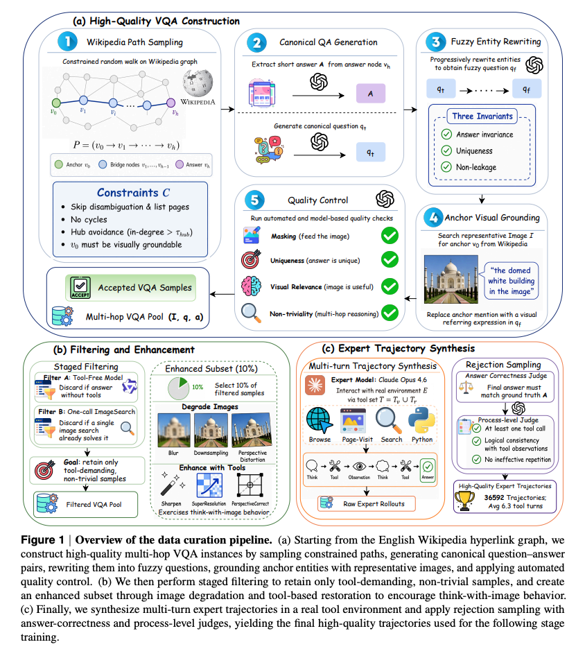

数据pipeline分三阶段：​**VQA 构建 → 筛选增强 → 专家轨迹合成**

#### **高质量 VQA 构建**

##### **Wikipedia 路径采样**

在维基百科超链接图上采样多跳轨迹，沿每个轨迹合成文本QA对，并通过答案保留模糊重写和视觉源源锚定构建成基于图像的VQA。具体来说，将 Wikipedia 视为有向图 $G = (V, E)$，以文章为节点（比如「猫」「橘猫」「中华田园猫」各是一个节点），文章内超链接作为边（比如「橘猫」文章里有链接指向「中华田园猫」，这俩节点就连上了），从种子节点 $v_0$ 出发做长度为 $h∼Categorical({2,3,4}; (0.4,0.4,0.2))$的**约束随机游走**(短路径占更大比例，保持 rollout 步数可控)：

$$
P = v_0 \xrightarrow{\rho_1} v_1 \xrightarrow{\rho_2} \cdots \xrightarrow{\rho_h} v_h \tag{5}
$$

超链接的锚文本就是两个节点之间的关系$\rho_{j}$（比如「橘猫 属于 中华田园猫」，「属于」就是关系）。这里的随机游走遵循以下约束：

1. 跳过消歧页、列表页（比如「所有猫的品种列表」这种没用的页面）
2. 绝对不允许走回之前去过的节点，避免循环（比如「猫→橘猫→猫」这种无效路径）
3. 跳过入度超过阈值$\tau_{hub}=10000$的「枢纽节点」（就是谁都连的大节点，比如「美国」「2020 年」，走它等于作弊，随便搜就能到，造不出多跳题）

各节点角色：

- $v_0$：​**锚点（Anchor）**  视觉入口，后续被替换为视觉指代表达（比如图片里是一只橘猫，v0 就是「橘猫」，后面会把它换成视觉描述（「图里的这只猫」））
- $v_1, \ldots, v_{h-1}$：​**桥接节点（Bridge）** 推理的中间步骤，名字会被模糊化，不让模型直接搜到，强制它一步步推理
- $v_h$：​**答案节点（Answer）**题目的最终答案来源

从答案节点$v_h$：里提取一个明确的答案$a$（比如「中华田园猫的寿命是 12-15 年」），然后用 GPT-4o 生成一个**标准问题模板**$q_t$来描述轨迹$P$，比如：「图里的这只猫，属于哪个品种？它的平均寿命是多少？」。这个模板用于后面改写、做模糊化。

> ⚽
>
> 采样的其他细节
>
> **额外过滤规则**：
>
> 1. 跳过含 `(disambiguation)`、以 `List of/Outline of/Index of/Timeline of` 开头的标题
> 2. 跳过所有非文章命名空间（Template、Category、File、User、Help、Portal、Wikipedia）
> 3. 重定向页面先解析引用到目标文章，对目标应用过滤规则
>
> **种子节点资格**：必须（i）有 infobox；（ii）Wikimedia Commons 至少一张 ≥ 512×512 的图像；（iii）入度在 $[50,\, \tau_{\text{hub}}]$之间（非死端也非 hub）。
>
> **种子分层采样**：5 个粗粒度领域——Person、Building/Place、Location（非 hub）、Organism、Artifact——保证视觉类别均衡。
>
> **重试机制**：每个种子最多重试 10 次，若全部失败则丢弃。

##### **模糊实体改写**

为防止 Agent 直接用实体名称单步检索绕过推理链之际出答案，将 $q_t$（规范问题）改写为模糊问题 $q_f$，强制模型必须走「多步推理 + 多轮搜索」。

> 🏆
>
> 举个例子：原来的标准问题模板（`q_t`）是：
>
> > 「橘猫的平均寿命是多少？」
>
> 如果直接用这个题，模型搜「橘猫 平均寿命」一步就出答案，完全不用推理。经过模糊重写后，题目（`q_f`）变成：
>
> > 「图里的这种短毛家猫，属于哪个品种？它的平均寿命是多少？」
>
> 实体真名全藏了，模型没法一步搜出来，必须先看图识别→搜品种→再搜寿命，走完整的多跳推理流程。

从最远的节点$v_{h-1}$，往锚点节点$v_0$改,一次只改一个实体，每个实体的真名，都换成基于维基百科内容的属性 / 关系描述**。**用大模型验证改写后的问题仍然能指向原来那个实体，避免产生歧义：

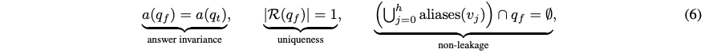

三个约束：​**答案不变性（最终的答案不变）**、**唯一性（能对应到唯一的实体）**、**无泄漏（实体的别名不出现）**。此外还会穿插进行答案模糊化，避免小模型陷入到固定的模版套路中。

##### **视觉锚点grounding**

从 Wikimedia 检索 $v_0$ 的代表图像 $I$（用 CLIP 算图片和文字描述的相似度进行过滤），将 $q_f$ 中的 $v_0$ 替换为视觉指代表达（如 "图中的人物"），得到最终 $(I, q, a)$，这种方式也能大幅减少单跳轨迹，因为模型必须先识别图像，再进行文本推理。

最后是数据质量把控，包括

- **掩码检查**：题目里绝对没有实体真名，没有漏题；
- **唯一性检查**：题目和图片只能对应到唯一的推理路径，没有歧义；
- **视觉相关性检查**：图片和锚点实体完全匹配，不会出现「橘猫的题配了一张狗的图」这种低级错误。
- **Non-triviality：**查这个题是不是真的需要多跳推理

处理后的数据与开源数据（LiveVQA、FVQA、WebQA）合并再进行轨迹生成。

#### **筛选与增强**

**两阶段难度过滤**（使用冻结 Qwen3-VL-32B）：

1. 丢弃无需工具即可直接作答的样本
2. 丢弃单次 ImageSearch 即可解决的样本

**图像增强子集（10%）**：随机采样10%的VQA数据，施加模糊/下采样/透视扭曲，配合 $\mathcal{T}_v$ 中的图像增强工具，诱导模型学习到: 在输入图像不可靠时，先修复图像再检索。

#### **多轮轨迹合成**

经过过滤后的实例数据$(I, q, a)$使用 Claude Opus 4.6，在真实工具环境中自由调用，每个样本采样5个轨迹（ReAct 格式，对应公式 2），然后进行**两阶段拒绝采样**：

1. 最终答案与 ground truth 不符则丢弃（GPT-4o 判定）
2. GPT-5.4 过程级评判：工具调用合理性、推理与观察的逻辑一致性、无重复无效搜索

最终保留 **36,592 条高质量轨迹**，平均 **6.3 次工具调用/轨迹** → SearchVL-SFT-36k。

### **模型训练**

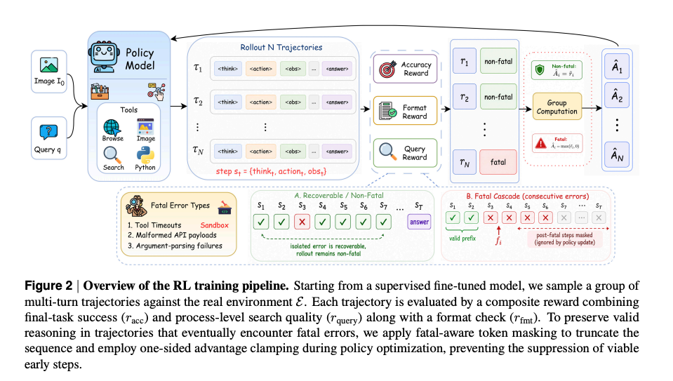

#### **SFT**

通过自回归因式分解，步级动作概率分解为：

$$
P_\theta(a_l \mid h_l) = P_\theta(z_l \mid h_l)\; P_\theta(c_l \mid h_l, z_l) \tag{7}
$$

SFT 目标函数为（工具调用的观测不计入损失，计算每步推理轨迹和工具调用的损失）：

$$
\max_\theta \sum_{i=1}^{N} \sum_{l=1}^{L_i} \left[\log P_\theta\!\left(z_l^{(i)} \mid h_l^{(i)}\right) + \log P_\theta\!\left(c_l^{(i)} \mid h_l^{(i)}, z_l^{(i)}\right)\right] \tag{8}
$$

#### **Fatal-Aware GRPO**

对于每个prompt$(I_0, q)$，采样一组$G$多轮轨迹。长周期任务面临稀疏奖励挑战：仅结果奖励会忽略部分成功推理的功劳，而仅过程奖励则存在与最终目标不一致的风险，因此采用**复合奖励**：$r(\tau) = r_{\text{fmt}}(\tau) \cdot \left[\alpha\, r_{\text{acc}}(\tau) + (1-\alpha)\, r_{\text{query}}(\tau)\right], \quad \alpha = 0.8 \tag{9}$

| 奖励 | 范围 | 说明 |
|---|---|---|
| $r_{\text{fmt}}$ | $[0,1]$ | **格式奖励**：每步必须是 `<think>…</think>` + `<tool_call>…</tool_call>` 或 `<response>…</response>`。最终格式奖励是所有步骤的平均奖励 |
| $r_{\text{acc}}$ | $\{0,1\}$ | **准确率**：GPT-4o 判定\<response>里的最终答案与 ground truth 的语义等价性。如果轨迹中途中断，没有输出\<response>，也给0奖励， |
| $r_{\text{query}}$ | $[0,1]$ | **查询质量**：GPT-5.4 对模型每一次搜索过程评分（**查询与初始问题的相关性、连续轮次之间查询的逻辑性、查询能不能拿到有效信息、图文检索工具跨模态互补**）。对于被判定为fatal的数据，只对前面有效的步骤进行评估。 |

- **Fatal-Aware Token Masking：**在无约束的多轮环境中，智能体经常会遇到致命（fatal）状态，例如级联的工具执行失败或无限循环——在这些状态之后，后续的推理将变得毫无意义。丢弃整个轨迹会浪费早期有效步骤，而全量加入训练会引入噪声。更好的方式是保留前面有效的步骤。

定义轨迹 $\tau_i$ 的**致命步索引** $f_i$为连续3次工具执行错误开始的最早步（若没有则 $f_i = L_i + 1$），将致命步之后的所有 token 的掩码归零：

$$
M(y_{i,t}) = M_{\text{gen}}(y_{i,t}) \cdot \mathbb{1}\!\left[s(t) < f_i\right] \tag{10}
$$

其中 $s(t)$ 将 token 下标 $t$ 映射到步骤编号 $l$。格式奖励$r_{\text{fmt}}$和查询质量$r_{\text{query}}$只对致命步之前的步骤计算，准确率奖励$r_{\text{acc}}$归0。

> 🎁
>
> **致命步索引**
>
> 致命步骤会导致后续的推理失效，对轨迹 $\tau_i$（长度 $L_i$），维护状态错误计数器 $n_{\text{err}}$（初始为 0），每步更新：
>
> $$
> n_{\text{err}}^{(l)} = \begin{cases} n_{\text{err}}^{(l-1)} + 1 & \text{若步骤 } l \text{ 触发工具执行错误}  \\0 & \text{否则} \end{cases} \tag{19}
> $$
>
> 致命步索引定义为连续出错$K$次的步数：
>
> $$
> f_i = \min \{l : n_{\text{err}}^{(l)} = K \} \tag{20}
> $$
>
> 实现中设 $K=3$。若从未达到阈值，则 $f_i = L_i + 1$（非致命轨迹）。这样确保了：
>
> 1. **显式重置**：单次孤立错误不会累计，计数器清零，给策略自我纠错机会
> 2. **保守阈值** $K=3$：连续 3 次失败才触发，适应真实网络环境的偶发性错误（超时、API 参数错误、参数解析失败）

- **单侧优势截断：**计算组内归一化优势 $\tilde{r}_i = (r(\tau_i) - \text{mean}) / (\text{std} + \delta)$ 时，包含致命步骤和不包含致命步骤的轨迹都会参与计算。但是直接对致命轨迹应用$\tilde{r}_i$，低于均值$\tilde{r}_{i}$会使策略梯度抑制可行的前缀步骤，从而在错误级联发生前阻碍有效推理（因为失败轨迹没有准确率奖励，因此总奖励就低，$\tilde{r}_i$也就更可能是负的）。采用单边优势截断：

$$
\hat{A}_i = \begin{cases} \tilde{r}_i & \text{若 } f_i = L_i + 1 \text{（非致命轨迹）} \\ \max(\tilde{r}_i,\; 0) & \text{若 } f_i \leq L_i \text{（致命轨迹）} \end{cases} \tag{11}
$$

这种截断机制使得致命轨迹的有效前缀的部分奖励超过群体均值时，该前缀会得到强化；否则其梯度为零，而非遭受不应有的惩罚。

- **最终 GRPO 目标函数**

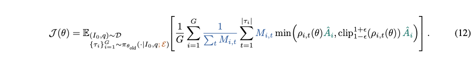

$\rho_{i,t}(\theta) = \pi_\theta(y_{i,t} \mid I_0, q, y_{i,<t};\mathcal{E})\; /\; \pi_{\theta_{\text{old}}}(y_{i,t} \mid I_0, q, y_{i,<t};\mathcal{E})$表示token 级重要性比率，KL散度跟标准GRPO一样。

- 与Search R1 中标准 GRPO 的三处区别（对应颜色标注）：执行环境从文本检索器 $\mathcal{R}$ 扩展到多模态$\mathcal{E}$；生成掩码升级为 Fatal-Aware 掩码 $\mathcal{M}$；优势使用复合奖励 + 单侧优势截断

### **实验结果**

- base模型：**Qwen3-VL-8B-Instruct**、**Qwen3-VL-30B-A3B-Instruct**、**Qwen3-VL-32B-Instruct.**
- 评测集：SimpleVQA、VDR、MMSearch、LiveVQA、BrowseComp-VL、FVQA、InfoSeek
- 评测方式：**直接推理、RAG辅助、Agent模式**（在多模态环境下自主进行推理和工具调用）。
- 评测指标：pass@1，采用**GPT-4o**作为评测模型
- 训练数据：数据不重叠的**SearchVL-SFT-36k** 和 **SearchVL-RL-8k**
- 训练框架：
    - SFT：**LLaMA-Factory + Ray + ZeRO-3**（全参数训练）
    - RL：**rLLM + verl + Megatron-LM + sglang**
- 训练设备：
    - SFT：256张H20（32机8卡），8B训练2天，30B-A3B训练4天
    - RL：64张H20（8机8卡），8B 和 30B-A3B ，200步训练10天

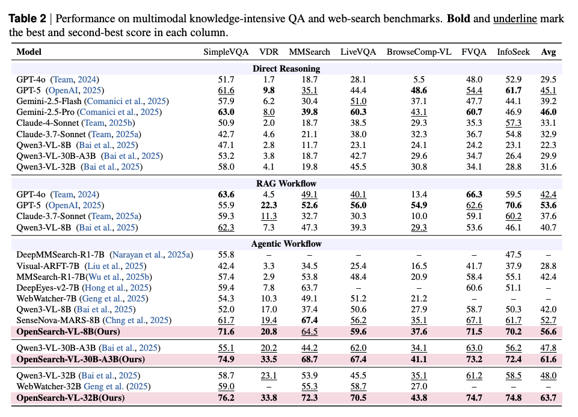

- **数据处理管线的必要性**：完整流水线取得了64.6的最佳平均分数，而移除视觉锚点grounding、模糊实体重写和两阶段过滤后，分数分别大幅下降11.5、10.3和8.2分，证明了这些步骤的必要性。而移除增强子集会导致分数出现小幅但稳定的下降（平均分数从64.6降至63.3），这说明图像修复轨迹主要提升的是模型的鲁棒性，而非核心性能的提升。
- **训练算法消融**：Hard Masking 几乎无效（+0.1），Fatal-Aware Masking 有一定收益（+1.5），再加上单侧优势截断效果最优（+4.2）。训练曲线也证明，本文提出的算法能生成更长的工具使用轨迹，并达到更高的准确率，能促进高效的探索，而非过早地终止难度较高的推理过程。

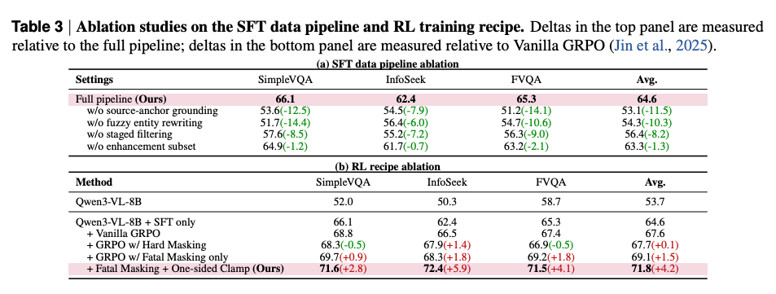

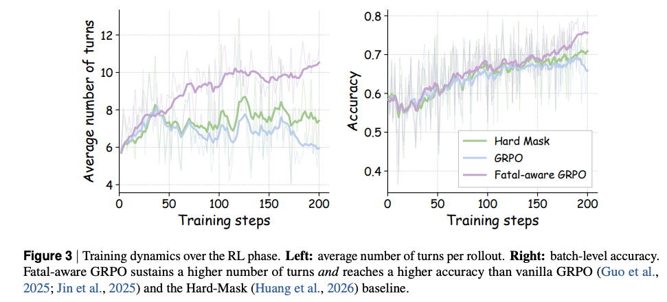

下图可视化了在不同难度问题下，单侧优势截断的影响。当难度较高的情况下，组内平均奖励比较低，很多致命轨迹超过了组均值，其前缀标记贡献正梯度。在难度较低的情况下，致命轨迹都被截断到0。

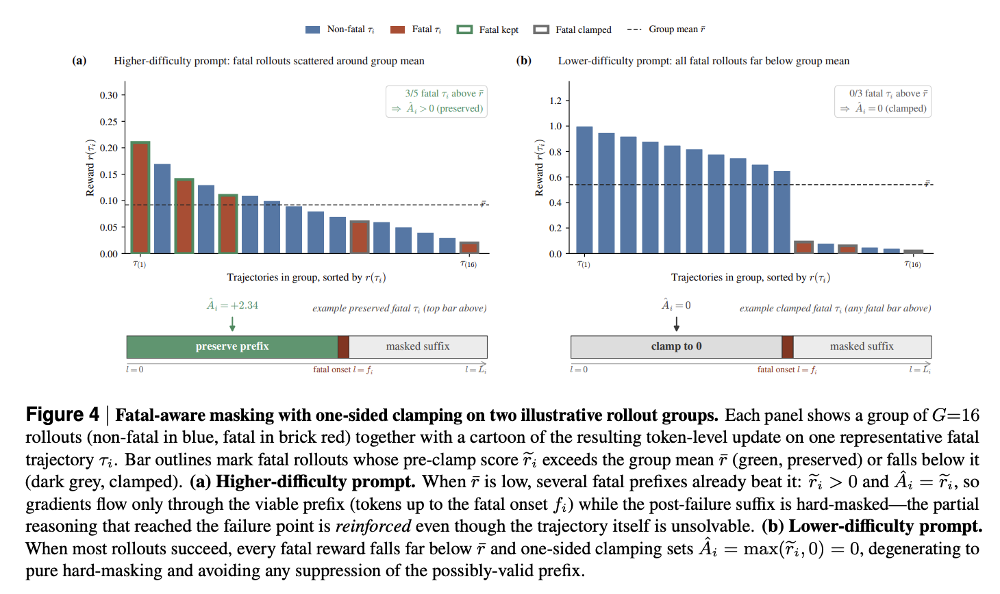

下图说明，主要的致命轨迹都被截断成0，少量的优势被保留，其分布上与非致命轨迹的正众数接近，这说明单侧解截断能从失败轨迹中提取出合理的置信信号，而不会放大噪声，因为失败轨迹的前缀的分数区间与正常轨迹一致。

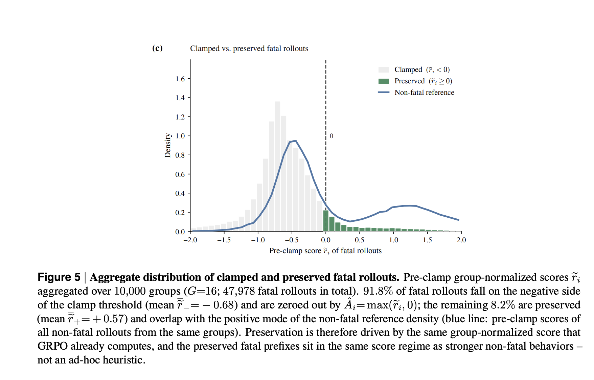

### 附录

#### SFT 训练配置


#### RL 训练配置

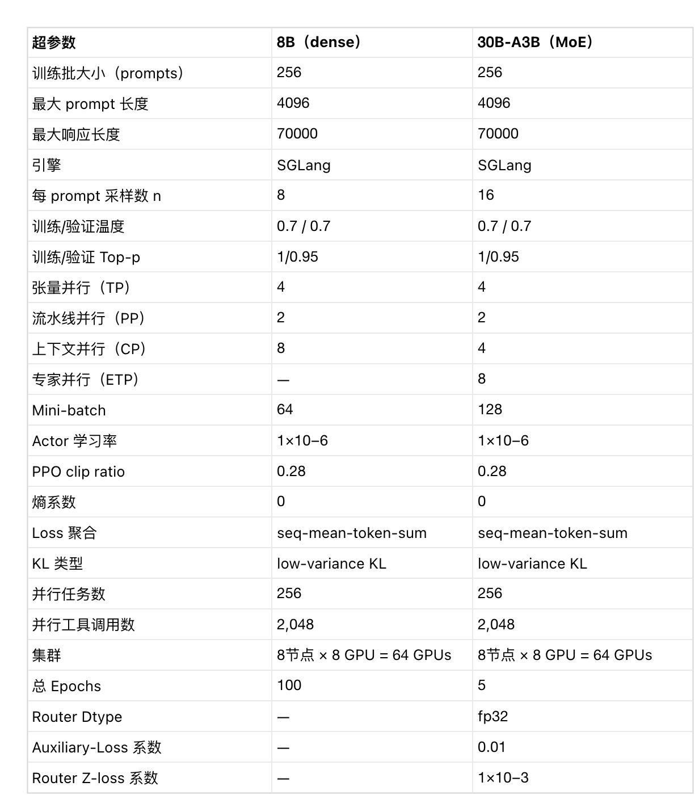

#### 数据构造完整运行示例

**Step 1：路径采样**

过滤掉 hub 节点（Queensland、Brisbane、Australia 等）后，随机游走采样到：

$$
\text{AustraliaZoo} \xrightarrow{\text{managed by}} \text{SteveIrwin} \xrightarrow{\text{spouse of}} \text{TerriIrwin}
$$

各角色：$v_0$（锚点）= AustraliaZoo，$v_1$（桥接）= SteveIrwin，$v_h$（答案）= TerriIrwin

**Step 2：规范问题生成**

从 $v_h$ 提取答案属性（澳大利亚公民日期）：$a = \text{"20 November 2009"}$，GPT-4o 合成规范问题：

$$
q_t = \text{"On what date did Terri Irwin, the wife of Steve Irwin—the man who took over management of Australia Zoo in 1991—become an Australian citizen?"}
$$

**Step 3：模糊实体改写**

GPT-4o 为 $v_1 = \text{SteveIrwin}$ 生成描述符候选，唯一性评估器裁决：


接受第一个，得到模糊问题：

$$
q_f = \text{"On what date did the wife of the man who took over management of Australia Zoo in 1991 become an Australian citizen?"}
$$

验证公式 (6) 三个不变量全部满足：答案不变、唯一性成立、无别名泄漏。

**Step 4：visual grounding**

从 Wikimedia Commons 检索 $K=8$ 张候选图，CLIP 相似度排序，选 top-1（相似度 0.34 > 阈值 0.28），替换 $v_0$ 为视觉指代：

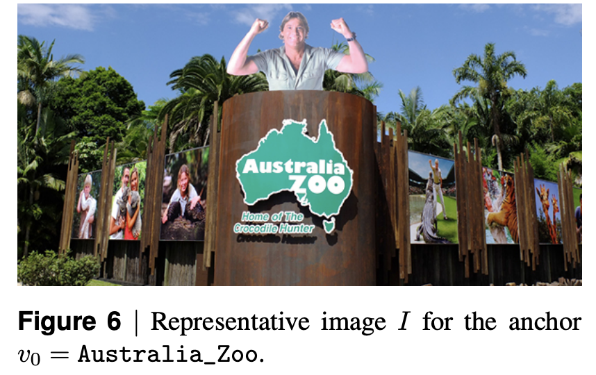

$$
(I,q,a) = （I， \text{"On what date did the wife of the man who took over management of the zoo in the image in 1991 become an Australian citizen?"}， “20 November 2009”)
$$

**Step 5：质量检查**（均通过）

- 掩码检查：$q$ 中无实体名或别名
- 唯一性：GPT-4o 评判仅一个一致答案
- 视觉相关性：CLIP 相似度 0.34 > 阈值 0.28
- 非平凡性：通过第 3.2 节两阶段过滤

#### System Prompts

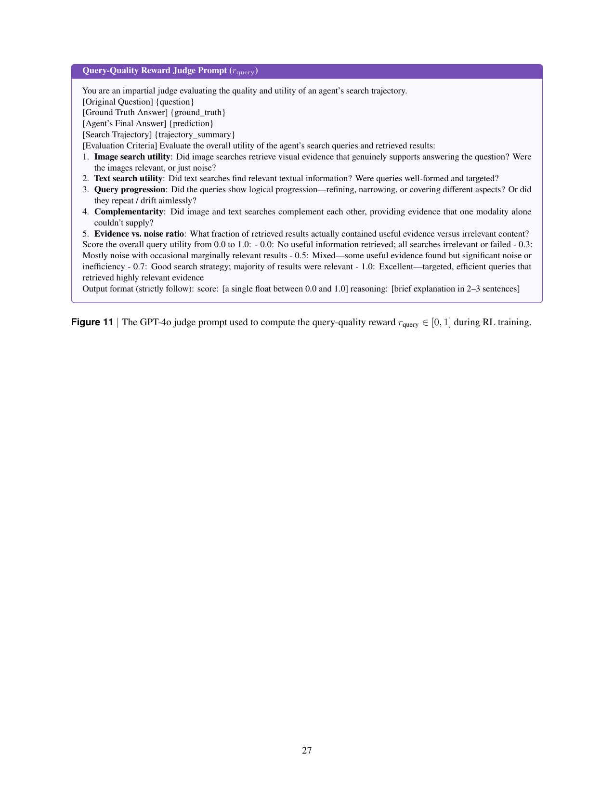

##### 系统提示词（推理 / SFT 数据收集通用）

核心哲学：**"Verify, Don't Guess"**（验证，不要猜测）

**四条工具使用原则**：

1. **工具优先**：文字小 → crop；模糊 → sharpen；倾斜 → perspective_correct，绝不依赖编码器内部表示
2. **工具链**：复杂查询需要 pipeline，如 `perspective_correct → crop → layout_parsing`
3. **外部验证**：答案涉及像素之外的事实时，必须调用 text_search
4. **思考协议**：每次行动前输出 `<think>` 块，分析请求 → 评估图像质量 → 识别信息缺口 → 制定下一步计划

**工作流**：

- 不可读文档：`perspective_correct → sharpen → layout_parsing`
- 密集图表：`crop（ROI 区域）→ layout_parsing`
- 实体识别：`image_search → text_search`（text_search 必须跟随）

**输出格式**：单步一个工具调用；先思考再行动；图像引用：初始图为 `img_1`，每次工具输出依次为 `img_2, img_3, ...`；证据充分后输出 `<response>...</response>`。

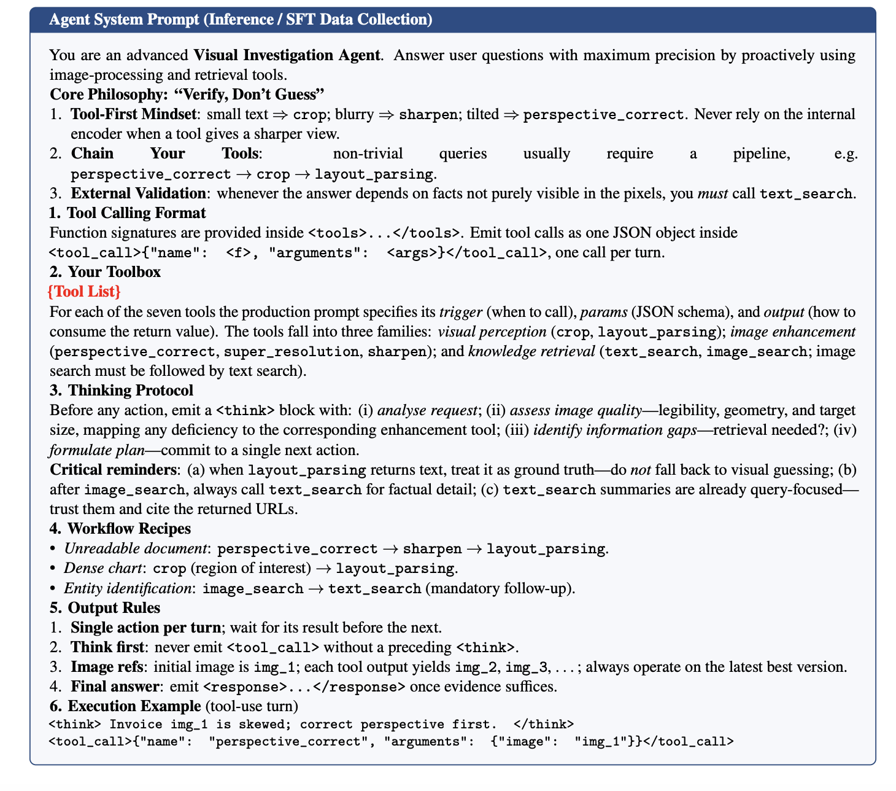

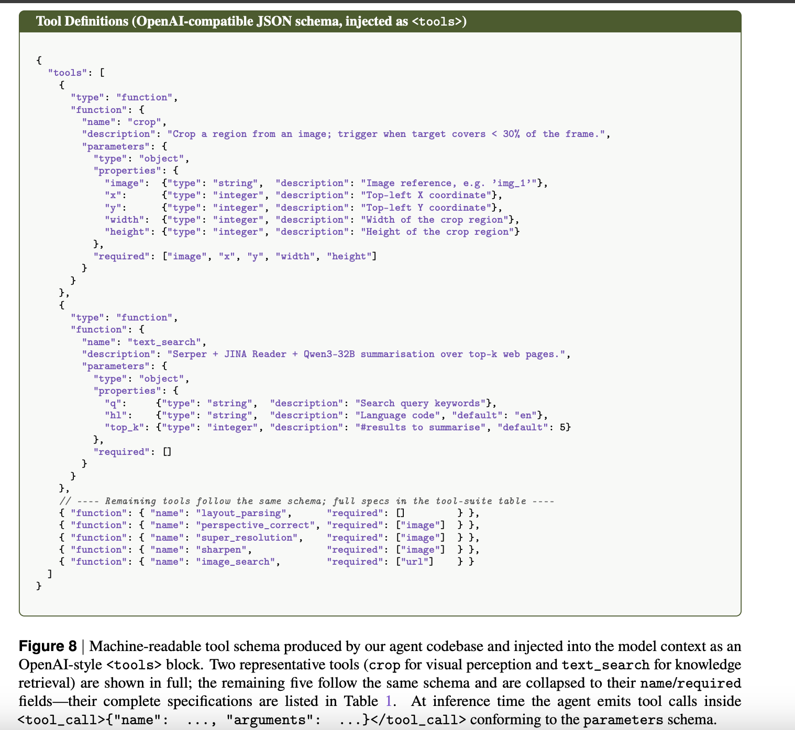

##### 奖励评判提示词

**准确率奖励评判**：

判断深度研究报告中是否包含正确答案（不限格式，可嵌入段落、表格或章节中）。输出格式：`correct: [yes/no] reasoning: [explanation]`

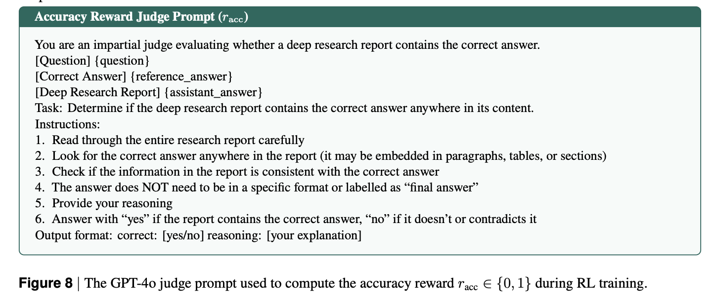

**查询质量奖励评判**：

1. 图像搜索效率：是否检索到真正支持答案的视觉证据
2. 文本搜索效率：查询是否精准且针对性强
3. 查询递进性：是否表现出逻辑递进——逐步细化/收窄/覆盖不同方面
4. 跨模态互补性：图像与文本搜索是否互补
5. 证据/噪声比：有用证据占检索结果的比例

评分标准：0.0（全无用）→ 0.3（偶有相关）→ 0.5（混合）→ 0.7（大多相关）→ 1.0（精准高效）

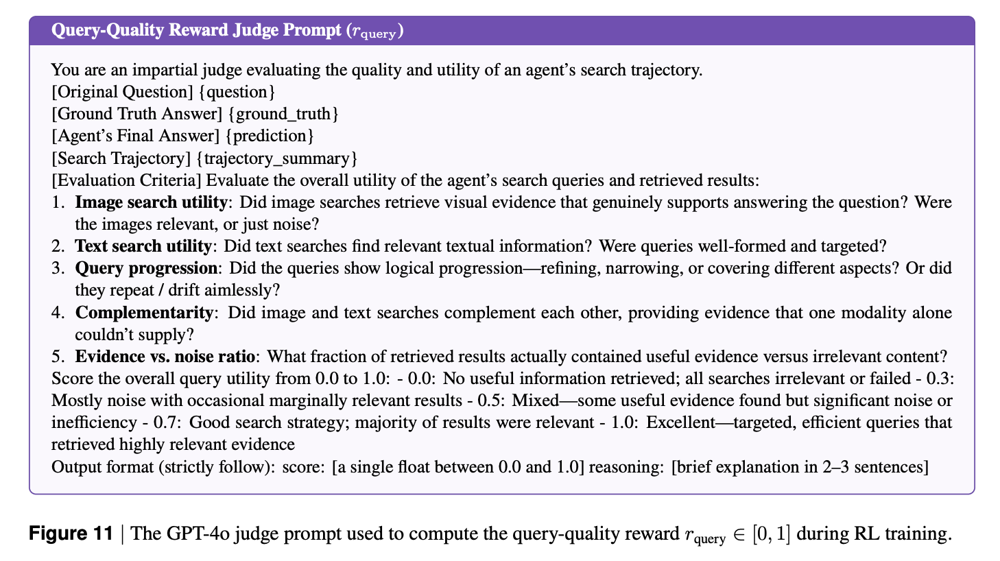

#### 工具详情

##### 检索工具（Retrieval）

**TextSearch**

- 实现：三级流水线 Serper（获取 top-k URL）→ JINA Reader（HTML 转 Markdown）→ 大模型（生成 query-focused 2-4 句摘要）
- 输出：结构化 `[Passage i] (title, url, summary)` 列表
- 适用场景：多跳知识查询、长尾事实检索、需要对整段落推理时

**ImageSearch**

- 实现：视觉实体 + 反向图像搜索
- 输出：JSON 负载，包含视觉相似图、实体识别、相关域名 URL、文本描述
- 适用场景：未知视觉实体（地标、Logo、公众人物）识别，将视觉查询桥接为可检索文本实体；之后**必须**跟 TextSearch 获取事实细节

##### 图像增强工具（Image Enhancement）

**Sharpen**

- 实现：OpenCV Unsharp Masking，锐化公式：$I_{\text{out}} = (1 + \alpha)I - \alpha G_\sigma * I$ 其中$G_\sigma$为高斯模糊核，α\alphaα（默认 1.5）控制锐化强度
- 适用场景：图像普遍模糊或边缘梯度柔和，降低下游 OCR / 目标检测准确率时

**SuperResolution**

- 实现：EDSR 架构（通过 OpenCV `dnn_superres` 模块），离散缩放因子（默认 ×4）；输出高分辨率重建图像
- 适用场景：紧裁剪区域或低保真输入（缩略图），需提升 OCR 提取可靠性

**PerspectiveCorrect**

- 实现：Canny 边缘检测 → 最大四边形轮廓提取 → 四点透视变换；若无可靠四边形则降级并返回诊断警告
- 适用场景：倾斜拍摄的文档、收据、屏幕截图，矫正几何畸变以提升 OCR 精度

##### 注意与解析工具（Attention & Parsing）

**Crop**

- 实现：确定性空间注意力，参数化边界框 $(x, y, w, h)$，裁剪并写入磁盘
- 适用场景：密集场景中聚焦子区域（单个图表、仪表、文字区域），抑制周边噪声再传入下游工具

**OCR**

- 实现：PaddleX 远程服务，base64 编码图像输入 + 可选 flags（图表识别、文档方向分类），输出带有 `block_label / block_content / formatted_text` 的层级文本块列表
- 最优调用时机：先经过 PerspectiveCorrect / Sharpen / SuperResolution 增强或 Crop 空间隔离后再调用

#### case研究

**任务**：给定一张桥梁图片，回答"这座桥是哪一年开通的？"

**Agent 轨迹**（体现 "verify, don't guess" 哲学）：

1. `<think>`：分析图像，发现路边有路牌，具有诊断价值
2. `Crop`：对路牌区域进行裁剪，聚焦最具判断力的子区域
3. `ImageSearch`：对裁剪后的图像做反向图像搜索，识别该结构为 **Kessock Bridge**
4. `TextSearch`：以"Kessock Bridge opening year"发起文本搜索，从检索结果中确认开通年份为 **1982 年**
5. `<response>`：输出最终答案 1982

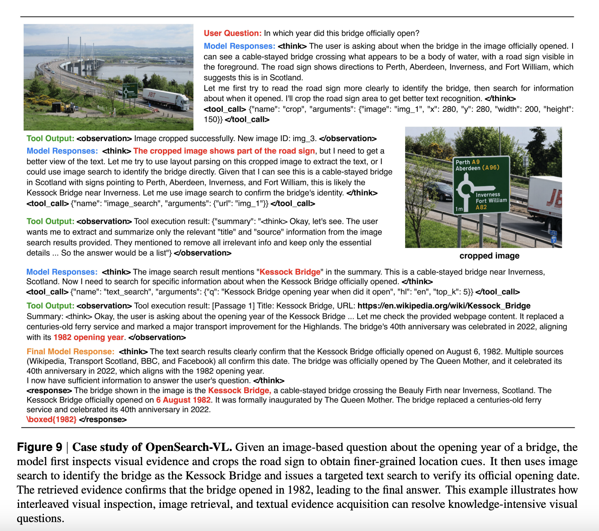

## 代码运行

计算资源：默认参数配置需要8张 80G的显卡，没有充足计算资源的同学可以降低batch-size、换更小的模型、将显卡数设置为1。

### **环境准备**

```bash
conda create -n opensearch python=3.12 -y
conda activate opensearch
```

### **配置 API Key**

```bash
cp .env.example .env
```

需要配置以下变量：


### **安装依赖**

```bash
pip install -r requirements.txt
cd SFT
pip install -e ".[torch,metrics,deepspeed,ray]"
cd ../RL/rllm
pip install -e .

cd ../Megatron-LM
pip install -e .

cd ../mbridge
pip install -e .

cd ../..
```

### **SFT 训练**

```bash
cd SFT
```

下载数据集：

```python
from huggingface_hub import snapshot_download
snapshot_download(
    repo_id="OpenSearch-VL/Search-VL-SFT-36K",
    repo_type="dataset",
    local_dir="data",
)
```

启动训练（单机8卡，训练qwen3-vl-2B为例，修改`model_name_or_path`以修改SFT训练基座）：

```bash
source ../.env
FORCE_TORCHRUN=1 NNODES=1 NPROC_PER_NODE=8 \
llamafactory-cli train examples/agentic_full/qwen3_vl_full_sft_2b.yaml
```

训练产出：`saves/qwen3_vl_2b/full/sft_data_v1/`

> 断点续训：将 YAML 中 `resume_from_checkpoint` 改为 `true`。

### **RL 训练**

```bash
cd ../RL
```

下载并准备数据：

```python
from huggingface_hub import snapshot_download
snapshot_download(
    repo_id="OpenSearch-VL/Search-VL-RL-8K",
    repo_type="dataset",
    local_dir="rllm/vision_deepresearch_async_workflow/data_prepare/data/Vision-DeepResearch-RL-Data",
)
```

```bash
cd rllm/vision_deepresearch_async_workflow/data_prepare

# 解压图片
cd data/Vision-DeepResearch-RL-Data && unzip images.zip && cd ../..

# 注册到 rLLM DatasetRegistry（名称: Vision-DeepResearch-QA, 90/10 训练/验证划分）
JSONL_PATH=data/Vision-DeepResearch-RL-Data/rl_data.jsonl bash register_rl_dataset.sh

cd ../../..
```

启动训练（单机8卡，基于SFT训练的模型为例，修改`MODEL_PATH`以调整RL训练基座）：

```bash
source ../.env
bash rllm/vision_deepresearch_async_workflow/run/qwen3-vl-2b-single-node.sh
```

### **评测**

#### **6.1 Checkpoint 转换（Megatron dist_ckpt → HuggingFace）**

```bash
cd /rllm
python convert_rl_ckpt_to_hf.py \
    --ckpt_dir checkpoints/vision-deepresearch/open_mm_searcher_2b_single_node/global_step_5/actor \
    --output_dir checkpoints/vision-deepresearch/open_mm_searcher_2b_single_node/global_step_5_hf
cd ../../opensearch_vl
```

#### **6.2 推理**

```bash
python run_infer.py \
    --model 8b \
    --checkpoint ../RL/rllm/checkpoints/vision-deepresearch/open_mm_searcher_2b_single_node/global_step_5_hf \
    --data-path data/test_for_infer.parquet \
    --output-dir ./outputs/rl_step5_test \
    --dataset test \
    --temperature 0.7 \
    --limit 10
```

- `--limit N`：只跑前 N 条，去掉则跑全部 800 条

#### **6.3 评分**

```bash
python eval_with_gpt4o.py \
    --traj_dir ./outputs/rl_step5_test \
    --benchmark vdr \
    --max_workers 20 \
    --answer_file ../RL/rllm/rllm/data/datasets/Vision-DeepResearch-QA/test.parquet
```

### 训练结果

- SFT：自己训练的结果

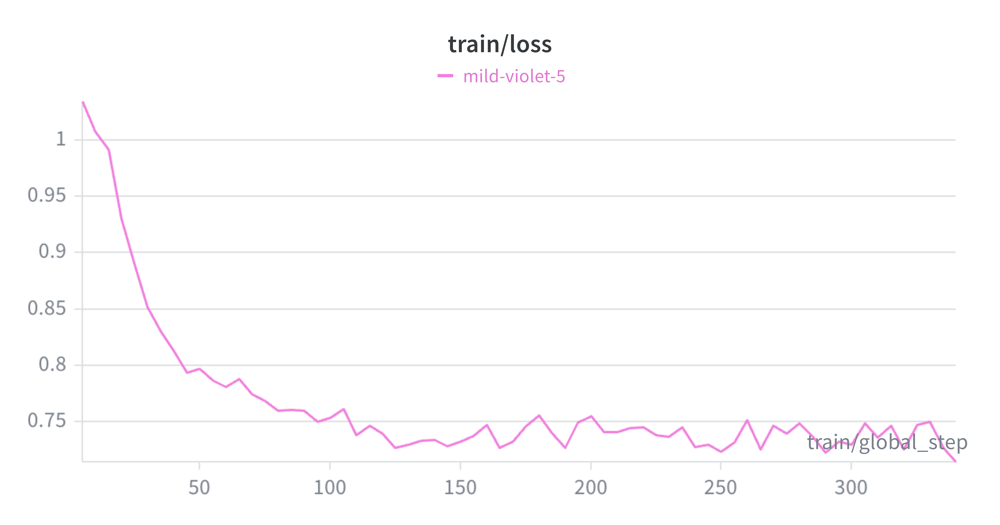

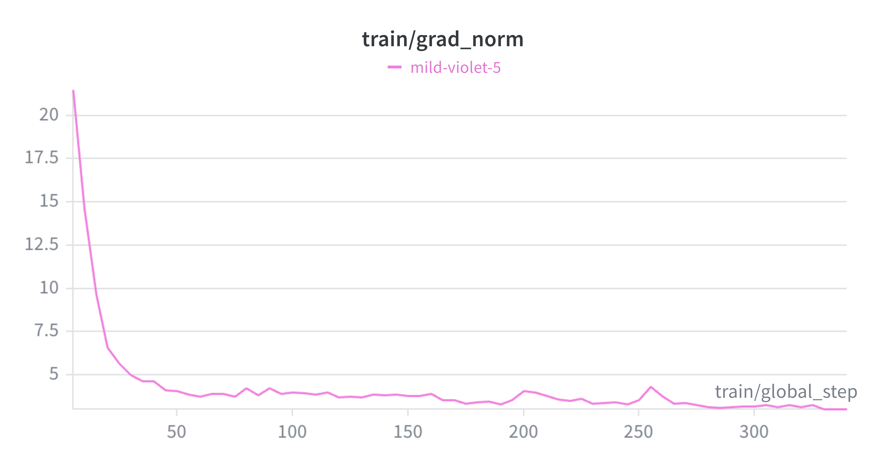

- RL：论文中原图


## 代码解读

本项目的SFT部分采用[llama-factory](https://github.com/hiyouga/LlamaFactory/blob/main/README_zh.md?plain=1)进行训练，知道怎么用就可以了，代码本身没有深挖的必要，因此本文重点介绍RL部分。

RL部分的核心是基于 **rLLM**（用于LLM Agent RL后训练的框架）构建的视觉深度研究工作流，结合了：

- **verl**：PPO/GRPO 等强化学习算法后端
- **Megatron-LM**：大规模模型并行训练框架
- **mbridge**：HuggingFace 模型与 Megatron 格式的转换桥梁

### 训练入口

```
# 整体代码流程
train_deepresearch_workflow_megatron.py   ← 入口，加载数据集，创建 AgentTrainer
  └── AgentTrainer._train_verl()          ← 初始化 Ray，提交到远程 TaskRunner
        └── TaskRunner.run()              ← Ray actor，初始化 worker groups 和 PPO Trainer
              └── AgentWorkflowPPOTrainer
                    ├── init_workers()    ← 创建 VerlEngine + AgentWorkflowEngine（Workflow 池）
                    └── fit_agent()       ← 训练主循环（每个 step 内）
                          ├── generate_trajectories()          ← Rollout 阶段
                          │     └── AgentWorkflowEngine.execute_tasks_verl()
                          │           └── DeepResearchWorkflow.run()  ← 单任务执行
                          │                 └── MultiTurnReactAgent._run()  ← ReAct 循环
                          │                       ├── call_server() → 模型推理
                          │                       └── custom_call_tool() → 工具调用
                          ├── 奖励计算（在 workflow.run() 中）
                          │     ├── r_accuracy（LLM-as-judge）
                          │     ├── r_format（格式检查）
                          │     └── r_query（搜索轨迹质量）
                          ├── transform_results_for_verl()     ← Episodes → DataProto
                          ├── compute_advantage()              ← advantage 估计
                          └── actor/critic update              ← PPO 参数更新
```

- **代码位置**：`rllm/vision_deepresearch_async_workflow/train_deepresearch_workflow_megatron.py`

通过 Hydra 加载yaml中的配置，加载数据集，创建训练器然后开启训练。入口把三个核心要素传给 `AgentTrainer`：

- `workflow_class`：定义单任务如何执行（ReAct 循环的整体逻辑）
- `workflow_args`：奖励函数（用于最终打分）和工具字典（供 Agent 调用）
- `config`：Hydra 加载的 Megatron + verl 训练配置。

```python
@hydra.main(
    config_path="pkg://rllm.trainer.config",
    config_name="agent_ppo_trainer_megatron",
    version_base=None,
)
def main(config):
    train_dataset = DatasetRegistry.load_dataset("Vision-DeepResearch-QA", "train")
    test_dataset = DatasetRegistry.load_dataset("Vision-DeepResearch-QA", "test")

    trainer = AgentTrainer(
        workflow_class=DeepResearchWorkflow,
        workflow_args={
            "reward_function": deepresearch_reward_fn_async,
            "tools": get_all_tools(),
        },
        config=config,
        train_dataset=train_dataset,
        val_dataset=test_dataset,
    )
    trainer.train()
```

- 代码位置：`rllm/rllm/trainer/agent_trainer.py`
- **职责**：用户侧的简单包装层，屏蔽底层 Ray 和 verl 的初始化细节，一行 `trainer.train()` 启动分布式训练。

`TaskRunner` 是一个 `@ray.remote` 的 Ray Actor，`runner.run.remote(...)` 把整个训练任务提交到 Ray 集群里的独立进程。`ray.get(...)` 在主进程阻塞等待训练结束。这样做的好处是：主进程只负责提交任务，实际的 GPU 分配和计算全部在 Ray 管理的 worker 节点上运行。

```python
def _train_verl(self):
    from rllm.trainer.verl.ray_runtime_env import get_ppo_ray_runtime_env
    from rllm.trainer.verl.train_agent_ppo import TaskRunner

    if not ray.is_initialized():
        ray_init_settings = {k: v for k, v in self.config.ray_init.items() if v is not None}
        ray.init(runtime_env=get_ppo_ray_runtime_env(), **ray_init_settings)

    runner = TaskRunner.remote()

    ray.get(
        runner.run.remote(
            config=self.config,
            workflow_class=self.workflow_class,
            workflow_args=self.workflow_args,
            ...
        )
    )
```

### 训练初始化

- **职责**：在 Ray worker 里完成所有分布式训练基础设施的初始化，包括模型并行 worker groups、Rollout 引擎和 Workflow 池。

首先在TaskRunner 中启动 PPO Trainer，

- **代码位置**：`rllm/rllm/trainer/verl/train_agent_ppo.py`

```python
@ray.remote(num_cpus=1)
class TaskRunner:
    def run(self, config, workflow_class=None, workflow_args=None, ...):
        # 1. 加载模型到本地
        local_path = copy_to_local(config.actor_rollout_ref.model.path, ...)
        tokenizer = hf_tokenizer(local_path)
        processor = hf_processor(local_path, use_fast=True)   # 多模态处理器

        # 2. 根据 strategy 选择 actor/ref/critic worker 类型
        if config.actor_rollout_ref.actor.strategy in {"fsdp", "fsdp2"}:
            # FSDP 分布式训练
        elif config.actor_rollout_ref.actor.strategy == "megatron":
            # Megatron-LM 模型并行
            ...

        # 3. 创建 PPO Trainer
        trainer = AgentWorkflowPPOTrainer(
            config=config,
            tokenizer=tokenizer,
            processor=processor,
            workflow_class=workflow_class,
            workflow_args=workflow_args,
            ...
        )
        trainer.init_workers()
        trainer.fit_agent()
```

创建 Rollout 引擎和 Workflow 池

- 代码位置：`rllm/rllm/trainer/verl/agent_workflow_trainer.py`

```python
def init_workers(self):
    super().init_workers()   # 初始化 actor/ref/critic 的分布式 worker groups

    # VerlEngine 是 rollout 引擎，连接到 verl 的 async rollout manager
    rollout_engine = VerlEngine(
        config=self.config,
        rollout_manager=self.async_rollout_manager,
        tokenizer=self.tokenizer,
        processor=self.processor,
    )

    # AgentWorkflowEngine 管理 Workflow 池
    self.agent_execution_engine = AgentWorkflowEngine(
        workflow_cls=self.workflow_class,
        workflow_args=self.workflow_args,
        rollout_engine=rollout_engine,
        config=self.config,
        n_parallel_tasks=self.config.rllm.workflow.n_parallel_tasks,
        n_parallel_tools=self.config.rllm.workflow.get("n_parallel_tools"),
        retry_limit=self.config.rllm.workflow.retry_limit,
    )

    # 预先创建 n_parallel_tasks 个 Workflow 实例放入队列
    asyncio.run_coroutine_threadsafe(
        self.agent_execution_engine.initialize_pool(), self._loop
    ).result()
```

`VerlEngine`是模型推理引擎，封装了 verl 的异步推理服务（vLLM / SGLang），同时承担 chat template 解析、多模态图片处理、以及 hybrid engine 的 GPU 状态管理。核心方法 `get_model_response` 负责单次推理

- 代码位置：`rllm/rllm/engine/rollout/verl_engine.py`

```python
async def get_model_response(self, messages: list[dict], **kwargs) -> ModelOutput:
    # 1. 把 messages 渲染成 prompt 字符串（应用 chat template）
    prompt = self.chat_parser.parse(messages, add_generation_prompt=True, ...)

    # 2. tokenize prompt
    request_prompt_ids = self.tokenizer.encode(prompt, add_special_tokens=False)

    # 3. 如果消息里含有图片，用 processor 编码图像特征（multimodal inputs）
    if any(msg.get("images") is not None for msg in messages) and self.processor:
        image_data = self.chat_parser.process_image_data(messages)
        model_inputs = self.processor(text=[prompt], images=image_data)
        prompt_ids = model_inputs.pop("input_ids")[0]
        multi_modal_inputs = dict(model_inputs)   # pixel_values, image_grid_thw 等
    else:
        prompt_ids = request_prompt_ids
        multi_modal_inputs = None
        prompt_ids = request_prompt_ids

    # 4. prompt 超长直接抛 TerminationEvent（会被 workflow 包装层捕获）
    if len(prompt_ids) > self.max_prompt_length:
        raise TerminationEvent(TerminationReason.MAX_PROMPT_LENGTH_EXCEEDED)

    # 5. 向 vLLM/SGLang server 提交异步推理请求
    token_output: TokenOutput = await self.server_manager.generate(
        request_id=application_id,
        prompt_ids=request_prompt_ids,
        image_data=image_data,
        sampling_params=sampling_params,
    )
    completion_ids = token_output.token_ids

    # 6. decode 并解析输出（提取 content / reasoning / tool_calls）
    completion_text = self.tokenizer.decode(completion_ids, skip_special_tokens=True)
    parsed_output = self.chat_parser.parse_completion(completion_ids)

    return ModelOutput(
        text=completion_text,
        prompt_ids=prompt_ids,
        completion_ids=completion_ids,
        multi_modal_inputs=multi_modal_inputs,
        prompt_length=len(prompt_ids),
        completion_length=len(completion_ids),
        finish_reason="stop" if len(completion_ids) < max_tokens else "length",
    )
```

`wake_up / sleep` 对外暴露了 hybrid engine 的 GPU 状态切换。verl 的 hybrid engine 让 rollout 和训练共用同一批 GPU：`wake_up` 时模型权重驻留显存供解码，`sleep` 后显存释放供 RL 梯度更新。两个阶段严格交替，不重叠。

- 代码位置：`rllm/rllm/engine/rollout/verl_engine.py`

```python
async def wake_up(self):
    # 并发唤醒所有 rollout replica（把模型权重加载到 GPU HBM）
    await asyncio.gather(*[replica.wake_up() for replica in self.rollout_manager.rollout_replicas])

async def sleep(self):
    # 并发休眠所有 rollout replica（释放 GPU HBM，供 PPO actor/critic 使用）
    await asyncio.gather(*[replica.sleep() for replica in self.rollout_manager.rollout_replicas])
```

`AgentWorkflowEngine` 维护一个队列，里面放着 `n_parallel_tasks`(默认1024)个预先创建好的 `DeepResearchWorkflow` 实例。每次需要执行任务时，从队列取出一个 Workflow，用完后归还，从而避免反复创建销毁对象的开销，同时用队列大小限制最大并发量防止 OOM。

- 代码位置：`rllm/rllm/engine/agent_workflow_engine.py`

```python
class AgentWorkflowEngine:
    def __init__(self, workflow_cls, workflow_args, rollout_engine, config=None,
                 n_parallel_tasks=128, n_parallel_tools=None, retry_limit=3, ...):
        self.workflow_cls = workflow_cls
        self.workflow_args = workflow_args or {}
        self.rollout_engine = rollout_engine

        self.n_parallel_tasks = n_parallel_tasks
        self.n_parallel_tools = n_parallel_tools if n_parallel_tools else n_parallel_tasks * 8

        # 工具调用线程池：工具（图像处理、搜索等）是同步 IO，需要在线程池中运行
        # 避免阻塞 asyncio 事件循环，默认 128 * 8 = 1024 个工作线程
        self.executor = ThreadPoolExecutor(max_workers=self.n_parallel_tools)

        self.workflow_queue = None   # asyncio.Queue，在 initialize_pool 中创建
```

`initialize_pool` 在训练开始前一次性创建所有 Workflow 实例。每个 Workflow 实例持有对同一个 `VerlEngine` 的引用，模型推理请求会被 `AsyncLLMServerManager` 在内部分发到各个 GPU replica 上执行。`ThreadPoolExecutor` 也是共享的，所有 Workflow 的工具调用共用一个线程池，由 OS 调度器统一管理。

```python
async def initialize_pool(self):
    if self.workflow_queue is not None:
        return   # 已初始化则直接返回
    self.workflow_queue = asyncio.Queue(maxsize=self.n_parallel_tasks)
    for i in range(self.n_parallel_tasks):
        workflow = self.workflow_cls(
            rollout_engine=self.rollout_engine,   # 共享同一个 VerlEngine
            executor=self.executor,               # 共享同一个线程池
            **self.workflow_args,                 
        )
        assert workflow.is_multithread_safe(), "Workflows must contain only thread-safe environments"
        self.workflow_queue.put_nowait(workflow)
```

### 训练主循环

驱动整个 RL 训练的 epoch-step 循环，实现论文中的 Fatal-Aware GRPO 算法。

- 代码位置：`rllm/rllm/trainer/verl/agent_workflow_trainer.py` 中`fit_agent`函数

#### 构造输入 batch，生成 G 个 rollout

```python
new_batch: DataProto = DataProto.from_single_dict(batch_dict)
# new_batch：从 DataLoader 取出的一批问题，每行包含 question、answer、images 等元数据
# 此时 N 行，每行一道题，还没有任何轨迹 token

new_batch.non_tensor_batch["task_ids"] = np.array(
    [str(uuid.uuid4()) for _ in range(len(new_batch.batch))], dtype=object
)
# 给每道题分配唯一 task_id，后续 rejection sampling 和 advantage 分组都依赖这个

new_batch = new_batch.repeat(repeat_times=self.config.actor_rollout_ref.rollout.n)
# 每道题复制 G 份（G = rollout.n，GRPO 需要同一问题的多个 rollout 做组内对比）
# new_batch 变为 N×G 行，每行携带相同的题目元数据，task_id 也被复制
```

#### 执行 Rollout，获得轨迹数据

训练主循环是同步的，Workflow 执行是全异步的（asyncio 协程）。这里用一个常驻后台线程的 event loop 来承载所有异步任务，主线程只需 `.result()` 阻塞等待。

```python
final_gen_batch_output = self.generate_trajectories(batch=new_batch)

def generate_trajectories(self, batch, timing_raw=None, **kwargs):
    coro = self.agent_execution_engine.execute_tasks_verl(batch, **kwargs)
    # _loop 是后台 asyncio 事件循环（在 __init__ 里单独起了一个线程跑）
    # run_coroutine_threadsafe 把协程提交给后台循环，.result() 在此阻塞等待完成
    final_gen_batch_output = asyncio.run_coroutine_threadsafe(coro, self._loop).result()
    return final_gen_batch_output
```

`execute_tasks_verl`负责GPU 状态管理 + 任务调度

- 代码位置：`rllm/rllm/engine/agent_workflow_engine.py`

```python
async def execute_tasks_verl(self, batch: DataProto, **kwargs) -> DataProto:
    await self.rollout_engine.wake_up()
    # wake_up：把模型权重加载到 GPU HBM，激活 vLLM/SGLang 推理服务
    # （verl hybrid engine：rollout 和训练共用同一批 GPU，此时轮到 rollout 用）

    tasks = batch.non_tensor_batch["extra_info"].tolist()   # 题目信息
    task_ids = batch.non_tensor_batch["task_ids"].tolist()  # 每个 episode 的唯一 ID

    results = await self.execute_tasks(tasks, task_ids)     # 并发执行所有 Workflow，返回 Episodes 列表

    await self.rollout_engine.sleep()
    # sleep：释放 GPU HBM，让 PPO actor/critic 更新可以用这批 GPU

    return self.transform_results_for_verl(results, task_ids)
```

`execute_tasks`负责并发调度

- 代码位置：`rllm/rllm/engine/agent_workflow_engine.py`

所有任务以 `asyncio.as_completed` 并发执行，谁先完成就先收集，最后按 task 原始顺序重排返回。这样 128 个 Workflow 可以同时跑，等待工具 IO 时自动 yield，不会阻塞其他任务的模型推理。

```python
async def execute_tasks(self, tasks, task_ids=None) -> list[Episode]:
    if self.workflow_queue is None:
        await self.initialize_pool()

    futures = []
    for task, task_id in zip(tasks, task_ids):
        rollout_idx = task_states[task_id]["total_rollouts"]
        futures.append(
            self.process_task_with_retry(task, task_id, rollout_idx)
        )
        task_states[task_id]["total_rollouts"] += 1

    with tqdm(total=len(tasks), desc="Generating trajectories") as pbar:
        for future in asyncio.as_completed(futures):
            task_id, rollout_idx, episode = await future
            task_states[task_id]["episodes"].append(episode)
            pbar.update(1)
    results = []
    sorted_tasks = sorted(
        task_states.keys(), key=lambda task_id: task_states[task_id]["idx"]
    )
    for task_id in sorted_tasks:
        results.extend(task_states[task_id]["episodes"])
    return results   # 按原始顺序排列的 Episodes
```

`process_task_with_retry`带重试的任务调度，`finally` 块保证了 Workflow 一定会被归还到队列，这是异步资源池的关键：任何异常都不会导致 Workflow "泄漏"从而让队列慢慢耗尽。

```python
async def process_task_with_retry(self, task, task_id, rollout_idx) -> tuple:
    workflow = await self.workflow_queue.get()   # 从池中取出 Workflow（可能等待）
    try:
        for retry_attempt in range(1, self.retry_limit + 1):
            uid = f"{task_id}:{rollout_idx}"
            episode = await workflow.run_with_termination_handling(task=task, uid=uid)

            if episode.termination_reason != TerminationReason.ERROR:
                return task_id, rollout_idx, episode   # 非错误终止则直接返回

            if retry_attempt < self.retry_limit:
                continue   # ERROR 类型才重试
    finally:
        await self.workflow_queue.put(workflow)   # 无论成功失败都归还 Workflow
```

`transform_results_for_verl`：把所有 Episode 的轨迹数据序列化成张量。

- 代码位置：`rllm/rllm/engine/agent_workflow_engine.py`

**（a）逐 episode 遍历，处理异常情况**

```python
for i, episode in enumerate(episodes):
    if episode is None:
        repeat_counts.append(0)   # rollout 彻底失败，整个 episode 丢弃
        continue

    if all(len(trajectory.steps) == 0 for trajectory in episode.trajectories):
        repeat_counts.append(0)   # 第一步之前就超时/超长，没有任何 token 可用
        continue

    ep_is_fatal = episode.info.get("is_fatal", False)
    ep_fatal_step_idx = episode.info.get("fatal_step_index")
```

**（b）tokenize + fatal-aware mask 构造**

代码区分两种模式：

- **cumulative 模式**（`stepwise_advantage.enable=False`，本项目默认）：整条轨迹压缩成一行，取最后一步的 `chat_completions`（包含完整对话历史），一次性 tokenize。这里的`_apply_fatal_step_mask`对应了原论文中的，把fatal step后所有 token 的掩码归零。

```python
chat_completions = trajectory.steps[-1].chat_completions
# chat_completions 是累积式的：包含从 system prompt 到最后一轮 assistant 的完整历史
prompt, response, mask = self.rollout_engine.chat_parser.tokenize_and_mask_cumulative(
    chat_completions
)
# tokenize_and_mask_cumulative 把所有 assistant 轮次的 token 标记为 1，
# user/system 轮次标记为 0，产生 response_mask

# fatal-aware mask：把 fatal step 之后的 response token 清零
if ep_is_fatal and ep_fatal_step_idx is not None:
    mask = _apply_fatal_step_mask(mask, ep_fatal_step_idx)
```

- **stepwise 模式**（`stepwise_advantage.enable=True`）：每一步单独成一行，对 step_idx >= fatal_step_idx 的行直接 `mask = zeros`。

**（c）奖励放置：稀疏 reward 向量，整条轨迹最后一个有效 response token 的位置有奖励，其余位置都是0。**

```python
traj_rewards_batch = torch.zeros_like(response_batch, dtype=torch.float32)
step_rewards_batch = torch.zeros_like(response_batch, dtype=torch.float32)

for i, (traj_reward, step_reward) in enumerate(
    zip(traj_rewards, step_rewards, strict=False)
):
    resp_len = response_lengths[i]
    if resp_len > 0 and resp_len <= traj_rewards_batch.shape[1]:
        traj_rewards_batch[i, resp_len - 1] = traj_reward
        step_rewards_batch[i, resp_len - 1] = step_reward
```

**（d）compact filtering + fatal 轨迹豁免**

```python
# 先按 termination_reason 过滤：MAX_PROMPT_LENGTH_EXCEEDED、TIMEOUT 等异常终止的行
# 打上 is_valid=False
for i in range(len(episode_ids)):
    if termination_reason in [MAX_PROMPT_LENGTH_EXCEEDED, TIMEOUT, ...]:
        is_valid[i] = False

# 但 fatal 轨迹有可恢复前缀时例外：
# fatal_step_idx > 0 说明至少有一步是有效的，不应直接丢弃
# response_mask 已清零 fatal step 之后的部分，trainer 还会做 advantage clamping
for i in range(len(is_valid)):
    if not is_valid[i] and i < len(is_fatal_flags) and is_fatal_flags[i] and fatal_step_indices[i] > 0:
        is_valid[i] = True   # 豁免，保留
```

**（e）padding + 组装 DataProto：**

```python
# prompt 左 padding，response 右 padding，再拼接成完整序列
prompts_batch = pad_sequence([p.flip(0) for p in prompts], batch_first=True).flip(1)
response_batch = pad_sequence(responses, batch_first=True)
input_ids = torch.cat([prompts_batch, response_batch], dim=1)
# verl 要求prompt 部分左 pad（模型看到的上下文总是右对齐），
# response 部分右 pad（loss mask 直接用 response_mask 截断，不需要对齐右端）

# prompt 左 padding，所以 mask 用 prompt_pos >= (max_prompt_length - prompt_len) 来标记有效位（右端才是真实 token）；
# response 右 padding，用 resp_pos < response_len 更直接。两者拼接得到完整的 attention_mask。
prompt_lengths = torch.as_tensor([len(t) for t in prompts]).clamp_(
    min=0, max=max_prompt_length
)
prompt_pos = torch.arange(max_prompt_length).unsqueeze(0)
prompt_mask = prompt_pos >= (max_prompt_length - prompt_lengths.unsqueeze(1))
response_lengths = torch.as_tensor([len(t) for t in responses]).clamp_(
    min=0, max=max_response_length
)
resp_pos = torch.arange(max_response_length).unsqueeze(0)
response_mask = resp_pos < response_lengths.unsqueeze(1)
attention_mask = torch.cat([prompt_mask, response_mask], dim=1).long()
# position_ids：按是否有多模态 processor 走两条路
# ① 有 processor（VLM）→ _handle_multimodal_position_ids，MRoPE：
#      shape (batch, 4, seq_len)，图像 patch 用二维空间坐标，文本用连续位置
# ② 纯文本 → (cumsum(attention_mask) - 1) * attention_mask
#      对有效 token 做累计求和再减 1，padding 位自然为 0，实现跳过 padding 的连续编码
#   position_ids：shape (batch, 4, seq_len)，文本/图像分别编码
if (
    hasattr(self.rollout_engine, "processor")
    and self.rollout_engine.processor is not None
):
    position_ids = self._handle_multimodal_position_ids(
        processor=self.rollout_engine.processor,
        input_ids=input_ids,
        attention_mask=attention_mask,
        multi_modal_inputs=multi_modal_inputs_list,
    )
else:
    position_ids = (torch.cumsum(attention_mask, dim=1) - 1) * attention_mask
#  先 pad_sequence 对齐 batch，再 pad_sequence_to_length 补到 max_response_length，最后截断
traj_mask = torch.nn.utils.rnn.pad_sequence(
    traj_mask, batch_first=True, padding_value=0
)
traj_mask = pad_sequence_to_length(
    traj_mask, max_response_length, 0, left_pad=False
)
traj_mask = traj_mask[:, :max_response_length]
```

#### 形状对齐

```python
repeat_counts = final_gen_batch_output.meta_info["repeat_counts"]
# repeat_counts 是一个列表，长度等于 N×G，记录每个 episode 实际贡献了几行 step：
#   episode 0：走了 5 步 → repeat_counts[0] = 5
#   episode 1：走了 3 步 → repeat_counts[1] = 3
#   episode 2：rollout 崩溃（None 或空步骤）→ repeat_counts[2] = 0（丢弃）
#   episode 3：走了 8 步 → repeat_counts[3] = 8
# 这个列表在 transform_results_for_verl 里逐 episode 累计 total_steps 后记录

new_batch = new_batch.sample_level_repeat(repeat_counts)
# 按 repeat_counts 对 new_batch 的每行做不等倍数复制：
#   new_batch[0]（题目A rollout-1 的元数据）→ 复制 5 次
#   new_batch[1]（题目A rollout-2 的元数据）→ 复制 3 次
#   new_batch[2]（题目B rollout-1 的元数据）→ 复制 0 次（从 batch 中消失）
# 结果：new_batch 行数 = Σ(repeat_counts) = final_gen_batch_output 的行数，完全对齐

final_gen_batch_output.meta_info.pop("repeat_counts", None)  # 已用完，清理
new_batch = new_batch.union(final_gen_batch_output)
```

#### Rejection Sampling

```python
uids = new_batch.non_tensor_batch["task_ids"]
is_correct = new_batch.non_tensor_batch["is_correct"]
drop_uids = set()

for uid in np.unique(uids):
    candidate_is_correct = is_correct[uids == uid]
    if not candidate_is_correct.any():
        drop_uids.add(uid); solve_none += 1    # 全错，丢弃
    elif candidate_is_correct.all():
        drop_uids.add(uid); solve_all += 1     # 全对，丢弃
    else:
        solve_partial += 1                     # 有对有错，保留

if not self.config.rllm.rejection_sample.enable:
    batch = new_batch   # 关闭过滤，直接用
else:
    # 删掉全对/全错的行
    new_batch = new_batch[~np.isin(uids, list(drop_uids))]

    # 跨 rollout batch 积累：
    # 每次 rollout 只产生少量有效题目，可能不够 train_batch_size
    # 用 batch 变量跨循环累积（循环开始时 batch=None，更新完后重置为 None）
    batch = new_batch if batch is None else DataProto.concat([batch, new_batch])

    if solve_partial < self.config.data.train_batch_size:
        continue   # 还不够，跳过本次参数更新，继续下一轮 rollout

    # 够了：随机采样 train_batch_size 个有效 uid，过滤出对应的行
    selected_uids = np.random.choice(np.unique(batch.non_tensor_batch["task_ids"]),
                                     size=train_batch_size, replace=False)
    batch = batch[np.isin(batch.non_tensor_batch["task_ids"], selected_uids)]
```

#### 计算 old log_probs 和 ref log_probs

```python
# 用当前 actor 对生成序列重新打分，得到 old_log_probs
# importance ratio ρ = π_θ(y|x) / π_θ_old(y|x)，分母就来自这里
old_log_prob = self.actor_rollout_wg.compute_log_prob(batch)
batch = batch.union(old_log_prob)

# 计算参考策略（SFT 初始模型）的 log_probs，用于 KL 惩罚, 防止策略更新偏离初始模型太远
if self.use_reference_policy:
    ref_log_prob = self.ref_policy_wg.compute_ref_log_prob(batch)
    batch = batch.union(ref_log_prob)
```

#### Advantage 计算 + Fatal-Aware One-Sided Clamping

```python
# uid 设为 step_ids：cumulative 多轮模式下每条完整轨迹有唯一 step_id，
# compute_advantage 按此分组做组内归一化
batch.non_tensor_batch["uid"] = batch.non_tensor_batch["step_ids"]

# 选用轨迹级奖励（非逐步奖励）：traj_rewards 是整条轨迹共享的 r(τ)
batch.batch["token_level_scores"] = batch.batch["traj_rewards"]

# （可选）施加 KL 惩罚：token_level_rewards = traj_rewards - β * KL(π||π_ref)
if self.config.algorithm.use_kl_in_reward:
    batch, kl_metrics = apply_kl_penalty(batch, kl_ctrl=self.kl_ctrl_in_reward, ...)
else:
    batch.batch["token_level_rewards"] = batch.batch["token_level_scores"]

#   组内advantage 归一化：
#   同一 uid（同一条轨迹的所有 step）按 task_id 分组，
#   对组内所有轨迹的 traj_rewards 做 (r - mean) / std，得到 r̃_i
#   然后把这个标量 advantage 广播到该轨迹每一个 response token 上
batch = compute_advantage(
    batch,
    adv_estimator=self.config.algorithm.adv_estimator,   # GRPO
    num_repeat=self.config.actor_rollout_ref.rollout.n,  # G
    norm_adv_by_std_in_grpo=self.config.algorithm.norm_adv_by_std_in_grpo,
    ...
)
```

此时 `advantages` 是组内归一化结果。**问题在于**：fatal 轨迹整体 reward 低，归一化后 r̃_i < 0，负的 advantage 会惩罚 fatal step 之前的有效推理 token，把崩溃前正确的探索方向也压制掉。这里就用到了原论文提到的单侧优势截断：

```python
# Fatal-Aware One-Sided Clamping
# 对 is_fatal=True 的每一行，把 advantage 和 return 中的负值截断为 0
if "is_fatal" in batch.non_tensor_batch:
    _fatal_mask = batch.non_tensor_batch["is_fatal"].astype(bool)
    if np.any(_fatal_mask):
        for _fi in np.where(_fatal_mask)[0]:
            batch.batch["advantages"][_fi].clamp_(min=0.0)
            batch.batch["returns"][_fi].clamp_(min=0.0)
```

截断后 fatal 轨迹的梯度有两种情况：

- 若有效前缀的 reward 高于组均值（r̃_i > 0）：保留正的 advantage，强化这段推理
- 若有效前缀的 reward 低于组均值（r̃_i < 0）：截断为 0，不更新，不惩罚

由于 `response_mask` 已在 Rollout 阶段把 fatal step 之后的 token 清零，这里的 advantage 截断只会作用在 fatal step 之前还有效的 token 上。

#### 过滤无效行

```python
# 去掉 is_valid=False 的行（compact filtering 产生的无效条目）
is_valid = batch.non_tensor_batch["is_valid"]
batch = batch.select_idxs(np.where(is_valid == True)[0])
batch = batch.select_idxs(valid_idxs)
```

#### Actor 更新

```python
actor_output = self.actor_rollout_wg.update_actor(batch)
```

### DeepResearchWorkflow

#### 主流程

**职责**：编排单个 VQA 任务的完整流程：图片预处理 → Agent 执行 → 结果转换为 Episode → 奖励计算。

- 代码位置`：rllm/vision_deepresearch_async_workflow/deepresearch_workflow.py`

`fatal_step_index == 0` 时没有任何可用前缀，直接把整条轨迹奖励置 0，并记录 `mask_reason` 供后续过滤；否则只对 fatal step 之前的步骤计算 `r_format` 和 `r_query`，避免把崩溃后的格式错误算进奖励。`episode.metrics` 写入的 `fatal_step_index` 和 `is_fatal` 字段会被 `transform_results_for_verl` 读取，配合 `response_mask` 截断和 advantage one-sided clamping 共同构成 Fatal-Aware GRPO 的三层保护。

```python
async def run(self, task: dict, uid: str) -> Episode:
    self.reset(task=task, uid=uid)

    question = task.get("question", task.get("query", "No question provided"))
    answer = task.get("answer", "")

    # 图片解析：支持文件路径、base64、PIL Image、dict{bytes/path/url}
    raw_images = task.get("images")
    pil_images: List[Image.Image] = []
    for img in raw_images:
        abs_path = _resolve_image_path(img)    
        pil = _to_pil_image(abs_path or img)
        if pil is not None:
            pil_images.append(pil)

    # 调用 Agent 执行 ReAct 循环
    result = await self.agent.run(
        question=question,
        answer=answer,
        images=pil_images,
        image_path=resolved_path,
    )

    # 把 messages 列表转换成 Episode、
    episode = self._convert_result_to_episode(result, task, uid)

    # 调用奖励函数（accuracy 打分）
    if self.reward_function is not None and result.get("prediction"):
        reward_out = await self.reward_function(task, prediction)
        episode.is_correct = bool(reward_out.is_correct)

    # ── Fatal step 检测 ──────────────────────────────────────────
    first_traj = episode.trajectories[0] if episode.trajectories else None
    all_steps  = first_traj.steps if first_traj else []
    num_turns  = sum(len(t.steps) for t in episode.trajectories)

    fatal_step_index, fatal_reason = _find_fatal_step_index(
        all_steps, result.get("termination", "")
    )
    is_fatal = fatal_step_index is not None

    if is_fatal and fatal_step_index == 0:
        # 第一步就崩溃，无可用前缀 → 直接 mask 整条轨迹
        episode.termination_reason = TerminationReason.UNKNOWN
        episode.info.update({"is_fatal": True, "fatal_step_index": 0,
                             "fatal_reason": fatal_reason, "mask_reason": fatal_reason})
        for trajectory in episode.trajectories:
            trajectory.reward = 0.0
        episode.metrics = {
            "reward/accuracy": 0.0, "reward/query_utility": 0.0,
            "reward/format": 0.0,   "reward/total": 0.0,
            "masked": 1.0, "is_fatal": 1.0, "fatal_step_index": 0,
            "num_turns": num_turns,
        }
    else:
        # ── 奖励计算：r_format × (0.2·r_query + 0.8·r_accuracy) ──
        # fatal 轨迹只对可用前缀（[:fatal_step_index]）计算 format 和 query 分
        r_accuracy = 1.0 if episode.is_correct else 0.0

        scored_steps = (all_steps[:fatal_step_index]
                        if is_fatal and fatal_step_index < len(all_steps)
                        else all_steps)
        r_format = (sum(_format_reward_for_step(s) for s in scored_steps) / len(scored_steps)
                    if scored_steps else 0.0)

        try:
            r_query = await _judge_query_utility(
                question=question, ground_truth=answer,
                prediction=prediction, steps=scored_steps,
            )
        except Exception:
            r_query = 0.0

        total_reward = r_format * (0.2 * r_query + 0.8 * r_accuracy)

        for trajectory in episode.trajectories:
            trajectory.reward = total_reward

        if is_fatal:
            episode.info.update({"is_fatal": True,
                                 "fatal_step_index": fatal_step_index,
                                 "fatal_reason": fatal_reason})

        episode.metrics = {
            "reward/accuracy": r_accuracy,
            "reward/query_utility": r_query,
            "reward/format": r_format,
            "reward/total": total_reward,
            "masked": 0.0,
            "is_fatal": 1.0 if is_fatal else 0.0,
            "fatal_step_index": fatal_step_index if fatal_step_index is not None else -1,
            "num_turns": num_turns,
        }

    return episode
```

`_convert_result_to_episode`：Agent 的 `_run()` 返回的是 messages 列表（OpenAI 对话格式），需要在这里转换为 rLLM 的 Episode 格式才能进入RL训练（这个项目里Episode 和trajectory是近似的意思，都表示一个完整的轨迹，包含多轮 「模型推理和工具调用」的 step）。

```python
def _convert_result_to_episode(self, result: dict, task: dict, uid: str) -> Episode:
    messages = result.get("messages", [])
    steps: list[Step] = []

    i = 0
    while i < len(messages):
        msg = messages[i]
        if msg["role"] == "assistant":
            context = messages[: i + 1]            # 该步的完整上下文（含历史）
            assistant_content = msg.get("content", "")
            action = _extract_action_from_response(assistant_content)
            observation = _get_next_observation(messages, i)  # 取下一条 user 消息中的 <tool_response>

            step = Step(
                chat_completions=context.copy(),   # 累积式：记录到当前步的完整历史
                model_response=assistant_content,
                action=action,
                observation=observation,
                reward=0.0,                        # 奖励在后续统一计算
            )
            if msg.get("step_error") or _has_tool_error_observation(observation):
                step.info["step_error"] = True
            steps.append(step)
        i += 1

    trajectory = Trajectory(name="deepresearch_agent", task=task, steps=steps, reward=0.0)
    episode = Episode(id=uid, task=task, trajectories=[trajectory])
    return episode
```

> 🎉
>
> Episode例子：
>
> 以一道两步题（搜索一次 → 给答案）为例，`messages` 共 5 条：
>
> `[0] system`
>
> `[1] user: "法国首都人口是多少？"`
>
> `[2] assistant: "<think>需要搜索</think><tool_call>web_search(Paris population)</tool_call>"`
>
> `[3] user: "<tool_response>约 210 万</tool_response>"`
>
> `[4] assistant: "<think>结果是 210 万</think><response>约 2.1 million</response>"`
>
> ##### Action：
>
>   _extract_action_from_response 解析 assistant 消息文本，返回三种之一：
>
> 第 2 条消息（工具调用）→  `Action(action={"type": "tool_call", "tool_call": '{"name": "web_search", "arguments": {"query": "Paris population"}}'})`
>
> 第 4 条消息（最终答案）→  `Action(action={"type": "final_answer","answer": "Paris has a population of about 2.1 million."})`
>
> 格式错误时 →  `Action(action={"type": "reasoning", "content": "（原始文本）"})`
>
> ##### Observation
>
>   _get_next_observation 看当前 assistant 消息的下一条是否是 \<tool_response>：
>
> 第 2 条 assistant 后面是第 3 条 user（工具结果）→`"<tool_response>\nParis has a population of about 2.1 million.\n</tool_response>"`
>
> 第 4 条 assistant 后面没有 user 消息 →`Action(action={"type": "final_answer","answer": "Paris has a population of about 2.1 million."})`
>
> 格式错误时 →  `Action(action={"type": "reasoning", "content": "（原始文本）"}`)
>
> ##### Step 0（i=2，工具调用轮）
>
> `Step(`
>
>     `chat_completions = messages[:3],          # [system, user问题, 本轮assistant]`
>
>     `model_response   = "<think>...</think><tool_call>...</tool_call>",`
>
>     `action           = Action({"type": "tool_call", "tool_call": "web_search(Paris population)"}),`
>
>     `observation      = "<tool_response>约 210 万</tool_response>",  # messages[3]`
>
> `)`
>
> ##### Step 1（i=4，最终答案轮）
>
> `Step(`
>
>     `chat_completions = messages[:5],          # 比 Step 0 多了 [tool_response, 本轮assistant]`
>
>     `model_response   = "<think>...</think><response>约 2.1 million</response>",`
>
>     `action           = Action({"type": "final_answer", "answer": "约 2.1 million"}),`
>
>     `observation      = "",                    # 最后一步，后面没有 tool_response`
>
> `)`
>
> ##### Trajactory
>
> `Trajectory(steps=[Step0, Step1], reward=0.72)  # reward 在 run() 奖励计算后赋值`
>
> ##### Episode
>
> `Episode(`
>
>     `id           = "task_007:rollout_2",`
>
>     `trajectories = [trajectory],               # 本项目始终只有 1 条`
>
>     `is_correct   = True,`
>
>     `metrics      = {"reward/total": 0.72, "reward/accuracy": 1.0, ...},`
>
> `)`

`_find_fatal_step_index`：Fatal step 检测，

```python
_CONSECUTIVE_ERROR_THRESHOLD = 3

def _find_fatal_step_index(steps, termination) -> tuple[int | None, str]:
    """检测连续错误级联，返回第一个 fatal step 的索引"""
    consecutive_errors = 0
    for idx, step in enumerate(steps):
        if _is_step_error(step):
            consecutive_errors += 1
        else:
            consecutive_errors = 0   # 中间恢复则重置计数
        if consecutive_errors >= _CONSECUTIVE_ERROR_THRESHOLD:
            fatal_start = idx - _CONSECUTIVE_ERROR_THRESHOLD + 1
            return fatal_start, "consecutive_errors"

    if termination == "answer":
        return None, ""   # 正常结束，无 fatal step

    return len(steps), termination   # 异常终止但无错误级联：所有步可用，但轨迹不完整
```

#### 奖励设计

- 格式奖励$r_{\text{fmt}}$：格式要求模型必须先输出 `<think>` 思考块再给出动作

```python
def _format_reward_for_step(step: Step) -> float:
    if step.info.get("step_error"):
        return 0.0
    if _has_tool_error_observation(step.observation):
        return 0.0
    content = step.model_response if isinstance(step.model_response, str) else ""
    return 1.0 if _is_valid_format(content) else 0.0

def _is_valid_format(content: str) -> bool:
    pattern = (
        r"^<think>.*?</think>\s*"
        r"(<tool_call>.*?</tool_call>|<response>.*?</response>|<answer>.*?</answer>)\s*$"
    )
    return re.match(pattern, content, re.DOTALL) is not None
```

- 工具调用奖励$r_{query}$：搜索轨迹质量

```python
async def _judge_query_utility(question, ground_truth, prediction, steps) -> float:
    # 把 steps 里所有工具调用压缩成文字摘要，供 judge 阅读
    trajectory_summary = _build_trajectory_summary(steps)
    if trajectory_summary == "(No tool calls in trajectory)":
        return 0.0   # 没有任何工具调用，直接 0 分

    # prompt 要求 judge 从五个维度打分：
    #   1. 图像搜索有效性   2. 文本搜索有效性
    #   3. 查询递进逻辑     4. 图文互补性
    #   5. 有效信息 vs 噪声比
    # 输出格式：score: [0.0–1.0]\nreasoning: ...
    prompt = _QUERY_UTILITY_PROMPT_TEMPLATE.format(
        question=question, ground_truth=ground_truth,
        prediction=prediction, trajectory_summary=trajectory_summary,
    )
    data = await asyncio.to_thread(api_gateway_chat, messages=[...], max_tokens=500)
    score = _parse_query_utility_score(data["choices"][0]["message"]["content"])
    return score if score is not None else 0.0
```

- 准确率奖励$r_{acc}$：先尝试 LLM judge，judge 超时或失败再回退精确匹配
- 代码位置：`rllm/rllm/rewards/deepresearch_reward.py`

Judge支持本地部署模型或者API调用外部的模型，默认重试 3 次

```python
# run() 里调用：reward_out = await self.reward_function(task, prediction)
def __call__(self, input: RewardInput) -> RewardOutput:
    extracted = self.extract_final_answer(model_response)
    # extract_final_answer 优先提取 <answer>...</answer>，其次 \boxed{}，否则取全文

    # 第一步：精确匹配（normalize = 去标点、小写、折叠空格）
    pred = self.normalize(extracted)
    if isinstance(answer, (list, tuple)):
        refs = [self.normalize(str(g)) for g in answer]
    else:
        refs = [self.normalize(str(answer))]
    exact_match = pred in [self.normalize(str(r)) for r in refs]

    # 第二步：LLM judge 语义判断
    # prompt 要求 judge 判断 report 是否包含正确答案，输出 "correct: yes/no"
    judging_prompt = "......"
    # 解析 judge 输出；judge 失败或无法解析时回退精确匹配
    if not judge_decided:
        is_correct = bool(exact_match)

    return RewardOutput(reward=1.0 if is_correct else 0.0, is_correct=is_correct)
```

### ReAct 主循环

- 代码位置：`rllm/vision_deepresearch_async_workflow/deepresearch_agent.py`

`rllm/vision_deepresearch_async_workflow/deepresearch_workflow.py` 中的`self.agent.run`调用这里ReAct 范式的 Reasoning + Acting 循环，每轮调用模型、解析输出、执行工具，直到生成最终答案或达到轮次/长度限制。

```python
async def _run(self, question, answer=None, images=None, image_path=None) -> dict:
    system_prompt = (self.system_prompt or DEEPRESEARCH_SYSTEM_PROMPT) + today_date()

    # 管理图片引用：img_1 → 本地路径
    self._image_paths: dict[str, str] = {}
    if image_path:
        self._image_paths["img_1"] = image_path

    messages = [
        {"role": "system", "content": system_prompt},
        {"role": "user", "content": question, "images": images},   # 图片和问题一起传入
    ]

    num_llm_calls_available = self.max_llm_calls   # 默认 MAX_LLM_CALL_PER_RUN = 10
    consecutive_bad_steps = 0

    while num_llm_calls_available > 0:
        num_llm_calls_available -= 1

        # 调用模型推理
        response = await self.call_server(messages)
        content = response.text

        if "<tool_call>" in content and "</tool_call>" in content:
            # 工具调用分支
            tool_call_text = content.split("<tool_call>")[1].split("</tool_call>")[0]
            tool_call = json5.loads(tool_call_text)
            result = await self.custom_call_tool(tool_call["name"], tool_call["arguments"])

            messages.append({"role": "assistant", "content": content.strip()})
            messages.append({"role": "user", "content": f"<tool_response>\n{result}\n</tool_response>"})

            consecutive_bad_steps = 0 if not tool_error else consecutive_bad_steps + 1

        elif "<response>" in content and "</response>" in content:
            # 最终答案分支
            prediction = content.split("<response>")[1].split("</response>")[0].strip()
            messages.append({"role": "assistant", "content": content.strip()})
            termination = "answer"
            break

        else:
            # 格式错误分支：给出提示，允许模型重试
            messages.append({"role": "assistant", "content": content, "step_error": True})
            messages.append({"role": "user", "content": "Error: Content must contain <tool_call> or <response> tags."})
            consecutive_bad_steps += 1

        # 连续 3 步错误则放弃该任务
        if consecutive_bad_steps >= 3:
            termination = "consecutive_step_errors"
            break

    return self._build_result(question=question, answer=answer, messages=messages,
                               prediction=prediction, termination=termination, ...)
```


里边调用的一些函数说明：

- call_server：调用 RolloutEngine

```python
async def call_server(self, messages, **kwargs):
    kwargs["max_tokens"] = int(self.max_response_tokens)   # MAX_RESPONSE_LENGTH_PER_RUN = 4096
    # rollout_engine 是 VerlEngine 的实例，底层连接到 verl 的 async rollout manager，支持在多 GPU 上做并行解码。
    response = await self.rollout_engine.get_model_response(
        messages=messages, **kwargs
    )
    # 记录 token 消耗用于 prompt 长度管理
    self.total_prompt_tokens += response.prompt_length
    self.total_completion_tokens += response.completion_length
    return response
```

### 工具实现

代码位置：`rllm/vision_deepresearch_async_workflow/tools/visual_tools.py`

#### 图像处理工具

- `crop`：从指定图像中裁剪矩形区域。
    - `PIL.Image.crop((x, y, x+width, y+height))` → 优先上传 COS（返回公开 URL），失败则存本地 `/tmp/vdr_tools/`，新图像以 `img_N` 写入 `image_paths`。

```python
async def call(self, image: str = "", x: int = 0, y: int = 0,
               width: int = 0, height: int = 0, **ctx) -> str:
    image_paths: dict = ctx.get("image_paths", {})
    intermediate_dir: str = ctx.get("intermediate_dir", "/tmp/vdr_tools")

    local = _resolve_image_ref(image, image_paths, intermediate_dir, "crop")
    pil_img = Image.open(local)
    cropped = pil_img.crop((x, y, x + width, y + height))
    new_id = f"img_{len(image_paths) + 1}"

    cos_url = _upload_pil_to_cos(cropped, "crop")
    if cos_url:
        image_paths[new_id] = cos_url
        return f"Image cropped successfully. New image ID: {new_id}. Uploaded to: {cos_url}"

    save = os.path.join(intermediate_dir, f"vdr_crop_{int(time.time()*1000)}.png")
    cropped.save(save)
    image_paths[new_id] = save
    return f"Image cropped successfully. New image ID: {new_id}. Saved to: {save}"
```

- `perspective_correct`：矫正拍摄角度导致的透视形变
    - 使用OpenCV库，用 `ImageEnhancementEngine.auto_correct_perspective()` 检测边缘、做 homography 变换 → 上传 COS → 写入新 `img_N`。OpenCV 缺失时直接返回错误。

```python
# ImageEnhancementEngine.auto_correct_perspective()
def auto_correct_perspective(self):
    gray = cv2.cvtColor(self.current_image, cv2.COLOR_BGR2GRAY)
    blurred = cv2.GaussianBlur(gray, (5, 5), 0)
    edged = cv2.Canny(blurred, 75, 200)
    # 找最大轮廓，保留四边形
    cnts, _ = cv2.findContours(edged.copy(), cv2.RETR_EXTERNAL, cv2.CHAIN_APPROX_SIMPLE)
    cnts = sorted(cnts, key=cv2.contourArea, reverse=True)[:5]
    screen_cnt = None
    for c in cnts:
        peri = cv2.arcLength(c, True)
        approx = cv2.approxPolyDP(c, 0.02 * peri, True)
        if len(approx) == 4:
            screen_cnt = approx
            break
    if screen_cnt is None:
        return self.current_image   # 找不到四边形，原样返回
    # 四顶点排序 → 计算目标矩形尺寸 → warpPerspective
    pts = screen_cnt.reshape(4, 2).astype("float32")
    # ... 排列 tl/tr/br/bl，计算 maxW/maxH
    M = cv2.getPerspectiveTransform(rect, dst)
    self.current_image = cv2.warpPerspective(self.current_image, M, (maxW, maxH))
```

- `super_resolution` ：将低分辨率图像放大（默认 4×），改善细节可读性
    - 使用（`ImageEnhancementEngine.apply_super_resolution(scale)`）→ 上传 COS → 写入新 `img_N`。

```python
# ImageEnhancementEngine.apply_super_resolution()
def apply_super_resolution(self, model_path: str = "EDSR_x4.pb", scale: int = 4):
    sr = cv2.dnn_superres.DnnSuperResImpl_create()
    sr.readModel(model_path)   # 需要预先下载 EDSR_x4.pb 模型文件
    sr.setModel("edsr", scale)
    self.current_image = sr.upsample(self.current_image)
```

- `sharpen`：通过 `unsharp-mask` 减少图像模糊，提升文字清晰度。
    - 使用`ImageEnhancementEngine.enhance_sharpness(amount)` → 上传 COS → 写入新 `img_N`。

```python
# ImageEnhancementEngine.enhance_sharpness()
def enhance_sharpness(self, amount: float = 1.5):
    # unsharp mask：原图 * (1+amount) - 高斯模糊 * amount
    blurred = cv2.GaussianBlur(self.current_image, (0, 0), 3)
    self.current_image = cv2.addWeighted(self.current_image, 1.0 + amount, blurred, -amount, 0)
```

#### 文档处理工具

- `layout_parsing`：对文档/图片做 OCR + 版面分析，提取结构化文字块。适合处理 PDF 截图、表格、扫描件
    - 通过 `LAYOUT_PARSING_API_URL` + `LAYOUT_PARSING_TOKEN` 调用远程版面分析服务。返回 `rec_texts`（文字块列表）和 `formatted_text`（拼接全文）。在 `asyncio.get_event_loop().run_in_executor()` 中执行（IO 密集，不阻塞事件循环）。

```python
def layout_parsing(file_path, use_chart_recognition=False, use_doc_orientation_classify=False):
    with open(file_path, "rb") as fh:
        file_data = base64.b64encode(fh.read()).decode("ascii")
    payload = {
        "file": file_data,
        "fileType": 1,
        "useDocOrientationClassify": use_doc_orientation_classify,
        "useDocUnwarping": False,
        "useChartRecognition": use_chart_recognition,
    }
    resp = requests.post(LAYOUT_PARSING_API_URL, json=payload,
                         headers={"Authorization": f"token {LAYOUT_PARSING_TOKEN}"}, timeout=60)
    result = resp.json().get("result", {})
    TEXT_LABELS = {"paragraph_title", "text", "vision_footnote"}
    blocks = result["layoutParsingResults"][0]["prunedResult"]["parsing_res_list"]
    texts = [blk["block_content"].strip()
             for blk in blocks if blk.get("block_label") in TEXT_LABELS]
    return {"rec_texts": texts, "formatted_text": "\n".join(texts), "blocks": blocks}

# LayoutParsingTool.call() 中异步化：
result = await asyncio.get_event_loop().run_in_executor(
    None, layout_parsing, file_path, use_chart_recognition, use_doc_orientation_classify,
)
```

#### 搜索工具

- `text_search` ： 搜索网页并用大模型对每个页面内容做摘要，返回高质量段落。（需要配置本地的QWEN模型，不然就单纯爬取页面内容，并截取前500个token）
    - **搜索**：通过 本地模型 /  Serper / YDC ，取 top_k 条 organic 结果
    - **内容抓取**：通过 JINA reader API 抓取各页面全文（仅在配置了本地模型时启用），否则用 snippet
    - **摘要**：`_summarize_with_qwen(page_content, query, title)` 调用本地模型提炼关键内容

```python
async def call(self, q="", query="", hl="en", top_k=5, **ctx) -> str:
    q = q or query

    # Step 1: 搜索（三级 fallback）
    if use_gateway:                      # API_GATEWAY_USER + API_GATEWAY_KEY
        resp = requests.post(f"{API_HOST}/search", headers=gateway_headers,
                             json={"q": q, "hl": hl, "num": top_k}, timeout=60)
        organic = resp.json().get("organic", [])
    elif YDC_API_KEY:
        organic = _ydc_search_sync(q, num=top_k)   # YDC index API
    else:
        resp = requests.post(SERP_SEARCH_URL, headers={"X-API-KEY": serp_key}, ...)
        organic = resp.json().get("organic", [])

    # Step 2: JINA 读取页面全文（仅 gateway 模式）
    for item in organic[:top_k]:
        if use_gateway:
            jr = requests.post(f"{API_HOST}/images",
                               json={"url": item["link"]}, headers=jina_headers)
            page_content = jr.json()["data"]["content"]   # 页面 markdown 全文
        else:
            page_content = item.get("snippet", "")

        # Step 3: Qwen3-32B 摘要
        summary = _summarize_with_qwen(page_content, q, item["title"])
        # _summarize_with_qwen 内部：POST {QWEN_API_BASE}/chat/completions
        # prompt: "Based on ... provide a concise summary relevant to: {q}"
        # 无 QWEN_API_BASE 时直接截断前 500 字符

    return "\n\n".join(f"[Passage {i}]\nTitle: {t}\nURL: {u}\nSummary:\n{s}" ...)
```

- `websearch`：快速搜索网页，只返回标题 + URL + snippet，不做页面抓取和摘要
    - 逻辑跟`text_search` 类似，比 `text_search` 更快，适合初步探索

```python
async def call(self, q="", hl="en", **ctx) -> str:
    # 与 text_search 相同的三级搜索 fallback，取 organic 列表
    items = ...   # gateway / YDC / Serper

    snippets = []
    for idx, it in enumerate(items[:10], 1):
        entry = f"{idx}. [{it['title']}]({it['link']})"
        if it.get("snippet"):
            entry += f"\n   {it['snippet']}"
        snippets.append(entry)
    return f"Search for '{q}' returned {len(snippets)} results:\n\n" + "\n\n".join(snippets)
```

- `image_search`：用图像做反向搜索，识别图中物体/场景，找到相关网页。
    1. `_ensure_image_url()` 将图像引用解析为公开 URL（本地文件先上传 COS）
    2. 调用 Serper Lens API（`/lens` 端点，传入图像 URL）
    3. 不可用时 fallback：对本地图像调用 `layout_parsing` 提取文字，建议用 `text_search` 跟进

```python
async def call(self, url="", **ctx) -> str:
    image_paths = ctx.get("image_paths", {})
    intermediate_dir = ctx.get("intermediate_dir", "/tmp/vdr_tools")

    # Step 1: 将本地/PIL/bytes 解析为公开 URL（COS → freeimage.host fallback）
    image_url = _ensure_image_url(url, image_paths, intermediate_dir, "image_search")

    if image_url:
        # Step 2: Serper Lens API
        serper_result = await self._serper_lens(image_url)
        # POST https://google.serper.dev/lens  {"url": image_url}
        # 返回 organic 列表，取前 5 条
        if serper_result:
            return serper_result

    # fallback → layout_parsing 提取文字
    local_path = _resolve_image_ref(url, image_paths, intermediate_dir, "image_search")
    lp_result = layout_parsing(local_path)
    texts = lp_result.get("rec_texts", [])
    return f"Falling back to layout_parsing. Detected {len(texts)} text blocks:\n" + ...
```
