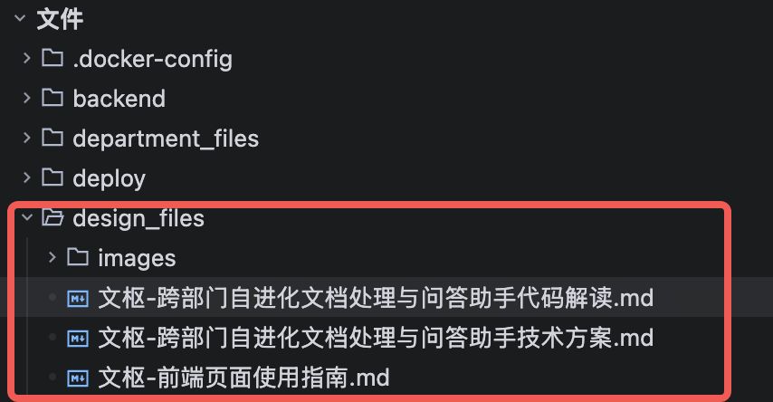

# 项目更新|行政助手Agent

> 来源（Source）：https://articles.zsxq.com/id_ldx4lbr0x3k8.html  
> 日期：2026年08月19日 23:10

本项目原生版本涉及较多后端、服务治理与部署内容，最适合用来投递 **Agent 开发岗 / 大模型应用开发 / Agent 工程师 / AI应用开发**。如果目标是 **算法岗** ，而你又不懂后端的东西，可以在面试中明确说明本项目是两个人协作完成的：**你负责算法与实验部分，另一位同学负责前后端开发和工程部署部分**；但它不能单独替代模型训练或强化学习项目。

本项目对没有实习的同学非常友好。

之前没有学过后端的同学可能学起来会比较吃力，不过里面后端相关的概念都是很成熟的技术，b站上都有完整的课程，可以自己搜来看看。

本项目最突出特色就是 Agent自进化，涉及到的技术栈有：

Harness Engineering、Agent DAG、可信 RAG、Memory Engineering、Loop Engineering、Skill Workflow、BM25、Milvus、RRF、Reranker、MongoDB、Redis Stream、FastAPI、K8s、HPA、Prometheus、pi Agent Runtime

**面试准备文档：**

飞书链接：https://my.feishu.cn/wiki/CVv8wFvD8iAm0Tk1NDLc1ZwNnNe

密码：86@3v671

还是老样子，去面试的时候如果问到了超出这个文档范围的问题，就：

1、在文档边上写评论、或者在这个帖子下面写评论，我看到就会补充

2、去原代码里找答案

3、看看《八股文速记》里面有没有

**代码：**

链接: https://pan.baidu.com/s/1wjPaoIc6zYSt5ZvWT1opew?pwd=xg3k

提取码: xg3k

有同学说没有百度网盘的会员，所以夸克网盘也上传了一份：

我用夸克网盘给你分享了「居丽叶的简历项目9：行政助手Agent」，点击链接或复制整段内容，打开「夸克APP」即可获取。

/~d6933aJBmj~:/

链接：[https://pan.quark.cn/s/3f6cba127728](https://pan.quark.cn/s/3f6cba127728)

**代码解析文档也在网盘里面：**

讲解视频下周更新。
