# 居丽叶的简历项目9：行政助手Agent

> 来源（Source）：https://my.feishu.cn/wiki/CVv8wFvD8iAm0Tk1NDLc1ZwNnNe

### 投递岗位说明

本项目原生版本涉及较多后端、服务治理与部署内容，最适合用来投递 **Agent 开发岗 / 大模型应用开发 / Agent 工程师 / AI应用开发**。如果目标是如下图所示的这类 **算法岗** ，也可以按下面的方式调整项目分工；但它不能单独替代模型训练或强化学习项目。

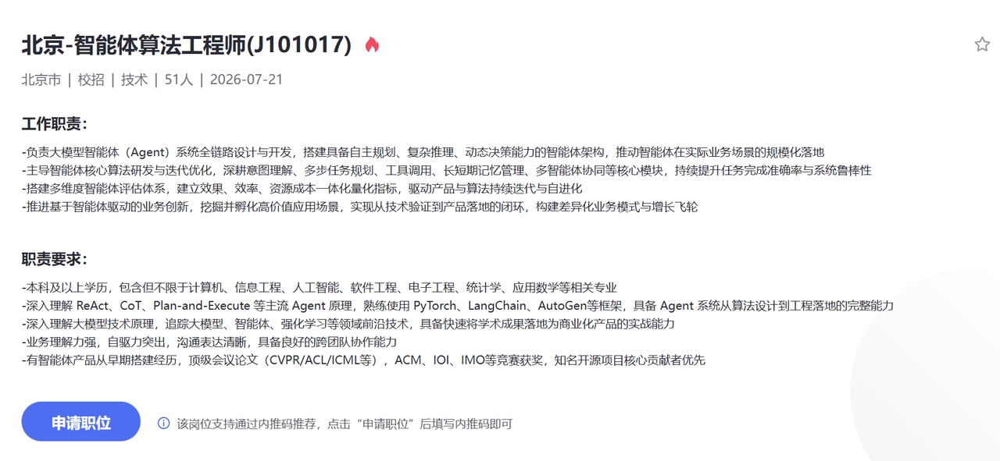

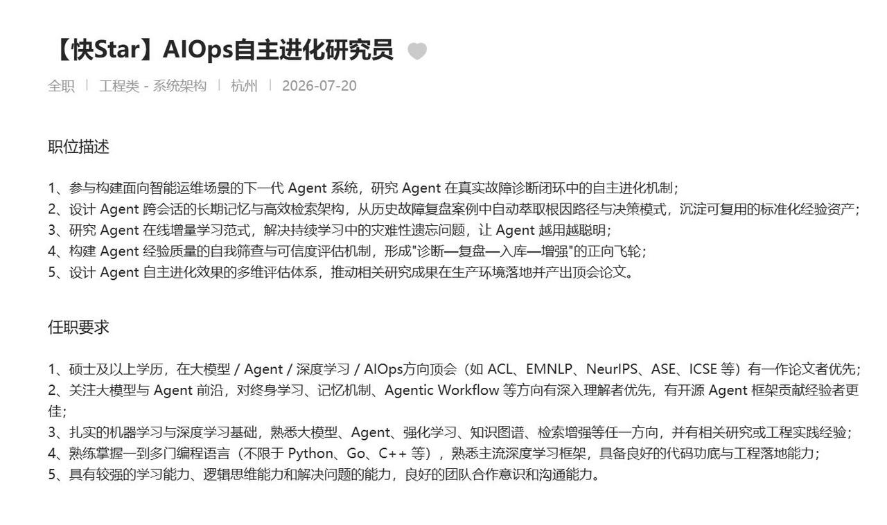

如果你不懂后端的东西，可以在面试中明确说明本项目是两个人协作完成的：**你负责算法与实验部分，另一位同学负责前后端开发和工程部署部分。** 

**你负责的算法部分：**

- 设计意图识别、部门路由和 Query Rewrite，处理术语别名、上下文指代与多查询扩展；
- 设计 `BM25 + Milvus + RRF + Reranker` 混合检索链路，并通过分层评测集优化 Recall@5、MRR 和引用正确率；
- 设计 Answer-Verifier 证据校验与安全拒答策略，分析无依据回答、旧版本误引和跨部门冲突等 bad case；
- 设计长期记忆检索、MemoryContextBuilder 和权威等级，避免会话摘要、模型推断被误当成官方事实；
- 设计 `Execute → Observe → Reflect → Adapt → Deploy` 反馈闭环，将失败归因为 retrieval / intent / generation / knowledge_gap，并通过 Trace 回放、灰度对照和分阶段指标归因验证策略效果；
- 搭建 1,200 条分层评测集，负责算法实验、指标分析、错误归因和迭代结论。

**队友负责的前后端与工程部分：**

- 前端交互、文档管理后台、反馈入口与结果展示；
- FastAPI 接口、鉴权、部门权限、异步任务和业务数据读写；
- MongoDB、Milvus、Redis Stream 等服务的工程接入与稳定性保障；
- 部门 Agent Service、全局 Orchestrator、K8s、HPA、Prometheus、压测、超时降级和部署运维。

算法岗同学仍然要能讲清整条系统链路、数据如何流动、算法模块的输入输出以及线上约束，但不需要把前端、接口开发、K8s 扩缩容都写成自己的贡献。上述分工只适用于真实协作项目；最终表述应与实际经历一致，并确保队友之间的口径能够互相验证。

### 场景说明

> **场景包装**：本项目原生场景是学校、政府或公司等多部门制度问答。整套方案（可信 RAG + 自建 Agent 编排治理 + 五个记忆平面 + 反馈驱动的 Skill 进化）也可以直接换成政务 12345 知识库、企业内部制度与 HR 助手、银行保险的合规问答、医院院内制度、运营商客服知识库，只需要替换文档来源、术语表和部门划分即可。
>
> 12345 知识库类比赛及其赛题：https://cvmart.net/race/11419/des （报名截止8月31日12:00）

**原生场景示例：**

东南大学|善问：https://mp.weixin.qq.com/s/dbHLFeWYYis3Mha68gy3oQ （由东南大学校长办公室联合网络与信息中心研发）

西安交通大学｜交小智：https://mp.weixin.qq.com/s/LWVAXF_SzZDm_-SMQC2FFg （网络信息中心）

北京工业大学｜燕小北：https://mp.weixin.qq.com/s/UO7nBmLsFtkdkko_V9rYEg

中国农业大学｜小鹉哥：https://mp.weixin.qq.com/s/4g_gySMBQZCJ9OZ-yBkmvw

清华大学 | 清小搭：https://mp.weixin.qq.com/s/9OgcujzM9HRJ_MMZFsQmkA

其他学校大家可以自己去找找，如果你的学校暂无同类校内行政助手 Agent，可以自己想一个文艺一点的名字。

打算将该项目包装为 **校内行政助手 Agent** 用于简历投递的同学，可以在本文末尾的评论区填写目标院校与 Agent 名称（或者自定义的名称）。其他人看到相同选题时可以点赞标记。

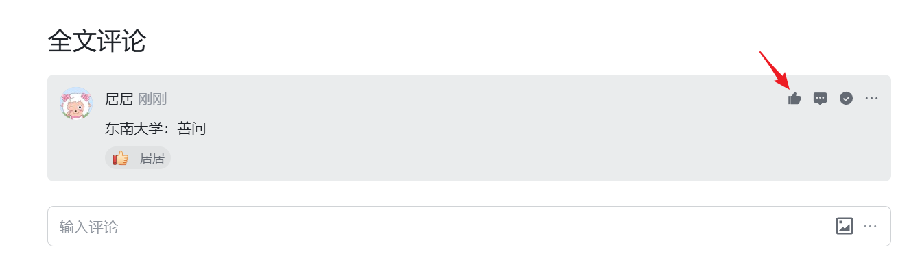

这样做有两个作用：

1. 可以规避项目命名冲突；
2. 方便回答面试官问：“为什么我看到很多份简历都出现了这个项目？你们学校的这个项目有多少人在做？”

如果有同学真实在校内落地过同类系统，我提供的方案可作为迭代后的进阶版本；你可以把自己在校完成的内容作为项目初版。通过项目迭代演进的叙事，进一步提升项目深度。

### 自我介绍

自我介绍不用展开，说清楚系统干什么、自己负责哪几块、用了哪些技术就可以了。

**半分钟简洁版**

我本科毕业于 xx 大学，现在就读于 xx 大学研二。在校期间，我参与了一个学院和校网信息办联合开发的校内行政助手 Agent，叫文枢。这个项目原来已经有一个基础版本，主要是把制度文件切块后放进向量库，再用简单 RAG 做问答。我接手后主要负责把它升级成一套更可靠的制度问答系统：补了文档版本管理、BM25 + 向量混合检索、原文引用校验、Agent Harness 编排、分层记忆和反馈自进化 Loop。模型推理由 pi Agent Runtime 执行，但权限、事实校验、流程控制、策略灰度和回滚都由我实现的治理引擎来控制。

**1 分钟版**

我本科毕业于xx大学，现在就读于xx大学研二，在校期间，我参与了一个学院和校网信息办联合开发的行政助手Agent（非计算机学院的同学就说自己在校网信办做助管或者勤工俭学），叫文枢，我的工作主要解决了这些问题：文档分散于各部门、文件多版本共存、跨部门口径冲突，以及传统 RAG 上线后策略难以迭代。

架构上我自建了一套 Agent 编排与治理引擎，把概率性的推理部分交给 pi Runtime。自建这层负责身份鉴权、部门隔离、事实检索、记忆治理、固定 DAG、灰度和回滚；pi 负责意图识别、查询改写、答案生成、结果复核和 bad case 归因。文档进来之后会经过解析、清洗、条款级切片、向量化、去重，并维护完整版本链路，问答阶段采用 BM25+Milvus 双路召回，通过 RRF 融合再做重排序，最后从 MongoDB 取出完整原始条款作为回答依据。

项目的另一个重点是反馈闭环。系统会收集点赞、点踩、纠错、追问、复制和 Verifier 结果，把失败归类为检索、意图、生成或者知识缺失，再生成 Skill、Hook、Rule 候选。这里的 Skill 不是简单的提示词，是可以实际调整查询词、调 top-k、切换回答模板，同时完整记录实验分组、版本与效果数据。

以上是我的自我介绍，需要我详细讲一下这个项目的架构和迭代过程吗？

---

### 简历写法

（仅供参考，可酌情删减，现在这个版本写得有点长了，而且是从项目owner的视角写的）

**文枢｜校内行政助手 Agent：基于 Harness Engineering 的可信 RAG 与反馈自进化系统**  　                      `2026.XX – 2026.XX`

**项目背景**

接手学院与校网信息办已有的校内制度问答原型，原系统采用“文档切块 + 向量检索 + 单 Agent 生成”的简单 RAG 链路，存在多版本制度误引、纯向量检索精确信息不稳、Agent 执行不可控、用户反馈无法反哺策略等问题。针对教务、学工、财务、研究生院等多部门制度文档，参与升级为具备 **可信 RAG、Agent Harness、分层 Memory、反馈自进化 Loop** 的校内行政助手 Agent。

**解决方案**

- **Agent Harness 编排治理**：自建 Harness 层，将问答链路固定为 `Intent → Rewrite → Retrieval → Answer → Verify` DAG；pi Agent Runtime 负责意图识别、查询改写、答案生成、结果复核和 bad case 归因，自建治理层负责身份鉴权、部门隔离、事实校验、超时降级、灰度发布和自动回滚，避免 Agent 自由规划导致跳过检索或误答；
- **可信 RAG 数据链路**：将 MongoDB 设计为事实平面，维护制度文档 `active / archived` 状态、版本链、来源哈希和条款元数据；Milvus 仅负责向量候选召回，命中后必须回 MongoDB 回填完整原始条款并校验生效状态，实现答案引用可核验；
- **混合检索与证据召回优化**：针对制度问答中数字、电话、条款号、时间节点等精确信息难召回的问题，设计 `BM25 + Milvus + RRF + Reranker` 检索链路；BM25 负责关键词和精确信息召回，向量检索负责语义召回，RRF 融合后重排，并由 Query Rewriter 结合术语表和会话实体生成多组查询；
- **分层 Memory 架构：**将记忆拆分为 Redis 工作记忆、情景记忆、用户语义记忆、组织知识记忆和程序性策略记忆；通过 MemoryContextBuilder 按权限、时效、权威级别和 token 预算裁剪上下文，避免会话摘要、部门 FAQ 或模型推断被误当成官方制度引用；
- **反馈自进化 Loop**：实现 `Execute → Observe → Reflect → Adapt → Deploy` 闭环，采集点赞、点踩、纠错、追问、复制和 Verifier 结果；通过 Reflect 将 bad case 归因为 retrieval / intent / generation / knowledge_gap，并生成 Skill / Hook / Rule 候选，经历史 Trace 回放、稳定哈希灰度和指标监控后发布或回滚。
- **可执行 Skill Workflow**：将 Skill 从普通提示词升级为可执行策略单元，支持查询词扩展、top-k 调整、回答模板切换、校历约束注入，并记录实验分组、触发次数、成功率和版本效果，用于验证反馈是否真实改变下一轮执行路径。

**项目成果**

- 在 1,086 份制度文档、28,640 条语义条款、1,200 条分层评测问题上完成规模化验收，Recall@5 达到 93.4%，MRR 0.862，引用正确率 96.1%，部门路由准确率 94.2%；
- 综合回答准确率从基础向量 RAG 的 82.6% 提升到 93.1%，其中混合检索与事实治理贡献 7.2 个百分点，两轮 Skill 灰度迭代贡献 3.3 个百分点。
- 无依据问题安全拒答率达到 97.3%，单部门问答 P95 3.6 秒，跨部门问答 P95 5.4 秒。
- 支持按部门拆分 Agent Service，通过 `DEPT_ID` 强制过滤和全局 Orchestrator 并行合并；完成 1 → 20 Pod 压测，200 并发下吞吐从 8.7 req/s 提升至 57.9 req/s。**（算法岗可以删除这一条）**

**如需突出后端能力与平台能力可以替换的两条：**

- 基于 FastAPI、Motor、Redis Stream 搭建 Agent Harness 编排服务和异步 Worker，统一管理问答 DAG、文档入库、Loop 作业、Trace 回放与 Skill 发布流程，并持久化 `queued / running / completed / failed` 状态和阶段进度。
- 按部门拆分独立 Agent Service，通过 `DEPT_ID` 做权限隔离和事实过滤，由全局 Orchestrator 并行调度多部门 Agent，并支持部分成功合并、超时降级和失败回放；配套 K8s、HPA、Prometheus 与 k6 压测验证扩缩容效果。

**技术栈：**  
Harness Engineering、Agent DAG、可信 RAG、Memory Engineering、Loop Engineering、Skill Workflow、BM25、Milvus、RRF、Reranker、MongoDB、Redis Stream、FastAPI、K8s、HPA、Prometheus、pi Agent Runtime

---

### 项目描述

先说背景，再说一开始怎么做的、遇到了什么问题、试了什么新方案、结论是什么，要突出迭代的过程。

我接手这个项目时，它已经有一个基础版原型。上一版主要是典型的简单 RAG：把学校各部门的制度文件上传后切块，写入向量库，用户提问时做向量检索，然后让模型生成答案。这个版本能跑通基础问答，但更像一个“文档搜索 + 生成”的 Demo，离真正可用的校内行政助手还有差距。

我接手后先做了一轮问题定位，主要有这四个问题

第一，制度文件不是普通知识库。它有部门边界、有版本、有生效状态。用户问"退课怎么办"，向量库里 2022 版和 2025 版的《本科生选课管理办法》长得几乎一样，模型经常引到旧版本，甚至引到还没生效的征求意见稿。

第二，纯向量检索对"第八周""28881110"这种精确信息很不稳，问"选课退选截止到第几周"能召回一堆语义相近但没有具体日期的条款。

第三，多轮对话完全接不住，用户第二句问"那怎么办"，系统不知道"那"指什么。

第四，反馈没有闭环，用户点踩或者纠错后只是写日志，下一次同类问题还是走原来的路径。

针对第一和第二个问题，我先做了可信 RAG 这一层。把 MongoDB 设成独立的事实平面，文档有 `active/archived` 状态、版本链和来源哈希，Milvus 只负责从两万多条向量里快速找候选；检索结果必须回 MongoDB 回填完整条款，并且再检查一次所属文档是不是 active。检索本身改成 BM25 取前 20、向量取前 40，用 RRF 融合再过 Reranker，Query Rewriter 会结合术语表和会话实体生成多组查询。答案强制带 `[来源N]`，后面接一个 Verifier 检查结论和引用是否对得上。这一轮下来 Recall@5 从 84.7% 到 92.8%，引用正确率从 88.3% 到 95.4%，性质上是把"能回答"变成了"有依据地回答"。

接着我发现另一个矛盾：制度场景很怕 Agent 自由发挥。早期我让一个 ReAct Agent 自己规划，它会反复检索同一个意思的查询词，偶尔还跳过检索直接凭模型知识回答——这在医疗和制度这类场景是不能接受的。于是我把编排改成固定 DAG：Intent、Rewrite、Retrieval、Answer、Verify 五步，每步的输入输出结构和超时预算都定死，Retrieval 必须走自建的事实检索模块，模型没有绕过它的权限；Verifier 不通过时定向打回 Answer，最多重写两次，两次还不过就退化成"给出原文引用并明确说明依据不足"，不让它无限循环。概率性的那部分交给 pi Runtime 执行，确定性的边界留在我自己这一层。部门路由准确率这时候从 86.5% 提到 92.7%。

然后是记忆。最初的做法很朴素，把对话历史整段塞进 prompt，超过十轮之后上下文又长又重复，模型还容易被前面的话题带偏。更麻烦的是，如果把聊天摘要、部门 FAQ 和模型推断都塞进同一个向量库，它们会被当成官方制度引用出去。所以我设计成一个独立事实平面加五个记忆平面：Redis 工作记忆存最近消息和已确认实体，TTL 30 分钟；情景记忆存 append-only 事件和会话摘要；用户语义记忆只存用户明确同意的低敏偏好；组织知识记忆存 FAQ 和协调结论，但必须绑定 `doc_id/chunk_id/version`，命中之后要回查原文还在不在 active 才能进证据集；程序性记忆存 Skill、Hook、Rule 和实验，它只改执行参数，不作为事实进 prompt。所有平面统一由 MemoryContextBuilder 按权限、时效、权威级别和字符预算裁剪，再注入 Intent、Rewrite 和 Answer。权威顺序是 active 官方文档 > 管理员审核过的组织知识 > 用户明确声明 > 会话摘要 > 系统推断候选。

最后一步才是反馈进化，也是这个项目和普通知识库问答最不一样的地方。

我实现了 Execute、Observe、Reflect、Adapt、Deploy 五个阶段：反馈进 Redis Stream，pi 的 Reflect Agent 做概率性归因，把 bad case 分成 retrieval、intent、generation、knowledge_gap 四类，自建引擎负责候选生成、历史 Trace 回放、稳定哈希灰度分桶和自动回滚。为了证明反馈真的改了行为，我做了 Skill Executor：比如"暴雨天气有哪些安全事项"会命中极端天气 Skill，默认 top-k 从 5 提到 8，同时扩展"预警、避险、应急电话"等查询词，并换成风险—行动—求助的回答模板；那次执行经过 active 校验和相似度阈值过滤后实际返回 7 条证据，系统写入 treatment 记录，触发数从 0 变成 1。这就是"策略确实改变了下一轮执行"的直接证据。

最后我还做了规模化验收，主要证明两件事：

第一，Harness + 可信 RAG + Memory + Loop 的改动确实提升了问答质量；

第二，部门 Agent 服务化和 HPA 扩缩容确实改善了并发能力，但系统瓶颈也从应用层转移到了外部模型配额和共享资源上。

我批量导入了 1,086 份制度文档、切出 28,640 条语义条款，构造了 1,200 条分层评测问题，评测集按部门、意图、难度、跨部门和安全拒答分层，其中 960 条用于策略迭代、240 条冻结做验收。最终 Recall@5 93.4%、MRR 0.862、引用正确率 96.1%、答案关键点完整率 92.4%、无依据安全拒答率 97.3%，综合回答准确率从 82.6% 到 93.1%。其中，混合检索和事实治理主要提升召回与引用正确率，两轮 Skill 灰度迭代主要改善了一批高频 bad case 的回答路径。

工程侧我也做了压测。原来向量检索和部门问答比较耦合，后面我把向量检索独立成 Milvus 服务，并按部门拆分 Agent Service，用 `DEPT_ID` 做权限过滤和事实隔离，再由全局 Orchestrator 并行调度。扩缩容上，我用自定义 `inflight` 指标做 HPA，做了 1 到 20 个 Pod 的对照压测。在 200 并发下，有效吞吐从 8.7 req/s 提升到 57.9 req/s，约等于单 Pod 的 6.7 倍；P95 延迟从 7.6 秒降到 2.9 秒。

这个压测结果说明：当部门 Agent 数量继续增加时，收益会逐渐变缓，主要受外部模型 TPM / RPM 配额、跨部门结果合并，以及共享存储连接池影响。所以这一轮优化的结论是，部门 Agent 服务化和 HPA 能明显改善并发能力，但后续如果要继续提升吞吐，需要进一步做模型调用限流、跨部门合并策略优化和连接池隔离。

---

### 面试问题

> 🏖️ PI Agent面试拓展文档：[如何基于 Pi 开发自己的 Agent 项目](https://my.feishu.cn/wiki/REE6wlLe4iQoPKkzfGQcjY6znHb)
>
> 自反思评测优化面试拓展文档：[把"跑一次实验"沉淀成Loop：评测驱动的自进化优化闭环](https://my.feishu.cn/wiki/C7YxwxdpNix2ankrXlycQMmonSg)

#### 一、架构与 Harness 设计

##### 1. 先整体介绍一下你这个系统的架构

分五层来讲，从上往下。

最上面是接入层，FastAPI 提供问答、文档管理、反馈、Skill 管理等接口，鉴权和限流也在这层完成。

第二层是 Harness 编排层，也就是我自己写的那套治理引擎，负责固定 DAG 的推进、每一步的超时预算、Verifier 的打回和降级，以及对 pi Agent Runtime 的调用。

第三层是能力层，分成检索、记忆、Skill 三块：检索是混合检索加重排，记忆是一个事实平面加五个记忆平面，Skill 是可执行的策略产物。

第四层是数据层，MongoDB 存文档和条款的事实平面、异步作业、记忆事件，Milvus 存向量，Redis 存工作记忆和消息流。

最下面是运行层，K8s 按部门拆 Agent Service，Prometheus 采自定义指标做 HPA。

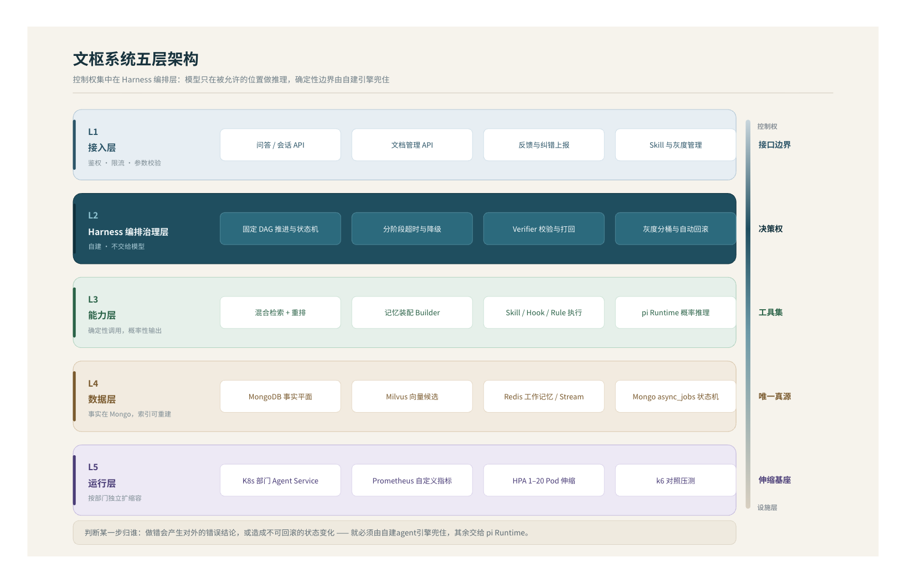

可以强调一句：这五层的关键分界在于"谁有权决定下一步"。接入层和数据层是设施，能力层是工具，真正的控制权在 Harness 这一层，模型只在被允许的位置做推理。

##### 2. 为什么自己写编排引擎，不直接用 pi Agent Runtime 或者 LangGraph

因为这两类东西解决的问题不一样。

pi Agent Runtime 擅长的是概率性的部分——意图理解、查询改写、答案生成、bad case 归因，这些交给它比我自己写规则强得多。但制度问答有一堆确定性要求：检索必须真的执行、引用必须真的存在、旧版本文件必须不能被引、超时必须在预算内退出、Verifier 不通过必须定向重做、灰度必须可回滚。这些是我不能让模型自由决定的。

所以我把系统分成两部分：确定性治理在我自己这一层，其余交给 pi。判断一件事该放哪部分，我用一个很简单的标准——如果这一步做错了会产生对外的错误结论，或者会造成不可回滚的状态变化，就必须由我的引擎兜住。

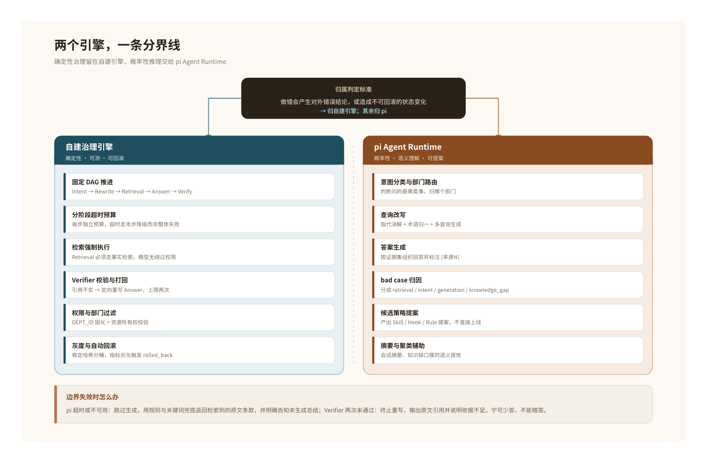

至于 LangGraph 这类框架，它能构建图式框架，但我要的分阶段超时预算、Verifier 定向打回、Trace 可回放、稳定哈希灰度和自动回滚，这几件事最终都要我自己写。把状态机写成显式的、可测的代码对于我这个场景来说是最合适的。

##### 3. 一次问答完整链路是怎么走的

请求进来先鉴权，拿到用户身份和部门权限。然后 MemoryContextBuilder 去 Redis 拉工作记忆、去 Mongo 拉情景摘要和用户偏好、拉组织知识候选，按权限和字符预算裁一遍。接着 Intent 节点做意图分类和部门路由，Rewrite 节点结合术语表和已确认实体生成多组查询——这一步很关键，"那怎么办"这种指代就是在这里被展开成完整问题的。

然后进 Retrieval：BM25 拿前 20，Milvus 拿前 40，RRF 融合，Reranker 重排，回 MongoDB 回填完整条款正文并再校验一次文档是不是 active，最后按相似度阈值过滤。证据集定下来之后 Answer 节点生成带 `[来源N]` 的答案，Verify 节点检查每个引用是否存在、结论是否被引用支撑、是否引到了非 active 文档。不通过就定向打回 Answer 重写，最多两次；两次还不过，就输出原文引用并明确说明依据不足。最后写情景记忆、进入 Trace、返回。

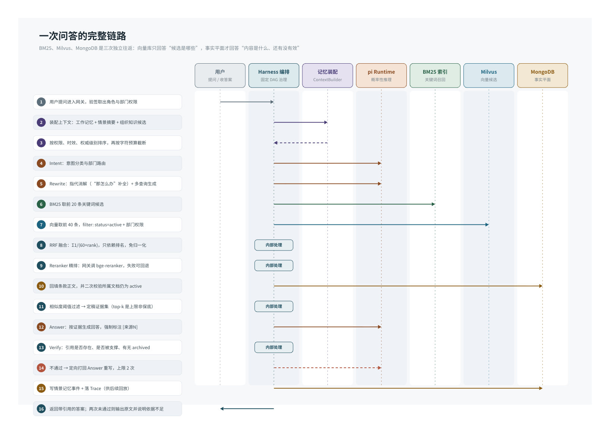

##### 4. 为什么用固定 DAG，不让 Agent 自己规划

一开始我确实是让 ReAct Agent 自己规划的，实测中会有两个问题：一是它会用意思几乎一样的查询词反复检索，白烧 token 也不提升召回；二是偶发跳过检索直接凭模型自己的知识回答，这在制度场景等于凭空编规定。

固定 DAG 的好处是每一步的输入输出契约固定、超时可控、失败可定位、Trace 可回放。代价是灵活性差，遇到需要多跳推理的问题只能靠 Rewrite 一次生成多查询来近似。

这个取舍是因为制度问答的形态高度收敛——绝大多数问题是"某个规定是什么、在哪、找谁"，不需要开放式规划。

**追问：那什么时候你会换成动态规划？**

当任务里出现真正的多步依赖、比如需要先查到负责人再去查这个人的排班，且这种问题占比上来了，我会在 DAG 里加一个受限的子循环，而不是把整条链路都让 Agent 自己规划。

##### 5. 分阶段超时预算具体怎么做的

每个节点有自己的预算。Intent 和 Rewrite 是几百毫秒级，Retrieval 给到秒级，Answer 最宽，Verify 很短。某一步超了，会去走这一步对应的降级：Rewrite 超时就用原始 query 直接检索；Reranker 超时就退回 RRF 融合后的顺序；Answer 超时就返回已检索到的原文条款加一句说明；Verify 超时就标记未校验并降低置信展示。

这样做的收益是 P95 可控，而且降级是分级的、也能明确"降到哪一档"。

---

#### 二、文档治理与可信 RAG

##### 6. 文档入库这条链路你是怎么设计的

上传之后先算 SHA-256，同哈希直接判重返回，避免重复入库和重复消耗 embedding。然后解析、按语义边界切块、批量向量化写 Milvus、条款正文写 MongoDB。

版本这块是重点：新文档如果识别出和已有文档是同一份制度的新版本，我会建 `supersedes` 关系形成版本链，但顺序是——新版本的所有 Chunk 全部就绪、状态置为 ready 之后，才把旧版本置成 archived。中间任何一步失败，新版本停在 pending，旧版本保持 active，用户查到的永远是一个完整可用的版本，不会出现"新的没好、旧的已经被下架"的空窗。

失败清理我现在是应用层补偿：一个作业记录挂着已写入的 Milvus ID 和 Mongo ID，失败就按记录反向清理。

这不算严格的分布式事务，真正生产要上 Outbox 或 Saga 加对账任务，我现在的做法是补偿加人工兜底。

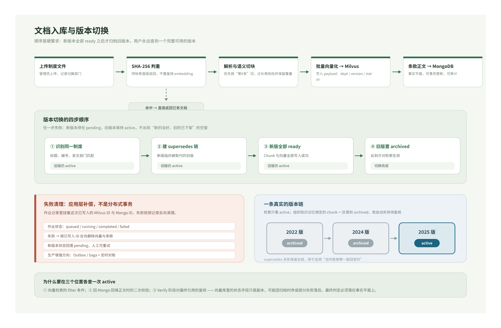

##### 7. 怎么保证不会引到旧版本或者还没生效的文件

三道关。

第一道在检索侧，向量库的 filter 条件里带 `status=active` 和部门权限

。第二道在回填侧，从 Mongo 拿正文的时候再查一次所属文档的状态，因为向量库的 payload 有可能落后于事实平面——这一层是防止元数据不一致的。

第三道在 Verify 侧，检查最终答案引用到的每一个 chunk 所属文档是不是 active，引到 archived 就打回。

**追问：为什么要查三次？**

因为 Milvus 里的标量字段是我写进去的副本，事实平面才是唯一真源。副本可能因为归档时序、部分失败而落后，所以最终判定必须落在 Mongo 上。

这套设计的核心是：向量库只负责"可能相关的候选是哪些"，不负责"内容是什么、还有没有效"。

##### 8. 为什么要做 MongoDB 和 Milvus 的双平面，一个库不行吗

技术上当然可以只用一个向量库，但这会让向量库承担太多它并不擅长的职责：

比如保存完整条款上下文（向量库里存的是切片，不好做上下文扩展）、维护版本链和 active / archived 状态（向量库的标量过滤能表达状态，但不适合做事务性的版本切换）、以及记录文档状态变更的审计信息（谁在什么时候改了什么状态）。

我把它概念化成"事实平面"和"候选平面"：

**事实平面**是权威的、可事务更新的、可审计的；

**候选平面**是可重建的索引，理论上删了能重灌。这个划分带来的一个直接好处是，我换 embedding 模型的时候可以直接重灌向量库，事实数据一动不动。

##### 9. 混合检索具体怎么融合的，RRF 公式是什么

BM25 取前 20，向量取前 40，两路各自出一个有序列表，然后按 RRF 打分：每个文档的分数是 Σ 1/(k + rank)，rank 是它在各路结果里的排名，k 我取 60。

用 RRF 而不是分数加权，原因是 BM25 的分数和向量余弦相似度不同量纲、分布也不一样，直接加权需要归一化和调参，而且不同 query 的分数尺度还会漂。RRF 只依赖排名，天然免归一化，加新的检索路也不用重新调权重。k=60 是常见默认值，作用是平滑排名差异，避免第一名的优势被放得过大，让多个召回源里的稳定高位结果都有机会进入后续重排。

融合之后再过 Reranker 做精排，最后按相似度阈值过滤。

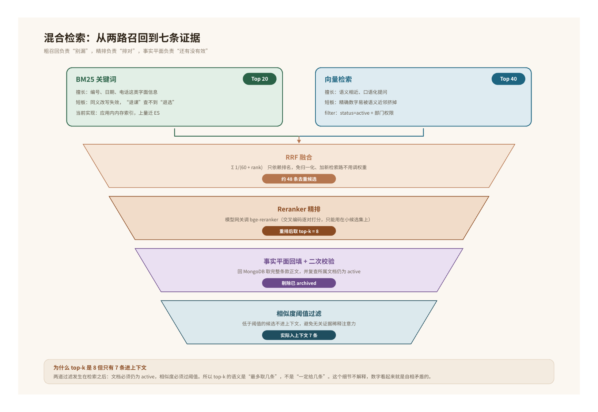

| **方案** | **擅长** | **明显短板** |
|---|---|---|
| BM25 关键词 | 精确术语、编号、"第八周""28881110"这类字面信息 | 同义改写完全失效，"退课"查不到"退选" |
| 向量检索 | 语义相近、口语化提问 | 精确数字和专有名词容易被语义近邻挤掉 |
| RRF 融合 | 两路互补，免归一化免调权 | 只看排名，丢失了原始分数的置信信息 |
| Reranker 精排 | query 与条款的细粒度相关性判断 | 交叉编码逐对打分，延迟最高，只能用在小候选集上 |

##### 10. Reranker 放在哪一步，模型挂了怎么办

放在 RRF 融合之后、回填正文之前，只对融合后的候选集重排。

原因是：Reranker 是交叉编码器，query 和候选要成对进模型，代价随候选数线性涨，不可能拿它去扫全库。它的定位是"在小范围内把顺序排对"，粗召回的活儿必须由 BM25 和向量来干。

我用的是 bge-reranker，通过统一的模型网关调用，不在业务代码里直连。网关超时或者失败的时候回退成启发式排序：保留 RRF 顺序，再叠加关键词命中数、条款层级、文档更新时间几个信号做微调。这样最坏情况是排序质量下降，而不是整条检索链路失败。

##### 11. 切片策略是怎么定的

按语义边界切，不是按固定字符数硬切。制度文件天然有"第几章第几条"的结构，我优先按条款切，条款过长再按段落细分，并保留一定重叠。每个 Chunk 上会挂所属文档、部门、版本、条款路径这些元数据。

1,086 份文档切出 28,640 条，平均一份 26 条左右，跟制度文件的条款密度大致对得上。

**这里其实还有一个没解决好的问题**：附表和流程表格切得不理想，表格被切开之后单独一块的语义很弱，检索命中率明显低于正文条款。

我现在的临时做法是表格整块不切并在前面拼上所属条款标题，更彻底的做法应该是表格转成结构化数据单独建索引，这个我还没做。

##### 12. BM25 你是怎么实现的，多个 Pod 会不会不一致

现在是应用进程内的内存索引，服务启动时从 Mongo 全量加载 active 条款构建，文档版本变化时触发重建。

这个方案在我这个规模（两万多条 Chunk）是够用的，**但这里其实也存在一些问题**：

一是每个 Pod 都有一份索引，内存重复占用；

二是重建有先后，短时间内不同 Pod 的索引状态不一致，同一个 query 打到不同 Pod 可能返回略有差异的关键词召回结果；

三是冷启动要花时间重建。

真要上量，正确做法是把关键词检索挪到 ES 或 OpenSearch，让它变成和 Milvus 一样的外部共享服务，Pod 就变成无状态的。

我保留内存索引是因为这样可以省一个组件、延迟也更低。

##### 13. 你的检索指标是怎么评的，1,200 条问题怎么来的

先说数据集：1,086 份文档、28,640 条 Chunk、1,200 条评测问题。问题按五个维度分层构造——部门归属、意图类型、难度、是否跨部门、是否属于应当拒答的无依据问题。其中 960 条用于策略迭代，240 条冻结下来只做最终验收，不参与调参。

> **指标定义**：Recall@5 我算的是 chunk 级召回——前 5 条结果命中的标注相关 chunk 数除以该问题标注的相关 chunk 总数，再对全部问题取平均。"前 5 条里有没有相关内容"那个是 Hit Rate@5，是另一个指标，两者不能混着说。MRR 是每个 query 首个相关结果排名的倒数、再对所有 query 取平均值。

再说口径：

检索类指标（Recall@5 93.4%、MRR 0.862）是在全部 1,200 条上算的；Loop 迭代前后的效果对比只用 240 条冻结集，因为迭代策略是在另外 960 条上调出来的，不能混起来算。

文档是从学校/学院/教务处/财务处等官网按部门下载导入的，评测问题是用大模型遍历 active 文档抽代表性段落反向生成，再刻意补一批"无依据、应当拒答"的问题，人工 check 质量

---

#### 三、记忆架构

##### 14. 你的记忆是怎么组织的，为什么不是"短期记忆 + 长期记忆"那种两层

两层的分法只回答了"存多久"，没回答"能不能当证据用"。制度问答里后面这个问题更致命。

举个例子，

用户上一轮说"我是研究生"，这是用户声明；

某个部门 FAQ 里写"研究生退课走教务处 B 窗口"，这是组织知识；

系统从行为里推断"这个用户大概是计算机学院的"，这是推断候选。

这三条的可信程度完全不同，但在"长期记忆"这个筐里它们是平级的，一起进 prompt 就会被模型当成同等事实，最后拼出一个看起来有理有据、其实没有任何官方条款支撑的答案。

所以我按"权威级别 + 是否可作为对外引用"来切平面：一个事实平面（MongoDB 里的 active 制度条款，唯一可以对外引用的东西），加五个记忆平面。

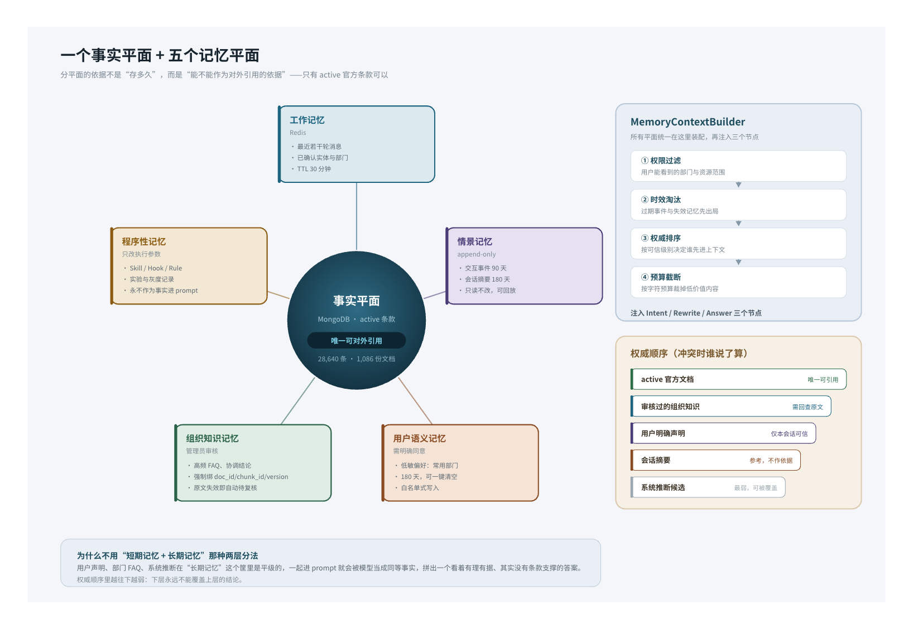

| **平面** | **存什么** | **留存与治理** |
|---|---|---|
| 工作记忆 | 最近若干轮消息、已确认实体、当前部门上下文 | Redis，TTL 30 分钟，会话结束即弃 |
| 情景记忆 | append-only 交互事件、会话摘要 | 事件 90 天、摘要 180 天，只读不改 |
| 用户语义记忆 | 低敏偏好，如常用部门、回答详略习惯 | 必须用户明确同意才写，180 天，可一键清空 |
| 组织知识记忆 | 高频 FAQ、跨部门协调结论 | 管理员审核后生效，强制绑 `doc_id/chunk_id/version` |
| 程序性记忆 | Skill、Hook、Rule、实验记录 | 只改执行参数，永不作为事实进 prompt |

统一由 MemoryContextBuilder 装配：先按用户权限过滤，再按时效性淘汰，再按权威级别排序，最后按字符预算截断，注入 Intent、Rewrite、Answer 三个节点。权威顺序是 active 官方文档 > 审核过的组织知识 > 用户明确声明 > 会话摘要 > 系统推断候选。

##### 15. "那怎么办"这种指代，你具体是怎么解出来的

工作记忆里维护一个已确认实体集合，包括上一轮命中的文档、部门、意图类型和用户自述身份。Rewrite 节点拿到原始 query 之后，先判断它是不是缺主语的续问——判断依据是长度、有没有指代词、有没有可检索的实体名。是的话就用实体集合把它补全，比如"那怎么办"补成"研究生超过退课截止时间后如何申请退课"，然后再生成多组查询去检索。

补全结果我会写回工作记忆，并且在返回给用户的调试信息里可见，方便对齐"系统到底把我的问题理解成了什么"。

这里我也遇到过问题：一开始我把补全后的 query 也当成用户原话存进情景记忆，导致后面的会话摘要越滚越偏。后来我就改成原话和改写后 query 分开存，摘要只用原话。

##### 16. 组织知识记忆命中之后，你怎么保证它不会变成"过时的官方说法"

两条约束。

第一，写入的时候强制绑定来源，也就是它是从哪份文档哪个条款的哪个版本总结出来的，没有来源的 FAQ 不允许进这个平面。

第二，命中之后不直接进 prompt，要先回查它绑的 chunk 现在还在不在 active 状态。原文已经被新版本取代了，这条组织知识就自动失效，同时进一条待复核记录给管理员。

这个设计的动机就是我前面说的那个 bug：制度改了，但沉淀下来的 FAQ 还在按老规定回答，而且因为它是"经过审核的知识"，反而比原文更容易被引用。绑版本是唯一能自动发现这件事的办法。

##### 17. 用户记忆涉及隐私，你怎么处理

只存低敏的、只在用户明确同意后存、可查可删。

用户能看到系统记住了他哪些偏好，能单条删也能全清。学号、成绩、处分记录这类信息我不写进任何记忆平面，需要的时候现查现用、用完即弃。

另外，写入是白名单式的——不是"敏感的不存"，而是"只有列在白名单里的字段才允许存"。

---

#### 四、Loop Engineering 与可执行 Skill

##### 18. Loop 的五个阶段分别做什么

Execute 是正常执行并落 Trace；

Observe 收集显式反馈（点赞点踩、纠错）和隐式信号（追问、无引用、拒答、超时）；

Reflect 做归因，把 bad case 分成 retrieval、intent、generation、knowledge_gap 四类；Adapt 产出候选策略，也就是 Skill、Hook、Rule 和知识缺口工单；Deploy 灰度上线并监控，好就扩量，坏就自动回滚。

工程上，反馈进 Redis Stream，异步 Worker 消费，作业状态和阶段进度落在 Mongo 的 `async_jobs` 里，前端可以轮询看到"归因中 / 生成候选中 / 灰度中"。这样做的原因是归因和候选生成都要调模型，耗时几十秒到分钟级，不能挂在请求链路上。

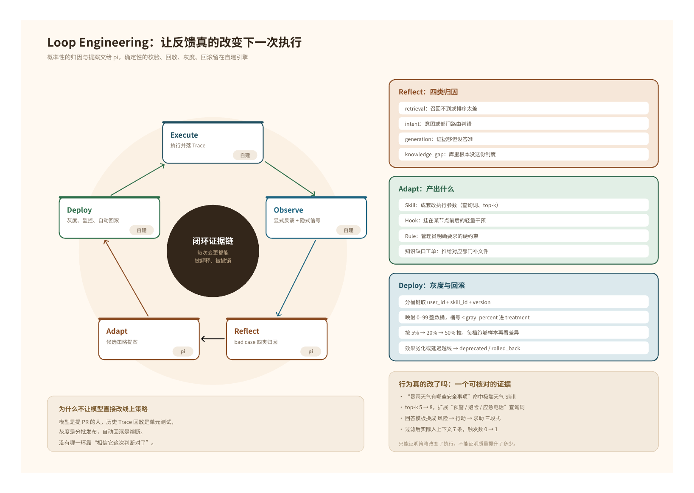

分工上，概率性的归因和候选生成交给 pi 的 Reflect Agent，确定性的部分——候选校验、Trace 回放、灰度分桶、指标比对、自动回滚——在我自己的引擎里。原因还是那句话：判错一个 bad case 的成本是浪费一次迭代，错误上线一个策略的成本是影响真实用户。

##### 19. Skill、Hook、Rule 有什么区别

Skill 是完整的策略包，命中某类 query 后成套地改执行参数：扩展查询词、调 top-k、换回答模板、加约束（比如校历日期）。

Hook 是挂在某个节点前后的轻量干预，比如在 Rewrite 之后强制补一个术语。

Rule 是硬约束，比如"问到学费缴纳一律附带财务处电话"这种必须执行的规定。

粒度从大到小、灵活度从高到低。Skill 走灰度和 A/B，Rule 一般直接生效因为它通常来自管理员的明确要求而不是模型的猜测。

##### 20. 你怎么证明反馈真的改变了系统行为，而不只是存了个日志

我做了 Skill Executor，让策略真的作用在执行上。举个具体例子：极端天气类问题命中"暴雨天气"Skill 之后，默认 top-k 从 5 提到 8，查询词扩展出"预警、避险、应急电话"，回答模板换成风险—行动—求助三段式。那次执行经过 active 校验和相似度阈值过滤后实际返回 7 条证据，系统写入了一条 treatment 记录，Skill 的触发计数从 0 变成 1，Trace 里能看到扩展后的查询词和被替换的模板。

> top-k 设成 8 但实际只有 7 条证据进了上下文，是因为过滤发生在检索之后——两道过滤（文档必须 active、相似度必须过阈值）会砍掉一部分候选，所以 top-k 是"最多取几条"而不是"一定给几条"。这个细节如果不解释，面试官会觉得数字自相矛盾。同时，这条证据只能说明"策略改变了下一轮执行"，不能说明"质量提升了多少"，因为样本量根本不够。

##### 21. 灰度分桶怎么做的，怎么判断新策略更好

分桶用稳定哈希：把分桶键做哈希后映射成 0–99 的整数桶，小于灰度百分比进 treatment，其余进 control。同一个键每次算出来的桶固定，所以同一个用户不会在两次请求之间跳组。

判断好坏看三类指标：  
直接效果（该类问题的引用正确率、关键点完整率）、副作用（延迟、token 成本、拒答率有没有异常上升）、反馈信号（点踩率）。灰度按 5% → 20% → 50% 推，每一档要跑够样本量再看差异是否显著，样本不够就只看有没有明显劣化、不下"更好"的结论。触发自动 deprecated 或 rolled_back 的条件是效果指标劣化超阈值、或者错误率与延迟越线。

##### 22. 为什么不让模型直接改线上策略

因为模型的归因有可能是错的，而且我没法在它做出结论的那一刻验证。所以流程被拆成"模型提候选、引擎做验证、灰度做裁决"。模型的输出是结构化的候选提案，要过 Schema 校验、要在历史 Trace 上回放看会不会打坏原本正确的问题，才允许进灰度。

把它类比成 CI：模型是提 PR 的人，回放是单元测试，灰度是分批发布，自动回滚是熔断。没有哪一环是靠"相信模型这次判断对了"。

##### 23. 知识缺口是怎么发现的，和上面这些有什么不一样

前三类归因改的是执行策略，`knowledge_gap` 改不了——它意味着库里根本没有这份制度。这类问题我做聚类挖掘：把一段时间内的无依据拒答和低分反馈问题做 embedding，用 DBSCAN 按余弦距离聚类，设定 `min_samples` 过滤噪声点，然后把簇规模达到门槛（我设的是同模式累计 20 条以上）的簇提炼成一条知识缺口工单，附上代表性问题和建议归属部门，推给对应部门补文件。

##### 24. 这套东西和定时跑个脚本重新调参有什么区别

区别在有没有闭环证据链。定时调参是开环的：改了、上线了，好不好不知道。我这套里每一次策略变更都能追到触发它的 bad case、归因结论、回放结果、灰度期的对照数据，以及最终是扩量还是回滚。这样每一次改动都能被解释和撤销。

---

#### 五、跨部门协同与弹性

##### 25. 部门级 Agent Service 是怎么拆的，为什么要拆

每个部门一个独立 Service，启动时 `DEPT_ID` 固化在环境变量里，服务内所有检索强制带这个部门过滤条件。上层是 Global Orchestrator，判断问题涉及哪几个部门，并行调用对应的部门 Agent，再合并证据、统一生成答案。

拆的理由有三个：

权限边界物理隔离，教务处的 Service 从代码路径上就不可能查到财务处的库；

故障隔离，某个部门的文档量大、检索慢，不会拖垮其他部门；

扩缩容独立，教务处开学季流量高就单独给它加 Pod。

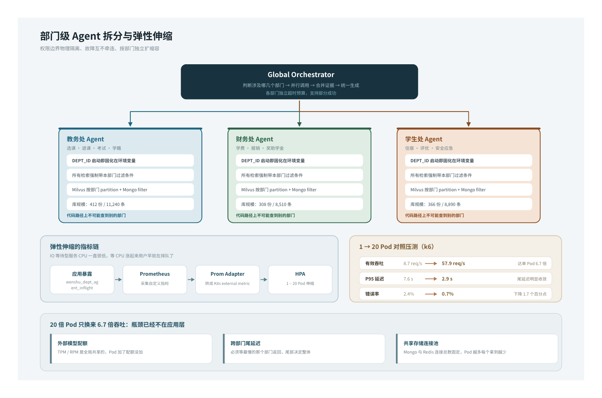

##### 26. 跨部门问题里某个部门超时或者失败了怎么办

支持部分成功。Orchestrator 并行发起调用，各部门有独立超时预算，超时的部门尝试全局共享检索，并根据检索结果生成补充答案，并说明这部分进行了服务降级。已返回部门的证据正常生成答案。

我不会静默降级。缺了哪个部门必须告诉用户，因为制度问答里"少了一半规定"造成的误判，比明确说"这部分没查到"危险得多。

全部部门都失败才返回失败，这时候走的是统一降级：返回最近的相关原文条款加联系方式。

##### 27. HPA 用什么指标，为什么不用 CPU

用自定义指标 `wenshu_dept_agent_inflight`，也就是每个 Pod 当前处理中的请求数。因为这个服务大部分时间在等外部模型和向量库返回，是 IO 等待型的，CPU 一直很低——等 CPU 涨起来再扩容，用户早就在排队了。inflight 直接反映"排了多少活"，是更贴近体感的信号。

指标由应用暴露，Prometheus 采集，Prometheus Adapter 转成 K8s 的 external metric，HPA 按 1–20 Pod 伸缩。

##### 28. 压测数据具体是什么样的，为什么没有线性提升

做的对照压测，1 Pod 到 20 Pod：有效吞吐从 8.7 req/s 到 57.9 req/s，也就是达到单 Pod 的 6.7 倍；P95 从 7.6 秒降到 2.9 秒；错误率从 2.4% 降到 0.7%，下降 1.7 个百分点。

> **这段我一定会主动补瓶颈分析**：20 倍 Pod 只换来 6.7 倍吞吐，不是扩容白做了，是瓶颈已经不在应用层。
>
> 三个原因：
>
> 外部模型服务的 TPM/RPM 配额是全局共享的，Pod 加了但配额没加；
>
> 跨部门问题需要等最慢的那个部门返回，尾延迟决定整体；
>
> MongoDB 和 Redis 的连接池是共享资源，Pod 越多单 Pod 能拿到的连接越少。

##### 29. 为什么用 Redis Stream 而不是直接开线程，或者上 Kafka

选 Redis Stream 的理由是它有消费组和 ACK、pending 列表可以看到卡住的消息、消费失败能重投，而 Redis 我本来就要用，不额外引组件。直接开线程的问题是进程重启消息就没了，也没有重试和可观测性。

不用 Kafka 是因为我的量级完全用不上，而且 Kafka 的运维成本太高了。如果消息量涨到需要多分区、需要长期回溯、需要多个下游各自消费同一份流，那时候换 Kafka 是合理的。

作业本身的状态我不放在消息里，放在 Mongo 的 `async_jobs`：`queued / running / completed / failed` 加阶段进度。消息负责触发，状态机负责事实——这跟前面 Milvus 和 Mongo 的分工是同一个思路。

---

#### 六、安全、失败处理与成本

##### 30. 鉴权和权限是怎么做的

用户侧是 HMAC 签名的 Token，载荷里带用户 ID、角色、部门权限和 `iat/exp`，服务端用密钥验签并校验有效期。角色分三种：普通用户只能问答和提反馈；部门管理员能管本部门文档和审核本部门组织知识；系统管理员能管 Skill、灰度和全局配置。

除了角色，还有一层资源所有权校验：改某份文档的时候不只看"你是不是部门管理员"，还要看"这份文档是不是属于你的部门"。只做角色不做所有权，是很常见的越权漏洞。

服务间调用用 `X-Internal-Token`，而且是 fail-closed：环境变量没配、Token 不匹配，直接拒绝，不做"没配就放过"的兼容。这个默认值的方向很重要，配错的时候系统应该是不可用，不应该是不设防。

##### 31. 系统有哪些降级路径

| **故障点** | **降级动作** | **用户看到什么** |
|---|---|---|
| Reranker 不可用 | 回退 RRF 顺序 + 关键词命中等启发式微调 | 无感，排序质量略降 |
| 生成模型超时或不可用 | 跳过生成，直接返回检索到的原文条款 | 明确提示"以下是相关原文，未生成总结" |
| Milvus 不可用 | 只走 BM25 关键词检索 | 无感，语义类问题召回下降 |
| Redis 不可用 | 工作记忆失效，退化为单轮问答 | 指代类续问需要重新说清楚 |
| 某部门 Agent 超时 | 部分成功合并 | 明确说明哪个部门未取到 |
| Verifier 两次未通过 | 终止重写，输出原文引用 | 明确说明依据不足、建议人工咨询 |

一句话总结：所有降级都是"降低服务能力"，不是"降低答案可信度"。宁可少答，不能瞎答。

##### 32. Prompt Injection 你怎么防

制度文件是管理员上传的，注入风险主要来自用户输入和被污染的文档正文。我的做法不是靠 prompt 里写"请忽略恶意指令"，那个不可靠。

真正起作用的是结构性约束：工具是白名单的，模型只能调我注册过的那几个，参数走 Schema 校验，不合法直接拒；模型没有执行任意代码、读任意文件、发起任意网络请求的通道；检索到的文档正文在拼进 prompt 时有明确的分隔标记和角色说明，标注为"待引用材料"而不是指令；最后 Verifier 会检查答案是否有引用支撑，凭空生成的内容过不了这一关。

也就是说，即使注入让模型想做坏事，它也没有可用的动作空间。

##### 33. 成本大概多少，怎么优化的

单次问答大约 3.1K 输入 token、580 输出 token，按模型单价折算约 ¥0.016；跨部门问题因为要合并多部门证据，约 ¥0.031。

优化了三处，合计降了约 28%：一是记忆注入按字符预算截断并按权威级别排序，把低价值的会话摘要挤出去；二是证据集在进 prompt 前去重，同一条款的重叠切片合并；三是 Intent 这种短任务换成更小的模型。

##### 34. 这个系统现在最大的瓶颈是什么

延迟上，最大的一块是外部模型调用，一次问答里生成阶段占 P95 的一半以上。质量上，最大的短板是我前面说的表格和附表切片，以及跨部门问题的证据合并——多个部门的规定有冲突时，系统现在只能把两边都列出来，没法判断谁优先。

工程上最需要还的债是 BM25 的内存索引和入库的补偿式清理。

---

#### 七、场景与追问题

##### 35. 如果文档从 1 千份涨到 10 万份、Chunk 到千万级，你怎么改

分四步说。

**检索侧**，Milvus 从单机换集群，索引从 HNSW 视内存情况考虑 IVF 系或做分区（按部门分 partition，天然契合我的权限过滤）；BM25 必须挪到 ES/OpenSearch。

**事实平面侧**，MongoDB 按部门或文档 ID 分片，条款集合上的 `doc_id + status` 复合索引要保证覆盖查询。

**链路侧**，回填正文这一步会成为新瓶颈，需要加一层 Chunk 正文缓存并按版本失效。

**评测侧**，1,200 条评测集在这个规模下太小了，得按部门分层扩到万级，否则指标没有分辨力。

##### 36. 如果系统把已经废止的制度发给了用户，你怎么排查

按数据流反着查。先从 Trace 里拿到那次请求引用的 chunk ID 和文档版本；然后查 Mongo 里这份文档现在的状态和版本链，确认它是什么时候被 archive 的；再查 Milvus 里对应向量的 payload 状态字段，看是不是副本没更新；最后看 Verify 节点的日志，为什么这条 archived 引用没被拦下。

四个位置对应四种根因：

向量库过滤条件没生效、回填时的二次校验被跳过、归档时序出了空窗、Verifier 逻辑漏了这一类。

我会说明我的设计里三道关任意一道生效就能挡住，所以真出事说明有多重失效，需要同时补测试。

##### 37. 如果模型服务整体不可用，系统还能提供什么价值

能退化成一个带权限和版本治理的制度检索系统：BM25 加向量还能跑（向量检索用的是已经落库的向量，不需要现场调 embedding，只有新文档入库会受影响），返回排好序的原文条款，明确告知当前不提供总结。

我认为这是这个架构的一个隐性收益——因为事实平面和生成能力是分开的，模型挂了系统不是全挂，是掉一档。

##### 38. 如果要做成多租户的产品，需要改哪些地方

`DEPT_ID` 这套隔离逻辑要升级成 `tenant_id + dept_id` 两级，向量库按租户分 collection 而不是只分 partition，Skill 和 Rule 必须按租户隔离（不能让 A 学院的策略影响 B 学院），评测集和指标也要按租户独立统计。另外配额和成本要按租户计量，否则一个大租户能把共享的模型配额吃光——这个问题我在压测里已经见过一次，只是当时是 Pod 之间抢配额。

---

#### 八、指标、分工与项目反思

##### 39. 核心指标

| **指标** | **初始向量 RAG 基线** | **最终** |
|---|---|---|
| Recall@5（chunk 级） | 84.7% | 93.4% |
| MRR | 0.741 | 0.862 |
| 引用正确率 | 88.3% | 96.1% |
| 部门路由准确率 | 86.5% | 94.2% |
| 答案关键点完整率 | 80.2% | 92.4% |
| 无依据问题安全拒答率 | 71.5% | 97.3% |
| 综合回答准确率 | 82.6% | 93.1% |

综合准确率涨的 10.5 个百分点我会拆开归因：混合检索加事实治理贡献 7.2 个百分点，两轮 Skill 灰度迭代再贡献 3.3 个百分点。

延迟：单部门问题 P50 1.8 秒、P95 3.6 秒；跨部门 P50 2.7 秒、P95 5.4 秒。

##### 40. 你觉得这个项目最有创新的地方是什么，和 Dify、Coze 这类平台的区别在哪

最有价值的一点是"反馈变成可执行策略"这条闭环真的跑通了：从 bad case 到归因、到候选策略、到回放验证、到灰度、到自动回滚，每一步都有产物和记录。市面上大部分 RAG 应用的反馈是采集完就躺在表里。

和 Dify、Coze 的区别在层次不同。它们是通用的编排平台，强在快速搭建和可视化配置，弱在垂直场景的确定性治理——版本链、事实平面、分级降级、灰度回滚这些我都要自己实现。

##### 41. 如果再给你一个月，你先做什么/后续还可以做哪些优化

按优先级：

第一件是把关键词检索挪到 ES，顺手解掉多 Pod 索引不一致这个技术债；

第二件是表格和附表的结构化处理，这是当前质量短板里最明确的一块；

第三件是把评测集扩到部门分层的万级规模并引入第二个标注人，否则我现在所有指标的置信度都受限于单人标注；

第四件才是语义缓存和成本优化。

顺序的逻辑是先补正确性和可信度的短板，再谈效率。

---

### 八股问题

#### RAG 与检索

##### 1. RAG 的完整流程

离线部分：文档接入、解析、切块、向量化、写索引，同时维护元数据（来源、部门、版本、状态）。在线部分：查询理解与改写、召回（关键词 + 向量）、融合、重排、上下文组装、生成、引用校验。

再详细一点，每一步都有各自的关键决策：切块决定语义完整性和检索粒度的取舍；改写决定能不能接住口语化和多轮提问；召回决定天花板（召不回来后面全白搭）；重排决定进上下文的顺序质量；组装决定 token 预算怎么花；校验决定敢不敢把答案给用户看。

##### 2. Chunking 有哪些策略，怎么选

固定长度切最简单但会切断语义；按分隔符或语义边界切质量更好但依赖文档结构；递归切分是折中，先按大边界切、太长再往下细分；还有把父子块结合的做法，检索用小块保证精度、给模型的时候扩展到父块保证上下文完整。

选型看文档形态。结构化强的（法律、制度、技术文档）优先按结构切；散文式的用递归切分加重叠；表格和代码要单独处理，不能按字符硬切。重叠的作用是防止关键信息正好落在边界上，代价是索引膨胀和重复召回。

##### 3. BM25 和 TF-IDF 的区别

都是词频加逆文档频率的思路，BM25 的改进有两点：词频做了饱和处理（一个词出现 100 次不会比出现 10 次重要 10 倍），以及引入文档长度归一化（长文档天然词多，要惩罚）。两个可调参数 `k1` 控制词频饱和速度、`b` 控制长度归一化强度。

实际效果上 BM25 在大多数检索任务里明显好于 TF-IDF，所以现在关键词检索基本默认用它。

##### 4. 稠密检索的原理，和关键词检索的本质差别

稠密检索把 query 和文档都编码成向量，用内积或余弦相似度衡量语义接近程度，靠 ANN 索引做快速近邻搜索。本质差别是匹配的对象不一样：关键词检索匹配的是字面符号，稠密检索匹配的是分布式语义表示。

所以两者的失败模式正好互补——关键词怕同义改写，稠密怕精确符号（编号、日期、电话、专有名词）。这也是混合检索有效的根本原因，不是简单地"多一路总比少一路好"。

##### 5. 混合检索的融合方式，RRF 为什么好用

两大类：分数融合（把两路分数归一化后加权求和）和排名融合（RRF）。

RRF 的公式是每个文档得分 Σ 1/(k + rank)，k 常取 60。好用的原因是它只用排名，不用处理两路分数不同量纲、分布不同、随 query 漂移的问题，也不用调权重；加第三路检索的时候直接加一项，不需要重新调参。代价是丢掉了原始分数里的置信信息——两路都排第一但一个相似度 0.95、一个 0.55，RRF 看不出差别。

##### 6. Embedding 模型和 Reranker 的区别

Embedding 是双塔：query 和文档分别编码，文档可以离线算好存索引，在线只算 query，所以能扫全库，但 query 和文档在编码时看不到对方。Reranker 是交叉编码器：query 和文档拼在一起进模型，能做细粒度的交互判断，精度高，但每一对都要现场算，代价随候选数线性增长。

所以标准做法是双塔粗召回、交叉编码精排，一个负责"别漏"，一个负责"排对"。

##### 7. 检索质量怎么评，各个指标什么含义

| **指标** | **含义** | **适合回答的问题** |
|---|---|---|
| Recall@k | 前 k 条命中的相关文档数 / 全部相关文档数 | 召回够不够全，天花板在哪 |
| Hit Rate@k | 前 k 条里至少有一条相关的查询占比 | 有没有起码给出一条有用的 |
| MRR | 首个相关结果排名倒数，对所有查询取平均 | 好结果排得够不够靠前 |
| nDCG@k | 带位置折损的增益，支持多档相关性 | 排序整体质量，相关性分等级时更合适 |
| Precision@k | 前 k 条里相关的比例 | 噪声多不多，上下文会不会被污染 |

RAG 场景里我更看 Recall@k 和 MRR：召回决定上限，排序决定模型实际看到什么。Precision 也要看，因为无关证据进上下文会稀释注意力。

#### Agent 与 Harness

##### 8. 一个 Agent 由哪些模块组成

四块：模型负责推理和决策；记忆负责跨轮和跨会话的状态；工具负责与外部世界交互；编排（也就是 Harness）负责决定什么时候调什么、失败怎么办、什么时候停。

我自己的理解：前三块决定 Agent 能力的上限，第四块决定它在生产里能不能用。上限不够是做不了，编排不行是不敢上。

##### 9. ReAct 是什么，什么时候不该用

Thought、Action、Observation 循环：模型先想，再调工具，看到结果再想下一步，直到给出答案。优点是灵活、能处理事先不知道步数的任务，也天然可解释。

不该用的场景是任务形态收敛、错误代价高、延迟敏感的时候。我的项目就是典型：绝大多数问题是"某个规定是什么"，用固定 DAG 更可控；让它自由循环会出现重复检索和跳过检索。我一般说"ReAct 是探索，DAG 是生产，形态稳定之后就该把探索固化成流程"。

##### 10. Agent Skills 和 MCP 有什么区别

MCP 解决的是"模型怎么以标准协议连上外部工具和数据源"，是接口层的规范。Skill 解决的是"模型在什么情况下该用什么套路做事"，是策略和知识层的封装。一个是连接，一个是方法论，不冲突：Skill 里可以调用 MCP 暴露的工具。

##### 11. 什么是渐进式披露，为什么重要

不要把所有能力说明、所有工具定义、所有背景知识一次性塞进上下文，而是按需加载：先给一个简短的索引，模型判断需要哪块，再把那块的详细内容读进来。

重要性有两层：一是 token 预算有限，二是上下文越长模型的注意力越容易被无关内容分散。我的 MemoryContextBuilder 按权威级别排序再按预算截断，就是同一个思路的应用。

##### 12. Prompt Engineering、Context Engineering、Harness Engineering 是什么关系

递进关系。Prompt Engineering 优化的是单次输入的措辞和结构；Context Engineering 优化的是这一次调用里应该放进哪些信息、怎么组织、怎么裁剪；Harness Engineering 优化的是多次调用之间的流程、状态、失败处理和治理。

作用范围从一次调用扩到一个会话再扩到整个系统。我的项目重心明确在第三层——固定 DAG、分阶段超时、Verifier 打回、灰度回滚，这些都不是 prompt 能解决的问题。

#### 工程与基础设施

##### 13. Milvus 的索引怎么选，HNSW 和 IVF 的差别

HNSW 是基于图的多层跳表结构，查询快、召回率高，代价是内存占用大、构建慢。IVF 系是先聚类分桶，查询时只搜最近的几个桶，内存友好、构建快，召回率靠 `nprobe` 调，精度略低。还有量化（PQ/SQ）可以压内存，代价是精度损失。

我这个数据量（两万多条）用 HNSW，内存完全够。到千万级要看内存预算，可能换 IVF_PQ 或者按部门分 partition 缩小搜索范围。

##### 14. MongoDB 的索引你怎么建的

条款集合上建 `doc_id + status` 复合索引，因为回填正文的查询固定是这两个条件；文档集合上给 SHA-256 建唯一索引来做判重；`async_jobs` 上给状态和创建时间建索引，供 Worker 拉取待处理作业和前端查进度；记忆事件按用户和时间建索引，并靠 TTL 索引自动过期。

复合索引的字段顺序按最左前缀原则定，等值条件在前、范围条件在后。

##### 15. Redis Stream 的消费组、ACK、pending 是怎么工作的

消费组让多个消费者分摊同一条流的消息，每条消息只投给组里的一个消费者。消费者读到消息后进入 pending 状态，处理完显式 ACK 才算完成。没 ACK 的消息一直留在 pending 列表里，可以用 `XPENDING` 看到，用 `XCLAIM` 转给别的消费者重新处理。

这套机制给的保证是至少一次投递，所以消费端必须做幂等——我的做法是作业 ID 落 Mongo，重复消费时看状态直接跳过。

##### 16. JWT 和你用的 HMAC 签名 Token 是一回事吗

我用的是 HMAC 对称签名的 Token，结构上就是 JWT 的 HS256 那一类：载荷里放用户 ID、角色、部门权限和 `iat/exp`，服务端用同一个密钥验签。

对称签名的前提是所有验签方都可信，因为拿到密钥就能签发。要是有第三方需要验签但不该有签发权，就得换成 RS256 这类非对称方案，用私钥签、公钥验。这个取舍我会主动说，因为它体现的是对信任边界的判断，不只是"用了 JWT"。

##### 17. K8s 的 HPA 怎么用自定义指标

应用暴露 metrics 端点，Prometheus 采集，Prometheus Adapter 把 Prometheus 的查询结果注册成 K8s 的 custom 或 external metric，HPA 引用这个指标名和目标值来算副本数。

关键点是选对指标：CPU 只适合计算密集型服务，IO 等待型服务要用队列长度、inflight 请求数、延迟这类直接反映积压的指标。另外要配 `stabilizationWindow` 防抖，不然流量抖一下就来回伸缩。

---

### 面试速记

> **三句话说清项目**
>
> - 一个面向学校多部门制度文件的问答系统，难点不在生成，在"版本、部门、依据"三件事必须对；
> - 我用固定 DAG 加事实平面把确定性的部分治理住，把意图理解、改写、生成、归因交给模型；
> - 最后跑通了反馈到策略的闭环，每一次策略变更都能被解释、被灰度、被回滚。

> **数字速记**
>
> - 1,086 份文档 / 28,640 条 Chunk / 1,200 条评测（960 迭代 + 240 冻结）；
> - Recall@5 93.4%、MRR 0.862、引用正确率 96.1%、安全拒答率 97.3%；
> - 综合准确率 82.6% → 93.1%（检索治理 7.2pp + Loop 3.3pp）；
> - P95 单部门 3.6s / 跨部门 5.4s；1→20 Pod 吞吐达单 Pod 的 6.7 倍。
